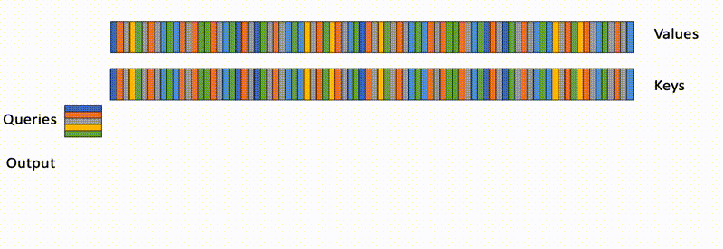
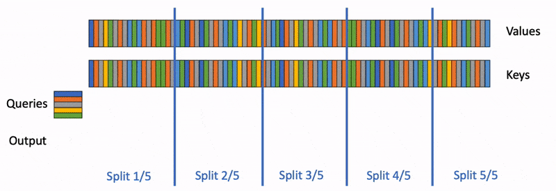
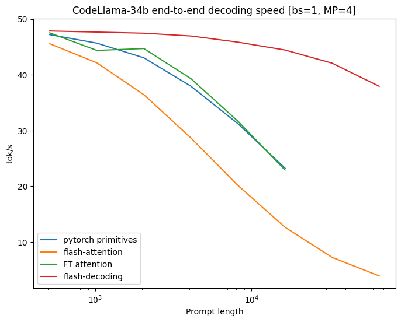
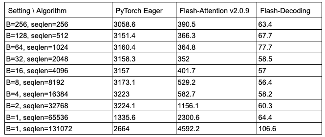

# Flash-Decoding for long-context inference

[中文](./Flash-Decoding.md) | English

- **Source**: [Flash-Decoding for long-context inference](https://crfm.stanford.edu/2023/10/12/flashdecoding.html)
- **Published**: 2023-10-12

## Key Points

### 1. Why is it needed? (Motivation)

Everyone knows LLM inference is expensive, and once the context gets long, the attention layer becomes the biggest bottleneck.

You might ask: don't we already have **FlashAttention**?

Yes, FlashAttention is very fast in **training**, because it parallelizes over batch size and query length. **Inference** (generation) is a different story:

- **Inference generates one token at a time**, which means the query length is usually just 1.
- To handle very long contexts, memory limits often force the batch size to be small (sometimes just 1).
- In that situation FlashAttention can't keep the GPU busy: most of its hundreds of compute units (SMs) sit idle, and utilization can fall below **1%**!

*FlashAttention parallelizes only over batch size and query blocks; during inference (decoding), with query length = 1 and a small batch, it can't fill the GPU.*

### 2. How does it work? (Flash-Decoding)

The core idea of Flash-Decoding is simple: **if the batch dimension can't be parallelized, parallelize over the sequence length of the KV cache instead.**

It splits the computation into three steps:

1. **Split**: cut the long keys and values sequence into many small chunks.
2. **Parallel Compute**: using the FlashAttention technique, let the GPU's compute units compute attention between the query and these chunks in parallel. Besides the attention values, this step also records one statistic per chunk (the log-sum-exp).
3. **Reduce**: finally, combine the results from all chunks, weighting them by the recorded statistics, to get the exact final output.

*Flash-Decoding adds a parallel dimension along the keys/values sequence length, making full use of the GPU.*

In short: **break the whole into parts, divide and conquer**.

### 3. How well does it work?

- **Much faster**: tested on CodeLlama-34b, decoding is up to **8x** faster for very long sequences.
- **Length barely matters**: remarkably, up to a sequence length of 32k, attention time stays almost constant and doesn't grow with length.
- **Ahead of the alternatives**: compared with native PyTorch, the older FlashAttention v2 and even FasterTransformer, it wins by a wide margin on long-context workloads.

*Decoding speed on CodeLlama 34B: Flash-Decoding performs well at long sequence lengths.*

*Micro-benchmark of the attention kernel: Flash-Decoding's run time stays almost constant as sequence length grows.*

### 4. How do I use it?

Just update the library:

- **FlashAttention**: upgrade to 2.2 or later.
- **xFormers**: upgrade to 0.0.22 or later (it dispatches automatically).
