# Mooncake：以更多存储换取更少计算——面向大语言模型聊天服务的 KVCache 中心化架构

中文 | [English](./Mooncake-KVCache-Centric-Serving_en.md)

- **原文链接**：**[FAST 2025 论文页面](https://www.usenix.org/conference/fast25/presentation/qin)**
- **论文**：**[Mooncake: Trading More Storage for Less Computation — A KVCache-centric Architecture for Serving LLM Chatbot](https://www.usenix.org/system/files/fast25-qin.pdf)**，第 23 届 USENIX 文件与存储技术会议论文集，第 155–170 页；ISBN 978-1-939133-45-8。
- **发布日期**：2025-02-25（FAST 2025 会议首日；会议于 2 月 25–27 日在美国加利福尼亚州圣克拉拉举行）。
- **范围**：FAST 2025 论文的非官方完整中文翻译，含全部正文、15 幅原图及中文图注和标注对照、2 张表、公式、API 清单、算法、脚注、致谢和 43 条参考文献。翻译于 2026-11-12 完成，发布于 2026-11-13。
- **说明**：“主要结论”为本笔记编写，不属于原文，数字均取自论文；英文配套页与中文逐行对应。论文及图表权利归原权利人，本笔记不主张其原创权，也不将代码仓库的许可套用于论文。

## 主要结论

- **核心设计**：Mooncake 不只分离预填充和解码，还把集群中 CPU、DRAM、SSD 和 RDMA 资源组织成分布式 KVCache 池，通过全局缓存复用、热点复制和缓存感知调度减少重复预填充计算。
- **请求承载能力**：在论文的真实对话轨迹实验中，相比基线，满足延迟 SLO 的有效请求比例提高 59%–498%；这里的 effective request capacity 按有效请求占全部请求的比例定义，不应直接当作每秒请求数。
- **全局缓存收益**：与本地缓存相比，实验中全局缓存命中率最高达到 2.36 倍，预填充计算时间最多减少 48%。收益依赖负载的前缀复用特征、缓存容量和传输带宽。
- **传输与部署**：传输 40 GB 缓存时，4×200 Gbps 和 8×400 Gbps 网络配置分别实现 87 GB/s、190 GB/s；论文历史生产统计称，A800／H800 集群分别可比此前系统多处理 115%／107% 的请求。生产统计、回放实验和单项传输测试是不同口径，本文未复现实验。

## 全文翻译

**原文题名：Mooncake: Trading More Storage for Less Computation — A KVCache-centric Architecture for Serving LLM Chatbot。**

**翻译说明：按原文顺序完整翻译；原图完整保留，图中文字逐图给出中文对照。作者姓名、代码和文献标识保留原样；“目前”“最新”“将开源”等表述对应论文写作时点，“我们”指论文作者。“译注”不属于原文。各级标题下移一级，浮动图表移至相应段落，重复页眉页脚省略，数学转换为 GitHub 支持的格式；未改动原文公式含义。API 清单是原论文的接口声明，并非可独立运行的程序。**

**封面说明：本文收录于第 23 届 USENIX 文件与存储技术会议论文集；论文集的开放获取得到赞助支持。**

### 作者与单位

Ruoyu Qin（Moonshot AI、清华大学）¹；Zheming Li（Moonshot AI）¹；Weiran He（Moonshot AI）；Jialei Cui（Moonshot AI）；Feng Ren（清华大学）；Mingxing Zhang（清华大学）²；Yongwei Wu（清华大学）；Weimin Zheng（清华大学）；Xinran Xu（Moonshot AI）²。

**作者脚注 1：Ruoyu Qin 的部分工作在 Moonshot AI 实习期间完成，与 Zheming Li 贡献相同。**

**作者脚注 2：通信作者联系方式：** `zhang_mingxing@mail.tsinghua.edu.cn`、`xuxinran@moonshot.cn`。

### 摘要

Mooncake 是 Moonshot AI 开发的大语言模型聊天服务 Kimi 的推理服务平台。该平台采用以 KVCache 为中心的解耦架构：不仅将预填充（prefill）集群与解码（decoding）集群分离，还高效利用 GPU 集群中尚未得到充分利用的 CPU、DRAM、SSD 和网卡（NIC）资源，构建解耦式 KVCache。Mooncake 的核心是以 KVCache 为中心的全局缓存，以及一个在遵守严格的延迟相关服务等级目标（Service Level Objectives，SLO）的同时，力求最大化吞吐量的调度器。

实验表明，Mooncake 在长上下文输入场景中表现出色。在采用真实轨迹的测试中，与基线方法相比，Mooncake 在满足 SLO 的同时，将有效请求承载能力提高了 59%–498%。目前，Mooncake 已运行于数千个节点之上，每天处理超过 1000 亿个 token。在实际部署中，与先前系统相比，Mooncake 的创新架构使 Kimi 在 NVIDIA A800 和 H800 集群上分别能够多处理 115% 和 107% 的请求。

### 1 引言

随着大语言模型（LLM）迅速应用于各种场景 **[1–4]**，LLM 推理服务的工作负载变得日益多样化。这些工作负载在输入／输出长度、请求到达分布等方面各不相同，更重要的是，它们要求不同类型的服务等级目标（SLO）。作为模型即服务（Model as a Service，MaaS）提供方，Kimi **[5]** 的主要目标之一，是求解一个具有多种复杂约束的优化问题。优化目标是最大化总体有效吞吐量，这直接影响收入；约束条件则体现不同级别的 SLO。这些 SLO 通常涉及延迟要求，主要包括首 token 延迟（time to first token，TTFT）和相邻 token 间隔（time between tokens，TBT）。

要实现这一目标，前提是尽可能充分地利用 GPU 集群中的各种资源。具体而言，尽管当前 GPU 服务器通常以高度集成的节点形式提供，例如 DGX／HGX 超级计算机 **[6]**，我们仍有必要将这些资源解耦，并重新组织为若干独立的资源池。各资源池分别针对不同但彼此协作的目标进行优化。例如，其他许多研究者 **[7–9]** 已提出将预填充服务器与解码服务器分离，因为 LLM 推理服务的这两个阶段具有非常不同的计算特征。

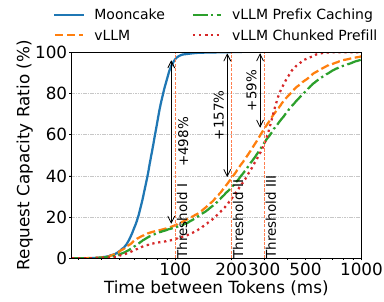

***图 1：在真实对话工作负载及不同 TBT SLO 下，Mooncake 有效请求承载能力的实验。在该实验中，Mooncake 与三个基线系统各自使用 16 个节点，每个节点配备 8 张 A800 GPU。更多信息见第 5.2 节。***

**图内标注：横轴为相邻 token 间隔（毫秒），纵轴为请求承载比例（%）；Threshold I／II／III 分别为阈值 I／II／III，对应 100／200／300 毫秒；图例为 Mooncake、vLLM、启用前缀缓存的 vLLM、启用分块预填充的 vLLM。图中标注的相对提升依次为 +498%、+157%、+59%。**

我们进一步推进这种解耦策略，将 GPU 集群中的 CPU、DRAM、SSD 和 RDMA 资源汇聚起来，构建了名为 Mooncake Store 的解耦式 KVCache。这一新架构利用未被充分使用的资源，在靠近 GPU 的位置实现高效的前缀缓存，显著提升全局缓存容量和节点间传输带宽。由此形成的分布式 KVCache 系统体现了“以更多存储换取更少计算”的原则。因此，如图 1 所示，在许多重要的真实场景中，该系统显著提高了 Kimi 在满足所需 SLO 时的最大吞吐能力。在本文后续部分，我们将首先从数学上分析这一策略对 LLM 推理服务的收益，并使用真实数据验证其有效性（第 2.2 节）。然后，我们将详细介绍实现这一 PB 级解耦缓存时的设计选择；该缓存通过带宽最高达 $`8\times400\,\mathrm{Gbps}`$ 的 RDMA 网络互联（第 3.2 节）。

基于这一思路，我们还发现，KVCache 的调度处于 LLM 推理服务的核心位置，因此提出了相应的解耦架构。图 2 展示了我们当前面向 LLM 推理服务、以 KVCache 为中心的解耦架构 Mooncake。对每个请求，全局调度器 Conductor 会选择一组预填充与解码实例，并按以下步骤调度请求：1）尽可能将更多可复用的 KVCache 传送到选中的预填充实例；2）按分块／分层方式完成预填充阶段，并持续将输出的 KVCache 以流式方式传送至相应的解码实例；3）在解码实例上加载 KVCache，将请求加入连续批处理过程，生成请求的输出。

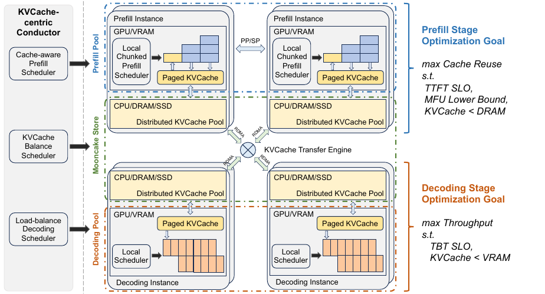

***图 2：Mooncake 架构。***

**图内标注对照：**

| 原文标注 | 中文译文 |
| --- | --- |
| KVCache-centric Conductor | 以 KVCache 为中心的 Conductor 全局调度器 |
| Cache-aware Prefill Scheduler | 缓存感知的预填充调度器 |
| KVCache Balance Scheduler | KVCache 均衡调度器 |
| Load-balance Decoding Scheduler | 负载均衡的解码调度器 |
| Prefill Pool／Prefill Instance | 预填充资源池／预填充实例 |
| Decoding Pool／Decoding Instance | 解码资源池／解码实例 |
| Local Chunked Prefill Scheduler | 本地分块预填充调度器 |
| Local Scheduler | 本地调度器 |
| Paged KVCache | 分页式 KVCache |
| Distributed KVCache Pool | 分布式 KVCache 池 |
| KVCache Transfer Engine | KVCache 传输引擎 |
| PP／SP | 流水线并行／序列并行 |
| GPU／VRAM；CPU／DRAM／SSD；RDMA | GPU／显存；CPU／动态随机存取内存／固态硬盘；远程直接内存访问 |

**图 2 中的优化目标：预填充阶段在满足 TTFT SLO、模型 FLOPs 利用率（MFU）下限以及 KVCache 容量小于 DRAM 容量的条件下，最大化缓存复用；解码阶段在满足 TBT SLO 以及 KVCache 容量小于显存容量的条件下，最大化吞吐量。**

虽然这一过程看似直接，但由于存在众多限制，实例选择策略实际上非常复杂。在预填充阶段，主要目标是尽可能复用 KVCache，以避免冗余计算。然而，分布式 KVCache 池在容量和访问延迟两方面都面临挑战。因此，Conductor 负责以感知 KVCache 的方式调度请求，并相应执行换出和复制等调度操作。最热的块应复制到多个节点，以避免拉取拥塞；最冷的块则应换出，以降低保留成本。相比之下，解码阶段具有不同的优化目标和约束：它希望在一个解码批次中聚合尽可能多的 token，以提升模型 FLOPs 利用率（Model FLOPs Utilization，MFU）。不过，这一目标不仅受 TBT SLO 限制，也受显存能够容纳的聚合 KVCache 总量限制。

在第 4 节中，我们将详细介绍以 KVCache 为中心的请求调度算法。该算法在实例负载与用户体验之间取得平衡，而用户体验由 TTFT 和 TBT SLO 衡量。其中包括一种基于启发式的自动热点迁移方案：无需精确预测 KVCache 未来的使用情况，即可复制热点 KVCache 块。实验结果表明，以 KVCache 为中心的调度能够显著降低真实场景中的 TTFT。

我们还将介绍实现过程中的主要设计选择，尤其是现有研究尚未覆盖的部分。例如，围绕预填充／解码（P/D）分离，由于带宽需求以及分块预填充（如 Sarathi-Serve **[10]**）带来的权衡，人们仍在争论其在大规模实际部署中的可行性。通过与 vLLM 比较，我们表明：借助经过高度优化的传输引擎，通信方面的挑战可以得到控制；对于 SLO 限制严格的场景，P/D 分离是更优的选择（第 5.2 节）。此外，我们还讨论如何实现独立的预填充节点池，使其能够平滑应对上下文长度的动态分布。我们采用分块流水线并行（chunked pipeline parallelism，CPP）机制，将单个请求的处理扩展到多个节点；这对于降低长上下文输入的 TTFT 是必要的。与传统的序列并行（SP）方案相比，CPP 减少了网络消耗，并降低了对频繁弹性伸缩的依赖（第 3.3 节）。

Mooncake 目前是 Kimi 的推理服务平台，已经成功应对指数级增长的工作负载，每天处理超过 1000 亿个 token。根据我们的历史统计，与先前系统相比，Mooncake 的创新架构使 Kimi 在 A800 和 H800 集群上分别能够多处理 115% 和 107% 的请求。

为了在保护专有信息的同时保证结果可复现，我们还使用一个结构仿照 LLaMA3-70B 的虚拟模型，基于真实工作负载轨迹的回放，提供了详细的实验结果。这些轨迹以及 Mooncake 的 KVCache 传输基础设施已在以下地址开源：

**开源地址：** **[kvcache-ai/Mooncake](https://github.com/kvcache-ai/Mooncake)**。

在使用公开数据集与真实工作负载的端到端实验中，Mooncake 在长上下文场景下表现突出。与基线方法相比，Mooncake 在满足 SLO 的同时，有效请求承载能力最高可提高 498%。在第 5.3 节中，我们将 Mooncake Store 与本地缓存设计进行比较，发现 Mooncake Store 的全局缓存设计显著提高了缓存命中率。在我们的实验中，其缓存命中率最高达到本地缓存的 2.36 倍，从而使预填充计算时间最多节省 48%。据我们所知，Mooncake 是首个在大规模部署场景中，展示通过分布式 KVCache 池在不同聊天会话和查询之间共享 KVCache 能够带来显著收益的系统。我们还评估了 Mooncake 中支持高速 RDMA 传输的传输引擎，其速度约为现有方案的 2.4 倍和 4.6 倍（第 5.4 节）。

### 2 预备知识与问题定义

#### 2.1 LLM 推理服务的服务等级目标

现代大语言模型基于 Transformer 架构，使用注意力机制和多层感知机（MLP）处理输入。GPT **[11]** 和 LLaMA **[12]** 等主流 Transformer 模型采用仅解码器（decoder-only）结构。每个推理请求在逻辑上分为两个阶段：预填充阶段和解码阶段。

在预填充阶段，所有输入 token 都被并行处理，因此这一阶段通常是计算密集型的。该阶段生成第一个输出 token，同时存储已计算出的键和值的中间结果，即 KVCache。随后，解码阶段利用这些 KVCache，以自回归方式生成新的 token。由于自回归生成的限制，在每个批次中，每条序列一次只能处理一个 token，这使该阶段受到内存约束，且计算时间随批大小呈次线性增长。因此，解码阶段一种广泛采用的优化是连续批处理 **[13, 14]**。在每次迭代之前，调度器检查请求状态，将新到达的请求加入批次，并移除已经完成的请求。

由于预填充阶段和解码阶段具有不同特征，MaaS 提供方为两者设置不同的指标来衡量相应的 SLO。具体来说，预填充阶段主要关注从请求到达到生成第一个 token 之间的延迟，即首 token 延迟（TTFT）。另一方面，解码阶段关注同一请求连续生成两个 token 之间的延迟，即相邻 token 间隔（TBT）。

在实际部署中，如果监控检测到 SLO 未得到满足，我们就需要增加推理资源，或者拒绝部分新到达的请求。然而，由于当前 GPU 供应存在不确定性，推理集群通常无法进行弹性横向扩容。因此，我们会主动拒绝预计无法满足 SLO 的请求，以减轻集群负载。我们的主要目标是在遵守 SLO 的前提下最大化总体吞吐量；其他研究将这一概念称为有效吞吐量（goodput）**[8, 15]**。

#### 2.2 以更多存储换取更少计算

为了满足上述严格的 SLO，一种常见方案是缓存先前生成的 KVCache，并在找到匹配前缀时进行复用。然而，现有方法 **[16–18]** 通常将缓存限制在本地 HBM 和 DRAM 中，原因是假设全局调度所需的传输带宽过高，难以承受。但正如我们将在第 5.3 节中说明的那样，本地 DRAM 的容量最多只能支持达到理论缓存命中率的 50%，因此全局缓存设计至关重要。本节从数学上分析从这一策略中获益实际所需的带宽，解释为什么分布式缓存具有优势，尤其是对于 LLaMA3-70B 这类较大的模型。第 5.4.2 节将给出更多实验结果。

**表 1：符号与参数。模型参数和机器参数分别按照 LLaMA3-70B 与配备 8 张 A800 GPU 的机器设置。**

| 符号 | 含义 | 数值 |
| --- | --- | --- |
| $`l`$ | 层数 | $`80`$ |
| $`d`$ | 模型维度 | $`8192`$ |
| $`a,b`$ | 公式（1）中的常数系数 | $`4,22`$ |
| $`\mathrm{gqa}`$ | 查询头数量／键值头数量 | $`8`$ |
| $`s`$ | 张量元素大小 | $`2\,\mathrm{B}`$（BFloat16） |
| $`G`$ | GPU 计算吞吐量 | $`8\times312\,\mathrm{TFLOPS}`$ |
| $`B_{\mathrm{h2d}}`$ | 主机到设备的带宽 | $`128\,\mathrm{GB/s}`$ |
| $`B_{\mathrm{nic}}`$ | 网卡带宽 | $`800\,\mathrm{Gbps}`$ |
| $`n,p`$ | 分别为提示词长度与匹配前缀长度 | — |

我们的分析使用表 1 中的符号，并代入 LLaMA3-70B 的具体参数。本质上，当前主流 LLM 都是自回归语言模型，每个 token 的 KVCache 仅取决于它自身和此前的 token。因此，相同输入前缀对应的 KVCache 可以被复用，而不会影响输出准确性。如果当前请求长度为 $`n`$ 的提示词，与先前缓存的 KVCache 共享一个长度为 $`p`$ 的公共前缀，其预填充过程就可以优化为：

```math
\begin{aligned}
q[p:n],\ k[p:n],\ v[p:n]
&=\mathrm{MLP}\bigl(\mathrm{hidden}[p:n]\bigr),\\
k[1:n],\ v[1:n]
&\leftarrow \mathrm{KVCache}+\bigl(k[p:n],v[p:n]\bigr),\\
o[p:n]
&=\mathrm{Attention}\bigl(q[p:n],k[1:n],v[1:n]\bigr),\\
\mathrm{KVCache}
&\leftarrow \bigl(k[1:n],v[1:n]\bigr).
\end{aligned}
```

**译注：以上保留原文的切片下标、MLP 写法及“+”符号，不将其改写为另一种 Transformer 实现。**

给定输入长度 $`n`$，预填充阶段的浮点运算量可以计算为：

```math
\mathrm{flops}(n)=l\times\left(an^{2}d+bnd^{2}\right).
\tag{1}
```

因此，复用 KVCache 大约能够减少 $`l\times\left(ap^{2}d+bpd^{2}\right)`$ 的预填充计算量。不过，这需要将已经缓存的 KVCache 传送到预填充 GPU 的 HBM 中，其大小为 $`p\times l\times\left(2\times d/\mathrm{gqa}\right)\times s`$。假设平均计算吞吐量为 $`G`$，KVCache 的平均加载速度为 $`B`$，其中 $`B`$ 由 $`B_{\mathrm{h2d}}`$ 和 $`B_{\mathrm{nic}}`$ 中较小者决定，则当满足下式时，复用 KVCache 对 TTFT 有利：

```math
\frac{B}{G}>\frac{2ds}{\mathrm{gqa}\times\left(apd+bd^{2}\right)}.
\tag{2}
```

在这种情况下，复用 KVCache 不仅减少 GPU 时间和成本，还能通过改善 TTFT 提升用户体验。当 $`d`$ 更大时，带宽 $`B`$ 相对于计算吞吐量 $`G`$ 所需满足的条件更容易达到，而 $`d`$ 与模型规模成正比。例如，在一台配备 8 张 A800 GPU 的机器上运行 LLaMA3-70B，假设前缀长度为 8192，根据公式（2），所需的最小 $`B`$ 为 $`6\,\mathrm{GB/s}`$。对于一台配备 8 张 H800 GPU 的机器，$`B`$ 的要求会提高到 $`19\,\mathrm{GB/s}`$。此外，在实际场景中，由于各传输阶段无法彼此完全重叠，实际带宽需求还会更高。不过，正如我们将在第 5.4.2 节中展示的那样，对每个 NVIDIA A800 HGX 系统，只要充分利用一张 $`100\,\mathrm{Gbps}`$ 网卡，就足以满足这些条件。

### 3 Mooncake 的设计

#### 3.1 概述

如图 2 所示，Mooncake 采用解耦架构：不仅将预填充节点与解码节点分离，还将 GPU 集群中的 CPU、DRAM、SSD 和 RDMA 资源汇聚起来，实现解耦式 KVCache。为了调度所有这些解耦组件，Mooncake 在系统中心实现了名为 Conductor 的全局调度器。Conductor 根据 KVCache 的当前分布和工作负载特征分派请求。第 3.2 节将详细介绍的 Mooncake Store 负责管理这些 KVCache 块的存储与传输。

具体来说，图 3 展示了一个请求的典型工作流程。分词完成后，Conductor 为请求配对选择预填充节点与解码节点，并启动包含以下四个步骤的工作流程：

1. **KVCache 复用：** 被选中的预填充节点（组）收到一个请求，其中包含原始输入、可复用前缀缓存的块键，以及为该请求分配的完整缓存的块键。该节点根据前缀缓存块键，将前缀缓存从远端 CPU 内存加载到 GPU 内存，以启动请求处理。如果不存在前缀缓存，则跳过此步骤。节点选择需要平衡三个目标：尽可能复用更多 KVCache、均衡不同预填充节点的工作负载，以及保证 TTFT SLO。这引出了以 KVCache 为中心的调度机制，第 4 节将进一步讨论。
1. **增量预填充：** 预填充节点利用前缀缓存完成预填充阶段，并将新生成的增量 KVCache 存回 CPU 内存。如果尚未缓存的输入 token 数超过某个阈值，预填充阶段就会被拆分为多个块，并以流水线方式执行。该阈值以充分利用相应 GPU 的计算能力为依据选取，通常大于 1000 个 token。第 3.3 节将解释，为什么采用分块预填充后，仍然保留独立的预填充节点。
1. **KVCache 传输：** 每个节点都部署 Mooncake Store，以管理和传输这些缓存。此步骤异步执行，并与上述增量预填充步骤重叠：每个模型层生成的 KVCache 都以流式方式传送到目标解码节点的 CPU 内存中，以减少等待时间。
1. **解码：** 当解码节点的 CPU 内存接收到全部 KVCache 后，该请求以连续批处理方式加入下一个批次。解码节点由 Conductor 根据其当前负载预先选定，以确保不会违反 TBT SLO。

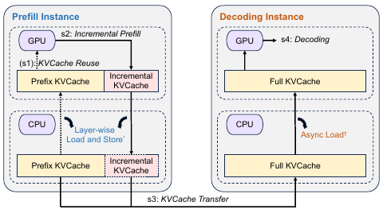

***图 3：推理实例的工作流程。***

**图内标注：Prefill Instance／Decoding Instance 为预填充实例／解码实例；s1 为 KVCache 复用，s2 为增量预填充，s3 为 KVCache 传输，s4 为解码；Prefix KVCache／Incremental KVCache／Full KVCache 分别为前缀 KVCache／增量 KVCache／完整 KVCache；Layer-wise Load and Store 为逐层加载与存储，Async Load 为异步加载。图中星号和剑号标记按原图保留，原图图注没有为其给出独立脚注。**

#### 3.2 Mooncake Store：KVCache 的缓存

Mooncake 的核心是高效实现 KVCache 的分布式全局缓存，即 Mooncake Store。正如第 2.2 节所述，复用已经缓存的 KVCache 不仅可以降低计算成本，还可以通过减少 TTFT 改善用户体验；在聚合带宽得到充分利用时，这一点尤其明显。然而，实现带宽的充分利用并不容易，因为总带宽最高可达 $`8\times400\,\mathrm{Gbps}`$，已经与 DRAM 带宽相当。

我们首先在第 3.2.1 节介绍 Mooncake Store 如何管理 KVCache，包括存储方案与淘汰策略。第 3.2.2 节介绍 Mooncake Store 的面向对象 API 和内存传输 API。第 3.2.3 节将详细介绍 Mooncake Store 传输引擎的设计：这是一个高性能、零拷贝的 KVCache 传输系统，旨在最大化利用每台机器上的多张 RDMA 网卡。它通过拓扑感知路径选择、端点池等技术，提高执行效率和可靠性。

##### 3.2.1 KVCache 管理

在 Mooncake Store 中，所有 KVCache 都以分页块的形式存储在分布式缓存池中。块大小，也就是每个块包含的 token 数，由模型规模和最优网络传输大小共同决定，通常为 16–512 个 token。每个块都附带一个哈希键，该键由块自身的哈希及其前缀共同决定，用于去重。为了降低热点缓存的访问延迟，同一个哈希键可以在不同节点上拥有多个副本；副本数量由第 4.2 节介绍的缓存负载均衡策略控制。

Mooncake Store 在缓存池中为每个缓存块分配空间，并记录块键、地址等元数据。当缓存池已满时，Mooncake Store 使用最近最少使用（Least Recently Used，LRU）策略淘汰一个已有缓存块，但正在被进行中的请求访问的块除外；然后用新块覆盖被淘汰块所占的空间。

##### 3.2.2 接口

在上层，Mooncake Store 提供 `put`、`get` 和 `change_replica` 等面向对象 API。这些 API 支持以解耦方式缓存 KVCache，将小块 KVCache 组织为内存对象，并使 Conductor 能够调整每个 KVCache 块的副本数量，以实现更高的带宽聚合。这些功能由一组同步批量传输 API 支撑，详见代码清单 1。

传输操作同时支持 DRAM 和 GPU 显存；在指定内存区域已预先注册的前提下，会在适合时使用 GPU Direct RDMA。可以通过 `getTransferStatus` API 异步监测这些操作是否完成；该 API 会报告传输仍在进行，还是遇到了错误。

**代码清单 1：Mooncake Store 中的内存传输 API。**

```cpp
int registerLocalMemory(void *vaddr, size_t len,
                        const string &type);
BatchID allocateBatchID(size_t batch_size);
int submitTransfer(BatchID batch_id,
                   const vector<Request> &entries);
int getTransferStatus(BatchID batch_id,
                      int request_index,
                      Status &status);
int freeBatchID(BatchID batch_id);
```

**译注：原文先称其为“同步批量传输 API”，随后说明可以异步查询完成状态；这里保留这两处表述，不根据接口名称擅自修改其语义。**

##### 3.2.3 传输引擎

为了高效实现上述 API，传输引擎需要实现几个关键目标：1）将传输任务有效分配到多张 RDMA 网卡设备；2）对 API 使用者屏蔽 RDMA 连接管理的复杂性；3）妥善处理临时网络故障。该传输引擎经过细致的工程设计，以满足上述各项目标。

**网络配置。** Mooncake 的收益依赖高带宽网络互联。目前，我们使用标准 HGX 机器：每张 A800 GPU 配备一张 100／200 Gbps 网卡，每张 H800 GPU 配备一张 200／400 Gbps 网卡。这样的带宽已经可与内存带宽相比，而除 NCCL 外的现有库无法充分利用这一能力。至于 NCCL，它无法优雅地处理因增加或移除节点／网卡而导致的动态拓扑变化，也不支持 DRAM 到 DRAM 的路径。相比之下，我们的传输引擎会在故障发生时尝试寻找替代路径。

为应对拥塞，网络采用由云服务商调优的 RoCEv2。在调度器层面，我们通过增加热点 KVCache 的副本数量来缓解拥塞（第 4.2 节）。

**拓扑感知的路径选择。** 现代推理服务器通常包含多个 CPU 插槽、DRAM、GPU 和 RDMA 网卡设备。虽然从技术上说，可以使用任意 RDMA 网卡将本地 DRAM 或显存中的数据传送到远端，但传输可能受到 Ultra Path Interconnect（UPI）或 PCIe 交换机的带宽限制。为克服这些限制，Mooncake Store 实现了一种拓扑感知路径选择算法。

在处理请求之前，每台服务器会生成一个拓扑矩阵，并将其广播到整个集群。该矩阵针对不同类型的内存，将网卡分为“首选”和“次选”两个列表；内存类型在注册内存时指定。在正常情况下，从首选列表中选择网卡进行传输，使 RDMA 操作限制在本地 NUMA 范围内，或者让 GPU Direct RDMA 仅通过本地 PCIe 交换机进行。在发生故障时，两个列表中的网卡都可以被使用。整个过程包括：根据内存地址确定合适的本地与目标网卡、建立连接，以及执行数据传输。

例如，如图 4 所示，要将本地节点中分配给 `cpu:0` 的缓冲区 0，传输到目标节点中分配给 `cpu:1` 的缓冲区 1，引擎首先利用本地服务器的拓扑矩阵，确定 `cpu:0` 的首选网卡，并从中选择一张，例如 `mlx5_1`，作为本地网卡。同样，根据目标内存地址选择目标网卡，例如 `mlx5_3`。由此便可建立从 `mlx5_1@local` 到 `mlx5_3@target` 的 RDMA 连接，以执行 RDMA 读写操作。

为了进一步提高带宽利用率，单个请求的传输会在内部以 16 KB 为粒度拆分为多个切片。每个切片可以使用不同的路径，从而让所有 RDMA 网卡协同工作。

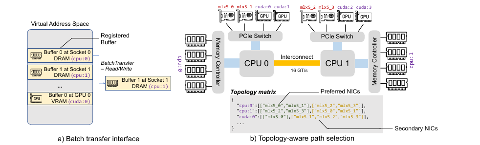

***图 4：Mooncake Store 的传输引擎。***

**图内标注：a）批量传输接口；b）拓扑感知路径选择。Virtual Address Space 为虚拟地址空间；Registered Buffer 为已注册缓冲区；BatchTransfer — Read/Write 为批量传输——读／写；Buffer 0 at Socket 0 DRAM、Buffer 1 at Socket 1 DRAM、Buffer 0 at GPU 0 VRAM 分别为 CPU 插槽 0 的 DRAM 中的缓冲区 0、CPU 插槽 1 的 DRAM 中的缓冲区 1、GPU 0 显存中的缓冲区 0；Memory Controller 为内存控制器；PCIe Switch 为 PCIe 交换机；Interconnect 为互联；Topology matrix 为拓扑矩阵；Preferred NICs／Secondary NICs 为首选网卡／次选网卡。硬件及内存标识符 `mlx5_*`、`cpu:*`、`cuda:*` 保持原样，互联速率标为 16 GT/s。**

**图 4 中的拓扑矩阵示例（保留原有标识符）：**

```text
{
  "cpu:0":[["mlx5_0","mlx5_1"],["mlx5_2","mlx5_3"]],
  "cpu:1":[["mlx5_2","mlx5_3"],["mlx5_0","mlx5_1"]],
  "cuda:0":[["mlx5_0"],["mlx5_1","mlx5_2","mlx5_3"]],
  ...
}
```

**端点管理。** Mooncake Store 用一对端点表示本地 RDMA 网卡与远端 RDMA 网卡之间的连接。在实际实现中，每个端点包含一个或多个 RDMA 队列对对象。Mooncake Store 按需建立连接：在第一个请求到来之前，端点保持未配对状态。

为了防止大量端点拖慢请求处理，Mooncake Store 使用端点池，对活跃连接的最大数量设置上限。我们使用 SIEVE **[19]** 算法管理端点淘汰。如果连接因链路错误而失效，该连接会从两端的端点池中移除，并在下一次数据传输尝试时重新建立。

**故障处理。** 在多网卡环境中，一种常见故障是某张网卡暂时不可用，但其他路径仍可连接两个节点。Mooncake Store 的设计能够有效处理此类临时故障。如果某个连接被判定为不可用，Mooncake Store 会自动寻找另一条可达路径，并将请求重新提交给另一张 RDMA 网卡设备。此外，Mooncake Store 能够检测其他 RDMA 资源的问题，包括 RDMA 上下文和完成队列。它会暂时避免使用这些资源，直到链路断开等问题得到解决。

#### 3.3 Mooncake 的预填充资源池

与不应受到干扰的解码节点不同，设计独立且可弹性伸缩的预填充资源池是否必要，以及如何设计才最合适，仍存在争论。例如，虽然许多研究者 **[7–9]** 与我们一样直觉上倾向于解耦架构，但在引入分块预填充 **[10]** 后，这种分离是否仍然必要，值得讨论。

不过，经过认真考虑，我们决定保留 Mooncake 的解耦架构。主要原因是，在线服务通常具有更严格的 SLO。虽然分块预填充减少了对解码的干扰，但要同时最大化预填充阶段的 MFU，并满足解码阶段的 TBT SLO，仍然很困难。我们将在第 5.2 节的端到端实验中展示这一点。另一个重要原因是，我们认为预填充节点需要不同的跨节点并行配置来处理长上下文，因为近期 LLM 支持的上下文长度正在迅速增加，从 8k、128k，甚至扩展到 100 万个 token **[20]**。对于这类长上下文请求，输入 token 数通常是输出 token 数的 10–100 倍，因此优化 TTFT 至关重要。长上下文预填充具有丰富的并行性，因此值得使用不止一个配备 8 张 GPU 的节点进行并行处理。然而，将张量并行（TP）扩展到多个节点，需要每层执行两次代价高昂的、基于 RDMA 的 all-reduce 操作，这会显著降低预填充节点的 MFU。

近期，许多工作提出了序列并行（SP）**[21–27]**。SP 将请求的输入序列划分到不同节点，以实现加速，使长请求也能满足 TTFT SLO。不过，在处理较短的输入请求时，SP 的 MFU 低于仅使用单节点 TP 的方案。近期研究 **[15]** 提出弹性序列并行，动态扩大或缩小 SP 组。虽然这一方案可行，但会增加系统架构复杂度。此外，SP 仍需要频繁的跨节点通信，这会降低 MFU，并与跨节点 KVCache 传输争用网络资源。

为解决这些问题，Mooncake 利用仅解码器 Transformer 的自回归特性，为长上下文预填充实现了分块流水线并行（CPP）。我们将预填充集群中的每 $`X`$ 个节点组织成一个流水线预填充节点组。对于每个请求，将输入 token 划分为若干块，每个块的长度不超过 `prefill_chunk`。同一请求的不同块可以由不同节点同时处理，从而实现并行处理并降低 TTFT。

CPP 有两个主要优点：1）与训练中的流水线并行类似，它只需在每个流水线阶段的边界进行跨节点通信，而且通信很容易与计算重叠。这带来了更高的 MFU，并减少与 KVCache 传输之间的网络资源争用。2）它天然适用于短上下文和长上下文，不会给短上下文预填充带来显著额外开销，也避免了频繁地动态调整节点划分。训练系统已经探索过这种基于流水线的加速方式 **[28]**；但据我们所知，这是该方法首次应用于推理阶段，因为长上下文推理只是最近才出现的。

### 4 调度

#### 4.1 预填充全局调度

此前关于 LLM 推理服务的研究通常采用负载均衡策略，根据分配给每个实例的请求数来评估其负载。然而，在 Mooncake 中，预填充实例的选择还会考虑其他因素：不仅考虑负载，还考虑前缀缓存命中长度以及可复用 KVCache 块的分布。虽然我们倾向于将请求路由到拥有更长前缀缓存的预填充实例，以降低计算成本，但为了保证整体系统均衡并满足 TTFT SLO，将请求调度到其他节点也可能更有利。为处理这些复杂性，我们提出一种缓存感知的全局调度算法，同时考虑前缀缓存所影响的预填充时间，以及本地排队时间。

算法 1 详细描述了我们以 KVCache 为中心的预填充调度机制。对于每个新请求，将块键逐一与各预填充实例的缓存键比较，以确定前缀匹配长度 `prefix_len`。根据这些匹配信息，Conductor 使用由离线数据拟合得到的多项式回归模型，依据请求长度和各实例不同的 `prefix_len` 估计相应执行时间。随后，将该请求的预计等待时间加上去，得到其在该实例上的 TTFT。最后，Conductor 将请求分配到 TTFT 最短的实例，并相应更新该实例的缓存和队列时间。如果无法满足 SLO，Conductor 会直接向上层返回 HTTP `429 Too Many Requests`（请求过多）响应状态码。

这一调度框架的主干很直接，但复杂性隐藏在各组件的工程实现中。例如，为预测请求预填充阶段的计算时间，我们采用了一个基于离线测试数据构建的预测模型。该模型根据请求长度和前缀缓存命中长度估计预填充时长。由于 Transformer 的计算模式具有规律性，只要离线数据足够，该预测的误差上界就很小。请求的排队时间通过累加所有排队请求的预填充时间计算得到。在实际实现中，各个 TTFT 的计算并行进行，因此与推理时间相比，其处理时间可以忽略不计。

更大的困难在于预测传输时间，因为传输时间不仅取决于传输数据的大小，还取决于当前网络状态，尤其是发送节点是否处于拥塞状态。这也使得热点 KVCache 块的复制成为必要，我们将在第 4.2 节中讨论。

#### 4.2 缓存负载均衡

在 Mooncake 中，每个预填充实例都有自己的一组本地前缀缓存。这些缓存的使用频率差异很大。例如，几乎每个请求都会访问系统提示词，而存储本地长文档内容的缓存可能只被一名用户使用。如第 4.1 节所述，Conductor 对实现缓存匹配与实例负载之间的最优平衡至关重要。因此，从分布式缓存系统的角度看，负载均衡同样发挥重要作用。具体来说，需要制定缓存备份策略，使全局预填充调度能够同时实现高缓存命中和低负载。

针对这一 KVCache 调度问题，一种朴素方案是收集每个块的全局使用情况，利用预测模型预测未来使用情况，再据此做出调度决策。然而，与预填充时间估计不同，工作负载具有高度动态性，会随着时间发生显著变化。特别是对于用户规模快速增长的 MaaS 提供方，准确预测未来使用情况是不可能的。因此，我们提出一种基于启发式的自动热点迁移方案，以改善缓存负载均衡。

如前所述，由于实例负载较高，请求不一定总被发送到前缀缓存长度最长的预填充实例。在这种情况下，如果估计的额外预填充时间短于传输时间，Conductor 就会将缓存的位置和请求转发给另一个实例。该实例会主动从缓存持有者处获取 KVCache，并将其保存在本地。更重要的是，如果最佳远端前缀匹配长度不大于当前本地可复用前缀长度乘以某个阈值，我们更倾向于计算这些输入 token。¹ 这两种策略不仅缩短请求的预填充时间，还促进热点缓存的自动复制，使其更广泛地分布在多个实例上。

**原文脚注 1（第 162 页）：该阈值目前由人工调整，未来可以使用算法进行自适应调整。**

**译注：上段第一项条件忠实保留原文的“额外预填充时间短于传输时间”（shorter than the transfer time）。这一表述与随后“转发并拉取缓存”的行为之间存在容易引起疑问的关系；算法 1 的实际判据则使用远端／本地前缀长度比值与阈值比较。这里不擅自将原文的“短于”改为“长于”。**

**算法 1：以 KVCache 为中心的调度算法。**

**输入：预填充实例池** $`P`$，**解码实例池** $`D`$，**请求** $`R`$，**缓存块大小** $`B`$。  
**输出：处理请求** $`R`$ **的预填充实例与解码实例** $`(p,d)`$。

| 原行号 | 操作（保持原算法的变量、条件与执行顺序） |
| --- | --- |
| 1 | $`\mathit{block\_keys}\leftarrow\mathrm{PrefixHash}(R.\mathit{prompt\_tokens},B)`$ |
| 2 | $`\mathrm{TTFT},p\leftarrow\infty,\varnothing`$ |
| 3 | $`\mathit{best\_len},\mathit{best\_instance}\leftarrow\mathrm{FindBestPrefixMatch}(P,\mathit{block\_keys})`$ |
| 4 | **对于每个** $`\mathit{instance}\in P`$ **执行第 5–16 行：** |
| 5 | **若** $`\dfrac{\mathit{best\_len}}{\mathit{instance}.\mathit{prefix\_len}}>\mathit{kvcache\_balancing\_threshold}`$，**则：** |
| 6 | $`\mathit{prefix\_len}\leftarrow\mathit{best\_len}`$ |
| 7 | $`\mathit{transfer\_len}\leftarrow\mathit{best\_len}-\mathit{instance}.\mathit{prefix\_len}`$ |
| 8 | $`T_{\mathrm{transfer}}\leftarrow\mathrm{EstimateKVCacheTransferTime}(\mathit{transfer\_len})`$ |
| 9 | **否则：** |
| 10 | $`\mathit{prefix\_len}\leftarrow\mathit{instance}.\mathit{prefix\_len}`$ |
| 11 | $`T_{\mathrm{transfer}}\leftarrow0`$ |
| 12 | $`T_{\mathrm{queue}}\leftarrow\mathrm{EstimatePrefillQueueTime}(\mathit{instance})`$ |
| 13 | $`T_{\mathrm{prefill}}\leftarrow\mathrm{EstimatePrefillExecutionTime}\bigl(\mathrm{len}(R.\mathit{prompt\_tokens}),\mathit{prefix\_len}\bigr)`$ |
| 14 | **若** $`\mathrm{TTFT}>T_{\mathrm{transfer}}+T_{\mathrm{queue}}+T_{\mathrm{prefill}}`$，**则：** |
| 15 | $`\mathrm{TTFT}\leftarrow T_{\mathrm{transfer}}+T_{\mathrm{queue}}+T_{\mathrm{prefill}}`$ |
| 16 | $`p\leftarrow\mathit{instance}`$ |
| 17 | $`d,\mathrm{TBT}\leftarrow\mathrm{SelectDecodingInstance}(D)`$ |
| 18 | **若** $`\mathrm{TTFT}>\mathrm{TTFT\_SLO}`$ **或** $`\mathrm{TBT}>\mathrm{TBT\_SLO}`$，**则：** |
| 19 | **拒绝** $`R`$；**返回。** |
| 20 | **若** $`\dfrac{\mathit{best\_len}}{p.\mathit{prefix\_len}}>\mathit{kvcache\_balancing\_threshold}`$，**则：** |
| 21 | $`\mathrm{TransferKVCache}(\mathit{best\_instance},p)`$ |
| 22 | **返回** $`(p,d)`$。 |

**译注：第 5、20 行在本地前缀长度为零时如何处理，原算法未显式规定；译文保留原式，不额外补入实现逻辑。**

为了验证策略的有效性，我们进行了一项调度实验，将随机调度、负载均衡调度与我们的策略比较。我们进一步比较第 4.1 节介绍的本地缓存感知调度，与本节介绍的、考虑缓存负载均衡的全局缓存感知调度。随机调度为每个请求任意选择一个预填充实例；负载均衡调度则选择负载最轻的实例。具体来说，我们构建了一个包含 16 个节点的 Mooncake 集群，每个节点配备 8 张 A800 GPU，并回放第 5.2.1 节详细介绍的对话轨迹进行实验。我们根据 TTFT 评估各调度算法的性能。图 5 所示的实验结果表明，以 KVCache 为中心的调度算法优于随机调度和负载均衡调度。在加入缓存负载均衡后，与本地缓存感知算法相比，全局缓存感知算法将平均 TTFT 进一步降低了 14%。

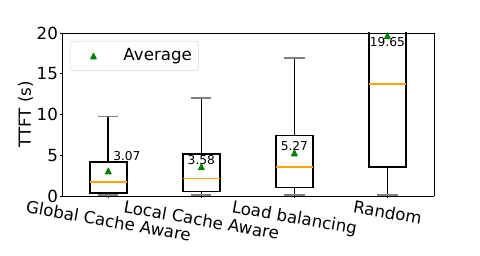

***图 5：预填充调度实验。***

**图内标注：纵轴为 TTFT（秒）；Average 为平均值。横轴依次为全局缓存感知、本地缓存感知、负载均衡、随机调度，对应平均 TTFT 分别为 3.07、3.58、5.27、19.65 秒。**

### 5 评估

如前所述，根据 Kimi 的历史统计，与我们此前基于 vLLM 的系统相比，Mooncake 使 Kimi 在 A800 和 H800 集群上分别能够多处理 115% 和 107% 的请求。为了进一步验证这一结果并保证可复现性，本节使用一个虚拟的 LLaMA3-70B 模型，对 Mooncake 进行一系列端到端实验与消融实验，以回答以下问题：1）在真实场景中，Mooncake 的表现是否优于现有 LLM 推理系统？2）与传统前缀缓存方法相比，Mooncake Store 的设计能否显著提升 Mooncake 的性能？

#### 5.1 实验设置

**测试平台。** 在复现实验中，系统部署在一个高性能计算节点集群上，以评估其性能。集群中的每个节点都配备 8 张 NVIDIA-A800-SXM4-80GB GPU，以及 4 张 200 Gbps RDMA 网卡。Mooncake Store 的 KVCache 块大小设为 256。部署 Mooncake 时，每个节点根据启动参数，作为预填充实例或解码实例运行。部署其他系统时，每个节点承载一个实例。

**指标。** 具体来说，我们测量每个请求的 TTFT 和 TBT，其中 TBT 按最长的 10% token 到达间隔的平均值计算。如第 2 节所述，TTFT 阈值设为 30 秒；根据场景不同，TBT 阈值分别设为 100、200 和 300 毫秒。我们将 TTFT 与 TBT 都低于各自阈值的请求视为有效请求，将有效请求占全部请求的比例称为有效请求承载能力。为简洁起见，后续实验如未提及 TTFT，则默认满足 TTFT 阈值。为了更细致地比较缓存性能，我们还测量预填充阶段的 GPU 时间，以及每个请求的缓存命中率。

**译注：本论文将 effective request capacity 操作性地定义为固定测试负载中满足两项 SLO 的请求比例。因此，下文的百分比提升不应未经换算直接解释为固定 SLO 下每秒请求数的等比例提升。**

**基线。** 我们采用先进的开源 LLM 推理服务系统之一 vLLM **[14]** 作为实验基线。vLLM 具有连续批处理和 PagedAttention 技术，显著提升了推理吞吐量。尽管具有这些优势，vLLM 将预填充与解码阶段耦合在一起的架构，仍可能干扰解码，尤其是在长上下文场景中。vLLM 近期更新集成了前缀缓存、分块预填充等功能，以改善长上下文场景中的 TTFT、TBT 等性能指标。实验中，我们也比较了 vLLM 的这些功能。我们使用当时最新发布的 vLLM v0.5.1。由于当前实现的限制，该版本的前缀缓存与分块预填充功能分别测试。

#### 5.2 端到端性能

在端到端实验中，我们评估 Mooncake 与基线系统在不同工作负载下的请求处理能力。具体而言，我们测量仍能满足既定 SLO 阈值的最大吞吐量。测试使用三类工作负载：两类从 Kimi 采样的真实轨迹，分别代表在线对话和工具／智能体交互；以及一类合成工作负载，以覆盖不同推理场景。我们首先描述这些工作负载的独特特征，然后讨论结果。最后，我们分析预填充阶段的 GPU 计算时间，进一步展示 Mooncake Store 在提高缓存利用率、减少计算成本方面的优势。

**表 2：工作负载统计。**

| 指标 | 对话（Conversation） | 工具与智能体（Tool&Agent） | 合成（Synthetic） |
| --- | --- | --- | --- |
| 平均输入长度（token） | 12035 | 8596 | 15325 |
| 平均输出长度（token） | 343 | 182 | 149 |
| 缓存比例 | 40% | 59% | 66% |
| 到达模式 | 时间戳 | 时间戳 | 泊松过程 |
| 请求数 | 12031 | 23608 | 3993 |

##### 5.2.1 工作负载

**对话工作负载。** 聊天机器人 **[1, 5]** 是 LLM 最常见的应用之一，因此对话请求是极具代表性的 LLM 推理工作负载。如表 2 所示，对话工作负载包含相当比例的长上下文请求：最长达到 128k 个 token，平均约 12k 个 token，与当前长上下文数据集 **[29, 30]** 的数据长度相当。此外，多轮对话带来了平均约 40% 的前缀缓存比例。我们从一个在线推理集群采样了 1 小时的对话轨迹，每条记录包含输入长度、输出长度以及到达时间戳。请求按照这些时间戳发出；当模型输出达到预定长度时，便提前终止该请求。

**工具与智能体工作负载。** 近期，利用 LLM 作为工具或智能体执行任务的研究 **[31]** 日益增多。这些任务通常会使用预先设计的系统提示词；这些提示词往往较长，且完全重复。我们同样采集了 1 小时的工具与智能体工作负载轨迹。如表 2 所示，该工作负载具有较高的前缀缓存比例，输入和输出长度都较短。

**合成工作负载。** 合成工作负载由多个公开数据集组合构成。我们将真实轨迹中的请求分为三类：短对话、工具与智能体调用、长文本摘要与问答。针对各类别，分别选择了以下数据集：ShareGPT **[32]**、Leval **[29]** 和 LooGLE **[30]**。ShareGPT 包含输入长度较短的多轮对话。Leval 是评估模型长上下文性能的基准，在这里用来模拟工具与智能体交互中常见的、请求携带较长系统提示词的场景。LooGLE 面向长上下文问答和摘要任务，输入长度可达 100k 个 token，同时包含多轮问答与单轮摘要，因此非常适合长文本摘要与问答场景。总体而言，合成工作负载的平均输入长度最长。尽管它的前缀缓存比例最高，但缓存命中分布非常分散，因此需要较大的缓存容量。

在预处理过程中，每一轮对话都被映射为一个独立请求，并纳入此前交互的输入与输出。对于多个问题共享同一个长提示词的数据集，每个问题及其前面的提示词都被视为一个请求。我们按 $`1:1:1`$ 的比例合并处理后的数据集，在保留多轮对话请求内部顺序关系的同时，随机打乱请求。由于这些数据集没有指定到达时间，我们通过泊松过程，以设定的速率发送请求，模拟真实条件。

##### 5.2.2 有效请求承载能力

为了评估不同工作负载下能够满足 SLO 的最大请求数量，我们测试了四种系统配置：Mooncake、vLLM、启用前缀缓存的 vLLM，以及启用分块预填充的 vLLM；每种配置均使用 16 个节点。

**对话工作负载。** 该工作负载的结果见图 1。其输入长度变化较大，输出长度也较长；预填充阶段的长上下文导致 vLLM 系统的 TBT 出现明显波动。虽然分块预填充减少了对解码的干扰，但仍难以兼顾预填充阶段 MFU 的提升与解码阶段 TBT 的约束。即使满足 TTFT SLO，其有效请求承载能力依然不够理想。与 vLLM 相比，Mooncake 的有效请求承载能力获得了非常显著的提升。

**工具与智能体工作负载。** 相比之下，该工作负载具有较高的前缀缓存比例和较短的输出长度，这有利于 vLLM 系统，因为较短的预填充时间对输出的影响很小。然而，如图 6 所示，vLLM 和启用分块预填充的 vLLM 因预填充处理时间较长，对解码造成了更严重的干扰，导致其有效缓存承载能力低于启用前缀缓存的 vLLM。Mooncake 使用全局缓存池显著增加缓存容量，并通过节点间传输优化缓存利用率，因此在前缀缓存比例较高的场景中表现突出。由此，在 200 毫秒阈值下，与启用前缀缓存的 vLLM 相比，其有效缓存承载能力提高了 42%。

**译注：本段原文两处使用 effective caching capacity（这里直译为“有效缓存承载能力”），但所在小节、图 6 和第 5.1 节定义的指标均为有效请求承载能力。原文未在此另外定义一个缓存容量指标。**

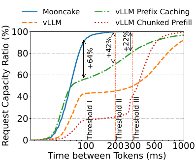

***图 6：工具与智能体工作负载下，Mooncake 的有效请求承载能力实验。***

**图内标注：横轴为相邻 token 间隔（毫秒），纵轴为请求承载比例（%）；四个系统图例与图 1 相同。阈值 I／II／III 分别为 100／200／300 毫秒，对应图中标注的相对提升为 +64%、+42%、+22%。**

**合成工作负载。** 合成工作负载的平均输入长度最长，缓存热点较分散，因此在缓存容量较小时，缓存利用率较低。如图 7 所示，Mooncake 处理的大多数请求的 TBT 都保持在 100 毫秒以内，而 vLLM 处理的请求中约有 20% 的 TBT 超过 300 毫秒。启用前缀缓存与分块预填充的系统性能与 vLLM 相近，因为它们未能减轻长上下文对解码阶段的影响。与 vLLM 相比，Mooncake 在 200 毫秒阈值下将有效请求承载能力提高了 40%。

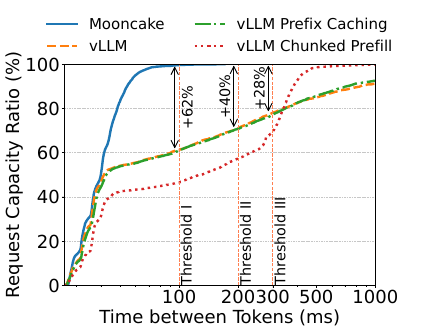

***图 7：合成工作负载下，Mooncake 的有效请求承载能力实验。***

**图内标注：横轴为相邻 token 间隔（毫秒），纵轴为请求承载比例（%）；四个系统图例与图 1 相同。阈值 I／II／III 分别为 100／200／300 毫秒，对应图中标注的相对提升为 +62%、+40%、+28%。**

##### 5.2.3 预填充 GPU 时间

预填充 GPU 时间与请求的 TTFT 和服务成本正相关，由请求输入长度和缓存命中率决定。我们分析了不同工作负载下预填充阶段的平均 GPU 时间，如图 8 所示。对于 Mooncake，对话工作负载由于输入较长、前缀缓存比例较低，预填充 GPU 时间最长。合成工作负载具有最高的前缀缓存比例和较分散的缓存热点，在 Mooncake 的全局缓存池中可以获得最优的缓存命中率。因此，尽管其平均输入长度最长，所需预填充 GPU 时间仍少于对话工作负载。最后，工具与智能体工作负载由于平均输入长度最短、前缀缓存比例相对较高，预填充 GPU 时间最短。

在不同系统之间进行比较，Mooncake 通过充分利用全局缓存进行前缀缓存，显著减少了 GPU 时间。与 vLLM 相比，在对话、工具与智能体、合成工作负载上，分别减少了 36%、53% 和 64%。启用前缀缓存的 vLLM 使用存储在 HBM 上的本地缓存，缓存容量远小于 Mooncake。它在对话和工具与智能体工作负载上的预填充 GPU 时间，分别为 Mooncake 的 1.43 倍和 1.40 倍。然而，在缓存热点更加分散的合成工作负载上，启用前缀缓存的 vLLM 的预填充 GPU 时间几乎与 vLLM 相同，为 Mooncake 的 2.59 倍。启用分块预填充的 vLLM 为了让解码阶段保持较低的 TBT，牺牲了一部分预填充效率，因此预填充 GPU 时间最长；在这三类工作负载上，分别为 Mooncake 的 1.90 倍、2.68 倍和 3.33 倍。

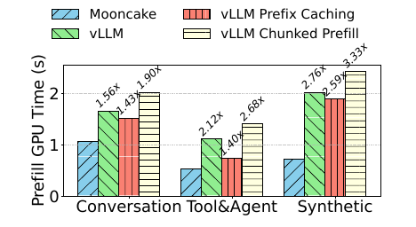

***图 8：不同工作负载下，每个请求在预填充阶段的平均 GPU 时间。***

**图内标注：纵轴为预填充 GPU 时间（秒）；横轴依次为对话、工具与智能体、合成工作负载；图例为 Mooncake、vLLM、启用前缀缓存的 vLLM、启用分块预填充的 vLLM。相对于 Mooncake，图中三个基线的倍数依次为：对话工作负载 1.56／1.43／1.90 倍，工具与智能体工作负载 2.12／1.40／2.68 倍，合成工作负载 2.76／2.59／3.33 倍。**

#### 5.3 Mooncake Store

为了回答问题 2，我们考察 Mooncake Store 的全局缓存池对系统性能的影响。分析表明，尽管使用本地 DRAM 构建 KVCache 存储，相比仅使用 HBM 可以增加缓存容量，但将缓存限制在单个节点上，仍会导致不理想的缓存利用率。我们首先定量分析缓存容量需求，然后通过实际工作负载实验展示其收益。

##### 5.3.1 缓存容量的定量分析

以 LLaMA3-70B 为例，每个 token 所需的 KVCache 大小为 320 KB。即使能够预留约 1 TB 的 DRAM 作为本地缓存，也只能存储约 300 万个 token，实践表明这仍然不够。图 9 展示了不同工作负载及其组合下的理论缓存命中率。结果表明，在大多数场景中，容量为 300 万个 token 的本地缓存，无法达到理论最大命中率的 50%。我们还发现，在这些工作负载中，5000 万个 token 的缓存容量就几乎可以达到理论最大命中率的 100%；这需要汇聚至少 20 个节点的 DRAM。结果说明，与本地缓存相比，全局缓存能够显著增加容量，从而提高缓存命中率并减少 GPU 时间。

**译注：这里“理论最大命中率的 100%”是指接近各工作负载自身可达到的上限，并不是说所有输入 token 都能命中缓存；图 9 中各曲线的上限仍不同。**

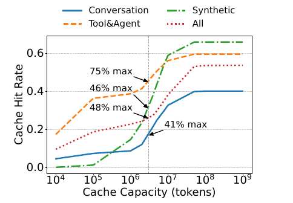

***图 9：不同缓存容量下前缀缓存命中率的定量分析。这里只考虑请求序列，不考虑预填充计算时间、缓存热点复制等因素。容量为 300 万个 token 的虚线表示本地缓存容量，交点表示该容量下的缓存命中率与理论最大命中率之比。***

**图内标注：纵轴为缓存命中率，横轴为缓存容量（token，对数刻度）；图例为对话、工具与智能体、合成及全部工作负载。虚线交点旁标注的是相对于各自最大值的比例：工具与智能体 75%、合成 46%、全部 48%、对话 41%。**

##### 5.3.2 实际工作负载实验

为评估全局与本地缓存机制的有效性，我们关注两个指标：缓存命中率和平均预填充 GPU 计算时间。我们配置了一个包含 10 个预填充节点的集群，并将所有请求的输出长度限制为 1，以隔离解码阶段的影响。在本地缓存配置中，每个节点拥有 300 万个 token 的缓存容量，但只能访问自己的缓存。全局调度器会将请求导向前缀匹配比例较高的节点，以最大化缓存利用率。相比之下，在全局缓存配置中，每个节点同样具有 300 万个 token 的容量，但可以通过主动的节点间缓存迁移，在所有节点之间共享缓存。图 10 所示实验数据表明，在所有被测工作负载上，全局缓存都取得了更高的缓存命中率和更短的平均预填充 GPU 计算时间。与本地缓存相比，全局缓存的缓存命中率最高提高了 136%，预填充计算时间最多减少了 48%。

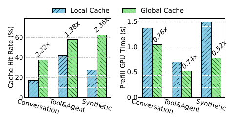

***图 10：全局缓存与本地缓存的缓存命中率，以及预填充的平均 GPU 计算时间。***

**图内标注：Local Cache／Global Cache 为本地缓存／全局缓存；左图纵轴为缓存命中率（%），右图纵轴为预填充 GPU 时间（秒）；两图横轴均依次为对话、工具与智能体、合成工作负载。全局缓存相对于本地缓存的命中率依次为 2.22、1.38、2.36 倍，GPU 时间依次为 0.76、0.74、0.52 倍。**

##### 5.3.3 缓存副本

基于第 4.2 节讨论的缓存负载均衡调度策略，Mooncake Store 中的缓存键可以在不同机器上拥有分布式副本，从而降低热点缓存的访问延迟。为了进一步研究系统的动态行为，我们统计了三类工作负载中各缓存键的副本数量，如图 11 所示。

可以观察到，在对话和工具与智能体工作负载中，存在高度集中的热点缓存，例如排名前 100 的键。系统稳定后，这些键几乎在预填充池中的每个实例上都有副本。相比之下，合成工作负载共享的前缀缓存较少，因此副本数量也较少，即使是排名前 10 的块，副本数也可能出现波动。这说明，第 4.2 节的调度策略能够有效地为热点缓存提供副本，尤其适用于前缀缓存高度集中的场景。

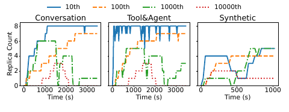

***图 11：不同工作负载下缓存键的副本数量。我们每隔 30 秒持续监测并记录所有缓存块的键及其数量，然后根据所有采样中的累计数量对缓存键排序。该图展示排名第 10、100、1000 和 10000 位的缓存键，其副本数量随时间的变化。***

**图内标注：三个子图依次为对话、工具与智能体、合成工作负载；纵轴为副本数量，横轴为时间（秒）；图例 10th／100th／1000th／10000th 表示上述四个排名位置。**

#### 5.4 KVCache 传输性能

##### 5.4.1 传输引擎

Mooncake 的传输引擎旨在实现高效的节点间缓存传输。我们将其延迟与其他流行方案比较，采用两种替代基线：使用 Gloo 后端的 `torch.distributed`，以及基于 TCP 的传输。所有方案的测试并发度均为 64，最小传输粒度为 128 KB。如图 12 所示，传输引擎的延迟始终明显低于其他方法。在传输 40 GB 数据的场景中，这相当于 LLaMA3-70B 在 128k 个 token 下的缓存大小；在 $`4\times200\,\mathrm{Gbps}`$ 和 $`8\times400\,\mathrm{Gbps}`$ 网络配置下，传输引擎分别实现了 $`87\,\mathrm{GB/s}`$ 和 $`190\,\mathrm{GB/s}`$ 的带宽，约为使用 TCP 协议时的 2.4 倍和 4.6 倍。该传输引擎的代码也将在后续开源，因为它是一个解耦的基础工具，可用于许多场景，例如 Moonshot AI 的检查点传输服务也使用了它。

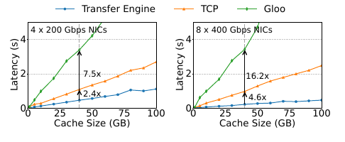

***图 12：节点间缓存传输的延迟。***

**图内标注：左图为 4 张 200 Gbps 网卡，右图为 8 张 400 Gbps 网卡；纵轴为延迟（秒），横轴为缓存大小（GB）；图例为传输引擎、TCP、Gloo。图中相对传输引擎的延迟倍数，左图标为 Gloo 7.5 倍、TCP 2.4 倍，右图标为 Gloo 16.2 倍、TCP 4.6 倍。**

**译注：此处原文说传输引擎代码“将在后续开源”，而引言使用“已开源”。两处时态均按原文保留，不代表翻译时的项目状态。**

##### 5.4.2 Mooncake 的带宽需求

Mooncake 的全局缓存池依赖高效的节点间缓存传输，将缓存传输时间隐藏在 GPU 计算时间中。我们模拟 24–400 Gbps 的一系列带宽，测量第 5.2.1 节所述合成工作负载下的传输时间和 TTFT，以评估网络带宽对系统性能的影响。图 13a 表明，请求的平均 TTFT 随带宽增加而下降。当总通信带宽超过 100 Gbps 时，平均 TTFT 保持在 2 秒以下，明显低于重新计算基线的 TTFT。然而，当带宽低于 100 Gbps 时，系统性能会明显受损，表现为 TTFT 急剧上升，并出现明显网络拥塞。图 13b 中实际传输时间与理论传输时间的显著偏离证明了这一点。因此，我们建议网络带宽至少达到 100 Gbps，以确保最优系统性能。

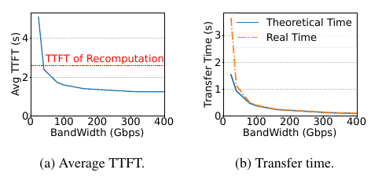

***图 13：使用不同网络带宽的合成工作负载实验。a）平均 TTFT；b）传输时间。***

**图内标注：横轴均为带宽（Gbps）；左图纵轴为平均 TTFT（秒），红色虚线为重新计算时的 TTFT；右图纵轴为传输时间（秒），Theoretical Time／Real Time 分别为理论时间／实际时间。**

##### 5.4.3 端到端延迟分解

Mooncake 中单个推理请求的延迟可分为五个部分：1）调度与排队时间；2）逐层预填充时间；3）缓存传输时间；4）解码节点将缓存从 DRAM 加载到 HBM 所需的时间；5）解码时间。我们在前缀缓存比例为 0% 和 95% 的设置下，实验分析这五个部分的占比，如图 14 所示。

首先，从图中可以清楚看到，引入前缀缓存显著减少了预填充时间。具体来说，在输入长度为 128k 个 token 时，前缀缓存使预填充时间减少了 92%。此外，Mooncake 引入的额外开销对系统性能影响很小。调度、传输和缓存加载这三个部分可以与模型推理异步进行，因此不会影响 Mooncake 的吞吐量。并且，这些开销带来的 TTFT 增量，小于前缀缓存带来的 TTFT 降幅。即使将额外开销计入，在输入长度为 128k 个 token 时，Mooncake 的前缀缓存仍可将 TTFT 降低 86%。

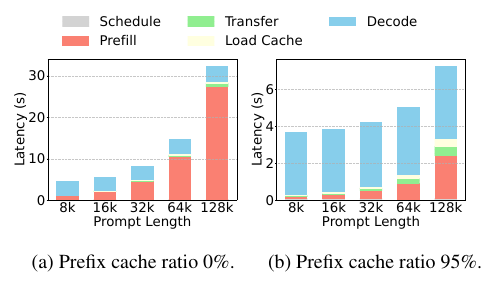

***图 14：Mooncake 的端到端延迟分解。图中 Prefill 表示融合缓存加载与存储的逐层预填充时间，Decode 表示解码 128 个 token 的时间。所有带斜线纹理的过程都可以与模型推理异步进行，不影响 Mooncake 的吞吐量。a）前缀缓存比例为 0%；b）前缀缓存比例为 95%。***

**图内标注：Schedule／Prefill／Transfer／Load Cache／Decode 分别为调度／预填充／传输／缓存加载／解码；纵轴为延迟（秒），横轴为提示词长度，取值依次为 8k、16k、32k、64k、128k。**

#### 5.5 P/D 比例

作为一个已部署的 P/D 分离系统，本节探讨不同 P/D 比例对系统性能的影响。我们将 P/D 比例定义为预填充节点数与解码节点数之比。我们使用总共包含 16 个节点、但 P/D 比例各不相同的集群，测量第 5.2.1 节合成工作负载下的平均 TTFT 和 TBT。随后，按照第 5.2.2 节介绍的方法计算有效请求承载能力，将 TTFT 和 TBT 阈值分别设为 10 秒和 100 毫秒。增加预填充节点数量会降低 TTFT，但提高 TBT；反之亦然（图 15b）。因此，需要在 TTFT 和 TBT 之间取得平衡。图 15a 表明，当 P/D 比例约为 $`1:1`$ 时，Mooncake 达到最高的有效请求承载能力，说明此时预填充集群与解码集群的负载相对均衡。

我们也注意到，已有一些工作 **[7, 9]** 提出，在预填充与解码之间动态切换节点角色。但在实际部署中，我们发现在线流量的统计特征通常是稳定的。因此，我们选择固定 P/D 比例，同时持续监测预填充与解码集群的负载，仅在出现明显负载波动时切换节点角色。

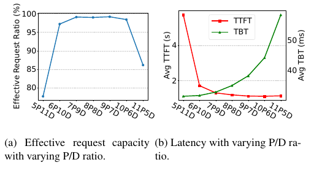

***图 15：P/D 比例对系统性能的影响。P 是预填充节点的缩写，D 是解码节点的缩写。a）不同 P/D 比例下的有效请求承载能力；b）不同 P/D 比例下的延迟。***

**图内标注：横轴配置依次为 5P11D、6P10D、7P9D、8P8D、9P7D、10P6D、11P5D，即相应数量的预填充节点与解码节点，总数均为 16；左图纵轴为有效请求比例（%）；右图左纵轴为平均 TTFT（秒），右纵轴为平均 TBT（毫秒），图例分别为 TTFT 与 TBT。**

### 6 相关工作

研究者已经投入大量工作，通过调度、内存管理和资源解耦来提升 LLM 推理服务系统的效率。FasterTransformer **[33]**、TensorRT-LLM **[34]**、DeepSpeed Inference **[35]** 等生产级系统，旨在显著提升吞吐量。Orca **[13]** 采用迭代级调度，支持不同阶段的并发处理；vLLM **[14]** 则利用动态 KVCache 管理优化内存。FlexGen **[36]**、Sarathi-Serve **[10]** 和 FastServe **[37]** 引入创新的调度与换入换出策略，在有限硬件上有效分配工作负载；这些优化往往可以互补。进一步的优化 **[7–9]** 将预填充与解码阶段分离，促成了 Mooncake 的解耦架构。Mooncake 的设计建立在这些进展之上，尤其借鉴了 vLLM 开源社区的成果，我们对此深表感谢。

前缀缓存也被广泛采用，以支持多个请求之间的 KVCache 复用，减少 LLM 推理系统的计算开销 **[14, 34]**。Prompt Cache **[16]** 在推理服务器上预先计算并存储常用文本的 KVCache，方便后续复用，从而显著降低推理延迟。SGLang **[17]** 使用 RadixAttention：它在基数树结构中维护最近最少使用（LRU）缓存，高效地在各种复用模式之间实现自动共享。

在这些方法中，与我们同期开展的 CachedAttention **[38]** 提出分层 KV 缓存系统，利用成本较低的内存和存储介质容纳所有请求的 KVCache。Mooncake 的架构与 CachedAttention 有许多相同的设计选择。然而，在长上下文推理中，KVCache 会变得非常庞大，需要高容量、高效数据传输，以及以 KVCache 为中心的全局调度。此外，Mooncake 不是一个独立的缓存服务：它同时包含高内存效率的缓存存储机制和缓存感知调度策略，进一步提高了前缀缓存效率。

分布式 KVCache 池的收益取决于缓存命中率；在容量固定时，随着每个 token 的缓存大小减小，缓存命中率会提高。因此，KVCache 压缩 **[39–41]** 和对 KVCache 友好的注意力架构 **[42, 43]** 等正交技术，可以进一步增强我们的方法。

### 7 结论

本文介绍了 Mooncake：一种以 KVCache 为中心的解耦架构，旨在高效提供 LLM 推理服务，尤其面向长上下文场景。我们讨论了如何在最大化总体有效吞吐量与满足延迟相关 SLO 要求之间取得平衡，以及实现这一目标的必要性、挑战和设计选择。

### 致谢

我们感谢匿名审稿人及论文指导人（shepherd）Kan Wu 先生提供的宝贵反馈。清华大学的所有作者均来自中国清华大学计算机科学与技术系、北京信息科学与技术国家研究中心（BNRist）。本研究获得国家重点研发计划（2022YFB4502004）、国家自然科学基金（62141216）、清华大学自主科研计划、中国科协青年人才托举工程（2022QNRC001）以及 Beijing HaiZhi XingTu Technology Co., Ltd. 的支持。

**译注：最后一家公司的名称按原文保留英文，不据其拼音猜测中文注册名称。**

### 参考文献

**参考文献翻译说明：保留原文的编号、作者、年份、卷页信息、arXiv 标识与 URL；题名译为中文，并附英文题名以便检索。原文“et al.”译为“等”。以下书目信息按论文所载版本保留，不更新为后来发表的版本。**

**[1] OpenAI.《介绍 ChatGPT》（Introducing ChatGPT）. 2022.** **[原文链接](https://openai.com/blog/chatgpt)**。

**[2] Hugo Touvron, Louis Martin, Kevin Stone, Peter Albert, Amjad Almahairi, Yasmine Babaei, Nikolay Bashlykov, Soumya Batra, Prajjwal Bhargava, Shruti Bhosale, 等.《Llama 2：开放基础模型与经过微调的聊天模型》（Llama 2: Open Foundation and Fine-Tuned Chat Models）. arXiv 预印本 arXiv:2307.09288, 2023.**

**[3] Mark Chen, Jerry Tworek, Heewoo Jun, Qiming Yuan, Henrique Ponde de Oliveira Pinto, Jared Kaplan, Harri Edwards, Yuri Burda, Nicholas Joseph, Greg Brockman, 等.《评估使用代码训练的大语言模型》（Evaluating Large Language Models Trained on Code）. arXiv 预印本 arXiv:2107.03374, 2021.**

**[4] Charles Packer, Vivian Fang, Shishir G Patil, Kevin Lin, Sarah Wooders, Joseph E Gonzalez.《MemGPT：迈向作为操作系统的大语言模型》（MemGPT: Towards LLMs as Operating Systems）. arXiv 预印本 arXiv:2310.08560, 2023.**

**[5] Moonshot AI. Kimi. 2023.** **[原文链接](https://kimi.moonshot.cn)**。

**[6] NVIDIA.《NVIDIA H100 Tensor Core GPU 架构》（NVIDIA H100 Tensor Core GPU Architecture）. 2022.** **[原文链接](https://resources.nvidia.com/en-us-tensor-core)**。

**[7] Pratyush Patel, Esha Choukse, Chaojie Zhang, Aashaka Shah, Íñigo Goiri, Saeed Maleki, Ricardo Bianchini.《Splitwise：通过阶段拆分实现高效的生成式 LLM 推理》（Splitwise: Efficient Generative LLM Inference Using Phase Splitting）. 载于 2024 年第 51 届 ACM／IEEE 国际计算机体系结构年会（ISCA），第 118–132 页. IEEE, 2024.**

**[8] Yinmin Zhong, Shengyu Liu, Junda Chen, Jianbo Hu, Yibo Zhu, Xuanzhe Liu, Xin Jin, Hao Zhang.《DistServe：分离预填充与解码，优化大语言模型推理服务的有效吞吐量》（DistServe: Disaggregating Prefill and Decoding for Goodput-Optimized Large Language Model Serving）. 载于第 18 届 USENIX 操作系统设计与实现研讨会（OSDI 24），第 193–210 页, 2024.**

**[9] Cunchen Hu, Heyang Huang, Liangliang Xu, Xusheng Chen, Jiang Xu, Shuang Chen, Hao Feng, Chenxi Wang, Sa Wang, Yungang Bao, 等.《互不干扰的推理：面向混合下游工作负载的 LLM 推理解耦》（Inference without Interference: Disaggregate LLM Inference for Mixed Downstream Workloads）. arXiv 预印本 arXiv:2401.11181, 2024.**

**[10] Amey Agrawal, Nitin Kedia, Ashish Panwar, Jayashree Mohan, Nipun Kwatra, Bhargav Gulavani, Alexey Tumanov, Ramachandran Ramjee.《通过 Sarathi-Serve 驾驭 LLM 推理中的吞吐量与延迟权衡》（Taming Throughput-Latency Tradeoff in LLM Inference with Sarathi-Serve）. 载于第 18 届 USENIX 操作系统设计与实现研讨会（OSDI 24），第 117–134 页, 2024.**

**[11] Alec Radford, Jeffrey Wu, Rewon Child, David Luan, Dario Amodei, Ilya Sutskever, 等.《语言模型是无监督多任务学习器》（Language Models Are Unsupervised Multitask Learners）. OpenAI 博客, 1(8):9, 2019.**

**[12] Hugo Touvron, Thibaut Lavril, Gautier Izacard, Xavier Martinet, Marie-Anne Lachaux, Timothée Lacroix, Baptiste Rozière, Naman Goyal, Eric Hambro, Faisal Azhar, 等.《LLaMA：开放且高效的基础语言模型》（LLaMA: Open and Efficient Foundation Language Models）. arXiv 预印本 arXiv:2302.13971, 2023.**

**[13] Gyeong-In Yu, Joo Seong Jeong, Geon-Woo Kim, Soojeong Kim, Byung-Gon Chun.《Orca：面向 Transformer 生成模型的分布式推理服务系统》（Orca: A Distributed Serving System for Transformer-Based Generative Models）. 载于第 16 届 USENIX 操作系统设计与实现研讨会（OSDI 22），第 521–538 页, 2022.**

**[14] Woosuk Kwon, Zhuohan Li, Siyuan Zhuang, Ying Sheng, Lianmin Zheng, Cody Hao Yu, Joseph Gonzalez, Hao Zhang, Ion Stoica.《通过 PagedAttention 实现大语言模型推理服务的高效内存管理》（Efficient Memory Management for Large Language Model Serving with PagedAttention）. 载于第 29 届操作系统原理研讨会论文集，第 611–626 页, 2023.**

**[15] Bingyang Wu, Shengyu Liu, Yinmin Zhong, Peng Sun, Xuanzhe Liu, Xin Jin.《LoongServe：利用弹性序列并行高效服务长上下文大语言模型》（LoongServe: Efficiently Serving Long-Context Large Language Models with Elastic Sequence Parallelism）. 载于第 30 届 ACM SIGOPS 操作系统原理研讨会论文集，第 640–654 页, 2024.**

**[16] In Gim, Guojun Chen, Seung-seob Lee, Nikhil Sarda, Anurag Khandelwal, Lin Zhong.《Prompt Cache：面向低延迟推理的模块化注意力复用》（Prompt Cache: Modular Attention Reuse for Low-Latency Inference）.《机器学习与系统论文集》（Proceedings of Machine Learning and Systems）, 6:325–338, 2024.**

**[17] Lianmin Zheng, Liangsheng Yin, Zhiqiang Xie, Jeff Huang, Chuyue Sun, Cody Hao Yu, Shiyi Cao, Christos Kozyrakis, Ion Stoica, Joseph E Gonzalez, 等.《使用 SGLang 高效编程大语言模型》（Efficiently Programming Large Language Models Using SGLang）. arXiv 预印本 arXiv:2312.07104, 2023.**

**[18] Vikranth Srivatsa, Zijian He, Reyna Abhyankar, Dongming Li, Yiying Zhang.《Preble：面向 LLM 推理服务的高效分布式提示词调度》（Preble: Efficient Distributed Prompt Scheduling for LLM Serving）. 2024.**

**[19] Yazhuo Zhang, Juncheng Yang, Yao Yue, Ymir Vigfusson, KV Rashmi.《SIEVE 比 LRU 更简单：一种高效、开箱即用的 Web 缓存淘汰算法》（SIEVE Is Simpler than LRU: An Efficient Turn-Key Eviction Algorithm for Web Caches）. 载于第 21 届 USENIX 网络系统设计与实现研讨会（NSDI 24），第 1229–1246 页, 2024.**

**[20] Google.《我们的下一代模型：Gemini 1.5》（Our Next-Generation Model: Gemini 1.5）. 2024.** **[原文链接](https://blog.google/technology/ai/google-gemini-next-generation-model-february-2024)**。

**[21] Sam Ade Jacobs, Masahiro Tanaka, Chengming Zhang, Minjia Zhang, Leon Song, Samyam Rajbhandari, Yuxiong He.《DeepSpeed Ulysses：支持极长序列 Transformer 模型训练的系统优化》（DeepSpeed Ulysses: System Optimizations for Enabling Training of Extreme Long Sequence Transformer Models）. arXiv 预印本 arXiv:2309.14509, 2023.**

**[22] Hao Liu, Matei Zaharia, Pieter Abbeel.《结合分块 Transformer 的环形注意力，实现近乎无限的上下文》（Ring Attention with Blockwise Transformers for Near-Infinite Context）. 载于 NeurIPS 2023 决策基础模型研讨会（Foundation Models for Decision Making Workshop）, 2023.**

**[23] William Brandon, Aniruddha Nrusimha, Kevin Qian, Zachary Ankner, Tian Jin, Zhiye Song, Jonathan Ragan-Kelley.《条带式注意力：面向因果 Transformer 的更快环形注意力》（Striped Attention: Faster Ring Attention for Causal Transformers）. arXiv 预印本 arXiv:2311.09431, 2023.**

**[24] Dacheng Li, Rulin Shao, Anze Xie, Eric P Xing, Joseph E Gonzalez, Ion Stoica, Xuezhe Ma, Hao Zhang.《LightSeq：面向长上下文 Transformer 分布式训练的序列级并行》（LightSeq:: Sequence Level Parallelism for Distributed Training of Long Context Transformers）. 载于“推进神经网络训练：计算效率、可扩展性与资源优化”研讨会（WANT@NeurIPS 2023）, 2023.**

**[25] Vijay Anand Korthikanti, Jared Casper, Sangkug Lym, Lawrence McAfee, Michael Andersch, Mohammad Shoeybi, Bryan Catanzaro.《减少大型 Transformer 模型中的激活重计算》（Reducing Activation Recomputation in Large Transformer Models）.《机器学习与系统论文集》（Proceedings of Machine Learning and Systems）, 5:341–353, 2023.**

**[26] Shenggui Li, Fuzhao Xue, Chaitanya Baranwal, Yongbin Li, Yang You.《序列并行：从系统角度看长序列训练》（Sequence Parallelism: Long Sequence Training from System Perspective）. 载于计算语言学协会第 61 届年会论文集，第 1 卷：长论文，第 2391–2404 页, 2023.**

**[27] Jiarui Fang, Shangchun Zhao.《USP：面向长上下文生成式 AI 的统一序列并行方法》（USP: A Unified Sequence Parallelism Approach for Long Context Generative AI）. arXiv 预印本 arXiv:2405.07719, 2024.**

**[28] Zhuohan Li, Siyuan Zhuang, Shiyuan Guo, Danyang Zhuo, Hao Zhang, Dawn Song, Ion Stoica.《TeraPipe：面向大规模语言模型训练的 token 级流水线并行》（TeraPipe: Token-Level Pipeline Parallelism for Training Large-Scale Language Models）. 载于国际机器学习会议（ICML），第 6543–6552 页. PMLR, 2021.**

**[29] Chenxin An, Shansan Gong, Ming Zhong, Xingjian Zhao, Mukai Li, Jun Zhang, Lingpeng Kong, Xipeng Qiu.《L-Eval：建立长上下文语言模型的标准化评估》（L-Eval: Instituting Standardized Evaluation for Long Context Language Models）. arXiv 预印本 arXiv:2307.11088, 2023.**

**[30] Jiaqi Li, Mengmeng Wang, Zilong Zheng, Muhan Zhang.《LooGLE：长上下文语言模型能理解长上下文吗？》（LooGLE: Can Long-Context Language Models Understand Long Contexts?）. arXiv 预印本 arXiv:2311.04939, 2023.**

**[31] Joon Sung Park, Joseph O’Brien, Carrie Jun Cai, Meredith Ringel Morris, Percy Liang, Michael S Bernstein.《生成式智能体：人类行为的交互式模拟体》（Generative Agents: Interactive Simulacra of Human Behavior）. 载于第 36 届 ACM 用户界面软件与技术年会论文集，第 1–22 页, 2023.**

**[32] ShareGPT 团队.** **[原文链接](https://sharegpt.com/)**。

**[33] NVIDIA Corporation. FasterTransformer. 2019.** **[原文链接](https://github.com/NVIDIA/FasterTransformer)**。

**[34] NVIDIA Corporation. TensorRT-LLM. 2023.** **[原文链接](https://github.com/NVIDIA/TensorRT-LLM)**。

**[35] Reza Yazdani Aminabadi, Samyam Rajbhandari, Ammar Ahmad Awan, Cheng Li, Du Li, Elton Zheng, Olatunji Ruwase, Shaden Smith, Minjia Zhang, Jeff Rasley, 等.《DeepSpeed-Inference：以前所未有的规模实现 Transformer 模型的高效推理》（DeepSpeed-Inference: Enabling Efficient Inference of Transformer Models at Unprecedented Scale）. 载于 SC22：高性能计算、网络、存储与分析国际会议，第 1–15 页. IEEE, 2022.**

**[36] Ying Sheng, Lianmin Zheng, Binhang Yuan, Zhuohan Li, Max Ryabinin, Beidi Chen, Percy Liang, Christopher Ré, Ion Stoica, Ce Zhang.《FlexGen：使用单张 GPU 实现大语言模型的高吞吐生成式推理》（FlexGen: High-Throughput Generative Inference of Large Language Models with a Single GPU）. 载于国际机器学习会议（ICML），第 31094–31116 页. PMLR, 2023.**

**[37] Bingyang Wu, Yinmin Zhong, Zili Zhang, Gang Huang, Xuanzhe Liu, Xin Jin.《面向大语言模型的快速分布式推理服务》（Fast Distributed Inference Serving for Large Language Models）. arXiv 预印本 arXiv:2305.05920, 2023.**

**[38] Bin Gao, Zhuomin He, Puru Sharma, Qingxuan Kang, Djordje Jevdjic, Junbo Deng, Xingkun Yang, Zhou Yu, Pengfei Zuo.《利用 CachedAttention 为多轮对话提供低成本的大语言模型推理服务》（Cost-Efficient Large Language Model Serving for Multi-Turn Conversations with CachedAttention）. 载于 2024 年 USENIX 年度技术会议（USENIX ATC 24），第 111–126 页, 2024.**

**[39] Yuhan Liu, Hanchen Li, Yihua Cheng, Siddhant Ray, Yuyang Huang, Qizheng Zhang, Kuntai Du, Jiayi Yao, Shan Lu, Ganesh Ananthanarayanan, 等.《CacheGen：通过 KV 缓存压缩与流式传输实现快速的大语言模型推理服务》（CacheGen: KV Cache Compression and Streaming for Fast Large Language Model Serving）. 载于 ACM SIGCOMM 2024 会议论文集，第 38–56 页, 2024.**

**[40] Coleman Hooper, Sehoon Kim, Hiva Mohammadzadeh, Michael W Mahoney, Yakun Sophia Shao, Kurt Keutzer, Amir Gholami.《KVQuant：通过 KV 缓存量化迈向千万上下文长度的 LLM 推理》（KVQuant: Towards 10 Million Context Length LLM Inference with KV Cache Quantization）. arXiv 预印本 arXiv:2401.18079, 2024.**

**[41] Zirui Liu, Jiayi Yuan, Hongye Jin, Shaochen Zhong, Zhaozhuo Xu, Vladimir Braverman, Beidi Chen, Xia Hu.《KIVI：一种无需调优的 KV 缓存非对称 2 比特量化方法》（KIVI: A Tuning-Free Asymmetric 2bit Quantization for KV Cache）. arXiv 预印本 arXiv:2402.02750, 2024.**

**[42] Aixin Liu, Bei Feng, Bin Wang, Bingxuan Wang, Bo Liu, Chenggang Zhao, Chengqi Dengr, Chong Ruan, Damai Dai, Daya Guo, 等.《DeepSeek-V2：强大、经济且高效的混合专家语言模型》（DeepSeek-V2: A Strong, Economical, and Efficient Mixture-of-Experts Language Model）. arXiv 预印本 arXiv:2405.04434, 2024.**

**[43] William Brandon, Mayank Mishra, Aniruddha Nrusimha, Rameswar Panda, Jonathan Ragan Kelly.《通过跨层注意力缩小 Transformer 键值缓存》（Reducing Transformer Key-Value Cache Size with Cross-Layer Attention）. arXiv 预印本 arXiv:2405.12981, 2024.**
