# Mooncake: Trading More Storage for Less Computation — A KVCache-Centric Architecture for Serving LLM Chatbots

[中文](./Mooncake-KVCache-Centric-Serving.md) | English

- **Source**: **[FAST 2025 paper page](https://www.usenix.org/conference/fast25/presentation/qin)**
- **Paper**: **[Mooncake: Trading More Storage for Less Computation — A KVCache-centric Architecture for Serving LLM Chatbot](https://www.usenix.org/system/files/fast25-qin.pdf)**, Proceedings of the 23rd USENIX Conference on File and Storage Technologies, pages 155–170; ISBN 978-1-939133-45-8.
- **Published**: 2025-02-25 (the first day of FAST 2025; the conference ran February 25–27 in Santa Clara, California, USA).
- **Scope**: An unofficial complete Chinese translation of the FAST 2025 paper, including all prose, 15 original figures with translated captions and label correspondences, 2 tables, equations, API listing, algorithm, footnotes, acknowledgments, and 43 references. Translation completed 2026-11-12; published here 2026-11-13.
- **Note**: Key Findings were written for this note, not the original paper, and use only numbers from the paper. This English counterpart aligns line by line with the Chinese. Rights to the paper and figures remain with their rights holders; this note claims no original ownership and does not apply the code repository's license to the paper.

## Key Findings

- **Core design**: Mooncake not only separates prefill and decoding, but also pools CPU, DRAM, SSD, and RDMA resources into a distributed KVCache store. Global cache reuse, hot-cache replication, and cache-aware scheduling reduce redundant prefill computation.
- **Request capacity**: In the paper's real conversation-trace experiments, the fraction of requests satisfying latency SLOs improves by 59%–498% over baselines. Effective request capacity here is the fraction of all requests that meet SLOs, not directly requests per second.
- **Global cache benefits**: Global caching achieves up to 2.36 times the local-cache hit rate and saves up to 48% of prefill computation time. Benefits depend on prefix reuse, cache capacity, and transfer bandwidth.
- **Transfer and deployment**: Transferring 40 GB of cache achieves 87 GB/s and 190 GB/s on 4×200 Gbps and 8×400 Gbps networks. Historical production statistics report 115%/107% more requests on A800/H800 clusters than previous systems. Production statistics, trace-replay experiments, and transfer microbenchmarks are different measurements; this note does not reproduce the experiments.

## Full Paper

**Original title: Mooncake: Trading More Storage for Less Computation — A KVCache-centric Architecture for Serving LLM Chatbot.**

**Translation notes: All content follows the original order. Original figures are preserved, with label correspondences accompanying each figure. Author names, code, and reference identifiers are retained. “Currently,” “latest,” and future open-source statements refer to the paper's writing date; “we” denotes the authors. Translator's notes are not original prose. Headings move down one level, floating figures/tables move near their discussion, repeated page headers/footers are omitted, and math uses GitHub-compatible formatting without changing meaning. The API listing contains interface declarations from the paper, not a standalone runnable program.**

**Cover note: This paper appears in the Proceedings of the 23rd USENIX Conference on File and Storage Technologies; open access to the proceedings is sponsored.**

### Authors and Affiliations

Ruoyu Qin (Moonshot AI, Tsinghua University)¹; Zheming Li (Moonshot AI)¹; Weiran He (Moonshot AI); Jialei Cui (Moonshot AI); Feng Ren (Tsinghua University); Mingxing Zhang (Tsinghua University)²; Yongwei Wu (Tsinghua University); Weimin Zheng (Tsinghua University); Xinran Xu (Moonshot AI)².

**Author footnote 1: Ruoyu Qin conducted part of this work as an intern at Moonshot AI and contributed equally with Zheming Li.**

**Author footnote 2: Corresponding authors:** `zhang_mingxing@mail.tsinghua.edu.cn`, `xuxinran@moonshot.cn`.

### Abstract

Mooncake is the serving platform for Kimi, an LLM chatbot service developed by Moonshot AI. It features a KVCache-centric disaggregated architecture that not only separates prefill and decoding clusters but also efficiently utilizes the underexploited CPU, DRAM, SSD, and network interface card (NIC) resources of the GPU cluster to establish a disaggregated KVCache. Its core comprises a KVCache-centric global cache and a scheduler designed to maximize throughput while adhering to stringent latency-related Service Level Objectives (SLOs).

Experiments demonstrate that Mooncake excels in scenarios involving long-context inputs. In tests using real traces, it increases effective request capacity by 59%–498% over baseline methods while complying with SLOs. It currently operates across thousands of nodes and processes over 100 billion tokens daily. In practical deployments, its innovative architecture enables Kimi to handle 115% and 107% more requests on NVIDIA A800 and H800 clusters, respectively, than previous systems.

### 1 Introduction

With the rapid adoption of large language models (LLMs) in various scenarios **[1–4]**, LLM serving workloads have become increasingly diverse. They differ in input/output length and arrival distribution and, most importantly, require different Service Level Objectives (SLOs). As a Model as a Service (MaaS) provider, one of Kimi's **[5]** primary goals is to solve an optimization problem with multiple complex constraints. The objective is to maximize overall effective throughput, which directly affects revenue, while the constraints reflect different SLO levels. These SLOs usually concern latency, mainly time to first token (TTFT) and time between tokens (TBT).

Achieving this goal first requires making the best use of the various resources in the GPU cluster. Although GPU servers are currently supplied as highly integrated nodes, such as DGX/HGX supercomputers **[6]**, their resources need to be decoupled and reorganized into disaggregated pools, each optimized for different but collaborative goals. Many researchers **[7–9]**, for example, have proposed separating prefill servers from decoding servers because the two stages have very different computational characteristics.

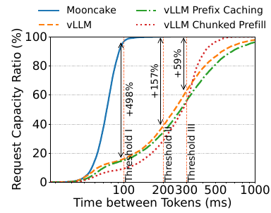

***Figure 1: Effective request capacity of Mooncake under a real-world conversation workload and different TBT SLOs. Mooncake and the three baseline systems each use 16 nodes with 8 A800 GPUs per node. See Section 5.2 for details.***

**Figure labels: The horizontal axis is time between tokens (ms), and the vertical axis is request capacity ratio (%). Thresholds I/II/III are 100/200/300 ms. The legend lists Mooncake, vLLM, vLLM with prefix caching, and vLLM with chunked prefill. The annotated relative improvements are +498%, +157%, and +59%, respectively.**

Advancing this disaggregation strategy, we pool the GPU cluster's CPU, DRAM, SSD, and RDMA resources to construct a disaggregated KVCache called Mooncake Store. This architecture harnesses underutilized resources for efficient near-GPU prefix caching, substantially increasing global cache capacity and inter-node transfer bandwidth. The resulting distributed KVCache system embodies the principle of trading more storage for less computation. As Figure 1 shows, it substantially boosts Kimi's maximum throughput while meeting the required SLOs in many important real-world scenarios. We first mathematically analyze this strategy's benefits and evaluate them using real data (Section 2.2). We then describe the design choices for implementing this petabyte-level disaggregated cache, interconnected by an RDMA network of up to $`8\times400\,\mathrm{Gbps}`$ (Section 3.2).

We also found that KVCache scheduling is central to LLM serving and therefore propose a corresponding disaggregated architecture. Figure 2 shows our current KVCache-centric disaggregated architecture, Mooncake. For each request, the global scheduler, Conductor, selects a pair of prefill and decoding instances and schedules three steps: 1) transfer as much reusable KVCache as possible to the chosen prefill instance; 2) complete prefill in chunks/layers while continuously streaming the resulting KVCache to the corresponding decoding instance; and 3) load the KVCache and add the request to continuous batching at the decoding instance to generate outputs.

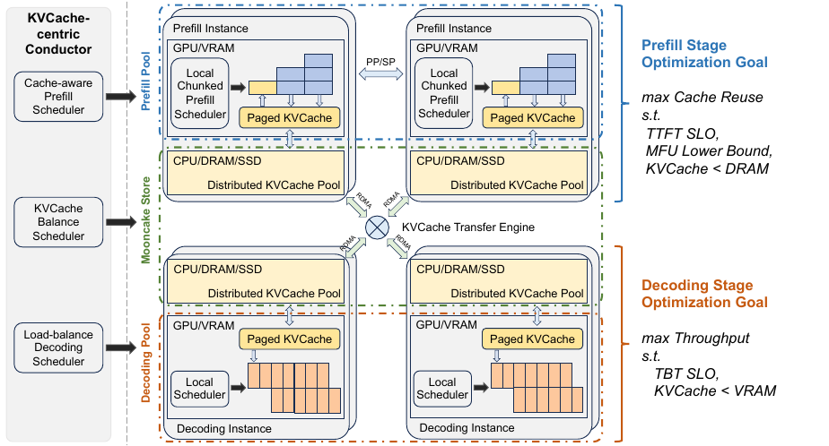

***Figure 2: Mooncake architecture.***

**Figure label correspondence:**

| Original label | Meaning |
| --- | --- |
| KVCache-centric Conductor | KVCache-centric global scheduler, Conductor |
| Cache-aware Prefill Scheduler | Cache-aware prefill scheduler |
| KVCache Balance Scheduler | KVCache balancing scheduler |
| Load-balance Decoding Scheduler | Load-balancing decoding scheduler |
| Prefill Pool / Prefill Instance | Prefill resource pool / prefill instance |
| Decoding Pool / Decoding Instance | Decoding resource pool / decoding instance |
| Local Chunked Prefill Scheduler | Local chunked-prefill scheduler |
| Local Scheduler | Local scheduler |
| Paged KVCache | Paged KVCache |
| Distributed KVCache Pool | Distributed KVCache pool |
| KVCache Transfer Engine | KVCache transfer engine |
| PP / SP | Pipeline parallelism / sequence parallelism |
| GPU / VRAM; CPU / DRAM / SSD; RDMA | GPU / video memory; CPU / dynamic random-access memory / solid-state drive; remote direct memory access |

**Optimization goals in Figure 2: Prefill maximizes cache reuse subject to the TTFT SLO, a lower bound on Model FLOPs Utilization (MFU), and KVCache size below DRAM capacity. Decoding maximizes throughput subject to the TBT SLO and KVCache size below VRAM capacity.**

Although this process seems straightforward, instance selection is complex because of many restrictions. Prefill mainly aims to reuse as much KVCache as possible to avoid redundant computation. However, the distributed KVCache pool faces challenges in both capacity and access latency. Conductor therefore schedules requests with KVCache awareness and performs operations such as swapping and replication accordingly. The hottest blocks should be replicated across nodes to avoid fetch congestion, whereas the coldest should be swapped out to reduce retention costs. Decoding has different objectives and constraints: it aims to aggregate as many tokens as possible in a batch to improve Model FLOPs Utilization (MFU). This is constrained not only by the TBT SLO but also by the total KVCache that fits in VRAM.

Section 4 details our KVCache-centric request scheduling algorithm, which balances instance loads and user experience as measured by TTFT and TBT SLOs. It includes a heuristic-based automated hotspot migration scheme that replicates hot KVCache blocks without precisely predicting their future use. Experiments show that KVCache-centric scheduling significantly lowers TTFT in real-world scenarios.

We also describe the main implementation choices, particularly those not covered by existing research. For example, the feasibility of large-scale prefill/decoding (P/D) disaggregation remains debated because of bandwidth requirements and the trade-offs introduced by chunked prefill, such as Sarathi-Serve **[10]**. Comparisons with vLLM show that a highly optimized transfer engine can manage the communication challenges and that P/D disaggregation is preferable under stringent SLOs (Section 5.2). We also discuss a separate prefill node pool that smoothly handles dynamically distributed context lengths. Chunked pipeline parallelism (CPP) spreads a single request across multiple nodes, which is necessary to reduce long-context TTFT. Compared with conventional sequence parallelism (SP), CPP reduces network use and dependence on frequent elastic scaling (Section 3.3).

Mooncake is currently Kimi's serving platform and has successfully handled exponentially growing workloads, processing more than 100 billion tokens per day. Our historical statistics show that its innovative architecture lets Kimi handle 115% and 107% more requests on A800 and H800 clusters, respectively, than previous systems.

To ensure reproducibility while protecting proprietary information, we provide detailed experimental results using a dummy model mirroring LLaMA3-70B's architecture, based on replayed traces of actual workloads. These traces and Mooncake's KVCache transfer infrastructure are open-sourced at:

**Open-source repository:** **[kvcache-ai/Mooncake](https://github.com/kvcache-ai/Mooncake)**.

In end-to-end experiments using public datasets and real workloads, Mooncake excels in long-context scenarios, improving effective request capacity by up to 498% over the baseline while meeting SLOs. Section 5.3 compares Mooncake Store with local caching and shows that global caching significantly improves cache hit rates. In our experiments, its hit rate reaches up to 2.36 times that of local caching, saving up to 48% of prefill computation time. To our knowledge, Mooncake is the first system to demonstrate substantial benefits from sharing KVCache across chat sessions and queries through a distributed pool in large-scale deployments. We also evaluate its high-speed RDMA transfer engine, which is approximately 2.4 and 4.6 times as fast as existing solutions (Section 5.4).

### 2 Preliminary and Problem Definition

#### 2.1 Service Level Objectives of LLM Serving

Modern LLMs use the Transformer architecture, which processes inputs using attention mechanisms and multilayer perceptrons (MLPs). Popular Transformer models, including GPT **[11]** and LLaMA **[12]**, use a decoder-only structure. Each inference request is logically divided into prefill and decoding stages.

During prefill, all input tokens are processed in parallel, making this stage typically compute-intensive. It generates the first output token and stores intermediate computed keys and values as KVCache. Decoding then uses that KVCache to generate new tokens autoregressively. Autoregression limits each sequence in a batch to processing one token at a time, making decoding memory-constrained; computation time grows sublinearly with batch size. Continuous batching **[13, 14]** is therefore widely used: before each iteration, the scheduler checks request status, adds newly arrived requests, and removes completed ones.

Because prefill and decoding have different characteristics, MaaS providers use different metrics for their SLOs. Prefill primarily concerns the latency from request arrival to the first generated token, or TTFT. Decoding concerns the delay between successive tokens of the same request, or TBT.

In production, unmet SLOs require either additional inference resources or rejection of some incoming requests. GPU supply uncertainty usually makes elastic scale-out infeasible. We therefore proactively reject requests predicted to miss their SLOs to relieve cluster load. Our main objective is to maximize overall throughput while adhering to SLOs, a concept called goodput in other research **[8, 15]**.

#### 2.2 More Storage for Less Computation

To meet stringent SLOs, a common solution caches previously generated KVCache and reuses it on a prefix match. Existing approaches **[16–18]** typically restrict caching to local HBM and DRAM, assuming prohibitively high bandwidth requirements for global scheduling. However, Section 5.3 shows that local DRAM capacity supports at most 50% of the theoretical cache hit rate, making global caching essential. This section mathematically analyzes the bandwidth actually needed to benefit from this strategy and explains why distributed caching is advantageous, especially for larger models such as LLaMA3-70B. Section 5.4.2 provides more experiments.

**Table 1: Notation and parameters. Model and machine parameters are set according to LLaMA3-70B and a machine with 8 A800 GPUs.**

| Symbol | Meaning | Value |
| --- | --- | --- |
| $`l`$ | Number of layers | $`80`$ |
| $`d`$ | Model dimension | $`8192`$ |
| $`a,b`$ | Constant coefficients in Equation (1) | $`4,22`$ |
| $`\mathrm{gqa}`$ | Number of query heads / number of key-value heads | $`8`$ |
| $`s`$ | Tensor element size | $`2\,\mathrm{B}`$ (BFloat16) |
| $`G`$ | GPU computation throughput | $`8\times312\,\mathrm{TFLOPS}`$ |
| $`B_{\mathrm{h2d}}`$ | Host-to-device bandwidth | $`128\,\mathrm{GB/s}`$ |
| $`B_{\mathrm{nic}}`$ | NIC bandwidth | $`800\,\mathrm{Gbps}`$ |
| $`n,p`$ | Prompt length and matched prefix length, respectively | — |

We use the notation in Table 1 and the specific parameters of LLaMA3-70B. Popular LLMs are autoregressive: each token's KVCache depends only on that token and preceding tokens. KVCache for an identical input prefix can therefore be reused without affecting output accuracy. If a prompt of length $`n`$ shares a prefix of length $`p`$ with previously cached KVCache, its prefill process can be optimized as follows:

```math
\begin{aligned}
q[p:n],\ k[p:n],\ v[p:n]
&=\mathrm{MLP}\bigl(\mathrm{hidden}[p:n]\bigr),\\
k[1:n],\ v[1:n]
&\leftarrow \mathrm{KVCache}+\bigl(k[p:n],v[p:n]\bigr),\\
o[p:n]
&=\mathrm{Attention}\bigl(q[p:n],k[1:n],v[1:n]\bigr),\\
\mathrm{KVCache}
&\leftarrow \bigl(k[1:n],v[1:n]\bigr).
\end{aligned}
```

**Translator's note: The original slice indices, MLP notation, and “+” symbol are preserved rather than rewritten for a different Transformer implementation.**

For input length $`n`$, the prefill floating-point operation count is:

```math
\mathrm{flops}(n)=l\times\left(an^{2}d+bnd^{2}\right).
\tag{1}
```

Reusing KVCache thus saves approximately $`l\times\left(ap^{2}d+bpd^{2}\right)`$ prefill operations. It requires transferring cached KVCache into the prefill GPU's HBM, with size $`p\times l\times\left(2\times d/\mathrm{gqa}\right)\times s`$. Let average computation throughput be $`G`$ and average KVCache loading speed be $`B`$, where $`B`$ is determined by the smaller of $`B_{\mathrm{h2d}}`$ and $`B_{\mathrm{nic}}`$. Reuse improves TTFT when:

```math
\frac{B}{G}>\frac{2ds}{\mathrm{gqa}\times\left(apd+bd^{2}\right)}.
\tag{2}
```

In these cases, KVCache reuse reduces GPU time and cost while improving user experience through lower TTFT. The requirement for bandwidth $`B`$ relative to computation throughput $`G`$ is easier to meet for larger $`d`$, and $`d`$ is proportional to model size. For example, running LLaMA3-70B on 8 A800 GPUs with a prefix length of 8192, Equation (2) gives a minimum $`B`$ of $`6\,\mathrm{GB/s}`$. On 8 H800 GPUs, the requirement for $`B`$ rises to $`19\,\mathrm{GB/s}`$. Actual requirements are higher because the transfer stages cannot overlap perfectly. Nevertheless, Section 5.4.2 shows that fully utilizing a $`100\,\mathrm{Gbps}`$ NIC per NVIDIA A800 HGX system is sufficient.

### 3 Design of Mooncake

#### 3.1 Overview

As Figure 2 shows, Mooncake disaggregates not only prefill and decoding nodes but also pools the GPU cluster's CPU, DRAM, SSD, and RDMA resources to implement disaggregated KVCache. Its central global scheduler, Conductor, dispatches requests according to the current KVCache distribution and workload characteristics. Mooncake Store, detailed in Section 3.2, manages the storage and transfer of KVCache blocks.

Figure 3 shows a typical request workflow. After tokenization, Conductor selects a paired prefill node and decoding node and starts four steps:

1. **KVCache reuse:** The selected prefill node or group receives the raw input, the block keys of reusable prefix cache, and the block keys of the full cache allocated to the request. It loads the prefix cache from remote CPU memory into GPU memory to start processing. This step is skipped if there is no prefix cache. Selection balances three goals: maximizing KVCache reuse, balancing prefill-node workloads, and meeting the TTFT SLO. This leads to the KVCache-centric scheduling discussed in Section 4.
1. **Incremental prefill:** The prefill node uses the prefix cache to complete prefill and stores newly generated incremental KVCache in CPU memory. If uncached input tokens exceed a threshold, prefill is divided into chunks executed as a pipeline. The threshold is chosen to fully utilize GPU compute and is usually greater than 1000 tokens. Section 3.3 explains why separate prefill nodes are retained despite using chunked prefill.
1. **KVCache transfer:** Mooncake Store runs on every node to manage and transfer caches. Transfer executes asynchronously and overlaps with incremental prefill, streaming each model layer's KVCache to the destination decoding node's CPU memory to reduce waiting.
1. **Decoding:** After the decoding node's CPU memory receives all KVCache, the request joins the next continuous batch. Conductor preselects the decoding node according to its current load to avoid violating the TBT SLO.

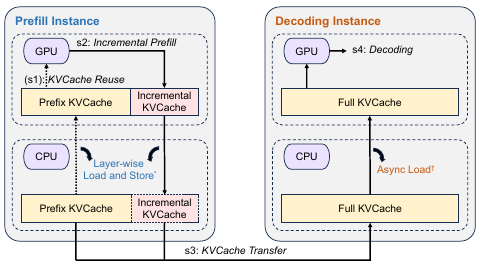

***Figure 3: Workflow of inference instances.***

**Figure labels: Prefill Instance and Decoding Instance identify the two instance types. Steps s1, s2, s3, and s4 are KVCache reuse, incremental prefill, KVCache transfer, and decoding, respectively. Prefix KVCache, Incremental KVCache, and Full KVCache identify the corresponding caches. Layer-wise Load and Store and Async Load describe their loading operations. The original asterisk and dagger are preserved; the original caption provides no separate footnotes for them.**

#### 3.2 Mooncake Store: Cache of KVCache

Mooncake's core is an efficient distributed global cache of KVCache, called Mooncake Store. As Section 2.2 explains, reuse reduces computation cost and improves user experience through lower TTFT, especially when aggregate bandwidth is fully utilized. Fully utilizing that bandwidth is challenging because it can reach $`8\times400\,\mathrm{Gbps}`$, comparable to DRAM bandwidth.

Section 3.2.1 introduces KVCache management, including storage and eviction. Section 3.2.2 describes object-based and memory-transfer APIs. Section 3.2.3 details the high-performance, zero-copy KVCache transfer engine, designed to maximize the benefits of multiple RDMA NICs per machine. Topology-aware path selection and endpoint pooling improve execution efficiency and reliability.

##### 3.2.1 KVCache Management

Mooncake Store keeps all KVCache as paged blocks in a distributed cache pool. Block size, the number of tokens per block, depends on model size and optimal network transfer size and typically ranges from 16 to 512 tokens. Each block has a hash key determined by its own hash and its prefix for deduplication. A key may have replicas on different nodes to reduce hot-cache access latency, controlled by the cache load-balancing policy in Section 4.2.

Mooncake Store allocates space for each block and records metadata such as its key and address. When the pool is full, it uses Least Recently Used (LRU) eviction, except for blocks accessed by ongoing requests, and overwrites the evicted block's space with the new block.

##### 3.2.2 Interface

At the upper layer, Mooncake Store provides object-based APIs including `put`, `get`, and `change_replica`. They organize small KVCache blocks as memory objects for disaggregated caching and allow Conductor to adjust replica counts for higher bandwidth aggregation. A set of synchronous batch-transfer APIs supports these functions, as shown in Listing 1.

Transfers support both DRAM and GPU VRAM and use GPU Direct RDMA when appropriate, provided the memory region has been preregistered. Completion can be monitored asynchronously through `getTransferStatus`, which reports whether transfers remain in progress or have encountered errors.

**Listing 1: Memory transfer APIs in Mooncake Store.**

```cpp
int registerLocalMemory(void *vaddr, size_t len,
                        const string &type);
BatchID allocateBatchID(size_t batch_size);
int submitTransfer(BatchID batch_id,
                   const vector<Request> &entries);
int getTransferStatus(BatchID batch_id,
                      int request_index,
                      Status &status);
int freeBatchID(BatchID batch_id);
```

**Translator's note: The original calls these “synchronous batch-transfer APIs” and then describes asynchronous completion checks. Both statements are retained without inferring different semantics from the interface names.**

##### 3.2.3 Transfer Engine

The transfer engine efficiently implements these APIs with three goals: 1) distribute transfer tasks effectively across multiple RDMA NICs; 2) hide RDMA connection-management complexity from API users; and 3) handle temporary network failures appropriately. The engine is carefully engineered to meet each goal.

**Network setup.** Mooncake depends on high-bandwidth interconnects. We currently use standard HGX machines, pairing each A800 GPU with a 100/200 Gbps NIC and each H800 GPU with a 200/400 Gbps NIC. This bandwidth is comparable to memory bandwidth, and existing libraries other than NCCL cannot fully utilize it. NCCL, however, cannot gracefully handle dynamic topology changes caused by adding or removing nodes/NICs and does not support DRAM-to-DRAM paths. Our transfer engine instead seeks alternative paths on failure.

The network uses cloud-provider-tuned RoCEv2 to address congestion. The scheduler further mitigates congestion by increasing replicas of hot KVCache (Section 4.2).

**Topology-aware path selection.** Modern inference servers often contain multiple CPU sockets, DRAM, GPUs, and RDMA NICs. Although any NIC can technically transfer local DRAM or VRAM to a remote location, UPI (Ultra Path Interconnect) or PCIe-switch bandwidth may limit performance. Mooncake Store addresses these limits using topology-aware path selection.

Before serving requests, each server generates and broadcasts a topology matrix. For each memory type specified during registration, it divides NICs into preferred and secondary lists. Under normal conditions, a preferred NIC is selected, keeping RDMA within the local NUMA domain or GPU Direct RDMA within the local PCIe switch. On failure, NICs from either list can be used. The process identifies suitable local and target NICs from memory addresses, establishes a connection, and transfers the data.

For example, in Figure 4, transferring buffer 0 assigned to `cpu:0` on the local node to buffer 1 assigned to `cpu:1` on the target node begins by consulting the local topology matrix and choosing a preferred NIC for `cpu:0`, such as `mlx5_1`. The target memory address similarly determines a target NIC such as `mlx5_3`. An RDMA connection from `mlx5_1@local` to `mlx5_3@target` then performs RDMA reads and writes.

To further maximize bandwidth utilization, a request's transfer is internally split into 16 KB slices. Each slice may use a different path, allowing all RDMA NICs to work together.

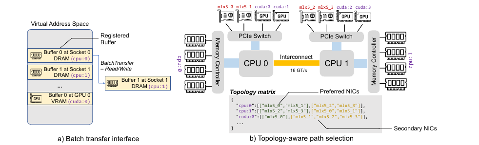

***Figure 4: Transfer engine of Mooncake Store.***

**Figure labels: a) Batch transfer interface; b) Topology-aware path selection. The diagram labels virtual address space, registered buffers, batch read/write transfers, buffer 0 in socket 0 DRAM, buffer 1 in socket 1 DRAM, buffer 0 in GPU 0 VRAM, memory controllers, PCIe switches, the interconnect, the topology matrix, and preferred/secondary NICs. Hardware and memory identifiers `mlx5_*`, `cpu:*`, and `cuda:*` are unchanged; the interconnect is labeled 16 GT/s.**

**Topology matrix example in Figure 4, with original identifiers preserved:**

```text
{
  "cpu:0":[["mlx5_0","mlx5_1"],["mlx5_2","mlx5_3"]],
  "cpu:1":[["mlx5_2","mlx5_3"],["mlx5_0","mlx5_1"]],
  "cuda:0":[["mlx5_0"],["mlx5_1","mlx5_2","mlx5_3"]],
  ...
}
```

**Endpoint management.** Mooncake Store represents a connection between a local and remote RDMA NIC with a pair of endpoints. Each endpoint contains one or more RDMA queue-pair objects. Connections are established on demand: endpoints remain unpaired until the first request.

To prevent excessive endpoints from slowing request processing, Mooncake Store pools endpoints and caps active connections. SIEVE **[19]** manages endpoint eviction. A connection that fails because of link errors is removed from both endpoint pools and re-established at the next transfer attempt.

**Failure handling.** In a multi-NIC environment, one NIC may be temporarily unavailable while other paths still connect the nodes. Mooncake Store handles such failures by automatically finding an alternative reachable path and resubmitting the request to another NIC. It also detects problems in other RDMA resources, including contexts and completion queues, and temporarily avoids them until the underlying issue, such as a downed link, is resolved.

#### 3.3 Mooncake's Prefill Pool

Unlike decoding nodes that must remain free of interference, the necessity and best design of a separate elastic prefill pool remain debated. Although many researchers **[7–9]** share our intuition for disaggregation, it is worth asking whether separation is still needed after introducing chunked prefill **[10]**.

After careful consideration, we retained Mooncake's disaggregated architecture, primarily because online services usually have stricter SLOs. Chunked prefill reduces decoding interference, but simultaneously maximizing prefill MFU and meeting decoding TBT SLOs remains difficult, as Section 5.2 demonstrates. Another reason is that prefill nodes need different cross-node parallelism configurations for long contexts: supported context lengths have rapidly grown from 8k to 128k and even 1 million tokens **[20]**. Inputs for such requests are typically 10–100 times longer than outputs, making TTFT optimization crucial. Abundant prefill parallelism makes using more than one 8-GPU node desirable. However, extending tensor parallelism (TP) across nodes requires two expensive RDMA all-reduces per layer, significantly lowering prefill MFU.

Recent work proposes sequence parallelism (SP) **[21–27]**, distributing a request's input sequence across nodes to accelerate processing and meet TTFT SLOs even for long requests. For shorter inputs, however, SP has lower MFU than single-node TP. Elastic SP **[15]** dynamically scales the SP group up or down, but adds architectural complexity. SP also requires frequent cross-node communication, lowering MFU and competing with inter-node KVCache transfers for network resources.

Mooncake instead exploits the autoregressive property of decoder-only Transformers to implement chunked pipeline parallelism (CPP) for long-context prefill. Every $`X`$ prefill nodes form a pipelined group. Each request's input is partitioned into chunks no longer than `prefill_chunk`. Different nodes can simultaneously process different chunks of the same request, parallelizing execution and reducing TTFT.

CPP has two advantages: 1) Like training pipeline parallelism, it requires cross-node communication only at stage boundaries, which readily overlaps computation, improves MFU, and reduces contention with KVCache transfer. 2) It naturally handles both short and long contexts without significant short-context overhead or frequent changes to node partitioning. Training systems have explored this pipeline-based acceleration **[28]**, but to our knowledge this is its first application to inference, as long-context inference emerged only recently.

### 4 Scheduling

#### 4.1 Prefill Global Scheduling

Earlier LLM-serving research commonly balances load using the number of requests assigned to each instance. Mooncake considers additional factors: prefix-cache hit length and the distribution of reusable KVCache blocks, as well as load. Although routing to an instance with a longer cached prefix saves computation, another node may better balance the system and meet TTFT SLOs. Our cache-aware global scheduler therefore accounts for both the prefill time affected by prefix reuse and local queueing time.

Algorithm 1 describes this KVCache-centric prefill scheduling. For each new request, block keys are compared sequentially with each instance's cache keys to determine `prefix_len`. Conductor uses a polynomial regression model fitted to offline data to estimate execution time from request length and the instance-specific `prefix_len`. It adds estimated waiting time to obtain TTFT, assigns the request to the instance with the shortest TTFT, and updates that instance's cache and queue time. If the SLO cannot be met, Conductor returns HTTP `429 Too Many Requests` to upper layers.

The framework is straightforward, but its components require complex engineering. For example, an offline-data-based model predicts prefill duration from request length and cached-prefix length. Transformers' regular computation patterns keep prediction error small given sufficient offline data. Queueing time is the sum of prefill times for queued requests. In practice, TTFT estimates are computed in parallel, making their processing cost negligible compared with inference.

Transfer-time prediction is harder because it depends on both data volume and current network conditions, especially sender congestion. This also necessitates the hot-KVCache replication discussed in Section 4.2.

#### 4.2 Cache Load Balancing

Each prefill instance in Mooncake has local prefix caches with widely varying access frequencies. Almost every request may access a system prompt, whereas a cache of a local long document may serve only one user. As Section 4.1 explains, Conductor is crucial to balancing cache matching and instance load. From the distributed-cache perspective, load balancing therefore requires cache-replication strategies that let global prefill scheduling achieve both high hit rates and low load.

A naive solution would collect global usage for each block, predict future use, and schedule accordingly. Unlike prefill-time estimation, however, workloads are highly dynamic and change substantially over time. Accurate prediction is impossible for a MaaS provider with rapidly growing users. We therefore propose heuristic-based automated hotspot migration to improve cache load balancing.

As noted above, a heavily loaded instance with the longest cached prefix may not receive the request. In such cases, if the estimated additional prefill time is shorter than the transfer time, Conductor forwards the cache location and request to another instance, which proactively retrieves and stores the KVCache locally. More importantly, if the best remote prefix match is no longer than the locally reusable prefix multiplied by a threshold, we prefer to compute the input tokens.¹ Both strategies reduce prefill time and automatically replicate hot caches across more instances.

**Original footnote 1 (page 162): This threshold is currently adjusted manually, but could be adjusted adaptively by an algorithm in the future.**

**Translator's note: The first condition above preserves the original “shorter than the transfer time.” Its relationship to the subsequent forwarding and cache-fetching action is potentially confusing. Algorithm 1 instead compares the remote/local prefix-length ratio with a threshold. The translation does not silently change “shorter” to “longer”.**

**Algorithm 1: KVCache-centric scheduling algorithm.**

**Input: prefill instance pool** $`P`$, **decoding instance pool** $`D`$, **request** $`R`$, **and cache block size** $`B`$.  
**Output: for request** $`R`$, **the prefill and decoding instances** $`(p,d)`$.

| Original line | Operation, preserving variables, conditions, and execution order |
| --- | --- |
| 1 | $`\mathit{block\_keys}\leftarrow\mathrm{PrefixHash}(R.\mathit{prompt\_tokens},B)`$ |
| 2 | $`\mathrm{TTFT},p\leftarrow\infty,\varnothing`$ |
| 3 | $`\mathit{best\_len},\mathit{best\_instance}\leftarrow\mathrm{FindBestPrefixMatch}(P,\mathit{block\_keys})`$ |
| 4 | **For each** $`\mathit{instance}\in P`$, **execute lines 5–16:** |
| 5 | **If** $`\dfrac{\mathit{best\_len}}{\mathit{instance}.\mathit{prefix\_len}}>\mathit{kvcache\_balancing\_threshold}`$, **then:** |
| 6 | $`\mathit{prefix\_len}\leftarrow\mathit{best\_len}`$ |
| 7 | $`\mathit{transfer\_len}\leftarrow\mathit{best\_len}-\mathit{instance}.\mathit{prefix\_len}`$ |
| 8 | $`T_{\mathrm{transfer}}\leftarrow\mathrm{EstimateKVCacheTransferTime}(\mathit{transfer\_len})`$ |
| 9 | **Else:** |
| 10 | $`\mathit{prefix\_len}\leftarrow\mathit{instance}.\mathit{prefix\_len}`$ |
| 11 | $`T_{\mathrm{transfer}}\leftarrow0`$ |
| 12 | $`T_{\mathrm{queue}}\leftarrow\mathrm{EstimatePrefillQueueTime}(\mathit{instance})`$ |
| 13 | $`T_{\mathrm{prefill}}\leftarrow\mathrm{EstimatePrefillExecutionTime}\bigl(\mathrm{len}(R.\mathit{prompt\_tokens}),\mathit{prefix\_len}\bigr)`$ |
| 14 | **If** $`\mathrm{TTFT}>T_{\mathrm{transfer}}+T_{\mathrm{queue}}+T_{\mathrm{prefill}}`$, **then:** |
| 15 | $`\mathrm{TTFT}\leftarrow T_{\mathrm{transfer}}+T_{\mathrm{queue}}+T_{\mathrm{prefill}}`$ |
| 16 | $`p\leftarrow\mathit{instance}`$ |
| 17 | $`d,\mathrm{TBT}\leftarrow\mathrm{SelectDecodingInstance}(D)`$ |
| 18 | **If** $`\mathrm{TTFT}>\mathrm{TTFT\_SLO}`$ **or** $`\mathrm{TBT}>\mathrm{TBT\_SLO}`$, **then:** |
| 19 | **Reject** $`R`$; **return.** |
| 20 | **If** $`\dfrac{\mathit{best\_len}}{p.\mathit{prefix\_len}}>\mathit{kvcache\_balancing\_threshold}`$, **then:** |
| 21 | $`\mathrm{TransferKVCache}(\mathit{best\_instance},p)`$ |
| 22 | **Return** $`(p,d)`$. |

**Translator's note: The original does not explicitly define the handling of zero local-prefix length at lines 5 and 20. The formulas are preserved without adding implementation logic.**

We compare our strategy with random and load-balancing scheduling, and further compare the local cache-aware scheduler of Section 4.1 with the global cache-aware scheduler here, which includes cache load balancing. Random scheduling chooses an arbitrary instance; load balancing chooses the least-loaded one. We build a Mooncake cluster of 16 nodes with 8 A800 GPUs each and replay the conversation trace detailed in Section 5.2.1. TTFT results in Figure 5 show that KVCache-centric scheduling outperforms random and load-balancing policies. Adding cache load balancing further reduces average TTFT by 14% relative to local cache-aware scheduling.

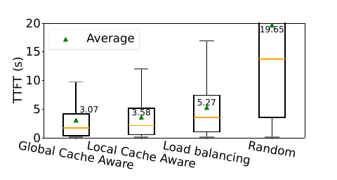

***Figure 5: Prefill scheduling experiment.***

**Figure labels: The vertical axis is TTFT (s), and “Average” identifies the mean. The horizontal categories are global cache-aware, local cache-aware, load balancing, and random, with mean TTFTs of 3.07, 3.58, 5.27, and 19.65 seconds, respectively.**

### 5 Evaluation

As noted earlier, Kimi's historical statistics show that Mooncake handles 115% and 107% more requests on A800 and H800 clusters than our previous vLLM-based systems. To further validate the results reproducibly, we conduct end-to-end and ablation experiments with a dummy LLaMA3-70B model, asking: 1) Does Mooncake outperform existing LLM inference systems in real-world scenarios? 2) Does Mooncake Store significantly improve performance compared with conventional prefix caching?

#### 5.1 Setup

**Testbed.** The experiments run on a high-performance computing cluster. Each node has 8 NVIDIA-A800-SXM4-80GB GPUs and 4 200 Gbps RDMA NICs. Mooncake Store's KVCache block size is 256. Each Mooncake node runs as a prefill or decoding instance according to startup parameters; each node runs one instance for the other systems.

**Metrics.** We measure each request's TTFT and TBT, defining TBT as the average of the longest 10% of token arrival intervals. As described in Section 2, TTFT is limited to 30 seconds, while TBT thresholds are 100, 200, or 300 ms depending on the scenario. Requests meeting both thresholds are effective requests; their fraction among all requests is called effective request capacity. Subsequent experiments that omit TTFT assume its threshold is met. We also measure prefill GPU time and per-request cache hit rate for a more detailed caching comparison.

**Translator's note: The paper operationally defines effective request capacity as the fraction of a fixed test workload satisfying both SLOs. The percentage improvements below should not be directly interpreted as proportional gains in requests per second at fixed SLOs without conversion.**

**Baseline.** We use vLLM **[14]**, a leading open-source LLM serving system, as the baseline. Its continuous batching and PagedAttention greatly improve throughput, but coupled prefill and decoding can disrupt decoding, especially for long contexts. Recent updates added prefix caching and chunked prefill to improve TTFT and TBT in such scenarios; we compare these features too. We use the then-latest vLLM v0.5.1, testing prefix caching and chunked prefill separately because of implementation limitations.

#### 5.2 End-to-End Performance

We evaluate Mooncake and the baselines under different workloads, measuring maximum throughput within the defined SLO thresholds. We use two real traces sampled from Kimi, representing online conversation and tool/agent interaction, plus a synthetic workload covering other inference scenarios. After describing each workload and its results, we analyze prefill GPU time to further demonstrate Mooncake Store's cache-utilization and computation-cost advantages.

**Table 2: Workload statistics.**

| Metric | Conversation | Tool&Agent | Synthetic |
| --- | --- | --- | --- |
| Average input length (tokens) | 12035 | 8596 | 15325 |
| Average output length (tokens) | 343 | 182 | 149 |
| Cache ratio | 40% | 59% | 66% |
| Arrival pattern | Timestamp | Timestamp | Poisson process |
| Number of requests | 12031 | 23608 | 3993 |

##### 5.2.1 Workloads

**Conversation workload.** Chatbots **[1, 5]** are among the most common LLM applications, making conversation highly representative of inference workloads. Table 2 shows many long-context requests, reaching 128k tokens and averaging about 12k, comparable with current long-context datasets **[29, 30]**. Multi-turn conversation yields an average prefix-cache ratio of about 40%. We sample 1 hour of traces from an online inference cluster, recording input/output lengths and arrival timestamps. Requests are dispatched according to those timestamps and terminated when output reaches the predetermined length.

**Tool&Agent workload.** Increasing research **[31]** deploys LLMs as tools or agents to perform tasks. These tasks usually use predefined, often lengthy, fully repeated system prompts. We likewise sample 1 hour of tool/agent traces. As Table 2 shows, this workload has a high prefix-cache ratio and shorter input/output lengths.

**Synthetic workload.** We combine public datasets after dividing real-trace requests into short conversations, tool/agent calls, and long-text summarization and QA. We select ShareGPT **[32]**, Leval **[29]**, and LooGLE **[30]**, respectively. ShareGPT contains multi-turn conversations with short inputs. Leval evaluates long-context performance and here models the lengthy system prompts common in tool/agent interactions. LooGLE targets long-context QA and summarization, with inputs up to 100k tokens, multi-turn QA, and single-turn summaries. Overall, the synthetic workload has the longest average inputs. Although its prefix-cache ratio is highest, dispersed hits require substantial cache capacity.

Preprocessing maps each conversation turn to a separate request including previous inputs and outputs. For datasets with multiple questions sharing one lengthy prompt, each question and its preceding prompt form a request. We combine the datasets in a $`1:1:1`$ ratio and shuffle requests while preserving the internal order of multi-turn dialogues. With no arrival timestamps in these datasets, we simulate realistic arrivals at a defined rate using a Poisson process.

##### 5.2.2 Effective Request Capacity

To assess the maximum requests meeting SLOs under each workload, we test Mooncake, vLLM, vLLM with prefix caching, and vLLM with chunked prefill, each on 16 nodes.

**Conversation workload.** Figure 1 shows the results. Varying input lengths and longer outputs cause large TBT fluctuations in vLLM because of long-context prefill. Chunked prefill reduces decoding interference, but balancing prefill MFU against decoding TBT remains difficult. Even when its TTFT SLO is met, effective request capacity remains suboptimal. Mooncake achieves a substantial increase over vLLM.

**Tool&Agent workload.** Its high prefix-cache ratio and shorter outputs favor vLLM because brief prefill minimally affects output. Nevertheless, Figure 6 shows that vLLM and chunked-prefill vLLM disrupt decoding more severely because their prefill takes longer, giving lower effective caching capacity than prefix-caching vLLM. Mooncake's global cache pool increases capacity and uses inter-node transfers to optimize utilization, excelling with high prefix reuse. At the 200 ms threshold, it improves effective caching capacity by 42% over prefix-caching vLLM.

**Translator's note: The original uses “effective caching capacity” twice in this paragraph, but the subsection, Figure 6, and the definition in Section 5.1 concern effective request capacity. No separate cache-capacity metric is defined here.**

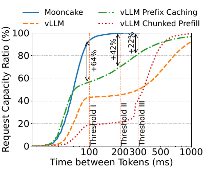

***Figure 6: Mooncake's effective request capacity experiment under the tool&agent workload.***

**Figure labels: The horizontal axis is TBT (ms), and the vertical axis is request capacity ratio (%). The four system legends match Figure 1. Thresholds I/II/III are 100/200/300 ms, with annotated relative improvements of +64%, +42%, and +22%.**

**Synthetic workload.** It has the longest average inputs and dispersed cache hotspots, leading to poor utilization with smaller caches. Figure 7 shows that most Mooncake requests keep TBT within 100 ms, whereas about 20% of vLLM requests exceed 300 ms. Prefix caching and chunked prefill perform similarly to vLLM because they do not mitigate long-context interference with decoding. Mooncake increases effective request capacity by 40% over vLLM at 200 ms.

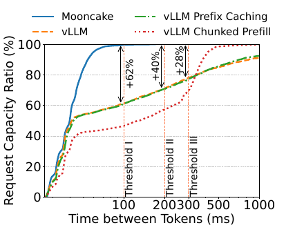

***Figure 7: Mooncake's effective request capacity experiment under the synthetic workload.***

**Figure labels: The horizontal axis is TBT (ms), and the vertical axis is request capacity ratio (%). The four system legends match Figure 1. Thresholds I/II/III are 100/200/300 ms, with annotated relative improvements of +62%, +40%, and +28%.**

##### 5.2.3 Prefill GPU Time

Prefill GPU time is positively correlated with TTFT and serving cost and depends on input length and cache hit rate. Figure 8 shows average prefill GPU time by workload. For Mooncake, conversation takes longest because of longer inputs and a lower prefix-cache ratio. The synthetic workload has the highest prefix-cache ratio and dispersed hotspots, which Mooncake's global pool handles with optimal hit rates; despite the longest average inputs, it needs less GPU time than conversation. Tool&Agent is shortest because it has the shortest inputs and relatively high prefix reuse.

Mooncake substantially reduces GPU time by fully exploiting global prefix caching: 36%, 53%, and 64% reductions versus vLLM for conversation, tool&agent, and synthetic workloads. Prefix-caching vLLM uses HBM-local caches with much less capacity. Its prefill GPU time is 1.43 and 1.40 times Mooncake's for conversation and tool&agent. On synthetic traffic with dispersed hotspots, it is almost the same as vLLM and 2.59 times Mooncake's. Chunked-prefill vLLM sacrifices prefill efficiency to maintain lower decoding TBT, giving the longest prefill times: 1.90, 2.68, and 3.33 times Mooncake's, respectively.

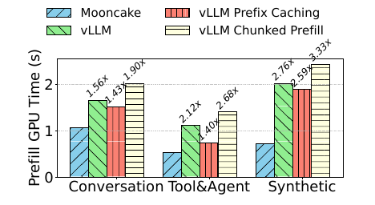

***Figure 8: Average per-request GPU time during prefill under different workloads.***

**Figure labels: The vertical axis is prefill GPU time (s); categories are conversation, tool&agent, and synthetic. Legends are Mooncake, vLLM, prefix-caching vLLM, and chunked-prefill vLLM. The three baseline/Mooncake ratios are 1.56/1.43/1.90 for conversation, 2.12/1.40/2.68 for tool&agent, and 2.76/2.59/3.33 for synthetic.**

#### 5.3 Mooncake Store

To answer Question 2, we examine the performance effect of Mooncake Store's global cache pool. Although local DRAM increases KVCache capacity over HBM alone, restricting caches to a single node still yields suboptimal utilization. We first quantify capacity requirements and then demonstrate the benefits with practical workloads.

##### 5.3.1 Quantitative Analysis of Cache Capacity

LLaMA3-70B requires 320 KB of KVCache per token. Even reserving about 1 TB of DRAM locally stores only about 3 million tokens, which is insufficient. Figure 9 shows theoretical hit rates for individual and combined workloads. In most scenarios, 3 million tokens of local capacity do not reach 50% of the theoretical maximum hit rate. A cache of 50 million tokens nearly reaches 100% of each workload's theoretical maximum, requiring at least 20 nodes' DRAM. Global caching therefore substantially increases capacity and hit rates and reduces GPU time.

**Translator's note: “100% of the theoretical maximum hit rate” means approaching each workload's own achievable ceiling, not that all input tokens hit the cache. Figure 9 has different ceilings for different workloads.**

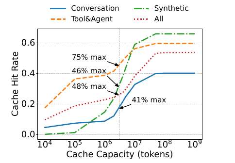

***Figure 9: Quantitative analysis of prefix-cache hit rates at different capacities. Only request order is considered, not prefill time or hotspot replication. The dashed line at 3 million tokens represents local cache capacity; its intersections indicate the achieved hit rate relative to the theoretical maximum.***

**Figure labels: The vertical axis is cache hit rate; the horizontal axis is cache capacity in tokens on a logarithmic scale. Legends are conversation, tool&agent, synthetic, and all workloads. Ratios to each maximum at the dashed line are 75% for tool&agent, 46% for synthetic, 48% for all, and 41% for conversation.**

##### 5.3.2 Practical Workload Experiment

We compare local and global caching using hit rate and average prefill GPU time. A cluster of 10 prefill nodes limits all outputs to 1 token to isolate decoding effects. Each local-cache node holds 3 million tokens but can access only its own cache; the global scheduler routes toward higher prefix-match ratios. In the global-cache setup, each node likewise holds 3 million tokens but can share all nodes' caches through proactive inter-node migration. Figure 10 shows higher hit rates and shorter average prefill GPU times across all tested workloads. Global caching increases hit rate by up to 136% and reduces prefill time by up to 48% over local caching.

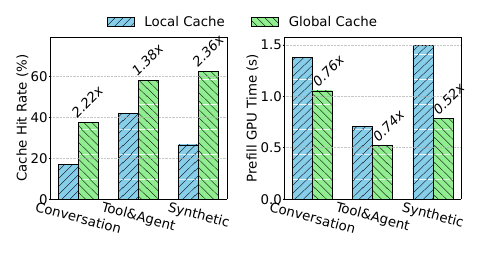

***Figure 10: Cache hit rates and average prefill GPU computation time with global and local caches.***

**Figure labels: The legends identify local and global caches. The left vertical axis is hit rate (%), and the right is prefill GPU time (s). Categories are conversation, tool&agent, and synthetic. Global/local hit-rate ratios are 2.22, 1.38, and 2.36, and GPU-time ratios are 0.76, 0.74, and 0.52, respectively.**

##### 5.3.3 Cache Replicas

Under Section 4.2's cache load-balancing policy, Mooncake Store keys may have replicas on different machines, reducing hot-cache access latency. To study dynamic behavior, we count replicas per key across the three workloads, as Figure 11 shows.

Conversation and tool&agent workloads have highly concentrated hot caches, such as the top 100 keys, which have replicas on almost every prefill instance after stabilization. Synthetic traffic shares fewer prefixes, so even the top 10 blocks have fewer and potentially fluctuating replicas. This demonstrates that the policy in Section 4.2 effectively replicates hot caches, especially for highly concentrated prefix caches.

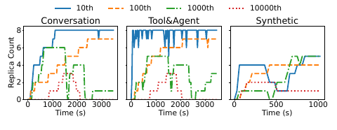

***Figure 11: Replica counts for cache keys under different workloads. Every 30 seconds we record all cache keys and their counts, then rank keys by cumulative counts across samples. The plot tracks keys ranked 10th, 100th, 1000th, and 10000th over time.***

**Figure labels: Subplots are conversation, tool&agent, and synthetic; the vertical axis is replica count and the horizontal axis is time (s). Legends 10th/100th/1000th/10000th identify the four rank positions.**

#### 5.4 KVCache Transfer Performance

##### 5.4.1 Transfer Engine

Mooncake's transfer engine efficiently moves caches between nodes. We compare latency with two alternatives: `torch.distributed` using Gloo and TCP-based transfer. All tests use concurrency 64 and minimum transfer size 128 KB. Figure 12 shows consistently lower latency for the engine. Transferring 40 GB, the LLaMA3-70B cache size for 128k tokens, achieves $`87\,\mathrm{GB/s}`$ and $`190\,\mathrm{GB/s}`$ on $`4\times200\,\mathrm{Gbps}`$ and $`8\times400\,\mathrm{Gbps}`$ networks, respectively, about 2.4 and 4.6 times TCP's rates. The engine will also be open-sourced later as a decoupled basic tool usable in many scenarios, including Moonshot AI's checkpoint transfer service.

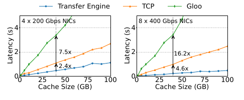

***Figure 12: Latency of inter-node cache transfer.***

**Figure labels: Left: 4 NICs at 200 Gbps; right: 8 NICs at 400 Gbps. Axes are latency (s) and cache size (GB). Legends identify the transfer engine, TCP, and Gloo. Relative to the engine, annotated latency ratios are Gloo 7.5 and TCP 2.4 on the left, and Gloo 16.2 and TCP 4.6 on the right.**

**Translator's note: This passage says the engine “will be open-sourced later,” whereas the introduction says it is already open-sourced. Both original tenses are retained and do not describe project status at translation time.**

##### 5.4.2 Mooncake's Bandwidth Demand

Mooncake relies on efficient inter-node transfer to hide cache-transfer time behind GPU computation. We simulate bandwidths from 24 to 400 Gbps and measure transfer time and TTFT with Section 5.2.1's synthetic workload. Figure 13a shows that average TTFT decreases with bandwidth. Above 100 Gbps total communication bandwidth, it remains below 2 seconds, well below recomputation. Below 100 Gbps, performance degrades sharply, with increased TTFT and clear congestion, evidenced by the large gap between actual and theoretical transfer times in Figure 13b. We therefore recommend at least 100 Gbps for optimal performance.

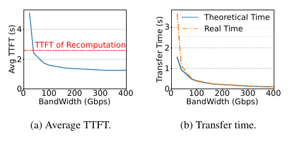

***Figure 13: Synthetic workload experiment with varying network bandwidths. a) Average TTFT; b) Transfer time.***

**Figure labels: Both horizontal axes are bandwidth (Gbps). The left vertical axis is average TTFT (s), with the red dashed line indicating recomputation TTFT. The right vertical axis is transfer time (s), with theoretical and actual time curves.**

##### 5.4.3 End-to-End Latency Breakdown

A Mooncake request's latency has five components: 1) scheduling and queueing; 2) layer-wise prefill; 3) cache transfer; 4) loading cache from DRAM to HBM at the decoding node; and 5) decoding. Figure 14 compares these components with prefix-cache ratios of 0% and 95%.

Prefix caching clearly reduces prefill time: by 92% for 128k-token inputs. Mooncake's overhead minimally affects performance. Scheduling, transfer, and cache loading can run asynchronously with model inference and therefore do not affect throughput. Their TTFT overhead is smaller than the reduction from prefix caching. Even including overhead, prefix caching reduces TTFT by 86% at 128k tokens.

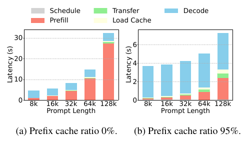

***Figure 14: Mooncake end-to-end latency breakdown. Prefill is layer-wise prefill integrating cache loading and storing; Decode is the time to decode 128 tokens. All diagonally striped processes can run asynchronously with inference and do not affect throughput. a) Prefix-cache ratio 0%; b) Prefix-cache ratio 95%.***

**Figure labels: Schedule, Prefill, Transfer, Load Cache, and Decode identify the five stages. The vertical axis is latency (s), and the horizontal axis is prompt length: 8k, 16k, 32k, 64k, and 128k.**

#### 5.5 P/D Ratio

We examine how the ratio of prefill to decoding nodes affects this deployed P/D-disaggregated system. With 16 total nodes and varying ratios, we measure average TTFT and TBT under Section 5.2.1's synthetic workload, then compute effective request capacity as in Section 5.2.2 using thresholds of 10 seconds and 100 ms. More prefill nodes lower TTFT but raise TBT, and vice versa (Figure 15b), requiring a balance. Figure 15a shows the highest effective request capacity near $`1:1`$, indicating relatively balanced prefill and decoding loads.

Earlier work **[7, 9]** proposes dynamically switching node roles between prefill and decoding. In production, however, online traffic statistics are generally stable. We therefore fix the P/D ratio, continuously monitor both pools, and switch roles only when load changes substantially.

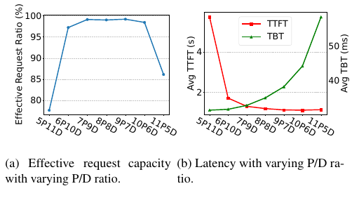

***Figure 15: Impact of the P/D ratio on performance. P denotes prefill nodes and D denotes decoding nodes. a) Effective request capacity at varying P/D ratios; b) Latency at varying P/D ratios.***

**Figure labels: Configurations are 5P11D, 6P10D, 7P9D, 8P8D, 9P7D, 10P6D, and 11P5D, each totaling 16 nodes. The left plot shows effective request ratio (%). The right plot's left axis is average TTFT (s), and its right axis is average TBT (ms), with TTFT and TBT legends.**

### 6 Related Work

Extensive work improves LLM serving through scheduling, memory management, and resource disaggregation. Production systems such as FasterTransformer **[33]**, TensorRT-LLM **[34]**, and DeepSpeed Inference **[35]** target higher throughput. Orca **[13]** uses iteration-level scheduling for concurrent processing across stages; vLLM **[14]** uses dynamic KVCache management to optimize memory. FlexGen **[36]**, Sarathi-Serve **[10]**, and FastServe **[37]** introduce scheduling and swapping strategies that effectively distribute workloads on limited hardware, often complementing one another. Further optimizations **[7–9]** separate prefill and decoding, leading to Mooncake's disaggregated architecture. Mooncake builds on these developments, particularly the vLLM open-source community, for which we are deeply grateful.

Prefix caching widely enables KVCache reuse across requests to reduce computation **[14, 34]**. Prompt Cache **[16]** precomputes and stores frequently used text's KVCache on inference servers for reuse and lower latency. SGLang **[17]** uses RadixAttention, maintaining an LRU cache in a radix tree to enable efficient automatic sharing across reuse patterns.

Concurrent work CachedAttention **[38]** proposes hierarchical KV caching using cost-effective memory and storage for all requests. Mooncake shares many design choices with it. Long-context inference, however, produces enormous KVCache requiring high capacity, efficient transfer, and KVCache-centric global scheduling. Mooncake is also more than a standalone cache service: it combines memory-efficient storage with cache-aware scheduling to further improve prefix-caching efficiency.

Distributed KVCache benefits depend on hit rate, which increases as per-token cache size decreases at fixed capacity. Orthogonal techniques including KVCache compression **[39–41]** and KVCache-friendly attention architectures **[42, 43]** can therefore further enhance our approach.

### 7 Conclusion

This paper presents Mooncake, a KVCache-centric disaggregated architecture for efficient LLM serving, particularly with long contexts. We discuss the necessity, challenges, and design choices involved in maximizing overall effective throughput while meeting latency-related SLOs.

### Acknowledgments

We thank the anonymous reviewers and our shepherd, Mr. Kan Wu, for their valuable feedback. All Tsinghua-affiliated authors are with the Department of Computer Science and Technology and the Beijing National Research Center for Information Science and Technology (BNRist), Tsinghua University, China. This work is supported by the National Key Research & Development Program of China (2022YFB4502004), the Natural Science Foundation of China (62141216), the Tsinghua University Initiative Scientific Research Program, the Young Elite Scientists Sponsorship Program by CAST (2022QNRC001), and Beijing HaiZhi XingTu Technology Co., Ltd.

**Translator's note: The final company's English name is retained rather than guessing its registered Chinese name from its romanization.**

### References

**Reference translation note: Original numbers, authors, years, volumes/pages, arXiv identifiers, and URLs are retained. Chinese titles in the companion translation are followed by English titles for retrieval. Original “et al.” is translated as the Chinese equivalent in the translation. Bibliographic details remain as listed in the paper and are not updated to later publication versions.**

**[1] OpenAI. Introducing ChatGPT. 2022.** **[Source link](https://openai.com/blog/chatgpt)**.

**[2] Hugo Touvron, Louis Martin, Kevin Stone, Peter Albert, Amjad Almahairi, Yasmine Babaei, Nikolay Bashlykov, Soumya Batra, Prajjwal Bhargava, Shruti Bhosale, et al. Llama 2: Open Foundation and Fine-Tuned Chat Models. arXiv preprint arXiv:2307.09288, 2023.**

**[3] Mark Chen, Jerry Tworek, Heewoo Jun, Qiming Yuan, Henrique Ponde de Oliveira Pinto, Jared Kaplan, Harri Edwards, Yuri Burda, Nicholas Joseph, Greg Brockman, et al. Evaluating Large Language Models Trained on Code. arXiv preprint arXiv:2107.03374, 2021.**

**[4] Charles Packer, Vivian Fang, Shishir G Patil, Kevin Lin, Sarah Wooders, Joseph E Gonzalez. MemGPT: Towards LLMs as Operating Systems. arXiv preprint arXiv:2310.08560, 2023.**

**[5] Moonshot AI. Kimi. 2023.** **[Source link](https://kimi.moonshot.cn)**.

**[6] NVIDIA. NVIDIA H100 Tensor Core GPU Architecture. 2022.** **[Source link](https://resources.nvidia.com/en-us-tensor-core)**.

**[7] Pratyush Patel, Esha Choukse, Chaojie Zhang, Aashaka Shah, Íñigo Goiri, Saeed Maleki, Ricardo Bianchini. Splitwise: Efficient Generative LLM Inference Using Phase Splitting. In 2024 ACM/IEEE 51st Annual International Symposium on Computer Architecture (ISCA), pages 118–132. IEEE, 2024.**

**[8] Yinmin Zhong, Shengyu Liu, Junda Chen, Jianbo Hu, Yibo Zhu, Xuanzhe Liu, Xin Jin, Hao Zhang. DistServe: Disaggregating Prefill and Decoding for Goodput-Optimized Large Language Model Serving. In 18th USENIX Symposium on Operating Systems Design and Implementation (OSDI 24), pages 193–210, 2024.**

**[9] Cunchen Hu, Heyang Huang, Liangliang Xu, Xusheng Chen, Jiang Xu, Shuang Chen, Hao Feng, Chenxi Wang, Sa Wang, Yungang Bao, et al. Inference without Interference: Disaggregate LLM Inference for Mixed Downstream Workloads. arXiv preprint arXiv:2401.11181, 2024.**

**[10] Amey Agrawal, Nitin Kedia, Ashish Panwar, Jayashree Mohan, Nipun Kwatra, Bhargav Gulavani, Alexey Tumanov, Ramachandran Ramjee. Taming Throughput-Latency Tradeoff in LLM Inference with Sarathi-Serve. In 18th USENIX Symposium on Operating Systems Design and Implementation (OSDI 24), pages 117–134, 2024.**

**[11] Alec Radford, Jeffrey Wu, Rewon Child, David Luan, Dario Amodei, Ilya Sutskever, et al. Language Models Are Unsupervised Multitask Learners. OpenAI blog, 1(8):9, 2019.**

**[12] Hugo Touvron, Thibaut Lavril, Gautier Izacard, Xavier Martinet, Marie-Anne Lachaux, Timothée Lacroix, Baptiste Rozière, Naman Goyal, Eric Hambro, Faisal Azhar, et al. LLaMA: Open and Efficient Foundation Language Models. arXiv preprint arXiv:2302.13971, 2023.**

**[13] Gyeong-In Yu, Joo Seong Jeong, Geon-Woo Kim, Soojeong Kim, Byung-Gon Chun. Orca: A Distributed Serving System for Transformer-Based Generative Models. In 16th USENIX Symposium on Operating Systems Design and Implementation (OSDI 22), pages 521–538, 2022.**

**[14] Woosuk Kwon, Zhuohan Li, Siyuan Zhuang, Ying Sheng, Lianmin Zheng, Cody Hao Yu, Joseph Gonzalez, Hao Zhang, Ion Stoica. Efficient Memory Management for Large Language Model Serving with PagedAttention. In Proceedings of the 29th Symposium on Operating Systems Principles, pages 611–626, 2023.**

**[15] Bingyang Wu, Shengyu Liu, Yinmin Zhong, Peng Sun, Xuanzhe Liu, Xin Jin. LoongServe: Efficiently Serving Long-Context Large Language Models with Elastic Sequence Parallelism. In Proceedings of the ACM SIGOPS 30th Symposium on Operating Systems Principles, pages 640–654, 2024.**

**[16] In Gim, Guojun Chen, Seung-seob Lee, Nikhil Sarda, Anurag Khandelwal, Lin Zhong. Prompt Cache: Modular Attention Reuse for Low-Latency Inference. Proceedings of Machine Learning and Systems, 6:325–338, 2024.**

**[17] Lianmin Zheng, Liangsheng Yin, Zhiqiang Xie, Jeff Huang, Chuyue Sun, Cody Hao Yu, Shiyi Cao, Christos Kozyrakis, Ion Stoica, Joseph E Gonzalez, et al. Efficiently Programming Large Language Models Using SGLang. arXiv preprint arXiv:2312.07104, 2023.**

**[18] Vikranth Srivatsa, Zijian He, Reyna Abhyankar, Dongming Li, Yiying Zhang. Preble: Efficient Distributed Prompt Scheduling for LLM Serving. 2024.**

**[19] Yazhuo Zhang, Juncheng Yang, Yao Yue, Ymir Vigfusson, KV Rashmi. SIEVE Is Simpler than LRU: An Efficient Turn-Key Eviction Algorithm for Web Caches. In 21st USENIX Symposium on Networked Systems Design and Implementation (NSDI 24), pages 1229–1246, 2024.**

**[20] Google. Our Next-Generation Model: Gemini 1.5. 2024.** **[Source link](https://blog.google/technology/ai/google-gemini-next-generation-model-february-2024)**.

**[21] Sam Ade Jacobs, Masahiro Tanaka, Chengming Zhang, Minjia Zhang, Leon Song, Samyam Rajbhandari, Yuxiong He. DeepSpeed Ulysses: System Optimizations for Enabling Training of Extreme Long Sequence Transformer Models. arXiv preprint arXiv:2309.14509, 2023.**

**[22] Hao Liu, Matei Zaharia, Pieter Abbeel. Ring Attention with Blockwise Transformers for Near-Infinite Context. In NeurIPS 2023 Foundation Models for Decision Making Workshop, 2023.**

**[23] William Brandon, Aniruddha Nrusimha, Kevin Qian, Zachary Ankner, Tian Jin, Zhiye Song, Jonathan Ragan-Kelley. Striped Attention: Faster Ring Attention for Causal Transformers. arXiv preprint arXiv:2311.09431, 2023.**

**[24] Dacheng Li, Rulin Shao, Anze Xie, Eric P Xing, Joseph E Gonzalez, Ion Stoica, Xuezhe Ma, Hao Zhang. LightSeq:: Sequence Level Parallelism for Distributed Training of Long Context Transformers. In Workshop on Advancing Neural Network Training: Computational Efficiency, Scalability, and Resource Optimization (WANT@NeurIPS 2023), 2023.**

**[25] Vijay Anand Korthikanti, Jared Casper, Sangkug Lym, Lawrence McAfee, Michael Andersch, Mohammad Shoeybi, Bryan Catanzaro. Reducing Activation Recomputation in Large Transformer Models. Proceedings of Machine Learning and Systems, 5:341–353, 2023.**

**[26] Shenggui Li, Fuzhao Xue, Chaitanya Baranwal, Yongbin Li, Yang You. Sequence Parallelism: Long Sequence Training from System Perspective. In Proceedings of the 61st Annual Meeting of the Association for Computational Linguistics (Volume 1: Long Papers), pages 2391–2404, 2023.**

**[27] Jiarui Fang, Shangchun Zhao. USP: A Unified Sequence Parallelism Approach for Long Context Generative AI. arXiv preprint arXiv:2405.07719, 2024.**

**[28] Zhuohan Li, Siyuan Zhuang, Shiyuan Guo, Danyang Zhuo, Hao Zhang, Dawn Song, Ion Stoica. TeraPipe: Token-Level Pipeline Parallelism for Training Large-Scale Language Models. In International Conference on Machine Learning (ICML), pages 6543–6552. PMLR, 2021.**

**[29] Chenxin An, Shansan Gong, Ming Zhong, Xingjian Zhao, Mukai Li, Jun Zhang, Lingpeng Kong, Xipeng Qiu. L-Eval: Instituting Standardized Evaluation for Long Context Language Models. arXiv preprint arXiv:2307.11088, 2023.**

**[30] Jiaqi Li, Mengmeng Wang, Zilong Zheng, Muhan Zhang. LooGLE: Can Long-Context Language Models Understand Long Contexts?. arXiv preprint arXiv:2311.04939, 2023.**

**[31] Joon Sung Park, Joseph O’Brien, Carrie Jun Cai, Meredith Ringel Morris, Percy Liang, Michael S Bernstein. Generative Agents: Interactive Simulacra of Human Behavior. In Proceedings of the 36th Annual ACM Symposium on User Interface Software and Technology, pages 1–22, 2023.**

**[32] ShareGPT teams.** **[Source link](https://sharegpt.com/)**.

**[33] NVIDIA Corporation. FasterTransformer. 2019.** **[Source link](https://github.com/NVIDIA/FasterTransformer)**.

**[34] NVIDIA Corporation. TensorRT-LLM. 2023.** **[Source link](https://github.com/NVIDIA/TensorRT-LLM)**.

**[35] Reza Yazdani Aminabadi, Samyam Rajbhandari, Ammar Ahmad Awan, Cheng Li, Du Li, Elton Zheng, Olatunji Ruwase, Shaden Smith, Minjia Zhang, Jeff Rasley, et al. DeepSpeed-Inference: Enabling Efficient Inference of Transformer Models at Unprecedented Scale. In SC22: International Conference for High Performance Computing, Networking, Storage and Analysis, pages 1–15. IEEE, 2022.**

**[36] Ying Sheng, Lianmin Zheng, Binhang Yuan, Zhuohan Li, Max Ryabinin, Beidi Chen, Percy Liang, Christopher Ré, Ion Stoica, Ce Zhang. FlexGen: High-Throughput Generative Inference of Large Language Models with a Single GPU. In International Conference on Machine Learning (ICML), pages 31094–31116. PMLR, 2023.**

**[37] Bingyang Wu, Yinmin Zhong, Zili Zhang, Gang Huang, Xuanzhe Liu, Xin Jin. Fast Distributed Inference Serving for Large Language Models. arXiv preprint arXiv:2305.05920, 2023.**

**[38] Bin Gao, Zhuomin He, Puru Sharma, Qingxuan Kang, Djordje Jevdjic, Junbo Deng, Xingkun Yang, Zhou Yu, Pengfei Zuo. Cost-Efficient Large Language Model Serving for Multi-Turn Conversations with CachedAttention. In 2024 USENIX Annual Technical Conference (USENIX ATC 24), pages 111–126, 2024.**

**[39] Yuhan Liu, Hanchen Li, Yihua Cheng, Siddhant Ray, Yuyang Huang, Qizheng Zhang, Kuntai Du, Jiayi Yao, Shan Lu, Ganesh Ananthanarayanan, et al. CacheGen: KV Cache Compression and Streaming for Fast Large Language Model Serving. In Proceedings of the ACM SIGCOMM 2024 Conference, pages 38–56, 2024.**

**[40] Coleman Hooper, Sehoon Kim, Hiva Mohammadzadeh, Michael W Mahoney, Yakun Sophia Shao, Kurt Keutzer, Amir Gholami. KVQuant: Towards 10 Million Context Length LLM Inference with KV Cache Quantization. arXiv preprint arXiv:2401.18079, 2024.**

**[41] Zirui Liu, Jiayi Yuan, Hongye Jin, Shaochen Zhong, Zhaozhuo Xu, Vladimir Braverman, Beidi Chen, Xia Hu. KIVI: A Tuning-Free Asymmetric 2bit Quantization for KV Cache. arXiv preprint arXiv:2402.02750, 2024.**

**[42] Aixin Liu, Bei Feng, Bin Wang, Bingxuan Wang, Bo Liu, Chenggang Zhao, Chengqi Dengr, Chong Ruan, Damai Dai, Daya Guo, et al. DeepSeek-V2: A Strong, Economical, and Efficient Mixture-of-Experts Language Model. arXiv preprint arXiv:2405.04434, 2024.**

**[43] William Brandon, Mayank Mishra, Aniruddha Nrusimha, Rameswar Panda, Jonathan Ragan Kelly. Reducing Transformer Key-Value Cache Size with Cross-Layer Attention. arXiv preprint arXiv:2405.12981, 2024.**
