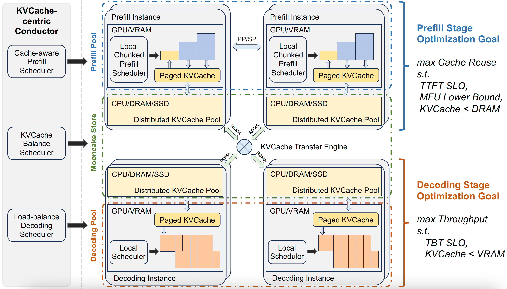
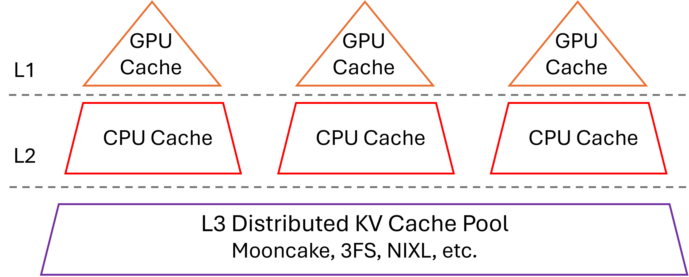
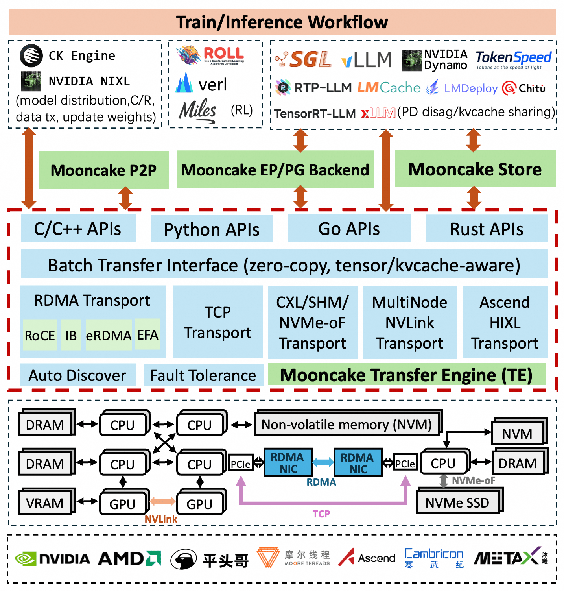
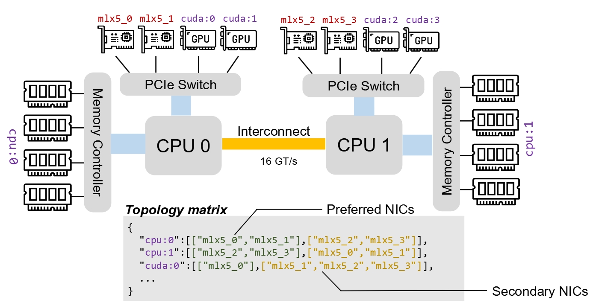
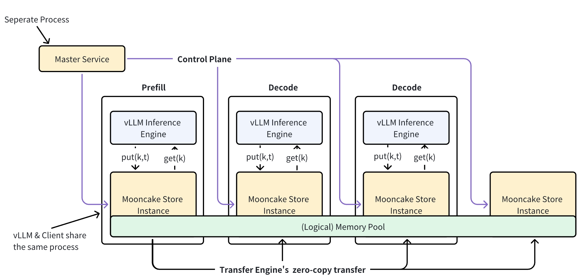

# Mooncake 与 SGLang：围绕 KVCache 的架构梳理

中文 | [English](./Mooncake-SGLang-KVCache-Architecture_en.md)

- **整理日期**: 2026-11-13
- **范围**: Mooncake 论文（FAST 2025）、开源 Mooncake 和 SGLang 中与 KVCache 有关的设计：PD 分离、KVCache 复用的条件与命中率、以 KVCache 为中心的调度、SGLang 如何使用 Mooncake，以及论文中的算法在当前代码中的实现。
- **论文**: [Mooncake: Trading More Storage for Less Computation — A KVCache-centric Architecture for Serving LLM Chatbot](https://www.usenix.org/conference/fast25/presentation/qin)（FAST 2025 最佳论文），全文翻译见 [Mooncake 论文全文翻译](./Mooncake-KVCache-Centric-Serving.md)
- **代码版本**: [kvcache-ai/Mooncake](https://github.com/kvcache-ai/Mooncake) main 分支 `b2ff9e97`（2026-11-13，最新发布版本 0.3.14），[sgl-project/sglang](https://github.com/sgl-project/sglang) main 分支 `112ecb13`（2026-11-13）。文中的代码和文档链接都固定在这两个提交上。
- **依据**: 第 1～3 章依据论文、Mooncake 文档和 SGLang 文档；第 4 章依据阅读上述两个提交中的代码，没有实际运行验证。用公开 trace 复现的命中率是按文中定义回放得到的。

本文结合 Mooncake 论文、Mooncake 仓库文档和 SGLang 文档，梳理 KVCache 在两个系统中如何被计算、传输、存储和复用。第 1～3 章从模块层面介绍论文和两个系统，不展开代码细节；第 4 章对照两个仓库当前的代码，说明论文中的算法现在是怎么实现的。

## 1. Mooncake 简介

### 1.1 为什么要围绕 KVCache 设计

LLM 推理分为两个阶段：

- **Prefill**：并行处理全部输入 token，生成第一个输出 token，同时产生这些 token 在每一层的 Key/Value 张量，即 KVCache。这一阶段是计算密集型，对应的延迟指标是 TTFT（首 token 延迟）。
- **Decode**：利用 KVCache 逐个生成后续 token。这一阶段受显存带宽限制，通常用 continuous batching 提高吞吐，对应的延迟指标是 TBT（token 间隔，SGLang 中常称 ITL）。

两个阶段的瓶颈不同，放在同一个实例里会互相干扰：一个长 prompt 的 prefill 会打断正在进行的 decode，使 TBT 变差。因此 Mooncake 把 prefill 和 decode 放到不同的实例上执行（PD 分离），这样 prefill 实例算出的 KVCache 就要通过网络传给 decode 实例。

另一方面，自回归模型中一个 token 的 KV 只取决于它自己和它之前的 token，所以**前缀相同的请求可以复用同一份 KVCache**。多轮对话、带长 system prompt 的 agent 调用、对同一份长文档反复提问，都有大量可复用的前缀。

Mooncake 论文标题中的 “Trading More Storage for Less Computation” 概括了它的思路：把算过的 KVCache 存起来，下次直接取用，用存储容量和网络带宽换掉重复的 prefill 计算。

### 1.2 论文的关键论证

论文从两方面论证 KVCache 应该放进跨机器的分布式池：一是从其他机器加载前缀的 KV 比重新计算更快，二是单台机器的内存放不下足够多的 KV。

#### 复用划算的条件

设请求的 prompt 长度为 $`n`$，其中前 $`p`$ 个 token 能在缓存中命中。论文把长度为 $`n`$ 的 prefill 计算量写成

```math
\mathrm{flops}(n) = l \times \left(a n^2 d + b n d^2\right)
```

其中 $`l`$ 是层数，$`d`$ 是模型维度。括号里的第一项是注意力的计算量，与 $`n^2`$ 成正比；第二项是线性层的计算量，与 $`n`$ 成正比；$`a`$、$`b`$ 是常数系数，它们的取值在本小节后面推导。

复用这段前缀约可省下 $`l \times (a p^2 d + b p d^2)`$ 的计算量，即前 $`p`$ 个 token 自身的计算量 $`\mathrm{flops}(p)`$；未命中的 token 仍要对整个前缀做注意力，这部分省不掉。代价是要把 $`p \times l \times \frac{2d}{\mathit{gqa}} \times s`$ 字节的 KV 搬进 GPU 显存，其中 $`\mathit{gqa}`$ 是 query head 数与 KV head 数之比，$`s`$ 是每个元素的字节数。设 GPU 算力为 $`G`$，KV 加载带宽为 $`B = \min(B_{\mathrm{h2d}}, B_{\mathrm{nic}})`$，即 host 到 GPU 带宽与网卡带宽中的较小者。只要传输这些 KV 的时间少于省下的计算时间，复用就能缩短 TTFT，整理后的条件为

```math
\frac{B}{G} > \frac{2ds}{\mathit{gqa} \times (apd + bd^2)}
```

$`d`$ 越大（模型越大），这个条件越容易满足。论文按 LLaMA3-70B 的参数（$`l = 80`$，$`d = 8192`$，$`\mathit{gqa} = 8`$，$`s = 2`$ 字节，$`a = 4`$，$`b = 22`$）取 $`p = 8192`$ 计算：8×A800 机器（$`G = 8 \times 312`$ TFLOPS）需要的最小带宽是 6 GB/s，8×H800（$`G = 8 \times 989`$ TFLOPS）是 19 GB/s。实际中，各段传输（如网卡传输和 host 到 GPU 的拷贝）无法完全重叠，所需带宽还会更高；论文 §5.4.2 的实验表明，A800 HGX 机器上跑满一块 100 Gbps 网卡即可满足。

**系数 $`a`$、$`b`$ 的来历**。论文表 1 只给出 $`a = 4`$、$`b = 22`$ 这两个取值，没有推导，可以按 LLaMA3-70B 的结构推一遍。下面把一次乘加记为 2 次浮点运算（FLOPs），与 GPU 算力指标的口径相同。

**$`b`$ 来自每层的线性层**。处理一个 token 时，一个 $`d_{\mathrm{in}} \times d_{\mathrm{out}}`$ 的权重矩阵要做 $`2d_{\mathrm{in}}d_{\mathrm{out}}`$ 次运算。LLaMA3-70B 的 $`d = 8192`$，FFN 的中间维度是 $`28672 = 3.5d`$，KV head 数是 query head 数的 1/8：

| 矩阵 | 形状 | 每 token 运算量 |
| --- | --- | --- |
| $`W_{Q}`$ | $`d \times d`$ | $`2d^2`$ |
| $`W_{K}`$、$`W_{V}`$ | 各 $`d \times d/8`$ | 合计 $`0.5d^2`$ |
| $`W_{O}`$ | $`d \times d`$ | $`2d^2`$ |
| FFN 的 gate 和 up | 各 $`d \times 3.5d`$ | 合计 $`14d^2`$ |
| FFN 的 down | $`3.5d \times d`$ | $`7d^2`$ |
| 合计 | | $`25.5d^2`$ |

$`n`$ 个 token 就是 $`25.5\thinspace nd^2`$，即 $`b \approx 25.5`$。论文取 22，比推算值低约 14%，原因论文没有说明。

**$`a`$ 来自注意力**。每层先算打分矩阵 $`QK^{\top}`$，再用它对 $`V`$ 加权求和。两步都是每个 query 与每个 key 之间做 $`d`$ 维的乘加（64 个头各 128 维，合计 $`d`$ 维），各需 $`2n^2d`$ 次运算，合计 $`4n^2d`$，即 $`a = 4`$。这是把整个 $`n \times n`$ 矩阵都算上的结果；利用因果掩码只算下三角时减半，$`a = 2`$。GQA 只减少 K、V 的数量，每个 query 头仍要单独打分，所以 $`a`$ 与 $`\mathit{gqa}`$ 无关。

**取值对结论的影响不大**。复用条件可以改写成 $`B > B_{\min}`$，其中 $`B_{\min}`$ 是复用前缀与重新计算耗时相同时的 KV 加载带宽：实际带宽高于它，复用才更快。论文取的 $`p = 8192`$ 恰好等于 LLaMA3-70B 的 $`d`$，这时条件里的 $`apd + bd^2`$ 化为 $`(a + b)d^2`$，再代入 $`s = 2`$、$`\mathit{gqa} = 8`$，得到

```math
B_{\min} = G \times \frac{2ds}{\mathit{gqa} \times (a + b)d^2} = \frac{G}{16384 \times (a + b)}
```

即最小带宽与 $`a + b`$ 成反比。以论文的取值和 8×A800 机器为例：按峰值算力 $`G`$ 重新计算这 8192 个 token 约需 0.46 秒，它们的 KV 为 $`8192 \times 320\ \mathrm{KiB}`$，约 2.7 GB；要在 0.46 秒内加载完，带宽至少约为 5.9 GB/s。

下表每一格是一组 $`a`$、$`b`$ 取值在一种机器上的 $`B_{\min}`$。四行依次是：论文的取值；注意力只算因果掩码下的一半（$`a = 2`$）；线性层按上面推算的 $`b = 25.5`$；两处都按推算值。

| $`a`$ | $`b`$ | 8×A800 | 8×H800 |
| --- | --- | --- | --- |
| 4 | 22（论文） | 5.9 GB/s | 18.6 GB/s |
| 2 | 22 | 6.3 GB/s | 20.1 GB/s |
| 4 | 25.5 | 5.2 GB/s | 16.4 GB/s |
| 2 | 25.5 | 5.5 GB/s | 17.6 GB/s |

$`a + b`$ 越小，复用省下的计算越少，所需带宽就越高。四种取法的 $`a + b`$ 在 24～29.5 之间，最小带宽比论文取值时低约 12% 到高约 8%，论文给出的 6 GB/s 和 19 GB/s 这个量级不变。作为参照，一块 100 Gbps 网卡约为 12.5 GB/s：A800 一列都低于它，与上文“跑满一块 100 Gbps 网卡即可满足”一致；H800 一列都高于它，一块 100 Gbps 网卡不够，需要更快的网卡或多块网卡一起传。

#### 单机缓存容量不够

在前面 KV 字节数的表达式中取 $`p = 1`$，得到 LLaMA3-70B 每个 token 的 KV 大小：

```math
l \times \frac{2d}{\mathit{gqa}} \times s = 80 \times \frac{2 \times 8192}{8} \times 2\ \mathrm{B} = 327{,}680\ \mathrm{B} = 320\ \mathrm{KiB}
```

一台机器拿出约 1 TB DRAM，也只能存 $`1\ \mathrm{TB} / 320\ \mathrm{KiB} \approx 3 \times 10^{6}`$ 个 token。论文用三类负载的请求 trace 分析了缓存容量对命中率的影响。其中 conversation（多轮对话）和 tool&agent（工具与 agent 调用）各从 Kimi 的线上集群采样一小时，synthetic 由公开数据集构造；三份 trace 都已匿名化公开（[`FAST25-release/`](https://github.com/kvcache-ai/Mooncake/tree/b2ff9e9739b1305050e7a0339867dc7d26976962/FAST25-release)）。分析的结论是：容量为 300 万 token 的单机缓存，在多数场景下达不到理论最高命中率的一半；容量要到约 5000 万 token 才接近理论上限，这需要至少 20 台机器的 DRAM。下面先说明命中率和理论上限的含义，再看论文的数据。

**命中率**。论文没有写出公式。从图 9、图 10（全局缓存与本地缓存的对比）的用法和 trace 的格式看，命中率按 token 计：

```math
h = \frac{\sum_r \mathrm{hit}_r}{\sum_r n_r}
```

$`n_r`$ 是请求 $`r`$ 的输入 token 数，$`\mathrm{hit}_r`$ 是请求到达时，从开头起连续能在缓存中找到 KV 的 token 数。trace 的每条记录对应一个请求，包含到达时间、输入和输出长度，以及把输入按 512 个 token 分块后每块的前缀哈希 ID；ID 相同就说明这一块及其之前的所有 token 都相同。算 $`\mathrm{hit}_r`$ 时从第一个块开始逐个查，遇到第一个不在缓存里的块就停，已查到的块数乘以 512 就是 $`\mathrm{hit}_r`$。之后的块即使在缓存里也用不上，因为前缀已经断了。SGLang 的 `cache_hit_rate` 指标也按 token 计，分子是命中的 token 数，分母是全部输入 token 数。

**理论最高命中率**。它回答的问题是：假如缓存足够大，算过的 KV 一直保留、从不淘汰，这批请求最多有多少输入 token 不必重新计算。计算时按到达顺序回放 trace，用一个集合记下已经算过的块：

1. 取下一个请求，从它的第一个块开始逐个在集合中查找，遇到第一个不在集合中的块就停。查到的块数乘以 512，就是这个请求的 $`\mathrm{hit}_r`$。
2. 把这个请求的块都加入集合。命中的块本来就在集合中；没命中的块要计算，算完也存下来。
3. 回到第 1 步处理下一个请求。所有请求处理完后，按上面的公式求出命中率，记为 $`h_{\max}`$。

在这个回放中，一个块只有第一次出现时不命中，之后每次用到都能命中：块 ID 是前缀哈希，一个块已在集合中，说明它前面的块也都在集合中，前缀不会在它之前断开。因此 $`h_{\max}`$ 只取决于请求序列本身，与机器和缓存的配置无关。容量有限的缓存只会比这个集合少一些块，命中不会更多，所以任何缓存的命中率都不会超过 $`h_{\max}`$，这就是“理论最高”的含义。这个上限远低于 100%，因为第一次出现的内容（新的问题、新的文档、上一轮的回答）总要计算一次，不足 512 token 的尾部也无法命中。这几部分各占多少，见下文“理论上限为什么不高”一段。

**容量有限时的命中率**。真实的缓存有容量上限，存满后要先丢掉一些块，才能放进新的块。容量有限时的命中率 $`h(C)`$ 回答的问题是：缓存最多只能存 $`C`$ 个 token（即 $`C/512`$ 个块）的 KV 时，同一批请求能命中多少。计算时仍按到达顺序回放，只是把集合换成一个队列。队列中的块就是缓存中的块，从左到右按最近一次被使用的时间排列：最左边是最久没用的块，最右边是刚用过的块，最多放 $`C/512`$ 个。

1. 取下一个请求，用同样的方法在队列中查找它的前缀，得到 $`\mathrm{hit}_r`$。
2. 按顺序处理这个请求的每个块：块已在队列中，就把它移到最右边；不在队列中，就把它放到最右边，放之前如果队列已满，先丢掉最左边的块。
3. 回到第 1 步处理下一个请求。所有请求处理完后，按同一个公式求出命中率 $`h(C)`$。

这种淘汰最久没用的块的规则叫 LRU（Least Recently Used），依据是刚用过的块更可能很快再被用到。论文 §3.2.1 中的分布式 KVCache 池也按 LRU 淘汰（见 1.3 节）。

与容量无限时相比，$`h(C)`$ 少掉的部分就是容量不够造成的损失：有些块之前算过，再次用到时却已被淘汰；或者块还在，但它前面的某个块已被淘汰，前缀断了也用不上。这些块都要重新计算。容量增大时，缓存中保留的块只会更多，$`h(C)`$ 只会升高或不变；容量大到不再淘汰之后还会用到的块时，$`h(C)`$ 就等于 $`h_{\max}`$。比值 $`h(C) / h_{\max}`$ 表示这个容量拿到了理论上限的多大比例：“达不到理论最高命中率的一半”指它低于 50%，“接近理论上限”指它接近 100%。从小到大增加 $`C`$，比值首次达到 99%（或 95%）时的容量，就可以看作所需的缓存容量。

**例子**。用 4 个请求说明，每个记号代表一个 512 token 的块：s1、s2 是公共的 system prompt；a1 是用户 A 第 1 轮的内容，a2 是 A 第 2 轮新增的内容；b1、b2 是用户 B 的，含义相同。每一轮的输入都包含 system prompt 和这个用户之前各轮的内容。4 个请求依次到达，共 14 个块。

先算理论最高命中率。容量无限时，缓存就是上面说的集合，回放过程如下：

| 请求 | 块 | 到达时缓存中的块 | 命中的块 | 新写入的块 |
| --- | --- | --- | --- | --- |
| R1：A 第 1 轮 | s1 s2 a1 | 无 | 无 | s1 s2 a1 |
| R2：B 第 1 轮 | s1 s2 b1 | s1 s2 a1 | s1 s2 | b1 |
| R3：A 第 2 轮 | s1 s2 a1 a2 | s1 s2 a1 b1 | s1 s2 a1 | a2 |
| R4：B 第 2 轮 | s1 s2 b1 b2 | s1 s2 a1 b1 a2 | s1 s2 b1 | b2 |

以 R2 为例：它的前两块 s1、s2 已在缓存中，第三块 b1 不在，于是命中 2 块，b1 算完后写入缓存。4 个请求共命中 0 + 2 + 3 + 3 = 8 块。按 token 计，分子是 $`8 \times 512`$，分母是 $`14 \times 512`$，所以 $`h_{\max} = 8/14`$，即 57.1%。没命中的 6 块正好是 s1、s2、a1、b1、a2、b2 各自第一次出现，容量再大也省不掉。

再算容量有限时的命中率。下面两张表分别是容量为 4 块和 3 块时的回放过程，表中的队列按上面的规则从左到右排列，最左边是最久没用的块。

容量为 4 块时：

| 请求 | 到达时的队列 | 命中的块 | 写入和淘汰 | 处理后的队列 |
| --- | --- | --- | --- | --- |
| R1 | 空 | 无 | 写入 s1、s2、a1 | s1 s2 a1 |
| R2 | s1 s2 a1 | s1 s2 | 写入 b1 | a1 s1 s2 b1 |
| R3 | a1 s1 s2 b1 | s1 s2 a1 | 淘汰 b1，写入 a2 | s1 s2 a1 a2 |
| R4 | s1 s2 a1 a2 | s1 s2 | 淘汰 a1，写入 b1；淘汰 a2，写入 b2 | s1 s2 b1 b2 |

R2 用到 s1、s2 后，这两块移到最右边，没用到的 a1 就成了最左边的块。R3 到达时队列已满，它的 s1、s2、a1 依次移到最右边后，最左边是 b1，写入 a2 时淘汰了它。于是 R4 只命中 s1、s2，b1 要重新计算。共命中 7 块，即 50.0%，是理论最高的 87.5%。

容量为 3 块时：

| 请求 | 到达时的队列 | 命中的块 | 写入和淘汰 | 处理后的队列 |
| --- | --- | --- | --- | --- |
| R1 | 空 | 无 | 写入 s1、s2、a1 | s1 s2 a1 |
| R2 | s1 s2 a1 | s1 s2 | 淘汰 a1，写入 b1 | s1 s2 b1 |
| R3 | s1 s2 b1 | s1 s2 | 淘汰 b1，写入 a1；淘汰 s1，写入 a2 | s2 a1 a2 |
| R4 | s2 a1 a2 | 无 | 依次写入 s1、s2、b1、b2，分别淘汰 s2、a1、a2、s1 | s2 b1 b2 |

R2 命中 s1、s2 后，最久没用的是 a1，写入 b1 时淘汰了它。R3 也只命中 s1、s2，这时最久没用的变成了 b1，R3 写入 a1 时淘汰了它。写入 a2 时，队列中的 s1、s2、a1 都刚被 R3 用过，其中 s1 是 R3 最先访问的块，最近一次使用的时间最早，因此被淘汰。R3 有 4 块，缓存只放得下 3 块，只能挤掉 R3 自己的一块，而 LRU 挑中的恰好是前缀的开头。R4 到达时 s1 已不在缓存中，s2 虽然还在，但前缀在 s1 处就断了，一个块也用不上。共命中 4 块，即 28.6%，只有理论最高的 50%。

四种容量的结果汇总如下。容量为 5 块时，回放过程与容量无限时只差在 R4 写入 b2 时淘汰了 a1，命中的块完全相同。

| 容量 | 无限 | 5 块 | 4 块 | 3 块 |
| --- | --- | --- | --- | --- |
| R1～R4 各自命中的块数 | 0、2、3、3 | 0、2、3、3 | 0、2、3、2 | 0、2、2、0 |
| 命中块数（共 14 块） | 8 | 8 | 7 | 4 |
| 命中率 | 57.1% | 57.1% | 50.0% | 28.6% |
| 占理论最高的比例 | 100% | 100% | 87.5% | 50% |

- 容量为 4 块和 3 块时，比理论上限少命中的块就是容量不够造成的损失：4 块时少了 R4 的 b1；3 块时少了 R3 的 a1，以及 R4 的 s1、s2、b1。其中 R4 到达时 s2 还在缓存中，属于前缀断了才用不上的情况，其余几块都是已被淘汰。
- 容量为 5 块时已经达到理论上限：6 个不同的块中，最后出现的 b2 之后不再有请求使用，不必为它留位置，所以这组请求达到理论上限所需的容量是 5 块。

上面回放用的 LRU 只看每个块最近一次被使用的时间，不考虑块在前缀中的位置，也不避开当前请求正在用的块，所以会出现 R3 挤掉自己前缀开头的情况。实际系统会避开这种情况。Mooncake Store 不淘汰正在被请求读取的块（见 1.3 节；当前实现的做法见 4.3 节）。SGLang 的 radix tree 默认也按 LRU 淘汰，但只淘汰叶子节点，也不淘汰正在运行的请求锁住的节点（[`radix_cache.py`](https://github.com/sgl-project/sglang/blob/112ecb1303efe813723afa79606b116fa32dc79f/python/sglang/srt/mem_cache/radix_cache.py#L559-L587)），所以前缀的开头要等它后面的块都被淘汰之后才会被淘汰。按这两种规则，R3 读取的 s1、s2 在它写入新块时都不会被淘汰，R4 仍能命中这两块：容量为 3 块时的命中块数从 4 变成 6，即 42.9%，是理论最高的 75%；其他容量的结果不变。

上文定义 $`h(C)`$ 时仍取这种简单的 LRU，因为下文用栈距离一次算出整条曲线的方法依赖它。用三份公开 trace 回放时，按论文中 Mooncake Store 的规则（不淘汰当前请求正在用的块）得到的各容量命中率与简单 LRU 几乎相同；按 SGLang 的规则最多高约 0.5 个百分点（synthetic 在 10 万 token 时从 1.3% 升到 1.8%），不影响下文复现的结论。

**论文的数据**。论文图 9 按到达顺序回放三类负载的 trace 以及三者的合并，画出 $`h(C)`$ 随容量变化的曲线。这个分析只看请求序列，不考虑 prefill 计算时间和热点复制，相当于所有请求共用一个容量为 $`C`$ 的缓存。论文没有写明图 9 用的是哪种淘汰策略。各曲线最后的平台值就是 $`h_{\max}`$，与表 2（负载统计）中的 Cache Ratio 一致：conversation 40%，tool&agent 59%，synthetic 66%。在 300 万 token 处，图中标出了 $`h(C) / h_{\max}`$：tool&agent 75%，synthetic 46%，conversation 41%，三者合并 48%，只有 tool&agent 超过一半。到 5000 万 token 时，各曲线都已接近平台值。论文原文说这时 “nearly reaches the theoretical maximum hit rate of 100%”，其中的 100% 指的就是这个比值，命中率本身只有 40%～66%。

**用公开 trace 复现**。按上面的定义，可以用这三份 trace 复现图 9。上面的回放步骤每次只能算出一个容量下的命中率，不过在 LRU 下不必对每个容量都回放一遍：一次访问能否命中只取决于栈距离，即这个块上次被访问之后又访问过多少个不同的块。一个块被访问后排在队列最右边，之后每多访问一个不同的块，它就向左移一位；队列只能放 $`C/512`$ 个块，所以栈距离小于 $`C/512`$ 时它还在缓存中，否则已被淘汰。前缀命中还要求前面的块都命中，所以对每次访问取请求内到当前块为止的最大栈距离。回放一遍算出这个值，就能得到整条 $`h(C)`$ 曲线。

仍以上面的例子说明。R3 访问 a1 时，a1 上次在 R1 中被访问，之后访问过的不同的块有 s1、s2、b1 三个，栈距离为 3：缓存能放 4 块时 a1 还在，只能放 3 块时已被淘汰，与上面两张表一致。容量无限时命中的 8 次访问，请求内到当前块为止的最大栈距离依次是：R2 的 s1、s2 为 2、2；R3 的 s1、s2、a1 为 2、2、3；R4 的 s1、s2、b1 为 3、3、4。其中小于 3、4、5 的分别有 4、7、8 个，正好是容量为 3、4、5 块时的命中块数。另外 6 次访问是块第一次出现，栈距离记为无穷大，容量多大都不命中。

三份 trace 的结果如下，括号里是 $`h(C) / h_{\max}`$：

| 容量（token） | conversation | tool&agent | synthetic |
| --- | --- | --- | --- |
| 10 万 | 4.3%（11%） | 33.7%（59%） | 1.3%（2%） |
| 100 万 | 5.5%（15%） | 36.0%（63%） | 14.7%（23%） |
| 300 万 | 14.3%（38%） | 42.9%（75%） | 32.0%（49%） |
| 1000 万 | 29.8%（80%） | 53.6%（94%） | 58.8%（90%） |
| 2000 万 | 35.9%（96%） | 56.9%（100%） | 65.0%（100%） |
| 5000 万 | 37.1%（99%） | 57.0%（100%） | 65.0%（100%） |
| 无限（$`h_{\max}`$） | 37.3% | 57.0% | 65.0% |

复现结果与论文接近。$`h_{\max}`$ 为 37.3%、57.0%、65.0%，比表 2 低 1～3 个百分点；300 万 token 处的比值为 38%、75%、49%，论文为 41%、75%、46%；到 5000 万 token 时三者都达到 99% 以上。

这组复现也支持命中率按 token 计的判断：如果改成先算每个请求的命中比例再取平均，容量无限时三份 trace 的命中率是 40.8%、66.8%、42.4%。conversation 与表 2 只差约 1 个百分点，tool&agent 和 synthetic 则分别差约 8 和 24 个百分点。按 token 计的复现结果仍比表 2 低 1～3 个百分点，这可能来自块粒度：复现只统计完整的 512 token 块，前缀如果在某个块的中间断开，这个块里相同的那部分 token 统计不到。粗略估计：假设每个至少命中一个块、命中部分之后还有输入的请求，在前缀断开的那个块里平均还有半块（256 token）相同，把这部分计入命中后，三份 trace 分别是 39.4%、59.7%、65.7%，与表 2 基本一致。

复现图 9 中三者合并的曲线时，不能直接把三份 trace 拼起来回放：每份 trace 的哈希 ID 都各自从 0 编号，直接合并会把不同的内容当成相同的块。假定不同 trace 之间没有相同的内容，把各自的 ID 区分开后按到达时间合并回放，$`h_{\max}`$ 为 51.3%，300 万 token 处的比值为 45%，与论文的 48% 接近。

**理论上限为什么不高**。如上所述，容量无限时一个块只在第一次出现时要计算，之后每被一个请求用到就命中一次。如果每个块平均被 $`u`$ 个请求用到，完整块中能命中的比例就是 $`1 - \frac{1}{u}`$，再乘以完整块占输入 token 的比例（三份 trace 都在 97% 以上），就得到 $`h_{\max}`$。要达到 90%，每个块平均至少要被 10 个请求用到，而三份 trace 的 $`u`$ 只有 1.62、2.41 和 2.94。

把请求分成两类，可以看出未命中的 token 从哪里来。各请求共用的开头（如公共的 system prompt）按出现在 100 个以上请求中的块计，阈值改成 30 或 300，下面的数字几乎不变。新请求除了这段共用的开头之外，与之前的请求没有共同前缀；后续请求能接上更早某个请求的上下文，典型的是多轮对话的下一轮。下表最后三行把全部输入 token 分成三份，依次是新请求中未命中的、后续请求中未命中的和命中的。

| 指标 | conversation | tool&agent | synthetic |
| --- | --- | --- | --- |
| 每个块平均被几个请求用到（$`u`$） | 1.62 | 2.41 | 2.94 |
| 新请求占请求数的比例 | 61.5% | 80.0% | 55.9% |
| 新请求中未命中的 token | 52.2% | 35.8% | 33.6% |
| 后续请求中未命中的 token | 10.4% | 7.1% | 1.4% |
| 理论最高命中率 $`h_{\max}`$ | 37.3% | 57.0% | 65.0% |

- conversation：所有请求的第一个块都相同，但 61.5% 的请求在这一块之后就是新内容，平均每个要计算约 1 万个 token，单是这些就占全部输入的 52%。后续请求的输入中有 77% 能命中，但它们只占请求数的 38.5%。
- tool&agent：请求的第一个块只有 4 种，最常见的一种出现在 46% 的请求中。这几段公共 system prompt 带来的命中占全部输入的 35%，tool&agent 的 $`h_{\max}`$ 比 conversation 高就是因为这部分。但 80% 的请求在 system prompt 之后都是新内容，平均每个要计算约 3800 个 token。
- synthetic：没有共用的开头（第一个块有 1125 种），55.9% 的请求一个块都不命中；后续请求的输入中则有 98% 能命中。

其他因素的影响都不大。不足 512 token 的尾部只占输入的 1.4%～2.6%。上一轮的回答第一次作为输入出现时也算未命中，但即使像 2.4 节的 decode 侧 KV 卸载那样把回答的 KV 也存起来，conversation 和 tool&agent 的 $`h_{\max}`$ 也只高不到 1 个百分点，因为回答平均只有 343 和 182 个 token。trace 只有一小时，回放又从空缓存开始，开头一段的命中率偏低：conversation 前 10 分钟的命中率是 28.8%，最后 10 分钟是 41.1%，只算后半小时是 40.1%。时间窗口更长，命中率会高一些，但量级不变。

命中率要超过 90%，同样的内容就得被反复使用，例如对同一份长文档连续追问，或 agent 每一步只在很长的上下文后面追加一小段。假设一个对话有 $`T`$ 轮，每轮新增的内容一样多，第 $`t`$ 轮的输入中前 $`t-1`$ 轮的内容都能命中，这个对话的命中率就是 $`1 - \frac{2}{T+1}`$，要 19 轮才能达到 90%。synthetic 的最后约 3 分钟接近这种情况：这段时间的输入中，新请求只占 3%，命中率达到 95.5%。作为参照，DeepSeek 公布的线上数据中，24 小时内有 56.3% 的输入 token 命中了硬盘上的 KV 缓存（[DeepSeek-V3/R1 推理系统概览](https://github.com/deepseek-ai/open-infra-index/blob/main/202502OpenSourceWeek/day_6_one_more_thing_deepseekV3R1_inference_system_overview.md)），与这三份 trace 在同一量级。

三类负载对容量的需求差别很大。tool&agent 的请求大多带有预先设计好、完全重复的长 system prompt（论文 §5.2.1），同一段前缀往往很快就被再次使用：容量只有 10 万 token（只够放十几个请求的输入）时，它的命中率就有 33.7%，达到理论上限的 59%，这些命中几乎全部来自前面说的几段公共 system prompt。conversation 的复用主要来自同一用户的下一轮对话，两轮之间隔着许多其他请求；synthetic 的命中也比较分散（论文 §5.2.1）。这两类负载需要大得多的容量。

**需要多少台机器**。5000 万 token 的 KV 为 $`5 \times 10^{7} \times 320\ \mathrm{KiB}`$，约 16.4 TB。每台机器按 1 TB 计需要约 17 台；论文写的“至少 20 台”相当于每台按约 800 GB 可用内存计算。

**结论**：两方面合起来，KVCache 应该放进一个跨机器的分布式池，再配一个能跑满网卡带宽的传输引擎，使任意 prefill 实例都能取到可复用的前缀。

### 1.3 论文中的系统架构



*论文中 Mooncake 的整体架构：prefill 池、decode 池、由各机器 CPU、DRAM、SSD 组成的分布式 KVCache 池（Mooncake Store），以及左侧的全局调度器 Conductor。*

论文中的 Mooncake 是 Kimi 使用的 PD 分离推理平台，由以下部分组成：

| 组成部分 | 作用 |
| --- | --- |
| Prefill 池 | 执行 prefill。实例内由本地调度器做 chunked prefill；超长输入用分块流水并行（CPP）分到多台机器上加速 |
| Decode 池 | 执行 decode，使用 continuous batching |
| Mooncake Store | 用各 GPU 节点闲置的 CPU、DRAM、SSD 组成分布式 KVCache 池，节点之间通过 RDMA 传输引擎互通，提供大容量、高带宽的 KVCache 存取 |
| Conductor | 全局调度器：为每个请求选择 prefill 和 decode 实例，并负责热点 KVCache 的复制和迁移，目标是在满足 SLO 的前提下最大化有效吞吐 |

两个池的优化目标不同（论文图 2）：

```math
\text{Prefill:}\quad \max\ \text{cache reuse} \quad \text{s.t.}\quad \mathrm{TTFT} \le \mathrm{TTFT}_{\mathrm{SLO}},\ \ \mathrm{MFU} \ge \mathrm{MFU}_{\min},\ \ \text{KVCache} < \text{DRAM}
```

```math
\text{Decode:}\quad \max\ \text{throughput} \quad \text{s.t.}\quad \mathrm{TBT} \le \mathrm{TBT}_{\mathrm{SLO}},\ \ \text{KVCache} < \text{VRAM}
```

其中 MFU 是模型算力利用率（Model FLOPs Utilization）。两式的最后一项约束分别表示：缓存起来供 prefill 复用的 KVCache 不能超过 DRAM 的容量，一个 decode 批次中所有请求的 KVCache 不能超过显存的容量。

**KVCache 的组织方式**（论文 §3.2.1）：

- KVCache 以 block 为单位存放在分布式池中，每个 block 含 16～512 个 token（论文实验取 256；1.2 节的公开 trace 按 512 个 token 分块）。
- 每个 block 的 key 由它自身的内容和它之前的全部前缀共同哈希得到。key 相同就说明这一段 token 及其之前的所有 token 都相同，可以直接去重和复用。
- 同一个 key 可以在多个节点上有副本，用来分散热点 block 的读取压力。
- 池满时按 LRU 淘汰，正在被请求读取的 block 不会被淘汰。

一个请求的处理过程（论文图 3）：

1. **KVCache 复用**：Conductor 选定 prefill 实例和 decode 实例后，把请求连同可复用前缀的 block key 发给 prefill 实例。prefill 实例按 key 从远端 CPU 内存把前缀 KV 读进 GPU。
2. **增量 prefill**：只计算未命中的部分，新产生的 KV 写回 CPU 内存。未命中的 token 较多时（通常超过 1000 个），分 chunk 流水执行。
3. **KVCache 传输**：与 prefill 计算重叠进行，每算完一层就把这一层的 KV 流式写到 decode 实例所在机器的 CPU 内存。
4. **Decode**：KV 全部到达后，请求以 continuous batching 的方式加入 decode 实例的下一个批次。

#### 以 KVCache 为中心的调度（论文 §4）

**要解决的问题**。每来一个请求，Conductor 都要选一个 prefill 实例来处理它。选择时要处理两个问题（论文 §4.1、§4.2）：

- **缓存命中和负载相互冲突**。实例上缓存的前缀越长，这个请求需要计算的 token 就越少，所以应该优先选命中长的实例。但命中长的实例也会吸引更多请求，可能已经排了很长的队。只看负载的传统负载均衡浪费了已有的缓存；只看命中，又会让请求在少数实例上排长队。
- **热点缓存集中在少数实例上**。不同缓存的使用频率差别很大：system prompt 几乎每个请求都要用，一份长文档的缓存可能只有一个用户会用。常用的缓存只存在于一两个实例上时，这些实例就成了热点，应该把这些缓存复制到更多实例上。但哪些缓存将来会被频繁使用，很难提前预测。

**目标**。为每个请求选出预估 TTFT 最短的 prefill 实例，并在调度过程中顺带把常用的缓存复制到更多实例上。如果预估的 TTFT 或 TBT 超出 SLO，就直接拒绝这个请求。

**做法**。在论文的架构中，各实例算出的 KVCache 存放在所在机器的 CPU 内存里，其他机器可以通过 RDMA（远程直接内存访问）读取。这要求存放 KV 的机器事先把这段内存注册给自己的网卡，并把内存地址和远程访问密钥告诉读取方；读取时由它的网卡从内存中取出数据发回，不需要它的 CPU 参与（开源版 Mooncake 中的做法见 3.2 节）。因此，要复用某个实例上的缓存，Conductor 不必把请求交给这个实例。对一个请求，Conductor 有三种处理方式可选：

| 处理方式 | 排队时间 | 计算量 | 传输 |
| --- | --- | --- | --- |
| 交给缓存命中最长的实例（下称持有方） | 持有方可能很忙，要排很久的队 | 最少 | 不需要 |
| 交给另一个实例，只用它本地的缓存 | 取决于这个实例的负载 | 通常比在持有方多 | 不需要 |
| 交给另一个实例，先从持有方拉取缺少的 KV | 取决于这个实例的负载 | 与在持有方相同 | 需要拉取 KV |

第三种处理方式只读取持有方机器内存中的 KV，不占用持有方的 GPU；只要带宽足够，拉取也比重算快（见 1.2 节）。三种处理方式的代价各不相同，Conductor 把它们统一换算成预估的 TTFT 来比较：

```math
\mathrm{TTFT}_i = T^{\mathrm{transfer}}_i + T^{\mathrm{queue}}_i + T^{\mathrm{prefill}}\left(n, \hat{p}_i\right)
```

- $`T^{\mathrm{transfer}}_i`$ 是拉取 KV 的时间，不拉取时为 0。
- $`T^{\mathrm{queue}}_i`$ 是排队时间，即实例 $`i`$ 队列中所有请求的预估 prefill 时间之和。
- $`T^{\mathrm{prefill}}(n, \hat{p}_i)`$ 是计算时间。$`n`$ 是 prompt 的长度，$`\hat{p}_i`$ 是开始计算时已经有 KV 的前缀长度（本地缓存的加上拉取来的），只需计算剩下的 $`n - \hat{p}_i`$ 个 token。论文用离线数据拟合的多项式回归模型估算这一项。

具体分五步（论文 Algorithm 1）：

1. **算前缀命中**：把 prompt 按 block 切分，算出每个 block 的 key（见上面“KVCache 的组织方式”），再与每个 prefill 实例的缓存逐个比较，得到实例 $`i`$ 本地命中的前缀长度 $`p_i`$。所有实例中最长的命中记为 $`p^{\ast} = \max_j p_j`$，它所在的实例就是持有方。
2. **确定每个实例的估算方式**：设阈值为 $`\theta`$（`kvcache_balancing_threshold`），对每个实例 $`i`$：
   - 若 $`p^{\ast} / p_i > \theta`$，即持有方的前缀比本地长得多，就按第三种处理方式估算：$`\hat{p}_i = p^{\ast}`$，$`T^{\mathrm{transfer}}_i`$ 取拉取缺少的 $`p^{\ast} - p_i`$ 个 token 的 KV 所需的预估时间。
   - 否则按第二种处理方式估算，只用本地缓存：$`\hat{p}_i = p_i`$，$`T^{\mathrm{transfer}}_i = 0`$。

   持有方自己的 $`p_i`$ 就是 $`p^{\ast}`$，估算结果是 $`\hat{p}_i = p^{\ast}`$，$`T^{\mathrm{transfer}}_i = 0`$，即第一种处理方式。上面两条规则的意思是：持有方的前缀超过本地的 $`\theta`$ 倍才考虑拉取，差距不大时宁可自己算。按伪代码的写法，$`p_i = 0`$ 时比值可以看作无穷大：只要持有方有命中，本地没有命中的实例都按第三种处理方式估算。$`\theta`$ 目前由人工设定，下面例子的最后分析了它的作用。
3. **估算 TTFT，选最小的**：按上面的公式算出每个实例的 $`\mathrm{TTFT}_i`$，选出 TTFT 最小的实例 $`i^{\ast} = \arg\min_i \mathrm{TTFT}_i`$。
4. **检查 SLO**：按当前负载从 decode 池中选出 decode 实例，得到它预估的 TBT。如果 $`\mathrm{TTFT}_{i^{\ast}} > \mathrm{TTFT}_{\mathrm{SLO}}`$，或者 $`\mathrm{TBT} > \mathrm{TBT}_{\mathrm{SLO}}`$，就直接拒绝请求，返回 HTTP 429。
5. **真正拉取**：第 2 步中的拉取只用于估算。选中的实例如果是按第三种处理方式估算的，Conductor 这时才把 KV 的位置连同请求一起发给它。这个实例从持有方读取缺少的 KV 并存到本地，再计算剩下的部分。最后，Conductor 更新这个实例的排队时间和缓存信息，供调度后面的请求时使用。

**效果**。

- 针对缓存命中和负载的冲突：请求会避开排长队的实例，同时尽量用上已有的缓存。
- 针对热点缓存集中的问题：按第三种处理方式估算后被选中的实例，会在第 5 步把缺少的 KV 拉到本地，相当于把持有方的缓存复制了一份。持有方越忙，请求就越常被分到别的实例，常用前缀的 KV 也就随之复制到更多实例上，不需要预测哪些缓存会变热。
- 论文把这种调度称为全局缓存感知调度。图 5 的实验中，它的平均 TTFT 比本地缓存感知调度（估算时不考虑拉取）低 14%。

#### 举例：用一组数字走一遍 Algorithm 1

下面的数字是为了便于计算而假设的。每一步标题后括号里的行号对应论文中 Algorithm 1 的伪代码，符号沿用上文。

**场景**。有三个 prefill 实例 A、B、C。某个用户发来第 4 轮对话，prompt 共 16K 个 token，由 system prompt、前 3 轮问答和这一轮的新问题组成。每一轮的 prompt 都是在上一轮后面追加内容，所以各实例上与这个用户有关的缓存都是本轮 prompt 的前缀：

- A 处理过第 3 轮，缓存了第 3 轮的完整 prompt，共 12K。
- C 处理过第 2 轮，缓存了第 2 轮的 prompt，共 8K。
- B 没处理过这个用户的请求，只缓存了所有请求共用的 system prompt，共 2K。

本轮新增的 4K（第 3 轮的回答和这一轮的新问题）在哪个实例上都没有缓存。

**假设**。公式中的长度以 1K token 为单位，时间以秒为单位。

- **计算**：开始计算时还没有 KV 的 token，每 1K 个算 0.2 秒。论文用离线数据拟合的回归模型来估算，这里简化成线性。
- **拉取**：每 1K token 的 KV 传 0.02 秒。按 1.2 节的数字，LLaMA3-70B 每 1K token 的 KV 为 $`1024 \times 320\ \mathrm{KiB} = 320\ \mathrm{MiB}`$，约 0.34 GB。要在 0.02 秒内传完，带宽约需 17 GB/s，低于论文在 4×200 Gbps 网络上实测的 87 GB/s（见 1.4 节）。在这组假设下，拉取一段 KV 的时间只有重算它的十分之一。
- **排队**：$`T^{\mathrm{queue}}_{\mathrm{A}} = 4.0`$，$`T^{\mathrm{queue}}_{\mathrm{B}} = 0.5`$，$`T^{\mathrm{queue}}_{\mathrm{C}} = 1.0`$。A 上的缓存多，缓存感知调度会把更多请求分给它，所以它最忙。
- **阈值**：$`\theta = 2`$。论文没有给出具体取值，脚注说目前是手动调整的。

按前两条假设，计算时间和拉取时间分别为：

```math
T^{\mathrm{prefill}}(n, \hat{p}_i) = 0.2 \times (n - \hat{p}_i),
\qquad
T^{\mathrm{transfer}}_i = 0.02 \times (p^{\ast} - p_i)
```

拉取时间只在按第三种处理方式估算时计入，其他情况为 0。

**第 1 步：算前缀命中**（第 1～3 行）。按 block 切分 prompt（论文实验中每个 block 含 256 个 token），16K 的 prompt 得到 64 个 block key。每个 key 由这个 block 和它之前所有 block 的内容一起哈希得到。把这些 key 依次拿到各实例的缓存里查，遇到第一个查不到的就停：

- A 的前 48 个都能查到，$`p_{\mathrm{A}} = 12\mathrm{K}`$；
- C 的前 32 个能查到，$`p_{\mathrm{C}} = 8\mathrm{K}`$；
- B 的前 8 个能查到，$`p_{\mathrm{B}} = 2\mathrm{K}`$。

最长命中 $`p^{\ast} = 12\mathrm{K}`$，持有方是 A。

**第 2 步：确定每个实例的估算方式**（第 5～11 行）。比较 $`p^{\ast} / p_i`$ 与 $`\theta`$：

| 实例 | $`p_i`$ | $`p^{\ast} / p_i`$ | 估算方式 | $`\hat{p}_i`$ | $`T^{\mathrm{transfer}}_i`$ |
| --- | --- | --- | --- | --- | --- |
| A | 12K | 1 | A 就是持有方（第一种） | 12K | 0 |
| B | 2K | 6，大于 $`\theta`$ | 先从 A 拉取 10K（第三种） | 12K | $`0.02 \times (12 - 2) = 0.2`$ |
| C | 8K | 1.5，不大于 $`\theta`$ | 只用本地缓存（第二种） | 8K | 0 |

**第 3 步：估算 TTFT，选最小的**（第 12～16 行）。按上文的 TTFT 公式，把拉取、排队、计算三项时间相加：

| 实例 | $`T^{\mathrm{transfer}}_i`$ | $`T^{\mathrm{queue}}_i`$ | $`T^{\mathrm{prefill}}(n, \hat{p}_i)`$ | $`\mathrm{TTFT}_i`$ |
| --- | --- | --- | --- | --- |
| A | 0 | 4.0 | $`0.2 \times (16 - 12) = 0.8`$ | 4.8 |
| B | 0.2 | 0.5 | $`0.2 \times (16 - 12) = 0.8`$ | **1.5** |
| C | 0 | 1.0 | $`0.2 \times (16 - 8) = 1.6`$ | 2.6 |

结果选 B，即 $`i^{\ast} = \mathrm{B}`$。A 命中的前缀最长，但要排 4 秒的队。B 缺的 10K 自己算要 2 秒，从 A 拉取只要 0.2 秒。拉取是通过 RDMA 直接读取 A 所在机器 CPU 内存中的 KV，不占用 A 的 GPU，也不用排 A 的计算队列。

**第 4 步：检查 SLO**（第 17～19 行）。Conductor 再从 decode 池中选出 decode 实例，并得到它预估的 TBT，这里假设为 80 ms。论文实验中 TTFT 上限取 30 秒，TBT 上限按场景取 100、200 或 300 ms，这里取 $`\mathrm{TTFT}_{\mathrm{SLO}} = 30`$ 秒、$`\mathrm{TBT}_{\mathrm{SLO}} = 100`$ ms。B 的 1.5 秒和 decode 实例的 80 ms 都在上限之内，请求被接受。如果连 TTFT 最短的实例也超过上限，或者 TBT 超标，Conductor 就不分配实例，直接返回 HTTP 429。

**第 5 步：真正拉取**（第 20～21 行）。第 2 步中 B 的拉取只用于估算。B 被选中，又是按第三种处理方式估算的，Conductor 这时才把 KV 的位置连同请求一起发给 B。B 从 A 读取这 10K token 的 KV 并存到本地，再计算剩下的 4K。对 A、C 所做的估算不会触发任何动作。Conductor 随后更新 B 的排队时间和缓存信息，供调度下一个请求时使用。

处理完后，B 上有了本轮完整 prompt 的 KV：本地原有的 2K、从 A 拉来的 10K 和新算出的 4K，其中前 12K 在 A、B 上各有一份。上文所说的热点 KV 自动复制就是这样发生的。如果选中的实例按第二种处理方式自己算出缺少的前缀，它同样会留下一份 KV，所以被大量请求共用的前缀（如热门长文档、长 system prompt）会逐渐分布到多个实例上。

**和其他调度方式比较**。论文图 5 比较了四种调度方式，在本例中它们的选择如下：

| 调度方式 | 选择方法 | 本例的结果 |
| --- | --- | --- |
| 随机 | 任选一个实例，只用它本地的缓存 | TTFT 为 2.6、3.3 或 4.8 秒，取决于选中哪个 |
| 负载均衡 | 选排队时间最短的实例，只用它本地的缓存 | 选 B，$`0.5 + 0.2 \times (16 - 2) = 3.3`$ 秒 |
| 本地缓存感知 | 按各实例本地的缓存估算 TTFT，不考虑拉取 | A、B、C 分别为 4.8、3.3、2.6 秒，选 C，2.6 秒 |
| 全局缓存感知（Algorithm 1） | 估算时允许先从持有方拉取 | 选 B，1.5 秒 |

本地缓存感知与 Algorithm 1 只差在第 2 步：前者没有“先拉取再计算”这个选项。论文图 5 在 conversation trace 上测得的平均 TTFT 依次为 19.65、5.27、3.58 和 3.07 秒，最后两项相差 14%。

**阈值的作用**。$`\theta`$ 在比较 TTFT 之前就决定了每个实例按哪种方式估算。本例中 C 本地已有 8K，$`p^{\ast} / p_{\mathrm{C}} = 1.5`$，没有超过 $`\theta`$，所以算法不考虑让 C 拉取。其实 C 拉取会更快：$`0.02 \times (12 - 8) + 1.0 + 0.2 \times (16 - 12) = 1.88`$ 秒，比 2.6 秒短，只是仍不如 B，结果不变。

前缀差距不大时为什么宁可自己计算，论文没有展开说明。结合论文 §4.1 的讨论，可以这样理解：

- 拉取不占用持有方的 GPU，但要占用它的网卡带宽。持有方往往就是热点实例，它同时还要把自己算出的 KV 发给 decode 实例，网卡上本来就有不少流量。
- 传输时间不仅取决于数据量，还取决于网络状态，特别是发送方是否拥塞，因此比计算时间难估准（论文 §4.1）。
- 所以前缀差距不大时，估算出的那点收益可能被拥塞抵消，不如自己计算。$`\theta`$ 越大，越倾向自己计算，跨实例传输就越少。

以上是论文中的设计。开源的 Mooncake 和 SGLang 都没有实现 Algorithm 1，当前的调度方式见 4.1 节。

### 1.4 论文中的效果

论文的实验使用按 LLaMA3-70B 结构构造的模型，端到端实验在 16 台 8×A800 机器上回放 1.2 节介绍的三类负载。主要结果如下：

- 与 vLLM 及其 prefix caching、chunked prefill 版本相比，满足 SLO 的有效请求容量提升 59%～498%。
- 与 vLLM 相比，prefill 的 GPU 时间在 conversation、tool&agent、synthetic 三类负载下分别减少 36%、53%、64%。
- 在 10 个 prefill 节点、每个节点能缓存 300 万 token 的实验中，全局缓存池的命中率最高可达单机本地缓存的 2.36 倍，prefill 计算时间最多减少 48%。
- 128K token 的输入在 95% 前缀命中时，prefill 时间比没有命中时减少 92%；算上调度、传输、加载缓存的开销，TTFT 仍减少 86%。
- 传输引擎传输 40 GB 数据（相当于 LLaMA3-70B 处理 128K token 产生的 KVCache），在 4×200 Gbps 和 8×400 Gbps 网络上分别达到 87 GB/s 和 190 GB/s，约为 TCP 的 2.4 倍和 4.6 倍。
- 在 synthetic 负载下模拟不同网络带宽的实验中，总带宽低于 100 Gbps 时 TTFT 急剧上升，论文因此建议网络带宽至少为 100 Gbps。
- 线上部署覆盖数千台机器，每天处理超过 1000 亿 token。与此前基于 vLLM 的系统相比，Kimi 在 A800 和 H800 集群上能多处理 115% 和 107% 的请求。

1.2 节用到的公开 trace 也可以用来模拟和评估其他 KVCache 复用策略。SGLang 的压测工具 `python -m sglang.benchmark.serving` 用 `--dataset-name mooncake` 回放这些 trace，并用 `--mooncake-workload` 选择回放哪一份。

### 1.5 开源后的 Mooncake

开源的 Mooncake 把论文所述推理平台中可复用的基础设施拆成独立组件，供 SGLang、vLLM、TensorRT-LLM、LMCache、Dynamo 等框架接入（见 [README](https://github.com/kvcache-ai/Mooncake/blob/b2ff9e9739b1305050e7a0339867dc7d26976962/README.md)）。与 KVCache 直接相关的组件有：

| 组件 | 定位 | 与论文的对应关系 |
| --- | --- | --- |
| Transfer Engine（TE） | 跨机器、跨设备的零拷贝批量数据传输库 | 论文中的 KVCache Transfer Engine |
| Mooncake Store | 分布式 KVCache 存储，以 DRAM/显存为主，可扩展到 SSD | 论文中的 Mooncake Store；开源版采用 Master + Client 架构 |
| Conductor | 全局前缀缓存索引，供网关和路由器做缓存感知路由 | 对应论文 Conductor 中“掌握各处缓存分布”的部分；具体选哪个实例由路由器决定 |

论文中的 CPP 等推理侧并行策略，以及基于 SLO 预测的请求准入，属于推理引擎和调度系统的职责，不在开源的 Mooncake 组件中。SGLang 中的对应做法见 4.2 节和 4.6 节。

开源版的设计原则（[architecture.md](https://github.com/kvcache-ai/Mooncake/blob/b2ff9e9739b1305050e7a0339867dc7d26976962/docs/source/design/architecture.md)）：

- **高效、可靠地搬数据**：RDMA 零拷贝、多网卡聚合带宽、拓扑感知选路、故障时自动换路。
- **数据面与控制面分离**：大块数据只在持有源 buffer 和目标 buffer 的两个进程之间直接传输；控制服务只交换位置、租约、成员关系和缓存索引等元数据。
- **存储和计算都是可伸缩的池**：存储节点可以独立于推理进程加入、退出；缓存所用的内存由独立进程贡献时（见 2.4 节），推理进程重启也不会丢失缓存。计算侧的 Mooncake PG（一个 `torch.distributed` 通信后端）在 rank 故障或恢复时只调整活跃成员，不给 rank 重新编号。
- **按需组合**：只做 PD 传输时只用 TE，需要跨实例共享缓存时再加上 Store。

---

## 2. SGLang 如何使用 Mooncake

### 2.1 总览

SGLang 在以下与 KVCache 有关的场景中使用 Mooncake：

| 场景 | 解决的问题 | Mooncake 组件 | 启用方式 |
| --- | --- | --- | --- |
| PD 分离 | 把 prefill 算出的 KV 搬到 decode 实例 | Transfer Engine | `--disaggregation-mode prefill` / `decode`；传输后端默认就是 `mooncake` |
| HiCache L3 | 把 KV 存进集群共享的缓存池，跨实例、跨请求复用前缀 | Mooncake Store | `--enable-hierarchical-cache --hicache-storage-backend mooncake` |
| Direct L3 | 不经过 host 内存，GPU 显存直接与共享池读写 KV | Mooncake Store | `--enable-unified-cache-external-linker`（后端默认 `mooncake`） |

表中的 HiCache 是 SGLang 的分层前缀缓存，KVCache 分三级存放：L1 是 GPU 显存，L2 是本机 host 内存，L3 是可选的外部存储后端，Mooncake Store 是其中一种（详见 2.4 节）。

Transfer Engine 和 Mooncake Store 在 SGLang 中的分工不同：

- **Transfer Engine** 只按地址搬字节。传给谁、写到对端的哪个地址，由 SGLang 自己的控制面（HTTP + ZMQ）事先协商好。
- **Mooncake Store** 是按 key 存取的缓存服务。SGLang 只提供 key 和本地 buffer，数据存在集群中的哪台机器、何时淘汰，由 Mooncake 的 Master 决定。

论文的请求处理流程在 SGLang + Mooncake 中的对应做法：

| 论文步骤 | 论文的做法 | SGLang + Mooncake 的做法 |
| --- | --- | --- |
| 调度 | Conductor 按缓存命中、负载和 SLO 选择实例 | sglang router 按前缀匹配和负载选择 prefill/decode 实例（如 `--policy cache_aware`），不估算 TTFT（见 4.1 节）；Mooncake Conductor 提供全局前缀索引，但目前没有路由器调用它 |
| ① KVCache 复用 | 按 block key 从远端 CPU 内存读入 GPU | prefill 实例先在本地 L1/L2 匹配前缀，剩余部分到 Mooncake Store 查询；命中足够多时用 RDMA 预取到 L2，再逐层加载进 GPU |
| ② 增量 prefill | 只算未命中部分，新 KV 写回 CPU 内存 | chunked prefill 计算未命中部分；新 KV 先备份到 L2，再按写回策略写入 Mooncake Store |
| ③ KVCache 传输 | 与计算重叠，逐层写到 decode 实例所在机器的 CPU 内存 | 每算完一个 chunk，就用 TE 把这个 chunk 所有层的 KV 直接写进 decode 实例显存中的 KV 页 |
| ④ Decode | KV 全部到达后加入 continuous batching | KV 全部写完后，prefill 用 ZMQ 通知 decode，请求进入 decode 批次 |

与论文相比，SGLang 的 PD 传输直接写入对端显存，省掉了 decode 实例把 KV 从 CPU 内存再加载到显存这一步。

### 2.2 部署结构与公共基础

一个带 HiCache 的 PD 分离部署大致如下：

```text
sglang router ──┬──▶ Prefill 实例
                │      · GPU KV pool、HiCache L2（可选）
                │      · bootstrap server（默认端口 8998）
                │         │
                │         │  ZMQ：decode 登记 KV 地址，下发每个请求的目标页号
                │         │  TE：RDMA 把 KV 直接写进 decode 显存
                │         ▼
                └──▶ Decode 实例
                       · GPU KV pool

HiCache L3（可选）：
  各实例 ──RPC（查询、分配、确认）──▶ mooncake_master：控制面
  各实例 ══TE（KV 数据）═══════════▶ 各存储节点贡献的内存或 SSD：数据面
```

router 把同一个请求同时发给选中的 prefill 和 decode 实例，两边靠请求里附带的 bootstrap 信息（prefill 的地址和一个 room 编号）配对。

**同一个 GPU 进程内的各项功能共用一个 Transfer Engine**：

- 进程启动时创建，PD 分离、EPD 分离和弹性专家并行（见 2.7 节）都用它；HiCache 在网卡、元数据和协议配置一致时也复用它，避免重复注册内存和建立连接。
- 元数据使用 `P2PHANDSHAKE` 模式：第一次访问某个对端时，直接连到对端交换内存注册信息（地址、远程访问密钥 rkey、网卡）。因此 PD 分离不需要另外部署 etcd 或元数据服务。
- 传输协议由环境变量 `MOONCAKE_PROTOCOL` 决定，默认 `rdma`，AWS 上设为 `efa`；`--disaggregation-transfer-backend mooncake_tcp` 强制使用 TCP。
- 网卡用 `--disaggregation-ib-device` 指定，可以是一个列表，也可以按 GPU 编号分别配置；不指定时由 Mooncake 自动发现。

安装：`pip install mooncake-transfer-engine`（CUDA 13 用 `mooncake-transfer-engine-cuda13`，NPU、ROCm 等平台有各自的包；从 0.3.14 起默认的包已包含 AWS EFA 传输，不再需要单独的 EFA 包）。SGLang 官方镜像固定使用 Mooncake 0.3.14。

### 2.3 PD 分离：用 Transfer Engine 传输 KV

**为什么要分离**（[SGLang PD 文档](https://github.com/sgl-project/sglang/blob/112ecb1303efe813723afa79606b116fa32dc79f/docs/docs/advanced_features/pd_disaggregation.mdx)）：prefill 和 decode 在同一个引擎里统一调度时，新来的 prefill 批次会频繁打断正在进行的 decode；在 DP attention 下，一个 DP worker 做 prefill 时，其他 worker 的 decode 也会被拖慢。分离之后，两个阶段可以分别优化、分别扩容。Mooncake 文档中的早期测试显示，在两台 A10 服务器上，1P1D（1 个 prefill 实例加 1 个 decode 实例）的 TBT 比两个不做 PD 分离的实例低约 30%，总吞吐相当。

**一个请求的 KV 传输过程**：

```text
① decode ──HTTP──▶ prefill 的 bootstrap server：查询要对接的 prefill rank 及其并行配置
② decode ──ZMQ───▶ prefill：登记 decode 各层 KV buffer 的地址、每页字节数、TP 信息（首次对接时发送）
③ decode ──ZMQ───▶ prefill：为新请求预分配 KV 页，发送目标页号
④ prefill：执行 chunked prefill；每完成一个 chunk，按页号算出各层 K/V 的源地址和目标地址
⑤ prefill ══TE═══▶ decode 显存：一次批量 RDMA WRITE 写入这个 chunk 的全部 KV
⑥ prefill ══TE═══▶ decode：最后一个 chunk 额外写入 aux 数据（如首个输出 token）和 mamba、SWA 等状态
⑦ prefill ──ZMQ──▶ decode：通知成功或失败；decode 收齐所有相关 prefill rank 的成功通知后开始 decode
```

设计要点：

- **控制面与数据面分离**：①～③和⑦是 SGLang 自己的控制消息，④中的地址计算也由 SGLang 完成，只有⑤⑥的数据搬运交给 Transfer Engine。TE 不理解“页”和“层”，只接收 SGLang 算好的（源地址、目标地址、长度）列表。
- **零拷贝**：两侧的 KV pool 在启动时一次性注册给 TE。两侧 TP 相同时，prefill 把自己显存中的 KV 页直接写进 decode 显存中的 KV 页（GPUDirect RDMA），不经过 CPU 内存，也不需要中间缓冲区。源页号和目标页号都连续的一段页会合并成一个 TE 读写请求，以减少读写请求的数量。
- **与计算重叠**：KV 按 chunk 发送，后一个 chunk 计算时，前一个 chunk 已经在传输；发送由后台线程完成，不阻塞调度循环。请求在 prefill 显存的前缀缓存（radix cache）中命中的那部分 KV，默认在 forward 开始前就提前发出。
- **两侧 TP 不同**：MLA 模型的每个 rank 都持有完整的 KV，可以整页传输；MHA/GQA 模型则需要按 KV head 切分，默认做法是逐 token 切片传输，即每个 token 的 head 切片各作为一个小块单独传输。也可以在两侧都开启 GPU staging buffer（`SGLANG_DISAGG_STAGING_BUFFER=1`）：prefill 先在 GPU 上把要发给同一个 decode rank 的 head 切片收集到一块连续缓冲区，整块传过去，decode 再分散回各页。SGLang 文档给出的数据是，高并发下吞吐比逐 token 切片传输高 2～5 倍。
- **NVLink 传输**：设置 `SGLANG_MOONCAKE_CUSTOM_MEM_POOL=NVLINK`（配合 `MC_FORCE_MNNVL=True`，用于 NVL72 这类多节点 NVLink 系统）或 `INTRA_NODE_NVLINK`（配合 `MC_INTRANODE_NVLINK=true`，用于节点内 NVLink）后，KV pool 改由 Mooncake 的分配器分配，TE 就能经 NVLink 传输 KV。
- **故障处理**：decode 定期检查 prefill 的 `/health`，连续失败就认为 prefill 已失效。prefill 发往某个 decode 的传输一旦失败，就把这个 decode 的 session 标记为失败，后续发往它的请求直接失败；同时在后台用 TE 探活，对端恢复后自动解除标记。握手和等待 KV 都有超时（默认各 300 秒）。

**其他可选机制**：

- `--disaggregation-decode-allocation-policy prefill_complete`：decode 等 prefill 算完之后再预留 KV 页，避免长 prefill 长时间占用 decode 的显存；代价是 chunked prefill 与 KV 传输不再重叠，prefill 也要更久地保留这些 KV。目前只支持 Mooncake 后端，prefill 和 decode 两侧都要设置。
- `SGLANG_MOONCAKE_MAX_TRANSFER_BATCH_INDICES`：限制一次批量传输包含的页数，把超大的传输拆成多批。
- 请求在传输途中被取消时，decode 会等 prefill 确认在途写入已经结束，再回收这些 KV 页（默认开启），防止 RDMA 写进已被复用的页。

**性能**（[Mooncake 文档](https://github.com/kvcache-ai/Mooncake/blob/b2ff9e9739b1305050e7a0339867dc7d26976962/docs/source/performance/sglang/sglang-benchmark-results-v1.md)，H20 集群，Qwen3-235B-A22B，1P1D，每节点 4×400GbE，线速合计 200 GB/s）：峰值传输带宽 164.3 GB/s，约为线速的 82%；32K token 的 prompt 产生 12.62 GB KV，传输用时 76.78 ms，只占 TTFT 的 2.4%。

**启动示例**（单机两卡，摘自 SGLang 文档）：

```bash
# prefill
python -m sglang.launch_server --model-path meta-llama/Llama-3.1-8B-Instruct \
  --disaggregation-mode prefill --port 30000 --disaggregation-ib-device mlx5_roce0
# decode
python -m sglang.launch_server --model-path meta-llama/Llama-3.1-8B-Instruct \
  --disaggregation-mode decode --port 30001 --base-gpu-id 1 --disaggregation-ib-device mlx5_roce0
# router
python -m sglang_router.launch_router --pd-disaggregation \
  --prefill http://127.0.0.1:30000 --decode http://127.0.0.1:30001 --host 0.0.0.0 --port 8000
```

### 2.4 HiCache：Mooncake Store 作为 L3 缓存



*SGLang HiCache 的三级缓存：每个实例有自己的 GPU 缓存（L1）和 CPU 内存缓存（L2），L3 是各实例共享的分布式 KV 缓存池，可以用 Mooncake、3FS、NIXL 等实现。*

**三级结构**（[SGLang HiCache 设计文档](https://github.com/sgl-project/sglang/blob/112ecb1303efe813723afa79606b116fa32dc79f/docs/docs/advanced_features/hicache_design.mdx)）。HiCache 把 SGLang 原有的 RadixAttention（只在 GPU 显存里缓存前缀）扩展为三级：

| 层级 | 介质 | 共享范围 |
| --- | --- | --- |
| L1 | GPU 显存 | 单个实例私有 |
| L2 | 本机 host 内存 | 单个实例私有，同一台机器上的两个实例也不共享 |
| L3 | 存储后端，如 Mooncake Store、3FS、NIXL | 由后端决定；Mooncake 可以覆盖整个集群 |

调大 `--hicache-ratio` 或 `--hicache-size` 只会扩大本实例私有的 L2，跨实例复用只能靠 L3。Mooncake 作为 L3 由整个集群共享：一个实例算出的 KV 写进 Mooncake 后，集群中其他实例遇到相同前缀都能直接取用，这与论文“全局缓存池”的思路一致。

**元数据**。HiCache 用 HiRadixTree 管理缓存元数据。HiRadixTree 由 RadixAttention 的 radix tree 扩展而来，每个节点对应一段连续 token 的 KV，并记录这段 KV 存放在哪一级或哪几级缓存中。KV 在 L1 或 L2 中时，节点记录精确地址；L3 的元数据（数据是否存在、存放在哪台机器的哪个位置）不在本地保存，访问时实时向后端查询，这样就不必维护和同步一份全局元数据。

**工作流程**：

```text
新请求到达 prefill 实例
① 本地匹配：遍历 HiRadixTree，得到 L1 和 L2 命中的前缀（只查元数据，不拷贝数据）
② 查询 L3：对剩余 token 逐页计算 key，向 Mooncake 批量查询哪些页存在
③ 预取：L3 命中超过阈值（默认 256 token）才触发；Mooncake 从各存储节点并行 RDMA 读入本地 L2
④ 计算：逐层计算未命中的部分，同时把命中的 KV 从 L2 逐层加载到 GPU（计算第 N 层时加载第 N+1 层）
⑤ 写回：新 KV 从 L1 备份到 L2，再由后台线程写入 L3；写入前先查询，L3 中已有的页不再重复写
```

**预取策略**（`--hicache-storage-prefetch-policy`）决定预取什么时候停止：`best_effort` 在 GPU 可以开始计算时就停止；`wait_complete` 等预取全部完成；`timeout`（默认值，SGLang 推荐在生产环境使用）最多等待

```math
T_{\mathrm{timeout}} = T_{\mathrm{base}} + \frac{n_{\mathrm{fetch}}}{1024} \times t_{\mathrm{ki}}
```

其中 $`n_{\mathrm{fetch}}`$ 是本地 L1/L2 未命中、交给 L3 预取的 token 数（按页对齐）；$`T_{\mathrm{base}}`$ 和 $`t_{\mathrm{ki}}`$ 分别对应 `prefetch_timeout_base`（默认 1 秒）和 `prefetch_timeout_per_ki_token`（默认 0.25 秒），可以在 `--hicache-storage-backend-extra-config` 中修改。计时从请求第一次因等待预取而无法调度时开始。例如预取 32K token 时，上限为 $`1 + 32 \times 0.25 = 9`$ 秒。SGLang HiCache 设计文档写的默认值是 2 秒和 0.1 秒，另有 30 秒上限，与当前代码不一致，这里以代码为准。

无论采用哪种策略，预取停止后，已经取到的部分都与本地命中部分一起用于计算。

HiCache 的其他设计要点：

- **写回策略**（`--hicache-write-policy`）：`write_through`（默认，每次都写到下一级）、`write_through_selective`（访问次数超过阈值才写，只备份热数据）、`write_back`（从上一级淘汰时才写）。
- **多卡一致**：TP 等多卡并行时，各 rank 对 L3 命中页数取最小值（`all_reduce(MIN)`），保证所有 rank 使用同样长度的前缀。
- **按页组织、零拷贝**：L3 以页为单位存取。在 `page_first` 和 `page_first_direct` 布局下，一页所有层的 KV 在 host 内存中连续存放，可以作为一个对象直接传输；使用 Mooncake 后端时一般应选这两种布局之一（默认就是 `page_first`）。L2 内存由 Mooncake 的分配器分配并注册给 TE，预取和写回都在 L2 与远端存储节点之间直接 RDMA，不经过中间拷贝。每批最多 128 页，超出部分拆成多批，所以预取即使中途停止，已完成的批次也能用上。

**Key 的设计**。每页的哈希按页链式计算：

```math
h_i = \mathrm{SHA256}\left(h_{i-1} \thinspace\Vert\thinspace t_i\right)
```

其中 $`t_i`$ 是第 $`i`$ 页的 token id 序列，$`\Vert`$ 表示拼接，$`h_0`$ 默认为空，即 $`h_1 = \mathrm{SHA256}(t_1)`$。$`h_i`$ 相同就说明前 $`i`$ 页的 token 完全相同，这与论文中 block key 的思路一致；不同实例对同一前缀算出的 $`h_i`$ 也相同，这是跨实例共享的基础。请求带有 `extra_key` 或 `cache_salt` 字段时，$`h_0`$ 换成由这两个字段算出的命名空间种子，这两个字段取值不同的请求之间不共享缓存。

- SGLang 写进 Mooncake 的对象 key 由前缀、页哈希 $`h_i`$ 和后缀拼成。Mooncake Store 把 key 当作不透明的字符串，复用和隔离的边界主要由 SGLang 拼出的 key 决定（见 [KV Cache 共享与隔离](https://github.com/kvcache-ai/Mooncake/blob/b2ff9e9739b1305050e7a0339867dc7d26976962/docs/source/deployment/kv-cache-sharing-and-isolation.md)）：
  - key 前缀包含 `--served-model-name`（默认等于模型路径），不同模型的 KV 不会混用，要共享缓存的实例必须使用相同的名字；
  - `extra_backend_tag` 再加一层前缀，用于区分同一模型的不同发布版本，例如滚动升级或灰度发布。
- `tenant_id` 不写进 key：SGLang 在初始化 Mooncake 客户端时传入 `tenant_id`，Mooncake 据此选择租户命名空间和配额。严格隔离需要 Master 以 `--enable_multi_tenants=true` 启动，并在配额策略中登记每个租户；Master 没有开启多租户模式时，Mooncake 忽略 `tenant_id`，所有对象都放在 `default` 命名空间中。
- MHA/GQA 模型中每个 TP rank 只持有部分 KV head，因此每页按 rank 存成 K、V 两个对象；MLA 模型各 rank 的 KV 完全相同，每页只存一个对象，并且只由一个 rank 写入，避免重复存储。
- 可选的 group 语义（`enable_group_semantics`）让同一页拆出的多个对象在 Mooncake 中作为一组，共享读租约，淘汰时尽量整组处理。

**部署方式**（见 Mooncake 的 [HiCache 完整指南](https://github.com/kvcache-ai/Mooncake/blob/b2ff9e9739b1305050e7a0339867dc7d26976962/docs/source/deployment/integrations/sglang/hicache-integration-v1.md)）：

- 必须启动 `mooncake_master`。元数据服务可以不部署：SGLang 默认用 `P2PHANDSHAKE` 点对点交换传输元数据。需要集中式元数据服务时，可以给 `mooncake_master` 加上 `--enable_http_metadata_server=true`，让 Master 内嵌这项服务。
- 缓存容量由各进程通过 `global_segment_size` 贡献，有以下方式：
  - **SGLang 进程自己贡献**（`MOONCAKE_GLOBAL_SEGMENT_SIZE`）：部署最简单，但实例退出时，它贡献的那部分缓存随之丢失。设配置的 `global_segment_size` 为 $`S`$，每个 rank 贡献 $`S / (T \times P)`$，其中 $`T`$ 是 TP 大小（开启 DP attention 时取 attention TP 大小），$`P`$ 是 PP 大小。因此不开 DP attention 时，一个实例的所有 rank 合计贡献 $`S`$；开启 DP attention 时，每个 attention DP 组各贡献 $`S`$。
  - **独立的存储节点**：用 `python -m mooncake.mooncake_store_service` 启动专门贡献内存的进程。这时 SGLang 可以把自己的 `global_segment_size` 设为 0，只读写缓存。
  - **本机 real client + SGLang dummy client**：本机运行一个 `mooncake_client` 进程作为 real client，由它管理内存池和 RDMA 连接；SGLang 作为 dummy client，以 `standalone_storage` 模式连接它。SGLang 进程重启时，缓存数据仍保留在 real client 中。
- 配置来源的优先级：`--hicache-storage-backend-extra-config` 最高，其次是 `SGLANG_HICACHE_MOONCAKE_CONFIG_PATH` 指向的 JSON 文件，最后是 `MOONCAKE_*` 环境变量。
- 可选功能：`enable_ssd_offload`（Master 还要以 `--enable_offload=true` 启动）让 Mooncake 用本地 SSD 扩大缓存容量，内存中的副本被淘汰后仍能从 SSD 读取（见 3.3 节）；服务空闲时，可以用 `PUT /hicache/storage-backend` 挂载 L3 后端，用 `DELETE /hicache/storage-backend` 卸载，不必重启。

最小启动示例（单机，根据 Mooncake 快速上手文档简化）：

```bash
mooncake_master --enable_http_metadata_server=true
MOONCAKE_MASTER=127.0.0.1:50051 MOONCAKE_GLOBAL_SEGMENT_SIZE=8gb \
python -m sglang.launch_server --model-path [model_path] --page-size 64 \
  --enable-hierarchical-cache --hicache-storage-backend mooncake \
  --hicache-storage-prefetch-policy timeout
```

**效果**（[Mooncake 文档](https://github.com/kvcache-ai/Mooncake/blob/b2ff9e9739b1305050e7a0339867dc7d26976962/docs/source/performance/sglang/sglang-hicache-benchmark-results-v1.md)中的多轮对话测试，8×H800，8 张 mlx5 网卡）：前三轮里，只用 L1、L2 与加上 Mooncake 两种配置的命中率相同，只用 L1、L2 时略快，因为不需要从远端取数据。随着轮数增加，KV 总量超过 L2 的容量，只用 L1、L2 时命中率下降、TTFT 明显上升；加上 Mooncake 后命中率一直保持较高，TTFT 增长很慢。

**与 PD 分离组合**（前两种方式见 [SGLang HiCache 最佳实践](https://github.com/sgl-project/sglang/blob/112ecb1303efe813723afa79606b116fa32dc79f/docs/docs/advanced_features/hicache_best_practices.mdx)）：

- **只在 prefill 开启 HiCache**：prefill 实例之间共享 KV，适合大量请求共用同一个 system prompt 的场景。
- **prefill 开启 HiCache，decode 异步卸载 KV**：decode 加上 `--disaggregation-decode-enable-offload-kvcache`，把 decode 阶段产生的 KV（即模型回答部分）也写进 L3。多轮对话的下一轮请求包含上一轮的回答，这时 prefill 能从 L3 命中上一轮的完整上下文，而不只是上一轮的输入。
- **decode 侧前缀复用**：decode 加上 `--disaggregation-decode-enable-radix-cache` 后，先在自己的缓存中匹配前缀（开启 HiCache 时也包括 L2 和 L3），把命中长度告诉 prefill，prefill 只传输剩余部分。

### 2.5 Direct L3：显存直连 Mooncake Store

Direct L3 由 SGLang 的统一缓存外部链接器（unified cache external linker）实现，用 `--enable-unified-cache-external-linker` 开启。它把 radix cache 直接连到 Mooncake Store，与 HiCache 相比少了 L2（host 内存）这一级，也不能与 HiCache（`--enable-hierarchical-cache`）同时开启。主要做法如下（见 [`mooncake_store/README.md`](https://github.com/sgl-project/sglang/blob/112ecb1303efe813723afa79606b116fa32dc79f/python/sglang/srt/mem_cache/storage/mooncake_store/README.md)）：

- 启动时把 GPU 上的 KV pool 直接注册给 Mooncake，L3 的读写都在显存与远端存储节点之间直接进行，不经过 L2 中转。
- 默认的 `layer_wise` 模式下，加载时先一次性查好这一批请求所有 key 的副本位置，再把模型的各层分组，用多个线程并发读取；一组层读完，就通知 forward 可以使用这几层，使加载与计算重叠。也可以在 `--unified-cache-external-linker-config` 中把 `load_mode` 设为 `prefetch`：请求入队时就开始读取，所有 rank 都读完后才把这段前缀挂进 radix tree，读取失败则回退为重新计算。
- 写入方式与 HiCache 相同：先去重；MLA 模型只由一个 rank 写入。
- 数据由 SGLang 进程内嵌的 Mooncake real client 直接读写显存，不支持 dummy client（standalone）模式。

启动示例：

```bash
python -m sglang.launch_server --model-path [model_path] \
  --enable-unified-cache-external-linker \
  --unified-cache-external-linker-config '{"master_server_address": "127.0.0.1:50051"}'
```

### 2.6 缓存感知路由

论文中 Conductor 的关键能力是掌握每个实例上有哪些前缀缓存，并据此选择实例。在 SGLang 生态中，这部分能力由以下几块组成：

- **sglang router**：为每个请求选择 prefill 和 decode 实例，`cache_aware` 等策略会考虑前缀缓存命中，具体算法见 4.1 节。
- **公开 L3 的 key 格式**：SGLang 通过 `GET /get_hicache_l3_cache_layout`（以及 `/server_info`）公布 Mooncake L3 的 key 前缀、后缀和页大小。外部 KV 路由器据此自己拼出 key 去查询 L3，判断哪个实例能复用最多的 KV。目前只对 MLA 这类各 rank 数据相同的模型开放；开启 Direct L3（见 2.5 节）时，返回的是 Direct L3 写入的对象的格式。
- **KV 事件与 Mooncake Conductor**：SGLang 引擎和 Mooncake Store 的 Master 都可以通过 ZMQ 发布 KV 写入和删除事件。Mooncake Conductor 订阅这些事件，维护“哪个实例、哪一级存储上有哪段前缀”的全局索引，供网关和路由器查询（见 3.4 节），不过 SGLang 的路由器目前没有调用它。NVIDIA Dynamo 也订阅 Mooncake 的对象事件，用自己维护的索引跟踪共享池中可复用的 KV 页，为 SGLang HiCache 做路由。

### 2.7 其他用途（与 KVCache 无直接关系）

| 用途 | Mooncake 组件 | 说明 |
| --- | --- | --- |
| EPD 分离 | Transfer Engine | encoder 实例把 ViT 输出的图像 embedding 直接写进 prefill 实例的 GPU 缓冲区（`--encoder-transfer-backend mooncake`） |
| 多模态 embedding 全局缓存 | Mooncake Store | 在 encoder 上加 `--enable-mm-global-cache`，相同图片的 embedding 存入 Mooncake，其他实例命中后不必再算 ViT |
| 弹性专家并行 | Mooncake PG + EP | `--elastic-ep-backend mooncake --moe-a2a-backend mooncake`，部分 rank 故障时 MoE 推理继续服务 |
| 权重传输 | Transfer Engine | 新实例用 RDMA 从已加载权重的实例直接读取权重（`--load-format remote_instance --remote-instance-weight-loader-backend transfer_engine`）；RL 训练中点对点同步权重 |

---

## 3. Mooncake 模块设计

### 3.1 分层结构



*开源 Mooncake 的组件分层：最上层是训练和推理框架，中间是 P2P、EP/PG 后端和 Mooncake Store，下面是 Transfer Engine 和各类硬件互连。*

图中的各层自下而上依次是：

- **硬件**：DRAM、显存、NVMe SSD 等存储介质，以及 RDMA 网卡、NVLink、PCIe、TCP 网络等互连。
- **Transfer Engine**：统一的批量传输接口，下接多种传输后端，并提供拓扑自动发现和容错；对外提供 C/C++、Python、Go、Rust 接口。
- **上层组件**：Mooncake Store（分布式缓存池）、Mooncake EP/PG（弹性 MoE 通信）、P2P Store（权重分发），都通过 Transfer Engine 搬数据。
- **框架**：SGLang、vLLM、TensorRT-LLM、LMCache、Dynamo、verl 等推理和训练框架调用上层组件，也可以直接调用 Transfer Engine。

仓库中与 KVCache 相关的目录：

| 目录 | 内容 |
| --- | --- |
| `mooncake-transfer-engine/` | Transfer Engine 及下一代运行时 TENT |
| `mooncake-store/` | Mooncake Store（C++，Master + Client） |
| `mooncake-store-rs/` | Store-RS，即 Mooncake Store 的 Rust 原生实现（可选） |
| `mooncake-conductor/` | 全局前缀缓存索引服务 |
| `mooncake-integration/`、`python/mooncake/` | Python 绑定和上层 API，SGLang 通过它们调用 Mooncake |

### 3.2 Transfer Engine：数据通道

**核心抽象**（见 [Transfer Engine 设计文档](https://github.com/kvcache-ai/Mooncake/blob/b2ff9e9739b1305050e7a0339867dc7d26976962/docs/source/design/transfer-engine/index.md)）：

- **Segment**：一段可以被远端读写的地址空间。每个进程有一个以自己的 `local_hostname`（集群内唯一）命名的 RAM Segment，进程把要对外开放的内存（DRAM 或显存）注册为其中的 Buffer；每个 Buffer 记录它位于哪个 NUMA 节点或哪块 GPU，用于选择网卡。NVMe-oF 存储则以持久化 Segment 的形式暴露。
- **BatchTransfer**：一批异步读写请求。每个请求给出本地地址、远端 Segment 中的地址和长度，可以把大量不连续的小块一次提交，之后异步查询完成状态。

KVCache 天然是大量不连续的小块（层数 × 页数 × K/V），一次 BatchTransfer 就能搬完一个请求（或一个 chunk）的全部 KV。SGLang 的 PD 传输和 Mooncake Store 的读写都是这样使用 TE 的。

**元数据**：每个 Segment 的网卡列表、Buffer 地址和远程访问密钥（rkey）存放在元数据服务（etcd、Redis 或 HTTP）中，也可以在建立连接时点对点交换（P2PHANDSHAKE）。元数据只用于建立连接，数据本身不经过元数据服务。

**关键机制**（论文 §3.2.3 与设计文档）：



*拓扑感知选路示意：拓扑矩阵为每种内存位置列出首选网卡和备选网卡，传输时优先使用离这块内存近的网卡。*

- **拓扑感知选路**：每台机器生成一张拓扑矩阵，为每种内存位置（如 `cpu:0`、`cuda:0`）列出首选和备选网卡，并在集群内共享。传输时，按源和目标内存的位置各选一张“近”的网卡，让数据只经过本 NUMA 节点或本 PCIe Switch，避免跨 CPU 插槽或跨 PCIe Switch 争抢带宽；首选网卡故障时才使用备选网卡。
- **多网卡聚合**：大请求切成多个小片（论文中为 16 KB，当前实现默认 64 KB）。论文中不同的小片可以走不同的网卡。当前默认的经典实现中，一个请求的小片通常走同一张本地网卡，多张网卡同时工作主要靠不同的 GPU 使用各自的首选网卡，以及不同的提交随机选到不同的网卡；TENT 则在最近的一组网卡之间轮流分配小片（见 4.5 节）。
- **连接管理**：按需建立连接；连接池限制活跃连接的数量，用 SIEVE 算法淘汰；连接因链路错误失效后，从池中移除，下次传输时重建。
- **容错**：某张网卡或某条路径不可用时，自动换一条可达的路径重新提交；RDMA context、完成队列等资源出现问题时暂时绕开，恢复后再用。

**传输后端**：RDMA（RoCE、InfiniBand、eRDMA）、AWS EFA、TCP、NVLink（多节点 MNNVL 和节点内 NVLink）、共享内存、CXL、NVMe-oF、AMD HIP、华为昇腾等。根据编译选项和硬件，TE 可以识别 CUDA、MUSA、HIP、MACA、寒武纪 MLU、昇腾等设备的显存，并选择合适的传输路径。

**TENT**（Transfer Engine NEXT，见 [设计文档](https://github.com/kvcache-ai/Mooncake/blob/b2ff9e9739b1305050e7a0339867dc7d26976962/docs/source/design/tent/overview.md)）是下一代传输运行时，它把传输方式的选择、调度和故障处理从应用移到运行时内部：

- 应用只描述要搬什么数据，运行时为每个请求选择后端和路径；没有直连路径时，自动经 host 内存中转。
- 大传输切成小片后，根据各路径实测的完成时间和队列深度动态分配（slice spraying），慢链路自然分得少，避免一条慢链路拖慢整体。这项按实测性能分配的智能调度目前默认关闭，默认在最近的一组网卡中轮流分配（见 4.5 节）。
- 路径变慢或失效时，在运行时内部切换和重试；整个后端不可用时换用其他后端，路径恢复稳定后重新启用。应用只会观察到短时间的性能下降。

TENT 通过编译选项 `-DUSE_TENT=ON` 和运行时环境变量 `MC_USE_TENT=1` 启用，原有的 TE 接口保持不变。

### 3.3 Mooncake Store：分布式 KVCache 池

**定位**（见 [Store 设计文档](https://github.com/kvcache-ai/Mooncake/blob/b2ff9e9739b1305050e7a0339867dc7d26976962/docs/source/design/store/mooncake-store.md)）：Store 是专为 LLM 推理设计的分布式键值缓存。与 Redis 这类通用缓存不同，它存放的 KVCache 以内容（token 前缀）的哈希为 key，同一个 key 对应的值不会改变。因此 `Put` 不会覆盖已有的对象，对象写入成功后在删除前保持不变，`Get` 总能拿到完整、正确的数据。需要覆盖已有对象时，可以改用 Upsert 接口。



*Mooncake Store 的架构（图中的推理引擎以 vLLM 为例）：Master Service 是控制面，负责管理元数据；各 Store 实例贡献的内存组成一个逻辑内存池，实例之间通过 Transfer Engine 零拷贝传输数据。*

**两类组件**：

- **Master Service**（`mooncake_master`，独立进程）：控制面。管理存储池中所有 segment 的加入和退出，维护对象元数据与副本状态，负责空间分配、淘汰、租约和租户配额，**不经手任何对象数据**。
- **Client**：数据面，同时承担两个角色：
  - 作为客户端被推理引擎调用，发起 `Put`、`Get` 等请求；
  - 作为存储节点向全局池贡献一段内存（`global_segment_size`），其他 Client 可以直接读写这段内存。

  `global_segment_size` 设为 0 就是纯客户端，不贡献内存；`local_buffer_size`（Client 发起读写时用作中转的本地缓冲区大小）设为 0 就是纯存储节点，不能发起 `Put`、`Get`。

Client 有三种部署形态（SGLang 中的对应用法见 2.4 节）：

- 嵌入推理进程。
- 拆成 dummy client 和 real client：每个推理 rank 一个不持有资源的 dummy client，每个推理实例一个 real client。dummy client 通过 RPC 把请求转给 real client，数据经共享内存传递。
- 独立运行的 store service。

**一次读写的流程**：

```text
Put：Client ──PutStart──▶ Master：分配空间，返回各副本的位置
     Client ══TE 写入═══▶ 目标存储节点的内存（数据不经过 Master）
     Client ──PutEnd────▶ Master：副本标记为完成，对外可读（写入失败则 PutRevoke）
Get：Client ──查询副本──▶ Master：返回副本位置，并授予租约
     Client ══TE 读取═══▶ 选中的副本，数据直接写进调用方的 buffer
```

SGLang 主要使用批量零拷贝读写接口 `batch_put_from`、`batch_get_into`，以及批量查询接口 `batch_is_exist`。读写时调用方给出已注册内存的地址，数据在这块内存与远端存储节点之间直接传输，Store 不在中间拷贝。

**面向 KVCache 的对象管理**：

| 机制 | 作用 |
| --- | --- |
| 多副本 | 一个对象可以有多个副本，分别放在不同的 segment 上，用来分散热点读取。副本数在写入时指定，默认 1；读取时优先读本机的副本（见 4.4 节） |
| 分配策略 | Master 启动时选择：`random`（默认）、`free_ratio_first`（优先空闲比例高的节点，新加入的节点更快被用上）、`local_first`（优先写到写入方所在的机器）等 |
| 淘汰 | 使用率达到高水位（默认 90%）或分配失败时，按近似 LRU 淘汰约 5% 的对象；有租约或尚未写完的对象不淘汰（见 4.3 节） |
| 租约 | 查询对象存在或获取副本位置时授予（默认 10 秒），租约期内对象不会被删除或淘汰，保证读取期间数据有效 |
| Soft pin | 让重要的对象（如 system prompt 的 KV）优先保留，只在没有其他对象可淘汰时才淘汰；有固定的有效期（默认 30 分钟） |
| Hard pin | 永不淘汰（如模型权重），只能显式删除 |
| 对象组 | 一个逻辑条目拆成的多个对象（如同一页的 K 和 V）共享读租约，淘汰时尽量整组处理 |
| 僵尸对象清理 | 写入方在 PutStart 之后、PutEnd 之前崩溃时，Master 在超时后允许其他写入者抢占这个 key，并回收已分配的空间 |

**多级存储**：

- 内存（DRAM，也可以是显存）是主要的一层。
- **SSD offload**（见 [设计文档](https://github.com/kvcache-ai/Mooncake/blob/b2ff9e9739b1305050e7a0339867dc7d26976962/docs/source/design/store/ssd-offload.md)）：Master 以 `--enable_offload=true` 启动后，对象在内存中写完（`PutEnd`）时就排进写入 SSD 的队列，内存中的副本保留；加上 `--offload_on_evict=true` 后，改为在淘汰时才写入 SSD。real client 内的后台线程定期向 Master 发心跳，Master 在回复中列出要写到 SSD 的对象；real client 把这些对象写到本地 SSD 后通知 Master，Master 把它们登记为 `LOCAL_DISK` 副本。`Get` 找不到内存副本时，会自动从 SSD 读取。可以选择开启“命中后提升”，把反复读取的对象搬回内存；也可以开启“查询时预取”，在查询对象是否存在时就提前把只在 SSD 上的对象读进内存。
- 其他存储层：NVMe-oF SSD 池，以及分布式文件系统（DFS）上的副本，后者仍在开发中。

**高可用与运维**：

- 默认只有一个 Master。HA 模式下，多个 Master 通过 etcd 选主（也可以用 Redis 或 K8s Lease，其中 Redis 方式仍是实验性的）。开启 OpLog（默认关闭）后，主 Master 把元数据变更写入 OpLog，备用 Master 持续回放；基于 etcd 的部署还可以让备用 Master 定期生成快照。主 Master 故障时，新当选的 Master 先恢复元数据并校验无误，然后才对外服务。
- Master 通过心跳发现故障的 Client 并清理相关元数据，Client 恢复后自动重新加入。
- 此外还有多租户配额、KV 事件发布（供 Conductor 等索引服务使用）和 Prometheus 指标。

**Store-RS**：Mooncake Store 的 Rust 原生实现。路由、租约和放置信息由 Redis 或 etcd 等元数据后端协调，正常读写不经过中心 Master。它默认不编译；编译后设置 `MOONCAKE_STORE_BACKEND=rs`，Python 接口就会切换到它。

### 3.4 Conductor：全局前缀缓存索引

Conductor 与其他组件之间的交互如下（见 [Conductor 设计文档](https://github.com/kvcache-ai/Mooncake/blob/b2ff9e9739b1305050e7a0339867dc7d26976962/docs/source/design/conductor/conductor-architecture-design.md)）：

```text
vLLM / SGLang 引擎 ────ZMQ：KV 写入、删除事件────┐
Mooncake Store Master ─ZMQ：对象写入、删除事件──┴──▶ Conductor（前缀索引表）
网关 / 路由器 ──HTTP 或 RPC：查询某个前缀能在哪里复用──▶ Conductor
```

- **输入**：订阅推理引擎和 Store Master 发布的 KV 写入、删除事件。
- **统一哈希**：不同引擎对 token 块的哈希方式不同。每个服务注册时声明自己的哈希规则（如 `vllm_v1`、`sglang`），Conductor 查询时用同样的规则从请求 token 算出哈希，保证与事件中的块对得上。
- **索引内容**：按（租户、模型、LoRA、块大小）划分，每个前缀块记录它在哪些实例、哪一级存储上可用：GPU（`device`）、实例本地 CPU 内存（`cpu_local`）、共享池（`cpu_share`，即 Mooncake Store 的内存）、磁盘（`disk`）。每个划分默认最多记录 20 万个块，超出时按记录的先后删掉最早的一批，直到降到上限的 90%。
- **输出**：返回每个实例、每一级存储上可复用的最长前缀，路由器据此选择实例。

与论文的区别：论文中的 Conductor 既掌握缓存分布，也做调度决策；开源的 Conductor 只提供前者，调度决策交给路由器。Conductor 默认不编译（CMake 选项 `WITH_CONDUCTOR` 默认为 `OFF`），SGLang 的路由器目前也没有调用它（见 4.1 节）。

### 3.5 其他模块

下表中的模块与 KVCache 没有直接关系，这里只列出它们的作用：

| 模块 | 作用 |
| --- | --- |
| Mooncake EP / PG | DeepEP 风格的 MoE dispatch/combine，以及能容忍 rank 故障的 `torch.distributed` 后端 |
| P2P Store / checkpoint-engine | 基于 TE 的点对点权重分发，用于大规模训练和强化学习中的权重更新 |
| Reshard | 规划模型权重在不同 TP/PP/EP/DP 布局之间的搬运 |

### 3.6 小结：一份 KVCache 的完整经历

以一个同时开启了 HiCache（L3 为 Mooncake Store）和 decode 侧 KV 卸载（见 2.4 节）的 PD 分离部署为例：

1. 第一轮请求到达，router 选定 prefill 和 decode 实例。L1、L2、L3 中都没有这个请求可用的 KV，prefill 要计算全部输入 token。
2. prefill 每算完一个 chunk，Transfer Engine 就把这段 KV 直接写进 decode 的显存。同时，新 KV 备份到 prefill 的 L2，再按页写进 Mooncake Store，每页的 key 包含模型名和这一页的链式哈希。
3. decode 生成回答，回答部分的 KV 也被卸载到 Mooncake Store。
4. 第二轮请求到达。即使它被路由到另一个 prefill 实例，也能在 L3 命中上一轮的完整上下文：Mooncake 用 RDMA 把这些页并行预取到本地 L2，prefill 只需计算新输入的部分。
5. Mooncake Store 内存紧张时，Master 按近似 LRU 淘汰冷数据（见 4.3 节）；开启 SSD offload 时，对象默认在写入后就异步复制一份到 SSD，内存副本被淘汰后仍能从 SSD 读取。Mooncake 还支持用 soft pin 优先保留 system prompt 这类常用对象，不过 SGLang 目前写入 KV 时没有使用这个功能。

整个过程中，key、副本位置、页号等元数据走 Mooncake Master 或 SGLang 的控制通道；KV 数据只经 Transfer Engine 在显存、内存和存储节点之间直接传输。

---

## 4. 论文算法在当前代码中的实现

论文描述的是 Kimi 当时内部使用的系统。开源的 Mooncake 和 SGLang 只实现了其中一部分：有些算法换了做法，有些还没有对应的代码。本章对照两个仓库 2026-11-13 的 main 分支（Mooncake `b2ff9e97`，SGLang `112ecb13`），逐项说明论文中的算法现在是怎么实现的，代码链接都指向这两个提交。

| 论文中的算法 | 论文的做法 | 当前代码 | 见 |
| --- | --- | --- | --- |
| 请求调度（Algorithm 1） | 按预估 TTFT 选 prefill 实例，必要时让它先从持有方拉取 KV | 两个仓库都没有实现。SGLang 的路由器按前缀匹配和负载选实例，不估算 TTFT；实例本地没命中的前缀，由实例自己从 Mooncake Store 预取 | 4.1 |
| TTFT 预估与提前拒绝 | 用离线拟合的多项式回归估算 prefill 时间，预估超出 SLO 就返回 HTTP 429 | 路由器不预估 TTFT；拒绝请求的依据是限流、队列长度或没有可用实例 | 4.2 |
| 缓存池淘汰 | LRU，正在被读取的块不淘汰 | 按租约到期时间排序，效果近似 LRU；10 秒租约内被查询或读取过的对象不淘汰 | 4.3 |
| 热点 KV 复制 | 调度时顺带复制；Store 提供 `change_replica` 调整副本数 | 没有 `change_replica`；Master 有可选的动态复制，默认关闭 | 4.4 |
| 传输选路 | 请求切成 16 KB 的小片，各小片可以走不同的网卡 | 小片默认 64 KB；经典实现中一个请求的小片通常走同一张本地网卡，TENT 在最近的一组网卡之间轮流分配 | 4.5 |
| 长输入 prefill（CPP） | 长输入分块，在多台机器组成的流水线上执行 | SGLang 的流水线并行配合 chunked prefill；可选用拟合的二次函数动态调整块大小，默认关闭 | 4.6 |

### 4.1 请求调度

**没有代码实现 Algorithm 1**。在两个仓库中搜索 `kvcache_balancing_threshold`、TTFT 预测、回归模型、按 SLO 拒绝等，都没有找到对应的实现。Mooncake 文档首页仍沿用论文的说法，称过载时会用基于预测的提前拒绝（[`index.md`](https://github.com/kvcache-ai/Mooncake/blob/b2ff9e9739b1305050e7a0339867dc7d26976962/docs/source/index.md?plain=1#L38)），但仓库中没有这部分代码。开源的 Conductor 只是前缀索引，返回每个实例、每一级存储上可复用的最长前缀，不打分，也不推荐实例（见 3.4 节）。它默认不编译（[`CMakeLists.txt`](https://github.com/kvcache-ai/Mooncake/blob/b2ff9e9739b1305050e7a0339867dc7d26976962/CMakeLists.txt#L38)），SGLang 的两个路由器也都没有调用它。

**SGLang 的两个路由器**。`python -m sglang_router.launch_router` 启动的是 sgl-model-gateway（下称 SMG），也就是 SGLang 文档中介绍的 router。仓库里还有一个新的 sgl-router，README 称它是“感知 KV 的轻量路由器”，它的文档把 SMG 称为即将弃用的网关（[`BENCHMARKS.md`](https://github.com/sgl-project/sglang/blob/112ecb1303efe813723afa79606b116fa32dc79f/sgl-router/BENCHMARKS.md?plain=1#L27)）。两者选 prefill 实例的方法不同。

**SMG 的 `cache_aware`** 是 `launch_router` 的默认策略，PD 模式下 prefill 和 decode 没有单独指定策略时也都用它（[`router_args.py`](https://github.com/sgl-project/sglang/blob/112ecb1303efe813723afa79606b116fa32dc79f/sgl-model-gateway/bindings/python/src/sglang_router/router_args.py#L54-L63)、[`cache_aware.rs`](https://github.com/sgl-project/sglang/blob/112ecb1303efe813723afa79606b116fa32dc79f/sgl-model-gateway/src/policies/cache_aware.rs#L404-L470)）：

- 路由器为每个模型维护一棵近似的 radix tree，PD 模式下 prefill 和 decode 各一棵。树按字符组织，存的是请求的文本，不是 token。每选定一个实例，就把这个请求的文本插进树中，记在这个实例名下。所以这棵树记录的是路由器把哪些文本发给了哪个实例，不是实例上真实的缓存。
- 实例的负载是路由器自己统计的、已经发给这个实例但还没完成的请求数。
- 先看负载是否失衡：负载最大和最小的实例相差超过 `balance_abs_threshold`（默认 64）个请求，并且最大负载超过最小负载的 `balance_rel_threshold` 倍（默认 1.5），就直接选负载最小的实例。
- 不失衡时，在树中匹配请求的文本。匹配比例（匹配上的字符数除以总字符数）超过 `cache_threshold`（默认 0.3），就选匹配最深的实例；否则选负载最小的实例。
- 后台每 60 秒修剪一次，删掉最久没用的叶子，使树中每个实例名下的字符数不超过 `max_tree_size`（默认 $`2^{26}`$）。

**sgl-router 的 `cache_aware`** 要用 `--policy cache_aware` 指定。sgl-router 有两套路由实现：默认的 `legacy`，默认策略是 `round_robin`；以及用 `--chat-routing reorg` 切换的新实现，默认策略是 `power_of_two`（[`cli.rs`](https://github.com/sgl-project/sglang/blob/112ecb1303efe813723afa79606b116fa32dc79f/sgl-router/src/config/cli.rs#L244-L262)）。

- **前缀命中来自实例上报的 KV 事件**。实例默认不发布 KV 事件，加上 `--kv-events-config` 后，通过 ZMQ 发布 block 的写入和删除事件，路由器据此维护一棵按 block 哈希组织的树，记录每段前缀在哪些实例上。哈希的算法与 SGLang 计算页哈希的方法相同，所以匹配的是实例上真实的缓存，实例的 GPU 显存或 host 内存中有这段前缀都算命中（[`tree.rs`](https://github.com/sgl-project/sglang/blob/112ecb1303efe813723afa79606b116fa32dc79f/sgl-router/src/state/kv_events/tree.rs#L95-L103)）。SGLang 不把写进 Mooncake Store 的 KV 作为事件上报，所以路由器不知道 L3 中有哪些前缀。也可以用 `--cache-prefix-provider indexer` 改为查询独立的索引服务 sgl-kv-indexer。
- **候选**：命中至少 `cache_affinity_min_matched_tokens`（默认 1024）个 token 的实例才是候选，最多保留 8 个；实例很多时按实例数的 5% 增加，上限 32 个（[`cache_aware.rs`](https://github.com/sgl-project/sglang/blob/112ecb1303efe813723afa79606b116fa32dc79f/sgl-router/src/policies_reorg/cache_aware.rs#L225-L247)）。
- **`legacy` 实现**：候选之间要计算的 token 数相差超过 1024 时，总是选要计算得少的那个，负载只在差距不大时用来分先后（[`mod.rs` 中的测试](https://github.com/sgl-project/sglang/blob/112ecb1303efe813723afa79606b116fa32dc79f/sgl-router/src/policies/mod.rs#L1451-L1488)）。
- **reorg 实现**：候选按这个请求在该实例上要计算的 token 数从少到多排序。默认的 `prefer` 模式选第一个通过准入检查的候选；没有候选时，退回 power-of-two，即随机取两个实例，选负载较低的。`balanced` 模式下，还会从其余实例中按 power-of-two 取一个实例 B，与排在第一的候选 A 比较：负载 $`L`$ 是实例上等待计算的 token 数，加上这个请求在该实例上要计算的 token 数，$`L_{A} - L_{B} > 1024`$ 且 $`L_{A} > 2L_{B}`$ 时改选 B（[`affinity.rs`](https://github.com/sgl-project/sglang/blob/112ecb1303efe813723afa79606b116fa32dc79f/sgl-router/src/policies_reorg/affinity.rs#L44-L67)）。

**用 1.3 节的例子比较**。仍是 A、B、C 三个 prefill 实例，本地分别缓存了这个用户的 12K、2K、8K token，排队时间分别为 4.0、0.5、1.0 秒，每 1K token 计算 0.2 秒。另外假设：

- 三个实例都开启了 HiCache，L3 为 Mooncake Store。A 处理第 3 轮时按默认的 `write_through` 把这 12K 写进了 Mooncake，任何实例都能从 L3 取到。从 L3 预取 1K token 的 KV 用 0.02 秒，与 1.3 节的拉取速度相同。
- 按排队时间折算，三个实例上等待计算的 token 数分别为 20K、2.5K、5K；在途请求数分别为 20、3、5。
- SMG 树中文本的匹配比例等于 token 的匹配比例。

| 调度方式 | 选中 | 原因 | TTFT |
| --- | --- | --- | --- |
| Algorithm 1 | B | 估算 B 拉取 10K 后最快 | 1.5 秒 |
| SMG `cache_aware` | A | 在途请求数最多相差 17，没有超过 64，不算失衡；A 的匹配比例为 75%，超过 0.3 | 4.8 秒 |
| sgl-router，`legacy` 实现 | A | A 要计算的 token 比 C 少 4K、比 B 少 10K，都超过 1024 | 4.8 秒 |
| sgl-router，reorg 实现的 `prefer` 模式 | A | 三个实例都命中超过 1024 个 token，A 要计算的 token 最少 | 4.8 秒 |
| sgl-router，reorg 实现的 `balanced` 模式 | A | $`L_{A} = 24\mathrm{K}`$，$`L_{B} = 16.5\mathrm{K}`$，$`L_{A}`$ 不到 $`L_{B}`$ 的 2 倍 | 4.8 秒 |

如果请求被分给 B，B 本地有 2K，剩下的 10K 能从 L3 取到。HiCache 在请求进入等待队列时就开始预取（[`scheduler.py`](https://github.com/sgl-project/sglang/blob/112ecb1303efe813723afa79606b116fa32dc79f/python/sglang/srt/managers/scheduler.py#L3827-L3840)），0.2 秒的预取在 0.5 秒的排队期间就能完成，B 只需计算 4K，TTFT 约为 $`0.5 + 0.8 = 1.3`$ 秒。也就是说，Algorithm 1 中“先从持有方拉取 KV”这种处理方式，在 SGLang 中由实例自己从 Mooncake Store 预取完成，不需要路由器安排。但两个路由器判断命中时只看各实例自己的缓存（SMG 看的还只是自己的路由记录），不知道 B 能从 L3 取到 10K，高估了 B 的代价，所以仍把请求留在排长队的 A 上。负载差距更大时，例如各实例的在途请求数最多与最少相差超过 64 个且超过 1.5 倍（SMG），或 $`L_{A}`$ 超过 $`L_{B}`$ 的 2 倍且多出 1024 个 token 以上（`balanced` 模式），路由器才会改选 B。

### 4.2 TTFT 预估与请求准入

论文用离线数据拟合的多项式回归模型估算 prefill 时间，加上排队时间得到预估的 TTFT；预估的 TTFT 或 TBT 超出 SLO 时，直接返回 HTTP 429（见 1.3 节）。当前代码中：

- **不按 SLO 拒绝请求**。sgl-router 接受请求头 `x-sgl-ttft-slo-ms`，但只用它在配置文件中预先划分的几组实例（bucket）之间排先后：与每组配置的 TTFT 比较，不看实例当前的负载，也不会因此拒绝请求（[`buckets_reorg.rs`](https://github.com/sgl-project/sglang/blob/112ecb1303efe813723afa79606b116fa32dc79f/sgl-router/src/buckets_reorg.rs#L371)）。
- **只有 sgl-router 估算排队时间**。实例加上 `--load-publish-endpoint` 后定期上报负载，sgl-router 估算的排队时间是 $`N_{\mathrm{wait}} / R`$，其中 $`N_{\mathrm{wait}}`$ 是实例上等待计算的 token 数，$`R`$ 是用相邻两次上报的差值算出的 prefill 吞吐，即每秒计算的 token 数（[`engine_reported_load.rs`](https://github.com/sgl-project/sglang/blob/112ecb1303efe813723afa79606b116fa32dc79f/sgl-router/src/state/load_monitor/engine_reported_load.rs#L523-L547)）。比较 prefill 实例的负载时，它是第一个比较的指标。这个估算按实测吞吐线性外推，不考虑注意力计算量随长度平方增长，也不包括这个请求自己的计算和传输时间。SMG 不估算时间。
- **拟合模型只用来分块**。SGLang 中与论文的回归模型最接近的，是流水线并行的动态分块：启动时测量 128 次 prefill 的耗时，用最小二乘拟合二次函数，用来决定下一块的大小（见 4.6 节），不用来选实例或拒绝请求。
- **拒绝请求的依据是限流和队列长度**：
  - SMG 默认不限流（`max_concurrent_requests` 默认为 `-1`）。设置后，超出限额的请求进入等待队列（默认最多 100 个，最多等 60 秒）；队列满时返回 429，等待超时返回 408（[`middleware.rs`](https://github.com/sgl-project/sglang/blob/112ecb1303efe813723afa79606b116fa32dc79f/sgl-model-gateway/src/middleware.rs#L600-L613)）。
  - sgl-router 可以给每个实例设置在途请求数、等待计算的 token 数、KV 使用率等上限（其中一部分只在 reorg 实现中可用），默认都不设。所有实例都超出上限时返回 503。sgl-router 自己不返回 429。
  - SGLang 实例的 `--max-queued-requests` 默认不设，设置后等待队列满时以 503 拒绝新请求（[`scheduler.py`](https://github.com/sgl-project/sglang/blob/112ecb1303efe813723afa79606b116fa32dc79f/python/sglang/srt/managers/scheduler.py#L3904-L3938)）；PD 分离模式下这个参数不生效。环境变量 `SGLANG_REQ_WAITING_TIMEOUT` 可以让等待过久的请求以 503 结束，默认关闭。

### 4.3 缓存池的淘汰

论文中 Mooncake Store 按 LRU 淘汰 block，正在被请求读取的 block 不淘汰（§3.2.1）。当前的 Mooncake Store 以对象为单位管理，SGLang 写入的对象以页为单位（见 2.4 节）。淘汰按以下规则进行：

1. **何时触发**：Master 的淘汰线程每 10 毫秒检查一次，内存使用率超过高水位（默认 90%）时开始一轮淘汰（[`master_service.cpp`](https://github.com/kvcache-ai/Mooncake/blob/b2ff9e9739b1305050e7a0339867dc7d26976962/mooncake-store/src/master_service.cpp#L9626-L9640)）。`PutStart` 分配不到空间时，这次写入直接失败，客户端不重试；Master 同时记下需要淘汰，由淘汰线程随后腾出空间。
2. **淘汰多少**：每轮的目标是 $`\max(r, u - h + r)`$，其中 $`u`$ 是当前的内存使用率，$`h`$ 是高水位（默认 0.9），$`r`$ 是淘汰比例（默认 0.05）。例如使用率为 0.95 时，目标是淘汰 10% 的对象。比例按对象个数计，不按字节计，每个租户的命名空间各自淘汰自己的份额。
3. **先淘汰哪些**：按租约到期时间排序，先淘汰到期最早的。对象被查询是否存在（`ExistKey`）或被读取副本位置（`GetReplicaList`）时，租约延长到当前时间之后 10 秒；写入完成（`PutEnd`）时，租约设为当前时间。所以最近被读过的对象排在后面，效果接近 LRU，只是一次写入在排序上相当于 10 秒前的一次读取。为了排序快，到期时间按 100 毫秒分桶（[`lease_eviction_index.h`](https://github.com/kvcache-ai/Mooncake/blob/b2ff9e9739b1305050e7a0339867dc7d26976962/mooncake-store/include/metadata/lease_eviction_index.h#L42-L47)）。
4. **哪些不淘汰**：租约还没到期的对象，即 10 秒内被查询或读取过的对象；hard pin 的对象；还没写完的对象。soft pin 的对象先跳过，只有其他对象不够时才淘汰。

论文要求不淘汰正在被读取的块；当前实现并不跟踪哪些对象正在被读取，而是用 10 秒的租约近似。读取方在租约到期前读完就是安全的；读完时租约已经过期，客户端会报错（[`client_service.cpp`](https://github.com/kvcache-ai/Mooncake/blob/b2ff9e9739b1305050e7a0339867dc7d26976962/mooncake-store/src/client_service.cpp#L1658-L1661)）。SGLang 的 Direct L3 在读取耗时较长时会续租（SGLang [#49043](https://github.com/sgl-project/sglang/pull/49043)）。

2026-11-13 合入的 [#5448](https://github.com/kvcache-ai/Mooncake/pull/5448) 把淘汰索引分成 512 个分片，每个分片有自己的锁，淘汰也可以由多个线程并行执行：线程数按对象数自动确定，每 1600 万个对象一个线程，最多 64 个。对象少于 1600 万个时仍只用一个线程，开启 OpLog 或 `offload_on_evict` 时也仍串行执行（[`evictor.cpp`](https://github.com/kvcache-ai/Mooncake/blob/b2ff9e9739b1305050e7a0339867dc7d26976962/mooncake-store/src/eviction/evictor.cpp#L18-L40)）。

SGLang 实例内的显存和 host 内存缓存默认也按 LRU 淘汰，只淘汰叶子节点，不淘汰正在运行的请求锁住的节点（见 1.2 节的例子）；`--radix-eviction-policy` 还可以选 `lfu`、`slru`、`priority`、`tlru` 等策略（[`memory.py`](https://github.com/sgl-project/sglang/blob/112ecb1303efe813723afa79606b116fa32dc79f/python/sglang/srt/arg_groups/fields/memory.py#L25-L44)）。

### 4.4 热点 KV 的复制

论文中，热点 KV 的复制是调度的副产品：请求被分给持有方以外的实例时，这个实例拉取缺少的 KV 并存在本地（见 1.3 节）；Mooncake Store 还提供 `change_replica` 接口，由 Conductor 调整每个 block 的副本数（论文 §3.2.2）。当前代码中：

- **实例本地的副本**：SGLang 实例从 L3 预取的 KV 会留在本机的 L2 中，这个实例之后再遇到同样的前缀，直接在 L2 命中。这与论文中“拉取后存在本地”的效果相同，也不需要路由器安排。
- **没有 `change_replica`**：副本数由写入方在写入时指定（`replica_num`，默认 1，见 [`replica.h`](https://github.com/kvcache-ai/Mooncake/blob/b2ff9e9739b1305050e7a0339867dc7d26976962/mooncake-store/include/replica.h#L108-L112)）。SGLang 写入 KV 时不设置这个参数，所以每个对象只有一个内存副本。写入之后，除了下面的动态复制，只能手动提交复制任务（Python 接口 `create_copy_task`）来增加副本；迁移任务（`create_move_task`）只把副本移到别的 segment，不增加副本数。
- **可选的动态复制**：Master 以 `--dynamic_replication_mode=enforce` 启动后，会统计对象的读取次数。内存副本少于 `dynamic_replication_max_memory_replicas`（默认 2）的对象，在 10 秒的窗口内被读取至少 8 次（`dynamic_replication_admission_qps_threshold` 默认 0.8，乘以 10 秒），就再复制一个内存副本。新副本放在复制后使用率仍低于 85% 的 segment 上，优先选其他机器（[`dynamic_replication_controller.cpp`](https://github.com/kvcache-ai/Mooncake/blob/b2ff9e9739b1305050e7a0339867dc7d26976962/mooncake-store/src/dynamic_replication_controller.cpp#L347-L382)）。这个参数默认为 `off`，设为 `observe` 时只记录日志。
- **读哪个副本**：`Get` 优先读本机的内存副本；没有本机副本、也没有设置网卡亲和或副本打分时，读 Master 返回列表中的第一个内存副本，既不随机，也不看负载（[`replica_selection.h`](https://github.com/kvcache-ai/Mooncake/blob/b2ff9e9739b1305050e7a0339867dc7d26976962/mooncake-store/include/replica_selection.h#L133-L194)）。按这个规则，多出来的副本主要让与它同机的读取方受益，其他机器上的读取方仍集中读第一个副本。设置 `MC_STORE_REPLICA_SCORING=1` 后，会按传输协议给远端副本打分，再从中选择。

### 4.5 传输引擎的选路和切片

论文 §3.2.3 中，每台机器生成拓扑矩阵，为每种内存位置列出首选和备选网卡；请求切成 16 KB 的小片，每个小片可以走不同的路径，让所有网卡一起工作（见 3.2 节）。当前的 Transfer Engine 有经典实现和 TENT 两套，默认使用经典实现。

**经典实现**：

- **拓扑矩阵**：CPU 内存的首选网卡是同一个 NUMA 节点上的所有网卡；显存的首选网卡是与这块 GPU 的 PCIe 距离最近的网卡（有同一 NUMA 节点的网卡时只在其中选）。其余网卡都是备选（[`topology.cpp`](https://github.com/kvcache-ai/Mooncake/blob/b2ff9e9739b1305050e7a0339867dc7d26976962/mooncake-transfer-engine/src/topology.cpp#L570-L585)）。
- **选哪张网卡**：从首选网卡中随机选一张，设置 `MC_PATH_ROUNDROBIN=1` 后改为轮流选；没有首选网卡时从备选中选（[`topology.cpp`](https://github.com/kvcache-ai/Mooncake/blob/b2ff9e9739b1305050e7a0339867dc7d26976962/mooncake-transfer-engine/src/topology.cpp#L1015-L1046)）。
- **按什么粒度选**：2025-09 起（[#772](https://github.com/kvcache-ai/Mooncake/pull/772)），本地网卡按请求选一次，一个请求的所有小片通常走同一张本地网卡。2026-09 起（[#4259](https://github.com/kvcache-ai/Mooncake/pull/4259)），同一次批量提交中落在同一块注册内存里的连续请求和小片，也沿用上一次选中的本地网卡和远端网卡；换到另一块注册内存或者重试时才重新选（[`rdma_transport.cpp`](https://github.com/kvcache-ai/Mooncake/blob/b2ff9e9739b1305050e7a0339867dc7d26976962/mooncake-transfer-engine/src/transport/rdma_transport/rdma_transport.cpp#L1416-L1443)）。按代码推断（没有实测），一次提交中同一块注册内存里的 KV 通常只经过一张本地网卡；多张网卡同时工作，主要靠各块 GPU 使用各自的首选网卡，以及不同的提交随机选到不同的网卡。
- **小片大小**：默认 64 KB（`MC_SLICE_SIZE`），不是论文中的 16 KB。最后剩下不超过 16 KB 时并入前一片，所以最后一片最大 80 KB。
- **重试和故障处理**：每个小片最多尝试 9 次（`MC_RETRY_CNT`），重试时不再随机选择，而是按顺序换用下一张网卡。一张本地网卡到对端某张网卡的路径在 5 秒内出错 5 次，暂停使用 30 秒（因对端或链路出错失败、且还有其他路径可用时，立即暂停）；本地网卡连续 32 次轮询都有失败，暂停使用 5 秒；网卡端口故障时，还会把它从本机发布的拓扑中去掉，对端也就不再选它。
- **连接池**：用 SIEVE 淘汰连接，每张本地网卡默认最多 65536 个连接（还受网卡 QP 数的限制），每个连接 2 个 QP（[`config.h`](https://github.com/kvcache-ai/Mooncake/blob/b2ff9e9739b1305050e7a0339867dc7d26976962/mooncake-transfer-engine/include/config.h#L56-L75)）。

**TENT**：

- **切片**：一个请求最多切成 64 片，源数据在显存上或者是写操作时最多 32 片；每片的大小是 64 KB 的整数倍，片数达到上限后，请求越大每片越大。最后一片不足一片的 25% 时并入前一片。
- **分配**：默认在离源内存最近的一组网卡中轮流分配小片（[`quota.cpp`](https://github.com/kvcache-ai/Mooncake/blob/b2ff9e9739b1305050e7a0339867dc7d26976962/mooncake-transfer-engine/tent/src/transport/rdma/quota.cpp#L125-L159)）。3.2 节介绍的按实测性能分配，从 2026-11-13 起（[#5445](https://github.com/kvcache-ai/Mooncake/pull/5445)）默认关闭，原因是在一些平台上调度有问题；在 `MC_TENT_CONF` 中把 `transports/rdma/enable_smart_scheduling` 设为 `true` 可以重新开启。开启后，每张网卡的得分为

```math
\mathrm{score} = \frac{B_{\mathrm{inflight}} + B_{\mathrm{slice}}}{\bar{R}} \times w
```

其中 $`B_{\mathrm{inflight}}`$ 是这张网卡上还没传完的字节数，$`B_{\mathrm{slice}}`$ 是这一片的字节数，$`\bar{R}`$ 是实测带宽的滑动平均，$`w`$ 是距离权重，以显存为例：PCIe 最近的网卡为 1，同一 NUMA 节点的其他网卡为 5，其余为 10，得分还会加上一个小的随机扰动。逐片分配时（小请求的每一片都这样分配），选得分最低的网卡；大请求的各片一次分配时，按得分的倒数按比例分给各张网卡，每 100 次改为轮流分配一次，让每张网卡都有新的测量值。

### 4.6 长输入的 prefill

论文用分块流水并行（CPP）加速长输入：每 X 台机器组成一条流水线，请求的输入分成多个块，同一个请求的不同块可以同时在不同的机器上计算。论文没有采用序列并行，理由是序列并行仍需要大量跨机通信，会降低 MFU，还与 KVCache 传输争抢网络；用在较短的请求上时，MFU 也不如单机的张量并行（§3.3）。

SGLang 的流水线并行（`--pp-size`）配合 chunked prefill 实现了同样的做法，并用异步的点对点通信让计算与流水级之间的通信重叠（[SGLang PP 文档](https://github.com/sgl-project/sglang/blob/112ecb1303efe813723afa79606b116fa32dc79f/docs/docs/advanced_features/pipeline_parallelism.mdx)）。块大小固定时，后面的块要对更长的前缀做注意力，耗时更长，流水线中会出现空闲。为此 SGLang 提供动态分块（`--enable-dynamic-chunking`，默认关闭，只在 PP 大于 1 时生效），步骤如下（[`dynamic_chunk_sizer.py`](https://github.com/sgl-project/sglang/blob/112ecb1303efe813723afa79606b116fa32dc79f/python/sglang/srt/managers/scheduler_components/dynamic_chunk_sizer.py#L351-L412)）：

1. 启动时用不同的长度测量 128 次 prefill 的耗时，用最小二乘拟合 $`f(l) = \alpha l^2 + \beta l + \gamma`$，$`l`$ 是序列长度。
2. 以 `--chunked-prefill-size` 为初始块大小 $`x_{0}`$，每块的目标耗时是 $`f(x_{0}) - f(0)`$。
3. 已算完的前缀长度为 $`L`$ 时，解方程 $`f(L + x) - f(L) = f(x_{0}) - f(0)`$，得到下一块的大小 $`x`$。
4. 用系数 0.75（`SGLANG_DYNAMIC_CHUNKING_SMOOTH_FACTOR`）平滑：块大小取 $`x_{0} + 0.75(x - x_{0})`$，且不小于 $`x_{0}/4`$，最后向下对齐到 64 与页大小中的较大者。

例如按 1.2 节的计算量公式（$`a = 4`$，$`b = 22`$，LLaMA3-70B 的 $`d = 8192`$）估计耗时，初始块大小为 8192 个 token 时：

| 已算完的前缀长度 $`L`$ | 方程的解 | 平滑并对齐后的块大小 |
| --- | --- | --- |
| 8192 | 6427 | 6848 |
| 32768 | 3813 | 4864 |
| 131072 | 1413 | 3072 |

前缀越长，下一块越小，各块的耗时也就更接近。平滑使块比方程的解大一些，所以后面的块仍会稍慢；系数越接近 1，块大小越接近方程的解。SGLang 文档建议系数取 0.6～0.85，并把初始块大小设为固定分块时最优值的 2～3 倍。

SGLang 还提供 prefill 上下文并行（prefill CP），把一个请求新输入的 token 分给一组 rank，同时计算注意力（[文档](https://github.com/sgl-project/sglang/blob/112ecb1303efe813723afa79606b116fa32dc79f/docs/docs/advanced_features/prefill_cp.mdx)）。这属于论文没有采用的序列并行一类。

---

## 参考资料

### 论文与 trace

- [Mooncake FAST'25 论文](https://github.com/kvcache-ai/Mooncake/blob/b2ff9e9739b1305050e7a0339867dc7d26976962/FAST25-release/Mooncake-FAST25.pdf)
- [FAST'25 trace 说明](https://github.com/kvcache-ai/Mooncake/blob/b2ff9e9739b1305050e7a0339867dc7d26976962/FAST25-release/README.md)

### Mooncake 文档

- [整体架构](https://github.com/kvcache-ai/Mooncake/blob/b2ff9e9739b1305050e7a0339867dc7d26976962/docs/source/design/architecture.md)
- [Transfer Engine 设计](https://github.com/kvcache-ai/Mooncake/blob/b2ff9e9739b1305050e7a0339867dc7d26976962/docs/source/design/transfer-engine/index.md)、[TENT 概览](https://github.com/kvcache-ai/Mooncake/blob/b2ff9e9739b1305050e7a0339867dc7d26976962/docs/source/design/tent/overview.md)
- [Mooncake Store 设计](https://github.com/kvcache-ai/Mooncake/blob/b2ff9e9739b1305050e7a0339867dc7d26976962/docs/source/design/store/mooncake-store.md)、[SSD offload 设计](https://github.com/kvcache-ai/Mooncake/blob/b2ff9e9739b1305050e7a0339867dc7d26976962/docs/source/design/store/ssd-offload.md)
- [Conductor 架构](https://github.com/kvcache-ai/Mooncake/blob/b2ff9e9739b1305050e7a0339867dc7d26976962/docs/source/design/conductor/conductor-architecture-design.md)
- [Mooncake × SGLang HiCache 设计](https://github.com/kvcache-ai/Mooncake/blob/b2ff9e9739b1305050e7a0339867dc7d26976962/docs/source/design/hicache-design.md)
- [SGLang 集成：PD 分离](https://github.com/kvcache-ai/Mooncake/blob/b2ff9e9739b1305050e7a0339867dc7d26976962/docs/source/deployment/integrations/sglang/pd-disaggregation.md)、[HiCache 快速上手](https://github.com/kvcache-ai/Mooncake/blob/b2ff9e9739b1305050e7a0339867dc7d26976962/docs/source/deployment/integrations/sglang/hicache-quick-start.md)、[HiCache 完整指南](https://github.com/kvcache-ai/Mooncake/blob/b2ff9e9739b1305050e7a0339867dc7d26976962/docs/source/deployment/integrations/sglang/hicache-integration-v1.md)
- [KV Cache 共享与隔离](https://github.com/kvcache-ai/Mooncake/blob/b2ff9e9739b1305050e7a0339867dc7d26976962/docs/source/deployment/kv-cache-sharing-and-isolation.md)
- [SGLang PD 性能](https://github.com/kvcache-ai/Mooncake/blob/b2ff9e9739b1305050e7a0339867dc7d26976962/docs/source/performance/sglang/sglang-benchmark-results-v1.md)、[SGLang HiCache 性能](https://github.com/kvcache-ai/Mooncake/blob/b2ff9e9739b1305050e7a0339867dc7d26976962/docs/source/performance/sglang/sglang-hicache-benchmark-results-v1.md)

### SGLang 文档

- [PD 分离](https://github.com/sgl-project/sglang/blob/112ecb1303efe813723afa79606b116fa32dc79f/docs/docs/advanced_features/pd_disaggregation.mdx)
- [HiCache 设计](https://github.com/sgl-project/sglang/blob/112ecb1303efe813723afa79606b116fa32dc79f/docs/docs/advanced_features/hicache_design.mdx)、[HiCache 最佳实践](https://github.com/sgl-project/sglang/blob/112ecb1303efe813723afa79606b116fa32dc79f/docs/docs/advanced_features/hicache_best_practices.mdx)、[运行时挂载 L3 后端](https://github.com/sgl-project/sglang/blob/112ecb1303efe813723afa79606b116fa32dc79f/docs/docs/advanced_features/hicache_storage_runtime_attach_detach.mdx)
- [EPD 分离](https://github.com/sgl-project/sglang/blob/112ecb1303efe813723afa79606b116fa32dc79f/docs/docs/advanced_features/epd_disaggregation.mdx)
- [Mooncake L3 后端说明](https://github.com/sgl-project/sglang/blob/112ecb1303efe813723afa79606b116fa32dc79f/python/sglang/srt/mem_cache/storage/mooncake_store/README.md)
