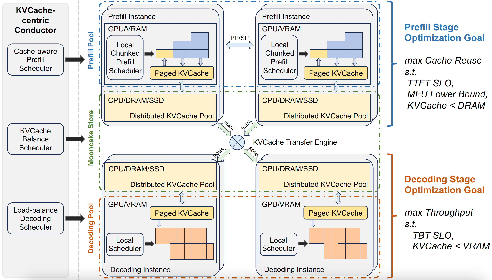
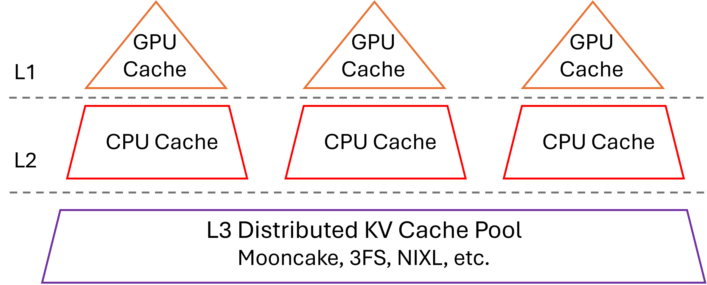
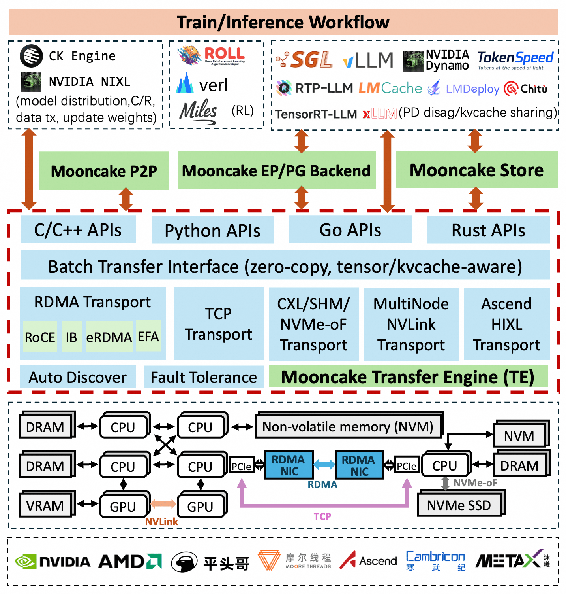
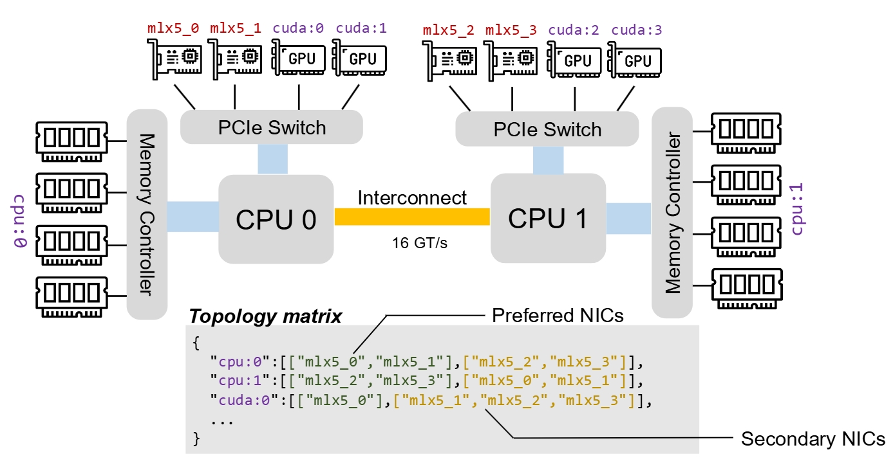
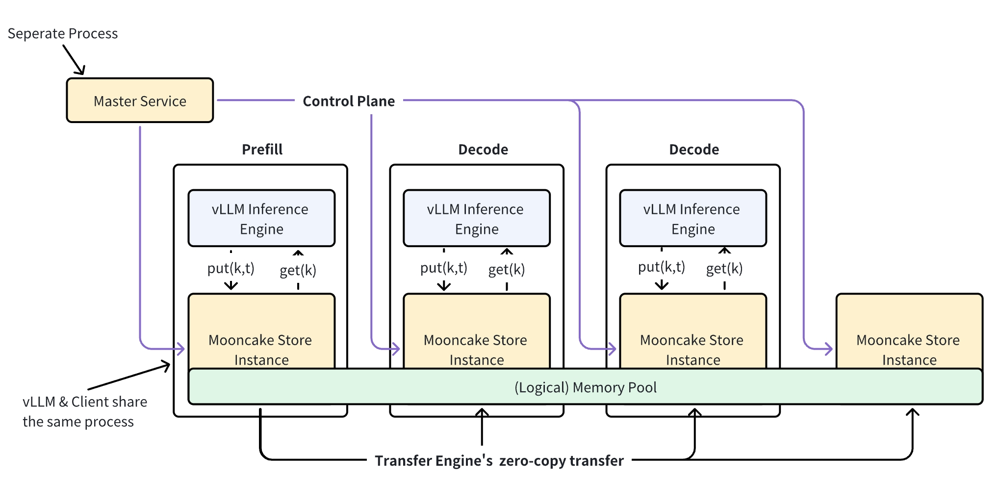

# Mooncake and SGLang: An Architecture Walkthrough Centered on KVCache

[中文](./Mooncake-SGLang-KVCache-Architecture.md) | English

- **Compiled**: 2026-11-13
- **Scope**: The KVCache-related designs in the Mooncake paper (FAST 2025), the open-source Mooncake repo and SGLang: PD disaggregation, when KVCache reuse pays off and how hit rates behave, KVCache-centric scheduling, how SGLang uses Mooncake, and how the paper's algorithms are implemented in the current code.
- **Paper**: [Mooncake: Trading More Storage for Less Computation — A KVCache-centric Architecture for Serving LLM Chatbot](https://www.usenix.org/conference/fast25/presentation/qin) (FAST 2025 Best Paper); for a full translation see [Mooncake paper full translation](./Mooncake-KVCache-Centric-Serving_en.md)
- **Code versions**: [kvcache-ai/Mooncake](https://github.com/kvcache-ai/Mooncake) main branch `b2ff9e97` (2026-11-13, latest release 0.3.14), [sgl-project/sglang](https://github.com/sgl-project/sglang) main branch `112ecb13` (2026-11-13). All code and documentation links in this note are pinned to these two commits.
- **Basis**: Chapters 1–3 draw on the paper, the Mooncake docs and the SGLang docs; Chapter 4 comes from reading the code at those two commits and was not verified by running it. The hit rates reproduced from the public traces come from replaying them under the definitions given in this note.

This note draws on the Mooncake paper, the Mooncake repository docs and the SGLang docs to trace how the two systems compute, transfer, store and reuse KVCache. Chapters 1–3 introduce the paper and the two systems at the module level, without going into code; Chapter 4 checks the current code of both repositories to explain how the paper's algorithms are implemented today.

## 1. Introduction to Mooncake

### 1.1 Why design around KVCache

LLM inference has two phases:

- **Prefill**: processes all input tokens in parallel and produces the first output token, generating along the way the Key/Value tensors of these tokens at every layer, i.e., the KVCache. This phase is compute-bound, and its latency metric is TTFT (time to first token).
- **Decode**: generates the following tokens one by one using the KVCache. This phase is bound by GPU memory bandwidth and usually raises throughput with continuous batching; its latency metric is TBT (time between tokens, often called ITL in SGLang).

The two phases have different bottlenecks, so running them in the same instance makes them interfere: the prefill of a long prompt interrupts ongoing decode and worsens TBT. Mooncake therefore runs prefill and decode on different instances (PD disaggregation), which means the KVCache computed by a prefill instance has to be sent over the network to a decode instance.

On the other hand, in an autoregressive model a token's KV depends only on the token itself and the tokens before it, so **requests with the same prefix can reuse the same KVCache**. Multi-turn conversations, agent calls with long system prompts, and repeated questions about the same long document all have plenty of reusable prefixes.

The phrase "Trading More Storage for Less Computation" in the Mooncake paper's title sums up its idea: store the KVCache once it is computed and fetch it directly next time, trading storage capacity and network bandwidth for repeated prefill computation.

### 1.2 The paper's key arguments

The paper argues from two angles that KVCache belongs in a cross-machine distributed pool: first, loading a prefix's KV from another machine is faster than recomputing it; second, the memory of a single machine cannot hold enough KV.

#### When reuse pays off

Let the request's prompt length be $`n`$, of which the first $`p`$ tokens hit in the cache. The paper writes the prefill computation for length $`n`$ as

```math
\mathrm{flops}(n) = l \times \left(a n^2 d + b n d^2\right)
```

where $`l`$ is the number of layers and $`d`$ is the model dimension. The first term in the parentheses is the attention computation, proportional to $`n^2`$; the second is the linear-layer computation, proportional to $`n`$; $`a`$ and $`b`$ are constant coefficients whose values are derived later in this subsection.

Reusing this prefix saves about $`l \times (a p^2 d + b p d^2)`$ of computation, i.e., the computation of the first $`p`$ tokens themselves, $`\mathrm{flops}(p)`$; the tokens that miss still have to attend over the whole prefix, and that part cannot be saved. The cost is moving $`p \times l \times \frac{2d}{\mathit{gqa}} \times s`$ bytes of KV into GPU memory, where $`\mathit{gqa}`$ is the ratio of query heads to KV heads and $`s`$ is the number of bytes per element. Let the GPU compute be $`G`$ and the KV loading bandwidth be $`B = \min(B_{\mathrm{h2d}}, B_{\mathrm{nic}})`$, i.e., the smaller of the host-to-GPU bandwidth and the NIC bandwidth. As long as transferring this KV takes less time than the computation it saves, reuse shortens TTFT; after rearranging, the condition is

```math
\frac{B}{G} > \frac{2ds}{\mathit{gqa} \times (apd + bd^2)}
```

The larger $`d`$ is (the larger the model), the easier this condition is to meet. Using the parameters of LLaMA3-70B ($`l = 80`$, $`d = 8192`$, $`\mathit{gqa} = 8`$, $`s = 2`$ bytes, $`a = 4`$, $`b = 22`$) and $`p = 8192`$, the paper computes a minimum bandwidth of 6 GB/s for an 8×A800 machine ($`G = 8 \times 312`$ TFLOPS) and 19 GB/s for 8×H800 ($`G = 8 \times 989`$ TFLOPS). In practice, the transfer stages (such as the NIC transfer and the host-to-GPU copy) cannot fully overlap, so the required bandwidth is even higher; the experiments in paper §5.4.2 show that saturating one 100 Gbps NIC is enough on A800 HGX machines.

**Where the coefficients $`a`$ and $`b`$ come from**. The paper's Table 1 only gives the values $`a = 4`$ and $`b = 22`$ without a derivation, so they can be derived from the structure of LLaMA3-70B. Below, one multiply-add counts as 2 floating-point operations (FLOPs), the same convention as GPU compute ratings.

**$`b`$ comes from each layer's linear layers**. For one token, a $`d_{\mathrm{in}} \times d_{\mathrm{out}}`$ weight matrix takes $`2d_{\mathrm{in}}d_{\mathrm{out}}`$ operations. LLaMA3-70B has $`d = 8192`$, an FFN intermediate dimension of $`28672 = 3.5d`$, and 1/8 as many KV heads as query heads:

| Matrix | Shape | Operations per token |
| --- | --- | --- |
| $`W_{Q}`$ | $`d \times d`$ | $`2d^2`$ |
| $`W_{K}`$, $`W_{V}`$ | each $`d \times d/8`$ | total $`0.5d^2`$ |
| $`W_{O}`$ | $`d \times d`$ | $`2d^2`$ |
| FFN gate and up | each $`d \times 3.5d`$ | total $`14d^2`$ |
| FFN down | $`3.5d \times d`$ | $`7d^2`$ |
| Total | | $`25.5d^2`$ |

For $`n`$ tokens this is $`25.5\thinspace nd^2`$, i.e., $`b \approx 25.5`$. The paper uses 22, about 14% below the derived value, and does not say why.

**$`a`$ comes from attention**. Each layer first computes the score matrix $`QK^{\top}`$ and then uses it to take a weighted sum over $`V`$. Both steps do a $`d`$-dimensional multiply-add between every query and every key (64 heads of 128 dimensions each, $`d`$ dimensions in total), each needing $`2n^2d`$ operations, $`4n^2d`$ in total, i.e., $`a = 4`$. This counts the whole $`n \times n`$ matrix; computing only the lower triangle under the causal mask halves it to $`a = 2`$. GQA only reduces the number of K and V heads, and every query head still has to be scored separately, so $`a`$ does not depend on $`\mathit{gqa}`$.

**The choice of values barely affects the conclusion**. The reuse condition can be rewritten as $`B > B_{\min}`$, where $`B_{\min}`$ is the KV loading bandwidth at which reusing the prefix takes as long as recomputing it: reuse is faster only when the actual bandwidth is above it. The paper's $`p = 8192`$ happens to equal LLaMA3-70B's $`d`$, so $`apd + bd^2`$ in the condition becomes $`(a + b)d^2`$; substituting $`s = 2`$ and $`\mathit{gqa} = 8`$ gives

```math
B_{\min} = G \times \frac{2ds}{\mathit{gqa} \times (a + b)d^2} = \frac{G}{16384 \times (a + b)}
```

that is, the minimum bandwidth is inversely proportional to $`a + b`$. Take the paper's values and an 8×A800 machine as an example: recomputing these 8192 tokens at the peak compute $`G`$ takes about 0.46 seconds, and their KV is $`8192 \times 320\ \mathrm{KiB}`$, about 2.7 GB; to load it within 0.46 seconds, the bandwidth must be at least about 5.9 GB/s.

Each cell of the table below is $`B_{\min}`$ for one pair of $`a`$, $`b`$ values on one machine. The four rows are, in order: the paper's values; attention counting only the half under the causal mask ($`a = 2`$); linear layers at the derived $`b = 25.5`$; and both at the derived values.

| $`a`$ | $`b`$ | 8×A800 | 8×H800 |
| --- | --- | --- | --- |
| 4 | 22 (paper) | 5.9 GB/s | 18.6 GB/s |
| 2 | 22 | 6.3 GB/s | 20.1 GB/s |
| 4 | 25.5 | 5.2 GB/s | 16.4 GB/s |
| 2 | 25.5 | 5.5 GB/s | 17.6 GB/s |

The smaller $`a + b`$ is, the less computation reuse saves and the higher the required bandwidth. Across the four choices $`a + b`$ ranges from 24 to 29.5, and the minimum bandwidth goes from about 12% lower to about 8% higher than with the paper's values, so the paper's 6 GB/s and 19 GB/s stay the same order of magnitude. For reference, one 100 Gbps NIC is about 12.5 GB/s: the whole A800 column is below it, consistent with "saturating one 100 Gbps NIC is enough" above; the whole H800 column is above it, so one 100 Gbps NIC is not enough and a faster NIC or several NICs transferring together are needed.

#### A single machine's cache is too small

Setting $`p = 1`$ in the earlier expression for KV bytes gives the KV size per token of LLaMA3-70B:

```math
l \times \frac{2d}{\mathit{gqa}} \times s = 80 \times \frac{2 \times 8192}{8} \times 2\ \mathrm{B} = 327{,}680\ \mathrm{B} = 320\ \mathrm{KiB}
```

Even if one machine sets aside about 1 TB of DRAM, it can only hold $`1\ \mathrm{TB} / 320\ \mathrm{KiB} \approx 3 \times 10^{6}`$ tokens. The paper used request traces of three workload types to analyze how cache capacity affects the hit rate. Of these, conversation (multi-turn chat) and tool&agent (tool and agent calls) were each sampled for one hour from Kimi's online clusters, and synthetic was built from public datasets; all three traces have been anonymized and released ([`FAST25-release/`](https://github.com/kvcache-ai/Mooncake/tree/b2ff9e9739b1305050e7a0339867dc7d26976962/FAST25-release)). The analysis concludes that a single-machine cache of 3 million tokens falls short of half the theoretical maximum hit rate in most scenarios; capacity has to reach about 50 million tokens to approach the theoretical limit, which takes the DRAM of at least 20 machines. Below, the meaning of the hit rate and of the theoretical limit is explained first, followed by the paper's data.

**Hit rate**. The paper gives no formula. Judging from how Figures 9 and 10 (global cache versus local cache) use it and from the trace format, the hit rate is counted in tokens:

```math
h = \frac{\sum_r \mathrm{hit}_r}{\sum_r n_r}
```

$`n_r`$ is the number of input tokens of request $`r`$, and $`\mathrm{hit}_r`$ is the number of tokens, counted contiguously from the start, whose KV can be found in the cache when the request arrives. Each trace record corresponds to one request and contains the arrival time, the input and output lengths, and the prefix hash ID of each block after splitting the input into blocks of 512 tokens; the same ID means this block and all tokens before it are identical. To compute $`\mathrm{hit}_r`$, check the blocks one by one starting from the first and stop at the first block not in the cache; the number of blocks found times 512 is $`\mathrm{hit}_r`$. The blocks after that are useless even if they are in the cache, because the prefix is already broken. SGLang's `cache_hit_rate` metric is also counted in tokens: the numerator is the number of hit tokens and the denominator is the number of all input tokens.

**Theoretical maximum hit rate**. It answers this question: if the cache were large enough to keep every computed KV forever, never evicting anything, at most how many input tokens of this batch of requests would not need recomputation? To compute it, replay the trace in arrival order and keep a set of the blocks already computed:

1. Take the next request and look up its blocks in the set one by one, starting from the first, and stop at the first block not in the set. The number of blocks found times 512 is this request's $`\mathrm{hit}_r`$.
2. Add all of this request's blocks to the set. The blocks that hit are already in the set; the blocks that missed have to be computed and are stored once computed.
3. Go back to step 1 for the next request. After all requests are processed, compute the hit rate with the formula above and call it $`h_{\max}`$.

In this replay, a block misses only the first time it appears and hits every time it is used after that: block IDs are prefix hashes, so a block in the set means all the blocks before it are in the set too, and the prefix cannot break before it. $`h_{\max}`$ therefore depends only on the request sequence itself, not on the machines or the cache configuration. A cache of limited capacity can only hold fewer blocks than this set and cannot hit more, so no cache's hit rate can exceed $`h_{\max}`$; that is what "theoretical maximum" means. This upper bound is far below 100%, because content that appears for the first time (new questions, new documents, the previous turn's answer) always has to be computed once, and a tail shorter than 512 tokens cannot hit either. How much each of these parts accounts for is covered in the paragraph "Why the theoretical limit is low" below.

**Hit rate at limited capacity**. A real cache has a capacity limit, and once it is full it has to drop some blocks before it can take new ones. The hit rate at limited capacity, $`h(C)`$, answers this question: when the cache can hold the KV of at most $`C`$ tokens (i.e., $`C/512`$ blocks), how much does the same batch of requests hit? The computation still replays the trace in arrival order, but replaces the set with a queue. The blocks in the queue are the blocks in the cache, ordered from left to right by the time each was last used: the leftmost is the least recently used block, the rightmost the one just used, and the queue holds at most $`C/512`$ blocks.

1. Take the next request and look up its prefix in the queue the same way, giving $`\mathrm{hit}_r`$.
2. Process each block of this request in order: if the block is already in the queue, move it to the right end; if not, put it at the right end, first dropping the leftmost block if the queue is full.
3. Go back to step 1 for the next request. After all requests are processed, compute the hit rate $`h(C)`$ with the same formula.

This rule of evicting the least recently used block is called LRU (Least Recently Used), on the reasoning that a block just used is more likely to be used again soon. The distributed KVCache pool in paper §3.2.1 also evicts by LRU (see Section 1.3).

Compared with unlimited capacity, what $`h(C)`$ loses is the cost of insufficient capacity: some blocks were computed before but had been evicted by the time they were used again; or a block is still there but a block before it has been evicted, so the prefix is broken and it cannot be used. All these blocks have to be recomputed. As capacity grows, the cache keeps only more blocks, so $`h(C)`$ only rises or stays the same; once capacity is large enough that no block needed later is evicted, $`h(C)`$ equals $`h_{\max}`$. The ratio $`h(C) / h_{\max}`$ is the fraction of the theoretical limit this capacity achieves: "falls short of half the theoretical maximum hit rate" means it is below 50%, and "approaches the theoretical limit" means it is close to 100%. Increasing $`C`$ from small to large, the capacity at which the ratio first reaches 99% (or 95%) can be taken as the required cache capacity.

**Example**. Take 4 requests, where each label stands for a block of 512 tokens: s1 and s2 are the shared system prompt; a1 is user A's turn-1 content and a2 is the content A adds in turn 2; b1 and b2 belong to user B in the same way. Each turn's input contains the system prompt and all of that user's earlier turns. The 4 requests arrive in sequence, 14 blocks in total.

First compute the theoretical maximum hit rate. With unlimited capacity, the cache is the set described above, and the replay goes as follows:

| Request | Blocks | Blocks in cache on arrival | Blocks hit | Blocks newly written |
| --- | --- | --- | --- | --- |
| R1: A turn 1 | s1 s2 a1 | none | none | s1 s2 a1 |
| R2: B turn 1 | s1 s2 b1 | s1 s2 a1 | s1 s2 | b1 |
| R3: A turn 2 | s1 s2 a1 a2 | s1 s2 a1 b1 | s1 s2 a1 | a2 |
| R4: B turn 2 | s1 s2 b1 b2 | s1 s2 a1 b1 a2 | s1 s2 b1 | b2 |

Take R2 as an example: its first two blocks s1 and s2 are already in the cache and its third block b1 is not, so it hits 2 blocks, and b1 is written to the cache once computed. The 4 requests hit 0 + 2 + 3 + 3 = 8 blocks in total. Counted in tokens, the numerator is $`8 \times 512`$ and the denominator $`14 \times 512`$, so $`h_{\max} = 8/14`$, i.e., 57.1%. The 6 blocks that miss are exactly the first appearances of s1, s2, a1, b1, a2 and b2, which no amount of capacity can save.

Next compute the hit rate at limited capacity. The two tables below show the replay with capacities of 4 blocks and 3 blocks; the queues in the tables are ordered from left to right by the rule above, with the least recently used block on the left.

With a capacity of 4 blocks:

| Request | Queue on arrival | Blocks hit | Writes and evictions | Queue afterwards |
| --- | --- | --- | --- | --- |
| R1 | empty | none | write s1, s2, a1 | s1 s2 a1 |
| R2 | s1 s2 a1 | s1 s2 | write b1 | a1 s1 s2 b1 |
| R3 | a1 s1 s2 b1 | s1 s2 a1 | evict b1, write a2 | s1 s2 a1 a2 |
| R4 | s1 s2 a1 a2 | s1 s2 | evict a1, write b1; evict a2, write b2 | s1 s2 b1 b2 |

Once R2 uses s1 and s2, these two blocks move to the right end, and the unused a1 becomes the leftmost block. When R3 arrives the queue is full; after its s1, s2 and a1 move to the right end in turn, b1 is leftmost and is evicted when a2 is written. So R4 hits only s1 and s2, and b1 has to be recomputed. 7 blocks hit in total, i.e., 50.0%, or 87.5% of the theoretical maximum.

With a capacity of 3 blocks:

| Request | Queue on arrival | Blocks hit | Writes and evictions | Queue afterwards |
| --- | --- | --- | --- | --- |
| R1 | empty | none | write s1, s2, a1 | s1 s2 a1 |
| R2 | s1 s2 a1 | s1 s2 | evict a1, write b1 | s1 s2 b1 |
| R3 | s1 s2 b1 | s1 s2 | evict b1, write a1; evict s1, write a2 | s2 a1 a2 |
| R4 | s2 a1 a2 | none | write s1, s2, b1, b2 in turn, evicting s2, a1, a2, s1 respectively | s2 b1 b2 |

After R2 hits s1 and s2, the least recently used block is a1, which is evicted when b1 is written. R3 also hits only s1 and s2; by then the least recently used block has become b1, which R3 evicts when writing a1. When a2 is written, s1, s2 and a1 in the queue have all just been used by R3; s1 is the block R3 accessed first, so its last use is the earliest, and it is evicted. R3 has 4 blocks and the cache holds only 3, so it has to push out one of R3's own blocks, and the one LRU picks is exactly the start of the prefix. When R4 arrives, s1 is no longer in the cache; s2 is still there, but the prefix already breaks at s1, so not a single block can be used. 4 blocks hit in total, i.e., 28.6%, only 50% of the theoretical maximum.

The results for the four capacities are summarized below. With a capacity of 5 blocks, the replay differs from unlimited capacity only in that R4 evicts a1 when writing b2, and exactly the same blocks hit.

| Capacity | Unlimited | 5 blocks | 4 blocks | 3 blocks |
| --- | --- | --- | --- | --- |
| Blocks hit by R1–R4 | 0, 2, 3, 3 | 0, 2, 3, 3 | 0, 2, 3, 2 | 0, 2, 2, 0 |
| Blocks hit (14 blocks in total) | 8 | 8 | 7 | 4 |
| Hit rate | 57.1% | 57.1% | 50.0% | 28.6% |
| Fraction of theoretical maximum | 100% | 100% | 87.5% | 50% |

- At capacities of 4 and 3 blocks, the blocks that hit less than the theoretical limit are the cost of insufficient capacity: with 4 blocks, R4's b1 is lost; with 3 blocks, R3's a1 and R4's s1, s2 and b1 are lost. Of these, s2 was still in the cache when R4 arrived and is unusable only because the prefix broke; all the others had been evicted.
- A capacity of 5 blocks already reaches the theoretical limit: of the 6 distinct blocks, b2, which appears last, is not used by any later request and needs no room kept for it, so the capacity this set of requests needs to reach the theoretical limit is 5 blocks.

The LRU used in the replays above looks only at the time each block was last used; it ignores where the block sits in the prefix and does not avoid the blocks the current request is using, so R3 can push out the start of its own prefix. Real systems avoid this. Mooncake Store does not evict blocks being read by a request (see Section 1.3; for how the current implementation does it, see Section 4.3). SGLang's radix tree also evicts by LRU by default, but it evicts only leaf nodes and never nodes locked by running requests ([`radix_cache.py`](https://github.com/sgl-project/sglang/blob/112ecb1303efe813723afa79606b116fa32dc79f/python/sglang/srt/mem_cache/radix_cache.py#L559-L587)), so the start of a prefix is evicted only after all the blocks after it are gone. Under either rule, the s1 and s2 that R3 reads are not evicted while it writes its new blocks, and R4 can still hit these two blocks: at a capacity of 3 blocks, the blocks hit go from 4 to 6, i.e., 42.9%, or 75% of the theoretical maximum; the results for the other capacities do not change.

The definition of $`h(C)`$ above still uses this plain LRU, because the method used below to compute the whole curve in one pass with stack distances depends on it. Replaying the three public traces, the hit rate at each capacity under the paper's Mooncake Store rule (not evicting blocks the current request is using) is almost the same as with plain LRU; under SGLang's rule it is at most about 0.5 percentage points higher (synthetic at 100,000 tokens goes from 1.3% to 1.8%), which does not change the conclusions of the reproduction below.

**The paper's data**. The paper's Figure 9 replays the traces of the three workload types, and of all three combined, in arrival order, and plots $`h(C)`$ against capacity. This analysis looks only at the request sequence, ignoring prefill compute time and hot-spot replication, which amounts to all requests sharing one cache of capacity $`C`$. The paper does not say which eviction policy Figure 9 uses. The plateau at the end of each curve is $`h_{\max}`$, and it matches the Cache Ratio in Table 2 (workload statistics): conversation 40%, tool&agent 59%, synthetic 66%. At 3 million tokens, the figure marks $`h(C) / h_{\max}`$: tool&agent 75%, synthetic 46%, conversation 41%, all three combined 48%; only tool&agent is above half. By 50 million tokens, every curve is close to its plateau. The paper says it then "nearly reaches the theoretical maximum hit rate of 100%", where the 100% refers to this ratio; the hit rate itself is only 40% to 66%.

**Reproducing it with the public traces**. With the definitions above, Figure 9 can be reproduced from these three traces. The replay steps above compute the hit rate for only one capacity at a time, but under LRU there is no need to replay once per capacity: whether an access hits depends only on the stack distance, i.e., how many distinct blocks have been accessed since this block was last accessed. Once accessed, a block sits at the right end of the queue, and it moves one place left for each further distinct block accessed; the queue holds only $`C/512`$ blocks, so the block is still in the cache when its stack distance is below $`C/512`$, and has been evicted otherwise. A prefix hit also requires all earlier blocks to hit, so each access takes the largest stack distance within the request up to the current block. Computing this value in one replay gives the whole $`h(C)`$ curve.

Take the example above again. When R3 accesses a1, a1 was last accessed in R1, and three distinct blocks, s1, s2 and b1, have been accessed since, so its stack distance is 3: a1 is still there when the cache holds 4 blocks and has been evicted when it holds only 3, consistent with the two tables above. For the 8 accesses that hit with unlimited capacity, the largest stack distance within the request up to the current block is, in order: 2, 2 for R2's s1, s2; 2, 2, 3 for R3's s1, s2, a1; and 3, 3, 4 for R4's s1, s2, b1. Of these, 4, 7 and 8 are below 3, 4 and 5 respectively, exactly the numbers of blocks hit at capacities of 3, 4 and 5 blocks. The other 6 accesses are first appearances of blocks, whose stack distance counts as infinite, and they never hit at any capacity.

The results for the three traces are below, with $`h(C) / h_{\max}`$ in parentheses:

| Capacity (tokens) | conversation | tool&agent | synthetic |
| --- | --- | --- | --- |
| 100,000 | 4.3% (11%) | 33.7% (59%) | 1.3% (2%) |
| 1 million | 5.5% (15%) | 36.0% (63%) | 14.7% (23%) |
| 3 million | 14.3% (38%) | 42.9% (75%) | 32.0% (49%) |
| 10 million | 29.8% (80%) | 53.6% (94%) | 58.8% (90%) |
| 20 million | 35.9% (96%) | 56.9% (100%) | 65.0% (100%) |
| 50 million | 37.1% (99%) | 57.0% (100%) | 65.0% (100%) |
| Unlimited ($`h_{\max}`$) | 37.3% | 57.0% | 65.0% |

The reproduction is close to the paper. $`h_{\max}`$ is 37.3%, 57.0% and 65.0%, 1 to 3 percentage points below Table 2; the ratios at 3 million tokens are 38%, 75% and 49%, against the paper's 41%, 75% and 46%; by 50 million tokens all three reach 99% or more.

This reproduction also supports the reading that the hit rate is counted in tokens: if instead each request's hit fraction is computed first and then averaged, the three traces' hit rates with unlimited capacity are 40.8%, 66.8% and 42.4%. conversation differs from Table 2 by only about 1 percentage point, but tool&agent and synthetic differ by about 8 and 24 percentage points, respectively. The token-counted reproduction is still 1 to 3 percentage points below Table 2, which may come from block granularity: the reproduction counts only complete 512-token blocks, so when a prefix breaks in the middle of a block, the identical tokens in that block are not counted. A rough estimate: assume that every request that hits at least one block and has more input after the hit has, on average, another half block (256 tokens) identical in the block where its prefix breaks; counting that as a hit gives 39.4%, 59.7% and 65.7% for the three traces, roughly matching Table 2.

To reproduce the combined curve in Figure 9, the three traces cannot simply be concatenated and replayed: each trace numbers its hash IDs from 0, so merging them directly would treat different content as the same block. Assuming the traces share no content, keeping their IDs distinct and replaying them merged by arrival time gives an $`h_{\max}`$ of 51.3% and a ratio of 45% at 3 million tokens, close to the paper's 48%.

**Why the theoretical limit is low**. As noted above, with unlimited capacity a block has to be computed only the first time it appears and hits once each time a request uses it after that. If each block is used by $`u`$ requests on average, the fraction of complete blocks that can hit is $`1 - \frac{1}{u}`$; multiplying by the share of input tokens in complete blocks (above 97% in all three traces) gives $`h_{\max}`$. To reach 90%, each block would have to be used by at least 10 requests on average, but the three traces' $`u`$ is only 1.62, 2.41 and 2.94.

Splitting requests into two kinds shows where the missed tokens come from. The shared opening of requests (such as a common system prompt) is counted as the blocks that appear in more than 100 requests; changing the threshold to 30 or 300 barely changes the numbers below. A new request shares no prefix with earlier requests beyond this shared opening; a follow-up request continues the context of some earlier request, typically the next turn of a multi-turn conversation. The last three rows of the table split all input tokens into three parts: missed tokens in new requests, missed tokens in follow-up requests, and hit tokens.

| Metric | conversation | tool&agent | synthetic |
| --- | --- | --- | --- |
| Average number of requests using each block ($`u`$) | 1.62 | 2.41 | 2.94 |
| New requests as a share of requests | 61.5% | 80.0% | 55.9% |
| Missed tokens in new requests | 52.2% | 35.8% | 33.6% |
| Missed tokens in follow-up requests | 10.4% | 7.1% | 1.4% |
| Theoretical maximum hit rate $`h_{\max}`$ | 37.3% | 57.0% | 65.0% |

- conversation: all requests share the same first block, but 61.5% of requests are new content right after that block, each needing about 10,000 tokens computed on average, which alone is 52% of all input. Follow-up requests hit 77% of their input, but they are only 38.5% of requests.
- tool&agent: requests start with only 4 distinct first blocks, and the most common appears in 46% of requests. The hits from these few shared system prompts make up 35% of all input, and that is why tool&agent's $`h_{\max}`$ is higher than conversation's. But 80% of requests are new content after the system prompt, each needing about 3800 tokens computed on average.
- synthetic: there is no shared opening (there are 1125 distinct first blocks), and 55.9% of requests hit not a single block; follow-up requests, by contrast, hit 98% of their input.

Other factors matter little. Tails shorter than 512 tokens are only 1.4% to 2.6% of input. The previous turn's answer also counts as a miss the first time it appears as input, but even if the answer's KV were stored as well, as with the decode-side KV offload in Section 2.4, the $`h_{\max}`$ of conversation and tool&agent would rise by less than 1 percentage point, because answers average only 343 and 182 tokens. The traces cover only one hour, and the replay starts from an empty cache, so the hit rate is low at the start: conversation's hit rate is 28.8% in the first 10 minutes and 41.1% in the last 10 minutes, and 40.1% counting only the second half hour. A longer time window would raise the hit rate somewhat, but not its order of magnitude.

For the hit rate to exceed 90%, the same content has to be used again and again, for example with repeated follow-up questions about the same long document, or an agent that appends only a short piece to a very long context at each step. Suppose a conversation has $`T`$ turns, each adding the same amount of new content, and all content of the first $`t-1`$ turns hits in the input of turn $`t`$; the conversation's hit rate is then $`1 - \frac{2}{T+1}`$, which takes 19 turns to reach 90%. The last 3 minutes or so of synthetic come close to this: in that period new requests are only 3% of input, and the hit rate reaches 95.5%. For reference, in the production data DeepSeek has published, 56.3% of input tokens over 24 hours hit its on-disk KV cache ([DeepSeek-V3/R1 inference system overview](https://github.com/deepseek-ai/open-infra-index/blob/main/202502OpenSourceWeek/day_6_one_more_thing_deepseekV3R1_inference_system_overview.md)), the same order of magnitude as these three traces.

The three workload types need very different capacities. Most tool&agent requests carry a predesigned, fully repeated long system prompt (paper §5.2.1), and the same prefix is often reused soon: with a capacity of only 100,000 tokens (enough for the input of a dozen or so requests), its hit rate is already 33.7%, 59% of the theoretical limit, and almost all of these hits come from the few shared system prompts mentioned earlier. conversation's reuse comes mainly from the same user's next turn, with many other requests in between; synthetic's hits are also spread out (paper §5.2.1). These two workloads need much more capacity.

**How many machines it takes**. The KV of 50 million tokens is $`5 \times 10^{7} \times 320\ \mathrm{KiB}`$, about 16.4 TB. At 1 TB per machine that takes about 17 machines; the paper's "at least 20 machines" amounts to counting about 800 GB of usable memory per machine.

**Conclusion**: taking both together, KVCache should go into a cross-machine distributed pool, paired with a transfer engine that can saturate the NIC bandwidth, so that any prefill instance can fetch reusable prefixes.

### 1.3 The system architecture in the paper



*Mooncake's overall architecture in the paper: the prefill pool, the decode pool, the distributed KVCache pool built from each machine's CPU, DRAM and SSD (Mooncake Store), and the global scheduler Conductor on the left.*

Mooncake in the paper is the PD-disaggregated inference platform used by Kimi, made up of these parts:

| Part | Role |
| --- | --- |
| Prefill pool | Runs prefill. Within an instance, a local scheduler does chunked prefill; very long inputs are split across several machines with chunked pipeline parallelism (CPP) to speed them up |
| Decode pool | Runs decode, using continuous batching |
| Mooncake Store | Builds a distributed KVCache pool from the idle CPU, DRAM and SSD of the GPU nodes, connected through an RDMA transfer engine, providing high-capacity, high-bandwidth KVCache access |
| Conductor | Global scheduler: picks the prefill and decode instances for each request and handles the replication and migration of hot KVCache, aiming to maximize effective throughput while meeting the SLOs |

The two pools have different optimization goals (the paper's Figure 2):

```math
\text{Prefill:}\quad \max\ \text{cache reuse} \quad \text{s.t.}\quad \mathrm{TTFT} \le \mathrm{TTFT}_{\mathrm{SLO}},\ \ \mathrm{MFU} \ge \mathrm{MFU}_{\min},\ \ \text{KVCache} < \text{DRAM}
```

```math
\text{Decode:}\quad \max\ \text{throughput} \quad \text{s.t.}\quad \mathrm{TBT} \le \mathrm{TBT}_{\mathrm{SLO}},\ \ \text{KVCache} < \text{VRAM}
```

where MFU is Model FLOPs Utilization. The last constraint in each formula says, respectively: the KVCache cached for prefill reuse cannot exceed the DRAM capacity, and the KVCache of all requests in a decode batch cannot exceed the GPU memory capacity.

**How KVCache is organized** (paper §3.2.1):

- KVCache is stored in the distributed pool in blocks of 16 to 512 tokens each (256 in the paper's experiments; the public traces in Section 1.2 use blocks of 512 tokens).
- Each block's key is a hash of its own content together with the whole prefix before it. The same key means this span of tokens and all tokens before it are identical, so it can be deduplicated and reused directly.
- The same key can have replicas on several nodes, to spread the read load of hot blocks.
- When the pool is full, blocks are evicted by LRU, and blocks being read by a request are not evicted.

How a request is processed (the paper's Figure 3):

1. **KVCache reuse**: after Conductor picks the prefill and decode instances, it sends the request to the prefill instance together with the block keys of the reusable prefix. The prefill instance reads the prefix KV from remote CPU memory into the GPU by key.
2. **Incremental prefill**: only the missed part is computed, and the newly produced KV is written back to CPU memory. When many tokens miss (usually more than 1000), they are run as a pipeline of chunks.
3. **KVCache transfer**: overlapping with prefill computation, the KV of each layer is streamed to the CPU memory of the decode instance's machine as soon as that layer is computed.
4. **Decode**: once all the KV has arrived, the request joins the decode instance's next batch through continuous batching.

#### KVCache-centric scheduling (paper §4)

**The problem**. For each incoming request, Conductor has to pick a prefill instance to handle it, and two problems arise in that choice (paper §4.1, §4.2):

- **Cache hits conflict with load**. The longer the prefix an instance has cached, the fewer tokens this request has to compute, so instances with long hits should be preferred. But instances with long hits also attract more requests and may already have long queues. Traditional load balancing that looks only at load wastes existing caches; looking only at hits makes requests queue up on a few instances.
- **Hot caches are concentrated on a few instances**. Caches differ greatly in how often they are used: a system prompt is used by almost every request, while the cache of a long document may be used by only one user. When a popular cache exists on only one or two instances, those instances become hot spots, and the cache should be replicated to more instances. But which caches will be used often in the future is hard to predict in advance.

**The goal**. Pick, for each request, the prefill instance with the shortest estimated TTFT, and replicate popular caches to more instances as a side effect of scheduling. If the estimated TTFT or TBT exceeds the SLO, reject the request outright.

**The approach**. In the paper's architecture, the KVCache each instance computes is stored in its machine's CPU memory, which other machines can read over RDMA (remote direct memory access). This requires the machine storing the KV to register that memory with its NIC in advance and to give the reader the memory address and remote access key; on a read, its NIC fetches the data from memory and sends it back, without involving its CPU (for how the open-source Mooncake does this, see Section 3.2). So to reuse the cache on some instance, Conductor does not have to send the request to that instance. For a request, Conductor has three options:

| Option | Queuing time | Compute | Transfer |
| --- | --- | --- | --- |
| Send it to the instance with the longest cache hit (the holder below) | The holder may be busy, with a long queue | Least | Not needed |
| Send it to another instance, using only that instance's local cache | Depends on that instance's load | Usually more than on the holder | Not needed |
| Send it to another instance that first pulls the missing KV from the holder | Depends on that instance's load | Same as on the holder | KV must be pulled |

Option 3 only reads KV from the holder machine's memory and does not use the holder's GPU; as long as the bandwidth is sufficient, pulling is faster than recomputing (see Section 1.2). The three options have different costs, and Conductor converts them all into an estimated TTFT to compare:

```math
\mathrm{TTFT}_i = T^{\mathrm{transfer}}_i + T^{\mathrm{queue}}_i + T^{\mathrm{prefill}}\left(n, \hat{p}_i\right)
```

- $`T^{\mathrm{transfer}}_i`$ is the time to pull KV, 0 when nothing is pulled.
- $`T^{\mathrm{queue}}_i`$ is the queuing time, i.e., the sum of the estimated prefill times of all requests in instance $`i`$'s queue.
- $`T^{\mathrm{prefill}}(n, \hat{p}_i)`$ is the compute time. $`n`$ is the prompt length and $`\hat{p}_i`$ is the length of the prefix whose KV is available when computation starts (cached locally plus pulled), so only the remaining $`n - \hat{p}_i`$ tokens need to be computed. The paper estimates this term with a polynomial regression model fitted on offline data.

It works in five steps (the paper's Algorithm 1):

1. **Compute prefix hits**: split the prompt into blocks, compute each block's key (see "How KVCache is organized" above), and compare them one by one with each prefill instance's cache to get the prefix length $`p_i`$ that instance $`i`$ hits locally. The longest hit across all instances is written $`p^{\ast} = \max_j p_j`$, and the instance that has it is the holder.
2. **Decide each instance's estimation mode**: with a threshold $`\theta`$ (`kvcache_balancing_threshold`), for each instance $`i`$:
   - If $`p^{\ast} / p_i > \theta`$, i.e., the holder's prefix is much longer than the local one, estimate it under option 3: $`\hat{p}_i = p^{\ast}`$, and $`T^{\mathrm{transfer}}_i`$ is the estimated time to pull the KV of the missing $`p^{\ast} - p_i`$ tokens.
   - Otherwise estimate it under option 2, using only the local cache: $`\hat{p}_i = p_i`$, $`T^{\mathrm{transfer}}_i = 0`$.

   The holder's own $`p_i`$ is $`p^{\ast}`$, so its estimate is $`\hat{p}_i = p^{\ast}`$, $`T^{\mathrm{transfer}}_i = 0`$, i.e., option 1. The two rules above mean: a pull is considered only when the holder's prefix is more than $`\theta`$ times the local one, and when the gap is small the instance computes the rest itself. As the pseudocode is written, the ratio can be taken as infinite when $`p_i = 0`$: as long as the holder has a hit, instances with no local hit are all estimated under option 3. $`\theta`$ is currently set by hand; its role is analyzed at the end of the example below.
3. **Estimate TTFT and pick the smallest**: compute each instance's $`\mathrm{TTFT}_i`$ with the formula above and pick the instance with the smallest TTFT, $`i^{\ast} = \arg\min_i \mathrm{TTFT}_i`$.
4. **Check the SLO**: pick a decode instance from the decode pool based on current load and get its estimated TBT. If $`\mathrm{TTFT}_{i^{\ast}} > \mathrm{TTFT}_{\mathrm{SLO}}`$ or $`\mathrm{TBT} > \mathrm{TBT}_{\mathrm{SLO}}`$, reject the request outright with HTTP 429.
5. **The actual pull**: the pull in step 2 was only for estimation. If the chosen instance was estimated under option 3, only now does Conductor send it the location of the KV along with the request. That instance reads the missing KV from the holder, stores it locally, and then computes the rest. Finally, Conductor updates this instance's queuing time and cache information for scheduling later requests.

**Effects**.

- For the conflict between cache hits and load: requests avoid instances with long queues while still using existing caches as much as possible.
- For hot caches being concentrated: an instance chosen after being estimated under option 3 pulls the missing KV locally in step 5, which amounts to copying the holder's cache. The busier the holder, the more often requests go to other instances, and the KV of popular prefixes is replicated to more instances along the way, with no need to predict which caches will become hot.
- The paper calls this scheduling global cache-aware scheduling. In the Figure 5 experiment, its average TTFT is 14% lower than local cache-aware scheduling (which ignores pulls when estimating).

#### Example: walking through Algorithm 1 with numbers

The numbers below are assumed to keep the arithmetic simple. The line numbers in parentheses after each step title refer to the pseudocode of Algorithm 1 in the paper, and the notation follows the text above.

**Scenario**. There are three prefill instances, A, B and C. A user sends the 4th turn of a conversation; the prompt has 16K tokens in total, made up of the system prompt, the first 3 turns of questions and answers, and this turn's new question. Each turn's prompt appends content to the previous turn's, so every cache related to this user on any instance is a prefix of this turn's prompt:

- A handled turn 3 and cached turn 3's full prompt, 12K in total.
- C handled turn 2 and cached turn 2's prompt, 8K in total.
- B has never handled this user's requests and caches only the system prompt shared by all requests, 2K in total.

The 4K added in this turn (turn 3's answer and this turn's new question) is not cached on any instance.

**Assumptions**. In the formulas, lengths are in units of 1K tokens and times in seconds.

- **Compute**: tokens that have no KV when computation starts take 0.2 seconds per 1K. The paper estimates this with a regression model fitted on offline data; here it is simplified to be linear.
- **Pull**: the KV of every 1K tokens takes 0.02 seconds to transfer. By the numbers in Section 1.2, the KV of 1K tokens of LLaMA3-70B is $`1024 \times 320\ \mathrm{KiB} = 320\ \mathrm{MiB}`$, about 0.34 GB. Transferring it within 0.02 seconds takes about 17 GB/s of bandwidth, below the 87 GB/s the paper measured on a 4×200 Gbps network (see Section 1.4). Under these assumptions, pulling a span of KV takes only one tenth of the time it takes to recompute it.
- **Queuing**: $`T^{\mathrm{queue}}_{\mathrm{A}} = 4.0`$, $`T^{\mathrm{queue}}_{\mathrm{B}} = 0.5`$, $`T^{\mathrm{queue}}_{\mathrm{C}} = 1.0`$. A has the most cache, so cache-aware scheduling sends it more requests, which makes it the busiest.
- **Threshold**: $`\theta = 2`$. The paper gives no concrete value; a footnote says it is currently tuned by hand.

Under the first two assumptions, the compute time and the pull time are:

```math
T^{\mathrm{prefill}}(n, \hat{p}_i) = 0.2 \times (n - \hat{p}_i),
\qquad
T^{\mathrm{transfer}}_i = 0.02 \times (p^{\ast} - p_i)
```

The pull time counts only when an instance is estimated under option 3; otherwise it is 0.

**Step 1: compute prefix hits** (lines 1–3). Split the prompt into blocks (each block holds 256 tokens in the paper's experiments); a 16K prompt gives 64 block keys. Each key is a hash of this block together with the contents of all the blocks before it. Look these keys up in each instance's cache in order, and stop at the first one not found:

- A finds the first 48, $`p_{\mathrm{A}} = 12\mathrm{K}`$;
- C finds the first 32, $`p_{\mathrm{C}} = 8\mathrm{K}`$;
- B finds the first 8, $`p_{\mathrm{B}} = 2\mathrm{K}`$.

The longest hit is $`p^{\ast} = 12\mathrm{K}`$, and the holder is A.

**Step 2: decide each instance's estimation mode** (lines 5–11). Compare $`p^{\ast} / p_i`$ with $`\theta`$:

| Instance | $`p_i`$ | $`p^{\ast} / p_i`$ | Estimation mode | $`\hat{p}_i`$ | $`T^{\mathrm{transfer}}_i`$ |
| --- | --- | --- | --- | --- | --- |
| A | 12K | 1 | A is the holder (option 1) | 12K | 0 |
| B | 2K | 6, greater than $`\theta`$ | first pull 10K from A (option 3) | 12K | $`0.02 \times (12 - 2) = 0.2`$ |
| C | 8K | 1.5, not greater than $`\theta`$ | local cache only (option 2) | 8K | 0 |

**Step 3: estimate TTFT and pick the smallest** (lines 12–16). Using the TTFT formula above, add the pull, queuing and compute times together:

| Instance | $`T^{\mathrm{transfer}}_i`$ | $`T^{\mathrm{queue}}_i`$ | $`T^{\mathrm{prefill}}(n, \hat{p}_i)`$ | $`\mathrm{TTFT}_i`$ |
| --- | --- | --- | --- | --- |
| A | 0 | 4.0 | $`0.2 \times (16 - 12) = 0.8`$ | 4.8 |
| B | 0.2 | 0.5 | $`0.2 \times (16 - 12) = 0.8`$ | **1.5** |
| C | 0 | 1.0 | $`0.2 \times (16 - 8) = 1.6`$ | 2.6 |

The result is B, i.e., $`i^{\ast} = \mathrm{B}`$. A has the longest prefix hit but a 4-second queue. Computing the 10K that B lacks would take B 2 seconds, while pulling it from A takes only 0.2 seconds. The pull reads the KV straight from the CPU memory of A's machine over RDMA; it does not use A's GPU or wait in A's compute queue.

**Step 4: check the SLO** (lines 17–19). Conductor then picks a decode instance from the decode pool and gets its estimated TBT, assumed here to be 80 ms. The paper's experiments set the TTFT limit to 30 seconds and the TBT limit to 100, 200 or 300 ms depending on the scenario; here $`\mathrm{TTFT}_{\mathrm{SLO}} = 30`$ seconds and $`\mathrm{TBT}_{\mathrm{SLO}} = 100`$ ms. B's 1.5 seconds and the decode instance's 80 ms are both within the limits, so the request is accepted. If even the instance with the shortest TTFT exceeds the limit, or the TBT does, Conductor assigns no instance and returns HTTP 429 directly.

**Step 5: the actual pull** (lines 20–21). The pull for B in step 2 was only an estimate. B was chosen and was estimated under option 3, so only now does Conductor send B the location of the KV along with the request. B reads the KV of these 10K tokens from A, stores it locally and then computes the remaining 4K. The estimates made for A and C trigger nothing. Conductor then updates B's queuing time and cache information for scheduling the next request.

After this, B holds the KV of this turn's full prompt: the 2K it already had, the 10K pulled from A and the 4K it just computed, with the first 12K now held by both A and B. This is how the automatic replication of hot KV mentioned above happens. If the chosen instance computes the missing prefix itself under option 2, it likewise keeps a copy of the KV, so prefixes shared by many requests (such as popular long documents and long system prompts) gradually spread across many instances.

**Comparison with other scheduling methods**. The paper's Figure 5 compares four scheduling methods; in this example they choose as follows:

| Scheduling method | How it chooses | Result in this example |
| --- | --- | --- |
| Random | picks any instance and uses only its local cache | TTFT of 2.6, 3.3 or 4.8 seconds, depending on which one is picked |
| Load balancing | picks the instance with the shortest queuing time and uses only its local cache | B, $`0.5 + 0.2 \times (16 - 2) = 3.3`$ seconds |
| Local cache-aware | estimates TTFT from each instance's local cache, without considering pulls | 4.8, 3.3 and 2.6 seconds for A, B and C; picks C, 2.6 seconds |
| Global cache-aware (Algorithm 1) | allows a pull from the holder first when estimating | B, 1.5 seconds |

Local cache-aware scheduling differs from Algorithm 1 only in step 2: it lacks the option to "pull first, then compute". On the conversation trace, the paper's Figure 5 measures average TTFTs of 19.65, 5.27, 3.58 and 3.07 seconds, in that order, and the last two differ by 14%.

**What the threshold does**. $`\theta`$ decides each instance's estimation mode before TTFTs are compared. In this example C already has 8K locally and $`p^{\ast} / p_{\mathrm{C}} = 1.5`$ does not exceed $`\theta`$, so the algorithm never considers having C pull. In fact a pull would be faster for C: $`0.02 \times (12 - 8) + 1.0 + 0.2 \times (16 - 12) = 1.88`$ seconds, shorter than 2.6 seconds, but still worse than B, so the result is the same.

The paper does not explain in detail why an instance should rather compute itself when the prefix gap is small. Based on the discussion in paper §4.1, one way to read it is:

- A pull does not use the holder's GPU, but it does use its NIC bandwidth. The holder is often the hot instance itself, which also has to send the KV it computes to decode instances, so its NIC already carries a lot of traffic.
- Transfer time depends not only on the amount of data but also on network conditions, especially whether the sender is congested, so it is harder to estimate accurately than compute time (paper §4.1).
- So when the prefix gap is small, the small estimated gain may be wiped out by congestion, and computing locally is better. The larger $`\theta`$ is, the more instances lean toward computing themselves, and the less cross-instance transfer there is.

The above is the paper's design. Neither the open-source Mooncake nor SGLang implements Algorithm 1; for how scheduling works today, see Section 4.1.

### 1.4 Results in the paper

The paper's experiments use a model built with the LLaMA3-70B architecture, and the end-to-end experiments replay the three workload types introduced in Section 1.2 on 16 machines with 8×A800 each. The main results are:

- Compared with vLLM and its prefix caching and chunked prefill variants, the effective request capacity that meets the SLO increases by 59%–498%.
- Compared with vLLM, prefill GPU time falls by 36%, 53% and 64% on the conversation, tool&agent and synthetic workloads, respectively.
- In an experiment with 10 prefill nodes, each able to cache 3 million tokens, the global cache pool's hit rate reaches up to 2.36 times that of a single machine's local cache, and prefill computation time falls by up to 48%.
- For a 128K-token input with a 95% prefix hit, prefill time is 92% lower than with no hit; counting the overhead of scheduling, transfer and cache loading, TTFT is still 86% lower.
- Transferring 40 GB of data (equivalent to the KVCache LLaMA3-70B produces for 128K tokens), the transfer engine reaches 87 GB/s and 190 GB/s on 4×200 Gbps and 8×400 Gbps networks, respectively, about 2.4 and 4.6 times TCP.
- In an experiment that simulates different network bandwidths under the synthetic workload, TTFT rises sharply when the total bandwidth is below 100 Gbps, so the paper recommends a network bandwidth of at least 100 Gbps.
- The production deployment spans thousands of machines and processes more than 100 billion tokens per day. Compared with the earlier vLLM-based system, Kimi can handle 115% and 107% more requests on its A800 and H800 clusters.

The public traces used in Section 1.2 can also be used to simulate and evaluate other KVCache reuse strategies. SGLang's benchmark tool `python -m sglang.benchmark.serving` replays these traces with `--dataset-name mooncake` and uses `--mooncake-workload` to choose which one to replay.

### 1.5 Mooncake after open-sourcing

Open-source Mooncake splits the reusable infrastructure of the inference platform described in the paper into independent components that frameworks such as SGLang, vLLM, TensorRT-LLM, LMCache and Dynamo can plug into (see [README](https://github.com/kvcache-ai/Mooncake/blob/b2ff9e9739b1305050e7a0339867dc7d26976962/README.md)). The components directly related to KVCache are:

| Component | Role | Counterpart in the paper |
| --- | --- | --- |
| Transfer Engine (TE) | A zero-copy batch data transfer library across machines and devices | The paper's KVCache Transfer Engine |
| Mooncake Store | Distributed KVCache storage, mainly in DRAM/GPU memory, extensible to SSD | The paper's Mooncake Store; the open-source version uses a Master + Client architecture |
| Conductor | A global prefix cache index that gateways and routers use for cache-aware routing | The part of the paper's Conductor that "knows where the caches are"; the router decides which instance to pick |

Inference-side parallelism strategies such as the paper's CPP, and request admission based on SLO prediction, are the job of the inference engine and the scheduling system and are not part of the open-source Mooncake components. For SGLang's counterparts, see Sections 4.2 and 4.6.

Design principles of the open-source version ([architecture.md](https://github.com/kvcache-ai/Mooncake/blob/b2ff9e9739b1305050e7a0339867dc7d26976962/docs/source/design/architecture.md)):

- **Move data efficiently and reliably**: RDMA zero-copy, bandwidth aggregation across multiple NICs, topology-aware path selection, and automatic rerouting on failure.
- **Separate the data plane from the control plane**: bulk data moves directly and only between the two processes holding the source buffer and the destination buffer; control services exchange only metadata such as locations, leases, membership and cache indexes.
- **Storage and compute are both elastic pools**: storage nodes can join and leave independently of inference processes; when the memory used for caching is contributed by a separate process (see Section 2.4), restarting an inference process does not lose the cache. On the compute side, Mooncake PG (a `torch.distributed` communication backend) only adjusts the active membership when a rank fails or recovers, without renumbering ranks.
- **Compose as needed**: use only TE for PD transfer alone, and add Store when caches need to be shared across instances.

---

## 2. How SGLang uses Mooncake

### 2.1 Overview

SGLang uses Mooncake in the following KVCache-related scenarios:

| Scenario | Problem solved | Mooncake component | How to enable |
| --- | --- | --- | --- |
| PD disaggregation | Moves the KV computed by prefill to the decode instance | Transfer Engine | `--disaggregation-mode prefill` / `decode`; the transfer backend is `mooncake` by default |
| HiCache L3 | Stores KV in a cluster-wide shared cache pool to reuse prefixes across instances and requests | Mooncake Store | `--enable-hierarchical-cache --hicache-storage-backend mooncake` |
| Direct L3 | Reads and writes KV between GPU memory and the shared pool directly, without going through host memory | Mooncake Store | `--enable-unified-cache-external-linker` (backend `mooncake` by default) |

HiCache in the table is SGLang's hierarchical prefix cache, which stores KVCache in three tiers: L1 is GPU memory, L2 is the local machine's host memory, and L3 is an optional external storage backend, of which Mooncake Store is one (see Section 2.4).

Transfer Engine and Mooncake Store play different roles in SGLang:

- **Transfer Engine** only moves bytes by address. Whom to send to and which address on the peer to write are negotiated in advance by SGLang's own control plane (HTTP + ZMQ).
- **Mooncake Store** is a cache service accessed by key. SGLang supplies only the key and a local buffer; which machine in the cluster stores the data and when it is evicted are decided by Mooncake's Master.

How the paper's request-processing flow maps onto SGLang + Mooncake:

| Paper step | In the paper | In SGLang + Mooncake |
| --- | --- | --- |
| Scheduling | Conductor picks instances by cache hits, load and SLO | sglang router picks prefill/decode instances by prefix match and load (e.g., `--policy cache_aware`) without estimating TTFT (see Section 4.1); Mooncake Conductor provides a global prefix index, but no router calls it today |
| ① KVCache reuse | Read from remote CPU memory into the GPU by block key | The prefill instance first matches the prefix in its local L1/L2 and queries Mooncake Store for the rest; when enough hits, it prefetches them into L2 over RDMA and then loads them into the GPU layer by layer |
| ② Incremental prefill | Compute only the missed part and write the new KV back to CPU memory | Chunked prefill computes the missed part; the new KV is first backed up to L2 and then written to Mooncake Store according to the write policy |
| ③ KVCache transfer | Overlap with computation, writing layer by layer to the CPU memory of the decode instance's machine | After each chunk is computed, TE writes the KV of all layers of that chunk directly into the KV pages in the decode instance's GPU memory |
| ④ Decode | Join continuous batching once all the KV has arrived | Once all the KV is written, prefill notifies decode over ZMQ and the request enters a decode batch |

Compared with the paper, SGLang's PD transfer writes directly into the peer's GPU memory, saving the step in which the decode instance loads the KV from CPU memory into GPU memory.

### 2.2 Deployment layout and shared foundations

A PD-disaggregated deployment with HiCache looks roughly like this:

```text
sglang router ──┬──▶ Prefill instance
                │      · GPU KV pool, HiCache L2 (optional)
                │      · bootstrap server (default port 8998)
                │         │
                │         │  ZMQ: decode registers KV addresses and sends each request's target page numbers
                │         │  TE: RDMA writes KV directly into decode GPU memory
                │         ▼
                └──▶ Decode instance
                       · GPU KV pool

HiCache L3 (optional):
  Each instance ──RPC (query, allocate, confirm)──▶ mooncake_master: control plane
  Each instance ══TE (KV data)═══════════▶ memory or SSD contributed by storage nodes: data plane
```

The router sends the same request to the chosen prefill and decode instances at the same time, and the two sides pair up using the bootstrap information carried in the request (the prefill's address and a room number).

**All features in one GPU process share one Transfer Engine**:

- It is created at process startup, and PD disaggregation, EPD disaggregation and elastic expert parallelism (see Section 2.7) all use it; HiCache also reuses it when the NIC, metadata and protocol settings match, avoiding duplicate memory registration and connection setup.
- Metadata uses `P2PHANDSHAKE` mode: on first access to a peer, it connects directly to the peer to exchange memory registration information (addresses, the remote access key rkey, NICs). PD disaggregation therefore needs no separate etcd or metadata service.
- The transfer protocol is set by the environment variable `MOONCAKE_PROTOCOL`: `rdma` by default and `efa` on AWS; `--disaggregation-transfer-backend mooncake_tcp` forces TCP.
- NICs are specified with `--disaggregation-ib-device`, either as a list or configured per GPU index; if unspecified, Mooncake discovers them automatically.

Installation: `pip install mooncake-transfer-engine` (for CUDA 13 use `mooncake-transfer-engine-cuda13`; platforms such as NPU and ROCm have their own packages; since 0.3.14 the default packages include the AWS EFA transport, so a separate EFA package is no longer needed). The official SGLang images pin Mooncake 0.3.14.

### 2.3 PD disaggregation: transferring KV with Transfer Engine

**Why disaggregate** ([SGLang PD docs](https://github.com/sgl-project/sglang/blob/112ecb1303efe813723afa79606b116fa32dc79f/docs/docs/advanced_features/pd_disaggregation.mdx)): when prefill and decode are scheduled together in one engine, newly arriving prefill batches frequently interrupt ongoing decode; under DP attention, while one DP worker runs prefill, the decode of the other workers is slowed down too. After disaggregation, the two phases can be optimized and scaled separately. Early tests in the Mooncake docs show that on two A10 servers, 1P1D (1 prefill instance plus 1 decode instance) has about 30% lower TBT than two instances without PD disaggregation, with similar total throughput.

**The KV transfer process of one request**:

```text
① decode ──HTTP──▶ prefill's bootstrap server: look up the prefill ranks to pair with and their parallel configuration
② decode ──ZMQ───▶ prefill: register the addresses of decode's per-layer KV buffers, the bytes per page and TP information (sent on first pairing)
③ decode ──ZMQ───▶ prefill: preallocate KV pages for a new request and send the target page numbers
④ prefill: run chunked prefill; after each chunk, compute the source and destination addresses of each layer's K/V from the page numbers
⑤ prefill ══TE═══▶ decode GPU memory: one batched RDMA WRITE writes all the KV of this chunk
⑥ prefill ══TE═══▶ decode: the last chunk also writes aux data (such as the first output token) and states such as mamba and SWA
⑦ prefill ──ZMQ──▶ decode: report success or failure; decode starts decoding after it has success notices from all relevant prefill ranks
```

Design points:

- **Control plane separated from data plane**: ① to ③ and ⑦ are SGLang's own control messages, and the address computation in ④ is also done by SGLang; only the data movement in ⑤ and ⑥ is handed to Transfer Engine. TE does not understand "pages" or "layers"; it only receives lists of (source address, destination address, length) computed by SGLang.
- **Zero-copy**: the KV pools on both sides are registered with TE once at startup. When both sides have the same TP, prefill writes the KV pages in its GPU memory directly into the KV pages in decode's GPU memory (GPUDirect RDMA), without going through CPU memory and without an intermediate buffer. A run of pages whose source and destination page numbers are both contiguous is merged into one TE read/write request, to reduce the number of requests.
- **Overlap with computation**: KV is sent per chunk, so while the next chunk computes, the previous chunk is already transferring; sending is done by a background thread and does not block the scheduling loop. The part of a request's KV that hits in the prefix cache (radix cache) in prefill's GPU memory is sent ahead, before forward starts, by default.
- **Different TP on the two sides**: in MLA models every rank holds the full KV, so whole pages can be transferred; MHA/GQA models need to be split by KV head, and the default is per-token slice transfer, i.e., each token's head slice is transferred separately as a small block. Alternatively, a GPU staging buffer can be enabled on both sides (`SGLANG_DISAGG_STAGING_BUFFER=1`): prefill first gathers on the GPU the head slices bound for the same decode rank into one contiguous buffer and sends it as a whole, and decode then scatters it back into the pages. According to the SGLang docs, throughput under high concurrency is 2 to 5 times that of per-token slice transfer.
- **NVLink transfer**: after setting `SGLANG_MOONCAKE_CUSTOM_MEM_POOL=NVLINK` (with `MC_FORCE_MNNVL=True`, for multi-node NVLink systems such as NVL72) or `INTRA_NODE_NVLINK` (with `MC_INTRANODE_NVLINK=true`, for intra-node NVLink), the KV pool is allocated by Mooncake's allocator instead, and TE can transfer KV over NVLink.
- **Failure handling**: decode periodically checks prefill's `/health` and treats prefill as dead after consecutive failures. Once a transfer from prefill to some decode fails, prefill marks that decode's session as failed, and later requests to it fail immediately; meanwhile it probes the peer in the background with TE and clears the mark automatically when the peer recovers. Both the handshake and the wait for KV have timeouts (300 seconds each by default).

**Other optional mechanisms**:

- `--disaggregation-decode-allocation-policy prefill_complete`: decode reserves KV pages only after prefill finishes computing, so a long prefill does not tie up decode's GPU memory for a long time; the cost is that chunked prefill no longer overlaps with KV transfer, and prefill has to keep this KV longer. Only the Mooncake backend supports it for now, and it must be set on both the prefill and the decode side.
- `SGLANG_MOONCAKE_MAX_TRANSFER_BATCH_INDICES`: caps the number of pages in one batched transfer, splitting very large transfers into several batches.
- When a request is canceled mid-transfer, decode waits for prefill to confirm that in-flight writes have finished before reclaiming those KV pages (on by default), so that RDMA never writes into pages that have already been reused.

**Performance** ([Mooncake docs](https://github.com/kvcache-ai/Mooncake/blob/b2ff9e9739b1305050e7a0339867dc7d26976962/docs/source/performance/sglang/sglang-benchmark-results-v1.md), H20 cluster, Qwen3-235B-A22B, 1P1D, 4×400GbE per node, 200 GB/s aggregate line rate): peak transfer bandwidth is 164.3 GB/s, about 82% of the line rate; a 32K-token prompt produces 12.62 GB of KV, which takes 76.78 ms to transfer, only 2.4% of TTFT.

**Launch example** (one machine, two GPUs, from the SGLang docs):

```bash
# prefill
python -m sglang.launch_server --model-path meta-llama/Llama-3.1-8B-Instruct \
  --disaggregation-mode prefill --port 30000 --disaggregation-ib-device mlx5_roce0
# decode
python -m sglang.launch_server --model-path meta-llama/Llama-3.1-8B-Instruct \
  --disaggregation-mode decode --port 30001 --base-gpu-id 1 --disaggregation-ib-device mlx5_roce0
# router
python -m sglang_router.launch_router --pd-disaggregation \
  --prefill http://127.0.0.1:30000 --decode http://127.0.0.1:30001 --host 0.0.0.0 --port 8000
```

### 2.4 HiCache: Mooncake Store as the L3 cache



*SGLang HiCache's three-tier cache: each instance has its own GPU cache (L1) and CPU memory cache (L2), and L3 is a distributed KV cache pool shared by all instances, which can be implemented with Mooncake, 3FS, NIXL and others.*

**Three tiers** ([SGLang HiCache design doc](https://github.com/sgl-project/sglang/blob/112ecb1303efe813723afa79606b116fa32dc79f/docs/docs/advanced_features/hicache_design.mdx)). HiCache extends SGLang's original RadixAttention (which caches prefixes only in GPU memory) to three tiers:

| Tier | Medium | Sharing scope |
| --- | --- | --- |
| L1 | GPU memory | Private to one instance |
| L2 | Local host memory | Private to one instance; even two instances on the same machine do not share it |
| L3 | Storage backend, such as Mooncake Store, 3FS or NIXL | Depends on the backend; Mooncake can span the whole cluster |

Raising `--hicache-ratio` or `--hicache-size` only enlarges the instance's private L2; reuse across instances relies on L3 alone. As L3, Mooncake is shared by the whole cluster: once the KV computed by one instance is written into Mooncake, any other instance in the cluster that meets the same prefix can use it directly, in line with the paper's idea of a "global cache pool".

**Metadata**. HiCache manages cache metadata with HiRadixTree. HiRadixTree extends RadixAttention's radix tree: each node corresponds to the KV of a contiguous span of tokens and records which tier or tiers that KV is stored in. When the KV is in L1 or L2, the node records its exact address; L3 metadata (whether the data exists and where on which machine it is stored) is not kept locally but queried from the backend on access, so there is no global metadata copy to maintain and synchronize.

**Workflow**:

```text
A new request arrives at a prefill instance
① Local match: walk HiRadixTree to get the prefix hit in L1 and L2 (metadata only, no data copied)
② Query L3: compute keys page by page for the remaining tokens and ask Mooncake in batches which pages exist
③ Prefetch: triggered only when the L3 hit exceeds a threshold (256 tokens by default); Mooncake reads from the storage nodes into local L2 in parallel over RDMA
④ Compute: compute the missed part layer by layer while loading the hit KV from L2 into the GPU layer by layer (load layer N+1 while computing layer N)
⑤ Write back: new KV is backed up from L1 to L2 and then written to L3 by a background thread; before writing it queries first, and pages already in L3 are not written again
```

**The prefetch policy** (`--hicache-storage-prefetch-policy`) decides when prefetching stops: `best_effort` stops as soon as the GPU can start computing; `wait_complete` waits for the whole prefetch to finish; `timeout` (the default, recommended by SGLang for production) waits at most

```math
T_{\mathrm{timeout}} = T_{\mathrm{base}} + \frac{n_{\mathrm{fetch}}}{1024} \times t_{\mathrm{ki}}
```

where $`n_{\mathrm{fetch}}`$ is the number of tokens missed in local L1/L2 and handed to L3 to prefetch (page-aligned); $`T_{\mathrm{base}}`$ and $`t_{\mathrm{ki}}`$ correspond to `prefetch_timeout_base` (1 second by default) and `prefetch_timeout_per_ki_token` (0.25 seconds by default), which can be changed in `--hicache-storage-backend-extra-config`. Timing starts when the request first cannot be scheduled because it is waiting for the prefetch. For example, when prefetching 32K tokens, the limit is $`1 + 32 \times 0.25 = 9`$ seconds. The SGLang HiCache design doc gives defaults of 2 seconds and 0.1 seconds, plus a 30-second cap, which do not match the current code; this note follows the code.

Whichever policy is used, once prefetching stops, the part already fetched is used for computation together with the local hit.

Other HiCache design points:

- **Write policy** (`--hicache-write-policy`): `write_through` (the default, always writes to the next tier), `write_through_selective` (writes only when the access count exceeds a threshold, backing up only hot data) and `write_back` (writes only when evicted from the tier above).
- **Consistency across GPUs**: under multi-GPU parallelism such as TP, the ranks take the minimum of their L3 hit page counts (`all_reduce(MIN)`), so all ranks use a prefix of the same length.
- **Organized by page, zero-copy**: L3 is read and written in pages. Under the `page_first` and `page_first_direct` layouts, the KV of all layers of a page is stored contiguously in host memory and can be transferred directly as one object; with the Mooncake backend one of these two layouts should normally be used (the default is `page_first`). L2 memory is allocated by Mooncake's allocator and registered with TE, so prefetch and write-back both go directly over RDMA between L2 and remote storage nodes, without intermediate copies. Each batch holds at most 128 pages and larger requests are split into several batches, so even if a prefetch stops midway, the completed batches can still be used.

**Key design**. Each page's hash is chained page by page:

```math
h_i = \mathrm{SHA256}\left(h_{i-1} \thinspace\Vert\thinspace t_i\right)
```

where $`t_i`$ is the token id sequence of page $`i`$, $`\Vert`$ denotes concatenation, and $`h_0`$ is empty by default, i.e., $`h_1 = \mathrm{SHA256}(t_1)`$. The same $`h_i`$ means the tokens of the first $`i`$ pages are identical, the same idea as the paper's block keys; different instances also compute the same $`h_i`$ for the same prefix, which is the basis of sharing across instances. When a request carries an `extra_key` or `cache_salt` field, $`h_0`$ is replaced with a namespace seed computed from these two fields, and requests with different values of these fields do not share caches.

- The object key SGLang writes into Mooncake is built from a prefix, the page hash $`h_i`$ and a suffix. Mooncake Store treats keys as opaque strings, so the boundaries of reuse and isolation are set mainly by the keys SGLang builds (see [KV Cache sharing and isolation](https://github.com/kvcache-ai/Mooncake/blob/b2ff9e9739b1305050e7a0339867dc7d26976962/docs/source/deployment/kv-cache-sharing-and-isolation.md)):
  - the key prefix includes `--served-model-name` (the model path by default), so the KV of different models never mixes, and instances that want to share a cache must use the same name;
  - `extra_backend_tag` adds another prefix layer to tell apart different releases of the same model, for example during rolling upgrades or canary releases.
- `tenant_id` is not written into the key: SGLang passes `tenant_id` when it initializes the Mooncake client, and Mooncake uses it to choose the tenant namespace and quota. Strict isolation requires the Master to start with `--enable_multi_tenants=true` and every tenant to be registered in the quota policy; when the Master is not in multi-tenant mode, Mooncake ignores `tenant_id` and puts all objects in the `default` namespace.
- In MHA/GQA models each TP rank holds only part of the KV heads, so each page is stored per rank as two objects, K and V; in MLA models the KV is identical on all ranks, so each page is stored as one object, written by a single rank to avoid duplicate storage.
- Optional group semantics (`enable_group_semantics`) make the several objects split from one page a group in Mooncake that shares a read lease and is evicted as a whole group where possible.

**Deployment** (see Mooncake's [HiCache full guide](https://github.com/kvcache-ai/Mooncake/blob/b2ff9e9739b1305050e7a0339867dc7d26976962/docs/source/deployment/integrations/sglang/hicache-integration-v1.md)):

- `mooncake_master` must be running. A metadata service is optional: by default SGLang exchanges transfer metadata peer to peer with `P2PHANDSHAKE`. When a centralized metadata service is needed, add `--enable_http_metadata_server=true` to `mooncake_master` to have the Master embed it.
- Cache capacity is contributed by processes through `global_segment_size`, in these ways:
  - **Contributed by the SGLang process itself** (`MOONCAKE_GLOBAL_SEGMENT_SIZE`): the simplest to deploy, but when the instance exits, the cache it contributed is lost with it. With the configured `global_segment_size` written as $`S`$, each rank contributes $`S / (T \times P)`$, where $`T`$ is the TP size (the attention TP size when DP attention is on) and $`P`$ is the PP size. So without DP attention, all ranks of an instance contribute $`S`$ in total; with DP attention, each attention DP group contributes $`S`$.
  - **Separate storage nodes**: start processes dedicated to contributing memory with `python -m mooncake.mooncake_store_service`. SGLang can then set its own `global_segment_size` to 0 and only read and write the cache.
  - **Local real client + SGLang dummy client**: run a `mooncake_client` process on the machine as the real client, which manages the memory pool and RDMA connections; SGLang connects to it as a dummy client in `standalone_storage` mode. When the SGLang process restarts, the cached data stays in the real client.
- Configuration sources by priority: `--hicache-storage-backend-extra-config` is highest, then the JSON file pointed to by `SGLANG_HICACHE_MOONCAKE_CONFIG_PATH`, and finally the `MOONCAKE_*` environment variables.
- Optional features: `enable_ssd_offload` (the Master must also start with `--enable_offload=true`) lets Mooncake extend cache capacity with local SSD, so an object can still be read from SSD after its memory replica is evicted (see Section 3.3); when the service is idle, `PUT /hicache/storage-backend` attaches an L3 backend and `DELETE /hicache/storage-backend` detaches it, without a restart.

Minimal launch example (one machine, simplified from the Mooncake quick-start doc):

```bash
mooncake_master --enable_http_metadata_server=true
MOONCAKE_MASTER=127.0.0.1:50051 MOONCAKE_GLOBAL_SEGMENT_SIZE=8gb \
python -m sglang.launch_server --model-path [model_path] --page-size 64 \
  --enable-hierarchical-cache --hicache-storage-backend mooncake \
  --hicache-storage-prefetch-policy timeout
```

**Results** (a multi-turn conversation test in the [Mooncake docs](https://github.com/kvcache-ai/Mooncake/blob/b2ff9e9739b1305050e7a0339867dc7d26976962/docs/source/performance/sglang/sglang-hicache-benchmark-results-v1.md), 8×H800, 8 mlx5 NICs): in the first three turns, using only L1 and L2 and adding Mooncake give the same hit rate, and L1 and L2 alone are slightly faster because nothing has to be fetched remotely. As turns accumulate, the total KV exceeds L2's capacity; with only L1 and L2 the hit rate drops and TTFT rises markedly, while with Mooncake added the hit rate stays high and TTFT grows slowly.

**Combining with PD disaggregation** (the first two ways are in [SGLang HiCache best practices](https://github.com/sgl-project/sglang/blob/112ecb1303efe813723afa79606b116fa32dc79f/docs/docs/advanced_features/hicache_best_practices.mdx)):

- **HiCache on prefill only**: prefill instances share KV, which suits scenarios where many requests share the same system prompt.
- **HiCache on prefill, asynchronous KV offload on decode**: adding `--disaggregation-decode-enable-offload-kvcache` to decode also writes the KV produced during decode (i.e., the model's answer) into L3. The next turn of a multi-turn conversation contains the previous turn's answer, so prefill can hit the previous turn's full context in L3, not just the previous turn's input.
- **Prefix reuse on decode**: with `--disaggregation-decode-enable-radix-cache`, decode first matches the prefix in its own cache (including L2 and L3 when HiCache is on) and tells prefill the hit length, so prefill transfers only the rest.

### 2.5 Direct L3: GPU memory connected directly to Mooncake Store

Direct L3 is implemented by SGLang's unified cache external linker and enabled with `--enable-unified-cache-external-linker`. It connects the radix cache directly to Mooncake Store; compared with HiCache it lacks the L2 (host memory) tier, and it cannot be enabled together with HiCache (`--enable-hierarchical-cache`). The main points are (see [`mooncake_store/README.md`](https://github.com/sgl-project/sglang/blob/112ecb1303efe813723afa79606b116fa32dc79f/python/sglang/srt/mem_cache/storage/mooncake_store/README.md)):

- At startup, the KV pool on the GPU is registered with Mooncake directly, so L3 reads and writes go directly between GPU memory and remote storage nodes, without staging through L2.
- In the default `layer_wise` mode, loading first looks up the replica locations of all keys of the batch at once, then groups the model's layers and reads them concurrently on several threads; as soon as a group of layers is read, forward is notified that it can use those layers, overlapping loading with computation. Alternatively, `load_mode` can be set to `prefetch` in `--unified-cache-external-linker-config`: reading starts when the request is enqueued, the prefix is attached to the radix tree only after all ranks finish reading, and a failed read falls back to recomputation.
- Writes work the same way as in HiCache: deduplicate first; in MLA models only one rank writes.
- Data is read and written directly in GPU memory by the Mooncake real client embedded in the SGLang process; dummy client (standalone) mode is not supported.

Launch example:

```bash
python -m sglang.launch_server --model-path [model_path] \
  --enable-unified-cache-external-linker \
  --unified-cache-external-linker-config '{"master_server_address": "127.0.0.1:50051"}'
```

### 2.6 Cache-aware routing

A key capability of the paper's Conductor is knowing which prefix caches are on each instance and picking instances accordingly. In the SGLang ecosystem, this capability comes from these pieces:

- **sglang router**: picks the prefill and decode instances for each request; policies such as `cache_aware` take prefix cache hits into account; the algorithms are described in Section 4.1.
- **Publishing the L3 key format**: SGLang publishes the key prefix, suffix and page size of the Mooncake L3 through `GET /get_hicache_l3_cache_layout` (and `/server_info`). External KV routers use them to build keys themselves and query L3, to judge which instance can reuse the most KV. This is currently available only for models such as MLA whose ranks hold identical data; with Direct L3 (see Section 2.5) on, it returns the format of the objects Direct L3 writes.
- **KV events and Mooncake Conductor**: both the SGLang engine and the Mooncake Store Master can publish KV store and remove events over ZMQ. Mooncake Conductor subscribes to these events and maintains a global index of "which prefix is on which instance and which storage tier" for gateways and routers to query (see Section 3.4), though SGLang's routers do not call it today. NVIDIA Dynamo also subscribes to Mooncake's object events, tracking the reusable KV pages in the shared pool with its own index, to route for SGLang HiCache.

### 2.7 Other uses (not directly related to KVCache)

| Use | Mooncake component | Description |
| --- | --- | --- |
| EPD disaggregation | Transfer Engine | The encoder instance writes the image embeddings output by ViT directly into the prefill instance's GPU buffer (`--encoder-transfer-backend mooncake`) |
| Global multimodal embedding cache | Mooncake Store | Add `--enable-mm-global-cache` on the encoder; embeddings of identical images are stored in Mooncake, and other instances that hit them do not need to run ViT again |
| Elastic expert parallelism | Mooncake PG + EP | `--elastic-ep-backend mooncake --moe-a2a-backend mooncake`; MoE inference keeps serving when some ranks fail |
| Weight transfer | Transfer Engine | A new instance reads weights over RDMA directly from an instance that has already loaded them (`--load-format remote_instance --remote-instance-weight-loader-backend transfer_engine`); point-to-point weight sync in RL training |

---

## 3. Mooncake module design

### 3.1 Layered structure



*Open-source Mooncake's component layers: training and inference frameworks on top, the P2P, EP/PG backend and Mooncake Store in the middle, and Transfer Engine and the various hardware interconnects below.*

From bottom to top, the layers in the figure are:

- **Hardware**: storage media such as DRAM, GPU memory and NVMe SSD, and interconnects such as RDMA NICs, NVLink, PCIe and TCP networks.
- **Transfer Engine**: a unified batch transfer interface over many transport backends, with automatic topology discovery and fault tolerance; it offers C/C++, Python, Go and Rust interfaces.
- **Upper-layer components**: Mooncake Store (the distributed cache pool), Mooncake EP/PG (elastic MoE communication) and P2P Store (weight distribution), all moving data through Transfer Engine.
- **Frameworks**: inference and training frameworks such as SGLang, vLLM, TensorRT-LLM, LMCache, Dynamo and verl call the upper-layer components, and can also call Transfer Engine directly.

Directories in the repository related to KVCache:

| Directory | Contents |
| --- | --- |
| `mooncake-transfer-engine/` | Transfer Engine and the next-generation runtime TENT |
| `mooncake-store/` | Mooncake Store (C++, Master + Client) |
| `mooncake-store-rs/` | Store-RS, the native Rust implementation of Mooncake Store (optional) |
| `mooncake-conductor/` | The global prefix cache index service |
| `mooncake-integration/`, `python/mooncake/` | Python bindings and upper-layer APIs, through which SGLang calls Mooncake |

### 3.2 Transfer Engine: the data path

**Core abstractions** (see the [Transfer Engine design doc](https://github.com/kvcache-ai/Mooncake/blob/b2ff9e9739b1305050e7a0339867dc7d26976962/docs/source/design/transfer-engine/index.md)):

- **Segment**: an address space that remote peers can read and write. Each process has a RAM Segment named after its own `local_hostname` (unique in the cluster), and the process registers the memory it exposes (DRAM or GPU memory) as Buffers in it; each Buffer records which NUMA node or GPU it is on, which is used to choose NICs. NVMe-oF storage is exposed as persistent Segments.
- **BatchTransfer**: a batch of asynchronous read/write requests. Each request gives a local address, an address in a remote Segment and a length, so large numbers of non-contiguous small pieces can be submitted at once and their completion status queried asynchronously afterward.

KVCache is by nature a large number of non-contiguous small pieces (layers × pages × K/V), and one BatchTransfer can move all the KV of a request (or a chunk). SGLang's PD transfer and Mooncake Store's reads and writes both use TE this way.

**Metadata**: each Segment's NIC list, Buffer addresses and remote access keys (rkey) are stored in a metadata service (etcd, Redis or HTTP), or can be exchanged peer to peer when a connection is set up (P2PHANDSHAKE). Metadata is used only to set up connections; the data itself never passes through the metadata service.

**Key mechanisms** (paper §3.2.3 and the design doc):



*Topology-aware path selection: the topology matrix lists preferred and secondary NICs for each memory location, and transfers favor the NICs close to that memory.*

- **Topology-aware path selection**: each machine generates a topology matrix that lists preferred and secondary NICs for each memory location (such as `cpu:0` and `cuda:0`) and shares it within the cluster. On a transfer, a "near" NIC is chosen for each of the source and destination memory locations, so that data passes only through the local NUMA node or the local PCIe Switch and avoids contending for bandwidth across CPU sockets or PCIe Switches; secondary NICs are used only when the preferred ones fail.
- **Multi-NIC aggregation**: large requests are cut into many slices (16 KB in the paper, 64 KB by default in the current implementation). In the paper, different slices can take different NICs. In the current default classic implementation, the slices of one request usually take the same local NIC, and multiple NICs work at the same time mainly because different GPUs use their own preferred NICs and different submissions randomly pick different NICs; TENT, by contrast, rotates slices across the nearest group of NICs (see Section 4.5).
- **Connection management**: connections are set up on demand; a connection pool caps the number of active connections and evicts with the SIEVE algorithm; a connection that fails because of a link error is removed from the pool and rebuilt on the next transfer.
- **Fault tolerance**: when a NIC or a path becomes unavailable, the request is automatically resubmitted on another reachable path; when resources such as RDMA contexts or completion queues have problems, they are temporarily bypassed and reused after recovery.

**Transport backends**: RDMA (RoCE, InfiniBand, eRDMA), AWS EFA, TCP, NVLink (multi-node MNNVL and intra-node NVLink), shared memory, CXL, NVMe-oF, AMD HIP, Huawei Ascend and more. Depending on the build options and hardware, TE can recognize the device memory of CUDA, MUSA, HIP, MACA, Cambricon MLU, Ascend and other devices and choose a suitable transfer path.

**TENT** (Transfer Engine NEXT, see the [design doc](https://github.com/kvcache-ai/Mooncake/blob/b2ff9e9739b1305050e7a0339867dc7d26976962/docs/source/design/tent/overview.md)) is the next-generation transfer runtime; it moves transport selection, scheduling and failure handling from the application into the runtime:

- The application only describes what data to move, and the runtime chooses a backend and path for each request; when there is no direct path, it automatically relays through host memory.
- After a large transfer is cut into slices, the slices are assigned dynamically based on each path's measured completion time and queue depth (slice spraying), so slow links naturally get less and one slow link does not drag down the whole transfer. This smart scheduling by measured performance is currently off by default, and slices are assigned in rotation across the nearest group of NICs by default (see Section 4.5).
- When a path slows down or fails, the runtime switches and retries internally; when a whole backend is unavailable, it switches to another backend, and re-enables the path once it is stable again. The application sees only a brief performance dip.

TENT is enabled with the build option `-DUSE_TENT=ON` and the runtime environment variable `MC_USE_TENT=1`; the existing TE interface stays the same.

### 3.3 Mooncake Store: the distributed KVCache pool

**Positioning** (see the [Store design doc](https://github.com/kvcache-ai/Mooncake/blob/b2ff9e9739b1305050e7a0339867dc7d26976962/docs/source/design/store/mooncake-store.md)): Store is a distributed key-value cache designed for LLM inference. Unlike general-purpose caches such as Redis, the KVCache it stores is keyed by a hash of the content (the token prefix), and the value for a given key never changes. So `Put` never overwrites an existing object, an object stays unchanged from a successful write until it is deleted, and `Get` always gets complete and correct data. To overwrite an existing object, use the Upsert interface instead.



*Mooncake Store's architecture (the figure uses vLLM as the inference engine): the Master Service is the control plane and manages metadata; the memory contributed by the Store instances forms a logical memory pool, and instances move data between each other with zero-copy transfers through Transfer Engine.*

**Two kinds of components**:

- **Master Service** (`mooncake_master`, a separate process): the control plane. It manages the joining and leaving of all segments in the storage pool, maintains object metadata and replica states, and handles space allocation, eviction, leases and tenant quotas, **without ever touching object data**.
- **Client**: the data plane, playing two roles at once:
  - as a client called by the inference engine, it issues requests such as `Put` and `Get`;
  - as a storage node, it contributes a span of memory (`global_segment_size`) to the global pool, which other Clients can read and write directly.

  With `global_segment_size` set to 0 it is a pure client that contributes no memory; with `local_buffer_size` (the size of the local buffer used for staging when the Client issues reads and writes) set to 0 it is a pure storage node that cannot issue `Put` or `Get`.

Clients have three deployment forms (for SGLang's corresponding usage, see Section 2.4):

- Embedded in the inference process.
- Split into a dummy client and a real client: one dummy client holding no resources per inference rank, and one real client per inference instance. The dummy client forwards requests to the real client over RPC, and data passes through shared memory.
- A standalone store service.

**The flow of one read and one write**:

```text
Put: Client ──PutStart──▶ Master: allocate space and return the location of each replica
     Client ══TE write═══▶ the memory of the target storage nodes (data does not pass through the Master)
     Client ──PutEnd────▶ Master: mark the replicas complete and readable (PutRevoke if the write fails)
Get: Client ──query replicas──▶ Master: return the replica locations and grant a lease
     Client ══TE read═══▶ the chosen replica; data is written directly into the caller's buffer
```

SGLang mainly uses the batch zero-copy read/write interfaces `batch_put_from` and `batch_get_into`, and the batch query interface `batch_is_exist`. For reads and writes, the caller gives the address of registered memory, and data moves directly between this memory and remote storage nodes, with no copy in the Store in between.

**Object management for KVCache**:

| Mechanism | Purpose |
| --- | --- |
| Multiple replicas | An object can have several replicas, placed on different segments, to spread hot reads. The replica count is set at write time, default 1; reads prefer a replica on the local machine (see Section 4.4) |
| Allocation strategy | Chosen when the Master starts: `random` (the default), `free_ratio_first` (prefers nodes with a high free ratio, so newly joined nodes are used sooner), `local_first` (prefers the writer's own machine) and others |
| Eviction | When usage reaches the high watermark (90% by default) or allocation fails, about 5% of objects are evicted by approximate LRU; objects with a lease or not yet completely written are not evicted (see Section 4.3) |
| Lease | Granted when an object's existence is queried or its replica locations are fetched (10 seconds by default); during the lease the object is neither deleted nor evicted, so the data stays valid while it is read |
| Soft pin | Keeps important objects (such as the KV of a system prompt) with priority, evicting them only when nothing else can be evicted; it has a fixed validity period (30 minutes by default) |
| Hard pin | Never evicted (for example, model weights); can only be deleted explicitly |
| Object group | The several objects one logical entry is split into (such as the K and V of one page) share a read lease and are evicted as a whole group where possible |
| Zombie object cleanup | When a writer crashes after PutStart and before PutEnd, the Master lets other writers take over the key after a timeout and reclaims the allocated space |

**Multi-tier storage**:

- Memory (DRAM, or GPU memory) is the main tier.
- **SSD offload** (see the [design doc](https://github.com/kvcache-ai/Mooncake/blob/b2ff9e9739b1305050e7a0339867dc7d26976962/docs/source/design/store/ssd-offload.md)): once the Master starts with `--enable_offload=true`, an object joins the queue for writing to SSD as soon as it is fully written in memory (`PutEnd`), and the memory replica is kept; adding `--offload_on_evict=true` defers writing to SSD until eviction. A background thread in the real client sends heartbeats to the Master periodically, and the Master's reply lists the objects to write to SSD; the real client writes them to local SSD and notifies the Master, which registers them as `LOCAL_DISK` replicas. When `Get` finds no memory replica, it reads from SSD automatically. "Promotion on hit" can optionally be enabled to move frequently read objects back into memory, and so can "prefetch on query", which reads objects that are only on SSD into memory as soon as their existence is queried.
- Other storage tiers: an NVMe-oF SSD pool, and replicas on a distributed file system (DFS), the latter still under development.

**High availability and operations**:

- By default there is only one Master. In HA mode, several Masters elect a leader through etcd (Redis or K8s Lease can also be used, with the Redis option still experimental). With OpLog enabled (off by default), the leader Master writes metadata changes to the OpLog and standby Masters replay it continuously; etcd-based deployments can also have standby Masters take periodic snapshots. When the leader Master fails, the newly elected Master first restores the metadata and verifies it, and only then serves requests.
- The Master detects failed Clients through heartbeats and cleans up their metadata, and Clients rejoin automatically after recovery.
- There are also multi-tenant quotas, KV event publishing (for index services such as Conductor) and Prometheus metrics.

**Store-RS**: the native Rust implementation of Mooncake Store. Routing, leases and placement information are coordinated through a metadata backend such as Redis or etcd, and normal reads and writes do not go through a central Master. It is not built by default; once built, setting `MOONCAKE_STORE_BACKEND=rs` switches the Python interface to it.

### 3.4 Conductor: the global prefix cache index

Conductor interacts with the other components as follows (see the [Conductor design doc](https://github.com/kvcache-ai/Mooncake/blob/b2ff9e9739b1305050e7a0339867dc7d26976962/docs/source/design/conductor/conductor-architecture-design.md)):

```text
vLLM / SGLang engines ────ZMQ: KV store and remove events────┐
Mooncake Store Master ─ZMQ: object store and remove events──┴──▶ Conductor (prefix index table)
Gateways / routers ──HTTP or RPC: query where a prefix can be reused──▶ Conductor
```

- **Input**: it subscribes to the KV store and remove events published by inference engines and the Store Master.
- **Unified hashing**: different engines hash token blocks differently. Each service declares its hash rule (such as `vllm_v1` or `sglang`) when it registers, and Conductor uses the same rule to hash the request's tokens at query time, so they match the blocks in the events.
- **Index contents**: partitioned by (tenant, model, LoRA, block size), each prefix block records which instances and which storage tiers it is available on: GPU (`device`), the instance's local CPU memory (`cpu_local`), the shared pool (`cpu_share`, i.e., Mooncake Store's memory) and disk (`disk`). Each partition records at most 200,000 blocks by default; beyond that, the earliest recorded batch is deleted until it falls to 90% of the cap.
- **Output**: it returns the longest reusable prefix for each instance and each storage tier, and the router picks an instance from that.

Difference from the paper: the paper's Conductor both knows where caches are and makes scheduling decisions; the open-source Conductor provides only the former and leaves scheduling decisions to the router. Conductor is not built by default (the CMake option `WITH_CONDUCTOR` defaults to `OFF`), and SGLang's routers do not call it today either (see Section 4.1).

### 3.5 Other modules

The modules in the table below are not directly related to KVCache, so only their roles are listed here:

| Module | Role |
| --- | --- |
| Mooncake EP / PG | DeepEP-style MoE dispatch/combine, and a `torch.distributed` backend that tolerates rank failures |
| P2P Store / checkpoint-engine | Point-to-point weight distribution on top of TE, for weight updates in large-scale training and reinforcement learning |
| Reshard | Plans the movement of model weights between different TP/PP/EP/DP layouts |

### 3.6 Summary: the full life of one piece of KVCache

Take as an example a PD-disaggregated deployment with both HiCache (with Mooncake Store as L3) and decode-side KV offload (see Section 2.4) enabled:

1. The first-turn request arrives and the router picks the prefill and decode instances. None of L1, L2 or L3 has KV this request can use, so prefill computes all the input tokens.
2. Each time prefill finishes a chunk, Transfer Engine writes that KV directly into decode's GPU memory. Meanwhile, the new KV is backed up to prefill's L2 and then written into Mooncake Store page by page, with each page's key containing the model name and that page's chained hash.
3. Decode generates the answer, and the KV of the answer is also offloaded to Mooncake Store.
4. The second-turn request arrives. Even if it is routed to another prefill instance, it can hit the previous turn's full context in L3: Mooncake prefetches these pages in parallel into local L2 over RDMA, and prefill only computes the new input.
5. When Mooncake Store runs short of memory, the Master evicts cold data by approximate LRU (see Section 4.3); with SSD offload enabled, by default an object is copied to SSD asynchronously right after it is written, so it can still be read from SSD after its memory replica is evicted. Mooncake also supports keeping popular objects such as system prompts with soft pin, but SGLang does not use this feature when writing KV today.

Throughout the process, metadata such as keys, replica locations and page numbers goes through the Mooncake Master or SGLang's control channel; KV data moves only through Transfer Engine, directly between GPU memory, host memory and storage nodes.

---

## 4. How the paper's algorithms are implemented in the current code

The paper describes the system Kimi used internally at the time. The open-source Mooncake and SGLang implement only part of it: some algorithms were replaced by other approaches, and some have no corresponding code yet. This chapter checks the main branches of both repositories as of 2026-11-13 (Mooncake `b2ff9e97`, SGLang `112ecb13`) and explains, item by item, how the paper's algorithms are implemented today; all code links point at these two commits.

| Algorithm in the paper | How the paper does it | Current code | See |
| --- | --- | --- | --- |
| Request scheduling (Algorithm 1) | Picks the prefill instance by estimated TTFT, having it pull KV from the holder first when needed | Implemented in neither repository. SGLang's routers pick instances by prefix match and load without estimating TTFT; prefixes an instance misses locally are prefetched by the instance itself from Mooncake Store | 4.1 |
| TTFT estimation and early rejection | Estimates prefill time with a polynomial regression fitted offline and returns HTTP 429 when the estimate exceeds the SLO | Routers do not estimate TTFT; requests are rejected based on rate limits, queue length or the lack of an available instance | 4.2 |
| Cache pool eviction | LRU; blocks being read are not evicted | Ordered by lease expiry time, which approximates LRU; objects queried or read within the 10-second lease are not evicted | 4.3 |
| Hot KV replication | Replicates as a side effect of scheduling; Store provides `change_replica` to adjust the replica count | No `change_replica`; Master has optional dynamic replication, off by default | 4.4 |
| Transfer path selection | Requests are cut into 16 KB slices, and different slices can take different NICs | Slices are 64 KB by default; in the classic implementation the slices of one request usually take the same local NIC, while TENT rotates them across the nearest group of NICs | 4.5 |
| Long-input prefill (CPP) | Long inputs are split into chunks and run on a pipeline of several machines | SGLang's pipeline parallelism with chunked prefill; chunk sizes can optionally be adjusted with a fitted quadratic function, off by default | 4.6 |

### 4.1 Request scheduling

**No code implements Algorithm 1**. Searching both repositories for `kvcache_balancing_threshold`, TTFT prediction, regression models, SLO-based rejection and the like turned up no corresponding implementation. The Mooncake docs' front page still repeats the paper's claim that prediction-based early rejection is used under overload ([`index.md`](https://github.com/kvcache-ai/Mooncake/blob/b2ff9e9739b1305050e7a0339867dc7d26976962/docs/source/index.md?plain=1#L38)), but the repository has no code for it. The open-source Conductor is only a prefix index: it returns the longest reusable prefix for each instance and each storage tier, without scoring or recommending instances (see Section 3.4). It is not built by default ([`CMakeLists.txt`](https://github.com/kvcache-ai/Mooncake/blob/b2ff9e9739b1305050e7a0339867dc7d26976962/CMakeLists.txt#L38)), and neither of SGLang's two routers calls it.

**SGLang's two routers**. `python -m sglang_router.launch_router` starts sgl-model-gateway (SMG below), which is the router described in the SGLang docs. The repository also has a newer sgl-router, whose README calls it "a slim, KV-aware router", and whose docs call SMG the gateway being deprecated ([`BENCHMARKS.md`](https://github.com/sgl-project/sglang/blob/112ecb1303efe813723afa79606b116fa32dc79f/sgl-router/BENCHMARKS.md?plain=1#L27)). The two pick prefill instances in different ways.

**SMG's `cache_aware`** is the default policy of `launch_router`, and in PD mode both prefill and decode use it when no separate policy is given ([`router_args.py`](https://github.com/sgl-project/sglang/blob/112ecb1303efe813723afa79606b116fa32dc79f/sgl-model-gateway/bindings/python/src/sglang_router/router_args.py#L54-L63), [`cache_aware.rs`](https://github.com/sgl-project/sglang/blob/112ecb1303efe813723afa79606b116fa32dc79f/sgl-model-gateway/src/policies/cache_aware.rs#L404-L470)):

- The router keeps an approximate radix tree per model, one each for prefill and decode in PD mode. The tree is organized by characters and stores the request text, not tokens. Each time an instance is chosen, the request's text is inserted into the tree under that instance's name. So the tree records which text the router sent to which instance, not the real cache on the instances.
- An instance's load is the number of requests the router itself has sent to it that have not finished yet.
- First it checks whether the load is imbalanced: if the most and least loaded instances differ by more than `balance_abs_threshold` (default 64) requests, and the largest load is more than `balance_rel_threshold` times (default 1.5) the smallest, it picks the least loaded instance directly.
- When the load is balanced, it matches the request text in the tree. If the match ratio (matched characters divided by total characters) exceeds `cache_threshold` (default 0.3), it picks the instance with the deepest match; otherwise it picks the least loaded instance.
- A background task prunes the tree every 60 seconds, removing the least recently used leaves so that each instance's entries in the tree hold no more than `max_tree_size` characters (default $`2^{26}`$).

**sgl-router's `cache_aware`** has to be selected with `--policy cache_aware`. sgl-router has two routing implementations: the default `legacy`, whose default policy is `round_robin`; and the new implementation switched on with `--chat-routing reorg`, whose default policy is `power_of_two` ([`cli.rs`](https://github.com/sgl-project/sglang/blob/112ecb1303efe813723afa79606b116fa32dc79f/sgl-router/src/config/cli.rs#L244-L262)).

- **Prefix hits come from KV events reported by the instances**. Instances publish no KV events by default; with `--kv-events-config`, they publish block store and remove events over ZMQ, from which the router maintains a tree organized by block hash that records which instances hold each prefix. The hash algorithm is the same one SGLang uses for page hashes, so the match is against the real cache on the instances, and a prefix held in either an instance's GPU memory or its host memory counts as a hit ([`tree.rs`](https://github.com/sgl-project/sglang/blob/112ecb1303efe813723afa79606b116fa32dc79f/sgl-router/src/state/kv_events/tree.rs#L95-L103)). SGLang does not report the KV it writes into Mooncake Store as events, so the router does not know which prefixes are in L3. Alternatively, `--cache-prefix-provider indexer` switches to querying a separate index service, sgl-kv-indexer.
- **Candidates**: only instances that hit at least `cache_affinity_min_matched_tokens` (default 1024) tokens are candidates, and at most 8 are kept; with many instances the cap grows to 5% of the instance count, up to 32 ([`cache_aware.rs`](https://github.com/sgl-project/sglang/blob/112ecb1303efe813723afa79606b116fa32dc79f/sgl-router/src/policies_reorg/cache_aware.rs#L225-L247)).
- **The `legacy` implementation**: when candidates differ by more than 1024 in the number of tokens they have to compute, it always picks the one with less to compute; load is used to break ties only when the gap is small ([a test in `mod.rs`](https://github.com/sgl-project/sglang/blob/112ecb1303efe813723afa79606b116fa32dc79f/sgl-router/src/policies/mod.rs#L1451-L1488)).
- **The reorg implementation**: candidates are sorted by the number of tokens this request would have to compute on each instance, from fewest to most. The default `prefer` mode picks the first candidate that passes admission checks; with no candidates it falls back to power-of-two, i.e., picks two instances at random and takes the less loaded one. In `balanced` mode it also takes an instance B from the remaining instances by power-of-two and compares it with the top candidate A: the load $`L`$ is the number of tokens waiting to be computed on an instance plus the number of tokens this request would have to compute there, and it switches to B when $`L_{A} - L_{B} > 1024`$ and $`L_{A} > 2L_{B}`$ ([`affinity.rs`](https://github.com/sgl-project/sglang/blob/112ecb1303efe813723afa79606b116fa32dc79f/sgl-router/src/policies_reorg/affinity.rs#L44-L67)).

**Comparison using the example from Section 1.3**. Again there are three prefill instances, A, B and C, which locally cache 12K, 2K and 8K tokens of this user, with queuing times of 4.0, 0.5 and 1.0 seconds; computing 1K tokens takes 0.2 seconds. In addition, assume:

- All three instances have HiCache enabled, with Mooncake Store as L3. When A handled turn 3 it wrote these 12K into Mooncake under the default `write_through`, so any instance can fetch them from L3. Prefetching the KV of 1K tokens from L3 takes 0.02 seconds, the same as the pull speed in Section 1.3.
- Converted from the queuing times, the numbers of tokens waiting to be computed on the three instances are 20K, 2.5K and 5K; the numbers of in-flight requests are 20, 3 and 5.
- In SMG's tree, the match ratio of the text equals the match ratio of the tokens.

| Scheduling method | Picks | Reason | TTFT |
| --- | --- | --- | --- |
| Algorithm 1 | B | Estimates B to be fastest after pulling 10K | 1.5 seconds |
| SMG `cache_aware` | A | In-flight requests differ by at most 17, not more than 64, so the load is not imbalanced; A's match ratio is 75%, above 0.3 | 4.8 seconds |
| sgl-router, `legacy` implementation | A | A has 4K fewer tokens to compute than C and 10K fewer than B, both more than 1024 | 4.8 seconds |
| sgl-router, reorg implementation in `prefer` mode | A | All three instances hit more than 1024 tokens, and A has the fewest tokens to compute | 4.8 seconds |
| sgl-router, reorg implementation in `balanced` mode | A | $`L_{A} = 24\mathrm{K}`$, $`L_{B} = 16.5\mathrm{K}`$, and $`L_{A}`$ is less than 2 times $`L_{B}`$ | 4.8 seconds |

If the request were sent to B, B has 2K locally and can fetch the remaining 10K from L3. HiCache starts prefetching as soon as the request enters the waiting queue ([`scheduler.py`](https://github.com/sgl-project/sglang/blob/112ecb1303efe813723afa79606b116fa32dc79f/python/sglang/srt/managers/scheduler.py#L3827-L3840)), so the 0.2-second prefetch completes during the 0.5-second queue, B only has to compute 4K, and TTFT is about $`0.5 + 0.8 = 1.3`$ seconds. In other words, Algorithm 1's option of "pulling KV from the holder first" is done in SGLang by the instance prefetching from Mooncake Store itself, with no need for the router to arrange it. But when judging hits, both routers look only at each instance's own cache (and SMG looks only at its own routing record), so they do not know that B can fetch 10K from L3; they overestimate B's cost and still leave the request on A with its long queue. The routers switch to B only when the load gap is larger, for example when the most and least in-flight requests across instances differ by more than 64 and by more than 1.5 times (SMG), or when $`L_{A}`$ is more than 2 times $`L_{B}`$ and exceeds it by more than 1024 tokens (`balanced` mode).

### 4.2 TTFT estimation and request admission

The paper estimates prefill time with a polynomial regression model fitted on offline data and adds the queuing time to get the estimated TTFT; when the estimated TTFT or TBT exceeds the SLO, it returns HTTP 429 directly (see Section 1.3). In the current code:

- **No requests are rejected by SLO**. sgl-router accepts the request header `x-sgl-ttft-slo-ms`, but uses it only to order the groups of instances (buckets) predefined in its configuration file: it compares the header with each group's configured TTFT, without looking at the instances' current load, and never rejects a request because of it ([`buckets_reorg.rs`](https://github.com/sgl-project/sglang/blob/112ecb1303efe813723afa79606b116fa32dc79f/sgl-router/src/buckets_reorg.rs#L371)).
- **Only sgl-router estimates queuing time**. With `--load-publish-endpoint`, instances report their load periodically, and sgl-router estimates the queuing time as $`N_{\mathrm{wait}} / R`$, where $`N_{\mathrm{wait}}`$ is the number of tokens waiting to be computed on the instance and $`R`$ is the prefill throughput computed from the difference between two consecutive reports, i.e., the tokens computed per second ([`engine_reported_load.rs`](https://github.com/sgl-project/sglang/blob/112ecb1303efe813723afa79606b116fa32dc79f/sgl-router/src/state/load_monitor/engine_reported_load.rs#L523-L547)). It is the first metric compared when ranking the load of prefill instances. This estimate extrapolates linearly from measured throughput, ignores that attention computation grows with the square of the length, and does not include this request's own compute and transfer time. SMG does not estimate time.
- **The fitted model is used only for chunking**. The closest thing in SGLang to the paper's regression model is pipeline parallelism's dynamic chunking: at startup it measures the time of 128 prefills, fits a quadratic function by least squares, and uses it to decide the size of the next chunk (see Section 4.6), not to pick instances or reject requests.
- **Requests are rejected based on rate limits and queue length**:
  - SMG does not rate-limit by default (`max_concurrent_requests` defaults to `-1`). When it is set, requests over the limit enter a waiting queue (at most 100 by default, waiting at most 60 seconds); it returns 429 when the queue is full and 408 when the wait times out ([`middleware.rs`](https://github.com/sgl-project/sglang/blob/112ecb1303efe813723afa79606b116fa32dc79f/sgl-model-gateway/src/middleware.rs#L600-L613)).
  - sgl-router can set per-instance caps on in-flight requests, tokens waiting to be computed, KV usage and so on (some only in the reorg implementation), none of which is set by default. When every instance is over its caps, it returns 503. sgl-router itself never returns 429.
  - An SGLang instance's `--max-queued-requests` is unset by default; when set, new requests are rejected with 503 once the waiting queue is full ([`scheduler.py`](https://github.com/sgl-project/sglang/blob/112ecb1303efe813723afa79606b116fa32dc79f/python/sglang/srt/managers/scheduler.py#L3904-L3938)); this option has no effect in PD disaggregation mode. The environment variable `SGLANG_REQ_WAITING_TIMEOUT` can end requests that wait too long with 503, and is off by default.

### 4.3 Cache pool eviction

In the paper, Mooncake Store evicts blocks by LRU and does not evict blocks being read by a request (§3.2.1). The current Mooncake Store manages objects, and SGLang writes its objects page by page (see Section 2.4). Eviction follows these rules:

1. **When it triggers**: the Master's eviction thread checks every 10 milliseconds and starts a round of eviction when memory usage exceeds the high watermark (90% by default) ([`master_service.cpp`](https://github.com/kvcache-ai/Mooncake/blob/b2ff9e9739b1305050e7a0339867dc7d26976962/mooncake-store/src/master_service.cpp#L9626-L9640)). When `PutStart` cannot allocate space, that write simply fails and the client does not retry; the Master also notes that eviction is needed, and the eviction thread frees space afterward.
2. **How much to evict**: each round's target is $`\max(r, u - h + r)`$, where $`u`$ is the current memory usage, $`h`$ is the high watermark (0.9 by default) and $`r`$ is the eviction ratio (0.05 by default). For example, at a usage of 0.95 the target is to evict 10% of the objects. The ratio counts objects, not bytes, and each tenant namespace evicts its own share.
3. **What goes first**: objects are ordered by lease expiry time, earliest first. When an object is checked for existence (`ExistKey`) or its replica locations are read (`GetReplicaList`), its lease is extended to 10 seconds after the current time; when a write completes (`PutEnd`), its lease is set to the current time. So recently read objects sort later, which approximates LRU, except that a write sorts like a read from 10 seconds earlier. To keep ordering fast, expiry times are bucketed in 100-millisecond buckets ([`lease_eviction_index.h`](https://github.com/kvcache-ai/Mooncake/blob/b2ff9e9739b1305050e7a0339867dc7d26976962/mooncake-store/include/metadata/lease_eviction_index.h#L42-L47)).
4. **What is not evicted**: objects whose lease has not expired, i.e., objects queried or read within the last 10 seconds; hard-pinned objects; and objects not yet completely written. Soft-pinned objects are skipped at first and evicted only when other objects are not enough.

The paper requires that blocks being read are not evicted; the current implementation does not track which objects are being read, and approximates this with the 10-second lease instead. A reader that finishes before the lease expires is safe; if the lease has expired by the time the read finishes, the client reports an error ([`client_service.cpp`](https://github.com/kvcache-ai/Mooncake/blob/b2ff9e9739b1305050e7a0339867dc7d26976962/mooncake-store/src/client_service.cpp#L1658-L1661)). SGLang's Direct L3 renews the lease when a read takes a long time (SGLang [#49043](https://github.com/sgl-project/sglang/pull/49043)).

[#5448](https://github.com/kvcache-ai/Mooncake/pull/5448), merged on 2026-11-13, splits the eviction index into 512 shards, each with its own lock, and lets eviction run on several threads in parallel: the thread count is set automatically from the object count, one thread per 16 million objects, up to 64. With fewer than 16 million objects it still uses one thread, and with OpLog or `offload_on_evict` enabled it still runs serially ([`evictor.cpp`](https://github.com/kvcache-ai/Mooncake/blob/b2ff9e9739b1305050e7a0339867dc7d26976962/mooncake-store/src/eviction/evictor.cpp#L18-L40)).

The GPU-memory and host-memory caches inside an SGLang instance also evict by LRU by default, evicting only leaf nodes and never nodes locked by running requests (see the example in Section 1.2); `--radix-eviction-policy` also offers policies such as `lfu`, `slru`, `priority` and `tlru` ([`memory.py`](https://github.com/sgl-project/sglang/blob/112ecb1303efe813723afa79606b116fa32dc79f/python/sglang/srt/arg_groups/fields/memory.py#L25-L44)).

### 4.4 Hot KV replication

In the paper, replicating hot KV is a by-product of scheduling: when a request is sent to an instance other than the holder, that instance pulls the missing KV and keeps it locally (see Section 1.3); Mooncake Store also provides a `change_replica` interface through which Conductor adjusts the replica count of each block (paper §3.2.2). In the current code:

- **Replicas local to an instance**: the KV an SGLang instance prefetches from L3 stays in the machine's L2, so the next time this instance meets the same prefix it hits directly in L2. This has the same effect as "pull and keep locally" in the paper, again with no need for the router to arrange it.
- **No `change_replica`**: the replica count is set by the writer at write time (`replica_num`, default 1, see [`replica.h`](https://github.com/kvcache-ai/Mooncake/blob/b2ff9e9739b1305050e7a0339867dc7d26976962/mooncake-store/include/replica.h#L108-L112)). SGLang does not set this parameter when writing KV, so each object has only one memory replica. After a write, apart from the dynamic replication below, replicas can only be added by submitting a copy task by hand (the Python interface `create_copy_task`); a move task (`create_move_task`) only moves a replica to another segment and does not add replicas.
- **Optional dynamic replication**: when the Master starts with `--dynamic_replication_mode=enforce`, it counts object reads. An object with fewer memory replicas than `dynamic_replication_max_memory_replicas` (default 2) that is read at least 8 times within a 10-second window (`dynamic_replication_admission_qps_threshold`, default 0.8, times 10 seconds) gets another memory replica. The new replica goes on a segment whose usage stays below 85% after the copy, preferring other machines ([`dynamic_replication_controller.cpp`](https://github.com/kvcache-ai/Mooncake/blob/b2ff9e9739b1305050e7a0339867dc7d26976962/mooncake-store/src/dynamic_replication_controller.cpp#L347-L382)). This option is `off` by default; set to `observe`, it only logs.
- **Which replica is read**: `Get` prefers a memory replica on the local machine; with no local replica, and with neither NIC affinity nor replica scoring configured, it reads the first memory replica in the list the Master returns, neither randomly nor by load ([`replica_selection.h`](https://github.com/kvcache-ai/Mooncake/blob/b2ff9e9739b1305050e7a0339867dc7d26976962/mooncake-store/include/replica_selection.h#L133-L194)). By this rule, extra replicas mainly benefit readers on the same machine as the replica, while readers on other machines still converge on the first replica. With `MC_STORE_REPLICA_SCORING=1`, remote replicas are scored by transfer protocol and chosen among accordingly.

### 4.5 Transfer engine path selection and slicing

In paper §3.2.3, each machine generates a topology matrix listing preferred and secondary NICs for each memory location; requests are cut into 16 KB slices, and each slice can take a different path so that all NICs work together (see Section 3.2). The current Transfer Engine has two implementations, the classic one and TENT, and uses the classic one by default.

**The classic implementation**:

- **Topology matrix**: the preferred NICs of CPU memory are all NICs on the same NUMA node; the preferred NICs of GPU memory are those with the shortest PCIe distance to that GPU (chosen only among NICs on the same NUMA node when there are any). All other NICs are secondary ([`topology.cpp`](https://github.com/kvcache-ai/Mooncake/blob/b2ff9e9739b1305050e7a0339867dc7d26976962/mooncake-transfer-engine/src/topology.cpp#L570-L585)).
- **Which NIC**: one of the preferred NICs is picked at random, or in rotation with `MC_PATH_ROUNDROBIN=1`; with no preferred NIC, one is picked from the secondary NICs ([`topology.cpp`](https://github.com/kvcache-ai/Mooncake/blob/b2ff9e9739b1305050e7a0339867dc7d26976962/mooncake-transfer-engine/src/topology.cpp#L1015-L1046)).
- **At what granularity**: since 2025-09 ([#772](https://github.com/kvcache-ai/Mooncake/pull/772)), the local NIC is picked once per request, so all slices of a request usually take the same local NIC. Since 2026-09 ([#4259](https://github.com/kvcache-ai/Mooncake/pull/4259)), consecutive requests and slices in the same batch submission that fall in the same registered memory region also reuse the local and remote NICs picked last; the choice is redone only on moving to another registered memory region or on retry ([`rdma_transport.cpp`](https://github.com/kvcache-ai/Mooncake/blob/b2ff9e9739b1305050e7a0339867dc7d26976962/mooncake-transfer-engine/src/transport/rdma_transport/rdma_transport.cpp#L1416-L1443)). Inferring from the code (not measured), the KV in one registered memory region within one submission usually goes through a single local NIC; multiple NICs work at the same time mainly because each GPU uses its own preferred NIC, and because different submissions randomly pick different NICs.
- **Slice size**: 64 KB by default (`MC_SLICE_SIZE`), not the paper's 16 KB. A remainder of at most 16 KB is merged into the previous slice, so the last slice is at most 80 KB.
- **Retries and failure handling**: each slice is tried at most 9 times (`MC_RETRY_CNT`), and retries no longer pick at random but move on to the next NIC in order. If the path from a local NIC to a given NIC on the peer fails 5 times within 5 seconds, it is paused for 30 seconds (and paused immediately when a failure was caused by the peer or the link and another path is available); if a local NIC fails on 32 consecutive polls, it is paused for 5 seconds; when a NIC port fails, it is also removed from the topology the machine publishes, so peers stop picking it.
- **Connection pool**: connections are evicted with SIEVE, each local NIC allows at most 65536 connections by default (also limited by the NIC's QP count), and each connection has 2 QPs ([`config.h`](https://github.com/kvcache-ai/Mooncake/blob/b2ff9e9739b1305050e7a0339867dc7d26976962/mooncake-transfer-engine/include/config.h#L56-L75)).

**TENT**:

- **Slicing**: a request is cut into at most 64 slices, or at most 32 when the source data is in GPU memory or the operation is a write; each slice size is a multiple of 64 KB, and once the slice count hits the cap, larger requests get larger slices. A last slice smaller than 25% of a slice is merged into the previous one.
- **Assignment**: by default slices are assigned in rotation across the group of NICs nearest the source memory ([`quota.cpp`](https://github.com/kvcache-ai/Mooncake/blob/b2ff9e9739b1305050e7a0339867dc7d26976962/mooncake-transfer-engine/tent/src/transport/rdma/quota.cpp#L125-L159)). The assignment by measured performance described in Section 3.2 has been off by default since 2026-11-13 ([#5445](https://github.com/kvcache-ai/Mooncake/pull/5445)), because of scheduling problems on some platforms; setting `transports/rdma/enable_smart_scheduling` to `true` in `MC_TENT_CONF` turns it back on. When it is on, each NIC's score is

```math
\mathrm{score} = \frac{B_{\mathrm{inflight}} + B_{\mathrm{slice}}}{\bar{R}} \times w
```

where $`B_{\mathrm{inflight}}`$ is the number of bytes not yet transferred on this NIC, $`B_{\mathrm{slice}}`$ is the number of bytes in this slice, $`\bar{R}`$ is the moving average of the measured bandwidth, and $`w`$ is a distance weight, for GPU memory for example: 1 for the NICs nearest by PCIe, 5 for the other NICs on the same NUMA node, and 10 for the rest; a small random perturbation is also added to the score. When slices are assigned one at a time (every slice of a small request is assigned this way), the NIC with the lowest score is picked; when the slices of a large request are assigned at once, they are split across NICs in proportion to the inverse of their scores, with a round-robin assignment every 100th time so that every NIC gets fresh measurements.

### 4.6 Long-input prefill

The paper accelerates long inputs with chunked pipeline parallelism (CPP): every X machines form a pipeline, a request's input is split into chunks, and different chunks of the same request can be computed on different machines at the same time. The paper did not adopt sequence parallelism, on the grounds that sequence parallelism still needs a lot of cross-machine communication, which lowers MFU and competes with KVCache transfer for the network; and on shorter requests its MFU is also worse than single-machine tensor parallelism (§3.3).

SGLang's pipeline parallelism (`--pp-size`) with chunked prefill does the same, and uses asynchronous point-to-point communication to overlap computation with communication between pipeline stages ([SGLang PP docs](https://github.com/sgl-project/sglang/blob/112ecb1303efe813723afa79606b116fa32dc79f/docs/docs/advanced_features/pipeline_parallelism.mdx)). With a fixed chunk size, later chunks attend over longer prefixes and take longer, leaving idle time in the pipeline. For this, SGLang offers dynamic chunking (`--enable-dynamic-chunking`, off by default, effective only when PP is greater than 1), which works as follows ([`dynamic_chunk_sizer.py`](https://github.com/sgl-project/sglang/blob/112ecb1303efe813723afa79606b116fa32dc79f/python/sglang/srt/managers/scheduler_components/dynamic_chunk_sizer.py#L351-L412)):

1. At startup it measures the time of 128 prefills of different lengths and fits $`f(l) = \alpha l^2 + \beta l + \gamma`$ by least squares, where $`l`$ is the sequence length.
2. Taking `--chunked-prefill-size` as the initial chunk size $`x_{0}`$, each chunk's target time is $`f(x_{0}) - f(0)`$.
3. When the prefix computed so far has length $`L`$, it solves $`f(L + x) - f(L) = f(x_{0}) - f(0)`$ to get the next chunk size $`x`$.
4. It smooths with a factor of 0.75 (`SGLANG_DYNAMIC_CHUNKING_SMOOTH_FACTOR`): the chunk size is $`x_{0} + 0.75(x - x_{0})`$, no smaller than $`x_{0}/4`$, and finally rounded down to a multiple of the larger of 64 and the page size.

For example, estimating times with the computation formula from Section 1.2 ($`a = 4`$, $`b = 22`$, and $`d = 8192`$ for LLaMA3-70B), with an initial chunk size of 8192 tokens:

| Prefix length computed so far $`L`$ | Solution of the equation | Chunk size after smoothing and rounding |
| --- | --- | --- |
| 8192 | 6427 | 6848 |
| 32768 | 3813 | 4864 |
| 131072 | 1413 | 3072 |

The longer the prefix, the smaller the next chunk, and the closer the chunks' times. Smoothing makes chunks somewhat larger than the solution of the equation, so later chunks are still a little slower; the closer the factor is to 1, the closer the chunk size is to the solution. The SGLang docs recommend a factor of 0.6–0.85 and an initial chunk size 2–3 times the best fixed chunk size.

SGLang also offers prefill context parallelism (prefill CP), which spreads a request's new input tokens across a group of ranks that compute attention at the same time ([docs](https://github.com/sgl-project/sglang/blob/112ecb1303efe813723afa79606b116fa32dc79f/docs/docs/advanced_features/prefill_cp.mdx)). This belongs to the sequence parallelism family that the paper did not adopt.

---

## References

### Paper and traces

- [Mooncake FAST'25 paper](https://github.com/kvcache-ai/Mooncake/blob/b2ff9e9739b1305050e7a0339867dc7d26976962/FAST25-release/Mooncake-FAST25.pdf)
- [FAST'25 trace notes](https://github.com/kvcache-ai/Mooncake/blob/b2ff9e9739b1305050e7a0339867dc7d26976962/FAST25-release/README.md)

### Mooncake docs

- [Overall architecture](https://github.com/kvcache-ai/Mooncake/blob/b2ff9e9739b1305050e7a0339867dc7d26976962/docs/source/design/architecture.md)
- [Transfer Engine design](https://github.com/kvcache-ai/Mooncake/blob/b2ff9e9739b1305050e7a0339867dc7d26976962/docs/source/design/transfer-engine/index.md), [TENT overview](https://github.com/kvcache-ai/Mooncake/blob/b2ff9e9739b1305050e7a0339867dc7d26976962/docs/source/design/tent/overview.md)
- [Mooncake Store design](https://github.com/kvcache-ai/Mooncake/blob/b2ff9e9739b1305050e7a0339867dc7d26976962/docs/source/design/store/mooncake-store.md), [SSD offload design](https://github.com/kvcache-ai/Mooncake/blob/b2ff9e9739b1305050e7a0339867dc7d26976962/docs/source/design/store/ssd-offload.md)
- [Conductor architecture](https://github.com/kvcache-ai/Mooncake/blob/b2ff9e9739b1305050e7a0339867dc7d26976962/docs/source/design/conductor/conductor-architecture-design.md)
- [Mooncake × SGLang HiCache design](https://github.com/kvcache-ai/Mooncake/blob/b2ff9e9739b1305050e7a0339867dc7d26976962/docs/source/design/hicache-design.md)
- [SGLang integration: PD disaggregation](https://github.com/kvcache-ai/Mooncake/blob/b2ff9e9739b1305050e7a0339867dc7d26976962/docs/source/deployment/integrations/sglang/pd-disaggregation.md), [HiCache quick start](https://github.com/kvcache-ai/Mooncake/blob/b2ff9e9739b1305050e7a0339867dc7d26976962/docs/source/deployment/integrations/sglang/hicache-quick-start.md), [HiCache full guide](https://github.com/kvcache-ai/Mooncake/blob/b2ff9e9739b1305050e7a0339867dc7d26976962/docs/source/deployment/integrations/sglang/hicache-integration-v1.md)
- [KV Cache sharing and isolation](https://github.com/kvcache-ai/Mooncake/blob/b2ff9e9739b1305050e7a0339867dc7d26976962/docs/source/deployment/kv-cache-sharing-and-isolation.md)
- [SGLang PD performance](https://github.com/kvcache-ai/Mooncake/blob/b2ff9e9739b1305050e7a0339867dc7d26976962/docs/source/performance/sglang/sglang-benchmark-results-v1.md), [SGLang HiCache performance](https://github.com/kvcache-ai/Mooncake/blob/b2ff9e9739b1305050e7a0339867dc7d26976962/docs/source/performance/sglang/sglang-hicache-benchmark-results-v1.md)

### SGLang docs

- [PD disaggregation](https://github.com/sgl-project/sglang/blob/112ecb1303efe813723afa79606b116fa32dc79f/docs/docs/advanced_features/pd_disaggregation.mdx)
- [HiCache design](https://github.com/sgl-project/sglang/blob/112ecb1303efe813723afa79606b116fa32dc79f/docs/docs/advanced_features/hicache_design.mdx), [HiCache best practices](https://github.com/sgl-project/sglang/blob/112ecb1303efe813723afa79606b116fa32dc79f/docs/docs/advanced_features/hicache_best_practices.mdx), [Attaching an L3 backend at runtime](https://github.com/sgl-project/sglang/blob/112ecb1303efe813723afa79606b116fa32dc79f/docs/docs/advanced_features/hicache_storage_runtime_attach_detach.mdx)
- [EPD disaggregation](https://github.com/sgl-project/sglang/blob/112ecb1303efe813723afa79606b116fa32dc79f/docs/docs/advanced_features/epd_disaggregation.mdx)
- [Mooncake L3 backend notes](https://github.com/sgl-project/sglang/blob/112ecb1303efe813723afa79606b116fa32dc79f/python/sglang/srt/mem_cache/storage/mooncake_store/README.md)
