# Mooncake Transfer Engine 学习笔记：代码结构、调用链、本机测试与 HiCache 链路

中文 | [English](./Mooncake-Transfer-Engine-Notes_en.md)

- **整理日期**: 2026-11-23
- **范围**: 经典 Transfer Engine（TE）的代码结构、核心数据结构、调用链、阅读方法和本机测试，TE 与 TENT 的区别，以及 SGLang HiCache 如何经 Mooncake Store 用到 TE。
- **代码版本**: [kvcache-ai/Mooncake](https://github.com/kvcache-ai/Mooncake/tree/301261358eef0b13fa55645ccde4a988f1ca7505) main 分支 `30126135`（2026-11-20），[sgl-project/sglang](https://github.com/sgl-project/sglang/tree/f5149f367b8f0fd728bca44f4e77c8fc102ad803) main 分支 `f5149f367b`（2026-11-20）。文中的 `文件:行号` 都对应这两个提交。
- **实测环境**: 单机 8 卡 GPU，400Gb/s RoCE 网卡（mlx5），两个进程经单块网卡回环测试；带宽数字来自这台机器，不代表跨机性能。
- **依据**: 阅读上述代码和 Mooncake 文档，并在上述单机上跑了第 6 节列出的部分测试。

术语的通俗解释见同目录的 [Mooncake Transfer Engine 源码阅读术语手册](./Mooncake-Transfer-Engine-Glossary.md)。

全文分为：

1. 目录结构
2. TE 与 TENT
3. 核心概念与数据结构
4. 调用链
5. 阅读建议
6. 本机测试
7. SGLang HiCache（L1/L2/L3）读写链路
8. 附录一：阅读自测参考答案
9. 附录二：更多问答

文中"我"指发起读写的 initiator，"对端"指被读写的 target。

## 1. 目录结构

`mooncake-transfer-engine` 里有两套引擎：**经典 TE**（`include/` + `src/`）和**新一代 TENT**（`tent/`）。

```text
mooncake-transfer-engine/
├── include/, src/        经典 TE
├── tent/                 TENT（自带 runtime / transport / plugin）
├── allocator/            Ascend NPU 内存分配器
├── nvlink-allocator/     NVLink/Fabric 内存分配器
├── ubshmem-allocator/    UB 共享内存分配器
├── benchmark/            统一压测框架，支持 TE 和 TENT
├── example/              transfer_engine_bench、validator、HTTP 元数据服务示例
├── rust/                 Rust 绑定
├── scripts/              运维和测试脚本（如 real_rdma_link_failover.sh）
└── tests/                经典 TE 的单测和集成测试，按功能命名
```

经典 TE 的主要文件（各自的职责见图 4）：

- `include/transfer_engine.h`、`src/transfer_engine.cpp`、`src/transfer_engine_impl.cpp`：对外 API。`transfer_engine_c.h/.cpp` 是 C ABI，Python 绑定在仓库根目录的 `mooncake-integration/transfer_engine/transfer_engine_py.cpp`。
- `src/multi_transport.cpp`：batch 管理和 Transport 选择。
- `src/transfer_metadata.cpp`、`src/transfer_metadata_plugin.cpp`：元数据与握手。
- `src/topology.cpp`、`src/memory_location.cpp`、`src/config.cpp`：网卡拓扑、内存位置判断、`MC_*` 环境变量。
- `src/transport/`：各传输后端，每种一个目录。RDMA 在 `rdma_transport/`（`rdma_transport.cpp`、`worker_pool.cpp`、`rdma_context.cpp`、`rdma_endpoint.cpp`、`endpoint_store.cpp`），其他有 tcp、shm、nvlink、intranode_nvlink、nccl、hip、musa、maca、ascend、efa、cxi、cxl、nvmeof 等。

TENT 的对外 API 在 `tent/include/tent/transfer_engine.h`，核心在 `tent/src/runtime/`（传输选择、调度、QoS、staging），传输实现在 `tent/src/transport/`，平台探测在 `tent/src/platform/`，元数据后端在 `tent/src/metastore/`。

## 2. TE 与 TENT

资料来源：`docs/source/design/tent/overview.md`、`failover.md`、`docs/source/api-reference/cpp/tent.md`、`src/transfer_engine.cpp`。TENT 是经典 TE 的后继版本，需 `-DUSE_TENT=ON` 编译（默认 OFF）。

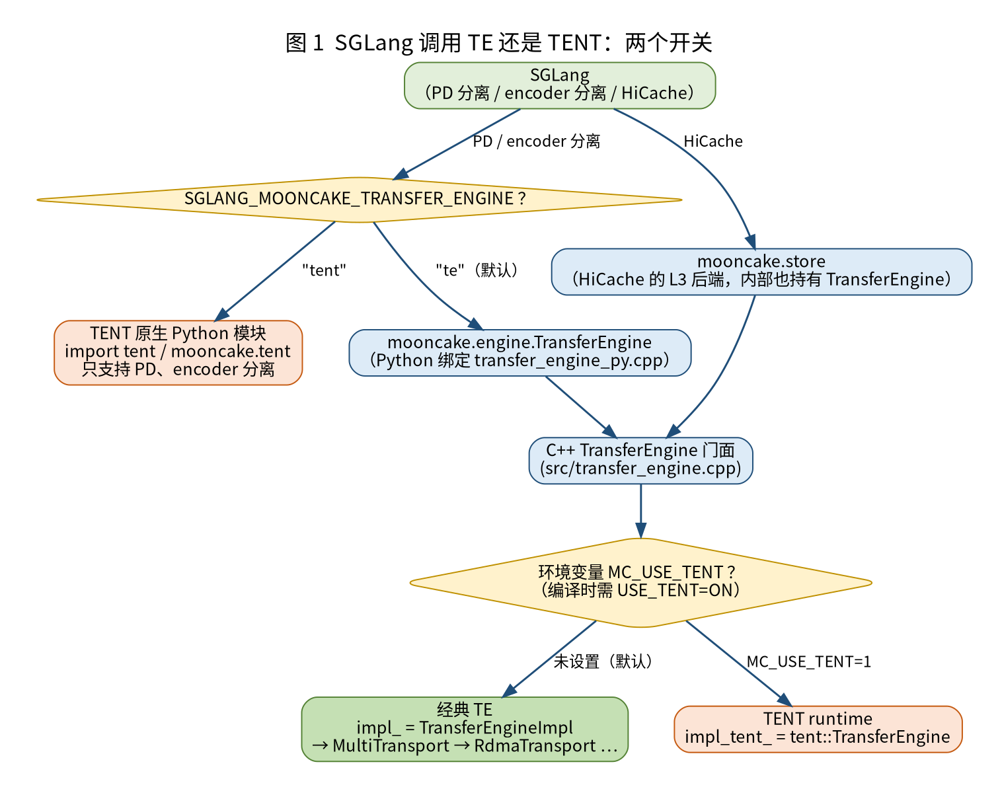

*图 1：SGLang 选 TE 还是 TENT 由两个开关决定：PD / encoder 分离看 `SGLANG_MOONCAKE_TRANSFER_ENGINE`，HiCache 的 Mooncake Store 看 `MC_USE_TENT`。*

### 主要区别

- **传输选择**：TE 在 init 时确定后端（`auto_discover` 开启时自动安装，Python 绑定默认开启；否则由应用 `installTransport()` 指定），之后按目标 segment 的 protocol 选；TENT 运行时为每个请求选后端，没有直连路径时经 host 内存中转。
- **多网卡调度**：TE 按拓扑从优先网卡中轮询或随机挑选（同一个 MR 上的连续 slice 通常沿用同一块网卡），不看链路实时负载；TENT 按完成耗时、队列深度把 slice 分给不同路径，慢路径少分。
- **故障处理**：TE 只在 RDMA 内部恢复（换网卡重试、端点重建、按对端网卡路径暂停故障链路，见图 13），重试用尽后返回 FAILED，不会换 transport；TENT 在提交阶段或完成阶段出错时都会切到下一个 transport（如 RDMA → TCP），并按 (本地网卡, 远端网卡) 暂停故障链路。
- **API**：TE 构造 + `init()` 两步，返回值有 int 也有 Status；TENT 用 `Config` 一步构造，多数接口返回 `Status`（`allocateBatch` 直接返回 `BatchID`），支持 QoS、deadline 调度、metrics。
- **后端覆盖**（按 transport 实现目录对比）：只有 TE 有 CXI、NVMe-oF、NCCL、HIP、MUSA、MACA 等；只有 TENT 有 io_uring、hp_tcp、TPU、XPU、MLU、bufio、memfabric 等；两边都有 RDMA、TCP、SHM、NVLink、MNNVL、UB、EFA（TENT 经 libfabric 的 `fabric` 后端）。目录对比不等于能力对比：TENT 的 CXL 走 `shm` 后端（配置 `cxl_mount_path`），TE 的 NVMe-oF 后端本身基于 cuFile（GDS），TE 的 RDMA 后端也能注册 MLU 内存。
- **TENT 已知限制**：`exportLocalSegment` / `importRemoteSegment` 未实现。提交阶段失败的切换在 2026-08-31（Mooncake PR #3682）实现，`failover.md` 前半部分仍写着“不重试”，以文末 Known Gaps 一节为准。

### 选型

- 同构 RDMA 集群、追求稳定：TE。
- 多网卡、链路会波动、需要自动切换或降低尾延迟，或异构互联：TENT。
- 硬件决定：Slingshot（CXI）、NVMe-oF、NCCL 只能 TE；TPU、XPU 只能 TENT。EFA、MNNVL、UB 两边都支持。
- 迁移：`USE_TENT=ON` 编译后用 `MC_USE_TENT` 开关 A/B 测试。集群内建议统一一种引擎，TE 与 TENT 节点能否互通未确认。

### SGLang 的默认选择（2026-11-20 核对，SGLang main f5149f367b）

- **默认经典 TE**：`python/sglang/srt/environ.py` 中 `SGLANG_MOONCAKE_TRANSFER_ENGINE = EnvStr("te")`；Mooncake 端默认也是 TE。
- `SGLANG_MOONCAKE_TRANSFER_ENGINE=tent`：PR #47025（2026-11-14）加入，opt-in。只支持 PD 和 encoder 分离，`MOONCAKE_PROTOCOL` 只能 rdma/tcp，不支持 elastic EP 和 expert backup。
- `MC_USE_TENT=1`：Intel XPU 必须用这种方式（需 `-DUSE_XPU=ON -DUSE_TENT=ON`）；HiCache 的 Mooncake Store 后端要切 TENT 也只能用这种方式（根据代码推断，未实测）。
- **收益与风险**：TENT 技术报告（arXiv 2604.00368）称在 SGLang HiCache 上吞吐最高 1.36 倍、P90 TTFT 降 26%；曾有 HiCache 在 `MC_USE_TENT=1` 下预热报 `TRANSFER_FAIL: -800`（Mooncake issue #2554），根因是 Mooncake 编译时没开 `USE_TENT`，已在 2026-06-25 由 PR #2596 修复。

## 3. 核心概念与数据结构

### 核心概念

- **RDMA**：我的网卡直接读写对端进程的内存，对端 CPU 和内核不参与。读写前，双方都要先把内存注册给本机网卡（`ibv_reg_mr`，注册后的内存叫 MR）。注册会固定这些内存页、让网卡记下它们的地址映射，并返回两个密钥：lkey 供本机网卡访问自己的 MR，rkey 交给对端用来远程访问。我发起一次写时，带上本地地址 + lkey 和对端地址 + rkey，对端网卡校验 rkey 后直接把数据写进内存。网卡通过 PCIe DMA 访问内存，所以 CPU 内存和 GPU 显存都能注册，网卡直接读写显存的方式称为 GPUDirect RDMA。TE 注册显存时，检测到 `nvidia_peermem` 模块就直接 `ibv_reg_mr`，否则把显存导出为 dma-buf，再用 `ibv_reg_dmabuf_mr` 注册。
- **Transport**：传输后端（RDMA、TCP、NVLink、SHM…），不是端口。每种是一个继承 `Transport` 的 C++ 对象，由 `installTransport` 安装，一个进程可装多个。`MultiTransport::selectTransport` 按目标 segment 的 `protocol` 选择；多协议 segment（需编译时开启 `ENABLE_MULTI_PROTOCOL`，默认 OFF）按目标地址所在 buffer 选，同一 buffer 多协议时优先级 hylink > hip/maca/musa/shm > cxl > rdma > tcp，跨机跳过 hip/musa/shm；`MC_DISABLE_HYLINK` / `MC_DISABLE_HIP` / `MC_DISABLE_MACA` / `MC_DISABLE_MUSA` 会把对应协议降到最低优先级。
- **Segment**：一个进程对外暴露的一组已注册内存，按名字发布。`openSegment(名字)` 返回 `SegmentHandle`（与 `SegmentID` 是同一个整数类型），后续填进 `TransferRequest::target_id`。
- **Batch / Task / Slice**：一个 batch 里每个 `TransferRequest` 是一个 Task，Task 在 Transport 内被切成 Slice 下发给网卡，见图 3。
- **Topology**：本机网卡与 CPU/GPU 的亲和关系，决定某块内存优先用哪几块网卡。

### 核心数据结构

图 2、图 3 画出了主要结构之间的关系，字段细节看下面列出的头文件。

- **控制面**（`include/transfer_metadata.h`、`include/topology.h`）：`SegmentDesc`、`DeviceDesc`、`BufferDesc`、`TopologyEntry` 见图 2；另有 `RpcMetaDesc`（握手服务地址 `ip:port`）、`HandShakeDesc`（建 QP 时交换的 QP 号、GID）、`NotifyDesc`（传输完成通知）。
- **数据面**（`include/transport/transport.h`）：`TransferRequest`、`TransferTask`、`Slice`、`BatchDesc` 见图 3。RDMA 下 `TransferRequest::target_offset` 填远端虚拟地址本身。
- **RDMA 资源**（`include/transport/rdma_transport/`、`include/config.h`）：`RdmaContext` 是一块本地网卡的 PD、CQ、MR、endpoint 缓存和 WorkerPool；`RdmaEndPoint` 是本地网卡到对端网卡的一组 QP 及连接状态，首次使用时才建链；`GlobalConfig` 是 `slice_size`、`workers_per_ctx`、`num_qp_per_ep` 等参数及对应 `MC_*` 环境变量。

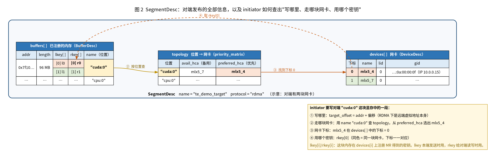

*图 2：对端发布的 SegmentDesc，以及 initiator 如何查出写哪里、走哪块网卡、用哪个 rkey（地址为示例值）。*

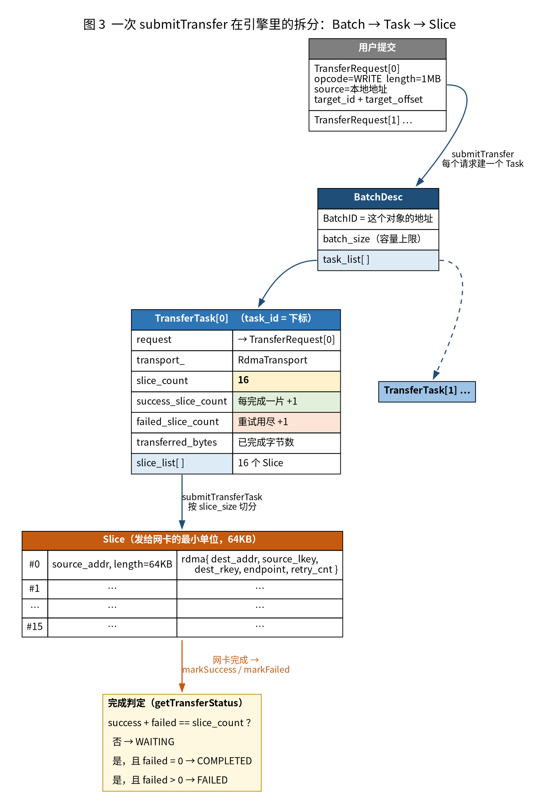

*图 3：一次 `submitTransfer` 在引擎里拆成 Batch → Task → Slice，以及 task 的完成判定。*

**对照一份真实的 SegmentDesc**：用 HTTP 元数据服务启动 target，把它发布的内容取出来，逐字段对照头文件。需要编译时开启 `USE_HTTP`（默认开启，`build-te` 已包含）。

```bash
cd Mooncake  # 仓库根目录
BIN=build-te/mooncake-transfer-engine/example
# 终端 1：HTTP 元数据服务（端口改成 18080）
sed 's/port=8080/port=18080/' mooncake-transfer-engine/example/http-metadata-server-python/bootstrap_server.py > /tmp/meta_server.py
python3 /tmp/meta_server.py
# 终端 2：target 改用 HTTP 元数据，segment 名设为 te_demo_target
$BIN/transfer_engine_bench --mode=target --metadata_server=http://127.0.0.1:18080/metadata \
  --local_server_name=te_demo_target --protocol=rdma --device_name=mlx5_4 --use_vram=true --gpu_id=0 \
  --buffer_size=67108864
# 终端 3：读出 SegmentDesc 和 RpcMetaDesc
curl -s --noproxy '*' "http://127.0.0.1:18080/metadata?key=mooncake/ram/te_demo_target" | python3 -m json.tool
curl -s --noproxy '*' "http://127.0.0.1:18080/metadata?key=mooncake/rpc_meta/te_demo_target"
```

本机实测输出（节选）：

```text
{
  "name": "te_demo_target",
  "protocol": "rdma",
  "devices": [{"name": "mlx5_4", "lid": 0, "gid": "00:...:ff:ff:0a:00:00:0f"}],
  "buffers": [{"name": "cuda:0", "addr": 139710152310784, "length": 100663296,
               "lkey": [43207], "rkey": [43207]}],
  "priority_matrix": {"cuda:0": [["mlx5_4"], []], "cpu:0": [["mlx5_4"], []]},
  "metadata_version": 1795332140964984
}
// rpc_meta: {"ip_or_host_name":"10.0.0.15","rpc_port":15449}
```

- `gid` 末 4 字节 `0a:00:00:0f` 即网口 IP 10.0.0.15（RoCE），`lid` 为 0。
- `length` 是 96MB 而不是传入的 64MB：bench 会把 `--buffer_size` 提高到至少 `batch_size × block_size × threads`（128 × 64KB × 12）。
- P2P 模式（`P2PHANDSHAKE`）没有中心服务，同样的 JSON 在 `openSegment` 时经握手端口直接交换（`TransferMetadata::getSegmentDescInternal`）。

## 4. 调用链

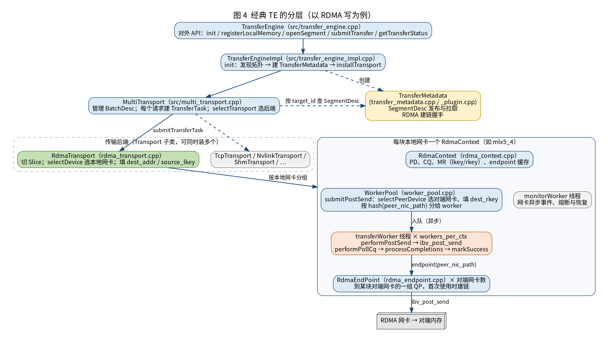

*图 4：经典 TE 的分层（以 RDMA 写为例），从对外 API 到网卡。*

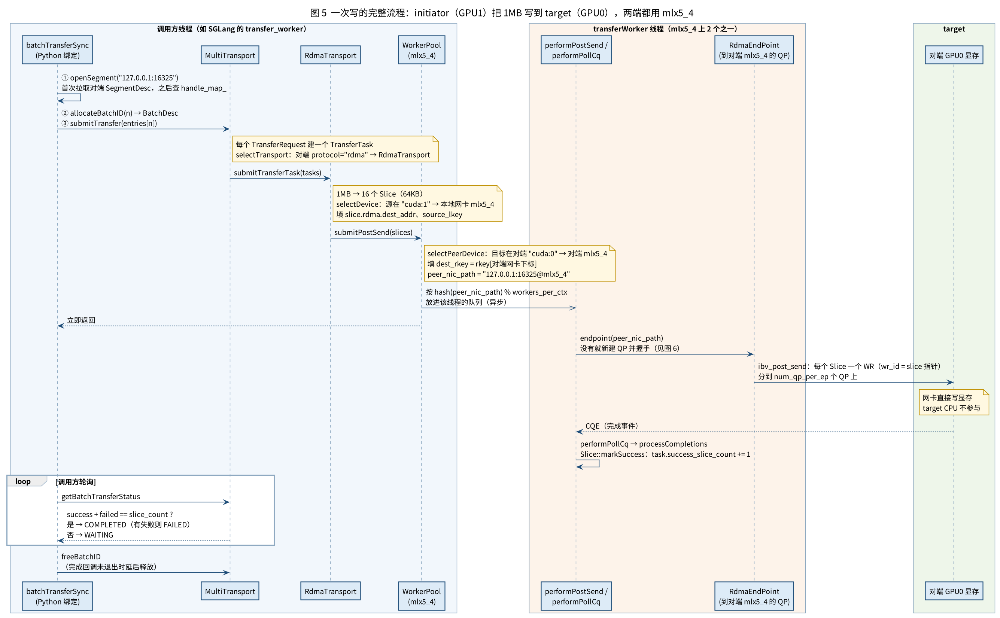

*图 5：initiator（GPU1）把 1MB 写到 target（GPU0）的完整时序，两端都用 mlx5_4。*

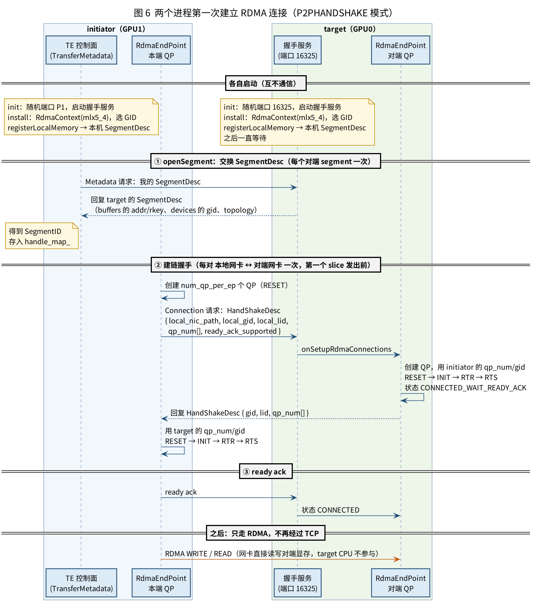

*图 6：P2PHANDSHAKE 模式下两个进程第一次建立 RDMA 连接的三次 TCP 往返。*

图 7 是 SGLang 进入 TE 的两条路径。SGLang 路径相对 `sglang/python/sglang/srt/`。

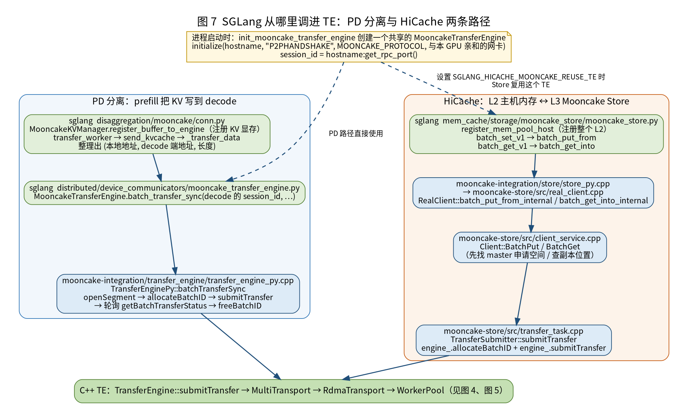

*图 7：SGLang 进入 TE 的两条路径：PD 分离和 HiCache。*

## 5. 阅读建议

目标是先能讲清"一次 write 从 Python 到网卡、再回到 COMPLETED"，再补控制面，最后按自己的需求（HiCache、容错）深入。每一遍都带着三个问题读：这一层收到什么、做了什么转换、交给下一层什么。前三遍遇到 metrics、拥塞控制、eventfd 通知、重试分支一律跳过。每遍末尾的"读完能回答"问题，参考答案在文末附录。

### 准备

1. 按第 6 节跑通 A1（显存 RDMA 写），确认环境可用。
2. 按第 3 节"对照一份真实的 SegmentDesc"取出一份元数据，后面读代码时随时对照。

### 第 1 遍：数据结构

1. `include/transfer_metadata.h`：`class TransferMetadata` 里的 `SegmentDesc`、`DeviceDesc`、`BufferDesc`。对照 JSON 弄清 `devices` 下标与 `lkey/rkey` 下标的关系。
2. `include/transport/transport.h`：`TransferRequest`、`TransferTask`、`Slice`、`BatchDesc`，以及 `Slice::markSuccess`、`finishIfComplete`（task 什么时候算完成）。
3. `include/topology.h`：内存位置如何映射到网卡。

读完能回答：我（initiator）要写对端（target）的一块显存，需要知道哪些信息，这些信息存在哪个字段里。

### 第 2 遍：数据面主链

按调用顺序读：

1. `transfer_engine_py.cpp`：`TransferEnginePy::batchTransferSync`（整个 API 的使用流程）。
2. `multi_transport.cpp`：`MultiTransport::submitTransfer`（建 task、选 Transport、分组提交）、`selectTransport`。
3. `rdma_transport.cpp`：`RdmaTransport::submitTransferTask`（切 slice、选本地网卡）。
4. `worker_pool.cpp`：`WorkerPool::submitPostSend`（选对端网卡、填 rkey）→ `performPostSend`。
5. `rdma_endpoint.cpp`：`RdmaEndPoint::submitPostSend`（组装 WR，`ibv_post_send`）。
6. `worker_pool.cpp`：`performPollCq` → `processCompletions` → `Slice::markSuccess`。
7. `multi_transport.cpp`：`getBatchTransferStatus` / `getTransferStatus`（调用方怎么看到 COMPLETED）。

读完能回答：一个 1MB 的请求会变成多少个 slice、走哪块网卡、由哪个线程发出、完成后怎么通知到调用方。

### 第 3 遍：控制面

1. `transfer_engine_impl.cpp`：`TransferEngineImpl::init`（P2P 模式随机端口、自动安装 Transport）。
2. `rdma_transport.cpp`：`RdmaTransport::install`、`registerLocalMemoryInternal`（每块网卡注册 MR，生成 `BufferDesc` 并发布）。
3. `rdma_context.cpp`：`RdmaContext::construct`（打开设备、PD、CQ、选 GID）。
4. `transfer_engine_impl.cpp` 的 `openSegment` → `transfer_metadata.cpp` 的 `getSegmentID` → `getSegmentDescInternal`（拿到对端 SegmentDesc）。
5. `rdma_endpoint.cpp`：`setupConnectionsByActive`（主动建链）、`doSetupConnection`（QP 状态 RESET → INIT → RTR → RTS）；被动方是 `rdma_transport.cpp` 的 `onSetupRdmaConnections`。

读完能回答：两个进程从互不认识到能互相 RDMA 读写，中间交换了哪些信息、经过哪几次网络往返。

### 第 4 遍：按需求深入

- **HiCache**：从 `mooncake-store/src/transfer_task.cpp` 的 `TransferSubmitter::submitTransfer` 往上读到 `Client::BatchPut` / `BatchGet` 和 `RealClient`，再对照第 7 节。
- **容错**：`WorkerPool::redispatch`、`markLocalContextFailure`、`RdmaEndPoint::reconstruct`、`endpoint_store.cpp`，配合 `tests/rdma_endpoint_reestablish_test.cpp`、`rdma_nic_selection_test.cpp` 和 `scripts/real_rdma_link_failover.sh`。
- **其他 Transport**：先读最简单的 `tcp_transport/` 做对照，结构都是实现 `Transport` 基类接口。

### 方法

- **用 gdb 跟一次真实调用**：先按第 6 节 A1 在另一个终端启动 target，把 `BIN`、`PORT` 设好；再用 gdb 运行 initiator，在主链上打断点，用 `bt` 看调用栈，用 `p *slice` 看字段值。

```bash
gdb -ex 'set breakpoint pending on' \
    -ex 'b mooncake::MultiTransport::submitTransfer' \
    -ex 'b mooncake::RdmaTransport::submitTransferTask' \
    -ex 'b mooncake::WorkerPool::submitPostSend' \
    -ex 'b mooncake::RdmaEndPoint::submitPostSend' \
    -ex run --args $BIN/transfer_engine_bench --mode=initiator \
    --metadata_server=P2PHANDSHAKE --local_server_name=127.0.0.1 \
    --segment_id=127.0.0.1:$PORT --protocol=rdma --device_name=mlx5_4 \
    --use_vram=true --gpu_id=1 --threads=1 --batch_size=1 --duration=5
```

- `--threads=1 --batch_size=1` 让每次只有一个请求，调用栈最干净。
- **看日志**：命令前加 `GLOG_v=1 GLOG_logtostderr=1`，输出更详细的 VLOG，可对照日志确认调用顺序。
- **把单测当说明书**：读某个机制时先在 `tests/` 中找名字相近的测试（如 `rdma_nic_selection_test.cpp` 对应网卡选择），测试的输入和期望输出就是这个机制的规格。

## 6. 本机测试

单机起两个进程：先起 target（被读写方），再起 initiator（发起方）。`P2PHANDSHAKE` 模式不需要 etcd 等元数据服务。

### 准备

- 二进制：pip 包带有 `/usr/local/bin/transfer_engine_bench`（入口脚本，实际运行包内自带的 bench，版本可能与源码不一致），但不带 validator。validator、NVLink、单测和改代码调试需要源码编译：

```bash
cd Mooncake  # 仓库根目录
bash dependencies.sh    # 首次编译前补齐依赖，需联网（先设置代理）
cmake -S . -B build-te -DCMAKE_BUILD_TYPE=RelWithDebInfo \
  -DUSE_CUDA=ON -DUSE_INTRA_NVLINK=ON -DBUILD_UNIT_TESTS=ON \
  -DWITH_STORE=OFF -DWITH_STORE_RUST=OFF
cmake --build build-te -j64
# 产物在 build-te/mooncake-transfer-engine/example/
```

- 网卡：`/sys/class/infiniband/<卡>/ports/1/{state,link_layer,rate}` 看状态和速率；测显存时用 `nvidia-smi topo -m` 选与 GPU 同 PCIe 交换机（`PIX`）的网卡。本机的对应关系见图 8。
- 显存测试需要 GPUDirect RDMA：加载了 `nvidia_peermem` 内核模块（`lsmod | grep nvidia_peermem`）时 TE 直接 `ibv_reg_mr` 注册显存，没有时改用 dma-buf 注册（需要驱动和网卡支持 dma-buf）。

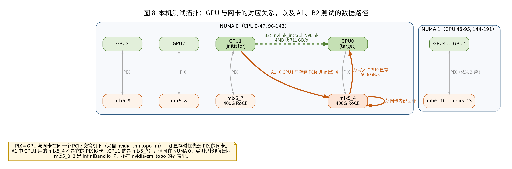

*图 8：本机测试拓扑：GPU 与网卡的对应关系，以及 A1、B2 测试的数据路径。*

### 原理（`example/transfer_engine_bench.cpp`）

- **target**：初始化 TE、分配并注册 buffer（DRAM 每个 NUMA 节点一块，显存在 `--gpu_id` 上），然后一直等待，自己不发请求。P2P 模式下 segment 名就是 `127.0.0.1:<端口>`，端口在日志 `listening on` 中。
- **initiator**：同样注册本地 buffer，`openSegment(--segment_id)` 后起 `--threads` 个线程，每个线程循环 `allocateBatchID` → 组 `--batch_size` 个 `--block_size` 字节的请求 → `submitTransfer` → 对每个 task 轮询 `getTransferStatus` 到完成 → `freeBatchID`，跑满 `--duration` 秒。
- **吞吐** = batch 数 × batch_size × block_size ÷ 时长。
- **validator**（`example/transfer_engine_validator.cpp`）：每轮先写后读，一轮只计一个 batch，所以它打印的吞吐只算了实际搬运字节数的一半。第一轮以及之后随机约 1/64 的轮次会校验：本地 buffer 填一个随机字节写到远端，本地清零后读回，`memcmp` 比较；不一致时打印 `Detect data integrity problem` 并退出。

### 完整命令

每项都开两个终端：先在终端 1 起 target，从日志找 `listening on 127.0.0.1:<端口>`，把端口填到终端 2 的 `--segment_id`。按 Ctrl+C 结束 target。下面统一用源码编译的二进制：

```bash
cd Mooncake  # 仓库根目录
BIN=build-te/mooncake-transfer-engine/example
```

A1 显存 RDMA 写（GPU0 ← GPU1，共用 mlx5_4）：

```bash
# 终端 1
$BIN/transfer_engine_bench --mode=target --metadata_server=P2PHANDSHAKE --local_server_name=127.0.0.1 \
  --protocol=rdma --device_name=mlx5_4 --use_vram=true --gpu_id=0 --buffer_size=1073741824
# 终端 2：PORT 填终端 1 日志 listening on 127.0.0.1:XXXXX 中的端口
PORT=16325
$BIN/transfer_engine_bench --mode=initiator --metadata_server=P2PHANDSHAKE --local_server_name=127.0.0.1 \
  --segment_id=127.0.0.1:$PORT --protocol=rdma --device_name=mlx5_4 --use_vram=true --gpu_id=1 \
  --buffer_size=1073741824 --operation=write --threads=8 --duration=10
```

其他项在 A1 基础上只改下列参数（target 不变的项可以复用同一个 target 进程）：

- A1 读：终端 2 `--operation=read`。
- A2 跨网卡：终端 2 `--device_name=mlx5_7`。
- A3 DRAM：两端把 `--use_vram=true --gpu_id=N` 换成 `--use_vram=false`。
- A4 多网卡：两端去掉 `--device_name=mlx5_4`，加 `--auto_discovery`。
- A5 TCP：两端 `--protocol=tcp`，去掉 `--device_name`。
- A6 参数扫描：终端 2 依次改 `--block_size`（4096 / 65536 / 1048576 / 4194304）、`--threads`（1 / 4 / 8 / 16）、`--batch_size`（32 / 128 / 512）。initiator 写对端的范围是 block_size × batch_size × threads，target 的 `--buffer_size` 必须不小于它，否则越界的 slice 选不出远端 buffer，直接报 FAILED。例如 4MB 块、batch 128、8 线程需要 4GB，target 要相应加大 `--buffer_size`（initiator 会自动加大自己的 buffer，target 不会）。
- B1 数据正确性：两端把 `transfer_engine_bench` 换成 `transfer_engine_validator`，终端 2 去掉 `--operation`（validator 没有这个参数，固定写后读回）。
- B2 NVLink：两端 `--protocol=nvlink_intra`，去掉 `--device_name`；终端 2 建议 `--block_size=4194304 --batch_size=32`。`--protocol=nvlink` 需要 `-DUSE_MNNVL=ON`，面向跨节点 NVLink 域（MNNVL）；GPU 不支持 fabric handle 时会退回 CUDA IPC，单机也能跑，但单机的正常用法是 `nvlink_intra`。
- B4 TENT：cmake 加 `-DUSE_TENT=ON` 重编，两端加 `--backend=tent`。TENT 模式下 bench 只用 `--metadata_server` 和 `--local_server_name` 构造配置，`--device_name`、`--auto_discovery` 不起作用，网卡由 TENT 自己选。

其他测试：

- A7 故障切换：`mooncake-transfer-engine/scripts/real_rdma_link_failover.sh --help` 查看参数，按本机网卡名设置后运行；脚本会 link down 网卡，影响同机其他业务。
- A8 Python API：运行 `docs/source/design/transfer-engine/index.md` 中的 `receiver.py` / `sender.py`（tcp），再把 `PROTOCOL` 改为 `"rdma"`、`DEVICE_NAME` 改为 `"mlx5_4"` 测一次。
- B3 单元测试：`ctest --test-dir build-te/mooncake-transfer-engine -j16 --timeout 300 --output-on-failure -E "efa|cxi|sunrise|ascend|hip|ub|nvmeof|cxl"`（排除本机没有硬件的项；这些测试本来就要开对应的 `USE_*` 才会注册，而 `ub` 是子串匹配，会误排除名字里带 `sub`、`republish` 的四个 RDMA 测试，不需要时可以去掉这一项）；按类别跑用 `-R rdma` 等。

### 实测结果（单卡 loopback，8 线程，每项 10 秒，默认 block 64KB、batch 128；只测了下面几项，其余未实测）

- A1 显存 RDMA：写 50.62 GB/s，读 50.77 GB/s，接近 400Gb/s 线速（约 50 GB/s）。
- A2 跨网卡（mlx5_4 ← mlx5_7）：写 48.61 GB/s。
- A3 DRAM RDMA：写 50.64 GB/s，读 50.68 GB/s。
- B1 validator（显存 RDMA）：校验通过，打印 23.88 GB/s。这个数只算了一半字节（见上面“原理”），实际约 47.8 GB/s，和 bench 接近；填充、清零和比对只在首轮和约 1/64 的轮次做，影响很小。
- B2 NVLink：默认 64KB 块 41.72 GB/s；4MB 块、batch 32 时 711.28 GB/s（小块为什么慢见 Q7 末尾）。

### 注意

- target 启动日志按 init 流程依次出现：`parseHostNameWithPort`（解析本机名，P2P 模式忽略其中的默认端口 12001）→ `listening on`（随机选的握手端口，填给 initiator）→ `rdma_transport` / `rdma_context`（为网卡建 Context：CQ、endpoint 缓存、自动选 GID）→ `VRAM is used` / `Allocating memory on GPU N`（分配 buffer）。之后注册内存、发布 segment 不再打日志，进程停在等待状态即为就绪。
- initiator 运行中偶尔出现 `Batch ... is still busy; cleanup has been deferred`（`multi_transport.cpp` 的 `freeBatchID`）属正常：所有 task 已完成，但 worker 线程的完成回调还没退出（`active_completion_callbacks != 0`），batch 交给后台线程稍后释放，不影响结果。实测 10 秒约 30 次，占 60187 个 batch 的 0.05%。
- pip 包版本的 initiator 开头会打印 `Local segment descriptor not found`（`transfer_metadata.cpp` 中 `getSegmentDescInternal` 和 `receivePeerMetadata` 都会打这句，推测是本机 SegmentDesc 还没建好就去和对端交换了），测试能正常完成时可忽略；源码编译的版本没有出现。
- 单卡 loopback 的带宽只用于验证流程，不代表跨机性能。

## 7. SGLang HiCache（L1/L2/L3）读写链路

场景：单个 SGLang 服务（非 PD 或只有 P 节点），`--enable-hierarchical-cache --hicache-storage-backend mooncake`。SGLang 路径相对 `sglang/python/sglang/srt/`，2026-11-20 核对（SGLang main f5149f367b）。

### 三层与核心对象

- **L1 显存**：设备 KV pool（`mem_cache/memory_pool.py`）。
- **L2 主机内存**：`MHATokenToKVPoolHost`（`mem_cache/pool_host/mha.py`），大小由 `--hicache-ratio` / `--hicache-size` 决定。
- **L3 Mooncake Store**：`MooncakeStore`（`mem_cache/storage/mooncake_store/mooncake_store.py`），内部是 `mooncake.store.MooncakeDistributedStore`。
- **基数树**：`UnifiedRadixCache`（`mem_cache/unified_radix_cache.py`，节点逻辑在 `mem_cache/unified_cache/unified_tree_core.py`），原来的 `HiRadixCache` 已移除。节点按组件存数据，KV 组件 `component_data[BASE_COMPONENT_TYPE]` 上的 `value` 是显存页索引（为空表示已从 L1 驱逐），`host_value` 是主机页索引（非空即 `backuped`），`hash_value` 是每页一个 SHA256 哈希（由前一页的哈希和本页 token 链式计算），L3 的 key 由它加上 rank 后缀组成。
- **控制器**：`HybridCacheController`（`mem_cache/hybrid_cache/hybrid_cache_controller.py`，继承 `managers/cache_controller.py` 的 `HiCacheController`），负责 L1↔L2 拷贝和 L2↔L3 的后台线程；拷贝由 `mem_cache/l2_transfer.py` 在独立 CUDA stream 上发起。

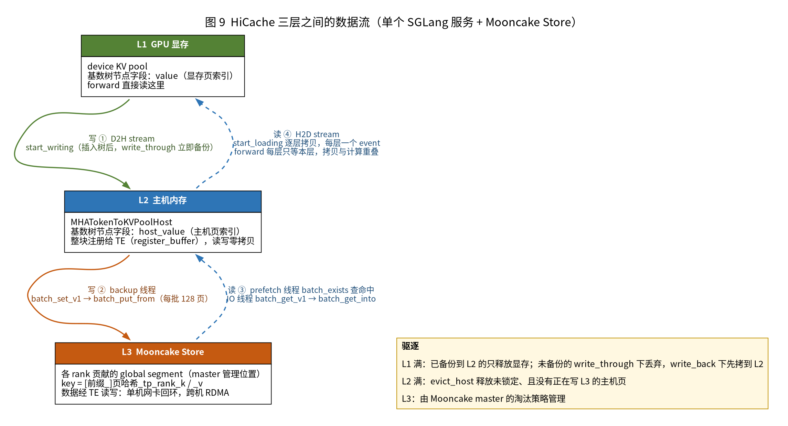

*图 9：单个 SGLang 服务加 Mooncake Store 时，HiCache 三层之间的数据流和驱逐规则。*

### 初始化

`scheduler` → `kv_cache_builder.build_kv_cache` → `registry.create_tree_cache` 构造 `UnifiedRadixCache` → `init_hicache`（`unified_radix_cache.py:549`）→ 组装 host pool 和 `HybridCacheController` → `attach_storage_backend`（`cache_controller.py:681`）：创建 `MooncakeStore`（`store.setup(...)` 连接 master、挂载 global segment），`register_mem_pool_host`（`mooncake_store.py:879`）把整个 L2 主机 KV 内存注册给 TE（实现零拷贝），启动 prefetch / IO / sync / backup 四个后台线程。

### 写：L1 → L2 → L3

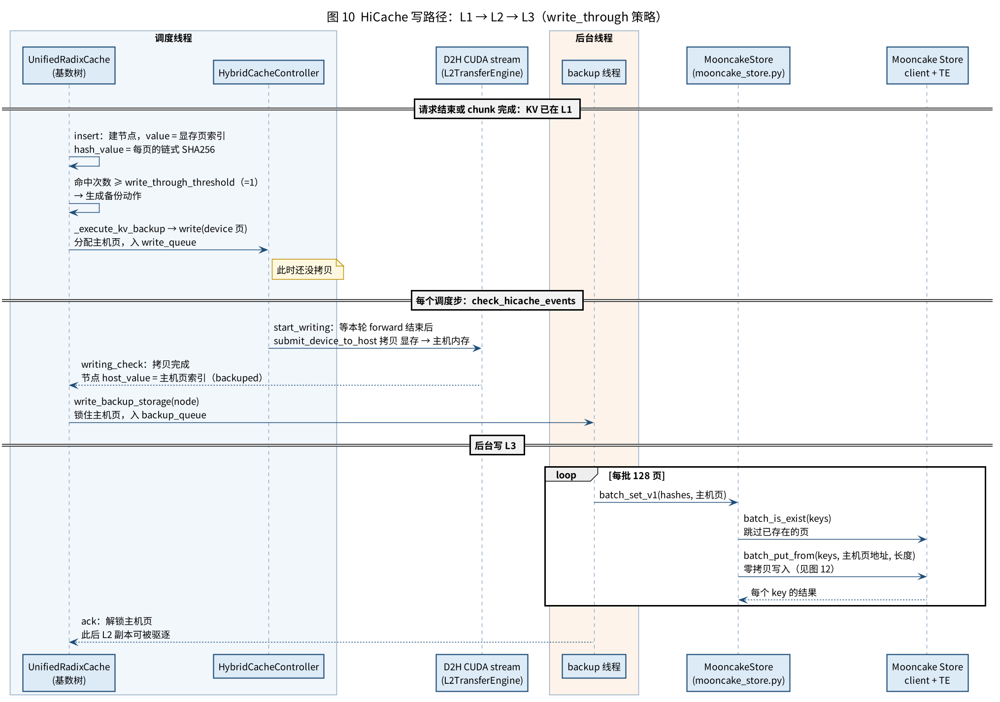

*图 10：HiCache 写路径 L1 → L2 → L3（write_through 策略）。*

图 10 中各函数的位置：`_execute_kv_backup`（`unified_radix_cache.py:2295`）、`controller.write`（`hybrid_cache_controller.py:757`）、`start_writing`（`cache_controller.py:1101`）、`submit_device_to_host`（`l2_transfer.py:205`）、`writing_check`（`unified_radix_cache.py:4339`）、`write_backup_storage`（`:2584`）、`backup_thread_func`（`hybrid_cache_controller.py:2129`）、`batch_set_v1`（`mooncake_store.py:1648`）。

L3 key 的格式：MHA 模型每页两个 key，`[前缀_]{hash}_{tp_rank}_k` 和 `..._v`，开 PP 时 rank 后缀为 `{tp_rank}_{pp_rank}`（原因见 Q10）。

### 读：L3 → L2（预取）→ L1（按层加载）

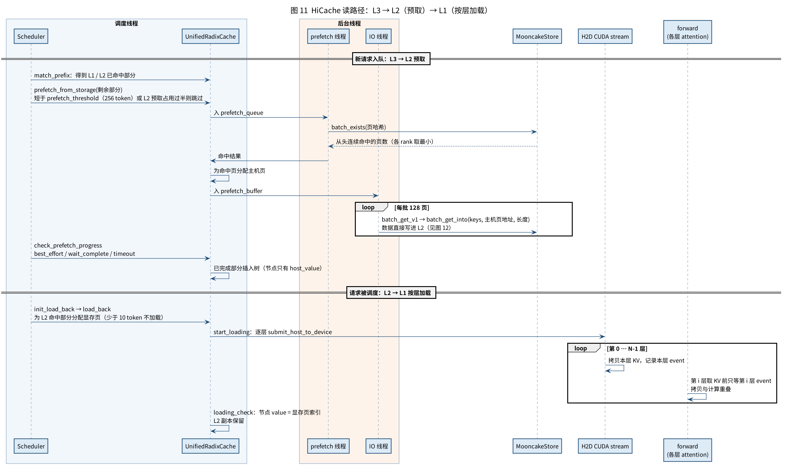

*图 11：HiCache 读路径：L3 → L2 预取，L2 → L1 按层加载。*

图 11 中各函数的位置：`prefetch_from_storage`（`unified_radix_cache.py:2707`）、`batch_exists`（`mooncake_store.py:1842`）、`batch_get_v1`（`:1611`）、`check_prefetch_progress`（`unified_radix_cache.py:3104`）、`init_load_back`（`:4467`）、`load_back`（`:2378`）、`start_loading`（`cache_controller.py:1244`）、`submit_host_to_device`（`l2_transfer.py:218`）、`loading_check`（`unified_radix_cache.py:4397`）。驱逐 L2 的 `evict_host` 在 `unified_radix_cache.py:1928`。

### Mooncake Store 内部（put / get 如何落到 TE）

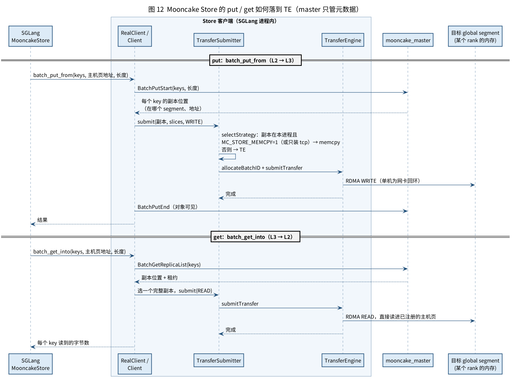

*图 12：Mooncake Store 的 put / get 如何落到 TE，master 只管元数据。*

- **代码路径**：`mooncake-integration/store/store_py.cpp` → `mooncake-store/src/real_client.cpp`（`RealClient::batch_put_from_internal` / `batch_get_into_internal`）→ `client_service.cpp`（`Client::BatchPut` / `BatchQuery` / `BatchGet`）→ `transfer_task.cpp`（`TransferSubmitter`）。master 只管元数据和分配，不经手数据。
- **global segment**：每个 SGLang rank 作为 Store 客户端，`setup` 时贡献 `global_segment_size / (tp*pp)` 的内存并注册给 TE，挂到 master 上，构成分布式内存池。单机部署时数据实际经过哪里见 Q9。

### 主要参数

- `--hicache-write-policy`：`write_through`（默认）/ `write_back` 等。
- `--hicache-ratio`、`--hicache-size`：L2 大小。`--hicache-mem-layout`：主机 KV 布局（如 `page_first`）。`--hicache-io-backend`：L1↔L2 拷贝方式（如 `kernel`）。
- `--hicache-storage-prefetch-policy`：`best_effort` / `wait_complete` / `timeout`。
- `--hicache-storage-backend-extra-config`：JSON，可含 Mooncake 配置（`master_server_address`、`protocol`、`device_name`、`global_segment_size` 等）和 `prefetch_threshold`、`prefetch_timeout_base` 等；也可用 `SGLANG_HICACHE_MOONCAKE_CONFIG_PATH` 指定配置文件，或 `MOONCAKE_MASTER`、`MOONCAKE_PROTOCOL`、`MOONCAKE_DEVICE`、`MOONCAKE_GLOBAL_SEGMENT_SIZE` 环境变量。

## 附录一：阅读自测参考答案

对应第 5 节每一遍末尾的问题。答案的主体已经画在对应的图里，这里只写结论和图中没有的细节。示例沿用本机场景：initiator 在 GPU1，target 在 GPU0，都用 mlx5_4。

### 第 1 遍：我（initiator）要写对端（target）的一块显存，需要知道哪些信息，存在哪个字段里

**结论**：四样信息，前三样来自对端的 `SegmentDesc`，在 `openSegment` 时拿到；第四样的一部分要等建链握手时才拿到。前三样（写哪里、对端哪块网卡、用哪个 rkey）的查找过程见图 2 的 ①~④。

图 2 没有画的补充：

- **地址范围**：切出来的每个 slice 都必须落在对端某一个 `buffers[i]` 内，否则选不出路径。整段请求可以跨两个相邻的 MR，slice 会在远端 MR 边界处截断（见第 2 遍的切片规则）。
- **第四样：怎么连到对端那块网卡**。对端 `DeviceDesc::name` 拼出 `peer_nic_path`（`"对端segment名@mlx5_4"`，也是 endpoint 缓存的 key）；握手地址来自 `RpcMetaDesc`（P2P 模式下就是对端 segment 名）；建 QP 用的 GID / LID 以握手回复 `HandShakeDesc` 里的为准，回复里 GID 为空时才退回 `SegmentDesc` 中 `devices[i]` 的 `gid` / `lid`。建链过程见图 6。
- **代码位置**：对端网卡和 rkey 在 `worker_pool.cpp` 的 `selectPeerDevice` 中选出，rkey 填进 `Slice::rdma.dest_rkey`。
- **lkey 不需要对端提供**：发送时用的是我自己的 `lkey[我的网卡下标]`，填进 `Slice::rdma.source_lkey`。

### 第 2 遍：一个 1MB 的请求会变成多少个 slice、走哪块网卡、由哪个线程发出、完成后怎么通知调用方

**结论**：16 个 slice，本机两端都走 mlx5_4，由 mlx5_4 上的某一个 transferWorker 线程发出并收完成事件，调用方靠轮询得知完成：Python 的 `batchTransferSync` 轮询 `getBatchTransferStatus`，bench 对每个 task 轮询 `getTransferStatus`。拆分结构见图 3，线程和调用顺序见图 5。

图中没有画的补充：

- **切片规则**（`SliceLengthCalculator`）：按 `slice_size`（`MC_SLICE_SIZE`，默认 64KB）切；剩余不超过 `slice_size + fragment_limit`（默认 16KB）时整段作为最后一片；每片截断到本地和远端 MR 的边界。1MB 刚好 16 × 64KB，所以是 16 片；跨 MR 时会多出片。
- **本地网卡**：同一个 MR 上的连续 slice 默认沿用上一次选中的网卡，重试时才换卡。
- **线程归属**：`hash(peer_nic_path) % workers_per_ctx`（默认 2），同一对端网卡的 slice 总由同一个线程处理。
- **失败时**：先换网卡重试，用尽才 `markFailed`，见图 13。
- **另一种通知方式**：`completionFd` / eventfd（RFC #5164）由完成路径主动唤醒调用方，默认不用。

### 第 3 遍：两个进程从互不认识到能互相 RDMA 读写，交换了哪些信息、经过几次网络往返

**结论**：P2P 模式下 3 次 TCP 往返，见图 6：① 交换 SegmentDesc（每个对端 segment 一次）；② 交换 `HandShakeDesc`（QP 号、GID、LID），每对网卡一次；③ ready ack。之后的读写只走 RDMA。

图 6 没有画的补充：

- **中心服务模式**：① 改为从 etcd/redis/http 读 `mooncake/ram/<名字>`，两个进程不直接通信；②③ 不变，仍要直接握手。两种模式的对比见图 14。
- **代码位置**：① `getSegmentDescInternal` → `exchangeMetadata`；② 主动方 `RdmaEndPoint::setupConnectionsByActive`，被动方 `RdmaTransport::onSetupRdmaConnections` → `setupConnectionsByPassive`，QP 状态切换在 `doSetupConnection`；③ `sendReadyAck`。
- **重新握手**：连接缓存在 `endpoint_store` 里，被淘汰或出错后，下次访问会重新走 ②③。

## 附录二：更多问答

以下问题按"数据面 → 控制面 → 性能 → HiCache"排列。

### Q1：target 什么都不做，为什么也能被写？它的 CPU 参与吗？

RDMA WRITE/READ 是单边操作：我的网卡带着对端地址和 rkey 发包，对端网卡校验 rkey 后直接把数据写进内存（或读出），全程不经过对端 CPU 和操作系统。target 只需要事先做两件事：注册内存（产生 rkey），以及让握手线程在线，用来回应元数据交换和建链请求（图 6 的 ①②③）。建链完成后，target 的 CPU 对每次读写都没有感知。这也是 bench 中 target 进程"一直在等"却能跑满 50 GB/s 的原因。

### Q2：一个 batch 里的请求可以发往不同对端吗？

可以。每个 `TransferRequest` 都有自己的 `target_id`，`MultiTransport::submitTransfer` 按请求逐个选 Transport，RDMA 层再按对端网卡分给不同 worker。只是 Python 绑定的 `batchTransferSync` 只接收一个 `target_hostname`，所以 SGLang PD 分离中一次调用只发往一个 decode 端。

### Q3：为什么一个请求要切成多个 slice？

- **并行**：同一个 endpoint 上的 slice 会分到多个 QP（`num_qp_per_ep`）并发执行；多网卡时，不同请求或不同 MR 可能选到不同网卡。
- **重试粒度**：出错时只重发失败的 slice，不用整个请求重来。
- **不跨 MR**：每片截断到 MR 边界，一个 WR 只涉及一个 MR。

代价是每个 slice 都要组 WR、处理完成事件，所以 slice 太小时 CPU 开销占主导（见 Q7）。

### Q4：一个 slice 失败后会发生什么？

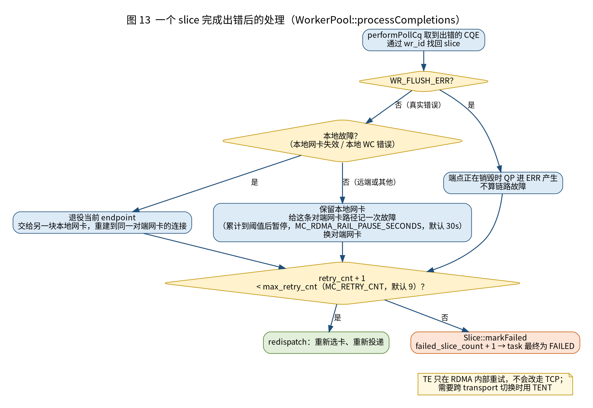

*图 13：一个 slice 完成出错后在 `WorkerPool::processCompletions` 里的处理。*

### Q5：P2PHANDSHAKE 和 etcd/http 元数据有什么区别？集群里用哪个？

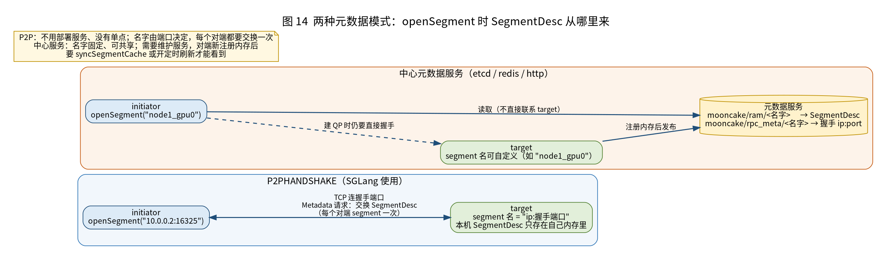

*图 14：两种元数据模式下 `openSegment` 时 SegmentDesc 从哪里来。*

两种模式的取舍见图 14。建议配合 SGLang 用 P2P；自己写的程序如果需要固定名字或大量进程共享元数据，再用中心服务。

### Q6：显存和 DRAM 测出来带宽一样（都是约 50 GB/s），为什么？

两种测试走的都是同一块 400Gb/s 网卡，瓶颈是网卡线速，与内存在哪里无关。网卡访问显存需要 GPUDirect RDMA（`nvidia_peermem` 或 dma-buf），并且网卡与 GPU 最好在同一个 PCIe 交换机下（`nvidia-smi topo -m` 中为 `PIX`），否则流量要绕经 CPU 侧的 PCIe 根复合体，带宽可能下降。本机 GPU0 与 mlx5_4 是 `PIX`，所以没有损失。

### Q7：为什么小块时带宽低？block_size、batch_size、threads 怎么调？

每个请求都有一份与块大小无关的固定开销，块越小，单位字节分摊到的开销越多。RDMA 下这部分开销是每个 slice 组 WR、`ibv_post_send`、轮询 CQE、更新计数，以及调用方轮询状态。第 6 节 B2 的 NVLink 实测（64KB 块 41.72 GB/s，4MB 块 711.28 GB/s）是同一个规律，但机制不同：`nvlink_intra` 不切 slice、不用 WR 和 CQ，每个请求一次 `cudaMemcpyAsync`（或批量 memcpy），每次 `submitTransfer` 开头还要 `cudaEventSynchronize`，阻塞到调用方之前的 GPU 工作完成，小块时这些调用开销占主导。调参思路：

- **block_size**：在业务允许的范围内尽量大，KV 页太小时可以考虑合并连续页。
- **batch_size**：一次提交更多请求，摊薄 submit 和轮询的开销。
- **threads**：增加并发提交的线程，直到网卡跑满或 CPU 成为瓶颈。
- **MC_SLICE_SIZE / MC_WORKERS_PER_CTX / MC_NUM_QP_PER_EP**：RDMA 引擎侧参数（对 `nvlink_intra` 不起作用），建议用 bench 的 A6 参数扫描对比后再改。

### Q8：一个进程能同时连多少对端？连接会被回收吗？

每块本地网卡的 `RdmaContext` 用 `endpoint_store` 缓存到各对端网卡的连接，上限 `max_ep_per_ctx`（`MC_MAX_EP_PER_CTX`，默认 65536），默认使用 SIEVE 淘汰策略（`MC_ENDPOINT_STORE_TYPE` 可改为 FIFO）。被淘汰的 endpoint 不会立刻释放：淘汰时它的 QP 先被切到 ERR 状态，已投递的 WR 以 `IBV_WC_WR_FLUSH_ERR` 完成，对应 slice 按重试流程重新投递（重试用尽才失败，见图 13），等这些 WR 全部收完才回收 endpoint。所以淘汰会让正在传输的 slice 重试一次，不会丢数据。下次再访问该对端时会重新握手（图 6 的 ②③）。

### Q9：HiCache 单机部署时，KV 写到 L3 实际经过了哪里？

TP=1 时，master 把空间分配在本进程自己挂载的 global segment 上，数据路径是：L2 主机内存 → TE → 本进程 global segment（也是主机内存）。`protocol=rdma` 且没有设置 `MC_STORE_MEMCPY=1` 时，这一步走网卡回环，而不是进程内 memcpy（`TransferSubmitter::selectStrategy`）。TP>1 时，一个 rank 的数据可能落到同机其他 rank 的 segment 上。master 只负责分配和记录位置，数据不经过它。

### Q10：为什么 L3 的 key 要带 tp_rank？

开张量并行时，每个 TP rank 只持有部分注意力头的 KV，同一个 token 前缀在不同 rank 上是不同的数据。key 用"页哈希 + rank 后缀"区分，每个 rank 只读写自己那份；开 PP 时还会再加 pp_rank。因此在默认的 `--hicache-storage-key-scheme rank-suffix` 下，MHA 模型 TP 规模不同的两个服务无法直接复用彼此写进 L3 的 KV。要跨 TP 规模复用有两种办法：在 extra config 里设 `tp_lcm_size`（各服务 TP 的最小公倍数，要求 `page_head` 布局），每个 rank 按更细的头分组写多份 key；或者用 `--hicache-storage-key-scheme unified`，key 改用与拓扑无关的“层号 + 头组号”坐标。MLA 模型的 KV 在各 TP rank 上相同，key 不带 tp_rank：不开 PP 时是 `{hash}__k`（后缀为空，两个下划线），开 PP 时是 `{hash}_{pp_rank}_k`。
