# Mooncake Transfer Engine Study Notes: Code Structure, Call Chain, Local Testing and the HiCache Path

[中文](./Mooncake-Transfer-Engine-Notes.md) | English

- **Compiled**: 2026-11-23
- **Scope**: The code structure, core data structures, call chain, reading approach and local tests of the classic Transfer Engine (TE); how TE differs from TENT; and how SGLang HiCache uses TE through Mooncake Store.
- **Code versions**: [kvcache-ai/Mooncake](https://github.com/kvcache-ai/Mooncake/tree/301261358eef0b13fa55645ccde4a988f1ca7505) main branch `30126135` (2026-11-20), [sgl-project/sglang](https://github.com/sgl-project/sglang/tree/f5149f367b8f0fd728bca44f4e77c8fc102ad803) main branch `f5149f367b` (2026-11-20). Every `file:line` reference in the text points to these two commits.
- **Test environment**: A single machine with 8 GPUs and 400Gb/s RoCE NICs (mlx5); two processes tested over loopback through a single NIC. The bandwidth numbers come from this machine and do not represent cross-machine performance.
- **Basis**: Reading the code above and the Mooncake docs, and running some of the tests listed in Section 6 on the machine above.

For plain-language explanations of the terms, see the [Mooncake Transfer Engine Source Code Reading Glossary](./Mooncake-Transfer-Engine-Glossary_en.md) in the same folder.

The note has these sections:

1. Directory Structure
2. TE and TENT
3. Core Concepts and Data Structures
4. Call Chain
5. Reading Suggestions
6. Local Testing
7. SGLang HiCache (L1/L2/L3) Read and Write Paths
8. Appendix 1: Answers to the Reading Self-Check
9. Appendix 2: More Q&A

In this note, "I" means the initiator that issues reads and writes, and "the peer" means the target being read or written.

## 1. Directory Structure

`mooncake-transfer-engine` contains two engines: the **classic TE** (`include/` + `src/`) and the **next-generation TENT** (`tent/`).

```text
mooncake-transfer-engine/
├── include/, src/        classic TE
├── tent/                 TENT (with its own runtime / transport / plugin)
├── allocator/            Ascend NPU memory allocator
├── nvlink-allocator/     NVLink/Fabric memory allocator
├── ubshmem-allocator/    UB shared memory allocator
├── benchmark/            unified benchmark framework, supports TE and TENT
├── example/              transfer_engine_bench, validator, HTTP metadata server example
├── rust/                 Rust bindings
├── scripts/              ops and test scripts (e.g. real_rdma_link_failover.sh)
└── tests/                classic TE unit and integration tests, named by feature
```

The main files of classic TE (Figure 4 shows what each one does):

- `include/transfer_engine.h`, `src/transfer_engine.cpp`, `src/transfer_engine_impl.cpp`: the public API. `transfer_engine_c.h/.cpp` is the C ABI, and the Python binding is in `mooncake-integration/transfer_engine/transfer_engine_py.cpp` under the repository root.
- `src/multi_transport.cpp`: batch management and Transport selection.
- `src/transfer_metadata.cpp`, `src/transfer_metadata_plugin.cpp`: metadata and handshake.
- `src/topology.cpp`, `src/memory_location.cpp`, `src/config.cpp`: NIC topology, memory location detection, `MC_*` environment variables.
- `src/transport/`: the transport backends, one directory each. RDMA is in `rdma_transport/` (`rdma_transport.cpp`, `worker_pool.cpp`, `rdma_context.cpp`, `rdma_endpoint.cpp`, `endpoint_store.cpp`); the others include tcp, shm, nvlink, intranode_nvlink, nccl, hip, musa, maca, ascend, efa, cxi, cxl, nvmeof and more.

TENT's public API is in `tent/include/tent/transfer_engine.h`, its core in `tent/src/runtime/` (transport selection, scheduling, QoS, staging), the transport implementations in `tent/src/transport/`, platform detection in `tent/src/platform/`, and the metadata backends in `tent/src/metastore/`.

## 2. TE and TENT

Sources: `docs/source/design/tent/overview.md`, `failover.md`, `docs/source/api-reference/cpp/tent.md`, `src/transfer_engine.cpp`. TENT is the successor to classic TE and must be built with `-DUSE_TENT=ON` (OFF by default).

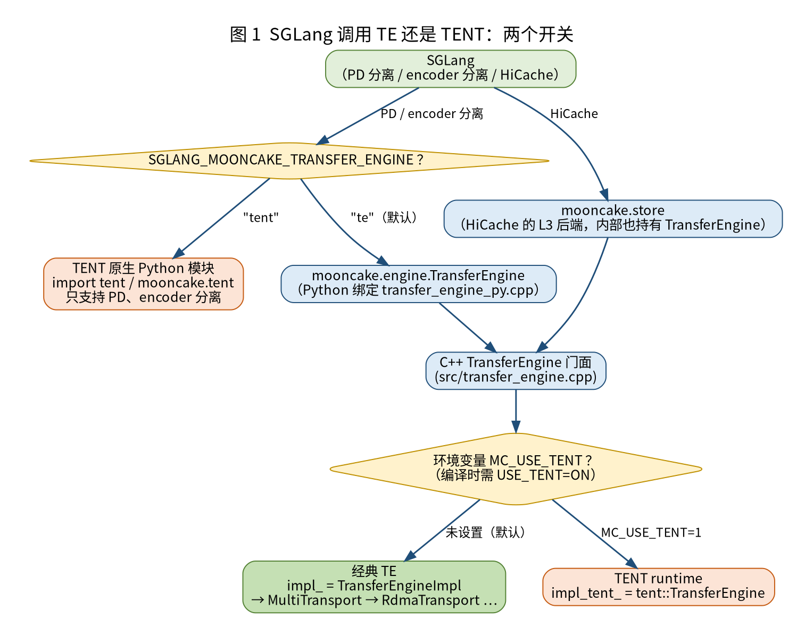

*Figure 1: Two switches decide whether SGLang picks TE or TENT: `SGLANG_MOONCAKE_TRANSFER_ENGINE` for PD / encoder disaggregation, and `MC_USE_TENT` for HiCache's Mooncake Store.*

### Main Differences

- **Transport selection**: TE fixes its backends at init (installed automatically when `auto_discover` is on, which is the default in the Python binding; otherwise the application specifies them with `installTransport()`), then picks one by the target segment's protocol. TENT picks a backend for each request at run time, and relays through host memory when there is no direct path.
- **Multi-NIC scheduling**: TE picks from the preferred NICs by topology, round-robin or at random (consecutive slices on the same MR usually stay on the same NIC), and ignores the links' live load. TENT spreads slices across paths by completion time and queue depth, giving slow paths fewer.
- **Failure handling**: TE recovers only inside RDMA (retrying on another NIC, rebuilding endpoints, pausing a failed link by peer NIC path; see Figure 13), returns FAILED once retries run out, and never switches transport. TENT switches to the next transport (such as RDMA → TCP) on an error in either the submission or the completion phase, and pauses a failed link per (local NIC, remote NIC) pair.
- **API**: TE takes two steps, construct + `init()`, and returns sometimes an int, sometimes a Status. TENT is constructed in one step from a `Config`, most calls return `Status` (`allocateBatch` returns a `BatchID` directly), and it supports QoS, deadline scheduling and metrics.
- **Backend coverage** (comparing the transport implementation directories): only TE has CXI, NVMe-oF, NCCL, HIP, MUSA, MACA and others; only TENT has io_uring, hp_tcp, TPU, XPU, MLU, bufio, memfabric and others; both have RDMA, TCP, SHM, NVLink, MNNVL, UB and EFA (TENT through libfabric's `fabric` backend). A directory comparison is not a capability comparison: TENT does CXL through the `shm` backend (configured with `cxl_mount_path`), TE's NVMe-oF backend is itself built on cuFile (GDS), and TE's RDMA backend can also register MLU memory.
- **TENT known limitations**: `exportLocalSegment` / `importRemoteSegment` are not implemented. Switching on a submission-phase failure was added on 2026-08-31 (Mooncake PR #3682); the first half of `failover.md` still says "no retry", so go by the Known Gaps section at its end.

### Choosing One

- Homogeneous RDMA cluster, stability first: TE.
- Multiple NICs with links that fluctuate, a need for automatic failover or lower tail latency, or heterogeneous interconnects: TENT.
- Decided by hardware: Slingshot (CXI), NVMe-oF and NCCL are TE only; TPU and XPU are TENT only. EFA, MNNVL and UB are supported by both.
- Migration: build with `USE_TENT=ON`, then A/B test with the `MC_USE_TENT` switch. Use one engine across a cluster; whether TE and TENT nodes can interoperate is unconfirmed.

### SGLang's Default (Checked 2026-11-20, SGLang main f5149f367b)

- **Classic TE by default**: `python/sglang/srt/environ.py` has `SGLANG_MOONCAKE_TRANSFER_ENGINE = EnvStr("te")`; the Mooncake side also defaults to TE.
- `SGLANG_MOONCAKE_TRANSFER_ENGINE=tent`: added in PR #47025 (2026-11-14), opt-in. It supports only PD and encoder disaggregation, `MOONCAKE_PROTOCOL` can only be rdma/tcp, and elastic EP and expert backup are not supported.
- `MC_USE_TENT=1`: Intel XPU must use this route (it needs `-DUSE_XPU=ON -DUSE_TENT=ON`); it is also the only way to switch HiCache's Mooncake Store backend to TENT (inferred from the code, not tested).
- **Gains and risks**: The TENT technical report (arXiv 2604.00368) claims up to 1.36x throughput and 26% lower P90 TTFT on SGLang HiCache. HiCache once reported `TRANSFER_FAIL: -800` during warm-up with `MC_USE_TENT=1` (Mooncake issue #2554); the root cause was that Mooncake had been built without `USE_TENT`, and PR #2596 fixed it on 2026-06-25.

## 3. Core Concepts and Data Structures

### Core Concepts

- **RDMA**: My NIC reads and writes the peer process's memory directly, without the peer's CPU or kernel taking part. Before any read or write, both sides must register the memory with their local NIC (`ibv_reg_mr`; registered memory is called an MR). Registration pins those memory pages, has the NIC record their address mapping, and returns two keys: the lkey lets the local NIC access its own MR, and the rkey is handed to the peer for remote access. When I issue a write, I pass the local address + lkey and the peer address + rkey, and the peer's NIC checks the rkey and writes the data straight into memory. The NIC accesses memory through PCIe DMA, so both CPU memory and GPU memory can be registered; a NIC reading and writing GPU memory directly is called GPUDirect RDMA. When TE registers GPU memory, it calls `ibv_reg_mr` directly if it detects the `nvidia_peermem` module; otherwise it exports the GPU memory as a dma-buf and registers it with `ibv_reg_dmabuf_mr`.
- **Transport**: A transport backend (RDMA, TCP, NVLink, SHM...), not a port. Each one is a C++ object derived from `Transport`, installed by `installTransport`, and one process can install several. `MultiTransport::selectTransport` chooses by the target segment's `protocol`. A multi-protocol segment (requires `ENABLE_MULTI_PROTOCOL` at build time, OFF by default) chooses by the buffer that holds the target address; when one buffer has several protocols the priority is hylink > hip/maca/musa/shm > cxl > rdma > tcp, and hip/musa/shm are skipped across machines. `MC_DISABLE_HYLINK` / `MC_DISABLE_HIP` / `MC_DISABLE_MACA` / `MC_DISABLE_MUSA` drop the corresponding protocol to the lowest priority.
- **Segment**: A set of registered memory that a process exposes to others, published under a name. `openSegment(name)` returns a `SegmentHandle` (the same integer type as `SegmentID`), which then goes into `TransferRequest::target_id`.
- **Batch / Task / Slice**: Each `TransferRequest` in a batch is a Task, and the Transport cuts each Task into Slices that it hands to the NIC; see Figure 3.
- **Topology**: The affinity between the local NICs and the CPUs/GPUs, which decides which NICs a given piece of memory prefers.

### Core Data Structures

Figures 2 and 3 show how the main structures relate; for field details, see the headers listed below.

- **Control plane** (`include/transfer_metadata.h`, `include/topology.h`): `SegmentDesc`, `DeviceDesc`, `BufferDesc` and `TopologyEntry` are in Figure 2; there are also `RpcMetaDesc` (the handshake service address `ip:port`), `HandShakeDesc` (the QP numbers and GID exchanged when setting up QPs) and `NotifyDesc` (transfer completion notifications).
- **Data plane** (`include/transport/transport.h`): `TransferRequest`, `TransferTask`, `Slice` and `BatchDesc` are in Figure 3. Under RDMA, `TransferRequest::target_offset` holds the remote virtual address itself.
- **RDMA resources** (`include/transport/rdma_transport/`, `include/config.h`): `RdmaContext` holds one local NIC's PD, CQ, MRs, endpoint cache and WorkerPool. `RdmaEndPoint` is a set of QPs from a local NIC to a peer NIC plus the connection state, connected only on first use. `GlobalConfig` holds parameters such as `slice_size`, `workers_per_ctx` and `num_qp_per_ep`, along with their `MC_*` environment variables.

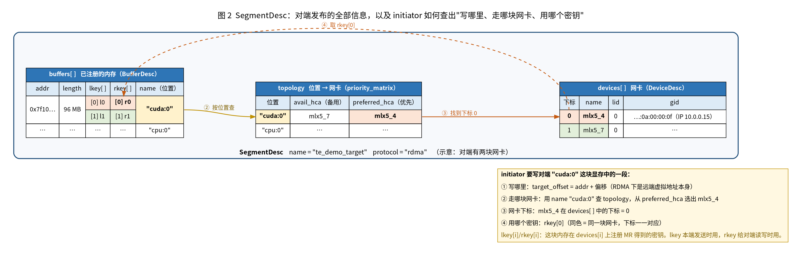

*Figure 2: The SegmentDesc the peer publishes, and how the initiator looks up where to write, which NIC to use and which rkey to use (the addresses are example values).*

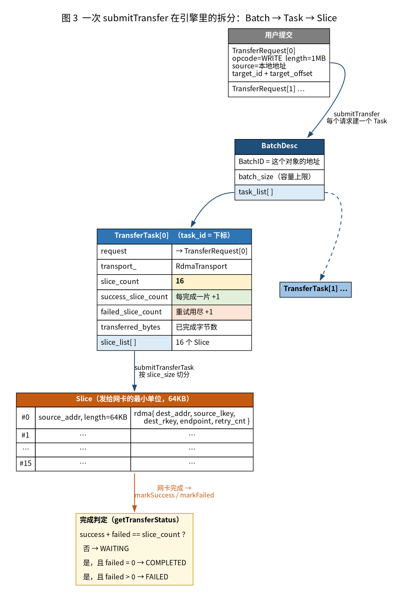

*Figure 3: How one `submitTransfer` is split into Batch → Task → Slice inside the engine, and how a task is judged complete.*

**Compare against a real SegmentDesc**: Start a target with the HTTP metadata service, fetch what it publishes, and check it field by field against the headers. This needs `USE_HTTP` at build time (on by default, and already in `build-te`).

```bash
cd Mooncake  # repository root
BIN=build-te/mooncake-transfer-engine/example
# Terminal 1: HTTP metadata service (port changed to 18080)
sed 's/port=8080/port=18080/' mooncake-transfer-engine/example/http-metadata-server-python/bootstrap_server.py > /tmp/meta_server.py
python3 /tmp/meta_server.py
# Terminal 2: target uses HTTP metadata, with the segment name set to te_demo_target
$BIN/transfer_engine_bench --mode=target --metadata_server=http://127.0.0.1:18080/metadata \
  --local_server_name=te_demo_target --protocol=rdma --device_name=mlx5_4 --use_vram=true --gpu_id=0 \
  --buffer_size=67108864
# Terminal 3: read out SegmentDesc and RpcMetaDesc
curl -s --noproxy '*' "http://127.0.0.1:18080/metadata?key=mooncake/ram/te_demo_target" | python3 -m json.tool
curl -s --noproxy '*' "http://127.0.0.1:18080/metadata?key=mooncake/rpc_meta/te_demo_target"
```

Output measured on this machine (excerpt):

```text
{
  "name": "te_demo_target",
  "protocol": "rdma",
  "devices": [{"name": "mlx5_4", "lid": 0, "gid": "00:...:ff:ff:0a:00:00:0f"}],
  "buffers": [{"name": "cuda:0", "addr": 139710152310784, "length": 100663296,
               "lkey": [43207], "rkey": [43207]}],
  "priority_matrix": {"cuda:0": [["mlx5_4"], []], "cpu:0": [["mlx5_4"], []]},
  "metadata_version": 1795332140964984
}
// rpc_meta: {"ip_or_host_name":"10.0.0.15","rpc_port":15449}
```

- The last 4 bytes of `gid`, `0a:00:00:0f`, are the network interface IP 10.0.0.15 (RoCE); `lid` is 0.
- `length` is 96MB rather than the 64MB passed in: the bench raises `--buffer_size` to at least `batch_size × block_size × threads` (128 × 64KB × 12).
- P2P mode (`P2PHANDSHAKE`) has no central service; the same JSON is exchanged directly over the handshake port during `openSegment` (`TransferMetadata::getSegmentDescInternal`).

## 4. Call Chain

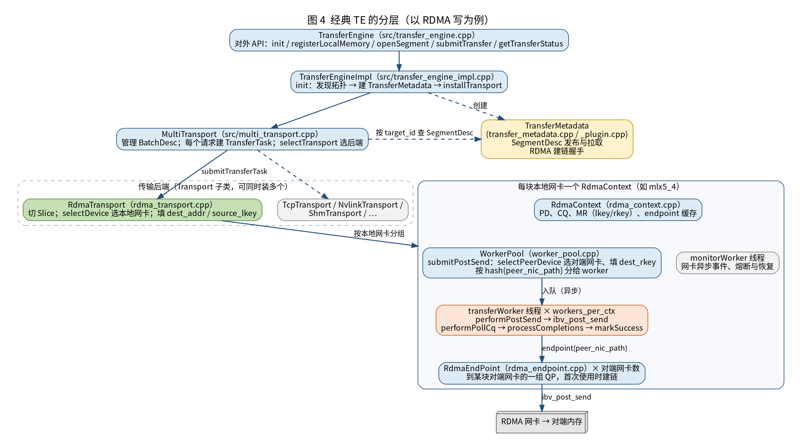

*Figure 4: The layers of classic TE (using an RDMA write as the example), from the public API down to the NIC.*

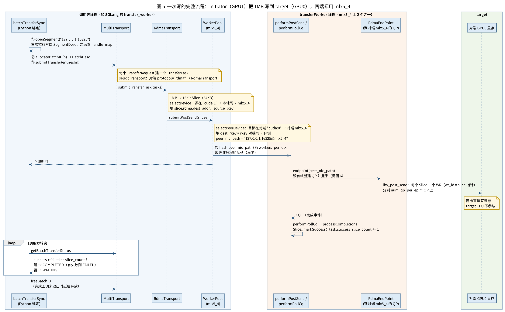

*Figure 5: The full sequence of the initiator (GPU1) writing 1MB to the target (GPU0), with both sides on mlx5_4.*

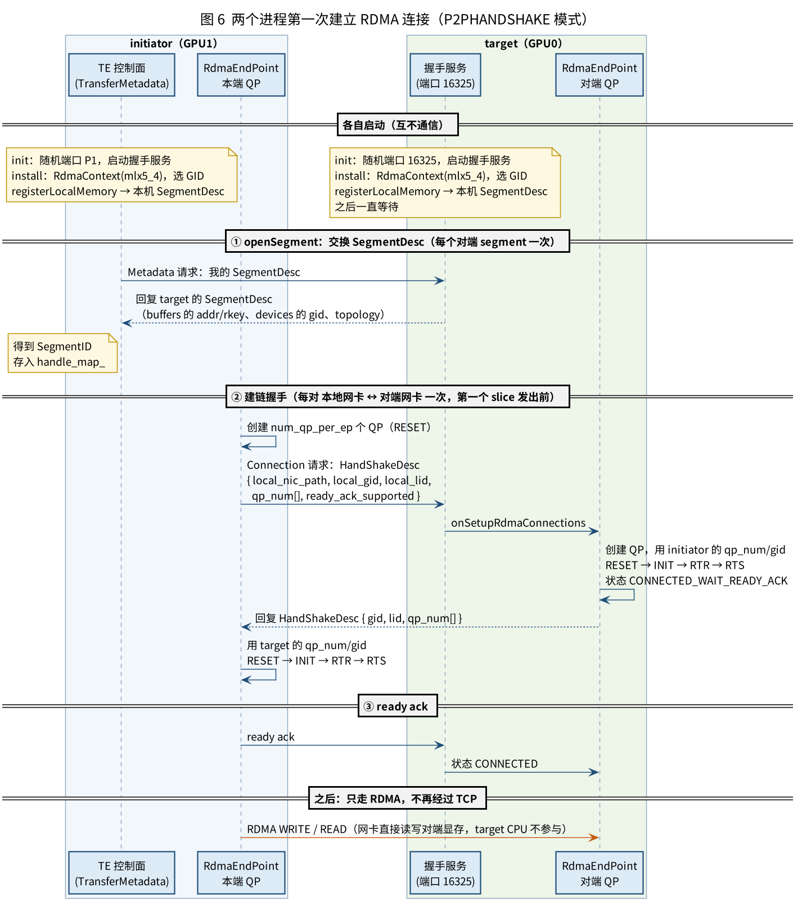

*Figure 6: The three TCP round trips when two processes first set up an RDMA connection in P2PHANDSHAKE mode.*

Figure 7 shows the two paths by which SGLang enters TE. SGLang paths are relative to `sglang/python/sglang/srt/`.

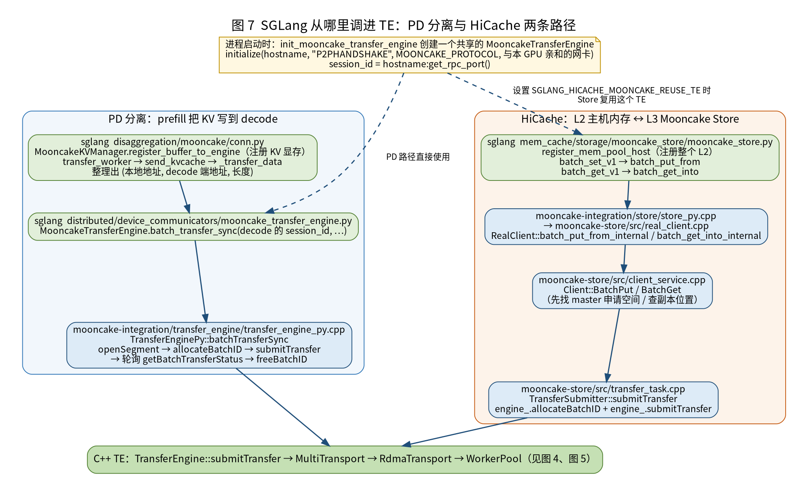

*Figure 7: The two paths by which SGLang enters TE: PD disaggregation and HiCache.*

## 5. Reading Suggestions

The goal is first to be able to explain "how one write goes from Python to the NIC and back to COMPLETED", then to fill in the control plane, and finally to dig into whatever you need (HiCache, fault tolerance). Read each pass with three questions in mind: what this layer receives, what conversion it does, and what it hands to the next layer. In the first three passes, skip metrics, congestion control, eventfd notification and retry branches whenever you meet them. The "after this pass you can answer" question at the end of each pass has a reference answer in the appendix at the end of the note.

### Preparation

1. Run A1 (GPU memory RDMA write) from Section 6 to confirm the environment works.
2. Fetch a copy of the metadata as in "Compare against a real SegmentDesc" in Section 3, and keep it at hand to compare against while reading the code.

### Pass 1: Data Structures

1. `include/transfer_metadata.h`: `SegmentDesc`, `DeviceDesc` and `BufferDesc` inside `class TransferMetadata`. Use the JSON to work out how the `devices` index relates to the `lkey/rkey` index.
2. `include/transport/transport.h`: `TransferRequest`, `TransferTask`, `Slice`, `BatchDesc`, plus `Slice::markSuccess` and `finishIfComplete` (when a task counts as complete).
3. `include/topology.h`: how a memory location maps to NICs.

After this pass you can answer: to write a block of the peer's (the target's) GPU memory, what do I (the initiator) need to know, and which fields hold that information?

### Pass 2: The Main Data-Plane Chain

Read in call order:

1. `transfer_engine_py.cpp`: `TransferEnginePy::batchTransferSync` (the usage flow of the whole API).
2. `multi_transport.cpp`: `MultiTransport::submitTransfer` (builds tasks, selects the Transport, submits in groups) and `selectTransport`.
3. `rdma_transport.cpp`: `RdmaTransport::submitTransferTask` (cuts slices, selects the local NIC).
4. `worker_pool.cpp`: `WorkerPool::submitPostSend` (selects the peer NIC, fills in the rkey) → `performPostSend`.
5. `rdma_endpoint.cpp`: `RdmaEndPoint::submitPostSend` (builds the WR, `ibv_post_send`).
6. `worker_pool.cpp`: `performPollCq` → `processCompletions` → `Slice::markSuccess`.
7. `multi_transport.cpp`: `getBatchTransferStatus` / `getTransferStatus` (how the caller sees COMPLETED).

After this pass you can answer: how many slices does a 1MB request become, which NIC does it use, which thread sends it, and how is the caller notified when it completes?

### Pass 3: The Control Plane

1. `transfer_engine_impl.cpp`: `TransferEngineImpl::init` (random port in P2P mode, automatic Transport installation).
2. `rdma_transport.cpp`: `RdmaTransport::install`, `registerLocalMemoryInternal` (registers an MR on each NIC, builds a `BufferDesc` and publishes it).
3. `rdma_context.cpp`: `RdmaContext::construct` (opens the device, PD and CQ, selects the GID).
4. `openSegment` in `transfer_engine_impl.cpp` → `getSegmentID` in `transfer_metadata.cpp` → `getSegmentDescInternal` (fetches the peer's SegmentDesc).
5. `rdma_endpoint.cpp`: `setupConnectionsByActive` (active connection setup) and `doSetupConnection` (QP state RESET → INIT → RTR → RTS); the passive side is `onSetupRdmaConnections` in `rdma_transport.cpp`.

After this pass you can answer: going from two processes that know nothing about each other to RDMA reads and writes between them, what information is exchanged, and which network round trips happen?

### Pass 4: Going Deeper as Needed

- **HiCache**: Start from `TransferSubmitter::submitTransfer` in `mooncake-store/src/transfer_task.cpp` and read upward to `Client::BatchPut` / `BatchGet` and `RealClient`, then compare with Section 7.
- **Fault tolerance**: `WorkerPool::redispatch`, `markLocalContextFailure`, `RdmaEndPoint::reconstruct` and `endpoint_store.cpp`, together with `tests/rdma_endpoint_reestablish_test.cpp`, `rdma_nic_selection_test.cpp` and `scripts/real_rdma_link_failover.sh`.
- **Other Transports**: Read the simplest one, `tcp_transport/`, first for comparison; they all share the same structure of implementing the `Transport` base class interface.

### Methods

- **Follow a real call with gdb**: First start a target in another terminal as in A1 of Section 6 and set `BIN` and `PORT`; then run the initiator under gdb, set breakpoints along the main chain, and use `bt` to see the call stack and `p *slice` to see field values.

```bash
gdb -ex 'set breakpoint pending on' \
    -ex 'b mooncake::MultiTransport::submitTransfer' \
    -ex 'b mooncake::RdmaTransport::submitTransferTask' \
    -ex 'b mooncake::WorkerPool::submitPostSend' \
    -ex 'b mooncake::RdmaEndPoint::submitPostSend' \
    -ex run --args $BIN/transfer_engine_bench --mode=initiator \
    --metadata_server=P2PHANDSHAKE --local_server_name=127.0.0.1 \
    --segment_id=127.0.0.1:$PORT --protocol=rdma --device_name=mlx5_4 \
    --use_vram=true --gpu_id=1 --threads=1 --batch_size=1 --duration=5
```

- `--threads=1 --batch_size=1` keeps it to one request at a time, so the call stack is as clean as possible.
- **Read the logs**: Prefix the command with `GLOG_v=1 GLOG_logtostderr=1` to print more detailed VLOG output, and use the log to confirm the call order.
- **Treat unit tests as the manual**: When reading a mechanism, first look in `tests/` for a test with a similar name (for example, `rdma_nic_selection_test.cpp` for NIC selection); the test's inputs and expected outputs are that mechanism's spec.

## 6. Local Testing

Run two processes on one machine: start the target (the side being read or written) first, then the initiator (the side issuing requests). `P2PHANDSHAKE` mode needs no metadata service such as etcd.

### Preparation

- Binaries: the pip package ships `/usr/local/bin/transfer_engine_bench` (an entry script that actually runs the bench bundled in the package, whose version may not match the source), but not the validator. The validator, NVLink, unit tests and debugging with code changes need a source build:

```bash
cd Mooncake  # repository root
bash dependencies.sh    # install dependencies before the first build; needs network access (set a proxy first)
cmake -S . -B build-te -DCMAKE_BUILD_TYPE=RelWithDebInfo \
  -DUSE_CUDA=ON -DUSE_INTRA_NVLINK=ON -DBUILD_UNIT_TESTS=ON \
  -DWITH_STORE=OFF -DWITH_STORE_RUST=OFF
cmake --build build-te -j64
# build outputs are in build-te/mooncake-transfer-engine/example/
```

- NICs: check state and rate in `/sys/class/infiniband/<nic>/ports/1/{state,link_layer,rate}`; for GPU memory tests, use `nvidia-smi topo -m` to pick a NIC under the same PCIe switch as the GPU (`PIX`). Figure 8 shows the mapping on this machine.
- GPU memory tests need GPUDirect RDMA: when the `nvidia_peermem` kernel module is loaded (`lsmod | grep nvidia_peermem`), TE registers GPU memory directly with `ibv_reg_mr`; otherwise it registers through dma-buf (which needs driver and NIC support for dma-buf).

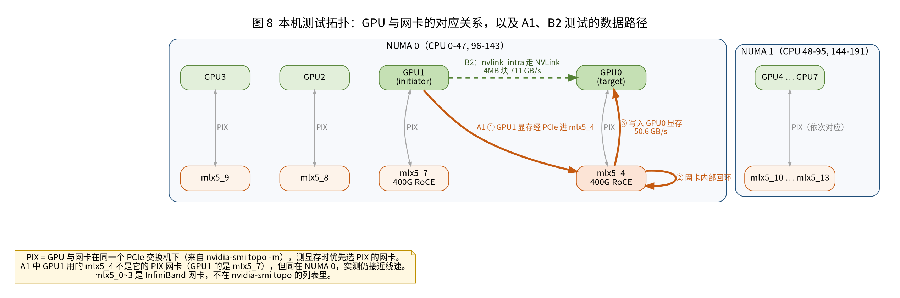

*Figure 8: Local test topology: how GPUs map to NICs, and the data paths of the A1 and B2 tests.*

### How It Works (`example/transfer_engine_bench.cpp`)

- **target**: Initializes TE, allocates and registers buffers (for DRAM one per NUMA node; for GPU memory on `--gpu_id`), then waits indefinitely without sending any requests itself. In P2P mode the segment name is simply `127.0.0.1:<port>`, and the port appears in the `listening on` log line.
- **initiator**: Also registers local buffers, then after `openSegment(--segment_id)` starts `--threads` threads. Each thread loops `allocateBatchID` → build `--batch_size` requests of `--block_size` bytes → `submitTransfer` → poll `getTransferStatus` for each task until it completes → `freeBatchID`, for the full `--duration` seconds.
- **Throughput** = number of batches × batch_size × block_size ÷ duration.
- **validator** (`example/transfer_engine_validator.cpp`): Each round writes and then reads but counts as only one batch, so the throughput it prints covers only half the bytes actually moved. The first round, and a random ~1/64 of later rounds, are verified: fill the local buffer with one random byte and write it to the remote side, zero the local buffer and read it back, then compare with `memcmp`; on a mismatch it prints `Detect data integrity problem` and exits.

### Full Commands

Each test uses two terminals: start the target in terminal 1, find `listening on 127.0.0.1:<port>` in its log, and put that port into `--segment_id` in terminal 2. Press Ctrl+C to stop the target. All commands below use the binaries built from source:

```bash
cd Mooncake  # repository root
BIN=build-te/mooncake-transfer-engine/example
```

A1 GPU memory RDMA write (GPU0 ← GPU1, sharing mlx5_4):

```bash
# Terminal 1
$BIN/transfer_engine_bench --mode=target --metadata_server=P2PHANDSHAKE --local_server_name=127.0.0.1 \
  --protocol=rdma --device_name=mlx5_4 --use_vram=true --gpu_id=0 --buffer_size=1073741824
# Terminal 2: set PORT to the port in "listening on 127.0.0.1:XXXXX" from the terminal 1 log
PORT=16325
$BIN/transfer_engine_bench --mode=initiator --metadata_server=P2PHANDSHAKE --local_server_name=127.0.0.1 \
  --segment_id=127.0.0.1:$PORT --protocol=rdma --device_name=mlx5_4 --use_vram=true --gpu_id=1 \
  --buffer_size=1073741824 --operation=write --threads=8 --duration=10
```

The other tests change only the parameters below relative to A1 (tests that leave the target unchanged can reuse the same target process):

- A1 read: terminal 2 `--operation=read`.
- A2 cross-NIC: terminal 2 `--device_name=mlx5_7`.
- A3 DRAM: on both sides, replace `--use_vram=true --gpu_id=N` with `--use_vram=false`.
- A4 multi-NIC: on both sides, remove `--device_name=mlx5_4` and add `--auto_discovery`.
- A5 TCP: `--protocol=tcp` on both sides, and remove `--device_name`.
- A6 parameter sweep: in terminal 2, vary `--block_size` (4096 / 65536 / 1048576 / 4194304), `--threads` (1 / 4 / 8 / 16) and `--batch_size` (32 / 128 / 512) in turn. The range the initiator writes on the peer is block_size × batch_size × threads, and the target's `--buffer_size` must be at least that; otherwise an out-of-range slice finds no remote buffer and fails with FAILED right away. For example, 4MB blocks, batch 128 and 8 threads need 4GB, so the target's `--buffer_size` must grow to match (the initiator enlarges its own buffer automatically; the target does not).
- B1 data correctness: on both sides, replace `transfer_engine_bench` with `transfer_engine_validator`, and remove `--operation` in terminal 2 (the validator has no such flag; it always writes and then reads back).
- B2 NVLink: `--protocol=nvlink_intra` on both sides, and remove `--device_name`; in terminal 2, `--block_size=4194304 --batch_size=32` is recommended. `--protocol=nvlink` needs `-DUSE_MNNVL=ON` and targets cross-node NVLink domains (MNNVL); when the GPU does not support fabric handles it falls back to CUDA IPC, so it also runs on one machine, but the normal choice on one machine is `nvlink_intra`.
- B4 TENT: rebuild with `-DUSE_TENT=ON` added to cmake, and add `--backend=tent` on both sides. In TENT mode the bench builds its config only from `--metadata_server` and `--local_server_name`; `--device_name` and `--auto_discovery` have no effect, and TENT picks the NICs itself.

Other tests:

- A7 failover: run `mooncake-transfer-engine/scripts/real_rdma_link_failover.sh --help` to see the parameters, set them for this machine's NIC names, then run it; the script takes NICs link down, which affects other workloads on the same machine.
- A8 Python API: run `receiver.py` / `sender.py` (tcp) from `docs/source/design/transfer-engine/index.md`, then change `PROTOCOL` to `"rdma"` and `DEVICE_NAME` to `"mlx5_4"` and run once more.
- B3 unit tests: `ctest --test-dir build-te/mooncake-transfer-engine -j16 --timeout 300 --output-on-failure -E "efa|cxi|sunrise|ascend|hip|ub|nvmeof|cxl"` (this excludes tests for hardware this machine lacks; those tests are only registered when the matching `USE_*` is on anyway, and `ub` is a substring match that also wrongly excludes four RDMA tests whose names contain `sub` or `republish`, so you can drop it when you don't need it); to run by category, use `-R rdma` and so on.

### Measured Results (Single-NIC Loopback, 8 Threads, 10 Seconds Each, Default Block 64KB and Batch 128; Only the Items Below Were Tested, the Rest Were Not)

- A1 GPU memory RDMA: write 50.62 GB/s, read 50.77 GB/s, close to the 400Gb/s line rate (about 50 GB/s).
- A2 cross-NIC (mlx5_4 ← mlx5_7): write 48.61 GB/s.
- A3 DRAM RDMA: write 50.64 GB/s, read 50.68 GB/s.
- B1 validator (GPU memory RDMA): verification passed, printing 23.88 GB/s. That number counts only half the bytes (see "How It Works" above), so the real rate is about 47.8 GB/s, close to the bench; filling, zeroing and comparing happen only in the first round and in about 1/64 of rounds, so their impact is small.
- B2 NVLink: 41.72 GB/s with the default 64KB blocks; 711.28 GB/s with 4MB blocks and batch 32 (the end of Q7 explains why small blocks are slow).

### Notes

- The target's startup log follows the init flow in order: `parseHostNameWithPort` (parses the local host name; P2P mode ignores the default port 12001 in it) → `listening on` (the randomly chosen handshake port, to give to the initiator) → `rdma_transport` / `rdma_context` (builds a Context for each NIC: CQ, endpoint cache, automatic GID selection) → `VRAM is used` / `Allocating memory on GPU N` (allocates the buffer). Registering memory and publishing the segment after that print no logs; once the process sits waiting, it is ready.
- An occasional `Batch ... is still busy; cleanup has been deferred` while the initiator runs (`freeBatchID` in `multi_transport.cpp`) is normal: all tasks have completed, but a worker thread's completion callback has not exited yet (`active_completion_callbacks != 0`), so the batch is handed to a background thread to free later, without affecting the result. In a measured 10-second run it appeared about 30 times, 0.05% of 60187 batches.
- The pip package's initiator prints `Local segment descriptor not found` at startup (both `getSegmentDescInternal` and `receivePeerMetadata` in `transfer_metadata.cpp` print it; presumably it starts exchanging with the peer before the local SegmentDesc is built). It can be ignored when the test completes normally; the source-built version does not show it.
- Single-NIC loopback bandwidth only validates the flow and does not represent cross-machine performance.

## 7. SGLang HiCache (L1/L2/L3) Read and Write Paths

Scenario: a single SGLang server (not PD, or only a P node), with `--enable-hierarchical-cache --hicache-storage-backend mooncake`. SGLang paths are relative to `sglang/python/sglang/srt/`, checked on 2026-11-20 (SGLang main f5149f367b).

### The Three Tiers and Core Objects

- **L1 GPU memory**: the device KV pool (`mem_cache/memory_pool.py`).
- **L2 host memory**: `MHATokenToKVPoolHost` (`mem_cache/pool_host/mha.py`), sized by `--hicache-ratio` / `--hicache-size`.
- **L3 Mooncake Store**: `MooncakeStore` (`mem_cache/storage/mooncake_store/mooncake_store.py`), backed internally by `mooncake.store.MooncakeDistributedStore`.
- **Radix tree**: `UnifiedRadixCache` (`mem_cache/unified_radix_cache.py`, with the node logic in `mem_cache/unified_cache/unified_tree_core.py`); the old `HiRadixCache` has been removed. A node stores data per component. On the KV component `component_data[BASE_COMPONENT_TYPE]`, `value` holds the GPU memory page indices (empty means evicted from L1), `host_value` holds the host page indices (non-empty means `backuped`), and `hash_value` holds one SHA256 hash per page (chained from the previous page's hash and this page's tokens); the L3 key is this hash plus a rank suffix.
- **Controller**: `HybridCacheController` (`mem_cache/hybrid_cache/hybrid_cache_controller.py`, a subclass of `HiCacheController` in `managers/cache_controller.py`) handles L1↔L2 copies and the L2↔L3 background threads; the copies are issued by `mem_cache/l2_transfer.py` on a separate CUDA stream.

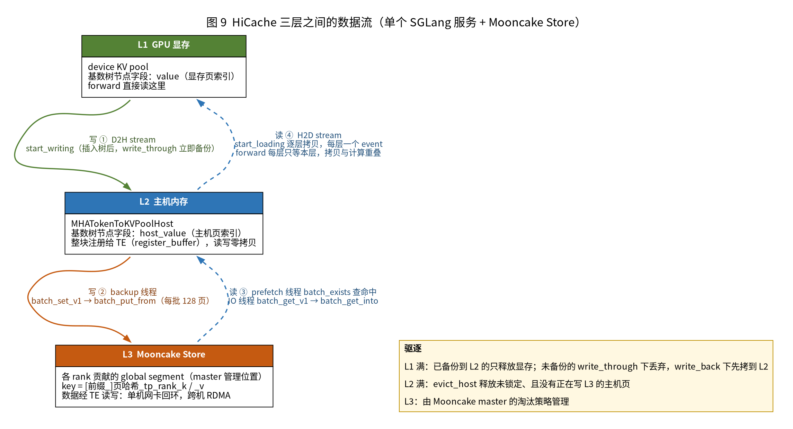

*Figure 9: Data flow and eviction rules between HiCache's three tiers, for a single SGLang server with Mooncake Store.*

### Initialization

`scheduler` → `kv_cache_builder.build_kv_cache` → `registry.create_tree_cache` constructs `UnifiedRadixCache` → `init_hicache` (`unified_radix_cache.py:549`) → assembles the host pool and `HybridCacheController` → `attach_storage_backend` (`cache_controller.py:681`): creates `MooncakeStore` (`store.setup(...)` connects to the master and mounts the global segment), `register_mem_pool_host` (`mooncake_store.py:879`) registers the whole L2 host KV memory with TE (for zero copy), and starts four background threads: prefetch / IO / sync / backup.

### Write: L1 → L2 → L3

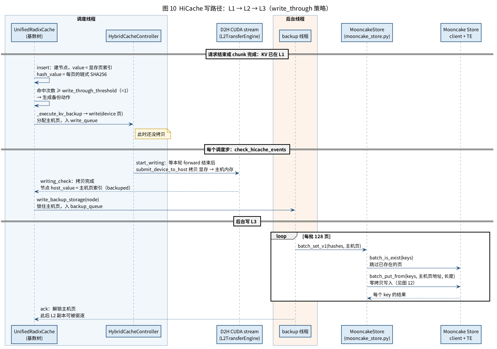

*Figure 10: HiCache write path L1 → L2 → L3 (write_through policy).*

Where the functions in Figure 10 live: `_execute_kv_backup` (`unified_radix_cache.py:2295`), `controller.write` (`hybrid_cache_controller.py:757`), `start_writing` (`cache_controller.py:1101`), `submit_device_to_host` (`l2_transfer.py:205`), `writing_check` (`unified_radix_cache.py:4339`), `write_backup_storage` (`:2584`), `backup_thread_func` (`hybrid_cache_controller.py:2129`), `batch_set_v1` (`mooncake_store.py:1648`).

L3 key format: an MHA model has two keys per page, `[prefix_]{hash}_{tp_rank}_k` and `..._v`; with PP enabled the rank suffix is `{tp_rank}_{pp_rank}` (Q10 explains why).

### Read: L3 → L2 (Prefetch) → L1 (Layer-by-Layer Load)

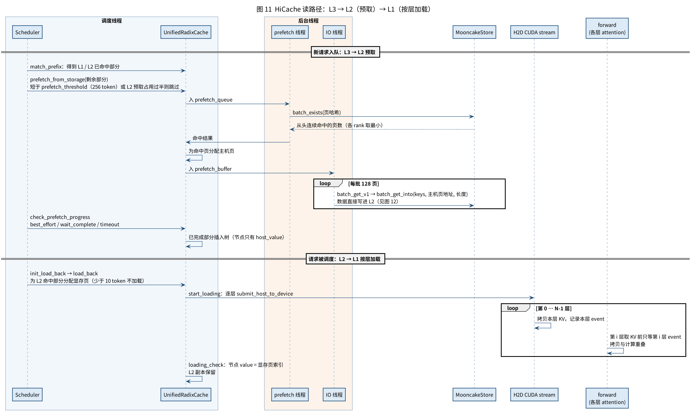

*Figure 11: HiCache read path: L3 → L2 prefetch, and L2 → L1 layer-by-layer load.*

Where the functions in Figure 11 live: `prefetch_from_storage` (`unified_radix_cache.py:2707`), `batch_exists` (`mooncake_store.py:1842`), `batch_get_v1` (`:1611`), `check_prefetch_progress` (`unified_radix_cache.py:3104`), `init_load_back` (`:4467`), `load_back` (`:2378`), `start_loading` (`cache_controller.py:1244`), `submit_host_to_device` (`l2_transfer.py:218`), `loading_check` (`unified_radix_cache.py:4397`). `evict_host`, which evicts L2, is at `unified_radix_cache.py:1928`.

### Inside Mooncake Store (How put / get Reach TE)

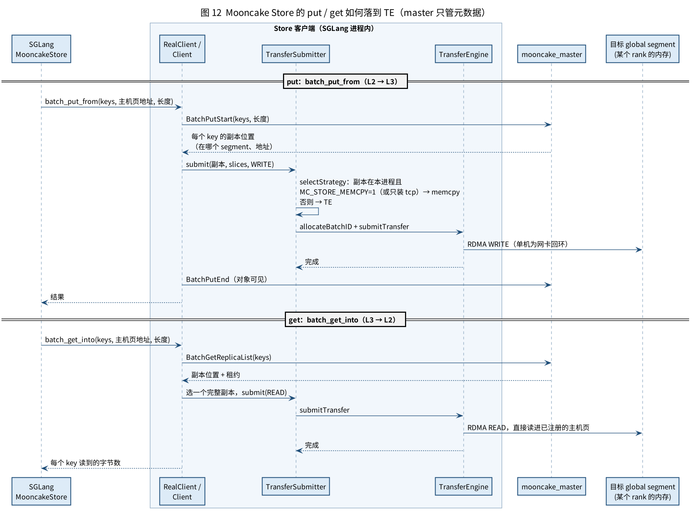

*Figure 12: How Mooncake Store's put / get reach TE; the master handles only metadata.*

- **Code path**: `mooncake-integration/store/store_py.cpp` → `mooncake-store/src/real_client.cpp` (`RealClient::batch_put_from_internal` / `batch_get_into_internal`) → `client_service.cpp` (`Client::BatchPut` / `BatchQuery` / `BatchGet`) → `transfer_task.cpp` (`TransferSubmitter`). The master handles only metadata and allocation and never touches the data.
- **global segment**: Each SGLang rank, as a Store client, contributes `global_segment_size / (tp*pp)` of memory at `setup`, registers it with TE and mounts it on the master, forming a distributed memory pool. Q9 covers where the data actually goes in a single-machine deployment.

### Main Parameters

- `--hicache-write-policy`: `write_through` (default) / `write_back`, among others.
- `--hicache-ratio`, `--hicache-size`: L2 size. `--hicache-mem-layout`: host KV layout (such as `page_first`). `--hicache-io-backend`: how L1↔L2 copies are done (such as `kernel`).
- `--hicache-storage-prefetch-policy`: `best_effort` / `wait_complete` / `timeout`.
- `--hicache-storage-backend-extra-config`: JSON that can hold Mooncake settings (`master_server_address`, `protocol`, `device_name`, `global_segment_size` and so on) and options such as `prefetch_threshold` and `prefetch_timeout_base`; you can also point to a config file with `SGLANG_HICACHE_MOONCAKE_CONFIG_PATH`, or use the `MOONCAKE_MASTER`, `MOONCAKE_PROTOCOL`, `MOONCAKE_DEVICE` and `MOONCAKE_GLOBAL_SEGMENT_SIZE` environment variables.

## Appendix 1: Answers to the Reading Self-Check

These answer the questions at the end of each pass in Section 5. The core of each answer is already drawn in the matching figure, so this appendix gives only the conclusion and the details the figures leave out. The examples keep the local setup: the initiator on GPU1, the target on GPU0, both using mlx5_4.

### Pass 1: To Write a Block of the Peer's (the Target's) GPU Memory, What Do I (the Initiator) Need to Know, and Which Fields Hold It

**Conclusion**: Four pieces of information. The first three come from the peer's `SegmentDesc`, obtained at `openSegment`; part of the fourth arrives only during the connection handshake. Steps ①~④ in Figure 2 show how the first three (where to write, which peer NIC, which rkey) are looked up.

Additions not drawn in Figure 2:

- **Address range**: Every slice must fall inside one of the peer's `buffers[i]`, or no path can be selected. A whole request can span two adjacent MRs; slices are cut at the remote MR boundary (see the slicing rules in Pass 2).
- **The fourth: how to connect to that peer NIC**. The peer's `DeviceDesc::name` is combined into `peer_nic_path` (`"<peer segment name>@mlx5_4"`, which is also the endpoint cache key); the handshake address comes from `RpcMetaDesc` (in P2P mode it is just the peer segment name); the GID / LID used to set up the QP come from the handshake reply `HandShakeDesc`, falling back to `gid` / `lid` of `devices[i]` in `SegmentDesc` only when the reply's GID is empty. Figure 6 shows the connection setup.
- **Code location**: The peer NIC and rkey are selected in `selectPeerDevice` in `worker_pool.cpp`, and the rkey goes into `Slice::rdma.dest_rkey`.
- **The peer does not need to provide the lkey**: Sending uses my own `lkey[my NIC index]`, which goes into `Slice::rdma.source_lkey`.

### Pass 2: How Many Slices a 1MB Request Becomes, Which NIC It Uses, Which Thread Sends It, and How the Caller Is Notified on Completion

**Conclusion**: 16 slices. On this machine both sides use mlx5_4, and one transferWorker thread on mlx5_4 sends them and receives the completion events. The caller learns of completion by polling: Python's `batchTransferSync` polls `getBatchTransferStatus`, and the bench polls `getTransferStatus` for each task. Figure 3 shows the split, and Figure 5 shows the threads and call order.

Additions not drawn in the figures:

- **Slicing rules** (`SliceLengthCalculator`): cut by `slice_size` (`MC_SLICE_SIZE`, default 64KB); when the remainder is no more than `slice_size + fragment_limit` (default 16KB), all of it becomes the last slice; each slice is cut at the local and remote MR boundaries. 1MB is exactly 16 × 64KB, hence 16 slices; crossing an MR adds slices.
- **Local NIC**: Consecutive slices on the same MR reuse the last chosen NIC by default, switching NICs only on retry.
- **Thread assignment**: `hash(peer_nic_path) % workers_per_ctx` (default 2), so slices for the same peer NIC are always handled by the same thread.
- **On failure**: Retry on another NIC first, and `markFailed` only when retries run out; see Figure 13.
- **Another notification method**: `completionFd` / eventfd (RFC #5164), where the completion path actively wakes the caller; not used by default.

### Pass 3: What Two Processes Exchange, and in How Many Network Round Trips, to Go From Strangers to RDMA Reads and Writes

**Conclusion**: In P2P mode, 3 TCP round trips (see Figure 6): ① exchange SegmentDesc (once per peer segment); ② exchange `HandShakeDesc` (QP number, GID, LID), once per NIC pair; ③ ready ack. After that, reads and writes go over RDMA only.

Additions not drawn in Figure 6:

- **Central service mode**: ① becomes a read of `mooncake/ram/<name>` from etcd/redis/http, with no direct communication between the two processes; ②③ stay the same and still need a direct handshake. Figure 14 compares the two modes.
- **Code locations**: ① `getSegmentDescInternal` → `exchangeMetadata`; ② active side `RdmaEndPoint::setupConnectionsByActive`, passive side `RdmaTransport::onSetupRdmaConnections` → `setupConnectionsByPassive`, with the QP state transitions in `doSetupConnection`; ③ `sendReadyAck`.
- **Re-handshake**: Connections are cached in `endpoint_store`; after one is evicted or fails, the next access goes through ②③ again.

## Appendix 2: More Q&A

The questions below are ordered "data plane → control plane → performance → HiCache".

### Q1: Why Can the Target Be Written When It Does Nothing? Does Its CPU Take Part?

RDMA WRITE/READ are one-sided operations: my NIC sends packets carrying the peer address and rkey, and the peer's NIC checks the rkey and writes the data straight into memory (or reads it out), never passing through the peer's CPU or operating system. The target only has to do two things in advance: register memory (which produces the rkey), and keep its handshake thread online to answer metadata exchange and connection setup requests (①②③ in Figure 6). Once the connection is set up, the target's CPU is unaware of each read and write. That is why the target process in the bench can run at a full 50 GB/s while it "just waits".

### Q2: Can the Requests in One Batch Go to Different Peers?

Yes. Each `TransferRequest` has its own `target_id`, `MultiTransport::submitTransfer` selects a Transport for each request in turn, and the RDMA layer then assigns them to different workers by peer NIC. The Python binding's `batchTransferSync`, however, takes only one `target_hostname`, so in SGLang PD disaggregation one call goes to only one decode side.

### Q3: Why Cut One Request Into Multiple Slices?

- **Parallelism**: Slices on the same endpoint are spread across multiple QPs (`num_qp_per_ep`) and run concurrently; with multiple NICs, different requests or different MRs may get different NICs.
- **Retry granularity**: On an error, only the failed slices are resent, not the whole request.
- **No MR crossing**: Each slice is cut at MR boundaries, so one WR involves only one MR.

The cost is that every slice needs its own WR and completion event handling, so when slices are too small, CPU overhead dominates (see Q7).

### Q4: What Happens After a Slice Fails?

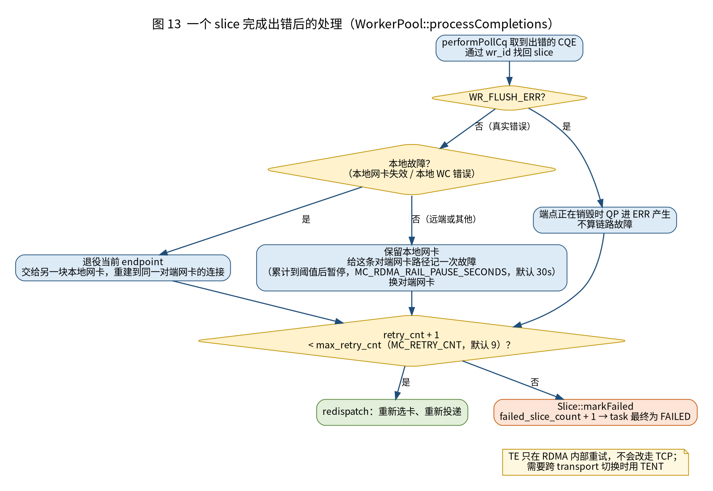

*Figure 13: How `WorkerPool::processCompletions` handles a slice that completes with an error.*

### Q5: How Do P2PHANDSHAKE and etcd/http Metadata Differ? Which One Should a Cluster Use?

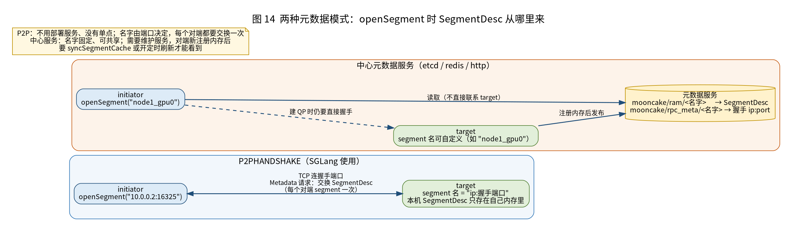

*Figure 14: Where the SegmentDesc comes from at `openSegment` in each of the two metadata modes.*

Figure 14 shows the trade-offs between the two modes. With SGLang, use P2P; for your own programs, use a central service only if you need fixed names or many processes sharing metadata.

### Q6: Why Do GPU Memory and DRAM Measure the Same Bandwidth (About 50 GB/s Each)?

Both tests go through the same 400Gb/s NIC, so the bottleneck is the NIC's line rate, regardless of where the memory is. NIC access to GPU memory needs GPUDirect RDMA (`nvidia_peermem` or dma-buf), and the NIC and GPU should preferably sit under the same PCIe switch (`PIX` in `nvidia-smi topo -m`); otherwise traffic detours through the PCIe root complex on the CPU side and bandwidth may drop. On this machine GPU0 and mlx5_4 are `PIX`, so there is no loss.

### Q7: Why Is Bandwidth Low With Small Blocks? How Should block_size, batch_size and threads Be Tuned?

Every request carries a fixed overhead that does not depend on block size, so the smaller the block, the more overhead each byte bears. Under RDMA this overhead is building a WR for each slice, `ibv_post_send`, polling CQEs, updating counters, and the caller polling status. The NVLink measurement for B2 in Section 6 (41.72 GB/s with 64KB blocks, 711.28 GB/s with 4MB blocks) follows the same pattern through a different mechanism: `nvlink_intra` does not cut slices or use WRs and CQs; each request is one `cudaMemcpyAsync` (or a batched memcpy), and each `submitTransfer` also starts with `cudaEventSynchronize`, which blocks until the caller's earlier GPU work finishes, so with small blocks these call overheads dominate. Tuning approach:

- **block_size**: As large as the workload allows; when KV pages are too small, consider merging consecutive pages.
- **batch_size**: Submit more requests at a time to spread the submit and polling overhead.
- **threads**: Add threads that submit concurrently until the NIC is saturated or the CPU becomes the bottleneck.
- **MC_SLICE_SIZE / MC_WORKERS_PER_CTX / MC_NUM_QP_PER_EP**: RDMA engine-side parameters (no effect on `nvlink_intra`); compare with the bench's A6 parameter sweep before changing them.

### Q8: How Many Peers Can One Process Connect To at Once? Are Connections Reclaimed?

Each local NIC's `RdmaContext` caches connections to the peer NICs in `endpoint_store`, up to `max_ep_per_ctx` (`MC_MAX_EP_PER_CTX`, default 65536), with the SIEVE eviction policy by default (`MC_ENDPOINT_STORE_TYPE` can switch it to FIFO). An evicted endpoint is not freed at once: on eviction its QPs are first moved to the ERR state, the WRs already posted complete with `IBV_WC_WR_FLUSH_ERR`, the corresponding slices are reposted through the retry flow (failing only once retries run out; see Figure 13), and the endpoint is reclaimed only after all those WRs have been collected. So eviction makes in-flight slices retry once and loses no data. The next access to that peer handshakes again (②③ in Figure 6).

### Q9: In a Single-Machine HiCache Deployment, Where Does KV Actually Go on Its Way to L3?

With TP=1, the master allocates space on the global segment this process mounted itself, and the data path is: L2 host memory → TE → this process's global segment (also host memory). With `protocol=rdma` and `MC_STORE_MEMCPY=1` not set, this step goes through NIC loopback rather than an in-process memcpy (`TransferSubmitter::selectStrategy`). With TP>1, one rank's data may land on another rank's segment on the same machine. The master only allocates and records locations; the data never passes through it.

### Q10: Why Does the L3 Key Include tp_rank?

With tensor parallelism, each TP rank holds the KV for only some of the attention heads, so the same token prefix is different data on different ranks. The key tells them apart with "page hash + rank suffix", and each rank reads and writes only its own share; with PP, pp_rank is added as well. So under the default `--hicache-storage-key-scheme rank-suffix`, two MHA-model servers with different TP sizes cannot directly reuse the KV each other wrote to L3. There are two ways to reuse across TP sizes: set `tp_lcm_size` in the extra config (the least common multiple of the servers' TP sizes, which requires the `page_head` layout), so each rank writes several keys by finer head groups; or use `--hicache-storage-key-scheme unified`, where the key switches to topology-independent "layer index + head group index" coordinates. An MLA model's KV is the same on every TP rank, so the key has no tp_rank: without PP it is `{hash}__k` (empty suffix, two underscores), and with PP it is `{hash}_{pp_rank}_k`.
