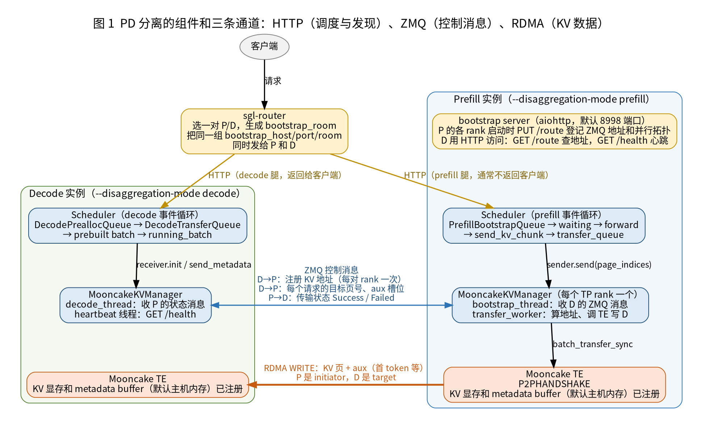
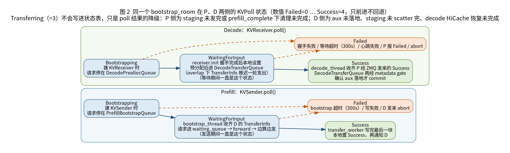
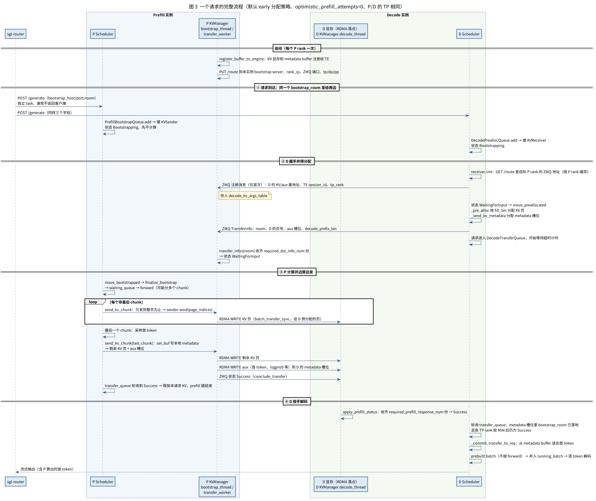
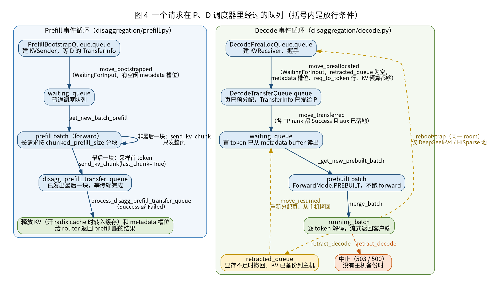
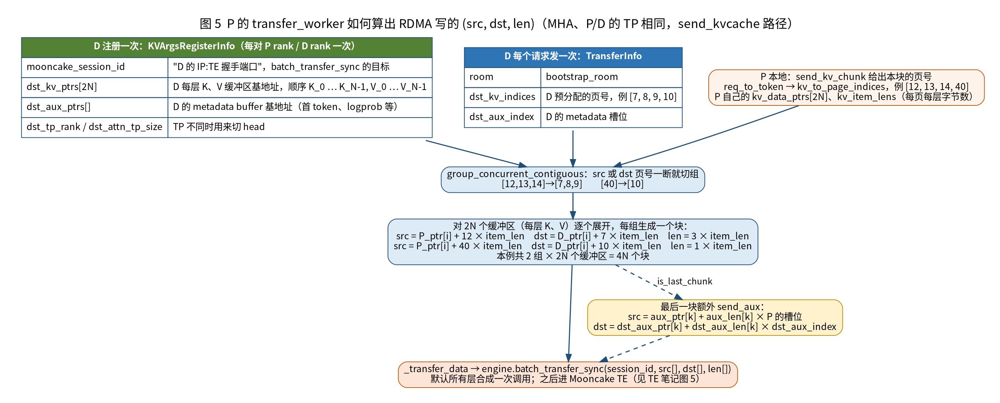
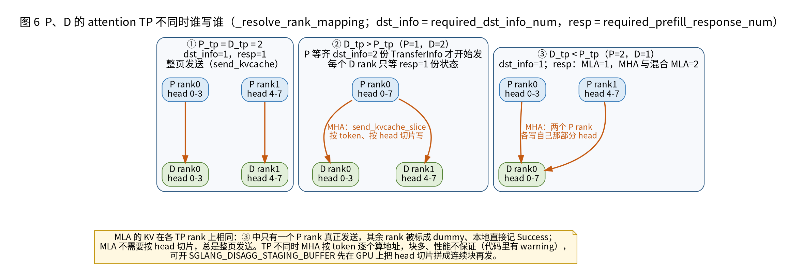

# SGLang PD 分离学习笔记（Mooncake 后端）：代码结构、请求流程、传输层、容错与本机测试

中文 | [English](./SGLang-PD-Disaggregation-Mooncake-Notes_en.md)

- **整理日期**: 2026-11-26
- **范围**: SGLang PD 分离（prefill / decode 分离）在 Mooncake 后端下的代码结构、核心数据结构、一个请求的完整流程、传输层细节、故障处理、阅读方法和本机测试。
- **代码版本**: [sgl-project/sglang](https://github.com/sgl-project/sglang/tree/f5149f367b8f0fd728bca44f4e77c8fc102ad803) main 分支 `f5149f367b`（2026-11-20），[kvcache-ai/Mooncake](https://github.com/kvcache-ai/Mooncake/tree/301261358eef0b13fa55645ccde4a988f1ca7505) main 分支 `30126135`（2026-11-20）。文中的 `文件:行号` 都对应这两个提交。
- **实测环境**: 单机 8 卡 GPU，每卡一块 400Gb/s RoCE 网卡（mlx5），模型 Qwen3-4B；带宽和延迟数字来自这台机器，不代表跨机性能。
- **依据**: 阅读上述代码、SGLang 和 Mooncake 文档，并在上述单机上跑了第 8 节列出的测试。

Mooncake TE 本身的内部实现见 [Mooncake Transfer Engine 学习笔记](./Mooncake-Transfer-Engine-Notes.md)（下文称"TE 笔记"）。

全文分为：

1. 目录结构
2. 整体架构
3. 核心概念与数据结构
4. 一个请求的完整流程
5. Mooncake 传输层
6. 故障处理与超时
7. 阅读建议
8. 本机测试
9. 附录一：阅读自测参考答案
10. 附录二：更多问答

- **路径约定**：SGLang 路径相对 `python/sglang/srt/`；`sgl-router/` 开头的路径相对 SGLang 仓库根目录。
- **测试脚本**：第 8 节用到 `pd_transfer_sim.py`（不加载模型、复现 P→D 的 KV 传输）、`pd_correctness.py`、`pd_ttft.py`（测完整 PD 部署的输出一致性和 TTFT），是作者自己写的，没有随笔记公开，做法在第 8 节里写明。
- **称呼约定**：P 指 prefill 实例，D 指 decode 实例。KV 数据由 P 用 RDMA WRITE 写进 D 的显存，所以 P 是 TE 的 initiator，D 是 target。

## 1. 目录结构

PD 分离的主体在 SGLang 的 `disaggregation/`，Mooncake 只提供 TE（经 Python 绑定调用）。

```text
python/sglang/srt/disaggregation/
├── prefill.py          P 侧：PrefillBootstrapQueue、prefill 事件循环、send_kv_chunk
├── decode.py           D 侧：DecodePreallocQueue、DecodeTransferQueue、decode 事件循环
├── decode_schedule_batch_mixin.py   D 侧 prebuilt batch（prepare_for_prebuilt / process_prebuilt）
├── utils.py            MetadataBuffers、poll_and_all_reduce、TransferBackend、get_kv_class
├── base/conn.py        抽象接口：KVArgs、KVPoll、BaseKVManager/Sender/Receiver/BootstrapServer
├── common/conn.py      各后端共用实现：bootstrap server、KVReceiver、rank 映射、心跳、状态消息
├── mooncake/conn.py    Mooncake 后端：MooncakeKVManager（transfer_worker、地址计算、调用 TE）
├── mooncake/utils.py   自定义显存池（NVLINK / BAREX / INTRA_NODE_NVLINK）
├── nixl/、mori/、ascend/、fake/   其他传输后端
└── decode_kvcache_offload_manager.py、decode_hicache_mixin.py   D 侧 KV 卸载和 HiCache
```

其他相关文件：

- `arg_groups/fields/disagg.py`：`--disaggregation-*` 启动参数定义；`arg_groups/pd_disaggregation_hook.py`：参数归一化和校验。
- `managers/scheduler.py`：`init_disaggregation`（1631 行起）建队列和 metadata buffer，`_dispatch_event_loop_once`（7054 行起）按角色选事件循环。
- `managers/disagg_service.py`：P 实例启动 bootstrap server。
- `distributed/device_communicators/mooncake_transfer_engine.py`：进程内共享的 `MooncakeTransferEngine`，封装 Mooncake Python 绑定。
- `sgl-router/src/server/routes/chat/forward.rs`、`preparation.rs`：router 选 P/D、生成 `bootstrap_room`、把请求同时发给两边。
- Mooncake 侧：`mooncake-integration/transfer_engine/transfer_engine_py.cpp`（`batchTransferSyncWrite` → `batchTransferSync`、`batchRegisterMemory`），部署文档 `docs/source/deployment/integrations/sglang/pd-disaggregation.md`。

Mooncake 后端很薄：`MooncakeKVReceiver` 和 `MooncakeKVBootstrapServer` 是 `common/conn.py` 里对应类的空子类，`MooncakeKVSender.send` 也只是转调 `CommonKVSender.send`。真正属于 Mooncake 的是 `MooncakeKVManager` 的 ZMQ 收消息线程、transfer_worker 和地址计算。

## 2. 整体架构



*图 1：PD 分离的组件和三条通道：HTTP（调度与发现）、ZMQ（控制消息）、RDMA（KV 数据）。*

三条通道各管一件事：

- **HTTP**：router 把同一组 `bootstrap_host / bootstrap_port / bootstrap_room` 发给 P 和 D（`forward.rs:218-229`），P 腿在独立 task 里跑，通常客户端只看到 D 的输出。几个例外：非流式、非 fan-out 的 `/generate` 带 `return_logprob` 时，router 等 P 返回，把 P 的 `input_token_logprobs` 拼到 D 响应的前面（`preparation.rs:351`、`forward.rs:352-356`、`:595-618`）；router 开 `--pd-stream-after-prefill` 时也要等 P 完成才放出 D 的响应；P 失败时 router 取消 D 的流；如果此时 D 还没返回响应，或 router 正在等 P（上面两种情况下 D 的响应会先被暂存），客户端收到的是 P 的错误（`forward.rs:887-889`、`:948-991`）。开启 router 的 decode gate 时，D 腿要等 `admit_decode` 放行才发出，两腿不一定同时到达（`forward.rs:263-299`、`:398`）。D 用 HTTP 访问 P 的 bootstrap server，查 P 各 rank 的 ZMQ 地址（`GET /route`），并做心跳（`GET /health`）。
- **ZMQ**：每个 KVManager 绑定一个 PULL socket（随机端口）。D 向 P 发注册消息和每个请求的目标页号，P 向 D 发传输状态。
- **RDMA**：P 的 transfer_worker 调 `batch_transfer_sync`，把 KV 页写进 D 预先分配好的显存，把 aux 写进 D 的 metadata buffer（默认在主机内存）。D 的 CPU 不参与写入，只通过 ZMQ 状态消息和 metadata buffer 得知完成。

`bootstrap_room` 是 router 生成的 63 位随机数（`preparation.rs:1264`），是 P、D 两边对同一个请求的共同 ID：P 的 `transfer_infos[room]`、两边的 `request_status[room]`、D 的 metadata buffer 里都用它。D 要确定找 P 的哪个 DP rank（`_resolve_prefill_dp_rank`，`decode.py:1191`）。前提是已经缓存了 P 的拓扑，否则先走慢路径去 `/route` 取。之后依次判断：请求里带了 `disagg_prefill_dp_rank` 就直接用（router 开 dp-aware、请求不 fan-out 且选定了 rank 时会写入，同时用 `generate_room_id_for_rank` 生成满足 `room % dp == rank` 的 room，`forward.rs:188-226`、`:813-819`）；P 的 `dp_size == 1` 时为 0；P 的 `load_balance_method` 为 `follow_bootstrap_room`（P 上默认的 `auto` 解析为它，D 从 `/route` 读到）时取 `room % dp`；其他情况，或设置了 `SGLANG_DISAGGREGATION_FORCE_QUERY_PREFILL_DP_RANK`，就由 P 收到请求时 `POST /register_dp_rank` 登记、D 用 `POST /query_dp_ranks` 查询（`common/conn.py:2376-2381`、`:2945-2965`）。请求没带 `disagg_prefill_dp_rank` 时，P 会检查自己的 DP rank 是否等于 `room % dp`，不一致直接让请求失败（`common/conn.py:2376-2396`）。

## 3. 核心概念与数据结构

### 核心概念

- **bootstrap server**：在 P 实例上启动的 aiohttp 服务（`common/conn.py:3244` 的 `CommonKVBootstrapServer`，默认端口 8998；开 `--enable-pd-role-switch` 时 D 也启动）。P 的每个 rank 启动时 `PUT /route` 登记自己的 ZMQ 地址和并行拓扑（tp/dp/cp/pp、page_size、KV dtype 等），D 用 `GET /route` 查询。它只做发现，不经手 KV 数据。
- **KVManager / KVSender / KVReceiver**：每个 TP rank 进程一个 `MooncakeKVManager`，负责注册显存、收发 ZMQ 消息、跑传输线程；每个请求在 P 上有一个 `KVSender`、在 D 上有一个 `KVReceiver`，调度器通过它们的 `poll()` 看传输进度。
- **KVPoll**：一个 room 的传输状态，`Failed=0 / Bootstrapping=1 / WaitingForInput=2 / Transferring=3 / Success=4`（`base/conn.py:142`），只前进、不回退。两侧的状态含义见图 2。每次 poll 后各 rank 用 gloo all-reduce 取 MIN（`utils.py:541`），保证同一请求在所有 TP rank 上一起前进。
- **页（page）**：KV 按 `page_size` 个 token 一页分配和传输。D 告诉 P 的是页号，不是 token 下标；P 在非最后一块只发到整页为止（开 radix cache 时还不超过已写入缓存的前缀长度，`clamp_kv_send_end`，`prefill.py:148`），剩下的半页留到下一块。
- **metadata buffer（aux）**：两侧各有一组固定槽位，存每个请求的首 token、cached_tokens、logprob、投机解码的 topk 和 hidden states，以及 `bootstrap_room` 本身（`utils.py:639` 的 `MetadataBuffers`）。默认放在主机内存，NPU 上放在 NPU 显存，`INTRA_NODE_NVLINK` 模式下放在显存（`utils.py:672-682`）。P 在最后一块把自己槽位的内容写进 D 的槽位；D 的槽位每次释放时 `clear_slot` 把 room 清零（`utils.py:780`），所以 D 看到槽位里的 room 不为 0，就认定 aux 已落地。槽位数：P 为 `max_running_requests × 2`，D 为 `req_to_token_pool.size × 2`（MiniMax 稀疏模型 × 8）。
- **rank 映射**：P、D 的 attention TP 可以不同。D 的每个 rank 按 `_resolve_rank_mapping`（`common/conn.py:1640`）算出要找 P 的哪些 rank，以及两个计数：P 要收齐几份 TransferInfo 才开始发（`required_dst_info_num`），D 要收齐几份 Success 才算完成（`required_prefill_response_num`），见图 6。



*图 2：同一个 bootstrap_room 在 P、D 两侧的 KVPoll 状态，只前进不回退。*

### 核心数据结构

- `KVArgs`（`base/conn.py:62`）：本 rank 交给 KVManager 的显存描述。`kv_data_ptrs / kv_data_lens / kv_item_lens` 是每个 KV 缓冲区的基地址、总长度、每页字节数（MHA 下按 K_0…K_N-1、V_0…V_N-1 排列，MLA 下每层一个）；`aux_data_ptrs / lens / item_lens` 对应 metadata buffer；`state_*` 是 Mamba、SWA 等额外状态；另有 `engine_rank`（P 上为 tp_rank，D 上为 attention TP rank）、`ib_device`、`gpu_id`、`page_size`、`kv_head_num` 以及 PP、DP、MLA 相关字段。开投机解码时，draft 模型的 KV 缓冲区也追加在 `kv_data_ptrs` 后面（`prefill.py:425-431`）。P 和 D 都在启动时把这些区域注册给 TE（`mooncake/conn.py:455` 的 `register_buffer_to_engine`）。
- `KVArgsRegisterInfo`（`mooncake/conn.py:171`）：D 的每个 rank 对每个目标 P rank 只发一次的注册消息。关键字段是 `mooncake_session_id`（D 的 TE 地址 `ip:握手端口`）、`dst_kv_ptrs`、`dst_aux_ptrs`、`dst_tp_rank`、`dst_attn_tp_size`、`dst_kv_item_len`。P 存进 `decode_kv_args_table[session_id]`。
- `TransferInfo`（`mooncake/conn.py:121`）：D 每个请求发一次。关键字段是 `room`、D 的 ZMQ 地址、`mooncake_session_id`、`dst_kv_indices`（D 预分配的页号）、`dst_aux_index`（D 的 metadata 槽位）、`required_dst_info_num`、`decode_prefix_len`。P 存进 `transfer_infos[room][session_id]`。`decode_prefix_len` 是 D 侧前缀缓存已命中的长度：开 `--disaggregation-decode-enable-radix-cache`（默认关闭）后，D 只为命中之后的部分分配页，P 也只从这个位置开始发（`decode.py:1815-1829`、`prefill.py:545`）。D 同时开了 HiCache 时，这个长度包含 L1、L2、L3 的命中，而 D 的显存页从 L1 命中之后开始分配，中间一段由 HiCache 回填。
- `TransferKVChunk`（`common/utils.py:17`）：P 内部传输队列的工作单元。默认（不开 staging、没有 DCP 重排）一次 `send_kv_chunk` 产生一个；是否最后一块由累计已发页数是否达到总页数判定（`common/conn.py:2486`）。字段包含 `room`、P 的页号 `prefill_kv_indices`、对应 D 页号的切片 `index_slice`、`is_last_chunk`；最后一块还带 `prefill_aux_index` 和 `state_indices`。
- `PrefillServerInfo`（`common/conn.py:126`）：D 从 `GET /route` 拿到并缓存的 P 拓扑，以及算好的 `target_tp_rank(s)`、`required_dst_info_num`、`required_prefill_response_num`。

两条 ZMQ 消息里，注册消息描述"D 的显存在哪"，`TransferInfo` 描述"这个请求写到 D 的哪几页"。P 把两者和自己的页号合起来，就能算出每一块 RDMA 写的源地址、目标地址和长度，见图 5。

## 4. 一个请求的完整流程



*图 3：一个请求的完整流程（默认 early 分配策略、optimistic_prefill_attempts=0、P/D 的 TP 相同）。*

图 3 中各步的代码位置：

- **① 到达**：P `PrefillBootstrapQueue.add`（`prefill.py:560`）→ `create_sender`（`:510`）；D `DecodePreallocQueue.add`（`decode.py:1114`）→ `_create_receiver_and_enqueue`（`:1211`）。开了 PD 时，没有 `bootstrap_room` 的请求在 P、D 上都直接 400（fake 后端除外，`managers/scheduler.py:3456`）。
- **② 握手与预分配**：`CommonKVReceiver.init`（`common/conn.py:2741`）→ `_setup_bootstrap_infos`（`:2843`）→ `_register_kv_args`（`:3031`）；`move_preallocated`（`decode.py:1653`）→ `_pre_alloc`（`:2954`，分配 req_to_token 行和 KV 页）→ `_publish_destination`（`:2095`）→ `_send_kv_metadata`（`:2363`，分配 metadata 槽位）→ `send_metadata`（`common/conn.py:3068`）。开 overlap、PP=1、在 CUDA 上（WAR barrier 开启）且不开 HiSparse 和 staging 时，默认推迟一轮发送（`SGLANG_ENABLE_DISAGG_DECODE_DEFERRED_PUBLISH`）：槽位在 `move_preallocated` 里就分配好，请求先进 DecodeTransferQueue，TransferInfo 由下一轮的 `publish_pending_destinations`（`decode.py:2040`）发出（`decode.py:517-524`、`:1983-2017`）。握手本身：已缓存 P 的拓扑、且不用查询就能确定 DP rank 时在 `add` 里做，否则在 `move_preallocated` 开头的 `_resolve_pending_reqs` 里做（`decode.py:1159-1166`、`:1590`）；P 收消息在 `bootstrap_thread`（`mooncake/conn.py:3364`）。
- **③ P 计算并发送**：`move_bootstrapped`（`prefill.py:606`）→ `finalize_bootstrap`（`:537`）；非最后一块在 `process_prefill_chunk`（`:1585`）里调 `send_kv_chunk`（`:1677`），最后一块在 `process_batch_result_disagg_prefill`（`:1090`）里调；之后 `CommonKVSender.send`（`common/conn.py:2519`）→ `add_transfer_request`（`mooncake/conn.py:3488`）→ `transfer_worker`（`:2850`）。完成检查在 `process_disagg_prefill_transfer_queue`（`prefill.py:1351`）。
- **④ D 接手**：`decode_thread`（`mooncake/conn.py:3450`）→ `apply_prefill_status`（`common/conn.py:1089`）；`move_transferred_with_outcomes`（`decode.py:3648`）→ `_commit_transfer_to_req`（`:3403`）；`get_next_disagg_decode_batch_to_run`（`:4207`）→ `get_new_prebuilt_batch`（`:4239`）→ `_get_new_prebuilt_batch`（`:4380`，内部调 `prepare_for_prebuilt`，`decode_schedule_batch_mixin.py:24`）→ 开了 KV checksum 时在这里校验 → `process_prebuilt`（`decode_schedule_batch_mixin.py:123`）→ `process_batch_result_prebuilt`（在 prebuilt 阶段就结束的请求在这里返回）→ `filter_batch` → `merge_batch` 合入 running_batch，running_batch 为空时直接用 prebuilt batch 替换（`decode.py:4212-4266`）。



*图 4：一个请求在 P、D 调度器里经过的队列，括号内是放行条件。*

两个事件循环每轮的顺序：

- **P**（`event_loop_normal_disagg_prefill`，`prefill.py:797`）：`ingest_requests` → `move_bootstrapped` → `get_next_disagg_prefill_batch_to_run`（先 `resolve_waiting_queue_bootstrap`，再 `process_prefill_chunk` 发出上一轮算完的非最后一块，再选新 batch）→ `run_batch` → `process_batch_result`（请求的最后一块：采样首 token、发剩余 KV 和 aux）→ `process_disagg_prefill_transfer_queue`（查传输是否完成）。
- **D**（`event_loop_normal_disagg_decode`，`decode.py:4063`）：`prefetch_prefill_dp_rank_queries` → `ingest_requests`（新请求在 `add` 里建 KVReceiver）→ `process_decode_queue`（`decode.py:4537`：查 HiCache / KV offload 进度 → 释放延迟释放的页 → 补发推迟的 TransferInfo 和 metadata → 恢复撤回的请求 → 预分配（retracted_queue 为空时才做）→ 查传输；`--disaggregation-decode-host-receive-threshold` 小于 1 时先查传输再预分配）→ `get_next_disagg_decode_batch_to_run`（prebuilt 合入、准备下一步 decode）→ `run_batch` → `process_batch_result`。
- 两边都有 overlap 版本（`event_loop_overlap_disagg_*`）和 PP 版本，选择逻辑在 `managers/scheduler.py:7068-7081`。

图里没有画出的要点：

- **P 默认等 D 分配完才开始算**：`--optimistic-prefill-attempts` 默认 0（`prefill_complete` 策略下参数钩子把 P 上的它设为 1），请求在 `Bootstrapping` 时停在 PrefillBootstrapQueue，收到 D 的 TransferInfo 才进 waiting_queue（`can_prefill_before_bootstrap`，`prefill.py:593`）。所以 D 显存紧张、预分配排队时，TTFT 会被拉长。`--disaggregation-decode-allocation-policy prefill_complete` 反过来让 P 先算完、D 再分配，要求两边一起开，限制条件见 SGLang 文档 `docs/docs/advanced_features/pd_disaggregation.mdx`。
- **D 预分配多少**：物理上只分配 `fill_len = 输入长度 + max(输出长度 - 1, 0)`（`pre_alloc_fill_len`，`utils.py:334`）对应的页，最后一个输出 token 是下一步 decode 的输入，不占 KV。能否准入看预算（`_allocatable_token_budgets`，`decode.py:2785`）：可用 KV 减去 max(A, B)，再减去上一轮 prebuilt batch 的请求数 × `num_reserved_decode_tokens`（默认 512，下同）和 retracted_queue 的需求。A = `num_reserved_decode_tokens` ×（running + 传输队列中的显存目标请求 + waiting_queue + 本轮已预分配的请求数）；B = 运行中请求里 max(输入长度 + min(max_new_tokens, 4096)) 减去运行中所有请求已占的 token 数，没有运行中请求时为 0（`decode.py:2702-2759`）。新请求自身的需求是 max(本次实际分配的 token 数 + `num_reserved_decode_tokens`, fill_len − 前缀 + min(max_new_tokens, `SGLANG_CLIP_MAX_NEW_TOKENS_ESTIMATION`，默认 4096) − 可撤回 token 数)（`_required_admission_tokens`，`:632`）。预留的解码空间只是预算，不是实际分配。req_to_token 表比 running 上限多分配 `pre_alloc_size` 行（`--disaggregation-decode-extra-slots`，默认 0；只有设置了 `max_running_requests` 且每个 DP rank 不超过 32 时自动设为 2 倍），所有行共用一个空闲列表，并不专门划给预分配（`DecodeReqToTokenPool`，`:222`；`arg_groups/pd_disaggregation_hook.py:133-143`）。预分配严格按队列顺序（开优先级调度时先按 priority 排序）：队头请求放不下时整个循环停下，后面的请求也跟着等（`decode.py:1704-1710`、`:1890-1904`）。开 decode radix cache 时可用 KV 还要加上可驱逐的缓存，开 decode HiCache 时还要减去待回填的 token 数（`decode.py:2813-2823`、`:2841`）。
- **首 token 由 P 算**：P 在最后一块采样首 token（`prefill.py:1206`），经 aux 写给 D；D 读出后直接接着解码，prebuilt batch 不跑 forward。
- **边算边发**：长 prompt 按 `--chunked-prefill-size` 分块，每块算完就把整页 KV 交给传输线程，传输和后面的计算重叠。
- **P 的 KV 什么时候释放**：传输队列 poll 到 `Success` 或 `Failed` 后才 `release`（`prefill.py:1428-1440`），开 radix cache 时 KV 转入前缀缓存。传输慢或 D 迟迟不回状态时，这部分 KV 一直被占着；D 根本没发 TransferInfo 的请求还停在 PrefillBootstrapQueue、尚未分配 KV，到 bootstrap 超时后失败。
- **D 的 poll 频率**：D 每 `--disaggregation-decode-polling-interval`（默认 1）轮才做一次预分配和传输状态检查（`decode.py:4563-4592`），调大可以省 CPU，但会推迟接纳新请求和发现传输完成的时间。
- **P 命中前缀缓存时提前发送**：P 的 radix cache 默认开启；`SGLANG_DISAGG_PREFILL_EARLY_SEND_CACHED_PREFIX`（默认开启）时，P 在 `run_batch` 发起 forward 之前，把显存里已命中、按页对齐的前缀（不含 HiCache 主机命中部分）作为一次非最后块先发出去，请求还在等 bootstrap 时不发（`managers/scheduler.py:5372-5399`、`prefill.py:1649-1675`）。

## 5. Mooncake 传输层

### 线程和队列

- P 的每个 KVManager 有 `SGLANG_DISAGGREGATION_QUEUE_SIZE`（默认 4）条传输队列，每条队列一个 `transfer_worker` 线程，外加各自的 `ThreadPoolExecutor`，每个 executor 的线程数 = `SGLANG_DISAGGREGATION_THREAD_POOL_SIZE` // 队列数（`mooncake/conn.py:355-371`）。`THREAD_POOL_SIZE` 未设置时为 `min(max(4, int(0.5 × CPU 核数) // 8), 12)`，本机 192 核算出 12，每个 executor 3 个线程；transfer_worker 线程不算在内。
- 一个请求进哪条队列：`sum(所有目标 D session 的端口) % 队列数`（`mooncake/conn.py:3520-3525`）。发往同一组 D 的请求总在同一条队列里按 FIFO 处理；不同的 D 也可能分到同一条队列，其中一个 D 慢会拖住同队列的其他请求。
- `transfer_worker` 按顺序选路径（`mooncake/conn.py:3024-3113`）：本块没有页、没有 KV 指针或标记了 skip_kv 时不发 KV；D 注册时要求 DCP 重排的走 DCP 路径；MLA（含混合 MLA）或 P、D 的 attention TP 相同走 `send_kvcache`（整页）；MHA 且 attention TP 不同时，P 开了 staging 且 D 注册了 staging buffer 才走 staging，否则走 `send_kvcache_slice`（按 head 切片）。

### 地址计算



*图 5：P 的 transfer_worker 如何算出 RDMA 写的 (src, dst, len)（MHA、P/D 的 TP 相同、send_kvcache 路径）。*

- 合并规则在 `group_concurrent_contiguous`（`common/utils.py:138`），地址公式在 `_send_kvcache_generic`（`mooncake/conn.py:1386-1390`）。P、D 两侧的空闲页越连续，块越少、越大。
- 批次：默认把所有缓冲区的块合成一次 `batch_transfer_sync`（`mooncake/conn.py:1419-1425`）；用 NVLINK / BAREX 自定义显存池时每个缓冲区（每层的 K、V 各一个）一批、在线程池里并行提交（`:1405-1418`）；在默认路径上设置 `SGLANG_MOONCAKE_MAX_TRANSFER_BATCH_INDICES=N` 且页数超过 N 时，每 N 页（含所有缓冲区）一批、串行提交、遇到失败立即返回（`:1427-1478`）；额外状态（`maybe_send_extra`）里按页存的状态也走这个函数，同样受它限制；按槽位存的状态和 Mamba 状态走 `_send_slot_state` / `_send_mamba_state`，不受限制。
- 最后一块：先 `maybe_send_extra`（Mamba、SWA 等额外状态），再 `send_aux`（`:2114`），等本 room 所有目标都发完后 `conclude_transfer` 给 D 发状态（`:3133-3217`）。

### 进入 TE

- 每个进程最多一个共享的 `MooncakeTransferEngine`（`distributed/device_communicators/mooncake_transfer_engine.py`），由 `distributed/bootstrap.py:146` 调 `maybe_init_shared_mooncake_transfer_engine`（`mooncake_transfer_engine.py:362`）创建（经典 TE 的 `initialize` 受 `SGLANG_DISAGGREGATION_ENGINE_INIT_TIMEOUT` 限时，TENT 不受）：PD 或 encoder 分离用 mooncake、HiCache 用 mooncake 后端且 `SGLANG_HICACHE_MOONCAKE_REUSE_TE` 开启（默认）、或 elastic EP 需要时才建。HiCache 的 Mooncake Store 只在引擎是经典 TE、网卡相同、P2PHANDSHAKE、rdma 时复用它，否则自己再建一个（`mem_cache/storage/mooncake_store/mooncake_store.py:641-660`）。初始化为 `initialize(hostname, "P2PHANDSHAKE", MOONCAKE_PROTOCOL, 网卡)`，`MOONCAKE_PROTOCOL` 默认 `rdma`；`session_id = hostname:get_rpc_port()`，就是 TE 笔记里的 P2P segment 名。
- 网卡来自 `--disaggregation-ib-device`：一个设备名或逗号列表（所有 GPU 共用）、按 GPU 编号的 JSON、或 JSON 文件路径。没设置时退回 `--mooncake-ib-device`；仍为空就传空字符串，TE 发现本机全部 HCA 后按拓扑选卡（`transfer_engine_impl.cpp:304-333`）。设置了 `MC_FORCE_TCP=1` 时 SGLang 也传空字符串；TE 只要看到 `MC_FORCE_TCP`（任何值）就不做拓扑发现、只装 TCP，没编译 `USE_TCP` 时初始化失败（`:225-244`）。按 GPU 编号的 JSON 里缺少当前 GPU 时直接报错。
- `_transfer_data`（`mooncake/conn.py:852`）→ SGLang 封装的 `batch_transfer_sync` → Mooncake Python 接口 `batch_transfer_sync_write`（`mooncake_transfer_engine.py:284`）→ `TransferEnginePy::batchTransferSyncWrite` → `batchTransferSync`（`transfer_engine_py.cpp:1083`）：缓存 `openSegment` 句柄、每个块一个 WRITE 请求、`submitTransfer` 后轮询状态。批次状态为 FAILED 或 TIMEOUT 时重来，重试时清掉 nic_hint、让 TE 重新选卡（可能选到同一块），总共最多尝试 `numContexts() + 1` 次；`openSegment` 失败、参数长度不一致、`submitTransfer` 本身失败或超过总时限都直接返回 -1。之后的切 slice、选网卡、发 WR 见 TE 笔记图 4、图 5。
- 第一次写某个 D 时，TE 才去交换 SegmentDesc、建 QP（TE 笔记图 6），这次传输会多花建链时间（本机实测 6~45ms，取决于 Mooncake 版本，见第 8 节）。
- 超时：从 `openSegment` 之后开始计时，覆盖所有重试，时限为 `MC_TRANSFER_TIMEOUT`（默认 30 秒，最小 5 秒）加上总字节数个纳秒（`transfer_engine_py.cpp:316-323`、`:1196-1206`）。

### TP、PP 不同时



*图 6：P、D 的 attention TP 不同时谁写谁，以及两个计数的取值。*

- `send_kvcache_slice`（`mooncake/conn.py:1977`）直接调 `engine.batch_transfer_sync`，不经过 `_transfer_data`，也不受 `MAX_TRANSFER_BATCH_INDICES` 限制。它按 token 逐个算地址：`layer_ptr + page × item_len + token × bytes_per_token + head_offset`，长度 = 两侧每个 rank 的 head 数中较小的那个 × 每 head 字节数。每层的 K、V 缓冲区各有"页数 × page_size"个块（每个 token 槽位一块，不合并），每个缓冲区单独一次 `batch_transfer_sync`，在线程池里并行提交（`:2074-2112`）。
- PP：P 的每个 stage 单独登记 `pp_rank`，各自只写自己那几层到 D 的对应层地址。D 的 PP 必须等于 P 的 PP 或为 1；为 1 时 D 要收齐每个 stage 的 Success（`required_prefill_response_num` 乘以 P 的 PP 数，`common/conn.py:1718-1726`）。

### 自定义显存池与 TENT

- `SGLANG_MOONCAKE_CUSTOM_MEM_POOL`：`NVLINK`（或 `True`）、`BAREX` 用 Mooncake 的分配器建 `torch.cuda.MemPool`，KV 显存从这个池里分配，传输改为每个缓冲区（MHA 每层的 K、V 各一个）一批、并行提交；`NVLINK` 面向 NVL72 这类跨节点 NVLink 部署（SGLang 文档要求同时设置 `MC_FORCE_MNNVL=True`），并且 aux 改走 TCP；这两种池下 metadata buffer 固定放在主机内存。`INTRA_NODE_NVLINK` 不建池、metadata buffer 放显存，配合 `MC_INTRANODE_NVLINK` 使用：TE 只要看到这个变量（任何值）就只装 `nvlink_intra`、不装 RDMA，所以 P、D 必须在同一台机器上，且 Mooncake 必须用 `USE_INTRA_NVLINK` 编译，只开 `USE_MNNVL` 时初始化失败（`transfer_engine_impl.cpp:406-483`、`multi_transport.cpp:1116-1120`、`:1181-1185`）。conn.py 自己不选 transport，选择发生在 TE 里。
- `SGLANG_MOONCAKE_TRANSFER_ENGINE=tent` 时创建 `TentTransferEngine`（`mooncake_transfer_engine.py:333-353`），conn.py 不变；非 TCP 模式下 `--disaggregation-ib-device` 变成 TENT 的 RDMA 网卡白名单；TENT 还会打开 NVLink 传输，同机 GPU 之间优先走 NVLink；TENT 只接受 `MOONCAKE_PROTOCOL` 为 rdma、tcp 或空，TCP 模式下 RDMA 和 NVLink 都关闭（`tent_transfer_engine.py:59-96`）。elastic EP 和 expert backup 不支持 TENT（`mooncake_transfer_engine.py:395-403`）。TE 与 TENT 的区别见 TE 笔记第 2 节。

## 6. 故障处理与超时

- **P 等不到 D**：KVSender 建好后（`prefill_complete` 策略下从 prefill 算完开始）`SGLANG_DISAGGREGATION_BOOTSTRAP_TIMEOUT`（默认 300 秒）内还停在 `Bootstrapping`，就记为 `Failed`（`common/conn.py:2601`）。通常是 D 挂了，或 D 显存紧张、请求一直排在 DecodePreallocQueue。默认策略下这段时间里 P 只占着队列位置，还没分配 KV。
- **D 等不到 KV**：`send_metadata` 之后开始计时，`SGLANG_DISAGGREGATION_WAITING_TIMEOUT`（默认 300 秒）内没等到 `Success`，D 记 `Failed` 并给 P 发 ABORT（`common/conn.py:3117`）。
- **心跳**：D 的 heartbeat 线程每 `max(SGLANG_DISAGGREGATION_HEARTBEAT_INTERVAL, 2)` 秒（默认 5 秒）对每个 P 的 bootstrap server 发 `GET /health`（连接超时 2 秒、读超时 3 秒），连续失败 `SGLANG_DISAGGREGATION_HEARTBEAT_MAX_FAILURE`（默认 2）次后，`_handle_node_failure`（`common/conn.py:2274`）清掉该 P 的连接缓存，并把发往它、还没到 Success 的请求标为失败。P 不检测 D 的心跳，D 挂了只能靠 bootstrap 超时或传输失败发现。
- **传输失败**：KV 或额外状态的 `batch_transfer_sync` 返回非 0 时，P 把这个 D 的 session 加进 KVManager 级别的黑名单（所有队列共享），当前 room 立即记 `Failed` 并通知 D（`mooncake/conn.py:3114-3131`、`:3162-3169`）；aux 失败也会拉黑，但要等这个 room 的所有目标都处理完才统一发 Failed，aux 走 TCP 时不检测失败（`:3192-3217`）；其他发往该 session 的 room 在出队时直接失败（`:2944-2966`）。移出黑名单有三种情况：后台探测成功、600 秒内没有请求再发往它（`SGLANG_FAILED_SESSION_IDLE_TIMEOUT_S`）、D 重新发注册消息。前两种由探测线程执行（`SGLANG_ENABLE_FAILED_SESSION_PROBE`，默认开启）：首次探测在下一个 30 秒周期，失败后间隔依次翻倍，最长 300 秒（`:405`、`:3563-3622`）。transfer_worker 线程本身抛异常时，把当前 room 记失败（不通知 D）后线程退出且不会重启（`:3278-3287`），这条队列之后无人处理。P 过了 Bootstrapping 就不再自己超时，这些请求要等 D 的 `WAITING_TIMEOUT` 到期发来 ABORT，P 才把它们记为 `Failed`。aux 走 TCP 时（NVLINK 池或 `SEND_AUX_TCP`）发送异常不会被捕获，也会走到这条路径（`:2142-2188`）。TE 内部的换网卡重试先于这一步发生，见 TE 笔记 Q4。
- **取消与 ABORT**：D 侧请求被取消或超时时发 `[ABORT, room, …]`，P 把 room 记 `Failed`。开启延迟释放（默认）时，P 等已投递的写全部结束才回带 rank 的 ACK（`common/conn.py:1212-1221`）；D 尚未就绪、ABORT 里没带 generation 时不回；发送失败过的 room 也不回，因为 TE 超时返回 -1 时那批写可能还在进行。关闭延迟释放时，P 收到 ABORT 立即回 ACK，不等写结束（`mooncake/conn.py:3300-3359`）。D 收到 ACK 前不释放这些页（`SGLANG_DISAGGREGATION_DEFERRED_DECODE_KV_RELEASE`，默认开启，`decode.py:3340-3343`；释放逻辑在 `resolve_deferred_releases`，`:3996`），防止晚到的 RDMA 写落进已经分给别的请求的页。目标在显存时最多等 30 秒（`..._RELEASE_TIMEOUT`）就强制释放，代码注释承认这种情况下无法保证没有晚到的写；目标在主机内存时一直等到接收端确认写入已排空，不设超时（`decode.py:4008-4016`）。
- **状态只前进**：在一个 room 的生命周期内，`update_status`（`common/conn.py:787`）取新旧状态的较大值，`Failed` 是终态。请求结束时 `clear()` 把这个 room 删掉，之后只能以 `Bootstrapping` 或 `WaitingForInput` 重新建立，晚到的旧状态消息会被丢弃（`:1098-1103`）。所以同一个 bootstrap_room 可以被再次使用，例如需要重新 prefill 的撤回请求（见 Q4）。
- **握手阶段失败**：D 第一次查 P 的拓扑失败时每秒重试一次，15 次后中止等待中的请求（`decode.py:555-558`、`:1505-1542`）；P 登记 `/route` 共尝试 5 次（间隔约 1、2、4、8 秒），之后只打错误日志（`common/conn.py:1845-1872`）；两边的分配策略不一致，或 `prefill_complete` 下对端不是 TP1/CP1/PP1 时，D 的握手直接失败（`:2756-2772`）；KV 布局不一致的注册由 P 拒绝，之后发往它的请求在出队时失败（`mooncake/conn.py:964-975`、`:2945-2951`）。
- **请求放不下**：D 在 `add` 时检查请求是否可能装进 KV 池，超出上限直接 400，不排队（`decode.py:1144`、`:1253-1298`）；P 只检查输入是否超过 `max_input_len`（`prefill.py:584-591`）。
- **数据校验**：开 `--disaggregation-enable-kv-checksum` 后，P 在最后一块对本次发送的页（从 `decode_prefix_len` 开始，含额外状态）算 Adler-32 写进 metadata；D 在请求进入 batch 时重算，各 rank 取 MAX 后不一致就中止请求（`prefill.py:1683-1701`、`decode.py:4291`）。P、D 的布局签名不同（TP 宽度、PP stage、page_size 不同）时跳过校验（`decode.py:3383-3401`）。

常用环境变量（SGLang 的变量定义在 `environ.py`；`MC_*` 由 Mooncake 读取；线程与队列只有 P 用，心跳只有 D 用）：

- 线程与队列：`SGLANG_DISAGGREGATION_THREAD_POOL_SIZE`（未设置时按 CPU 核数算）、`SGLANG_DISAGGREGATION_QUEUE_SIZE=4`。
- 超时：`SGLANG_DISAGGREGATION_BOOTSTRAP_TIMEOUT=300`、`SGLANG_DISAGGREGATION_WAITING_TIMEOUT=300`、`SGLANG_DISAGGREGATION_HEARTBEAT_INTERVAL=5`、`SGLANG_DISAGGREGATION_HEARTBEAT_MAX_FAILURE=2`、`SGLANG_DISAGGREGATION_ENGINE_INIT_TIMEOUT=60`（TE 初始化）、`SGLANG_DISAGGREGATION_BOOTSTRAP_ENTRY_CLEANUP_INTERVAL=120`（清理 bootstrap server 里过期的 room→DP rank 记录）、`MC_TRANSFER_TIMEOUT=30`。
- ZMQ 发送超时：D→P 的 PUSH 为 `SGLANG_DISAGGREGATION_ZMQ_SEND_TIMEOUT`（默认 1 秒，`common/conn.py:2976-2979`）；P→D 的 PUSH 固定 30 秒，只有 `prefill_complete` 策略下改用这个变量（`:1900-1905`）。
- 传输：`MOONCAKE_PROTOCOL=rdma`、`SGLANG_MOONCAKE_CUSTOM_MEM_POOL`、`SGLANG_MOONCAKE_MAX_TRANSFER_BATCH_INDICES=0`、`SGLANG_MOONCAKE_SEND_AUX_TCP=False`、`SGLANG_MOONCAKE_TRANSFER_ENGINE=te`、`SGLANG_DISAGG_STAGING_BUFFER=False`。
- 后端写成 `--disaggregation-transfer-backend mooncake_tcp` 时，参数钩子会改成 `mooncake`、在未设置时设置 `MC_FORCE_TCP=1`，并清空 `--disaggregation-ib-device`（`arg_groups/pd_disaggregation_hook.py:30-45`）。Mooncake 0.3.11 及更早版本的 TCP 传输在数据写到对端前就报告完成，见第 8 节。

## 7. 阅读建议

目标是先讲清"一个请求从 router 分成两路，到 D 输出第一个 decode token"，再看传输层，最后按需要看容错和异构并行。每一遍带着三个问题读：这一步在哪个线程、等的是什么条件、交给下一步什么数据。前两遍遇到 staging、DCP、HiSparse、Mamba state、role switch、checksum 分支一律跳过。每遍末尾的问题，参考答案在附录一。

### 准备

1. 先读 TE 笔记的第 3、4 节，知道 `batch_transfer_sync` 之下发生了什么。
2. 对照图 1、图 3，记住三条通道和四个阶段。

### 第 1 遍：骨架和状态

1. `base/conn.py`：`KVPoll`、`KVArgs` 和四个抽象类，只看接口。
2. `common/conn.py`：`CommonKVSender`（`:2325`）、`CommonKVReceiver`（`:2698`）的 `init / send / send_metadata / poll`，`CommonKVManager.update_status / check_status`。
3. `utils.py`：`MetadataBuffers`（`:639`）的字段，`poll_and_all_reduce`（`:541`）。

读完能回答：P、D 各自从哪一刻开始认为一个请求"可以往下走"了，依据是什么。

### 第 2 遍：两个调度器

1. `prefill.py`：`PrefillBootstrapQueue.add / move_bootstrapped / finalize_bootstrap`，`event_loop_normal_disagg_prefill`，`process_prefill_chunk`，`send_kv_chunk / _send_kv_chunk`，`process_batch_result_disagg_prefill`，`process_disagg_prefill_transfer_queue`。
2. `decode.py`：`DecodePreallocQueue.add / _update_handshake_waiters / move_preallocated / _pre_alloc / _send_kv_metadata`，`DecodeTransferQueue.move_transferred_with_outcomes / _commit_transfer_to_req`，`_get_new_prebuilt_batch`，`process_decode_queue`。
3. `decode_schedule_batch_mixin.py`：`prepare_for_prebuilt`、`process_prebuilt`。

读完能回答：一个 3000 token 的 prompt、`chunked_prefill_size=1024`、`page_size=16` 时，P 会调用几次 `send_kv_chunk`，每次发多少页；D 预分配了多少页。

### 第 3 遍：Mooncake 传输层

1. `mooncake/conn.py`：`MooncakeKVManager.__init__`（线程和队列）、`register_buffer_to_engine`、`bootstrap_thread`、`add_transfer_request`、`transfer_worker`、`send_kvcache → _send_kvcache_generic → _transfer_data`、`send_aux`。
2. `common/utils.py`：`group_concurrent_contiguous`。
3. `mooncake_transfer_engine.py`：`initialize`、`batch_transfer_sync`；再接到 Mooncake 的 `transfer_engine_py.cpp` 的 `batchTransferSync`。

读完能回答：P 的一次 `batch_transfer_sync` 里有多少个块，每块的源地址、目标地址、长度怎么来的，用的是谁的 rkey。

### 第 4 遍：按需深入

- **异构 TP / PP**：`common/conn.py` 的 `_resolve_rank_mapping`、`_setup_bootstrap_infos`，`mooncake/conn.py` 的 `send_kvcache_slice`，对照图 6。
- **容错**：`heartbeat_checker`、`_handle_node_failure`、`_check_waiting_timeout`、`_check_bootstrap_timeout`、ABORT 收发和 `resolve_deferred_releases`。
- **router**：`sgl-router/src/server/routes/chat/forward.rs` 的 `dispatch`（`:166`）。

## 8. 本机测试

本节所有结论都用上面两个提交的代码测得：SGLang main `f5149f367b`，Mooncake `30126135`（从源码编译）。为了不影响系统 Python 环境（它装的是 SGLang 0.5.15.post1 和 Mooncake pip 包 0.3.11.post1），测试在单独的虚拟环境里进行。系统环境里的 pip 包 Mooncake 只作对比项出现。

### 测试环境

- 虚拟环境里是 torch 2.14.1+cu130、`sglang-kernel` 0.4.11、flashinfer 0.7.4，sglang 以可编辑方式从源码安装，版本显示为 `0.5.24.dev1949+gf5149f367`；router 为 `sgl-router` 0.1.0，与源码里 `sgl-router/` 的版本相同。
- Mooncake 没有打 wheel：把源码里的 `python/mooncake/*.py`、`build-te` 编译出的 `engine.cpython-312-x86_64-linux-gnu.so` 和 `libasio.so` 放进虚拟环境的 `site-packages/mooncake/`。PD 只用到 `mooncake.engine`。
- 安装时遇到的问题：访问 `pypi.nvidia.com` 极慢，改用离机器更近的 PyPI 镜像（下面命令里的 `$PIP_MIRROR`）；flashinfer 0.7.4 的 TRT-LLM 注意力 kernel 需要预编译 cubin，NVIDIA artifactory 访问不通，PyPI 上也没有 `flashinfer-cubin` 0.7.4，改从 GitHub release 下载（sha256 与 flashinfer.ai 索引一致）；Rust 扩展用 `SGLANG_BUILD_RUST_EXTS=none` 跳过，PD 用不到。

```bash
PIP_MIRROR=https://pypi.org/simple  # 换成离机器近的 PyPI 镜像
VENV=$HOME/venv-sglang-main; SGLANG=$HOME/sglang; MC=$HOME/Mooncake
uv venv $VENV --python /usr/bin/python3.12 && source $VENV/bin/activate
uv pip install --index-url https://download.pytorch.org/whl/cu130 --no-deps torch==2.14.1
SGLANG_BUILD_RUST_EXTS=none uv pip install --index-url $PIP_MIRROR \
  --extra-index-url https://pypi.org/simple -e $SGLANG/python
uv pip install --index-url $PIP_MIRROR sgl-router==0.1.0
curl -L -o /tmp/flashinfer_cubin-0.7.4-py3-none-any.whl \
  https://github.com/flashinfer-ai/flashinfer/releases/download/v0.7.4/flashinfer_cubin-0.7.4-py3-none-any.whl
uv pip install --no-deps /tmp/flashinfer_cubin-0.7.4-py3-none-any.whl
# Mooncake：用源码编译的 engine
SP=$VENV/lib/python3.12/site-packages
cmake --build $MC/build-te -j64
mkdir -p $SP/mooncake && cp $MC/python/mooncake/*.py $SP/mooncake/
cp $MC/build-te/mooncake-integration/engine.cpython-312-x86_64-linux-gnu.so $MC/build-te/mooncake-common/libasio.so $SP/mooncake/
```

### 不加载模型的传输测试

用脚本 `pd_transfer_sim.py` 单独复现 SGLang 的 KV 传输部分，不加载模型，可以单独控制页的分布和 page_size。

#### 做法

- P 在 GPU2 + mlx5_8，D 在 GPU5 + mlx5_11（各自的 PIX 网卡），两个进程、两块网卡之间走 RDMA。
- KV 形状按 Qwen3-4B：36 层 × K/V 共 72 个缓冲区，8 个 KV head，head_dim 128，bf16，每 token 144KB。两侧 KV 池各 4096 token（576MB）；aux 64 个槽位放在 pinned 主机内存，与 SGLang 一样放 CPU。
- 消息和计算照 `mooncake/conn.py`：D 先发注册消息（TE session_id、72 个缓冲区基地址、aux 地址），每个请求再发页号和 aux 槽位；P 用 `group_concurrent_contiguous` 合并页，按"基地址 + 页号 × item_len"算块，所有层合成一次 `batch_transfer_sync_write`，再单独写 aux，最后用 ZMQ 回状态。
- D 收到状态后检查 aux 槽位里的 room，并逐页比对 72 个缓冲区的内容：P 的每一页填满同一个字节，值由缓冲区号和页号算出（每 251 页循环一次），写错页基本都能查出来。
- 变量：page_size 取 1、16、64；请求长度取 128、1024、2048、4096 token；页的分布分两种：contig 是两侧页号都连续，scattered 是两侧都从 4096 token 的池里随机挑页再按升序排列，模拟用久了的空闲链表。每组跑 6~8 次（`--reps`），去掉每对 P/D 的第一次后取中位数。

```bash
$VENV/bin/python pd_transfer_sim.py --page-size 16 --reps 6   # 源码编译的 Mooncake，每个请求一行 JSON
/usr/bin/python3 pd_transfer_sim.py --page-size 16 --reps 6        # 系统环境的 pip 包 0.3.11.post1，作对比
MC_FORCE_TCP=1 $VENV/bin/python pd_transfer_sim.py --protocol tcp --page-size 64 --reps 4 \
  --cases 128:contig:0,1024:contig:0,4096:contig:0
```

#### 结果（时间是 KV 那次 `batch_transfer_sync_write` 的耗时；所有请求的 KV 内容和 aux 都校验通过）

- **连续页**：每个请求都是 72 个块，与长度和 page_size 无关。源码编译的 Mooncake：128 token（18 MiB）0.55ms、34 GB/s；1024 token（144 MiB）3.35ms、45 GB/s；4096 token（576 MiB）13.3ms、45.5 GB/s。pip 包 0.3.11：4096 token 15.0~15.8ms、38~40 GB/s。
- **分散页，page_size=1**：每个 token 每层一个 2KB 的块，1024 token 约 6.9 万块，2048 token 约 11 万块。源码编译的 Mooncake 1024 token 中位 174~224ms（0.7~0.9 GB/s），2048 token 549~597ms（约 0.5 GB/s），波动很大，个别请求只要 42~70ms；pip 包 0.3.11 稳定在 89~94ms、179~183ms（1.6~1.7 GB/s）。P 在 Python 里拼地址列表另花 12~25ms。
- **分散页，page_size=16**：1024 token 约 4,200~4,500 块（每块 32KB，中位 4,320），源码编译版 4.45ms、33.9 GB/s，pip 包 6.16ms、24.5 GB/s。
- **分散页，page_size=64**：1024 token 约 1,000~1,150 块（每块 128KB），源码编译版 3.67ms、41.2 GB/s，pip 包 4.29ms、35.2 GB/s。
- **aux**：单独一次写 64 字节，0.06~0.12ms。
- **逐层提交**：72 次串行 `batch_transfer_sync_write`，4096 token 16.4ms，比一次提交慢约 25%。
- **每对 P/D 的第一次传输**：源码编译的 Mooncake 128 token 要 38~45ms，pip 包 6.5~7.4ms，之后同样大小只要 0.55ms，多出的部分是 TE 建链（TE 笔记图 6）。

#### 结论

- 页连续时，KV 传输接近网卡带宽（TE 笔记 A2 另一对网卡跨卡实测 48.6 GB/s）。
- 传输快慢主要看块数，不看字节数。page_size=1 且两侧空闲页分散时，带宽只剩 0.5~1.7 GB/s；page_size 调到 16 以上，块数少一个数量级以上，1024 token 的带宽回到 24.5~41.2 GB/s（2048 token 未测）。page_size 能否调大取决于注意力后端，本机自动选的 `trtllm_mha` 只支持 16、32、64、128，默认的 1 会被改成 64（见下一小节）。
- 源码编译的 Mooncake 在 64KB 以上的大块上比 pip 包 0.3.11 耗时少 11~16%（带宽高 13~19%），32KB 块（page_size=16）时带宽高约 38%；在大量 2KB 小块上，1024 token（约 6.9 万块）慢约 2 倍、2048 token（约 11 万块）慢约 3 倍，且波动大，128 token（9,216 块）时反而更快。下一小节 TP 不同的 PD 测试印证了这一点；原因没有深究。

#### TCP（`MC_FORCE_TCP=1`，64 token 一页，连续页）

- **源码编译的 Mooncake**：结果全部正确，128 token 15~16ms、1024 token 116ms、4096 token 455ms，约 1.3 GB/s（另一轮为 1.6 GB/s），比 RDMA 慢一个数量级以上。
- **pip 包 0.3.11.post1**：`batch_transfer_sync_write` 返回成功时数据不一定已经写进 D。每对 P/D 的第一次传输，D 立即检查时 KV 和 aux 都没落地，等 200ms 仍未落地，等 1 秒才正确；之后的传输 KV 基本已落地，但紧接着写的 aux 在 11 次检查中有 7 次还没到。带宽约 1.4 GB/s。原因是这个版本的 TCP 协议没有目的端确认，写完发送缓冲就标 COMPLETED（0.3.11.post1 的 `tcp_transport/tcp_transport.cpp:369-381`；当前 main 上保留的旧协议路径在 `tcp_transport_session_impl.h:953-955` 有注释说明这一点），修复在 Mooncake PR #2850（2026-07-13 合入），v0.3.12 起包含。
- 所以 `mooncake_tcp` 只适合没有 RDMA 网卡时验证流程；要用的话 Mooncake 至少 0.3.12。

### 完整 SGLang PD 测试

#### 部署（模型 Qwen3-4B，36 层、8 个 KV head；每个实例 `--mem-fraction-static 0.6`）

- 启动日志显示，本机自动选了 `trtllm_mha` 注意力后端，它把默认的 `page_size` 改成 64（只支持 16、32、64、128）；`chunked_prefill_size=16384`；每卡 KV 池 720,512 token。
- A：RDMA，P 用 GPU0 + mlx5_4，D 用 GPU1 + mlx5_7，router 8000。
- B：`--disaggregation-transfer-backend mooncake_tcp`，P 用 GPU2（加 `SGLANG_DISAGGREGATION_BOOTSTRAP_TIMEOUT=30`），D 用 GPU3，router 8001。
- C：P 为 TP1（GPU5 + mlx5_11），D 为 TP2（GPU6、7，`--disaggregation-ib-device '{"6": "mlx5_12", "7": "mlx5_13"}'`），router 8002。
- 对照：单实例 TP1（GPU4）、单实例 TP2（GPU2、3）、单实例 DP2（GPU2、3）。
- 测试脚本：`pd_correctness.py`（同一组随机 input_ids、greedy、64 个新 token，对比两个服务的 output_ids），`pd_ttft.py`（单请求流式测 TTFT）。
- 同时启动多个实例时，torch 分布式初始化的端口会冲突，报 `EADDRINUSE`（本机实测在 18003 端口），要用 `--nccl-port` 错开。按 f5149f367b 的代码，`--nccl-port` 不指定时在 22000~29999 里随机挑一个空闲端口，这次冲突的来源没有查清。DP2 实例不要指定 `--nccl-port`，否则两个 DP rank 抢同一个端口。

#### 命令（以 A 为例，均在虚拟环境里执行）

```bash
source $VENV/bin/activate
MODEL=Qwen/Qwen3-4B  # 或本地模型目录
# 终端 1：P（GPU0，mlx5_4，bootstrap server 监听 8998）
python -m sglang.launch_server --model-path $MODEL --disaggregation-mode prefill \
  --base-gpu-id 0 --port 30000 --disaggregation-bootstrap-port 8998 \
  --disaggregation-ib-device mlx5_4 --mem-fraction-static 0.6 --host 127.0.0.1
# 终端 2：D（GPU1，mlx5_7）
python -m sglang.launch_server --model-path $MODEL --disaggregation-mode decode \
  --base-gpu-id 1 --port 30001 --nccl-port 18101 --disaggregation-ib-device mlx5_7 \
  --mem-fraction-static 0.6 --host 127.0.0.1
# 终端 3：router（从每个 worker 读出角色和 bootstrap 端口；--model-id 要等于服务的 served_model_name）
sgl-router --model-id $MODEL --no-tokenizer --worker-urls http://127.0.0.1:30000 http://127.0.0.1:30001 \
  --host 127.0.0.1 --port 8000
# 终端 4：测试
curl -s --noproxy '*' "http://127.0.0.1:8998/route?prefill_dp_rank=-1&prefill_cp_rank=-1&target_tp_rank=-1&target_pp_rank=-1"
python pd_correctness.py --ref http://127.0.0.1:30020 --test http://127.0.0.1:8000 --seed-base 20000   # 30020 为单实例对照
python pd_ttft.py --url http://127.0.0.1:8000 --lens 128,1024,4096,16384,32768 --reps 5
python -m sglang.benchmark.serving --backend sglang --base-url http://127.0.0.1:8000 \
  --tokenizer $MODEL --model $MODEL --dataset-name random-ids --random-input-len 4096 \
  --random-output-len 256 --random-range-ratio 1.0 --num-prompts 256 --max-concurrency 64
```

#### 结果：输出是否正确（20 条请求，输入 17~16384 token；B 为 16 条，输入 17~4096 token）

- 比较时两边都必须是第一次见到这个 prompt。同一个单实例连续发两次相同的 prompt，第二次命中前缀缓存，输出就可能不同（实测 20 条里 4 条不同，其中一条连首 token 都不同），所以脚本用 `--seed-base` 为每组比较生成新的输入。
- A（RDMA，P、D 都是 TP1）对比单实例 TP1：20/20 完全一致。
- B（TCP）对比单实例 TP1：16/16 完全一致。作为对比，SGLang 0.5.15.post1 + pip 包 Mooncake 0.3.11 的同样部署是 12/16，与上一小节的 TCP 完成语义问题吻合（推断）。
- C（P TP1 → D TP2）对比单实例 TP1：首 token 20/20 一致（首 token 由 P 算），完整输出 12/20 一致。对照组中单实例 TP1 对比单实例 TP2 同样是 12/20，C 对比单实例 TP2 是 9/20。所以差异来自 TP2 的数值误差，不是传输出错。

#### 结果：单请求 TTFT（32 个新 token，每个长度 5 次、取后 4 次的中位数，单位 ms；B 每个长度 3 次）

- 128 token：单实例 10.2；A 15.8；B 28.4；C 25.4。
- 1024 token：单实例 11.4；A 20.6；B 102.5；C 78.5。
- 4096 token：单实例 31.4；A 50.7；B 374.6；C 427.1。
- 16384 token：单实例 159.6；A 253.1；C 10899.7（B 未测）。
- 32768 token：单实例 442.4；A 534.2；C 21696.3。
- TPOT：单实例 2.2~3.2ms，A 2.1~2.8ms，C 的 D 是 TP2，为 1.7~2.2ms。
- 把虚拟环境里的 Mooncake 临时换成 pip 包 0.3.11 再测一次（SGLang 仍是 main；A 每个长度 4 次、C 3 次，均去掉第 1 次）：A 在 4096、16384、32768 token 上分别为 53.4、222.6、503.7；C 在 4096、16384 token 上为 252.1、4427.9。

解读：

- A 在短 prompt 上比单实例多 5~9ms，包括 router 多一跳、D 预分配和 ZMQ 消息、D 下一轮 poll 和 commit，以及首 token 要等 D 第一步 decode 一起返回（Q2）。
- 16384 token 多 93ms（换成 pip 包时多 63ms）。这一块 KV 有 2.4GB（2.25 GiB），只有一个 chunk，传输没法和计算重叠，按 40~45 GB/s 算传输本身约 54~60ms，其余推断是轮询和调度带来的等待。
- 32768 token 的 KV 有 4.8GB，多出的时间却和 16384 token 差不多（92ms，pip 包 61ms）：`chunked_prefill_size=16384`，第一块 KV 在算第二块时就已经发走了，说明边算边发起了作用。
- B（TCP）4096 token 多 343ms，KV 约 0.6GB，折合约 1.8 GB/s，和上一小节的 TCP 带宽量级一致。
- C（TP 不同）16384 token 要 10.9 秒，是 A 的 43 倍，走的是 `send_kvcache_slice`：每个 token、每层 K/V 各一块，再乘以 2 个 D rank。同一 SGLang 下换成 pip 包 Mooncake 是 4.4 秒，说明大部分时间花在 Mooncake 处理海量小块上，与上一小节源码编译的 Mooncake 小块慢 2~3 倍的结果一致。

#### 结果：吞吐压测（random-ids，输入 4096、输出 256，256 条，最大并发 64）

- A，1P1D 共 2 卡：24.5 req/s，输出 6282 tok/s；TTFT 平均 490、中位 171、P99 2123ms；ITL 中位 8.3、P99 16.8ms。
- 单实例 DP2，同样 2 卡：25.9 req/s，输出 6629 tok/s；TTFT 平均 617、中位 621、P99 1081ms；ITL 中位 5.5、P99 45.5ms。
- 单实例 TP1，1 卡：15.1 req/s，输出 3854 tok/s；TTFT 平均 1173、中位 1149、P99 2047ms；ITL 中位 8.6、P99 10.4ms。
- 解读：同样 2 张卡，PD 和 DP2 的吞吐接近，PD 的 ITL P99 从 45.5ms 降到 16.8ms，因为 D 上没有 prefill 插进来打断 decode。PD 的 TTFT P99 更高，原因是 64 个请求同时到达时只有一个 P 在排队算 prefill（64 × 4096 token），DP2 则有两张卡分担。这只是一个负载点，P、D 的数量配比要按实际负载调。

#### 结果：边界和故障

- 不带 `bootstrap_room` 直接发给 P 或 D：两边都返回 400，`Disaggregated request received without bootstrap room id`。
- 只给 B 的 P 发带 bootstrap 字段的请求、不起对应的 D：30.0 秒后返回 500，`Request 223456790 timed out after 30.0s in KVPoll.Bootstrapping`，与 `SGLANG_DISAGGREGATION_BOOTSTRAP_TIMEOUT=30` 一致。
- 杀掉 C 的 P 进程：从执行 kill 到 D 打出 `Lost connection with prefill instance (bootstrap_addr: 127.0.0.1:9000), 0 requests affected` 约 10 秒（D 的两个 TP rank 各打一行），与"5 秒间隔、连续失败 2 次"一致。用同样的参数重启 P 后，不重启 D 和 router，请求经 router 又能正常完成。
- `GET /route`（四个参数都为 -1）返回 P 的拓扑：`attn_tp_size=1`、`dp_size=1`、`pp_size=1`、`page_size=64`、`follow_bootstrap_room=true`、`decode_allocation_policy=early`、`prefill_http_port=30000` 等；查单个 rank 返回 `{"rank_ip": "10.0.0.13", "rank_port": 33763}`（IP 已换成示例值），ZMQ 用的是自动探测到的本机 IP，不是 RDMA 网卡的 IP。`GET /health` 返回 `OK`。

## 附录一：阅读自测参考答案

对应第 7 节每一遍末尾的问题。默认 `early` 分配策略、P/D 的 TP 相同、不开 overlap，且前缀缓存没有命中（P 的 radix cache 默认开启，命中时会多一次提前发送，见第 4 节）。

### 第 1 遍：P、D 各自从哪一刻开始认为一个请求"可以往下走"了，依据是什么

**结论**：两边都只看本地的 `kv_mgr.request_status[room]`，由 ZMQ 收消息线程更新，调度器每轮 poll 一次，并在 TP 组内 all-reduce 取 MIN。

- **P 可以开始算**：状态到 `WaitingForInput`，即 `bootstrap_thread` 收齐了 `required_dst_info_num` 份 TransferInfo，D 已经把目标页分配好了。此外还要有空闲 metadata 槽位（`move_bootstrapped`）。
- **P 可以释放 KV**：状态到 `Success`，即 transfer_worker 写完最后一块和 aux；`conclude_transfer` 先把本地状态置为 Success，再给 D 发状态消息（`prefill_complete` 下推迟到 `sender.clear()` 时发，`common/conn.py:1061-1071`）。
- **D 可以预分配**：`receiver.init` 握手完成后本地设成 `WaitingForInput`，再加上 metadata 槽位、req_to_token 行和 KV 预算都够。
- **D 可以开始解码**：三个条件同时满足：收齐 `required_prefill_response_num` 份 P 的 Success（`apply_prefill_status`）；metadata 槽位里的 `bootstrap_room` 已经不为 0（aux 已落地）；all-reduce 后各 TP rank 都是 Success。

### 第 2 遍：3000 token 的 prompt、chunked_prefill_size=1024、page_size=16，P 调几次 send_kv_chunk、每次多少页，D 预分配多少页

**结论**：3 次，分别 64、64、60 页，共 188 页 = ⌈3000 / 16⌉；D 预分配同样的 188 页。

- 第 1、2 块各在下一轮循环选新 batch 之前的 `process_prefill_chunk` 里发出，`end_idx` 分别是 1024、2048，都是 16 的整数倍；开 radix cache 时 `clamp_kv_send_end` 也不会截短（此时已 checkpoint 到 1024、2048），各发 64 页。`req.start_send_idx` 每次推进到本次的 `end_idx`（`prefill.py:2008`）。
- 最后一块在 `process_batch_result_disagg_prefill` 里以 `last_chunk=True` 调用，发 [2048, 3000) 共 952 token，即 59 个整页加 1 个半页 = 60 页，同时带上 aux 槽位。
- D 预分配时请求还没有输出 token，`fill_len = 3000 + max(0 - 1, 0) = 3000`，按页向上取整为 188 页。P 算出的首 token 经 aux 送达，它的 KV 由 D 的第一步 decode 写入。
- 开 overlap 时，非最后一块的发送推迟到下一轮的 `process_batch_result` 里（`req.tmp_end_idx`），次数和页数不变。

### 第 3 遍：一次 batch_transfer_sync 里有多少块，地址和长度怎么来，用的是谁的 rkey

**结论**：在 `send_kvcache`（TP 相同或 MLA）路径上，块数 = 连续页组数 × KV 缓冲区个数（MHA 为 2 × 层数，MLA 为层数），默认所有层合成一次调用；每块的源地址、目标地址、长度按图 5 计算；用的是 D 的 rkey，但 SGLang 从不传 rkey。

- **页组**：`group_concurrent_contiguous` 在 P 或 D 的页号任一侧不连续时切开，所以两侧空闲页越碎，块越多。
- **地址**：`src = P 的 kv_data_ptrs[i] + P 页号 × item_len`，`dst = D 注册时给的 dst_kv_ptrs[i] + D 页号 × item_len`，`len = 页数 × item_len`；`item_len` 是该缓冲区每页的字节数。
- **rkey**：SGLang 只传虚拟地址和 `session_id`。TE 在 `openSegment(session_id)` 时经 P2P 握手拿到 D 的 SegmentDesc，发送时找到包含目标地址的 `BufferDesc`，取出对应网卡的 rkey（TE 笔记附录一第 1 遍）。D 的 KV 显存和 metadata buffer 在启动时注册过，所以都能被找到。
- **aux 单独一次调用**：`send_aux` 为每个 aux 缓冲区生成一块，另起一次 `batch_transfer_sync`。

## 附录二：更多问答

以下问题按"流程 → 性能 → 部署 → 容错"排列。

### Q1：为什么是 P 写 D，而不是 D 从 P 读？

代码上 P 是 initiator：`batch_transfer_sync` 最终调用的是 `batch_transfer_sync_write`。这样安排的好处（根据代码推断）：P 最清楚每块 KV 什么时候算完，可以算完一块发一块，和后面块的计算重叠；D 只需提前分配好页，然后等状态消息，D 的 GPU 和调度线程不用为传输做任何事。代价是 D 必须在 P 算之前就把页分配好，D 显存紧张时 P 也会跟着等。

### Q2：TTFT 由哪几段组成？

router 分发 → D 握手与预分配（第一次访问某个 P 还要查 `/route`、发注册消息）→ P 排队和 prefill 计算（与非最后一块的传输重叠）→ 最后一块 KV、aux 写入和 Success 消息 → D 下一轮 poll 到、commit → D 的第一步 decode。首 token 在 P 上算出，但要等 D 第一步 decode 的输出一起流式返回（`managers/scheduler_components/batch_result_processor.py:202-206`），所以客户端看到的首 token 时间还包含一步 decode。本机实测短 prompt 的 TTFT 比单实例多 5~9ms，16384 token 多约 93ms（第 8 节）。例外是在 prebuilt 阶段就结束的请求（如 `max_new_tokens=1`，或首 token 就是 EOS），会直接返回（`batch_result_processor.py:197-206`）。

### Q3：为什么服务刚起来时的第一个请求特别慢？

除了 CUDA graph、kernel 首次编译等常规预热，PD 还有一次性的建链开销：D 第一次访问 P 要 `GET /route` 并发注册消息（之后按 P rank 缓存在 `connection_pool`）；P 第一次写某个 D 时，TE 要交换 SegmentDesc 并为每对网卡建 QP（TE 笔记图 6），本机实测这次传输多花 6~45ms，取决于 Mooncake 版本（第 8 节）。压测前先发几个请求预热。

### Q4：D 显存不够时会发生什么？

新请求停在 DecodePreallocQueue，直到 KV 预算够用（预算扣除了每个活跃请求预留的 `num_reserved_decode_tokens`）。P 这时也停在 `Bootstrapping`，超过 `SGLANG_DISAGGREGATION_BOOTSTRAP_TIMEOUT` 就失败。运行中的 decode 请求显存不足时由 `retract_decode` 撤回（`managers/schedule_batch.py:2995`），按备份方式分三种结局：

- **有主机备份**（`--disaggregation-decode-retraction-backup` 为 `cpu_tensor` 或 `host_pool`；不设置时自动选：同时满足以下条件时选 `host_pool`，否则 `cpu_tensor`：D 实例、非 ROCm；KV 池是 MHA 池，或是带全注意力层的 SWA 池（不能是 unified hybrid SWA）；开 unified memory 时没有 MTP draft 池或用 DSpark；没有 SSM 状态、DCP、decode radix cache、KV offload、优先级抢占（`mem_cache/kv_cache_builder.py:257-303`））：KV 拷到主机，请求进 retracted_queue，之后 `move_resumed` 重新分配页、拷回显存、进 waiting_queue（`decode.py:1341`）。
- **无备份**：设为 `none` 时返回 503，`host_pool` 用尽时返回 500（`schedule_batch.py:3036-3053`）。
- **DeepSeek-V4 或 HiSparse 池**（无法做主机备份）：备份方式不为 `none`、池的额外状态支持备份，且请求没有多模态输入、input_embeds 或 positional embed 覆盖时改走 rebootstrap，否则中止。rebootstrap 沿用原 bootstrap_room 回到 DecodePreallocQueue，D 在 `send_metadata` 之后自己向原 P 发 `max_new_tokens=1` 的 `/generate` 让 P 重算（`mem_cache/common.py:285-312`、`decode.py:1137-1153`、`:2456-2460`）。

retracted_queue 非空时 D 不再接纳新请求的预分配。

### Q5：P 和 D 的 TP 可以不一样吗？代价是什么？

可以，规则见图 6。MLA 模型代价很小，仍是整页发送。MHA 模型 TP 不同时要按 token、按 head 切片，每层的 K、V 各有"页数 × `page_size`"个块，远多于整页发送，代码会打 "Performance is NOT guaranteed" 的警告；此时可以在 P、D 两端都开 `SGLANG_DISAGG_STAGING_BUFFER`（MLA 不可用），先在 GPU 上把切片拼成连续块再发。本机实测 Qwen3-4B 从 TP1 的 P 到 TP2 的 D，16384 token 的 TTFT 为 10.9 秒（Mooncake 换成 pip 包 0.3.11 时 4.4 秒），而 TP 相同时为 0.25 秒（第 8 节）。

### Q6：P 和 D 在同一台机器上，KV 走哪里？

经典 TE、默认 `MOONCAKE_PROTOCOL=rdma` 时走网卡回环（TENT 会让同机 GPU 之间走 NVLink），带宽上限是单块网卡的线速（本机约 50 GB/s，见 TE 笔记第 6 节 A1）。想走机内 NVLink，两端都设置 `SGLANG_MOONCAKE_CUSTOM_MEM_POOL=INTRA_NODE_NVLINK` 和 `MC_INTRANODE_NVLINK=true`（TE 笔记 B2 实测大块可到 700 GB/s 以上）。按代码，显存池里只有 `NVLINK` 会把 aux 改走 TCP（另外设置 `SGLANG_MOONCAKE_SEND_AUX_TCP` 也会）；`INTRA_NODE_NVLINK` 把 metadata buffer 放到显存，aux 和 KV 一样经 TE 发送（SGLang 文档里仍写着 aux 走 TCP，与代码不一致）。

### Q7：一个 P 同时服务多个 D 时，怎么区分？

P 上 `transfer_infos[room][session_id]` 按 room 再按 D 的 session 分开，`decode_kv_args_table[session_id]` 存各 D rank 的显存地址。传输队列按目标 session 的端口之和分片，同一组 D 的请求总在同一条队列里按顺序处理。某个 D 失败后它进入 KVManager 级别的黑名单，任何队列里发往它的请求都直接失败，发往其他 D 的不受影响。

### Q8：D 已经收到 ZMQ 的 Success，为什么还要检查 metadata 槽位里的 room？

Success 消息和 aux 数据走的是两条路：Success 走 ZMQ，aux 默认走 RDMA，开 `SGLANG_MOONCAKE_SEND_AUX_TCP` 或 NVLINK 池时走另一条 TCP 消息。只看 Success 可能读到还没写进来的槽位。`_apply_metadata_gate`（`utils.py:339`）在槽位里的 room 还是 0 时把 Success 降回 Transferring，all-reduce 取 MIN 后所有 rank 一起等。commit 时还会核对 room 是否等于本请求的 room，不一致说明槽位被错用，直接以 500 中止（`decode.py:3429-3475`）。

### Q9：P 挂了和 D 挂了，对方分别怎么发现？

P 挂了：D 的心跳连续 2 次 `GET /health` 失败（连接被拒时约 5~10 秒；对端无响应时每次探测还要等 3 秒读超时，单个 P 最多约 16 秒，同一轮里其他 P 也超时会更久；本机实测从杀掉 P 到 D 报 `Lost connection` 约 10 秒），把发往这个 P、还没完成的请求标为失败；正在等待的请求最晚在 `SGLANG_DISAGGREGATION_WAITING_TIMEOUT` 后失败。D 挂了：P 没有心跳，要么写 D 时 TE 报错（拉黑该 session），要么请求一直收不到 TransferInfo，`SGLANG_DISAGGREGATION_BOOTSTRAP_TIMEOUT` 后失败。已经在传输或等状态的请求占着 P 的 KV，停在 Bootstrapping 的请求只占队列位置（默认不提前计算时）。
