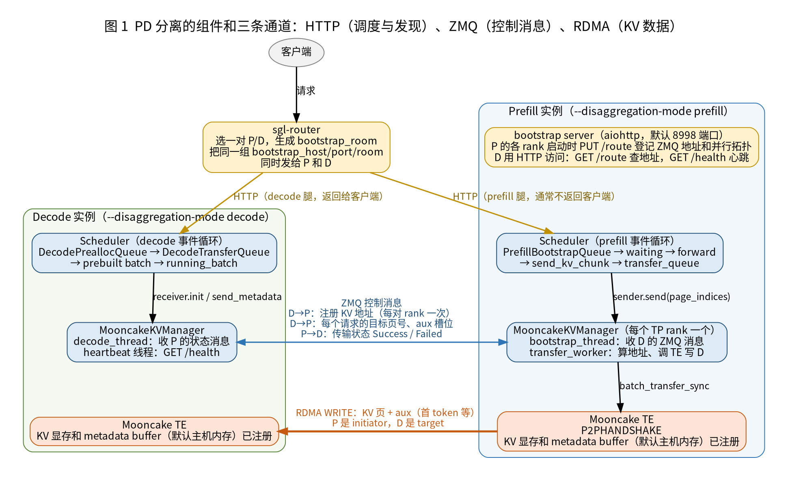
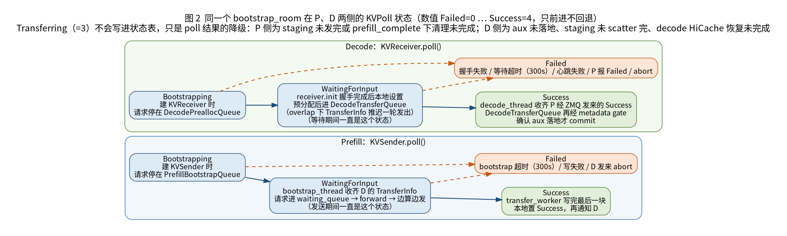
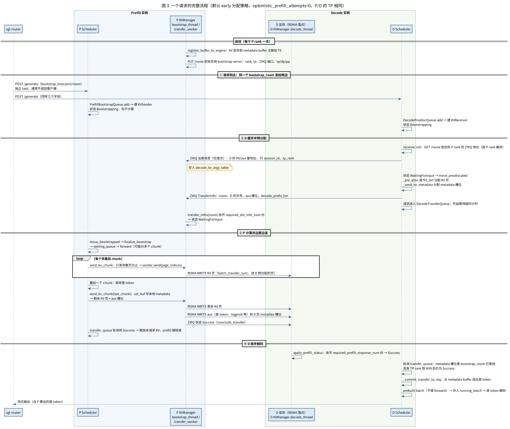
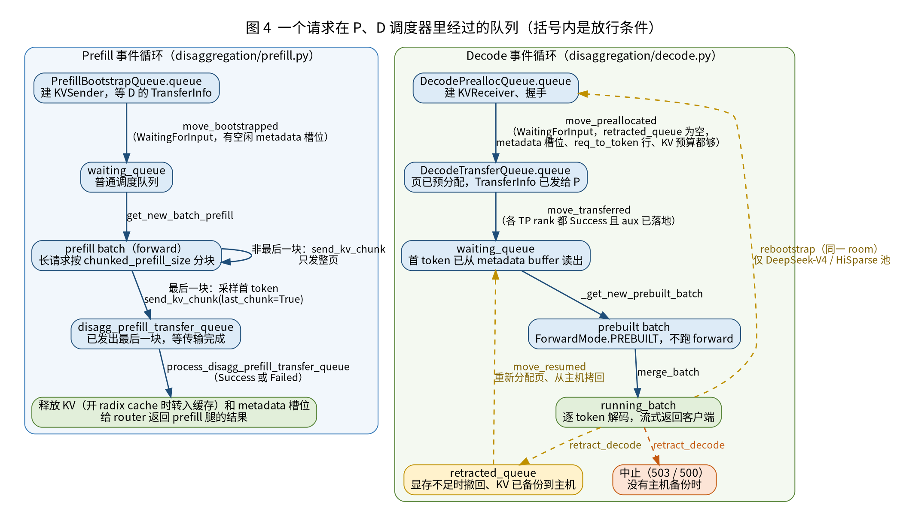
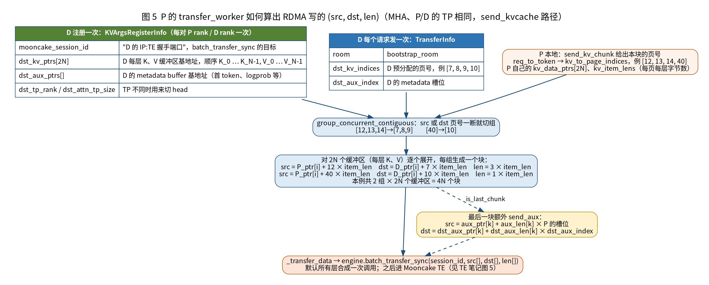
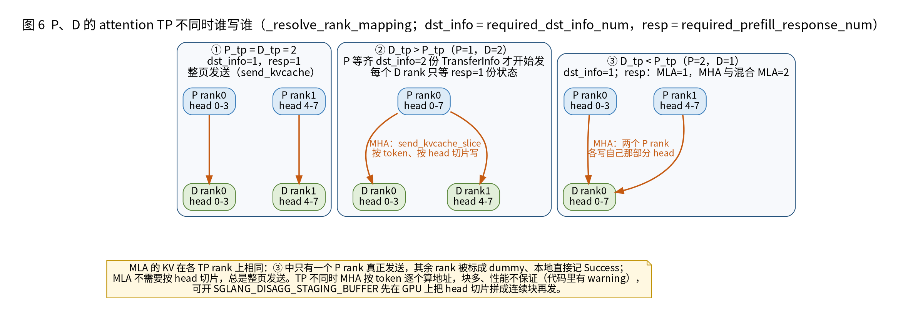

# SGLang PD Disaggregation Study Notes (Mooncake Backend): Code Structure, Request Flow, Transfer Layer, Fault Tolerance and Local Testing

[中文](./SGLang-PD-Disaggregation-Mooncake-Notes.md) | English

- **Compiled**: 2026-11-26
- **Scope**: The code structure, core data structures, full flow of one request, transfer-layer details, fault handling, reading approach and local tests of SGLang PD disaggregation (separating prefill and decode) with the Mooncake backend.
- **Code versions**: [sgl-project/sglang](https://github.com/sgl-project/sglang/tree/f5149f367b8f0fd728bca44f4e77c8fc102ad803) main branch `f5149f367b` (2026-11-20), [kvcache-ai/Mooncake](https://github.com/kvcache-ai/Mooncake/tree/301261358eef0b13fa55645ccde4a988f1ca7505) main branch `30126135` (2026-11-20). Every `file:line` reference in the text points to these two commits.
- **Test environment**: A single machine with 8 GPUs, one 400Gb/s RoCE NIC (mlx5) per GPU, model Qwen3-4B. The bandwidth and latency numbers come from this machine and do not represent cross-machine performance.
- **Basis**: Reading the code above and the SGLang and Mooncake docs, and running the tests listed in Section 8 on the machine above.

For the internals of Mooncake TE itself, see the [Mooncake Transfer Engine Study Notes](./Mooncake-Transfer-Engine-Notes_en.md) (called "the TE notes" below).

The note has these sections:

1. Directory Structure
2. Overall Architecture
3. Core Concepts and Data Structures
4. The Full Flow of One Request
5. The Mooncake Transfer Layer
6. Fault Handling and Timeouts
7. Reading Suggestions
8. Local Testing
9. Appendix 1: Answers to the Reading Self-Check
10. Appendix 2: More Q&A

- **Path conventions**: SGLang paths are relative to `python/sglang/srt/`; paths starting with `sgl-router/` are relative to the SGLang repository root.
- **Test scripts**: Section 8 uses `pd_transfer_sim.py` (reproduces the P→D KV transfer without loading a model), `pd_correctness.py` and `pd_ttft.py` (measure output consistency and TTFT of a full PD deployment). The author wrote them and did not publish them with the note; Section 8 describes how they work.
- **Naming conventions**: P means the prefill instance and D the decode instance. P writes the KV data into D's GPU memory with RDMA WRITE, so P is the TE initiator and D is the target.

## 1. Directory Structure

The bulk of PD disaggregation lives in SGLang's `disaggregation/`; Mooncake only provides TE (called through its Python bindings).

```text
python/sglang/srt/disaggregation/
├── prefill.py          P side: PrefillBootstrapQueue, prefill event loop, send_kv_chunk
├── decode.py           D side: DecodePreallocQueue, DecodeTransferQueue, decode event loop
├── decode_schedule_batch_mixin.py   D-side prebuilt batch (prepare_for_prebuilt / process_prebuilt)
├── utils.py            MetadataBuffers, poll_and_all_reduce, TransferBackend, get_kv_class
├── base/conn.py        abstract interfaces: KVArgs, KVPoll, BaseKVManager/Sender/Receiver/BootstrapServer
├── common/conn.py      implementation shared by all backends: bootstrap server, KVReceiver, rank mapping, heartbeat, status messages
├── mooncake/conn.py    Mooncake backend: MooncakeKVManager (transfer_worker, address calculation, calls into TE)
├── mooncake/utils.py   custom GPU memory pools (NVLINK / BAREX / INTRA_NODE_NVLINK)
├── nixl/, mori/, ascend/, fake/   other transfer backends
└── decode_kvcache_offload_manager.py, decode_hicache_mixin.py   D-side KV offload and HiCache
```

Other related files:

- `arg_groups/fields/disagg.py`: definitions of the `--disaggregation-*` launch arguments; `arg_groups/pd_disaggregation_hook.py`: argument normalization and validation.
- `managers/scheduler.py`: `init_disaggregation` (from line 1631) builds the queues and metadata buffers, and `_dispatch_event_loop_once` (from line 7054) picks the event loop by role.
- `managers/disagg_service.py`: the P instance starts the bootstrap server.
- `distributed/device_communicators/mooncake_transfer_engine.py`: the `MooncakeTransferEngine` shared within a process, wrapping the Mooncake Python bindings.
- `sgl-router/src/server/routes/chat/forward.rs`, `preparation.rs`: the router picks P/D, generates `bootstrap_room`, and sends the request to both sides at once.
- Mooncake side: `mooncake-integration/transfer_engine/transfer_engine_py.cpp` (`batchTransferSyncWrite` → `batchTransferSync`, `batchRegisterMemory`), and the deployment doc `docs/source/deployment/integrations/sglang/pd-disaggregation.md`.

The Mooncake backend is thin: `MooncakeKVReceiver` and `MooncakeKVBootstrapServer` are empty subclasses of the matching classes in `common/conn.py`, and `MooncakeKVSender.send` just forwards to `CommonKVSender.send`. What really belongs to Mooncake is the ZMQ receive thread, transfer_worker and address calculation in `MooncakeKVManager`.

## 2. Overall Architecture



*Figure 1: PD disaggregation components and the three channels: HTTP (scheduling and discovery), ZMQ (control messages), RDMA (KV data).*

Each of the three channels handles one job:

- **HTTP**: The router sends the same `bootstrap_host / bootstrap_port / bootstrap_room` to P and D (`forward.rs:218-229`). The P leg runs in a separate task, and the client usually sees only D's output. A few exceptions: for a non-streaming, non-fan-out `/generate` with `return_logprob`, the router waits for P to return and prepends P's `input_token_logprobs` to D's response (`preparation.rs:351`, `forward.rs:352-356`, `:595-618`); with `--pd-stream-after-prefill` on the router, it also waits for P to finish before releasing D's response; when P fails, the router cancels D's stream, and if D has not yet returned a response at that point, or the router is waiting for P (in the two cases above D's response is held first), the client receives P's error (`forward.rs:887-889`, `:948-991`). With the router's decode gate on, the D leg is sent only after `admit_decode` lets it through, so the two legs do not necessarily arrive at the same time (`forward.rs:263-299`, `:398`). D uses HTTP to reach P's bootstrap server, to look up the ZMQ addresses of P's ranks (`GET /route`) and to send heartbeats (`GET /health`).
- **ZMQ**: Each KVManager binds a PULL socket (on a random port). D sends P the registration message and the target page numbers of each request, and P sends D the transfer status.
- **RDMA**: P's transfer_worker calls `batch_transfer_sync` to write the KV pages into the GPU memory D allocated in advance, and writes aux into D's metadata buffer (in host memory by default). D's CPU does not take part in the write; D learns of completion only through ZMQ status messages and the metadata buffer.

`bootstrap_room` is a 63-bit random number generated by the router (`preparation.rs:1264`), and it is the shared ID that P and D use for the same request: P's `transfer_infos[room]`, both sides' `request_status[room]` and D's metadata buffer all use it. D has to determine which of P's DP ranks to contact (`_resolve_prefill_dp_rank`, `decode.py:1191`). This assumes P's topology is already cached; otherwise it first takes the slow path to fetch it from `/route`. It then checks in order: if the request carries `disagg_prefill_dp_rank`, use it directly (the router writes it when dp-aware is on, the request is not fanned out and a rank has been chosen, and at the same time uses `generate_room_id_for_rank` to generate a room satisfying `room % dp == rank`, `forward.rs:188-226`, `:813-819`); if P's `dp_size == 1`, use 0; if P's `load_balance_method` is `follow_bootstrap_room` (P's default `auto` resolves to it, and D reads it from `/route`), use `room % dp`; in all other cases, or when `SGLANG_DISAGGREGATION_FORCE_QUERY_PREFILL_DP_RANK` is set, P registers it with `POST /register_dp_rank` when it receives the request and D queries it with `POST /query_dp_ranks` (`common/conn.py:2376-2381`, `:2945-2965`). When the request does not carry `disagg_prefill_dp_rank`, P checks whether its own DP rank equals `room % dp` and fails the request right away if not (`common/conn.py:2376-2396`).

## 3. Core Concepts and Data Structures

### Core Concepts

- **bootstrap server**: An aiohttp service started on the P instance (`CommonKVBootstrapServer` at `common/conn.py:3244`, default port 8998; D starts one too when `--enable-pd-role-switch` is on). Each P rank registers its ZMQ address and parallel topology (tp/dp/cp/pp, page_size, KV dtype and so on) with `PUT /route` at startup, and D queries it with `GET /route`. It only does discovery and never handles KV data.
- **KVManager / KVSender / KVReceiver**: Each TP rank process has one `MooncakeKVManager`, which registers GPU memory, sends and receives ZMQ messages, and runs the transfer threads. Each request has one `KVSender` on P and one `KVReceiver` on D, and the scheduler watches transfer progress through their `poll()`.
- **KVPoll**: The transfer state of a room, `Failed=0 / Bootstrapping=1 / WaitingForInput=2 / Transferring=3 / Success=4` (`base/conn.py:142`). It only moves forward, never back. Figure 2 shows what the states mean on each side. After each poll, the ranks take the MIN with a gloo all-reduce (`utils.py:541`), so the same request moves forward together on all TP ranks.
- **Page**: KV is allocated and transferred in pages of `page_size` tokens. D tells P page numbers, not token indices. For a non-last chunk, P sends only up to the last full page (with radix cache on, also no further than the prefix length already written to the cache, `clamp_kv_send_end`, `prefill.py:148`), and the remaining partial page waits for the next chunk.
- **metadata buffer (aux)**: Each side has a set of fixed slots that store each request's first token, cached_tokens, logprob, the topk and hidden states for speculative decoding, and `bootstrap_room` itself (`MetadataBuffers` at `utils.py:639`). They sit in host memory by default, in NPU memory on NPUs, and in GPU memory in `INTRA_NODE_NVLINK` mode (`utils.py:672-682`). In the last chunk, P writes the contents of its slot into D's slot. Each time D frees a slot, `clear_slot` resets its room to zero (`utils.py:780`), so when D sees a nonzero room in a slot it concludes the aux has landed. Slot counts: `max_running_requests × 2` on P and `req_to_token_pool.size × 2` on D (× 8 for MiniMax sparse models).
- **Rank mapping**: P and D can have different attention TP. Each D rank uses `_resolve_rank_mapping` (`common/conn.py:1640`) to work out which P ranks to contact, plus two counts: how many TransferInfo messages P must collect before it starts sending (`required_dst_info_num`), and how many Success messages D must collect before it counts as done (`required_prefill_response_num`); see Figure 6.



*Figure 2: The KVPoll states of the same bootstrap_room on P and D, which only move forward, never back.*

### Core Data Structures

- `KVArgs` (`base/conn.py:62`): The description of GPU memory that this rank hands to the KVManager. `kv_data_ptrs / kv_data_lens / kv_item_lens` are the base address, total length and bytes per page of each KV buffer (ordered K_0…K_N-1, V_0…V_N-1 under MHA, one per layer under MLA); `aux_data_ptrs / lens / item_lens` cover the metadata buffer; `state_*` covers extra state such as Mamba and SWA; there are also `engine_rank` (tp_rank on P, attention TP rank on D), `ib_device`, `gpu_id`, `page_size`, `kv_head_num`, and PP, DP and MLA fields. With speculative decoding on, the draft model's KV buffers are also appended to `kv_data_ptrs` (`prefill.py:425-431`). Both P and D register these regions with TE at startup (`register_buffer_to_engine` at `mooncake/conn.py:455`).
- `KVArgsRegisterInfo` (`mooncake/conn.py:171`): The registration message each D rank sends only once to each target P rank. The key fields are `mooncake_session_id` (D's TE address `ip:handshake port`), `dst_kv_ptrs`, `dst_aux_ptrs`, `dst_tp_rank`, `dst_attn_tp_size` and `dst_kv_item_len`. P stores it in `decode_kv_args_table[session_id]`.
- `TransferInfo` (`mooncake/conn.py:121`): D sends one per request. The key fields are `room`, D's ZMQ address, `mooncake_session_id`, `dst_kv_indices` (the page numbers D preallocated), `dst_aux_index` (D's metadata slot), `required_dst_info_num` and `decode_prefix_len`. P stores it in `transfer_infos[room][session_id]`. `decode_prefix_len` is the length already hit in D's prefix cache: with `--disaggregation-decode-enable-radix-cache` on (off by default), D allocates pages only for the part after the hit, and P also starts sending from that position (`decode.py:1815-1829`, `prefill.py:545`). When D also has HiCache on, this length includes the L1, L2 and L3 hits, while D's GPU memory pages are allocated from the end of the L1 hit, and HiCache fills in the stretch in between.
- `TransferKVChunk` (`common/utils.py:17`): The unit of work in P's internal transfer queue. By default (no staging, no DCP reordering) one `send_kv_chunk` produces one; whether it is the last chunk is decided by whether the cumulative number of pages sent has reached the total (`common/conn.py:2486`). Its fields include `room`, P's page numbers `prefill_kv_indices`, the slice of matching D page numbers `index_slice`, and `is_last_chunk`; the last chunk also carries `prefill_aux_index` and `state_indices`.
- `PrefillServerInfo` (`common/conn.py:126`): The P topology that D gets from `GET /route` and caches, plus the computed `target_tp_rank(s)`, `required_dst_info_num` and `required_prefill_response_num`.

Of the two ZMQ messages, the registration message describes "where D's GPU memory is", and `TransferInfo` describes "which pages of D this request goes to". P combines the two with its own page numbers to compute the source address, destination address and length of each RDMA write block; see Figure 5.

## 4. The Full Flow of One Request



*Figure 3: The full flow of one request (default early allocation policy, optimistic_prefill_attempts=0, same TP on P and D).*

Code locations of each step in Figure 3:

- **① Arrival**: On P, `PrefillBootstrapQueue.add` (`prefill.py:560`) → `create_sender` (`:510`); on D, `DecodePreallocQueue.add` (`decode.py:1114`) → `_create_receiver_and_enqueue` (`:1211`). With PD on, a request without `bootstrap_room` gets a 400 right away on both P and D (except for the fake backend, `managers/scheduler.py:3456`).
- **② Handshake and preallocation**: `CommonKVReceiver.init` (`common/conn.py:2741`) → `_setup_bootstrap_infos` (`:2843`) → `_register_kv_args` (`:3031`); `move_preallocated` (`decode.py:1653`) → `_pre_alloc` (`:2954`, allocates the req_to_token row and KV pages) → `_publish_destination` (`:2095`) → `_send_kv_metadata` (`:2363`, allocates the metadata slot) → `send_metadata` (`common/conn.py:3068`). With overlap on, PP=1, on CUDA (WAR barrier on), and neither HiSparse nor staging on, sending is deferred by one round by default (`SGLANG_ENABLE_DISAGG_DECODE_DEFERRED_PUBLISH`): the slot is already allocated in `move_preallocated`, the request first enters DecodeTransferQueue, and the TransferInfo is sent by `publish_pending_destinations` (`decode.py:2040`) in the next round (`decode.py:517-524`, `:1983-2017`). The handshake itself happens in `add` when P's topology is already cached and the DP rank can be determined without a query; otherwise it happens in `_resolve_pending_reqs` at the start of `move_preallocated` (`decode.py:1159-1166`, `:1590`). P receives messages in `bootstrap_thread` (`mooncake/conn.py:3364`).
- **③ P computes and sends**: `move_bootstrapped` (`prefill.py:606`) → `finalize_bootstrap` (`:537`); non-last chunks call `send_kv_chunk` (`:1677`) in `process_prefill_chunk` (`:1585`), and the last chunk calls it in `process_batch_result_disagg_prefill` (`:1090`); after that, `CommonKVSender.send` (`common/conn.py:2519`) → `add_transfer_request` (`mooncake/conn.py:3488`) → `transfer_worker` (`:2850`). The completion check is in `process_disagg_prefill_transfer_queue` (`prefill.py:1351`).
- **④ D takes over**: `decode_thread` (`mooncake/conn.py:3450`) → `apply_prefill_status` (`common/conn.py:1089`); `move_transferred_with_outcomes` (`decode.py:3648`) → `_commit_transfer_to_req` (`:3403`); `get_next_disagg_decode_batch_to_run` (`:4207`) → `get_new_prebuilt_batch` (`:4239`) → `_get_new_prebuilt_batch` (`:4380`, which calls `prepare_for_prebuilt`, `decode_schedule_batch_mixin.py:24`) → the KV checksum is verified here when enabled → `process_prebuilt` (`decode_schedule_batch_mixin.py:123`) → `process_batch_result_prebuilt` (requests that finish in the prebuilt stage return here) → `filter_batch` → `merge_batch` into running_batch, or the prebuilt batch replaces running_batch directly when running_batch is empty (`decode.py:4212-4266`).



*Figure 4: The queues one request passes through in the P and D schedulers; the conditions for moving on are in parentheses.*

The order of each round of the two event loops:

- **P** (`event_loop_normal_disagg_prefill`, `prefill.py:797`): `ingest_requests` → `move_bootstrapped` → `get_next_disagg_prefill_batch_to_run` (first `resolve_waiting_queue_bootstrap`, then `process_prefill_chunk` sends the non-last chunk finished in the previous round, then a new batch is chosen) → `run_batch` → `process_batch_result` (the request's last chunk: sample the first token, send the remaining KV and aux) → `process_disagg_prefill_transfer_queue` (check whether transfers are done).
- **D** (`event_loop_normal_disagg_decode`, `decode.py:4063`): `prefetch_prefill_dp_rank_queries` → `ingest_requests` (new requests create a KVReceiver in `add`) → `process_decode_queue` (`decode.py:4537`: check HiCache / KV offload progress → free pages whose release was deferred → send deferred TransferInfo and metadata → resume retracted requests → preallocate (only when retracted_queue is empty) → check transfers; when `--disaggregation-decode-host-receive-threshold` is below 1, check transfers before preallocating) → `get_next_disagg_decode_batch_to_run` (merge prebuilt, prepare the next decode step) → `run_batch` → `process_batch_result`.
- Both sides also have overlap versions (`event_loop_overlap_disagg_*`) and PP versions; the selection logic is in `managers/scheduler.py:7068-7081`.

Key points not drawn in the figures:

- **By default P waits for D to finish allocating before it computes**: `--optimistic-prefill-attempts` defaults to 0 (under the `prefill_complete` policy the argument hook sets it to 1 on P). While in `Bootstrapping` the request stays in PrefillBootstrapQueue, and enters waiting_queue only after D's TransferInfo arrives (`can_prefill_before_bootstrap`, `prefill.py:593`). So when D's GPU memory is tight and preallocation queues up, TTFT gets longer. `--disaggregation-decode-allocation-policy prefill_complete` reverses this: P computes first and D allocates afterwards. Both sides must turn it on together; for the restrictions, see the SGLang doc `docs/docs/advanced_features/pd_disaggregation.mdx`.
- **How much D preallocates**: Physically it allocates only the pages for `fill_len = input length + max(output length - 1, 0)` (`pre_alloc_fill_len`, `utils.py:334`); the last output token is the input to the next decode step and takes no KV. Admission depends on the budget (`_allocatable_token_budgets`, `decode.py:2785`): available KV minus max(A, B), minus the number of requests in the previous round's prebuilt batch × `num_reserved_decode_tokens` (default 512, same below), minus the demand of retracted_queue. A = `num_reserved_decode_tokens` × (running + requests in the transfer queue whose target is GPU memory + waiting_queue + requests already preallocated this round). B = the max over running requests of (input length + min(max_new_tokens, 4096)) minus the tokens already held by all running requests, or 0 when nothing is running (`decode.py:2702-2759`). A new request's own demand is max(tokens actually allocated this time + `num_reserved_decode_tokens`, fill_len − prefix + min(max_new_tokens, `SGLANG_CLIP_MAX_NEW_TOKENS_ESTIMATION`, default 4096) − retractable tokens) (`_required_admission_tokens`, `:632`). The reserved decode space is only a budget, not an actual allocation. The req_to_token table gets `pre_alloc_size` more rows than the running limit (`--disaggregation-decode-extra-slots`, default 0; set automatically to 2× only when `max_running_requests` is set and is at most 32 per DP rank). All rows share one free list and are not set aside for preallocation (`DecodeReqToTokenPool`, `:222`; `arg_groups/pd_disaggregation_hook.py:133-143`). Preallocation strictly follows queue order (sorted by priority first when priority scheduling is on): when the request at the head of the queue does not fit, the whole loop stops and the requests behind it wait too (`decode.py:1704-1710`, `:1890-1904`). With decode radix cache on, the evictable cache is added to the available KV, and with decode HiCache on, the tokens waiting to be filled in are subtracted (`decode.py:2813-2823`, `:2841`).
- **P computes the first token**: P samples the first token in the last chunk (`prefill.py:1206`) and writes it to D through aux; D reads it and continues decoding directly, and the prebuilt batch runs no forward.
- **Send while computing**: A long prompt is split into chunks by `--chunked-prefill-size`, and as soon as each chunk is computed its full pages of KV go to the transfer thread, so the transfer overlaps with the computation that follows.
- **When P frees its KV**: Only after the transfer queue polls `Success` or `Failed` does it `release` (`prefill.py:1428-1440`); with radix cache on, the KV moves into the prefix cache. When the transfer is slow or D is slow to send status, this KV stays occupied. Requests for which D never sent a TransferInfo are still in PrefillBootstrapQueue, have no KV allocated yet, and fail when the bootstrap timeout expires.
- **D's poll frequency**: D does preallocation and transfer status checks only once every `--disaggregation-decode-polling-interval` (default 1) rounds (`decode.py:4563-4592`). Raising it saves CPU but delays admitting new requests and noticing completed transfers.
- **Early send on a P prefix cache hit**: P's radix cache is on by default. With `SGLANG_DISAGG_PREFILL_EARLY_SEND_CACHED_PREFIX` (on by default), before `run_batch` launches the forward, P sends the page-aligned prefix already hit in GPU memory (excluding the HiCache host hit) as one non-last chunk; it does not send while the request is still waiting for bootstrap (`managers/scheduler.py:5372-5399`, `prefill.py:1649-1675`).

## 5. The Mooncake Transfer Layer

### Threads and Queues

- Each KVManager on P has `SGLANG_DISAGGREGATION_QUEUE_SIZE` (default 4) transfer queues, one `transfer_worker` thread per queue, plus a `ThreadPoolExecutor` each; each executor has `SGLANG_DISAGGREGATION_THREAD_POOL_SIZE` // number of queues threads (`mooncake/conn.py:355-371`). When `THREAD_POOL_SIZE` is unset it is `min(max(4, int(0.5 × CPU cores) // 8), 12)`, which gives 12 on this 192-core machine, or 3 threads per executor; the transfer_worker threads are not counted.
- Which queue a request goes to: `sum(ports of all target D sessions) % number of queues` (`mooncake/conn.py:3520-3525`). Requests sent to the same set of D always go to the same queue and are handled FIFO; different D can also land in the same queue, and one slow D then holds up the other requests in that queue.
- `transfer_worker` picks a path in order (`mooncake/conn.py:3024-3113`): if the chunk has no pages, no KV pointers, or is marked skip_kv, it sends no KV; if D asked for DCP reordering at registration, it takes the DCP path; MLA (including hybrid MLA), or the same attention TP on P and D, takes `send_kvcache` (whole pages); MHA with different attention TP takes staging only if P has staging on and D registered a staging buffer, otherwise `send_kvcache_slice` (sliced by head).

### Address Calculation



*Figure 5: How P's transfer_worker computes the (src, dst, len) of an RDMA write (MHA, same TP on P and D, send_kvcache path).*

- The merge rule is in `group_concurrent_contiguous` (`common/utils.py:138`), and the address formula in `_send_kvcache_generic` (`mooncake/conn.py:1386-1390`). The more contiguous the free pages on P and D, the fewer and larger the blocks.
- Batches: by default all blocks of all buffers go into one `batch_transfer_sync` (`mooncake/conn.py:1419-1425`); with the NVLINK / BAREX custom GPU memory pool, each buffer (one each for the K and V of every layer) is one batch, submitted in parallel in the thread pool (`:1405-1418`); on the default path, with `SGLANG_MOONCAKE_MAX_TRANSFER_BATCH_INDICES=N` set and more than N pages, every N pages (across all buffers) form one batch, submitted serially and returning immediately on failure (`:1427-1478`); per-page state in the extra state (`maybe_send_extra`) also goes through this function and has the same limit; per-slot state and Mamba state go through `_send_slot_state` / `_send_mamba_state` and have no limit.
- Last chunk: first `maybe_send_extra` (extra state such as Mamba and SWA), then `send_aux` (`:2114`), and once all targets of the room are sent, `conclude_transfer` sends the status to D (`:3133-3217`).

### Into TE

- Each process has at most one shared `MooncakeTransferEngine` (`distributed/device_communicators/mooncake_transfer_engine.py`), created by `distributed/bootstrap.py:146` calling `maybe_init_shared_mooncake_transfer_engine` (`mooncake_transfer_engine.py:362`) (classic TE's `initialize` is time-limited by `SGLANG_DISAGGREGATION_ENGINE_INIT_TIMEOUT`, TENT is not). It is built only when PD or encoder disaggregation uses mooncake, when HiCache uses the mooncake backend with `SGLANG_HICACHE_MOONCAKE_REUSE_TE` on (the default), or when elastic EP needs it. HiCache's Mooncake Store reuses it only when the engine is classic TE with the same NIC, P2PHANDSHAKE and rdma; otherwise it builds its own (`mem_cache/storage/mooncake_store/mooncake_store.py:641-660`). Initialization is `initialize(hostname, "P2PHANDSHAKE", MOONCAKE_PROTOCOL, NIC)`, with `MOONCAKE_PROTOCOL` defaulting to `rdma`; `session_id = hostname:get_rpc_port()`, which is the P2P segment name in the TE notes.
- The NIC comes from `--disaggregation-ib-device`: one device name or a comma-separated list (shared by all GPUs), a JSON keyed by GPU index, or a path to a JSON file. When unset it falls back to `--mooncake-ib-device`; if that is still empty, an empty string is passed, and TE discovers all local HCAs and picks NICs by topology (`transfer_engine_impl.cpp:304-333`). With `MC_FORCE_TCP=1` set, SGLang also passes an empty string; as soon as TE sees `MC_FORCE_TCP` (any value) it skips topology discovery and installs only TCP, and initialization fails if `USE_TCP` was not compiled in (`:225-244`). If the JSON keyed by GPU index lacks the current GPU, it errors out right away.
- `_transfer_data` (`mooncake/conn.py:852`) → SGLang's wrapped `batch_transfer_sync` → the Mooncake Python API `batch_transfer_sync_write` (`mooncake_transfer_engine.py:284`) → `TransferEnginePy::batchTransferSyncWrite` → `batchTransferSync` (`transfer_engine_py.cpp:1083`): it caches the `openSegment` handle, makes one WRITE request per block, and polls the status after `submitTransfer`. When the batch status is FAILED or TIMEOUT it starts over, clearing nic_hint on retry so TE picks a NIC again (possibly the same one), for at most `numContexts() + 1` attempts in total; an `openSegment` failure, mismatched argument lengths, a failure of `submitTransfer` itself, or exceeding the overall time limit return -1 directly. The slicing, NIC selection and WR posting that follow are in Figures 4 and 5 of the TE notes.
- TE exchanges SegmentDesc and sets up QPs only the first time it writes to a given D (Figure 6 of the TE notes), so that transfer spends extra time on connection setup (6~45 ms measured on this machine, depending on the Mooncake version; see Section 8).
- Timeout: timing starts after `openSegment` and covers all retries; the limit is `MC_TRANSFER_TIMEOUT` (default 30 seconds, minimum 5 seconds) plus one nanosecond per byte of the total (`transfer_engine_py.cpp:316-323`, `:1196-1206`).

### When TP or PP Differ



*Figure 6: Who writes whom when P and D have different attention TP, and the values of the two counts.*

- `send_kvcache_slice` (`mooncake/conn.py:1977`) calls `engine.batch_transfer_sync` directly, bypassing `_transfer_data`, and is not limited by `MAX_TRANSFER_BATCH_INDICES`. It computes addresses token by token: `layer_ptr + page × item_len + token × bytes_per_token + head_offset`, with length = the smaller of the two sides' per-rank head counts × bytes per head. Each layer's K and V buffers each have "pages × page_size" blocks (one block per token slot, not merged), and each buffer gets its own `batch_transfer_sync`, submitted in parallel in the thread pool (`:2074-2112`).
- PP: each P stage registers its own `pp_rank` and writes only its own layers to the matching layer addresses on D. D's PP must equal P's PP or be 1; when it is 1, D must collect a Success from every stage (`required_prefill_response_num` is multiplied by P's PP count, `common/conn.py:1718-1726`).

### Custom GPU Memory Pools and TENT

- `SGLANG_MOONCAKE_CUSTOM_MEM_POOL`: `NVLINK` (or `True`) and `BAREX` build a `torch.cuda.MemPool` with Mooncake's allocator, KV GPU memory is allocated from this pool, and transfers change to one batch per buffer (one each for the K and V of every MHA layer), submitted in parallel. `NVLINK` targets cross-node NVLink deployments such as NVL72 (the SGLang docs require `MC_FORCE_MNNVL=True` as well), and it also moves aux to TCP; under these two pools the metadata buffer is always in host memory. `INTRA_NODE_NVLINK` builds no pool, puts the metadata buffer in GPU memory, and works together with `MC_INTRANODE_NVLINK`: as soon as TE sees this variable (any value) it installs only `nvlink_intra` and no RDMA, so P and D must be on the same machine, and Mooncake must be compiled with `USE_INTRA_NVLINK`; with only `USE_MNNVL` on, initialization fails (`transfer_engine_impl.cpp:406-483`, `multi_transport.cpp:1116-1120`, `:1181-1185`). conn.py does not choose the transport itself; the choice happens inside TE.
- With `SGLANG_MOONCAKE_TRANSFER_ENGINE=tent`, a `TentTransferEngine` is created (`mooncake_transfer_engine.py:333-353`) and conn.py stays the same. In non-TCP mode, `--disaggregation-ib-device` becomes TENT's RDMA NIC allowlist; TENT also turns on the NVLink transport, so GPUs on the same machine prefer NVLink; TENT accepts only rdma, tcp or empty for `MOONCAKE_PROTOCOL`, and in TCP mode both RDMA and NVLink are off (`tent_transfer_engine.py:59-96`). Elastic EP and expert backup do not support TENT (`mooncake_transfer_engine.py:395-403`). For how TE and TENT differ, see Section 2 of the TE notes.

## 6. Fault Handling and Timeouts

- **P never hears from D**: If the KVSender is still in `Bootstrapping` within `SGLANG_DISAGGREGATION_BOOTSTRAP_TIMEOUT` (default 300 seconds) after it is created (under the `prefill_complete` policy, after prefill finishes), it is marked `Failed` (`common/conn.py:2601`). Usually D is down, or D's GPU memory is tight and the request keeps waiting in DecodePreallocQueue. Under the default policy, P only holds a queue position during this time and has not yet allocated KV.
- **D never gets the KV**: Timing starts after `send_metadata`. If `Success` has not arrived within `SGLANG_DISAGGREGATION_WAITING_TIMEOUT` (default 300 seconds), D marks `Failed` and sends P an ABORT (`common/conn.py:3117`).
- **Heartbeat**: D's heartbeat thread sends `GET /health` to each P's bootstrap server every `max(SGLANG_DISAGGREGATION_HEARTBEAT_INTERVAL, 2)` seconds (default 5 seconds), with a 2-second connect timeout and 3-second read timeout. After `SGLANG_DISAGGREGATION_HEARTBEAT_MAX_FAILURE` (default 2) consecutive failures, `_handle_node_failure` (`common/conn.py:2274`) clears that P's connection cache and marks the requests sent to it that have not reached Success as failed. P does not check D's heartbeat; it can only find out D is down through the bootstrap timeout or a transfer failure.
- **Transfer failure**: When `batch_transfer_sync` for KV or extra state returns nonzero, P adds that D's session to a KVManager-level blacklist (shared by all queues), marks the current room `Failed` immediately and notifies D (`mooncake/conn.py:3114-3131`, `:3162-3169`); an aux failure also blacklists the session, but Failed is sent only after all targets of the room are handled, and when aux goes over TCP failures are not detected (`:3192-3217`); other rooms sent to that session fail right away when dequeued (`:2944-2966`). A session leaves the blacklist in three cases: a background probe succeeds, no request goes to it for 600 seconds (`SGLANG_FAILED_SESSION_IDLE_TIMEOUT_S`), or D sends a new registration message. The probe thread handles the first two (`SGLANG_ENABLE_FAILED_SESSION_PROBE`, on by default): the first probe is in the next 30-second cycle, and after a failure the interval doubles each time, up to 300 seconds (`:405`, `:3563-3622`). When the transfer_worker thread itself throws, it marks the current room failed (without notifying D) and the thread exits and is never restarted (`:3278-3287`), so nobody serves that queue afterwards. Once past Bootstrapping, P no longer times out on its own; these requests wait for D's `WAITING_TIMEOUT` to expire and send an ABORT before P marks them `Failed`. When aux goes over TCP (NVLINK pool or `SEND_AUX_TCP`), send exceptions are not caught and also end up on this path (`:2142-2188`). TE's internal NIC-switching retry happens before this step; see Q4 of the TE notes.
- **Cancellation and ABORT**: When a request on D is cancelled or times out, D sends `[ABORT, room, …]` and P marks the room `Failed`. With deferred release on (the default), P waits until all posted writes have finished before replying with an ACK carrying its rank (`common/conn.py:1212-1221`); it does not reply when D is not yet ready and the ABORT carries no generation; nor for a room whose send has failed, because when TE times out and returns -1 that batch of writes may still be in progress. With deferred release off, P replies with an ACK as soon as it receives the ABORT, without waiting for the writes to finish (`mooncake/conn.py:3300-3359`). D does not free these pages before receiving the ACK (`SGLANG_DISAGGREGATION_DEFERRED_DECODE_KV_RELEASE`, on by default, `decode.py:3340-3343`; the release logic is in `resolve_deferred_releases`, `:3996`), to keep late RDMA writes from landing in pages already given to another request. When the target is in GPU memory, it waits at most 30 seconds (`..._RELEASE_TIMEOUT`) and then forces the release; a code comment admits that in this case there is no guarantee against late writes. When the target is in host memory, it waits until the receiver confirms the writes have drained, with no timeout (`decode.py:4008-4016`).
- **State only moves forward**: Within a room's lifetime, `update_status` (`common/conn.py:787`) takes the larger of the old and new states, and `Failed` is terminal. When the request ends, `clear()` deletes the room, after which it can only be re-created as `Bootstrapping` or `WaitingForInput`, and late old status messages are dropped (`:1098-1103`). So the same bootstrap_room can be used again, for example by a retracted request that needs to be prefilled again (see Q4).
- **Failure during the handshake**: When D's first lookup of P's topology fails, it retries once per second and aborts the waiting requests after 15 tries (`decode.py:555-558`, `:1505-1542`); P tries to register with `/route` 5 times in total (intervals of about 1, 2, 4 and 8 seconds), then only logs an error (`common/conn.py:1845-1872`); when the two sides' allocation policies differ, or the peer is not TP1/CP1/PP1 under `prefill_complete`, D's handshake fails right away (`:2756-2772`); P rejects a registration whose KV layout does not match, and requests sent to it afterwards fail when dequeued (`mooncake/conn.py:964-975`, `:2945-2951`).
- **Request does not fit**: In `add`, D checks whether the request could fit in the KV pool and returns 400 right away if it exceeds the limit, without queueing (`decode.py:1144`, `:1253-1298`); P only checks whether the input exceeds `max_input_len` (`prefill.py:584-591`).
- **Data verification**: With `--disaggregation-enable-kv-checksum` on, P computes an Adler-32 over the pages sent this time (starting from `decode_prefix_len`, including extra state) in the last chunk and writes it into the metadata; D recomputes it when the request enters a batch, the ranks take the MAX, and the request is aborted on a mismatch (`prefill.py:1683-1701`, `decode.py:4291`). When the layout signatures of P and D differ (different TP width, PP stage or page_size), verification is skipped (`decode.py:3383-3401`).

Common environment variables (SGLang's variables are defined in `environ.py`; `MC_*` are read by Mooncake; only P uses the thread and queue variables, and only D uses the heartbeat ones):

- Threads and queues: `SGLANG_DISAGGREGATION_THREAD_POOL_SIZE` (computed from the CPU core count when unset), `SGLANG_DISAGGREGATION_QUEUE_SIZE=4`.
- Timeouts: `SGLANG_DISAGGREGATION_BOOTSTRAP_TIMEOUT=300`, `SGLANG_DISAGGREGATION_WAITING_TIMEOUT=300`, `SGLANG_DISAGGREGATION_HEARTBEAT_INTERVAL=5`, `SGLANG_DISAGGREGATION_HEARTBEAT_MAX_FAILURE=2`, `SGLANG_DISAGGREGATION_ENGINE_INIT_TIMEOUT=60` (TE initialization), `SGLANG_DISAGGREGATION_BOOTSTRAP_ENTRY_CLEANUP_INTERVAL=120` (cleans up expired room→DP rank records in the bootstrap server), `MC_TRANSFER_TIMEOUT=30`.
- ZMQ send timeouts: the D→P PUSH uses `SGLANG_DISAGGREGATION_ZMQ_SEND_TIMEOUT` (default 1 second, `common/conn.py:2976-2979`); the P→D PUSH is fixed at 30 seconds and uses this variable only under the `prefill_complete` policy (`:1900-1905`).
- Transfer: `MOONCAKE_PROTOCOL=rdma`, `SGLANG_MOONCAKE_CUSTOM_MEM_POOL`, `SGLANG_MOONCAKE_MAX_TRANSFER_BATCH_INDICES=0`, `SGLANG_MOONCAKE_SEND_AUX_TCP=False`, `SGLANG_MOONCAKE_TRANSFER_ENGINE=te`, `SGLANG_DISAGG_STAGING_BUFFER=False`.
- When the backend is given as `--disaggregation-transfer-backend mooncake_tcp`, the argument hook changes it to `mooncake`, sets `MC_FORCE_TCP=1` if unset, and clears `--disaggregation-ib-device` (`arg_groups/pd_disaggregation_hook.py:30-45`). In Mooncake 0.3.11 and earlier, the TCP transport reports completion before the data has been written to the peer; see Section 8.

## 7. Reading Suggestions

The goal is first to be able to explain "how one request splits into two paths at the router and ends with D emitting its first decode token", then to read the transfer layer, and finally to read fault tolerance and heterogeneous parallelism as needed. Read each pass with three questions in mind: which thread this step runs in, what condition it waits for, and what data it hands to the next step. In the first two passes, skip the staging, DCP, HiSparse, Mamba state, role switch and checksum branches whenever you meet them. The question at the end of each pass has a reference answer in Appendix 1.

### Preparation

1. First read Sections 3 and 4 of the TE notes to know what happens below `batch_transfer_sync`.
2. With Figures 1 and 3 at hand, memorize the three channels and four stages.

### Pass 1: Skeleton and State

1. `base/conn.py`: `KVPoll`, `KVArgs` and the four abstract classes; look only at the interfaces.
2. `common/conn.py`: `init / send / send_metadata / poll` of `CommonKVSender` (`:2325`) and `CommonKVReceiver` (`:2698`), and `CommonKVManager.update_status / check_status`.
3. `utils.py`: the fields of `MetadataBuffers` (`:639`), and `poll_and_all_reduce` (`:541`).

After this pass you can answer: from which moment do P and D each consider a request "ready to move on", and on what basis.

### Pass 2: The Two Schedulers

1. `prefill.py`: `PrefillBootstrapQueue.add / move_bootstrapped / finalize_bootstrap`, `event_loop_normal_disagg_prefill`, `process_prefill_chunk`, `send_kv_chunk / _send_kv_chunk`, `process_batch_result_disagg_prefill`, `process_disagg_prefill_transfer_queue`.
2. `decode.py`: `DecodePreallocQueue.add / _update_handshake_waiters / move_preallocated / _pre_alloc / _send_kv_metadata`, `DecodeTransferQueue.move_transferred_with_outcomes / _commit_transfer_to_req`, `_get_new_prebuilt_batch`, `process_decode_queue`.
3. `decode_schedule_batch_mixin.py`: `prepare_for_prebuilt`, `process_prebuilt`.

After this pass you can answer: for a 3000-token prompt with `chunked_prefill_size=1024` and `page_size=16`, how many times P calls `send_kv_chunk` and how many pages each call sends, and how many pages D preallocates.

### Pass 3: The Mooncake Transfer Layer

1. `mooncake/conn.py`: `MooncakeKVManager.__init__` (threads and queues), `register_buffer_to_engine`, `bootstrap_thread`, `add_transfer_request`, `transfer_worker`, `send_kvcache → _send_kvcache_generic → _transfer_data`, `send_aux`.
2. `common/utils.py`: `group_concurrent_contiguous`.
3. `mooncake_transfer_engine.py`: `initialize`, `batch_transfer_sync`; then continue into `batchTransferSync` in Mooncake's `transfer_engine_py.cpp`.

After this pass you can answer: how many blocks are in one `batch_transfer_sync` on P, where each block's source address, destination address and length come from, and whose rkey is used.

### Pass 4: Going Deeper as Needed

- **Heterogeneous TP / PP**: `_resolve_rank_mapping` and `_setup_bootstrap_infos` in `common/conn.py`, and `send_kvcache_slice` in `mooncake/conn.py`, with Figure 6 at hand.
- **Fault tolerance**: `heartbeat_checker`, `_handle_node_failure`, `_check_waiting_timeout`, `_check_bootstrap_timeout`, sending and receiving ABORT, and `resolve_deferred_releases`.
- **router**: `dispatch` (`:166`) in `sgl-router/src/server/routes/chat/forward.rs`.

## 8. Local Testing

Every conclusion in this section was measured with the code of the two commits above: SGLang main `f5149f367b` and Mooncake `30126135` (built from source). To avoid touching the system Python environment (which has SGLang 0.5.15.post1 and the Mooncake pip package 0.3.11.post1), the tests ran in a separate virtual environment. The Mooncake pip package from the system environment appears only as a comparison.

### Test Environment

- The virtual environment has torch 2.14.1+cu130, `sglang-kernel` 0.4.11 and flashinfer 0.7.4; sglang is installed from source in editable mode and shows version `0.5.24.dev1949+gf5149f367`; the router is `sgl-router` 0.1.0, the same version as `sgl-router/` in the source.
- Mooncake was not packaged as a wheel: the source's `python/mooncake/*.py`, plus the `engine.cpython-312-x86_64-linux-gnu.so` and `libasio.so` built in `build-te`, were placed in the virtual environment's `site-packages/mooncake/`. PD only uses `mooncake.engine`.
- Problems during installation: `pypi.nvidia.com` was extremely slow, so a PyPI mirror closer to the machine was used instead (`$PIP_MIRROR` in the commands below); flashinfer 0.7.4's TRT-LLM attention kernels need precompiled cubins, the NVIDIA artifactory was unreachable, and PyPI has no `flashinfer-cubin` 0.7.4, so it was downloaded from the GitHub release instead (sha256 matches the flashinfer.ai index); the Rust extensions were skipped with `SGLANG_BUILD_RUST_EXTS=none`, since PD does not use them.

```bash
PIP_MIRROR=https://pypi.org/simple  # replace with a PyPI mirror close to the machine
VENV=$HOME/venv-sglang-main; SGLANG=$HOME/sglang; MC=$HOME/Mooncake
uv venv $VENV --python /usr/bin/python3.12 && source $VENV/bin/activate
uv pip install --index-url https://download.pytorch.org/whl/cu130 --no-deps torch==2.14.1
SGLANG_BUILD_RUST_EXTS=none uv pip install --index-url $PIP_MIRROR \
  --extra-index-url https://pypi.org/simple -e $SGLANG/python
uv pip install --index-url $PIP_MIRROR sgl-router==0.1.0
curl -L -o /tmp/flashinfer_cubin-0.7.4-py3-none-any.whl \
  https://github.com/flashinfer-ai/flashinfer/releases/download/v0.7.4/flashinfer_cubin-0.7.4-py3-none-any.whl
uv pip install --no-deps /tmp/flashinfer_cubin-0.7.4-py3-none-any.whl
# Mooncake: the source-built engine
SP=$VENV/lib/python3.12/site-packages
cmake --build $MC/build-te -j64
mkdir -p $SP/mooncake && cp $MC/python/mooncake/*.py $SP/mooncake/
cp $MC/build-te/mooncake-integration/engine.cpython-312-x86_64-linux-gnu.so $MC/build-te/mooncake-common/libasio.so $SP/mooncake/
```

### Transfer Test Without a Model

The script `pd_transfer_sim.py` reproduces only SGLang's KV transfer, without loading a model, so the page layout and page_size can be controlled independently.

#### Method

- P is on GPU2 + mlx5_8 and D on GPU5 + mlx5_11 (each GPU's PIX NIC); the two processes go over RDMA between the two NICs.
- The KV shape follows Qwen3-4B: 36 layers × K/V for 72 buffers in total, 8 KV heads, head_dim 128, bf16, 144KB per token. Each side's KV pool holds 4096 tokens (576MB); aux has 64 slots in pinned host memory, on the CPU as in SGLang.
- Messages and computation follow `mooncake/conn.py`: D first sends the registration message (TE session_id, the base addresses of the 72 buffers, the aux address), then sends the page numbers and aux slot for each request; P merges pages with `group_concurrent_contiguous`, computes blocks as "base address + page number × item_len", puts all layers into one `batch_transfer_sync_write`, writes aux separately, and finally replies with the status over ZMQ.
- After receiving the status, D checks the room in the aux slot and compares the contents of the 72 buffers page by page: P fills every page with a single byte whose value is computed from the buffer index and page number (repeating every 251 pages), so a write to the wrong page is almost always caught.
- Variables: page_size of 1, 16 and 64; request lengths of 128, 1024, 2048 and 4096 tokens; two page layouts: contig, where page numbers are contiguous on both sides, and scattered, where both sides pick random pages from the 4096-token pool and sort them ascending, simulating a free list after long use. Each group runs 6~8 times (`--reps`), and the median is taken after dropping the first run of each P/D pair.

```bash
$VENV/bin/python pd_transfer_sim.py --page-size 16 --reps 6   # Mooncake built from source, one line per request as JSON
/usr/bin/python3 pd_transfer_sim.py --page-size 16 --reps 6        # pip package 0.3.11.post1 from the system environment, for comparison
MC_FORCE_TCP=1 $VENV/bin/python pd_transfer_sim.py --protocol tcp --page-size 64 --reps 4 \
  --cases 128:contig:0,1024:contig:0,4096:contig:0
```

#### Results (Time Is That of the KV `batch_transfer_sync_write`; the KV Contents and Aux of Every Request Passed Verification)

- **Contiguous pages**: every request is 72 blocks, regardless of length and page_size. Mooncake built from source: 128 tokens (18 MiB) 0.55 ms, 34 GB/s; 1024 tokens (144 MiB) 3.35 ms, 45 GB/s; 4096 tokens (576 MiB) 13.3 ms, 45.5 GB/s. pip package 0.3.11: 4096 tokens 15.0~15.8 ms, 38~40 GB/s.
- **Scattered pages, page_size=1**: one 2KB block per token per layer, about 69 thousand blocks for 1024 tokens and about 110 thousand blocks for 2048 tokens. Mooncake built from source: 1024 tokens median 174~224 ms (0.7~0.9 GB/s), 2048 tokens 549~597 ms (about 0.5 GB/s), with large variation, and a few requests take only 42~70 ms; pip package 0.3.11 is steady at 89~94 ms and 179~183 ms (1.6~1.7 GB/s). Building the address lists in Python on P takes another 12~25 ms.
- **Scattered pages, page_size=16**: 1024 tokens is about 4,200~4,500 blocks (32KB each, median 4,320); the source build takes 4.45 ms at 33.9 GB/s, the pip package 6.16 ms at 24.5 GB/s.
- **Scattered pages, page_size=64**: 1024 tokens is about 1,000~1,150 blocks (128KB each); the source build takes 3.67 ms at 41.2 GB/s, the pip package 4.29 ms at 35.2 GB/s.
- **aux**: one separate 64-byte write, 0.06~0.12 ms.
- **Per-layer submission**: 72 serial `batch_transfer_sync_write` calls take 16.4 ms for 4096 tokens, about 25% slower than one submission.
- **First transfer of each P/D pair**: Mooncake built from source takes 38~45 ms for 128 tokens and the pip package 6.5~7.4 ms, while later transfers of the same size take only 0.55 ms; the extra time is TE connection setup (Figure 6 of the TE notes).

#### Conclusions

- With contiguous pages, KV transfer comes close to NIC bandwidth (A2 in the TE notes measured 48.6 GB/s across another NIC pair).
- Transfer speed depends mainly on the number of blocks, not the number of bytes. With page_size=1 and scattered free pages on both sides, bandwidth drops to 0.5~1.7 GB/s; with page_size at 16 or more, the block count falls by more than an order of magnitude, and bandwidth for 1024 tokens returns to 24.5~41.2 GB/s (2048 tokens not tested). Whether page_size can be raised depends on the attention backend: `trtllm_mha`, selected automatically on this machine, supports only 16, 32, 64 and 128, and the default 1 is changed to 64 (see the next subsection).
- On large blocks of 64KB and up, Mooncake built from source takes 11~16% less time than pip package 0.3.11 (13~19% higher bandwidth), and on 32KB blocks (page_size=16) its bandwidth is about 38% higher; on large numbers of 2KB blocks it is about 2× slower at 1024 tokens (about 69 thousand blocks) and about 3× slower at 2048 tokens (about 110 thousand blocks), with large variation, while at 128 tokens (9,216 blocks) it is faster instead. The PD test with different TP in the next subsection confirms this; the cause was not investigated.

#### TCP (`MC_FORCE_TCP=1`, 64 Tokens per Page, Contiguous Pages)

- **Mooncake built from source**: all results correct; 128 tokens 15~16 ms, 1024 tokens 116 ms, 4096 tokens 455 ms, about 1.3 GB/s (1.6 GB/s in another round), more than an order of magnitude slower than RDMA.
- **pip package 0.3.11.post1**: when `batch_transfer_sync_write` returns success, the data has not necessarily been written into D. On the first transfer of each P/D pair, when D checks immediately neither the KV nor the aux has landed; after waiting 200 ms they still have not, and only after 1 second are they correct. On later transfers the KV has mostly landed, but the aux written right after it had not arrived in 7 of 11 checks. Bandwidth is about 1.4 GB/s. The cause is that this version's TCP protocol has no acknowledgment from the destination, and marks COMPLETED once the send buffer is written (`tcp_transport/tcp_transport.cpp:369-381` in 0.3.11.post1; the old protocol path kept on current main has a comment explaining this at `tcp_transport_session_impl.h:953-955`). The fix is Mooncake PR #2850 (merged 2026-07-13), included from v0.3.12.
- So `mooncake_tcp` is only good for validating the flow when there is no RDMA NIC, and if you use it, Mooncake must be at least 0.3.12.

### Full SGLang PD Test

#### Deployment (Model Qwen3-4B, 36 Layers, 8 KV Heads; `--mem-fraction-static 0.6` for Each Instance)

- The startup log shows that this machine automatically selected the `trtllm_mha` attention backend, which changes the default `page_size` to 64 (it supports only 16, 32, 64 and 128); `chunked_prefill_size=16384`; the KV pool is 720,512 tokens per GPU.
- A: RDMA, P on GPU0 + mlx5_4, D on GPU1 + mlx5_7, router 8000.
- B: `--disaggregation-transfer-backend mooncake_tcp`, P on GPU2 (with `SGLANG_DISAGGREGATION_BOOTSTRAP_TIMEOUT=30`), D on GPU3, router 8001.
- C: P is TP1 (GPU5 + mlx5_11), D is TP2 (GPU6, 7, `--disaggregation-ib-device '{"6": "mlx5_12", "7": "mlx5_13"}'`), router 8002.
- Baselines: single-instance TP1 (GPU4), single-instance TP2 (GPU2, 3), single-instance DP2 (GPU2, 3).
- Test scripts: `pd_correctness.py` (the same set of random input_ids, greedy, 64 new tokens, comparing the output_ids of two services) and `pd_ttft.py` (single-request streaming TTFT).
- When several instances start at once, the ports for torch distributed initialization collide and report `EADDRINUSE` (on port 18003 in this machine's test), so `--nccl-port` must be used to separate them. Per the code at f5149f367b, when `--nccl-port` is not given a free port is picked at random from 22000~29999; the source of this collision was not tracked down. Do not set `--nccl-port` for the DP2 instance, or the two DP ranks compete for the same port.

#### Commands (Using A as the Example, All Run in the Virtual Environment)

```bash
source $VENV/bin/activate
MODEL=Qwen/Qwen3-4B  # or a local model directory
# Terminal 1: P (GPU0, mlx5_4, bootstrap server listens on 8998)
python -m sglang.launch_server --model-path $MODEL --disaggregation-mode prefill \
  --base-gpu-id 0 --port 30000 --disaggregation-bootstrap-port 8998 \
  --disaggregation-ib-device mlx5_4 --mem-fraction-static 0.6 --host 127.0.0.1
# Terminal 2: D (GPU1, mlx5_7)
python -m sglang.launch_server --model-path $MODEL --disaggregation-mode decode \
  --base-gpu-id 1 --port 30001 --nccl-port 18101 --disaggregation-ib-device mlx5_7 \
  --mem-fraction-static 0.6 --host 127.0.0.1
# Terminal 3: router (reads the role and bootstrap port from each worker; --model-id must equal the service's served_model_name)
sgl-router --model-id $MODEL --no-tokenizer --worker-urls http://127.0.0.1:30000 http://127.0.0.1:30001 \
  --host 127.0.0.1 --port 8000
# Terminal 4: tests
curl -s --noproxy '*' "http://127.0.0.1:8998/route?prefill_dp_rank=-1&prefill_cp_rank=-1&target_tp_rank=-1&target_pp_rank=-1"
python pd_correctness.py --ref http://127.0.0.1:30020 --test http://127.0.0.1:8000 --seed-base 20000   # 30020 is the single-instance baseline
python pd_ttft.py --url http://127.0.0.1:8000 --lens 128,1024,4096,16384,32768 --reps 5
python -m sglang.benchmark.serving --backend sglang --base-url http://127.0.0.1:8000 \
  --tokenizer $MODEL --model $MODEL --dataset-name random-ids --random-input-len 4096 \
  --random-output-len 256 --random-range-ratio 1.0 --num-prompts 256 --max-concurrency 64
```

#### Results: Is the Output Correct (20 Requests, Inputs of 17~16384 Tokens; 16 for B, Inputs of 17~4096 Tokens)

- For a comparison, both sides must see the prompt for the first time. When the same single instance gets the same prompt twice in a row, the second one hits the prefix cache and the output may differ (4 of 20 differed in the test, one of them even in the first token), so the script uses `--seed-base` to generate new inputs for each comparison group.
- A (RDMA, both P and D TP1) vs. single-instance TP1: 20/20 identical.
- B (TCP) vs. single-instance TP1: 16/16 identical. For comparison, the same deployment with SGLang 0.5.15.post1 + Mooncake pip package 0.3.11 gives 12/16, which matches the TCP completion-semantics problem in the previous subsection (inferred).
- C (P TP1 → D TP2) vs. single-instance TP1: first token 20/20 identical (P computes the first token), full output 12/20 identical. In the baselines, single-instance TP1 vs. single-instance TP2 is also 12/20, and C vs. single-instance TP2 is 9/20. So the differences come from TP2's numerical error, not from transfer errors.

#### Results: Single-Request TTFT (32 New Tokens, 5 Runs per Length, Median of the Last 4, in ms; 3 Runs per Length for B)

- 128 tokens: single instance 10.2; A 15.8; B 28.4; C 25.4.
- 1024 tokens: single instance 11.4; A 20.6; B 102.5; C 78.5.
- 4096 tokens: single instance 31.4; A 50.7; B 374.6; C 427.1.
- 16384 tokens: single instance 159.6; A 253.1; C 10899.7 (B not tested).
- 32768 tokens: single instance 442.4; A 534.2; C 21696.3.
- TPOT: single instance 2.2~3.2 ms, A 2.1~2.8 ms, and C, whose D is TP2, 1.7~2.2 ms.
- Measured again after temporarily swapping the Mooncake in the virtual environment for pip package 0.3.11 (SGLang still main; A 4 runs per length, C 3, dropping the first run in both): A at 4096, 16384 and 32768 tokens is 53.4, 222.6 and 503.7; C at 4096 and 16384 tokens is 252.1 and 4427.9.

Interpretation:

- On short prompts A adds 5~9 ms over the single instance, covering the router's extra hop, D's preallocation and ZMQ messages, D's next-round poll and commit, and the first token having to wait to return together with D's first decode step (Q2).
- At 16384 tokens it adds 93 ms (63 ms with the pip package). This KV is 2.4GB (2.25 GiB) in a single chunk, so the transfer cannot overlap with computation; at 40~45 GB/s the transfer itself is about 54~60 ms, and the rest is inferred to be waiting caused by polling and scheduling.
- At 32768 tokens the KV is 4.8GB, yet the extra time is about the same as at 16384 tokens (92 ms, 61 ms with the pip package): with `chunked_prefill_size=16384`, the first chunk's KV was already sent while the second chunk was being computed, which shows that sending while computing works.
- B (TCP) adds 343 ms at 4096 tokens; the KV is about 0.6GB, or about 1.8 GB/s, the same order of magnitude as the TCP bandwidth in the previous subsection.
- C (different TP) takes 10.9 seconds at 16384 tokens, 43× A, on the `send_kvcache_slice` path: one block per token for each layer's K and V, times 2 D ranks. With the same SGLang and the pip package Mooncake it is 4.4 seconds, which shows that most of the time is spent in Mooncake handling huge numbers of small blocks, consistent with the previous subsection's finding that the source-built Mooncake is 2~3× slower on small blocks.

#### Results: Throughput Load Test (random-ids, Input 4096, Output 256, 256 Requests, Max Concurrency 64)

- A, 1P1D on 2 GPUs: 24.5 req/s, output 6282 tok/s; TTFT mean 490, median 171, P99 2123 ms; ITL median 8.3, P99 16.8 ms.
- Single-instance DP2, also 2 GPUs: 25.9 req/s, output 6629 tok/s; TTFT mean 617, median 621, P99 1081 ms; ITL median 5.5, P99 45.5 ms.
- Single-instance TP1, 1 GPU: 15.1 req/s, output 3854 tok/s; TTFT mean 1173, median 1149, P99 2047 ms; ITL median 8.6, P99 10.4 ms.
- Interpretation: on the same 2 GPUs, PD and DP2 have similar throughput, and PD lowers the ITL P99 from 45.5 ms to 16.8 ms because no prefill on D interrupts decode. PD's TTFT P99 is higher because when 64 requests arrive at once only one P queues up to compute prefill (64 × 4096 tokens), while DP2 shares the work across two GPUs. This is only one load point; the ratio of P to D instances should be tuned to the actual load.

#### Results: Edge Cases and Failures

- Sending directly to P or D without `bootstrap_room`: both return 400, `Disaggregated request received without bootstrap room id`.
- Sending a request with bootstrap fields only to B's P, without starting the matching D: returns 500 after 30.0 seconds, `Request 223456790 timed out after 30.0s in KVPoll.Bootstrapping`, consistent with `SGLANG_DISAGGREGATION_BOOTSTRAP_TIMEOUT=30`.
- Killing C's P process: about 10 seconds from the kill until D prints `Lost connection with prefill instance (bootstrap_addr: 127.0.0.1:9000), 0 requests affected` (one line from each of D's two TP ranks), consistent with "5-second interval, 2 consecutive failures". After restarting P with the same arguments, without restarting D or the router, requests through the router complete normally again.
- `GET /route` (all four parameters -1) returns P's topology: `attn_tp_size=1`, `dp_size=1`, `pp_size=1`, `page_size=64`, `follow_bootstrap_room=true`, `decode_allocation_policy=early`, `prefill_http_port=30000` and so on; querying a single rank returns `{"rank_ip": "10.0.0.13", "rank_port": 33763}` (IP replaced with an example value), and ZMQ uses the automatically detected local IP, not the RDMA NIC's IP. `GET /health` returns `OK`.

## Appendix 1: Answers to the Reading Self-Check

These answer the questions at the end of each pass in Section 7. They assume the default `early` allocation policy, the same TP on P and D, overlap off, and no prefix cache hit (P's radix cache is on by default, and a hit adds one early send; see Section 4).

### Pass 1: From Which Moment Do P and D Each Consider a Request "Ready to Move On", and on What Basis

**Conclusion**: Both sides look only at the local `kv_mgr.request_status[room]`, which the ZMQ receive thread updates; the scheduler polls it once per round and takes the MIN with an all-reduce within the TP group.

- **P can start computing**: the state reaches `WaitingForInput`, meaning `bootstrap_thread` has collected `required_dst_info_num` TransferInfo messages and D has allocated the target pages. A free metadata slot is also needed (`move_bootstrapped`).
- **P can free the KV**: the state reaches `Success`, meaning transfer_worker has written the last chunk and aux; `conclude_transfer` first sets the local state to Success, then sends the status message to D (under `prefill_complete` this is deferred until `sender.clear()`, `common/conn.py:1061-1071`).
- **D can preallocate**: after the `receiver.init` handshake completes, the local state is set to `WaitingForInput`, and the metadata slot, req_to_token row and KV budget must all be sufficient.
- **D can start decoding**: three conditions hold at once: it has collected `required_prefill_response_num` Success messages from P (`apply_prefill_status`); the `bootstrap_room` in the metadata slot is nonzero (aux has landed); and after the all-reduce every TP rank is at Success.

### Pass 2: For a 3000-Token Prompt With chunked_prefill_size=1024 and page_size=16, How Many Times P Calls send_kv_chunk, How Many Pages Each Time, and How Many Pages D Preallocates

**Conclusion**: 3 times, with 64, 64 and 60 pages, 188 pages in total = ⌈3000 / 16⌉; D preallocates the same 188 pages.

- Chunks 1 and 2 are each sent in `process_prefill_chunk` before the next loop round picks a new batch, with `end_idx` of 1024 and 2048, both multiples of 16; with radix cache on, `clamp_kv_send_end` does not shorten them either (by then the checkpoint has reached 1024 and 2048), so each sends 64 pages. `req.start_send_idx` advances to this call's `end_idx` each time (`prefill.py:2008`).
- The last chunk is called with `last_chunk=True` in `process_batch_result_disagg_prefill` and sends [2048, 3000), 952 tokens, which is 59 full pages plus 1 partial page = 60 pages, together with the aux slot.
- When D preallocates, the request has no output tokens yet, so `fill_len = 3000 + max(0 - 1, 0) = 3000`, rounded up to 188 pages. The first token computed by P arrives through aux, and D's first decode step writes its KV.
- With overlap on, sending a non-last chunk is deferred to the next round's `process_batch_result` (`req.tmp_end_idx`); the number of calls and pages stays the same.

### Pass 3: How Many Blocks Are in One batch_transfer_sync, Where the Addresses and Lengths Come From, and Whose rkey Is Used

**Conclusion**: On the `send_kvcache` path (same TP or MLA), blocks = contiguous page groups × number of KV buffers (2 × layers for MHA, layers for MLA), and by default all layers go into one call; each block's source address, destination address and length are computed as in Figure 5; D's rkey is used, but SGLang never passes an rkey.

- **Page groups**: `group_concurrent_contiguous` splits wherever the page numbers on either P or D are not contiguous, so the more fragmented the free pages on the two sides, the more blocks.
- **Addresses**: `src = P's kv_data_ptrs[i] + P page number × item_len`, `dst = D's dst_kv_ptrs[i] given at registration + D page number × item_len`, `len = number of pages × item_len`; `item_len` is the bytes per page of that buffer.
- **rkey**: SGLang passes only the virtual address and `session_id`. TE gets D's SegmentDesc through the P2P handshake at `openSegment(session_id)`, and when sending it finds the `BufferDesc` containing the target address and takes out the rkey for the matching NIC (Pass 1 of Appendix 1 in the TE notes). D's KV GPU memory and metadata buffer were registered at startup, so both can be found.
- **aux in a separate call**: `send_aux` makes one block per aux buffer and issues a separate `batch_transfer_sync`.

## Appendix 2: More Q&A

The questions below are ordered "flow → performance → deployment → fault tolerance".

### Q1: Why Does P Write to D, Instead of D Reading From P?

In the code P is the initiator: `batch_transfer_sync` ends up calling `batch_transfer_sync_write`. The benefits of this arrangement (inferred from the code): P knows best when each chunk of KV is computed, so it can send each chunk as soon as it is done, overlapping with the computation of later chunks; D only needs to allocate pages in advance and then wait for the status message, and D's GPU and scheduler thread do nothing for the transfer. The cost is that D must allocate the pages before P computes, so when D's GPU memory is tight, P waits too.

### Q2: What Parts Make Up TTFT?

Router dispatch → D handshake and preallocation (the first contact with a P also needs a `/route` lookup and a registration message) → P queueing and prefill computation (overlapping with the transfer of non-last chunks) → writing the last chunk of KV and aux, and the Success message → D polls it in the next round and commits → D's first decode step. The first token is computed on P, but it is streamed back together with the output of D's first decode step (`managers/scheduler_components/batch_result_processor.py:202-206`), so the first-token time the client sees also includes one decode step. Measured on this machine, short-prompt TTFT is 5~9 ms above the single instance, and about 93 ms above at 16384 tokens (Section 8). The exception is requests that finish in the prebuilt stage (such as `max_new_tokens=1`, or a first token that is EOS), which return directly (`batch_result_processor.py:197-206`).

### Q3: Why Is the First Request Especially Slow Right After the Service Starts?

Besides the usual warm-up such as CUDA graphs and first-time kernel compilation, PD has a one-time connection setup cost: D's first contact with P needs `GET /route` and a registration message (afterwards cached per P rank in `connection_pool`); the first time P writes to a given D, TE has to exchange SegmentDesc and set up QPs for each NIC pair (Figure 6 of the TE notes), and on this machine that transfer took an extra 6~45 ms, depending on the Mooncake version (Section 8). Send a few warm-up requests before a load test.

### Q4: What Happens When D Runs Out of GPU Memory?

New requests stay in DecodePreallocQueue until the KV budget is enough (the budget subtracts the `num_reserved_decode_tokens` reserved for each active request). P meanwhile also stays in `Bootstrapping` and fails after `SGLANG_DISAGGREGATION_BOOTSTRAP_TIMEOUT`. When running decode requests run short of GPU memory, `retract_decode` retracts them (`managers/schedule_batch.py:2995`), with three outcomes depending on the backup method:

- **With a host backup** (`--disaggregation-decode-retraction-backup` is `cpu_tensor` or `host_pool`; when unset it is chosen automatically: `host_pool` if all of the following hold, otherwise `cpu_tensor`: a D instance, not ROCm; the KV pool is an MHA pool, or an SWA pool with full-attention layers (not unified hybrid SWA); with unified memory on, no MTP draft pool or DSpark is used; no SSM state, DCP, decode radix cache, KV offload or priority preemption (`mem_cache/kv_cache_builder.py:257-303`)): the KV is copied to the host and the request enters retracted_queue; later `move_resumed` reallocates pages, copies the KV back to GPU memory, and puts the request into waiting_queue (`decode.py:1341`).
- **Without a backup**: when set to `none` it returns 503, and when `host_pool` is exhausted it returns 500 (`schedule_batch.py:3036-3053`).
- **DeepSeek-V4 or HiSparse pools** (no host backup possible): if the backup method is not `none`, the pool's extra state supports backup, and the request has no multimodal input, input_embeds or positional embed override, it takes rebootstrap instead; otherwise it is aborted. Rebootstrap keeps the original bootstrap_room and goes back to DecodePreallocQueue, and after `send_metadata` D itself sends the original P a `/generate` with `max_new_tokens=1` so that P recomputes (`mem_cache/common.py:285-312`, `decode.py:1137-1153`, `:2456-2460`).

While retracted_queue is not empty, D stops admitting preallocation for new requests.

### Q5: Can P and D Have Different TP? What Does It Cost?

Yes; the rules are in Figure 6. For MLA models the cost is small, since whole pages are still sent. For MHA models with different TP, the data has to be sliced by token and by head, and each layer's K and V each have "pages × `page_size`" blocks, far more than with whole-page sending, and the code prints a "Performance is NOT guaranteed" warning; in this case you can turn on `SGLANG_DISAGG_STAGING_BUFFER` on both P and D (not available for MLA), which first assembles the slices into contiguous blocks on the GPU and then sends them. Measured on this machine, Qwen3-4B from a TP1 P to a TP2 D has a TTFT of 10.9 seconds at 16384 tokens (4.4 seconds with Mooncake swapped for pip package 0.3.11), versus 0.25 seconds with the same TP (Section 8).

### Q6: When P and D Are on the Same Machine, Which Path Does KV Take?

With classic TE and the default `MOONCAKE_PROTOCOL=rdma`, it goes through NIC loopback (TENT makes GPUs on the same machine use NVLink), and the bandwidth ceiling is the line rate of a single NIC (about 50 GB/s on this machine; see A1 in Section 6 of the TE notes). To use intra-node NVLink, set `SGLANG_MOONCAKE_CUSTOM_MEM_POOL=INTRA_NODE_NVLINK` and `MC_INTRANODE_NVLINK=true` on both ends (B2 in the TE notes measured over 700 GB/s on large blocks). Per the code, among the GPU memory pools only `NVLINK` moves aux to TCP (setting `SGLANG_MOONCAKE_SEND_AUX_TCP` does too); `INTRA_NODE_NVLINK` puts the metadata buffer in GPU memory, and aux is sent through TE like the KV (the SGLang docs still say aux goes over TCP, which does not match the code).

### Q7: When One P Serves Several D at Once, How Are They Told Apart?

On P, `transfer_infos[room][session_id]` is split by room and then by D's session, and `decode_kv_args_table[session_id]` stores the GPU memory addresses of each D rank. Transfer queues are sharded by the sum of the target sessions' ports, so requests for the same set of D always go to the same queue and are handled in order. After a D fails it enters the KVManager-level blacklist, and requests sent to it from any queue fail right away, while requests to other D are unaffected.

### Q8: D Has Already Received the ZMQ Success, so Why Check the Room in the Metadata Slot?

The Success message and the aux data take two separate paths: Success goes over ZMQ, while aux goes over RDMA by default, or over a separate TCP message with `SGLANG_MOONCAKE_SEND_AUX_TCP` or the NVLINK pool. Looking only at Success could read a slot that has not been written yet. `_apply_metadata_gate` (`utils.py:339`) downgrades Success back to Transferring while the room in the slot is still 0, and after the all-reduce takes the MIN, all ranks wait together. At commit time it also checks that the room equals this request's room; a mismatch means the slot was misused, and the request is aborted with a 500 (`decode.py:3429-3475`).

### Q9: When P or D Goes Down, How Does the Other Side Find Out?

P goes down: D's heartbeat fails `GET /health` 2 times in a row (about 5~10 seconds when the connection is refused; when the peer does not respond, each probe also waits for the 3-second read timeout, up to about 16 seconds for a single P, and longer if other P in the same round also time out; on this machine it took about 10 seconds from killing P to D reporting `Lost connection`), and marks the unfinished requests sent to that P as failed; requests that are waiting fail at the latest after `SGLANG_DISAGGREGATION_WAITING_TIMEOUT`. D goes down: P has no heartbeat, so either TE reports an error when writing to D (blacklisting that session), or the request never receives a TransferInfo and fails after `SGLANG_DISAGGREGATION_BOOTSTRAP_TIMEOUT`. Requests already transferring or waiting for status hold P's KV, while requests stuck in Bootstrapping hold only a queue position (when not computing ahead, the default).
