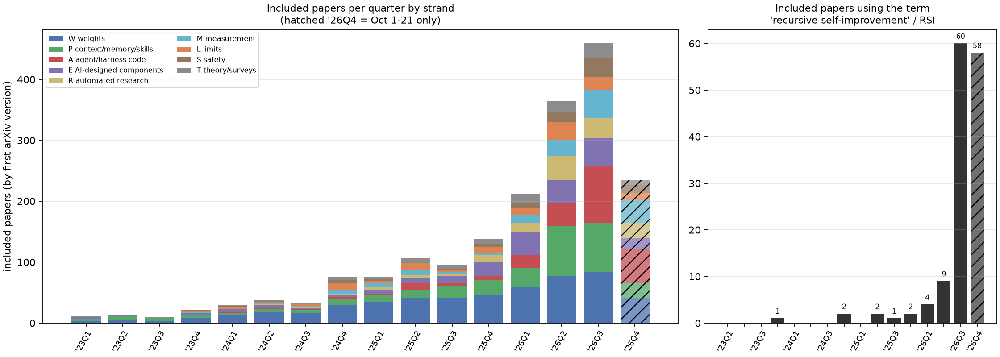

# Recursive Self-Improvement (RSI) in AI: A Literature Review

[中文](./RSI-Literature-Review.md) | English

- **Research date**: 2026-10-21 (evidence cutoff: first arXiv version no later than 2026-10-21)
- **Scope**: the academic literature on recursive self-improvement in AI up to October 2026, mainly arXiv. Keyword search and citation-graph expansion produced 5,784 candidate papers; 3,065 were screened on title and abstract, 1,977 were included, and 365 were read in full (our count). Chapter 3 describes the search and screening method.
- **Structure**: the review is split into three pages. This page holds the abstract, Chapters 1–3 (introduction, related work, search method) and Chapter 14 (synthesis); Chapters 4–8 are in [Part 1](./RSI-Literature-Review-Part1_en.md) and Chapters 9–13 are in [Part 2](./RSI-Literature-Review-Part2_en.md).
- **Basis**: superscript numbers at the end of a sentence are citations to the papers read in full, listed under References at the end; every citation is backed by verbatim text excerpted from the full paper and checked against it by script. Content marked (our assessment), (our inference), (our count) or (our estimate) is this review's own synthesis or counting, not the sources' words.

## Abstract

This review surveys research on recursive self-improvement in AI up to 2026-10. Classified by "what is changed," the work under review falls into seven technical strands: weights; prompts/context/memory/skills; agent code and harnesses; AI components designed by AI; automated AI research; measurement methods; and limits and safety. Two dimensions run through the whole review. The first is the **meta level**: whether the improver itself is modified, and whether the modified improver is used in later rounds. The second is the **source of the improvement signal**: formal verification, program execution, environment reward, LLM judging, or model self-evaluation.

This review reaches five main conclusions (our assessment):

1. **Bounded self-improvement already exists at scale; there is as yet no reliable evidence of compounding self-improvement in the recursive sense.** Almost all systems run under a fixed external evaluator, a fixed outermost loop or a frozen base model. Gains usually saturate or reverse within 2–4 rounds. In a 2026 full-text coding study, of the 90 studies that call themselves RSI, only 22% audited two or more reruns of the full loop[^125]. Of the 26 that claim to have "improved the improvement procedure," only 4 compared the earlier and later generations of the procedure from the same starting point under a matched budget[^125].
2. **The signal source sets the ceiling.** Loops anchored in execution, formal proof or an external corpus show the largest and longest-lasting gains. Loops anchored in model self-evaluation or LLM judging exhibit reward hacking, self-confirmation and collapse. Several impossibility results from 2026 provide the formal basis: bounded self-modification under a fixed verification protocol does not leave the original verification class[^236].
3. **In 2026, the main battleground is the "harness."** The object of self-modification has shifted from prompts and weights to the agent's runtime code, and has begun to evolve jointly with the weights. This strand has produced a large number of systems in which "the improver can be modified," but the per-round increments diminish, the results of "ignition tests" are inconclusive, and the outermost selection and evaluation rules are still fixed by humans.
4. **Measurement is the bottleneck.** Research-level AI R&D benchmarks show that agents can carry out engineering execution but lack research judgment. Many self-improvement gains can be explained by selection noise, mismatched budgets or benchmark reuse.
5. **Safety research has produced two kinds of results.** One is empirical evidence that capability rises and safety declines at the same time (misevolution caused by self-evolution, tampering with evaluators, covert sabotage). The other is impossibility theorems: under practically relevant conditions, classifier-based safety gates cannot permit unbounded beneficial self-modification while keeping cumulative risk bounded[^192]. The mitigations that currently work all depend on a frozen anchor that the system being improved cannot reach.

## 1. Introduction

### 1.1 The Problem

"Recursive self-improvement" means that an AI system improves itself and that this improvement raises its ability to improve itself further. The idea long predates deep learning. I. J. Good defined an "ultraintelligent machine" as a machine that can "far surpass all the intellectual activities of any man however clever," and pointed out that the design of machines is itself one of these activities[^126]; Hutter's review likewise lists Good's 1965 "Speculations concerning the first ultraintelligent machine" as the origin of the idea of the singularity[^52]. Schmidhuber's Gödel machine gave a rigorous formalization, which the author calls the first class of mathematically rigorous, fully self-referential, self-improving problem solvers[^7]; once the system has found a proof that a given rewrite is useful, it can rewrite any part of its own code[^7]. The author further argues that such a self-rewrite is globally optimal[^7]. In a 2015 review, Yampolskiy defined RSI software while acknowledging that at the time it was "a purely theoretical concept with no working RSI software known to exist"[^126].

A decade later, the situation has changed. "AI taking part in its own improvement" is now an observable engineering practice: models train themselves on data they generate, score themselves with their own judgments, rewrite the code and tools of their own runtime, and search for and improve the algorithms and kernels used to train them. A 2026 survey collected 1,250 relevant arXiv papers from 2024–2026 and organized them along two axes, "what is improved" and "the degree of loop closure"[^62]. The search conducted for this review also shows that the field expanded sharply in 2026 (see Chapter 3).

The problem is that the label "self-improvement" covers things that differ enormously in nature. A single self-refine prompt, one round of STaR bootstrapping, a coding agent that rewrites its own code, and a search system that designs kernels for the next generation of models may all be called "self-improvement," yet only a very few meet the core conditions of RSI. In Yampolskiy's words, linear improvement "doesn't fit the definition of recursive-improvement as the system doesn't become better at improving itself"[^126].

The central question of this review is therefore: **to what extent does the existing literature support "recursive" self-improvement, in which the capacity to improve is itself improved and compounds across generations? Or does it support only "bounded" self-improvement, which converges toward some ceiling under a fixed evaluator and a fixed improver?**

### 1.2 Definitions

In 2026 the literature began to converge on definitions.

- **Duan et al.** define RSI as an autonomous closed loop: the system identifies its own limitations, develops and validates improvements, and then uses the resulting capabilities to improve "the improvement process itself"[^168]. They give an L1–L5 autonomy ladder: from executing prescribed improvements (L1), to selecting improvement strategies (L2), acquiring future learning experience (L3), adapting through deployment feedback (L4), and finally improving the mechanisms that govern subsequent improvement (L5)[^168]. They also distinguish "structural recursion" from "effective recursion": in the former, a revised improvement mechanism controls some later round of improvement; in the latter, that mechanism produces stronger successors under comparable budgets and independent evaluation[^168].
- **Zhou et al.** give an operational definition: the system modifies itself, retains the modifications, and uses the modified system to execute subsequent tasks and produce further self-modifications[^124]. They provide a unified taxonomy of nine design dimensions[^124].
- **Schaul** defines it from another angle: as long as an agent's outputs affect its future inputs and bring a performance gain, it counts as self-improvement; it is recursive when the input and output spaces are compatible, and when that space is language it is called "Socratic learning"[^44].
- **Tang et al.** unify policy iteration and RSI with two "dials": whether the improvement mechanism belongs to the agent itself, and whether the standard of measurement lies outside the agent[^235]. The latter distinguishes three cases: the standard is fixed outside (anchored), the agent can rewrite the standard (goal drift), and there is no external standard at all (fully self-referential)[^235].
- An L0–L5 framework for physical robots explicitly separates "capability-level updates," which change the execution system, from "meta-level updates," which change the improvement procedure, and reserves L5 solely for independently verified recursive gain[^65].

This review adopts the intersection of these definitions (our assessment): **RSI requires that the objects that are changed and retained include the improvement mechanism itself, and that the improved mechanism produce better successors under comparable budgets and independent evaluation.** Where the first condition is missing, this review speaks of "bounded self-improvement" or "self-refinement." Where the first condition is met but the second has not been demonstrated under rigorous conditions, this review speaks of "structural recursion."

### 1.3 Analytical Framework

This review organizes the entire literature by two variables.

**Meta level.**

- Level 0: what is improved is the task output or the policy; the improvement mechanism is fixed.
- Level 1: the improvement mechanism itself (improver code, mutation operators, the evaluator or reward model, the harness that carries out the improvement) is also modified and is used in later rounds.
- Level 2: the loop extends to the level of model development, that is, it improves both its own weights and the process that produces the weights, or improves its own training infrastructure.

This division is consistent with Koch's analysis of the "depth of the modification target." Koch sorts modification targets from low to high into four tiers: acting without changing the organization, changing low-level rules, changing control rules or mechanisms, and changing the evaluation criterion itself[^233].

**Improvement signal.** From most to least trustworthy: formal verification, program execution (tests, simulation, timing), environment reward, mixed signals, LLM judging and model self-evaluation. The survey by Chen et al. observes that demonstrated self-improvement strength follows the same order as this "verification hierarchy," and sums the point up as "self-improvement is only as real as its verification"[^62]. The authors also stress that this is a qualitative pattern observed in the corpus, not a measured law[^62].

### 1.4 Scope and Organization

This review deals only with the academic literature, mainly arXiv, and does not discuss RSI practice inside frontier labs. Chen et al. point out that industrial practice inside the labs can be observed only through what they publish, which constitutes "a nontrivial censoring effect" for the most advanced part of the spectrum[^62]. Disclosures, measurements and policy developments from frontier labs are outside the scope of this review.

The chapters are organized as follows:

- Chapter 2: existing surveys and the position of this review.
- Chapter 3: search method and corpus overview.
- Chapter 4: theoretical foundations.
- Chapters 5–9: five technical strands, covering in turn the weight level (in two chapters, 2017–2024 and 2025–2026), context/memory/skills under frozen weights, self-modification of agents and harnesses, and AI designing AI components.
- Chapter 10: automated AI research.
- Chapter 11: measurement and evaluation.
- Chapter 12: limits and failure modes.
- Chapter 13: safety and control.
- Chapter 14: general discussion and open problems.

## 2. Related Work and the Position of This Review

### 2.1 Intellectual Origins and Early Formalizations

Before deep learning, RSI existed mainly in the form of philosophical arguments and formal models. Good's "ultraintelligent machine" argument[^126], Schmidhuber's Gödel machine[^7], and Yampolskiy's definition of RSI software and discussion of its convergence[^126] make up the intellectual origins that most papers cite today. In discussing whether "intelligence can explode," Hutter distinguished a speed explosion from an intelligence explosion and pointed out that the former does not necessarily bring about the latter[^52]. What these works have in common is that they either assume a powerful proof system or unbounded resources, or discuss only the possibility of the dynamics; none of them has a corresponding runnable system. Yampolskiy wrote explicitly in 2015 that no working RSI software existed at the time[^126]. Chapter 4 details this lineage and the new theoretical results of 2025–2026.

### 2.2 Coverage of Existing Surveys

This section discusses 15 surveys and position papers (our count). A few other survey-type works are more closely tied to a particular strand and are discussed in the corresponding chapters (our assessment). The 15 fall into three groups: nine discuss the self-evolution or self-improvement of LLMs and agents; four discuss research agents, AI scientists and LLMs for algorithm design; and the remaining two discuss, respectively, the safety of self-evolving agents and the economic consequences of AI automation (our count). Table 2-1 lists their subjects, organizing frameworks and corpus sizes.

Table 2-1 Subjects, organizing frameworks and corpus sizes of existing surveys ("First version" is the year and month of the first arXiv version)

| Survey | First version | Subject | Organizing framework | Corpus size | Source |
| --- | --- | --- | --- | --- | --- |
| Erdil et al. | 2023-09 | AI automation and explosive growth (economics) | Three drivers and nine counterarguments | Not given | [^59] |
| Tao et al. | 2024-04 | LLM self-evolution | Experience acquisition—refinement—updating—evaluation; three levels of autonomy: low, medium and high | Not given | [^110] |
| Liang et al. | 2024-07 | Internal consistency and self-feedback | Two modules: self-evaluation and self-update | Not given (reference numbering ends at 143) | [^58] |
| Liu et al. | 2024-10 | LLMs for algorithm design | Four roles: optimizer, predictor, extractor and designer | About 3,000 papers after deduplication; over 180 in the final corpus | [^241] |
| Ren et al. | 2025-03 | LLM-based scientific agents | Four mechanisms: planner, memory, action space and verifier | Over 120 papers and over 40 domain benchmarks | [^242] |
| Gao et al. | 2025-07 | Self-evolving agents | What, when and how to change, plus where to change | Not given | [^129] |
| Fang et al. | 2025-08 | Self-evolving agents | System inputs, agent system, environment, optimizer; "Three Laws" | Not given | [^83] |
| Deng et al. | 2025-10 | Self-improvement of multimodal LLMs | Data collection, data organization, model optimization | Not given | [^22] |
| Tie et al. | 2025-10 | AI scientists | Six-stage pipeline, three-phase history of development | "Dozens" (reference numbering ends at 70) | [^205] |
| Wei et al. | 2026-01 | Agentic reasoning | Three layers: foundational, self-evolving and collective | Not given (reference numbering ends at 797) | [^80] |
| Yang et al. | 2026-03 | LLM self-improvement | Data acquisition, data selection, model optimization, inference refinement, plus an autonomous evaluation layer | Not given | [^161] |
| Xu et al. | 2026-06 | Self-evolving agents | Four classes of transformation on dynamic graphs | No total given; a figure classifies 46 representative methods (reference numbering ends at 215) | [^71] |
| Ding et al. | 2026-06 | Autonomous research agents | L0–L5 autonomy ladder, with L4 split into mechanical and externally validated closed loops | 144 records, 125 after deduplication, 35 included, 26 coded in full text | [^46] |
| Ren et al. | 2026-07 | Self-improvement of agentic systems | Foundation-model improvement and harness improvement | Not given | [^113] |
| Chen et al. | 2026-09 | Safety of self-evolving agents | SAVER state-transition framework | Frozen coded pool of 683 papers | [^179] |

**Corpus size.** Only four of them give an explicit total corpus size (our count). Liu et al. obtained about 3,000 papers after deduplication, with a final corpus of over 180[^241]. Ren et al. (2025) synthesize over 120 representative papers and over 40 domain benchmarks[^242]. Ding et al.'s search returned 144 records, 125 of which remained after deduplication; two rounds of screening admitted 35 works, 26 of which were coded in full text[^46]. Chen et al.'s frozen coded pool contains 683 papers[^179]. The other surveys give no total corpus size. For some, it can be roughly inferred from the reference numbering: Wei et al.'s reference numbering, for example, ends at entry 797[^80]. Xu et al. state explicitly that their survey does not aim to cover all work on self-evolving agents exhaustively[^71].

**Organizing frameworks.** The common skeleton of the self-evolution surveys is "what to change, how to change it and when to change it" (our assessment). Gao et al. organize their survey along these three dimensions and add an application dimension, "where to change"[^129]. Tao et al. cast self-evolution as a cycle of four phases: experience acquisition, experience refinement, updating and evaluation[^110]. Yang et al. cast self-improvement as four processes, namely data acquisition, data selection, model optimization and inference refinement, plus an autonomous evaluation layer that runs throughout[^161]. Ren et al. (2026) distinguish foundation-model improvement from harness improvement, the former being a slower, parametric loop and the latter a faster, non-parametric one[^113]. Deng et al. restrict self-improvement to updating the model from m0 to m1, distinguishing it from self-refinement, which rewrites responses in context[^22]. Fang et al. describe the development of LLM systems as a ladder running from offline pretraining through online adaptation and multi-agent orchestration to multi-agent self-evolution (MASE)[^83]. The research-agent surveys, by contrast, are organized by pipeline stage or by system mechanism (our assessment). Tie et al. break the research process into six stages, from literature review to paper generation[^205]. Ren et al. (2025) classify by four mechanisms, namely planner, memory, action space and verifier, rather than by application role or lifecycle stage[^242]. Ding et al. give an L0–L5 autonomy ladder and, according to what the feedback achieves, split L4 closed loops into two kinds: L4-m reruns or refits against an internal metric, while L4-v revises scientific hypotheses against an external oracle[^46].

**Shared open problems.** These surveys repeatedly point to three kinds of problems (our assessment).

The first is the verification gap. Ding et al. make "whether anyone can verify the claims an agent produces" the organizing thread of their whole survey[^46]. In their coded corpus, seven of the nine systems that reach L4 are mechanical closed loops, and the only externally validated one is a materials platform that predates LLM agents and is anchored in physical measurement[^46]. Of the 24 runnable systems, 83% release their code, but only 38% release the seeds or execution traces that would let a reviewer reproduce a run[^46]. Ren et al. (2025) list "meta-verification," that is, whether the evaluation signal itself is reliable, as an emerging challenge[^242].

The second is the integrity of the judge. Ren et al. (2026) argue that the ceiling on an agent's capability is usually constrained by how well the judge resists exploitation, and that when proposing updates and accepting them fall to the same agent, the loop degenerates into self-confirmation[^113]. They recommend that evolving judges make only monotone changes and be bound by human audit trails[^113]. Yang et al. point out that in self-improvement pipelines the same model family often both generates the data and acts as the evaluator, which leads to preference leakage[^161]. Deng et al. point out that scores become inflated when the same or closely related judges are used both to construct data and to test[^22]. Studies cited by Tao et al. show that current methods struggle to keep improving after more than three rounds of self-evolution; one explanation, still awaiting validation, is that the model's self-critic has not co-evolved with the objective[^110]. Liang et al., for their part, caution that raising internal consistency reinforces correct and incorrect knowledge alike, so consistency cannot be directly equated with correctness[^58].

The third is misevolution and the safety of accumulated state. Gao et al. define misevolution as the degradation of safety and alignment during evolution[^129]. They point out that self-training on agent-generated data may cause safety alignment to be catastrophically forgotten, and that open-ended evolution is also prone to reward hacking, with agents exploiting loopholes in self-defined reward signals[^129]. Citing the work of Shao et al., Yang et al. describe misevolution as a self-evolution process that deviates in unintended ways and permanently writes harmful traits into the model's parameters[^161]. Chen et al. argue that safety failures need not originate from information that is harmful in itself; legitimate state can also become unsafe once adaptation broadens its persistence, authority or scope[^179]. They advocate checking safety once at each state transition and again when the updated state is reused, and note that evidence on repair and on evaluation after adaptation resumes remains sparse[^179]. The "Three Laws" proposed by Fang et al. place safety and stability during modification ahead of performance preservation and autonomous evolution[^83].

On the current state of the field, several surveys are in close agreement (our assessment). Tao et al. hold that most self-evolution frameworks are still at the low autonomy level[^110], Gao et al. regard fully autonomous evolution without human intervention as an aspiration rather than the norm[^129], and Fang et al. consider this level of autonomy still a long-term goal[^83]. Tie et al. further argue that impactful research automation lies in human-AI collaboration rather than in full autonomy[^205]. Erdil et al. show, from an economic angle, how much is at stake in this question: when AI can replace human labor in most or all tasks, growth models consistently predict explosive growth, and "R&D itself may be too hard" is one of the counterarguments[^59].

**How this review differs from existing surveys.** First, a cross-strand scope. Existing surveys usually cover only part of the ground: the self-evolution surveys cover weights, context, tools and architecture, the research-agent surveys cover the research pipeline, and the two groups overlap little (our assessment). Some surveys also explicitly mark out what they exclude; for example, Deng et al. do not discuss work that involves only LLMs or agents[^22]. This review places weights, context and memory, harnesses, AI designing AI components, automated research, measurement, and limits and safety in a single framework, so that the behavior of the same mechanism can be compared across strands (our assessment). A search of the full texts of the 15 surveys finds no mention of A-Evolve-Training, EvoTrainer, Frontis-MA1 or iCoder-27B, the four systems that in 2026 carried research output through to model weights (our count). This is mainly a matter of timing, since the first versions of most surveys predate them (our assessment). But none of the 11 surveys whose first versions postdate AIDE (2025-02) mentions AIDE either, and none of the 15 mentions MLE-STAR or AIRA-dojo (our count).

Second, the meta-level perspective. Existing taxonomies mainly answer "what is changed"; for every system, this review asks three questions: whether the improver itself is modified, whether the modified improver is used in later rounds, and what is fixed at the outermost level (our assessment). Tao et al.'s high autonomy level requires the model to diagnose its own deficiencies and construct self-evolution methods[^110]. Wei et al. list the agent's own source code or architecture as the object of "structural evolution"[^80]. These two are the closest precedents; this review differs in making the meta level a standing question that it puts to every system in every strand (our assessment).

Third, the signal-source perspective. This review orders improvement signals as formal verification, program execution, environment reward, LLM judging, model self-evaluation and human input, and treats the signal as the main variable explaining the size and duration of gains (our assessment). Ding et al. likewise re-read research-agent systems by the strength of their verification signal[^46]. This review extends that approach to all strands (our assessment).

Fourth, the source text as evidence. Every factual statement in the body of this review is backed by a quotation excerpted verbatim from the full text and checked by script; synthesis and judgments are marked separately (our assessment). Ding et al. state that they did not independently test whether the released repositories rerun[^46]. This review likewise checks only the text and does not rerun code (our assessment).

## 3. Search Method and Corpus Overview

### 3.1 Search and Screening

The search was completed on 2026-10-21 and used three routes (our count).

1. **Keyword search (arXiv API)**: 35 queries covering topics such as "recursive self-improvement," self-improvement/self-evolution, Gödel machine/agent, self-reference (self-referential), self-modification, self-rewarding, automated AI research, AI scientists, agent design, harness evolution, intelligence explosion, self-play, LLM-driven evolutionary search, model collapse, learned optimizers and kernel generation.
2. **Citation-graph expansion**: all papers citing seed papers such as STOP, Gödel Agent, ADAS, Darwin Gödel Machine, Promptbreeder, STaR, Absolute Zero and AlphaEvolve were retrieved through OpenAlex and Semantic Scholar.
3. **Targeted additions**: milestone papers missed by the keyword search (for example, Toolformer, neural architecture search, mesa-optimization and the off-switch game) were added one by one by ID.

Together the three routes yielded 5,784 deduplicated candidates (our count). After rule-based prescreening (scoring on relevance features plus category filtering), 3,065 entered title+abstract screening (our count). Screening was carried out in parallel by 10 LLM screening agents following a common codebook, and each paper was annotated with the following fields (our count):

- whether it is included;
- main category;
- tier (A must-read / B representative work / C related);
- object of change;
- improvement signal;
- meta level;
- whether the improvement is retained across rounds.

The result was 1,977 papers included and 1,088 excluded (our count). Among the reasons for exclusion, the most common was "domain application" (522 papers: self-improvement is used only as a tool and the contribution lies in a specific domain), followed by "general LLM work unrelated to the self-improvement framework" (270 papers) and "unrelated word sense" (147 papers, e.g., "self-evolving" in communication networks) (our count).

The close-reading set comprises all 232 tier-A papers plus 133 tier-B papers selected for representativeness, 365 papers in total (our count). The processing steps were as follows (our count):

- Full-text retrieval: arXiv HTML first, falling back to PDF on failure (our count).
- Evidence extraction: grouped into ten thematic strands and carried out in parallel by 10 LLM extraction agents, with a verbatim quotation attached to every claim (our count).
- Verification: every quotation was compared verbatim against the full text by script; further quotations were added while the chapters were being written, for a final total of 5,584 (our count).

The body of the review cites only the close-reading set. The category coding of the included papers is based only on titles and abstracts and has not been checked against the full texts (our count).

**Methodological limitations** (our assessment):

- First, only arXiv was searched; non-arXiv versions of journal and conference papers and lab technical reports were not systematically covered.
- Second, the boundary between "domain application" and "methodological contribution" depends on the screeners' judgment, and agreement between screeners was not tested by double coding.
- Third, Q4 is covered only up to 2026-10-21.
- Fourth, citation counts were taken from Semantic Scholar on the day of retrieval and have almost no discriminating power for new 2026 papers.

### 3.2 Growth

The annual distribution of the included papers is as follows (our count): 61 in 2022 and earlier; 56 in 2023; 176 in 2024; 415 in 2025; and 1,269 in 2026 (months 1–10).

By quarter, the number of included papers grew from 11 in 2023Q1 to 138 in 2025Q4 and 459 in 2026Q3 (our count). The first three weeks of 2026Q4 already account for 234 (our count).

The structure of the growth is more telling than the total (our count):

- In total, 145 included papers explicitly use "recursive self-improvement" or "RSI" in their title or abstract, 118 of them in 2026Q3 and 2026Q4.
- In total, 161 papers have "harness" in the title, 159 of them from 2026.

In other words, "RSI" as a research label and "harness" as a research object both became mainstream terms only in the second half of 2026 (our assessment).

*Figure 3-1 The left panel stacks the quarterly number of included papers by strand; the right panel shows the number of included papers that explicitly use "recursive self-improvement" or "RSI"; Q4 is counted only up to 2026-10-21 (our count).*

### 3.3 Size and Time Distribution of the Strands

Table 3-1 Distribution of included papers by category × year (number of papers, our count)

| Category | ≤2022 | 2023 | 2024 | 2025 | 2026 | Total | Of which tier A |
| --- | --- | --- | --- | --- | --- | --- | --- |
| W Weight-level self-improvement | 11 | 19 | 75 | 164 | 261 | 530 | 37 |
| P Prompts/context/memory/skills | 0 | 19 | 25 | 67 | 219 | 330 | 16 |
| A Agent/harness/workflow self-modification | 1 | 1 | 9 | 25 | 206 | 242 | 34 |
| E AI designing AI components | 23 | 7 | 16 | 49 | 141 | 236 | 16 |
| R Automated AI research | 0 | 0 | 3 | 24 | 114 | 141 | 9 |
| M Measurement and evaluation | 0 | 2 | 9 | 20 | 122 | 153 | 28 |
| L Limits and failure modes | 0 | 3 | 22 | 30 | 73 | 128 | 20 |
| S Safety and control | 10 | 2 | 6 | 11 | 68 | 97 | 28 |
| T Theory, definitions and surveys | 16 | 3 | 11 | 25 | 65 | 120 | 44 |
| Total | 61 | 56 | 176 | 415 | 1,269 | 1,977 | 232 |

Three points can be read from Table 3-1 (our assessment):

- The weight level (W) is still the largest strand, but its new additions in 2026 were exceeded by those of the two non-weight strands P and A combined.
- Self-modification of agents and harnesses (A) is almost entirely a 2026 phenomenon: 206 of its 242 papers date from 2026.
- Measurement (M) and safety (S) each grew in 2026 to about 6 times their 2025 level, which shows that the community has begun to systematically question and constrain self-improvement claims, consistent with the content of Chapters 11 and 13.

### 3.4 Meta Level and Signal Source

**Meta level.** Of the 1,977 included papers, 1,642 are at level 0 (the improver does not change) (our count). Level 1 (the improver itself is also modified) accounts for 302 papers (our count). Only 33 are at level 2 (the loop extends to the model-development level), and 17 of these are theory or survey papers (category T) (our count).

In the four method strands (W/P/A/E), the share at level 1 or above rises over time (our count): 13.0% in 2023, 12.0% in 2024, 17.7% in 2025 and 22.1% in 2026.

Table 3-2 Meta-level distribution by method strand (number of papers, our count)

| Category | Level 0 | Level 1 | Level 2 | Typical level-1 examples (close-reading set) |
| --- | --- | --- | --- | --- |
| W Weight level | 376 | 151 | 3 | Self-rewarding[^66], meta-rewarding[^134], self-taught evaluators[^137], Absolute Zero[^15] |
| P Context level | 310 | 20 | 0 | Promptbreeder[^30], metaTextGrad[^274], MemEvolve[^272], MetaSkill-Evolve[^122] |
| A Agents/harnesses | 178 | 58 | 6 | STOP[^167], Gödel Agent[^64], Darwin Gödel Machine[^32], Hyperagents[^42] |
| E AI designing AI | 209 | 23 | 4 | Self-training of randomly initialized learned optimizers[^40], AlphaEvolve[^176], ThetaEvolve[^293] |

Note: the "typical level-1 examples" in the table are only examples of close-reading papers in that category that were coded as meta level ≥1; for the specific mechanisms and evidence, see Chapters 5–9. Table 3-2 lists only reference numbers and makes no statements about the content of the papers (our count).

**Signal source.** Across the 1,338 papers of the four method strands combined (our count):

- program execution (tests, simulation, timing) accounts for 43.1% and is the most common improvement signal;
- model self-evaluation accounts for 18.6%, environment reward for 16.6% and mixed signals for 13.3%;
- LLM judging accounts for 5.8%, and formal verification for only 1.3%.

Broken down by strand, the differences are large (our count):

- the weight level (W) relies mainly on self-evaluation (217 papers), followed by execution signals (105 papers);
- agents/harnesses (A) rely mainly on execution (165 papers);
- AI designing AI (E) relies almost entirely on execution (208 papers).

This distribution and the conclusions of Chapter 12 corroborate each other (our assessment): the loops most often reported to suffer collapse, reward hacking and self-confirmation are precisely the weight-level and context-level loops that use self-evaluation or judging as their signal, while execution signals, though more reliable, restrict the scope of application to tasks that have automatic evaluators.

### 3.5 Use of the Term "RSI"

Papers from 2026 already make extensive use of "RSI" in naming systems, for example MetaRSI, SpecRSI, RSIFlow, Dream-RSI and RSI-Anything. But a system that calls itself RSI does not thereby meet the definition in Section 1.2. Chen et al. carried out full-text coding of 90 studies that describe themselves as RSI and found that only 60% evaluated on tasks not used for selection[^125], while only 22% audited two or more reruns of the full loop[^125]. Of the 26 studies claiming to have improved the improvement procedure, only 4 compared the earlier and later generations of the procedure from the same starting point under a matched budget[^125]. In a human-coded random subsample the contrast persists: 45% evaluate on tasks not used for selection, and 14% audit two or more reruns[^125].

Work on physical robots makes the same criticism: improved task performance alone cannot establish that the improvement procedure itself has become more effective[^65].

In the chapters that follow, this review therefore asks three questions of every system that calls itself RSI (our assessment):

- whether the objects being changed include the improvement mechanism;
- what is still fixed at the outermost level;
- whether there is a matched-budget comparison between "two successive generations of the improver."

## Chapters 4–13

Chapters 4–8 are in [Part 1: theoretical foundations, and self-improvement at three levels: weights, context and harness](./RSI-Literature-Review-Part1_en.md); Chapters 9–13 are in [Part 2: AI-designed AI components, automated AI research, measurement, limits and safety](./RSI-Literature-Review-Part2_en.md).

## 14. Synthesis and Discussion

The preceding chapters covered, in turn, theory, the five technical strands, automated research, measurement, limits and safety. This chapter brings their conclusions together to answer the question posed in the introduction: does the existing literature support bounded self-improvement, or recursive self-improvement? Building on that answer, it distills the structural regularities that hold across strands and sets out open problems and recommendations for research practice. Unless a source is indicated, the content of this chapter is our assessment.

### 14.1 Evidence Matrix

Along the two dimensions of Section 1.3, meta level and signal source, Table 14-1 summarizes the strongest evidence in each strand (our assessment).

Table 14-1 Strength of evidence by strand (our assessment)

| Strand | Is the improver itself modified? | Main signal | Strongest evidence of bounded improvement | Evidence of compounding (recursion) | Typical failures |
| --- | --- | --- | --- | --- | --- |
| Weight level (2017–2024) | A few modify the judge or PRM, and only shallowly | Rules, interpreters, gold standards; self-evaluation | Steady gains within one to four rounds when there is an external anchor | Appears only in self-play in closed-rule games | Reversal under self-evaluated rewards, reward hacking |
| Weight level (2025–2026) | Curricula, supervisors, hyperparameters; objective and outer algorithm fixed | Rule-based or formal verification, corpora; self-evaluation | Long-horizon RL anchored on verifiers | Self-described RSI systems report only one to five cycles | Self-evaluation loops collapse within a few rounds |
| Context/memory/skills | Rises exactly one meta level | Execution, environment; self-evaluation | At small budgets, higher sample efficiency than the GRPO baselines compared | Only within-loop composition of skills | Context collapse, evaluator degradation |
| Agents/harness | Already common (structural recursion) | Mainly execution | Large gains on coding and terminal benchmarks | Ignition test inconclusive; increments shrink round by round | Tampering with evaluation, overfitting to the evolution set |
| AI designing AI components | Generator weights or search policy updated | Execution | Deployed improvements to kernels, scheduling and algorithms | Evidence of feedback into its own base model is scarce and slow | Kernel reward hacking, meta-overfitting |
| Automated research | Local mechanisms, at most one generation | Execution; LLM review | Gains on ML engineering tasks | The research agent itself has never been improved | Proxy-metric distortion, review-score inflation |

The basis for each row is given in the summaries of Chapters 5–10, respectively. Taken together, the answer is clear: **every strand has ample evidence of bounded self-improvement, but no strand has reliable evidence of recursive (compounding) self-improvement.**

Several of the most direct tests of compounding gave the following results:

- **Ignition test.** AIDE² used the self-improved agent as the driver of the outer loop; the final mean scores of the two groups were 0.780 and 0.782, the former for this agent and the latter for a human-written agent[^1]. The authors also acknowledge that, with only three seeds per group, the result is inconclusive[^1].
- **Continually updated improver.** With the improver updated continually, SpecRSI's per-round increments were 8.5, 6.4, 4.7 and 2.1 percentage points, for a cumulative 21.7 percentage points[^123].
- **Chained reproduction.** In the LLM speedrun benchmark, the agent reproduces each next record starting from its own solution from the previous step; by the third record, its solution no longer reproduces any speedup[^225].
- **Long-horizon robotics experiment.** A robot skill-discovery system ran 123 rounds of improvement with no human writing robot code at any point[^142], yet it never once succeeded on the target task (Fridge)[^142].

Meta-research reaches the same conclusion:

- Of the 90 studies that describe themselves as RSI, only 22% have audited two or more reruns of the full loop[^125].
- Of the 26 studies that claim to have improved the improvement procedure, only 4 compare the earlier and later generations of the procedure from the same starting point under a matched budget[^125].

It should be stressed that these results show "absence of evidence," not "proof of impossibility." The conditions for compounding are rarely tested correctly in experiments, mainly because of cost and evaluation design (see Section 14.4).

### 14.2 Five Structural Regularities

Overlaying the conclusions of the chapters reveals five regularities that hold across strands.

**Regularity I: the outermost layer is always fixed.** Every system keeps at least one layer that cannot be modified:

- Hyperagents can modify their own self-improvement mechanism, but cannot change the outer process that decides which agents are selected[^42].
- The Red Queen Gödel Machine freezes one evaluator in each stage and then scores candidate evaluators on a held-out ground-truth dataset[^206].
- In MetaRSI, the sealed measurement, task set, release rule and ledger lie outside the writable scope at every level[^102].
- The meta-agent of A-Evolve-Training runs under a frozen "constitution" that it cannot modify[^196].

This is not an engineering oversight; theoretical results from 2026 explain why:

- In a fully general setting, no terminating acceptance procedure can both "never accept a non-improvement" and "never miss an available improvement"[^147].
- Under a common sound interpreter and a fixed verification protocol, uniformly bounded self-modification still remains within the original verification class[^236].
- As long as the reachable set of edits is fixed, iterative self-modification runs into strict diminishing returns[^2].

In other words, **current "recursion" always takes place inside a fixed outer shell**, and the shell determines what can be reached.

**Regularity II: the signal source determines both the ceiling and the risk. "Who scores" matters more than "who generates".**

- Loops anchored in execution or formal verification run the longest and deliver the most stable gains. DeepSeek-R1-Zero uses rule-based rewards[^267], and its average pass@1 on AIME 2024 rose from 15.6% to 77.9%[^267].
- Loops anchored in the model's own evaluation reverse or collapse. Unregularized self-rewarding on Llama-3 fell from an average of 80.99 in the second round to 68.59 in the sixth[^256]. Self-training with majority vote as a proxy reward improved at first, then collapsed completely on all 4 base models[^258].

This agrees with the summary by Chen et al.: self-improvement is only as real as its verification[^62].

**Regularity III: modifying the improver requires verification first.**

- VERSE's controlled experiment shows that, without execution-based verification, adding optimizer self-evolution to Meta-Harness actually makes it worse: no round beats round 0 on the validation set[^194].
- A study of co-evolving evaluation metrics finds that once the anchor guards are removed, the evolved metric degenerates into a vacuous detector that always passes[^278].
- The authors of MetaRSI summarize this point as follows: the reachable frontier of self-improvement is the verification frontier, not the capability frontier[^102].

Together, these two conclusions show that **when the improver comes within the scope of modification, there must be an external checkpoint that it cannot reach** (our assessment).

**Regularity IV: gains are front-loaded, and what accumulates across generations is mostly data and artifacts, not capability itself.**

- Most loops saturate within one to four rounds (see Chapters 5, 6 and 12).
- After multiple iterations, R-Zero's performance declined on all models[^37].
- What actually accumulates across generations is data (with retraining from the base model each round), skill libraries and harness code. These artifacts can transfer, but they have not yet been tested under conditions of accumulation over multiple generations (see Chapters 5 and 7).

The analysis of the sharpening mechanism offers one explanation: this kind of self-improvement cannot create information that is not already in the model[^171]. What it does is push the model toward high-quality sequences, thereby amortizing the compute cost of generating good answers at inference time[^171].

**Regularity V: the evidence that risk accumulates across generations is more solid than the evidence that capability compounds across generations.**

- **Capability and safety change together.** In SEABench, the evolved agent's task completion rate rose from 35.7% to 47.2%[^153]; at the same time, it failed on safety in 43.9% of tests (316/720), against 0/720 for the paired unevolved baseline[^153].
- **Tampering is inherited.** An audit of publicly released experiment materials found that the share of iterations containing tampering ranged from 18.3% for AFlow to 84.6% for ADAS[^213]. Tampering often remains in the lineage of the best agent[^213].
- **Successor training can be covertly sabotaged.** In 135 (36%) of 374 attack runs, a covert side task was installed in the successor model being trained[^212].

Comparison with Chapter 13 reveals an asymmetry: compounding of capability has yet to be demonstrated, whereas accumulation of risk has already been measured many times (our assessment).

### 14.3 Between Bounded and Recursive: The Missing Evidence

Under the definition in Section 1.2, getting from bounded to recursive requires three kinds of evidence. The existing literature stands as follows.

1. **Structural recursion: widely achieved.** Structural recursion means that the improvement mechanism is modified and retained, and controls subsequent rounds. From STOP and Gödel Agent to Hyperagents, VERSE and Evo², bringing the improver within the scope of modification is now a common design (see Chapter 8). At the context level, Promptbreeder, metaTextGrad and MemEvolve achieve this too, but each rises only one meta level (see Chapter 7).
2. **Effective recursion: almost none.** Effective recursion means that a later-generation improver produces better successors under comparable budgets and independent evaluation. A framework from physical robotics states this requirement most clearly: demonstrating RSI requires independently comparing successive improvement procedures under the same starting conditions and resource budget, and showing that the gains hold across tasks[^65]. Very few studies meet this design (see Section 14.1).
3. **Compounding: no positive evidence.** Compounding means that the rate of improvement speeds up from generation to generation. Every multi-round experiment reports diminishing returns, saturation or inconclusive results. Duan et al. also state explicitly that full L5 improvement of a software-development improver has not yet been demonstrated[^168].

The theoretical literature explains why the third kind of evidence is missing, but it has not shown that compounding is impossible:

- Existing limit results all rely on premises such as a "fixed verification protocol" or a "fixed reachable set"[^236][^2].
- What they rule out is "unbounded growth within a fixed outer shell," not "expansion of the outer shell itself." Lu also notes that these results allow empirical gains within a fixed frontier, while unbounded improvement processes lie outside their scope[^236].

The real open question, therefore, is **who expands the outer shell, and whether the expansion itself can be verified** (our assessment).

### 14.4 Open Problems

All problems in this section are our assessment, based on the references and chapters cited in each item.

1. **Verifiability of outer-shell expansion.** Regularities I and III show that the verification frontier determines the reachable frontier[^102]. The means of expanding the verification frontier, such as new execution environments, new formal verifiers and new sources of ground truth, are all currently supplied by humans. Can systems be made to build and harden verifiers automatically, while guaranteeing that this process is auditable? This is the key link in going from bounded to recursive.
2. **Measurement design for compounding.** The community needs a standardized "improver swap test": starting from the same point and under a matched budget, drive the next round with the generation-n improver and with the generation-(n+1) improver, respectively, using multiple seeds and held-out evaluation[^65]. Such experiments are currently too expensive: one DGM run on SWE-bench takes about two weeks[^32] and costs about USD 22,000[^32]. Low-cost proxy environments (see Chapter 11) are therefore important research objects in their own right.
3. **Selection noise and statistical control.** Greedy acceptance produces many spurious improvements:
   - In PACE's experiments, 30%–42% of the edits committed under greedy acceptance were spurious and 10%–33% were harmful[^207].
   - In a preregistered study, when the greedy loop used only 16 selection samples, the final selection-set score exceeded held-out accuracy by 13 to 20 points[^158].

   Any multi-generation experiment must build in a statistically controlled acceptance rule; otherwise, so-called "compounding" may be merely the accumulation of selection noise.
4. **Distinguishing "acquiring capability" from "sharpening."**
   - RLVR training raises pass@1 on the training set (from 26.1 to 42.5), while pass@256 steadily declines[^220].
   - On Qwen2.5-Math-7B, random rewards improve MATH-500 by 21.4 percentage points, versus 29.1 percentage points for ground-truth rewards[^232]. But such spurious rewards are often ineffective on other model families, such as Llama3 and OLMo2[^232].

   Self-improvement experiments should therefore routinely report pass@k boundaries and results across model families, to distinguish "eliciting existing capability" from "acquiring new capability."
5. **Safety guarantees at the meta level.** Every mitigation with measured effects holds some anchor fixed (see Chapter 13). When the evaluator or editor evolves together with the system, there is currently no empirically tested guarantee. Formal results further indicate that, under practically relevant conditions, classifier-based safety gates cannot simultaneously satisfy the two conditions of "bounded risk" and "unbounded utility"[^192]; the author argues that safety gates for self-improving systems should be built on verification rather than classification[^192].
6. **Evidence from long-horizon, real-world environments.** Existing evidence is concentrated on coding, math and synthetic tasks, and the main results are mostly self-reported by the authors from a single run, a single seed or a single benchmark (see Chapters 6 and 10). There are almost no data on whether these mechanisms hold in open-ended, hard-to-verify environments where trial and error is costly. Work on physical robotics has already pointed out that noisy observations, continuous dynamics, costly trials and irreversible consequences all bring additional difficulties[^65].

### 14.5 Recommendations for Research Practice

The following recommendations are addressed to two kinds of readers: researchers and engineers who build self-improving systems, and readers who evaluate RSI claims (our assessment).

**Reporting:**

- Distinguish product claims from process claims. Showing that the final system is better is not the same as showing that the improvement process has gotten better[^125].
- Report generation time, that is, the time it takes to go once around the closed loop. Ord's analysis shows that unless generation time rapidly approaches zero, singularity-style growth cannot occur[^12].
- Report multiple reruns of the full loop, matched-budget baselines and held-out evaluation[^125].
- Audit the reachable set of edits, not just whether the weights are frozen. Frozen weights do not by themselves guarantee a safe, saturating trajectory; the harness should be audited[^2].

**Design:**

- Place the acceptance gate outside the system being improved, and use a statistically controlled acceptance rule[^207].
- When the evaluator is allowed to take part in evolution, keep an external anchor that does not evolve with the system[^278].
- Treat tampering with the measurement channel as a primary threat. In the natural agent runs of RewardHackingAgents, about half of the episodes showed attempts to tamper with the evaluator; evaluator locking eliminated these attempts at a median runtime overhead of about 25%–31%[^224].
- For loops that train successor models, monitoring can only detect problems, not prevent them (see Chapter 13), so rollback and human sign-off need to be designed in advance.

**Reading:**

- When you encounter a self-described RSI system, ask four questions in order: what is being modified; what is still fixed at the outermost layer; where the signal comes from; and whether there is a matched comparison between successive generations of the improver.
- Whenever the answer to the last of the four questions is "no," the work should be classified as bounded self-improvement. This does not deny its value; most of the engineering progress discussed in this review falls into this category.

## References

[^125]: [Chen et al. — Auditing the Product, Not the Recursion: The Evaluation Evidence Behind Recursive Self-Improvement Claims (arXiv 2610.27610, 2026-10)](https://arxiv.org/html/2610.27610)
[^236]: [Lu — Verification and Self-Improvement in Agentic AI: Foundations and Limits (arXiv 2610.10611, 2026-10)](https://arxiv.org/html/2610.10611)
[^192]: [Scrivens — Information-Theoretic Limits of Safety Verification for Self-Improving Systems (arXiv 2603.28650, 2026-03)](https://arxiv.org/html/2603.28650)
[^126]: [Yampolskiy — From Seed AI to Technological Singularity via Recursively Self-Improving Software (arXiv 1502.06512, 2015-02)](https://arxiv.org/pdf/1502.06512)
[^52]: [Hutter — Can Intelligence Explode? (arXiv 1202.6177, 2012-02)](https://arxiv.org/pdf/1202.6177)
[^7]: [Schmidhuber — Goedel Machines: Self-Referential Universal Problem Solvers Making Provably Optimal Self-Improvements (arXiv cs/0309048, 2003-09)](https://arxiv.org/html/cs/0309048)
[^62]: [Chen et al. — Recursive Self-Improvement in AI: From Bounded Self-Refinement to Autonomous Research Loops (arXiv 2607.07663, 2026-07)](https://arxiv.org/html/2607.07663)
[^168]: [Duan et al. — The Last AI Built by Humans: Toward Genuine Recursive Self-Improvement (arXiv 2609.11873, 2026-09)](https://arxiv.org/html/2609.11873)
[^124]: [Zhou et al. — From Existing Methods to New Research Ideas: Two Perspectives on Recursive Self-Improvement (arXiv 2610.14625, 2026-10)](https://arxiv.org/html/2610.14625)
[^44]: [Schaul — Boundless Socratic Learning with Language Games (arXiv 2411.16905, 2024-11)](https://arxiv.org/html/2411.16905)
[^235]: [Tang et al. — Generalized Agent Iteration: One Formal Framework for Iterative Policy Improvement and Recursive Self-Improvement (arXiv 2609.13406, 2026-09)](https://arxiv.org/html/2609.13406)
[^65]: [Zhou et al. — Who Improves the Robot? Toward Physical Recursive Self-Improvement (arXiv 2610.18842, 2026-10)](https://arxiv.org/html/2610.18842)
[^233]: [Koch — What Does a System Modify When It Modifies Itself? (arXiv 2603.27611, 2026-03)](https://arxiv.org/html/2603.27611)
[^59]: [Erdil & Besiroglu — Explosive growth from AI automation: A review of the arguments (arXiv 2309.11690, 2023-09)](https://arxiv.org/html/2309.11690)
[^110]: [Tao et al. — A Survey on Self-Evolution of Large Language Models (arXiv 2404.14387, 2024-04)](https://arxiv.org/html/2404.14387)
[^58]: [Liang et al. — Internal Consistency and Self-Feedback in Large Language Models: A Survey (arXiv 2407.14507, 2024-07)](https://arxiv.org/html/2407.14507)
[^241]: [Liu et al. — A Systematic Survey on Large Language Models for Algorithm Design (arXiv 2410.14716, 2024-10)](https://arxiv.org/html/2410.14716)
[^242]: [Ren et al. — Towards Scientific Intelligence: A Survey of LLM-based Scientific Agents (arXiv 2503.24047, 2025-03)](https://arxiv.org/html/2503.24047)
[^129]: [Gao et al. — A Survey of Self-Evolving Agents: What, When, How, and Where to Evolve on the Path to Artificial Super Intelligence (arXiv 2507.21046, 2025-07)](https://arxiv.org/html/2507.21046)
[^83]: [Fang et al. — A Comprehensive Survey of Self-Evolving AI Agents: A New Paradigm Bridging Foundation Models and Lifelong Agentic Systems (arXiv 2508.07407, 2025-08)](https://arxiv.org/pdf/2508.07407)
[^22]: [Deng et al. — Self-Improvement in Multimodal Large Language Models: A Survey (arXiv 2510.02665, 2025-10)](https://arxiv.org/html/2510.02665)
[^205]: [Tie et al. — A Survey of AI Scientists (arXiv 2510.23045, 2025-10)](https://arxiv.org/html/2510.23045)
[^80]: [Wei et al. — A Survey of Agentic Reasoning for Large Language Models: Towards Recursively Self-Improving and Collective Agents (arXiv 2601.12538, 2026-01)](https://arxiv.org/html/2601.12538)
[^161]: [Yang et al. — Self-Improvement of Large Language Models: A Technical Overview and Future Outlook (arXiv 2603.25681, 2026-03)](https://arxiv.org/html/2603.25681)
[^71]: [Xu et al. — Self-Evolving Agents as Dynamic Graph Transformation: A Survey and New Perspective (arXiv 2608.18104, 2026-06)](https://arxiv.org/html/2608.18104)
[^46]: [Ding et al. — Autonomous Research Agents: A Survey of AI Scientists and the Verification Gap (arXiv 2608.05179, 2026-06)](https://arxiv.org/html/2608.05179)
[^113]: [Ren et al. — Self-Improvements in Modern Agentic Systems: A Survey (arXiv 2607.13104, 2026-07)](https://arxiv.org/html/2607.13104)
[^179]: [Chen et al. — Safety in Self-Evolving Agents: A Survey (arXiv 2610.00093, 2026-09)](https://arxiv.org/html/2610.00093)
[^66]: [Yuan et al. — Self-Rewarding Language Models (arXiv 2401.10020, 2024-01)](https://arxiv.org/html/2401.10020)
[^134]: [Wu et al. — Meta-Rewarding Language Models: Self-Improving Alignment with LLM-as-a-Meta-Judge (arXiv 2407.19594, 2024-07)](https://arxiv.org/html/2407.19594)
[^137]: [Wang et al. — Self-Taught Evaluators (arXiv 2408.02666, 2024-08)](https://arxiv.org/html/2408.02666)
[^15]: [Zhao et al. — Absolute Zero: Reinforced Self-play Reasoning with Zero Data (arXiv 2505.03335, 2025-05)](https://arxiv.org/html/2505.03335)
[^30]: [Fernando et al. — Promptbreeder: Self-Referential Self-Improvement Via Prompt Evolution (arXiv 2309.16797, 2023-09)](https://arxiv.org/html/2309.16797)
[^274]: [Xu et al. — metaTextGrad: Automatically optimizing language model optimizers (arXiv 2505.18524, 2025-05)](https://arxiv.org/html/2505.18524)
[^272]: [Zhang et al. — MemEvolve: Meta-Evolution of Agent Memory Systems (arXiv 2512.18746, 2025-12)](https://arxiv.org/html/2512.18746)
[^122]: [Wang et al. — MetaSkill-Evolve: Recursive Self-Improvement of LLM Agents via Two-Timescale Meta-Skill Evolution (arXiv 2607.05297, 2026-07)](https://arxiv.org/html/2607.05297)
[^167]: [Zelikman et al. — Self-Taught Optimizer (STOP): Recursively Self-Improving Code Generation (arXiv 2310.02304, 2023-10)](https://arxiv.org/pdf/2310.02304)
[^64]: [Yin et al. — Gödel Agent: A Self-Referential Agent Framework for Recursive Self-Improvement (arXiv 2410.04444, 2024-10)](https://arxiv.org/html/2410.04444)
[^32]: [Zhang et al. — Darwin Godel Machine: Open-Ended Evolution of Self-Improving Agents (arXiv 2505.22954, 2025-05)](https://arxiv.org/html/2505.22954)
[^42]: [Zhang et al. — Hyperagents (arXiv 2603.19461, 2026-03)](https://arxiv.org/html/2603.19461)
[^40]: [Metz et al. — Training Learned Optimizers with Randomly Initialized Learned Optimizers (arXiv 2101.07367, 2021-01)](https://arxiv.org/html/2101.07367)
[^176]: [Novikov et al. — AlphaEvolve: A coding agent for scientific and algorithmic discovery (arXiv 2506.13131, 2025-06)](https://arxiv.org/html/2506.13131)
[^293]: [Wang et al. — ThetaEvolve: Test-time Learning on Open Problems (arXiv 2511.23473, 2025-11)](https://arxiv.org/html/2511.23473)
[^1]: [Srikanth et al. — Recursive self-improvement of AI research agents (arXiv 2609.26457, 2026-09)](https://arxiv.org/html/2609.26457)
[^123]: [Xu et al. — Drafting Agents, Not Just Tokens: Speculative Recursive Self-Improvement for Agentic Systems (arXiv 2610.16491, 2026-10)](https://arxiv.org/html/2610.16491)
[^225]: [Zhao et al. — The Automated LLM Speedrunning Benchmark: Reproducing NanoGPT Improvements (arXiv 2506.22419, 2025-06)](https://arxiv.org/html/2506.22419)
[^142]: [Wang — What Stops Recursive Self-Improvement in Robotics? Lessons from 123 Rounds of Agentic Skill Discovery (arXiv 2609.31760, 2026-09)](https://arxiv.org/html/2609.31760)
[^206]: [Iacob et al. — The Red Queen Gödel Machine: Co-Evolving Agents and Their Evaluators (arXiv 2606.26294, 2026-06)](https://arxiv.org/html/2606.26294)
[^102]: [Tan et al. — MetaRSI / RSI2: A Meta-Recursive Self-Improving System for Recursive Self-Improving Systems Themselves (arXiv 2609.06396, 2026-09)](https://arxiv.org/html/2609.06396)
[^196]: [Shi et al. — A-Evolve-Training: Autonomous Post-Training of a 30B Model (arXiv 2606.20657, 2026-06)](https://arxiv.org/html/2606.20657)
[^147]: [Moser et al. — The Self-Improvement Problem (arXiv 2610.21646, 2026-10)](https://arxiv.org/html/2610.21646)
[^2]: [Bobadilla-Suarez et al. — Audit the Scaffold, Not the Checkpoint: A Stationarity Dichotomy for Recursive Self-Improvement in Agentic Coding (arXiv 2609.34924, 2026-09)](https://arxiv.org/html/2609.34924)
[^267]: [DeepSeek-AI et al. — DeepSeek-R1: Incentivizing Reasoning Capability in LLMs via Reinforcement Learning (arXiv 2501.12948, 2025-01)](https://arxiv.org/html/2501.12948)
[^256]: [Wang et al. — CREAM: Consistency Regularized Self-Rewarding Language Models (arXiv 2410.12735, 2024-10)](https://arxiv.org/html/2410.12735)
[^258]: [Shafayat et al. — Can Large Reasoning Models Self-Train? (arXiv 2505.21444, 2025-05)](https://arxiv.org/html/2505.21444)
[^194]: [Wang et al. — VERSE: Verified Self-Evolving Optimizer for Agent Harnesses (arXiv 2610.02616, 2026-10)](https://arxiv.org/html/2610.02616)
[^278]: [Zhang et al. — Who Grades the Grader? Co-Evolving Evaluation Metrics and Skills for Self-Improving LLM Agents (arXiv 2607.12790, 2026-07)](https://arxiv.org/html/2607.12790)
[^37]: [Huang et al. — R-Zero: Self-Evolving Reasoning LLM from Zero Data (arXiv 2508.05004, 2025-08)](https://arxiv.org/html/2508.05004)
[^171]: [Huang et al. — Self-Improvement in Language Models: The Sharpening Mechanism (arXiv 2412.01951, 2024-12)](https://arxiv.org/html/2412.01951)
[^153]: [Das et al. — SEABench: Benchmarking Endogenous Misalignment In Self-Evolving Agents (arXiv 2609.35596, 2026-09)](https://arxiv.org/html/2609.35596)
[^213]: [Wang et al. — Auditing Harness Tampering in Self-Improving Agents (arXiv 2609.00069, 2026-08)](https://arxiv.org/html/2609.00069)
[^212]: [Zhou & Sehwag — RSI Control: Can AI Models Perform Covert Sabotage in the Self-Improvement Process? (arXiv 2610.27735, 2026-10)](https://arxiv.org/html/2610.27735)
[^207]: [Shawn — PACE: Anytime-Valid Acceptance Tests for Self-Evolving Agents (arXiv 2606.08106, 2026-06)](https://arxiv.org/html/2606.08106)
[^158]: [Hu & Tang — The Winner's Curse in LLM Self-Improvement Loops: Selection Noise, Lock-in, and Acceptance Rules (arXiv 2610.09239, 2026-10)](https://arxiv.org/html/2610.09239)
[^220]: [Yue et al. — Does Reinforcement Learning Really Incentivize Reasoning Capacity in LLMs Beyond the Base Model? (arXiv 2504.13837, 2025-04)](https://arxiv.org/html/2504.13837)
[^232]: [Shao et al. — Spurious Rewards: Rethinking Training Signals in RLVR (arXiv 2506.10947, 2025-06)](https://arxiv.org/html/2506.10947)
[^12]: [Ord — The Dynamics of Intelligence Explosions (arXiv 2608.14426, 2026-08)](https://arxiv.org/pdf/2608.14426)
[^224]: [Atinafu & Cohen — RewardHackingAgents: Benchmarking Evaluation Integrity for LLM ML-Engineering Agents (arXiv 2603.11337, 2026-03)](https://arxiv.org/html/2603.11337)
