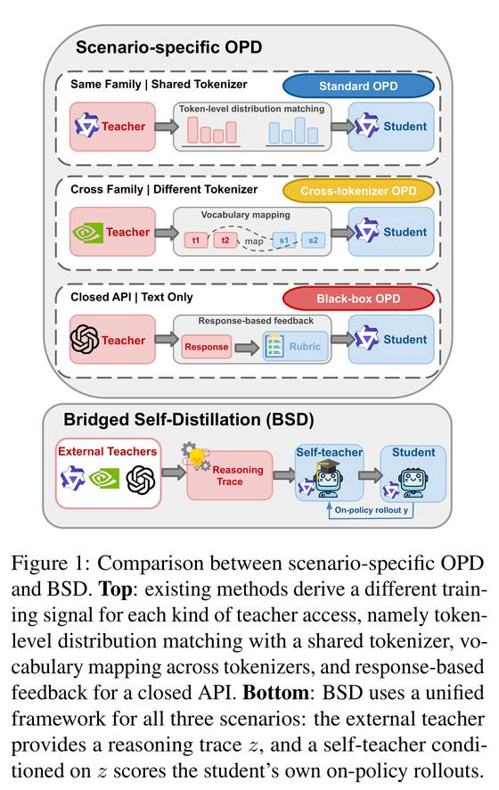
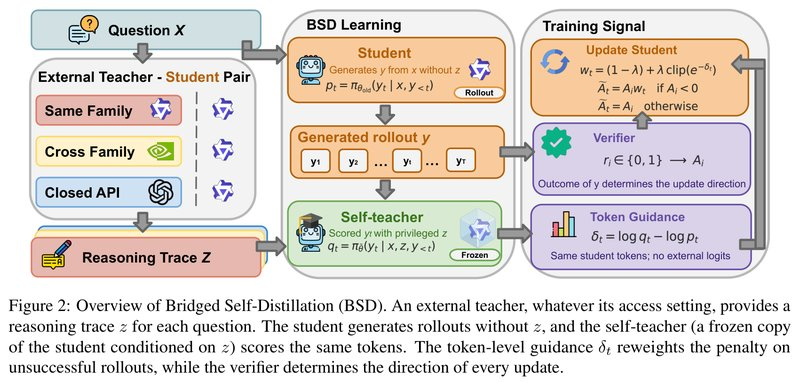
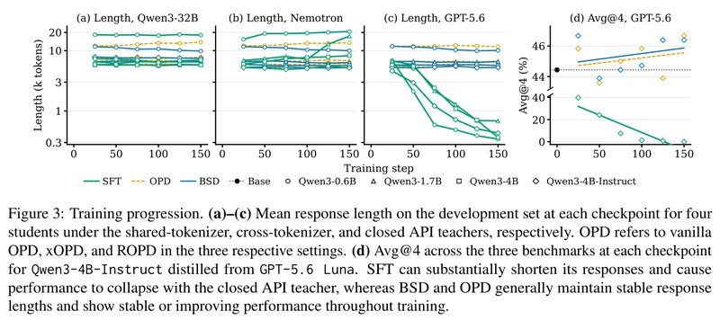

# Bridged Self-Distillation for On-Policy Learning（面向在线学习的桥接自蒸馏）

中文 | [English](./BSD-Bridged-Self-Distillation_en.md)

- **原文链接**: [Bridged Self-Distillation for On-Policy Learning](https://arxiv.org/abs/2610.26397v2)
- **论文**: [arXiv:2610.26397](https://arxiv.org/abs/2610.26397)
- **官方资料**: [TUMLegalTech/Bridged-Self-Distillation](https://github.com/TUMLegalTech/Bridged-Self-Distillation)
- **发布日期**: 2026-10-19
- **范围**: 按 arXiv v2（2026-10-27 修订）写的通俗解读，不是全文翻译。作者是 Runsheng Chen、Yihong Liu、Raoyuan Zhao、Michael A. Hedderich、Hinrich Schütze、Matthias Grabmair（前两位为共同一作，Yihong Liu 为通讯作者），来自慕尼黑工业大学（TUM）、慕尼黑大学（LMU）和慕尼黑机器学习中心（MCML）。

## 一句话版本

小模型向大模型学推理时，老师可能和学生用同一个分词器（把文字切成 token 的规则），也可能用不同的分词器，或者只能通过闭源 API 调用，以前每种老师各配一套专门方法。这篇论文提出 BSD（Bridged Self-Distillation，桥接自蒸馏），只要求老师交一份文字解答。训练时把解答交给学生自己的一个副本当参考，让这个副本逐个 token 检查学生做错的答卷：看过解答后觉得不对劲的地方多扣分，觉得没问题的地方少扣分，答案对错仍由自动判卷器决定。老师只提供文字，打分全部在学生自己的模型和 token 上完成，所以三种老师共用同一套训练流程。

效果：4 个 Qwen3 学生（0.6B～4B）各跟 3 种老师学，共 12 组师生组合，在三个竞赛数学测试集上评测。BSD 在 12 组里全部超过未训练的学生，平均正确率提升 1.2～4.7 个百分点（下文简称"分"），其中 11 组是蒸馏方法里的最高分或并列最高。直接模仿老师解答的 SFT 有 8 组反而不如未训练的学生。要留意的是，论文主表（表 1）每个方法只报一个检查点（训练中途存下的模型，用一小批开发题挑出）。论文画出了其中 4 组设置每个检查点的测试分，我读图后按 6 个检查点平均再比，BSD 对专门方法的领先从主表的 0.6～3.6 分缩到约 0.3～1.3 分（这是我的看法，见第 7 节）。

---

## 1. 先认识几个词

| 词 | 大白话 |
| --- | --- |
| token | 模型处理文字的最小单位，一个词或词的一部分 |
| 分词器（tokenizer） | 把文字切成 token 的规则，不同模型的切法可能不同 |
| 蒸馏（distillation） | 让小模型（学生）学到大模型（老师）的能力 |
| SFT（监督微调） | 直接让模型模仿给定的文字，比如逐字模仿老师写的解题过程 |
| on-policy | 学生在自己生成的答卷上学习，而不是模仿别人写好的答卷 |
| OPD（on-policy distillation，在线蒸馏） | 学生自己写答卷，老师逐个 token 给概率，学生朝老师的概率靠拢 |
| GRPO | 一种强化学习方法（让模型自己作答、按得分调整）：同一道题采样多份答卷，比组内平均好的奖励，比平均差的惩罚 |
| 答卷（rollout） | 模型对一道题生成的一份完整回答 |
| 判卷器（verifier） | 自动检查最终答案对错的程序，本文用 Math-Verify |
| 特权上下文（privileged context） | 只在训练时提供、考试时没有的信息，本文指老师的解答 |
| 自教师（self-teacher） | 看着特权上下文给学生答卷打分的学生副本 |
| token 熵 | 学生在某个位置对下一个 token 有多拿不准，越高越拿不准 |
| Avg@4 / Pass@4 | 每题采样 4 次。Avg@4 是 4 次的平均正确率，Pass@4 是至少做对 1 次的题目比例 |
| LoRA | 只训练少量新增参数的轻量微调方法 |
| 检查点 | 训练过程中定期存下来的模型参数，本文每 25 步存一个 |

## 2. 它想解决什么问题

让小模型（学生）向大模型（老师）学推理，常见两条路：

| 路线 | 做法 | 好处 | 问题 |
| --- | --- | --- | --- |
| SFT | 把老师写的解题过程当标准答案，让学生逐字模仿 | 什么老师都能用 | 强得多的老师的解法，小模型往往学不来，硬学容易学坏 |
| OPD | 学生自己做题，老师给学生答卷里的每个 token 打概率，学生朝老师的概率靠拢 | 学生是在自己的答卷上被纠正，通常比 SFT 稳 | 老师要交出每个 token 的概率，而且这些概率要能和学生的 token 一一对上 |

OPD 的这个要求，三种老师满足的程度不同：

| 老师类型 | 本文用的老师 | 难点 | 以前的专门方法 |
| --- | --- | --- | --- |
| 同一个分词器 | Qwen3-32B | 基本没有，可以直接比较概率 | OPD |
| 不同分词器 | Nemotron-3-30B-A3B | 两边切法不同，概率对不上，要先做映射 | xOPD |
| 闭源 API | GPT-5.6 Luna | 只返回文字，不给概率，也不公开分词器 | ROPD：让老师为每道题写评分细则，训练中按细则给学生答卷打分 |

于是每换一种老师，就要换一套方法。



*图 1：上半部分是现有做法，老师的开放方式不同，训练信号也不同：同一个分词器时直接对齐每个 token 的概率分布（图中 Standard OPD），不同分词器时先做词表映射（Cross-tokenizer OPD），闭源 API 时只能根据老师的回答给反馈，比如评分细则（Black-box OPD）。下半部分是 BSD：三种外部老师都只提供一份解答 z，由以 z 为条件的自教师给学生自己生成的答卷打分。*

论文要回答的问题是：**能不能有一种 on-policy 学习方法，只要求老师能写出解题过程，三种老师都能用？**

## 3. 核心做法：让看过解答的自己批改做错的答卷

打个比方（类比是我加的，不是论文原文）：学生闭卷做一道题，做错了。普通强化学习（GRPO）的批改方式是整份卷子每个 token 扣一样的分，学生不知道错在哪。BSD 请来第二个批改人：读过老师解答的学生自己。对错仍由判卷器判定，这个批改人只决定扣分怎么分到各个 token 上。它不重新做题，只把学生的卷子从头读一遍，在每个 token 上判断"看过解答之后，我还会这么写吗"。不会这么写的地方多扣分，觉得没问题的地方少扣分。

批改人和学生是同一个模型，用同一套 token，所以老师用什么分词器无所谓，也不需要老师的概率。老师的解答文字把两边连了起来。我的理解是，名字里的 Bridged（桥接）指的就是这一点，论文没有专门解释这个名字。

**四个角色。**

| 角色 | 是谁 | 做什么 |
| --- | --- | --- |
| 外部老师（external teacher） | 想要学习的大模型 | 训练开始前，给每道训练题写一份解答 z。闭源模型不公开思考过程，就用它的最终回答 |
| 学生 | 要训练的小模型 | 看不到 z，每道题自己写 8 份答卷 |
| 自教师 | 学生的冻结副本，每 10 次更新同步一次参数 | 输入题目和 z，逐个 token 给学生的答卷打概率，自己不写答卷 |
| 判卷器 | 自动检查最终答案的程序 | 判断每份答卷对错 |

自教师的提示词里写明：读懂参考解答的每一步，但不要照抄或改写，用自己的话独立推出同样的答案。自教师读的是学生原始的 token 序列，不会把文字解码后重新切分。

**一次训练更新的步骤**（对应图 2）：

1. 学生对每道题写 8 份答卷。
2. 判卷器判对错。GRPO 在同一道题的 8 份答卷内部比较：比平均好的得正分，比平均差的得负分，记为 A。8 份全对或全错时 A 全是 0，这道题不产生训练信号。
3. 学生和自教师分别读这些答卷，给每个 token 打概率：学生打的是 $`p_t`$（不看解答），自教师打的是 $`q_t`$（看着解答）。
4. 计算每个 token 的引导信号 $`\delta_t = \log q_t - \log p_t`$。$`\delta_t < 0`$ 表示读过解答后，自教师觉得这个 token 更不该出现；$`\delta_t > 0`$ 表示觉得更合理。
5. 做对的答卷照常奖励。做错的答卷按 $`\delta_t`$ 调整每个 token 的扣分：$`\delta_t < 0`$ 的多扣，$`\delta_t > 0`$ 的少扣。
6. 用调整后的分数做一次策略梯度更新，也就是按分数调整模型：得正分的 token 以后更常写，得负分的更少写。

关键在第 5 步：**奖励还是惩罚只由判卷器决定**。参考解答只能改变扣分的轻重，不能把惩罚变成奖励，也不碰做对的答卷。调整幅度也不大：训练开始时最多 ±10%，之后逐步降到 0（见第 4 节的数值例子）。



*图 2：左边是三种外部老师（同系列、跨系列、闭源 API），不管哪种，都只为每道题提供一份解答 z。中间是训练流程：学生不看 z，自己生成答卷 y，并给每个 token 打概率 $`p_t`$；自教师是学生的冻结副本（图中标 Frozen），看着 z 给同一份答卷的同样这些 token 打概率 $`q_t`$。右边是训练信号：判卷器给出对错 $`r_i`$ 并换算成 $`A_i`$，决定每次更新的方向；token 级引导信号 $`\delta_t`$ 只调整做错答卷上的扣分轻重。右下角的说明是：打分全用学生自己的 token，不需要外部老师的概率。*

**和最接近的两种做法比。**

- **RLSD**：BSD 的调权重公式来自它。区别有两处：RLSD 的自教师只看标准答案，BSD 看外部老师的完整解答；RLSD 对做对和做错的答卷都调权重，BSD 只调做错的。
- **OPSD**：同样让看着解答的自己打分，但不用判卷器，直接把打分当奖励。

## 4. 用公式再说一遍（选读）

这一节把第 3 节的做法写成公式，不看也不影响理解。记号：x 是题目，z 是外部老师的解答，y 是学生的一份答卷，$`y_t`$ 是其中第 t 个 token，$`y_{<t}`$ 是它前面的部分。

**整份答卷的得分（GRPO）。** 同一道题的 G 份答卷，判卷器给出 $`r^{(i)} \in \{0,1\}`$：

```math
A^{(i)} = \frac{r^{(i)} - \mathrm{mean}\left(\{r^{(j)}\}_{j=1}^{G}\right)}{\mathrm{std}\left(\{r^{(j)}\}_{j=1}^{G}\right)}
```

做对的 A 为正，做错的 A 为负。普通 GRPO 把同一个 A 用在这份答卷的每个 token 上。

**两次打分与引导信号。** 学生给自己的 token 打分 $`p_t = \pi_\theta(y_t \mid x, y_{<t})`$，自教师打分 $`q_t = \pi_{\bar\theta}(y_t \mid x, z, y_{<t})`$：

```math
\delta_t = \mathrm{sg}\left[\log q_t - \log p_t\right]
```

sg 表示这个数只当权重用，不回传梯度。

**只给做错的答卷调权重。**

```math
w_t = (1-\lambda) + \lambda \cdot \mathrm{clip}_{[1-\epsilon,\ 1+\epsilon]}\left(e^{-\delta_t}\right), \qquad \tilde A_t = \begin{cases} A \cdot w_t & A < 0 \\ A & A \ge 0 \end{cases}
```

其中 $`e^{-\delta_t} = p_t / q_t`$。自教师觉得这个 token 更不该出现时（$`q_t < p_t`$），比值大于 1，扣分加重。最后用 $`\tilde A_t`$ 代替 A 做 GRPO 式的裁剪策略梯度更新，没有 KL 惩罚。

**数值例子。** 论文设 ε = 0.2，λ 从 0.5 线性降到 0。所以裁剪后的值落在 [0.8, 1.2]，训练刚开始时 $`w_t`$ 落在 [0.9, 1.1]，训练结束时 $`w_t = 1`$。假设一份做错的答卷 A = −1，训练刚开始时：

| 自教师的看法 | $`\delta_t`$ | $`e^{-\delta_t}`$ | 裁剪后 | $`w_t`$ | 这个 token 的得分 |
| --- | --- | --- | --- | --- | --- |
| 明显不该这么写（$`q_t`$ 约为 $`p_t`$ 的 0.6 倍） | −0.5 | 1.65 | 1.2 | 1.10 | −1.10 |
| 没有看法 | 0 | 1 | 1 | 1.00 | −1.00 |
| 略觉合理 | +0.1 | 0.905 | 0.905 | 0.95 | −0.95 |
| 明显合理 | +1.0 | 0.37 | 0.8 | 0.90 | −0.90 |

也就是说，**每个 token 的扣分最多被调 ±10%，而且这个幅度随训练线性降到 0**。参考解答只是在做错的答卷里，把一些 token 的扣分调重一点、另一些调轻一点。

**和 OPD 的联系**（附录 C 的命题 1）：$`\delta_t`$ 很小时，BSD 的梯度约等于 GRPO 的梯度，再加上一项只作用在做错答卷上的 OPD 式修正（老师换成自教师）：

```math
g_{\text{BSD}} \approx g_{\text{GRPO}} + \lambda\, \mathbb{E}\Big[\sum_t \mathbb{1}\{A<0\}\, |A|\, \delta_t\, \nabla_\theta \log \pi_\theta(y_t \mid x, y_{< t})\Big]
```

作者特别说明，这只是一种解读，既不保证训练稳定，也不保证扣分落在真正出错的 token 上。

## 5. 实验结果

### 5.1 实验怎么设计的

**学生**：Qwen3-0.6B、Qwen3-1.7B、Qwen3-4B（都开思考模式），外加 Qwen3-4B-Instruct-2507。最后这个模型原本不写思考过程，作者先用 1,000 条 Nemotron 解答微调它，让它学会写 `<think>` 段，再拿来当学生，下文简称 Qwen3-4B-Instruct。

**老师**（解答长度见论文第 4.2 节，老师自己的分数见附录表 8，Avg@4，%）：

| 老师 | 类型 | 解答形式 | 老师自己在三个测试集上的平均分 |
| --- | --- | --- | --- |
| Qwen3-32B | 同分词器 | 完整思考过程，平均约 4,000 token | 69.2 |
| Nemotron-3-30B-A3B | 不同分词器 | 完整思考过程，平均约 4,000 token | 68.6 |
| GPT-5.6 Luna | 闭源 API | 不返回思考过程，只有最终回答，平均 247 token | 87.2 |

**训练数据**：OpenThoughts 的数学子集。每对师生抽 2,400 道题，老师每题写一份解答，训练前一次性生成好。

**训练**：所有方法都训 LoRA（秩 32），各 150 次更新。BSD 每次更新用 16 道题、每题 8 份答卷；16 × 150 = 2,400，正好是训练集大小，相当于每道题只过一遍。学习率 BSD 为 1e-6，SFT 为 5e-6。训练用 NVIDIA H100/H200，开销见 5.4 节。

**测试**：AIME 2024、AIME 2025、HMMT 2025 三个竞赛数学测试集，各 30 题。每题采样 4 次，报告 4 次的平均正确率（Avg@4）。每个方法每 25 步存一个检查点，用另外 128 道 OpenThoughts 题（开发集）挑出最好的一个，再拿它去测试。

**对照方法**：

- SFT：用同一份老师解答做模仿学习。
- 同分词器：标准 OPD。
- 不同分词器：xOPD，先对齐两套 token，再把老师的概率映射到学生的 token 上。
- 闭源 API：ROPD，让老师为每道题写评分细则，训练中再由老师按细则给学生答卷打分，所以训练期间要一直调用 API。

### 5.2 主要结果：BSD 在 12 组里都超过原始模型，SFT 多数反而变差

主表（论文表 1）给出三个测试集的平均分（Avg@4，%）。"OPD 类"一列在三种老师下分别是 OPD、xOPD、ROPD。加粗是这一组里蒸馏方法的最高分。

| 学生 | 老师 | 原始 | SFT | OPD 类 | BSD |
| --- | --- | --- | --- | --- | --- |
| Qwen3-4B | Qwen3-32B | 59.2 | 60.6 | 60.3 | **63.9** |
| | Nemotron | 59.2 | **63.6** | 59.7 | **63.6** |
| | GPT-5.6 Luna | 59.2 | 57.2 | 59.7 | **61.9** |
| Qwen3-4B-Instruct | Qwen3-32B | 44.4 | 40.8 | 42.2 | **45.8** |
| | Nemotron | 44.4 | 38.1 | 45.0 | **45.6** |
| | GPT-5.6 Luna | 44.4 | 39.7 | 45.8 | **46.4** |
| Qwen3-1.7B | Qwen3-32B | 35.8 | 30.0 | **38.6** | **38.6** |
| | Nemotron | 35.8 | 37.5 | 35.0 | **39.2** |
| | GPT-5.6 Luna | 35.8 | 36.9 | 36.4 | **40.0** |
| Qwen3-0.6B | Qwen3-32B | 10.8 | 9.2 | 13.1 | **13.6** |
| | Nemotron | 10.8 | 7.5 | **14.2** | 12.8 |
| | GPT-5.6 Luna | 10.8 | 2.8 | 11.4 | **12.5** |

怎么读这张表：

- **BSD 全部超过原始模型**：12 组都高于原始模型，提升 1.2～4.7 分。
- **11 组拿到最高分**：9 组单独第一，2 组并列第一（Qwen3-4B + Nemotron 与 SFT 并列，Qwen3-1.7B + Qwen3-32B 与 OPD 并列），1 组输给 xOPD（Qwen3-0.6B + Nemotron，12.8 对 14.2）。
- **SFT 多数变差**：12 组里有 8 组低于原始模型。
- **同分词器时 BSD 也不输 OPD**：作者的解释是，用同一个分词器不代表两个模型的推理习惯相近，而 BSD 的打分来自学生自己的副本，更贴合学生。
- **xOPD 解决了"能不能用"，但效果不稳**：对 0.6B 提升 3.4 分，对 4B 和 4B-Instruct 只提升 0.5 和 0.6 分，对 1.7B 反而降 0.8 分。

### 5.3 SFT 被老师的回答长度带跑，甚至崩掉

- **长度被带跑。** GPT-5.6 Luna 的回答平均只有 247 token，SFT 照着学，4 个学生的回答都越来越短。Nemotron 当老师时，SFT 多数情况让回答变长，Qwen3-1.7B 最明显。BSD 和 OPD 类方法在 12 组里回答长度都基本不变。
- **成绩崩掉。** Qwen3-4B-Instruct 跟 GPT-5.6 Luna 学，SFT 在第 25 步就已低于原始模型，到第 150 步正确率接近 0。附录图 8b 里 Qwen3-4B 跟 GPT-5.6 Luna 学，SFT 第 50 步还有约 61 分，第 150 步不到 1 分（读图估计）。BSD 和 ROPD 全程稳定。
- **主表没体现出崩溃。** 原因是每个方法报的是开发集挑出的检查点，而 SFT 往往越训越差，12 组里有 10 组挑中的是最早的第 25 步。
- **忘掉数学以外的能力。** 附录 I 用 Qwen3-4B 学生测了这一点。在 MMLU-Pro 中数学、物理、化学、工程以外的 200 道题上，跟 GPT-5.6 Luna 做 SFT，分数从第 25 步的 62.1 降到第 150 步的 54.1，比原始模型的 63.5 低 9.4 分。在 LEXam 法律题上，同一设置第 100 步降到 40.5（原始 45.9）。BSD 和 OPD 类方法在所有检查点上，MMLU-Pro 最多比原始低 1.1 分，LEXam 最多低 3.5 分；而原始模型在 LEXam 上 4 个采样随机种子之间的标准差就有 4.9 分。



*图 3：(a)～(c) 是三种老师（同分词器的 Qwen3-32B、不同分词器的 Nemotron、闭源的 GPT-5.6 Luna）下，4 个学生每个检查点在开发集上的平均回答长度。纵轴是对数刻度，单位千 token；绿色实线是 SFT，橙色虚线是 OPD 类方法（三种设置里分别是 OPD、xOPD、ROPD），蓝色实线是 BSD，点的形状区分学生。(c) 里 SFT 的回答从第 25 步的约 4.5k～7k token 缩到第 150 步的约 0.3k～0.7k（读图估计）。(d) 是 Qwen3-4B-Instruct 跟 GPT-5.6 Luna 学时每个检查点在三个测试集上的 Avg@4，纵轴中间断开，上半段放大了 44～46 分附近，黑点是原始模型的 44.4。SFT 从约 40 跌到接近 0；BSD 和 OPD 类方法的回答长度总体稳定，成绩在整个训练中保持稳定或略有提升。*

作者的结论：同样一份老师解答，当成模仿目标（SFT）会出问题，当成自教师的参考（BSD）就稳得多。

### 5.4 训练开销：比 OPD 略多，比 xOPD、ROPD 少

论文附录表 6（Qwen3-4B 学生训练 150 次更新，H200 GPU 小时）：

| 老师 | 方法 | GPU 小时 |
| --- | --- | --- |
| Qwen3-32B | SFT | 0.8 |
| | OPD | 29.4 |
| | BSD | 31.4 |
| Nemotron | xOPD | 70.8 |
| | BSD | 48.7 |
| GPT-5.6 Luna | ROPD | 83.0 |
| | BSD | 33.3 |

这些数字不含训练前生成老师解答的开销，也不含 ROPD 调用 API 的开销。OPD 和 xOPD 训练时要多占一张卡放老师，这部分算在内。BSD 每次更新多一次自教师前向计算，耗时 7～18 秒，不到单次更新时间的 10%。

### 5.5 消融：参考越完整越好，判卷器不能少，做对的答卷别动

设置：Qwen3-4B 学生，Qwen3-32B 老师，训练题和优化设置都相同。论文图 4c 和附录表 11（三个测试集平均，Avg@4，%）：

| 变体 | 自教师看到什么 | 用判卷器 | 引导信号用在哪 | 平均分 |
| --- | --- | --- | --- | --- |
| 原始模型（不训练） | 无 | 无 | 无 | 59.2 |
| OPSD | 完整解答 | 否 | 所有答卷 | 59.7 |
| GRPO | 没有自教师 | 是 | 无 | 60.6 |
| RLSD | 只有标准答案 | 是 | 做错的答卷 | 61.7 |
| BSD（w/ succ.） | 完整解答 | 是 | 所有答卷 | 61.4 |
| BSD-hint | 三句话提示 + 答案 | 是 | 做错的答卷 | 61.7 |
| BSD-guide | 最多 8 步的思路（不含计算）+ 答案 | 是 | 做错的答卷 | 62.5 |
| BSD-trace（即 BSD） | 完整解答 | 是 | 做错的答卷 | **63.9** |

这里的 RLSD 是按 BSD 改过的版本：除了自教师只看标准答案，其余设置都和 BSD 相同，所以也只调做错的答卷。

怎么读这张表：

- **有参考比没参考好**：GRPO 60.6，只给答案的 RLSD 61.7，给完整解答的 BSD 63.9。三者在训练题上的正确率曲线几乎重合，差别出现在测试集上。作者认为参考信息让判卷器的反馈更好地迁移到了新题上。
- **参考越完整越好**：三句话提示 61.7，分步思路 62.5，完整解答 63.9。
- **判卷器不能少**：OPSD 不用判卷器，第 25 步测试分 63.3，到第 150 步掉到 55.8，回答长度从 16.8k token 缩到 12.5k（原始模型 17.5k）。其他变体的长度都在 16.5k～17.7k。
- **做对的答卷别动**：调权重也用到做对的答卷上，分数从 63.9 降到 61.4。作者的理由是，做对的答卷是学生不靠参考自己找到的解法，按 GRPO 正常奖励就好，不必往自教师那边拉。

### 5.6 引导信号集中在学生拿不准的地方

这一节和后面三节看引导信号 $`\delta_t`$ 到底在帮什么忙。作者在训练前做了一次测量：每个学生对 24 道难题各写 6 份答卷，每份答卷分别用三个老师各一份答案正确的解答来打分，只统计做错的答卷，结果对三个老师取平均。论文表 2（最后一列是 BSD 在三种老师下比原始模型平均高多少分，按主表算）：

| 学生 | 引导信号强度 | 与 token 熵的相关系数 | BSD 平均提升（分） |
| --- | --- | --- | --- |
| Qwen3-0.6B | 0.072 | 0.87 | +2.2 |
| Qwen3-1.7B | 0.115 | 0.90 | +3.5 |
| Qwen3-4B | 0.114 | 0.90 | +3.9 |
| Qwen3-4B-Instruct | 0.037 | 0.83 | +1.5 |

怎么读这张表：

- **引导信号强度**是做错答卷所有 token 上 $`\delta_t`$ 平均值的绝对值。这个平均值在每组师生里都是负的：在做错的答卷上，看过解答的自教师给学生的 token 打的概率平均更低。
- **token 熵高**，表示学生在这个位置拿不准下一个 token 写什么。相关系数在 0.83～0.90，说明信号最强的地方正是学生最拿不准的地方。
- **信号越强，提升越大**：Qwen3-4B-Instruct 信号最弱，提升也最小；1.7B 和 4B 信号强，提升也大。不过只有 4 个学生，作者也承认这只是相关性。

### 5.7 完整解答能指出错在哪一步，只给答案做不到

附录 D 的图 7 有一个例子。一道求面积的题，Qwen3-4B 在训练前的一份错误答卷里，把区间长度 $`1/5^m - 1/5^{m+1}`$ 算成了 $`1/5^{m+1}`$，正确结果是 $`4/5^{m+1}`$。

- 自教师看着完整解答（里面有正确推导）时，在写错的分子上，以及把这个错误结果带进下一步的 token 上，都给出很强的负信号。
- 自教师只看最终答案时，同样这些 token 上的信号接近 0，因为光有答案看不出哪一步错了。

这个例子和消融结果一致：完整解答（63.9）好于只给答案（61.7）。附录表 11 还显示，训练前测得的引导信号强度，只给答案时是 0.055，给完整解答时是 0.127。

### 5.8 案例：学会回头检查

论文图 5 是 AIME 2024 的一道题：N 是最大的四位数，把它任意一位改成 1 后都能被 7 整除；Q、R 是 N 除以 1000 的商和余数，求 Q + R。答案是 699。

原始 Qwen3-4B 找对了 N = 5694，却把商和余数写成了 Q = 569、R = 4。作者截取这份答卷的前 90%（已经包含这个错误）作为共同开头，让两个模型接着写：

- 原始模型接着写，没有认真核对这一步，最后写成 Q = 569、R = 694，得到 1263，错。
- BSD 训练过的学生（老师是 Qwen3-32B）写了"等等，再检查一下 N 除以 1000"，发现 5694 = 5 × 1000 + 694，改成 Q = 5、R = 694，得到 699，对。
- 从这个开头各续写 8 次，BSD 学生做对 6 次，原始模型做对 4 次。

### 5.9 用词变化：作者自己说不能当证据

附录 E 在 26 道题上比较了原始模型的错误回答（45 份）和 BSD 学生的正确回答（69 份）。错误回答里 "but this is"、"not sure"、"try to" 这类否定和犹豫的说法更多，正确回答里 "which matches"、"indeed"、"verify" 这类核对的说法更多；正确回答也更短，平均 19,057 对 24,279 token。作者明确说，这个比较同时换了模型和对错，差别不能归因于 BSD，只作描述，不能当作 BSD 让模型学会自我纠错的独立证据。

## 6. 作者自己承认的局限

- **学生规模、模型系列和任务都有限。** 受算力限制，只测了 4B 及以下的学生、只用了 Qwen3 一个系列、只测了英文竞赛数学。换更大的学生、别的模型系列、别的领域是否同样有效，还不知道。
- **离不开判卷器。** BSD 靠判卷器决定奖惩方向，所以只适用于答案能自动检查的任务，写作、开放式问答这类任务用不了。能不能用"学生和老师的结论是否一致"代替判卷器，作者留作后续工作。
- **引导信号为什么有用，只有相关性证据。** 引导信号和提升之间的关系，只是跨 4 个学生的相关性。论文说明了信号集中在哪里，但没有证明它具体帮到了哪些 token、为什么有用。

## 7. 读的时候值得留意的地方

以下是我读原文时注意到、论文没有重点讨论的点，供参考。

### 证据有多强

- **主表的领先幅度很依赖挑哪个检查点。** 主表里每个方法只报开发集挑出的那一个检查点。正文图 3d 和附录图 8 画出了 4 组设置在每个检查点上的测试分。这两张图在 PDF 里是矢量图，我取出了图中每个点的坐标并换算成分数（主表选中的检查点都和主表一致），按 6 个检查点取平均再比，BSD 在 4 组里平均都领先，方向一致，但幅度比主表小（Avg@4，%）：

| 学生 + 老师 | 主表：BSD 比专门方法高 | 6 个检查点平均：BSD 比专门方法高 |
| --- | --- | --- |
| Qwen3-4B + Qwen3-32B | 3.6（63.9 对 60.3） | 0.37（60.93 对 60.56） |
| Qwen3-4B + GPT-5.6 Luna | 2.2（61.9 对 59.7） | 1.34（62.22 对 60.88） |
| Qwen3-4B-Instruct + Qwen3-32B | 3.6（45.8 对 42.2） | 1.20（45.23 对 44.03） |
| Qwen3-4B-Instruct + GPT-5.6 Luna | 0.6（46.4 对 45.8） | 0.28（45.42 对 45.14） |

- **一两分的差距分不清是不是噪声。** 作为参照：BSD 自己相邻两个检查点就能差 5 分（Qwen3-4B-Instruct + Qwen3-32B，第 100 步 43.3，第 125 步 48.3）；三个测试集一共只有 90 道题，在三集平均分里，一道题的 4 次采样全部由错变对只加 1.1 分。我在论文里没有看到换随机种子重复训练的结果，所以一两分的差距有多少是噪声，判断不了。消融里 BSD 比 GRPO 高 3.3 分，同样是单次训练、单个检查点的比较，而 BSD 对 GRPO 的改动本身很小（第 4 节）。
- **SFT 的结论不受影响。** SFT 在 Qwen3-4B + GPT-5.6 Luna 上的检查点平均分只有 26.4，远低于原始的 59.2。
- **Pass@4 上看不到同样的提升。** 附录表 14 用同一批检查点报了 Pass@4，即 4 次采样里至少做对 1 次的题目比例。BSD 在 12 组里有 3 组低于原始模型、1 组持平：Qwen3-4B 跟 Qwen3-32B 学少做出 1 道题，跟 GPT-5.6 Luna 学少做出 3 道；Qwen3-0.6B 跟 Nemotron 学少做出 1 道。所以对 Qwen3-4B 这种较强的学生，提升主要来自"有时能做对的题现在更常做对"，没有多做出以前做不出的题。这不是 BSD 独有的：SFT 和 OPD 类方法在这个学生上的 Pass@4 也只有 Nemotron 一组超过原始模型。较小的 Qwen3-1.7B 则三组 Pass@4 都有提升（+2.2～+7.8）。正文没有讨论 Pass@4 的结果。
- **Qwen3-4B-Instruct 的提升要换个角度看。** 为了让它写思考过程，作者先用 1,000 条 Nemotron 解答微调了它，分数从 46.4 降到 44.4（附录表 9）。BSD 的 +1.2～2.0 分从 44.4 算起，最好的 46.4 正好回到微调前的水平。不过微调前的模型不写思考过程、直接作答，两次评测方式不完全一样。

### 适用范围

- **"解答越完整越好"只在一组师生上验证过。** 消融只做了 Qwen3-4B + Qwen3-32B。换个角度看，GPT-5.6 Luna 只给 247 token 的最终回答，却在 Qwen3-4B-Instruct 和 Qwen3-1.7B 两个学生上是 BSD 效果最好的老师。它本身也强得多（平均 87.2 分，另两个老师约 69 分），所以"解答长短"和"老师强弱"的影响在这里分不开。

## 8. 如果想自己跑

- **适合的场景**：想从闭源 API 模型或分词器不同的模型学习，任务又有自动判卷器。论文只测了数学题；带测试用例的代码题在原理上也满足这个条件，但没有验证过。老师只要能写出解答文字就行。
- **需要准备**：每道训练题一份老师解答（训练前一次性生成）；判卷器；一套 GRPO 训练框架（作者用 verl 和 vLLM，代码见文首链接）。自教师的输入包含题目和解答，作者给它的长度上限是 12,288 token。
- **作者发布了什么**：只开源代码，不发布模型权重和数据，老师的解答也不发布。闭源老师的回答，作者说明只用于非商业研究。
- **和 SFT 比**：用的是同一份老师解答，但稳定得多，不会被老师的回答长度带跑，也没有忘掉数学以外的能力。代价是要付强化学习的训练成本：Qwen3-4B 上 BSD 用了 31.4 GPU 小时，SFT 只用 0.8。
- **和专门方法比**：三种老师共用一套代码；在 Qwen3-4B 上，不同分词器和闭源 API 两种情况的 GPU 小时也更少。分数一般略好，但领先幅度不大（见第 7 节）。
- **论文用的关键设置**：λ 从 0.5 线性降到 0，ε = 0.2，自教师每 10 次更新同步一次，只调做错的答卷，不加 KL 惩罚，LoRA 秩 32，学习率 1e-6，每次更新 16 道题 × 8 份答卷，共 150 次更新。

## 9. 和相关工作的关系

论文第 7 节把 BSD 放在两条线索里：一条是知识蒸馏和 on-policy 蒸馏，包括面向不同分词器和黑盒老师的各种变体，它们通常每种情况要一套专门的监督信号；另一条是特权信息和自蒸馏，让模型自己看着答案、解答或反馈来当老师。BSD 沿用后一条的做法，区别是特权上下文来自外部老师的解答。文中讨论到的几篇：

| 论文 | 和 BSD 的关系 | 链接 |
| --- | --- | --- |
| On-Policy Distillation of Language Models（Agarwal 等，ICLR 2024） | on-policy 蒸馏的代表工作 | [arXiv:2306.13649](https://arxiv.org/abs/2306.13649) |
| On-Policy Distillation（Kevin Lu、Thinking Machines Lab，2025） | 同分词器情况下的 OPD 对照按它实现 | [博客](https://thinkingmachines.ai/blog/on-policy-distillation/) |
| DeepSeekMath（Shao 等，2024） | 提出 GRPO，BSD 的强化学习底座 | [arXiv:2402.03300](https://arxiv.org/abs/2402.03300) |
| Self-Distilled Reasoner，即 OPSD（Zhao 等，2026） | 看着答案的自己当老师；BSD 消融里的 OPSD 对照 | [arXiv:2601.18734](https://arxiv.org/abs/2601.18734) |
| Reinforcement Learning via Self-Distillation，即 SDPO（Hübotter 等，2026） | 和 OPSD 并列引用的 on-policy 自蒸馏工作 | [arXiv:2601.20802](https://arxiv.org/abs/2601.20802) |
| Self-Distilled RLVR，即 RLSD（Yang 等，2026） | BSD 的调权重公式来自它 | [arXiv:2604.03128](https://arxiv.org/abs/2604.03128) |
| Rethinking On-Policy Distillation（Li 等，2026） | 指出师生推理习惯相容对 OPD 很重要 | [arXiv:2604.13016](https://arxiv.org/abs/2604.13016) |
| Breaking the Tokenizer Barrier，即 xOPD（Niu 等，2026） | 不同分词器情况下的对照方法 | [arXiv:2606.09456](https://arxiv.org/abs/2606.09456) |
| Rubric-Based On-Policy Distillation，即 ROPD（Fang 等，2026） | 闭源 API 情况下的对照方法 | [arXiv:2605.07396](https://arxiv.org/abs/2605.07396) |

## 10. 总结

BSD 的思路是：**老师只交文字解答，由看过解答的学生副本在学生自己的 token 上打分。** 这样不管老师和学生是不是同一个分词器、老师是不是只能通过 API 调用，都能用同一套 on-policy 训练流程。奖惩方向仍由判卷器决定，解答只把做错答卷上的扣分在各个 token 之间重新分配，幅度最多 ±10%，而且随训练降到 0。

在 4 个 Qwen3 学生和 3 种老师组成的 12 组里，BSD 都比原始模型高 1.2～4.7 分，11 组是蒸馏方法里的最高分（含并列）。同一份老师解答拿去做 SFT，8 组反而变差，还会被老师的短回答带跑，最差时成绩崩到接近 0，数学以外的能力也会掉。消融显示判卷器不能少，参考解答越完整越好，做对的答卷不要动。代价是强化学习的训练成本：Qwen3-4B 上 BSD 用 31.4 GPU 小时，SFT 只用 0.8，不过比 xOPD 和 ROPD 都省。局限是只测了 4B 及以下的 Qwen3 学生和英文竞赛数学，而且离不开判卷器。另外按检查点平均看，它对专门方法的领先只有约 0.3～1.3 分，论文又没有重复训练的结果，一两分的差距有多少是噪声还不好说（这两点是我的看法）。

---

## 原文位置对照

| 本文内容 | 论文位置 |
| --- | --- |
| 三种老师和现有方法的问题 | 第 1 节，图 1 |
| GRPO、特权自蒸馏和 RLSD 的背景 | 第 2 节，式 (1)(2) |
| BSD 的做法（外部老师、自教师、怎么学） | 第 3 节，式 (3)～(5)，图 2 |
| 学生、自教师和消融变体的提示词，自教师读原始 token | 附录 B |
| 和 OPD 的联系（命题 1） | 附录 C.1、C.2，式 (6)～(10) |
| 为什么不给做对的答卷调权重 | 第 6.1 节，附录 C.3 |
| 学生、老师、训练和测试设置 | 第 4 节，附录 A，附录表 3、4、5、7 |
| 老师自己的分数 | 附录 A，附录表 8 |
| Qwen3-4B-Instruct 的预先微调 | 第 4.1 节，附录 A，附录表 9 |
| 主要结果 | 第 5.1 节，表 1 |
| 回答长度和训练曲线 | 第 5.2 节，图 3，附录 H 图 8 |
| 挑中的检查点 | 附录 F，附录表 13 |
| 数学以外的能力 | 附录 I，附录图 9、10，附录表 15 |
| 训练开销 | 附录 A，附录表 6 |
| 消融 | 第 6.1 节，图 4，附录 D，附录表 10、11，附录图 6 |
| 引导信号的测量 | 第 6.2 节，表 2，附录 A |
| 完整解答和只给答案的信号对比 | 附录 D，附录图 7 |
| 回头检查的案例 | 第 6.2 节，图 5 |
| 用词变化 | 附录 E，附录表 12 |
| Pass@4 | 附录 G，附录表 14 |
| 局限 | 论文的 Limitations 部分 |
| 发布范围、闭源老师回答的用途 | 论文的 Ethics Statement 部分 |
| 相关工作 | 第 7 节 |
