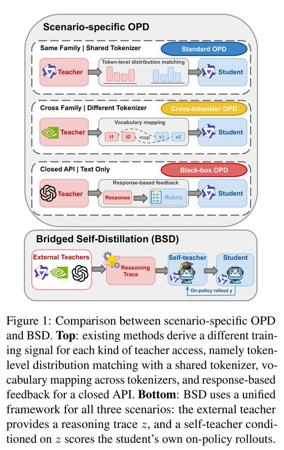
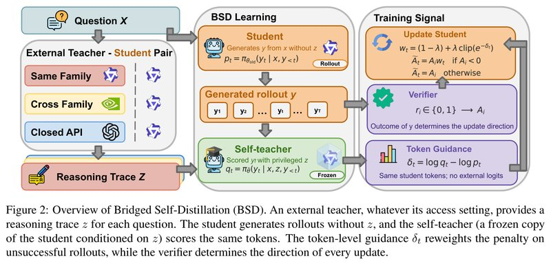
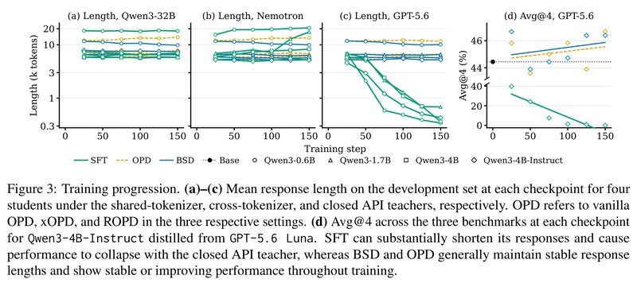

# Bridged Self-Distillation for On-Policy Learning

[中文](./BSD-Bridged-Self-Distillation.md) | English

- **Source**: [Bridged Self-Distillation for On-Policy Learning](https://arxiv.org/abs/2610.26397v2)
- **Paper**: [arXiv:2610.26397](https://arxiv.org/abs/2610.26397)
- **Official resources**: [TUMLegalTech/Bridged-Self-Distillation](https://github.com/TUMLegalTech/Bridged-Self-Distillation)
- **Published**: 2026-10-19
- **Scope**: A plain-language explainer based on arXiv v2 (revised 2026-10-27), not a full translation. The authors are Runsheng Chen, Yihong Liu, Raoyuan Zhao, Michael A. Hedderich, Hinrich Schütze and Matthias Grabmair (the first two are co-first authors, and Yihong Liu is the corresponding author), from the Technical University of Munich (TUM), LMU Munich (LMU) and the Munich Center for Machine Learning (MCML).

## In One Sentence

When a small model learns reasoning from a large one, the teacher may use the same tokenizer as the student (the rules that cut text into tokens), may use a different tokenizer, or may be reachable only through a closed API, and each kind of teacher used to get its own specialized method. This paper proposes BSD (Bridged Self-Distillation), which asks the teacher only for a written solution. During training, the solution is handed as a reference to a copy of the student itself, and this copy runs a per-token check on the student's wrong responses: places that look off once it has seen the solution get a bigger penalty, places that look fine get a smaller one, and whether the answer is right is still decided by the automatic verifier. The teacher supplies only text, and all the scoring happens on the student's own model and tokens, so the three kinds of teachers share one training pipeline.

Results: 4 Qwen3 students (0.6B to 4B) each learn from 3 kinds of teachers, 12 teacher-student pairs in all, evaluated on three competition-math test sets. BSD beats the untrained student in all 12 pairs, raising average accuracy by 1.2 to 4.7 percentage points (called "points" below), and in 11 of them it has the highest or tied-highest score among the distillation methods. SFT, which directly imitates the teacher's solutions, ends up worse than the untrained student in 8 pairs. Note that the paper's main table (Table 1) reports only one checkpoint per method (a model saved partway through training, picked with a small batch of dev problems). For 4 of these settings the paper plots the test score at every checkpoint. I read the values off the plot and compared averages over 6 checkpoints, and BSD's lead over the specialized methods shrinks from 0.6 to 3.6 points in the main table to about 0.3 to 1.3 points (this is my own view, see Section 7).

---

## 1. Key Terms

| Term | In plain words |
| --- | --- |
| token | The smallest unit of text a model processes, a word or part of a word |
| tokenizer | The rules that cut text into tokens; different models may cut text differently |
| distillation | Getting a small model (the student) to learn the abilities of a large model (the teacher) |
| SFT (supervised fine-tuning) | Directly making a model imitate given text, for example copying word for word the solution steps a teacher wrote |
| on-policy | The student learns on responses it generated itself, rather than imitating responses someone else already wrote |
| OPD (on-policy distillation) | The student writes its own responses, the teacher gives a probability for each token, and the student moves toward the teacher's probabilities |
| GRPO | A reinforcement learning method (the model answers on its own and adjusts according to its score): sample several responses to the same problem, reward the ones better than the group average and penalize the ones worse than it |
| response (rollout) | One complete answer a model generates for a problem |
| verifier | A program that automatically checks whether the final answer is right; this paper uses Math-Verify |
| privileged context | Information provided only during training and absent at test time; in this paper, the teacher's solution |
| self-teacher | A copy of the student that scores the student's responses while looking at the privileged context |
| token entropy | How unsure the student is about the next token at a given position; the higher it is, the less sure the student is |
| Avg@4 / Pass@4 | Each problem is sampled 4 times. Avg@4 is the average accuracy over the 4 samples, and Pass@4 is the fraction of problems solved correctly at least 1 time |
| LoRA | A lightweight fine-tuning method that trains only a small number of added parameters |
| checkpoint | Model parameters saved periodically during training; this paper saves one every 25 steps |

## 2. What Problem It Tackles

Getting a small model (the student) to learn reasoning from a large model (the teacher) usually takes one of two routes:

| Route | How it works | Benefit | Problem |
| --- | --- | --- | --- |
| SFT | Treat the solution steps the teacher wrote as the reference solution and have the student imitate them word for word | Works with any teacher | A small model often cannot learn the methods of a much stronger teacher, and forcing it tends to make the model worse |
| OPD | The student solves problems itself, the teacher gives a probability for every token in the student's response, and the student moves toward the teacher's probabilities | The student is corrected on its own responses, so it is usually more stable than SFT | The teacher must hand over a probability for every token, and those probabilities must line up one to one with the student's tokens |

The three kinds of teachers meet this OPD requirement to different degrees:

| Teacher type | Teacher used in this paper | Difficulty | Earlier specialized method |
| --- | --- | --- | --- |
| Same tokenizer | Qwen3-32B | Basically none; the probabilities can be compared directly | OPD |
| Different tokenizer | Nemotron-3-30B-A3B | The two sides cut text differently, so the probabilities do not line up and must be mapped first | xOPD |
| Closed API | GPT-5.6 Luna | Returns only text, gives no probabilities, and does not disclose its tokenizer | ROPD: have the teacher write a scoring rubric for each problem, and score the student's responses against the rubric during training |

So every change of teacher type has meant a change of method.



*Figure 1: The top half shows existing approaches, where the training signal differs with how the teacher is exposed: with the same tokenizer, the probability distribution at each token is aligned directly (Standard OPD in the figure); with a different tokenizer, the vocabulary is mapped first (Cross-tokenizer OPD); with a closed API, feedback can only be based on the teacher's response, such as a scoring rubric (Black-box OPD). The bottom half shows BSD: all three kinds of external teachers provide only a solution z, and a self-teacher conditioned on z scores the responses the student generated itself.*

The question the paper sets out to answer is: **can there be one on-policy learning method that only needs the teacher to be able to write out its solution steps, and that works with all three kinds of teachers?**

## 3. Core Method: The Student Grades Its Own Wrong Responses After Reading the Solution

An analogy (the analogy is mine, not the paper's): a student works a problem closed-book and gets it wrong. Plain reinforcement learning (GRPO) grades it by taking the same penalty off every token in the whole response, so the student does not learn where the mistake is. BSD brings in a second grader: the student itself, after reading the teacher's solution. Right or wrong is still decided by the verifier; this grader only decides how the penalty is spread over the tokens. It does not redo the problem. It just reads the student's response from start to finish and asks at each token, "Having seen the solution, would I still write this?" Places where it would not get a bigger penalty, and places that look fine get a smaller one.

The grader and the student are the same model and use the same tokens, so it does not matter which tokenizer the teacher uses, and the teacher's probabilities are not needed. The text of the teacher's solution connects the two sides. My reading is that this is what the Bridged in the name refers to; the paper does not explain the name.

**Four roles.**

| Role | Who | What it does |
| --- | --- | --- |
| External teacher | The large model the student is meant to learn from | Before training starts, writes a solution z for each training problem. Closed models do not disclose their thinking process, so their final response is used |
| Student | The small model being trained | Cannot see z; writes 8 responses of its own for each problem |
| Self-teacher | A frozen copy of the student whose parameters are synced every 10 updates | Takes the problem and z as input and assigns a probability to each token of the student's responses; writes no responses itself |
| Verifier | A program that automatically checks the final answer | Judges whether each response is right or wrong |

The self-teacher's prompt says: understand every step of the reference solution, but do not copy or paraphrase it; derive the same answer independently in your own words. The self-teacher reads the student's original token sequence and does not decode the text and re-tokenize it.

**The steps of one training update** (matching Figure 2):

1. The student writes 8 responses for each problem.
2. The verifier judges right or wrong. GRPO compares the 8 responses to the same problem with one another: those better than the average get a positive score and those worse than the average get a negative score, denoted A. When all 8 are right or all are wrong, A is 0 for all of them and the problem produces no training signal.
3. The student and the self-teacher each read these responses and assign a probability to every token: the student's is $`p_t`$ (without seeing the solution) and the self-teacher's is $`q_t`$ (while looking at the solution).
4. Compute each token's guidance signal $`\delta_t = \log q_t - \log p_t`$. $`\delta_t < 0`$ means that, after reading the solution, the self-teacher thinks this token is even less appropriate; $`\delta_t > 0`$ means it finds the token more reasonable.
5. Correct responses are rewarded as usual. In wrong responses, each token's penalty is adjusted by $`\delta_t`$: tokens with $`\delta_t < 0`$ are penalized more and tokens with $`\delta_t > 0`$ are penalized less.
6. Use the adjusted scores for one policy-gradient update, that is, adjust the model according to the scores: tokens with a positive score get written more often afterwards, and tokens with a negative score less often.

The key is step 5: **whether a response is rewarded or penalized is decided only by the verifier**. The reference solution can only change how heavy a penalty is; it cannot turn a penalty into a reward, and it does not touch correct responses. The adjustment is also small: at most ±10% at the start of training, then gradually lowered to 0 (see the numerical example in Section 4).



*Figure 2: On the left are the three kinds of external teachers (same family, cross-family, closed API); whichever kind it is, it only provides one solution z per problem. In the middle is the training pipeline: the student, without seeing z, generates a response y on its own and assigns each token a probability $`p_t`$; the self-teacher is a frozen copy of the student (marked Frozen in the figure) and, looking at z, assigns probabilities $`q_t`$ to the very same tokens of the same response. On the right is the training signal: the verifier gives a right-or-wrong result $`r_i`$, which is converted into $`A_i`$ and sets the direction of each update; the token-level guidance signal $`\delta_t`$ only adjusts how heavy the penalty is on wrong responses. The note in the bottom-right corner says that all scoring uses the student's own tokens, and the external teacher's probabilities are not needed.*

**Compared with the two closest approaches.**

- **RLSD**: BSD's reweighting formula comes from it. They differ in two ways: RLSD's self-teacher sees only the reference answer, while BSD's sees the external teacher's full solution; RLSD reweights both correct and wrong responses, while BSD reweights only the wrong ones.
- **OPSD**: also has the student's own copy score while looking at the solution, but uses no verifier and uses the scores directly as the reward.

## 4. The Same Thing in Formulas (Optional)

This section writes the method of Section 3 as formulas; skipping it does not hurt understanding. Notation: x is the problem, z is the external teacher's solution, y is one response from the student, $`y_t`$ is its t-th token, and $`y_{<t}`$ is the part before it.

**Score of a whole response (GRPO).** For G responses to the same problem, the verifier gives $`r^{(i)} \in \{0,1\}`$:

```math
A^{(i)} = \frac{r^{(i)} - \mathrm{mean}\left(\{r^{(j)}\}_{j=1}^{G}\right)}{\mathrm{std}\left(\{r^{(j)}\}_{j=1}^{G}\right)}
```

A is positive for correct responses and negative for wrong ones. Plain GRPO applies the same A to every token of the response.

**Two scorings and the guidance signal.** The student scores its own tokens with $`p_t = \pi_\theta(y_t \mid x, y_{<t})`$, and the self-teacher scores them with $`q_t = \pi_{\bar\theta}(y_t \mid x, z, y_{<t})`$:

```math
\delta_t = \mathrm{sg}\left[\log q_t - \log p_t\right]
```

sg means this number is used only as a weight, and no gradient flows back through it.

**Reweighting only the wrong responses.**

```math
w_t = (1-\lambda) + \lambda \cdot \mathrm{clip}_{[1-\epsilon,\ 1+\epsilon]}\left(e^{-\delta_t}\right), \qquad \tilde A_t = \begin{cases} A \cdot w_t & A < 0 \\ A & A \ge 0 \end{cases}
```

Here $`e^{-\delta_t} = p_t / q_t`$. When the self-teacher thinks a token is even less appropriate ($`q_t < p_t`$), the ratio is greater than 1 and the penalty gets heavier. Finally, $`\tilde A_t`$ replaces A in a GRPO-style clipped policy-gradient update, with no KL penalty.

**A numerical example.** The paper sets ε = 0.2, and λ decreases linearly from 0.5 to 0. So the clipped value falls in [0.8, 1.2], $`w_t`$ falls in [0.9, 1.1] at the very start of training, and $`w_t = 1`$ at the end of training. Suppose a wrong response has A = −1. At the very start of training:

| What the self-teacher thinks | $`\delta_t`$ | $`e^{-\delta_t}`$ | After clipping | $`w_t`$ | Score of this token |
| --- | --- | --- | --- | --- | --- |
| Clearly should not be written this way ($`q_t`$ is about 0.6× $`p_t`$) | −0.5 | 1.65 | 1.2 | 1.10 | −1.10 |
| No opinion | 0 | 1 | 1 | 1.00 | −1.00 |
| Seems slightly reasonable | +0.1 | 0.905 | 0.905 | 0.95 | −0.95 |
| Clearly reasonable | +1.0 | 0.37 | 0.8 | 0.90 | −0.90 |

In other words, **each token's penalty is adjusted by at most ±10%, and this range shrinks linearly to 0 over training**. All the reference solution does is make the penalty a bit heavier on some tokens of a wrong response and a bit lighter on others.

**Link to OPD** (Proposition 1 in Appendix C): when $`\delta_t`$ is small, BSD's gradient is approximately GRPO's gradient plus an OPD-style correction term that acts only on wrong responses (with the self-teacher in place of the teacher):

```math
g_{\text{BSD}} \approx g_{\text{GRPO}} + \lambda\, \mathbb{E}\Big[\sum_t \mathbb{1}\{A<0\}\, |A|\, \delta_t\, \nabla_\theta \log \pi_\theta(y_t \mid x, y_{<t})\Big]
```

The authors stress that this is only one interpretation: it guarantees neither that training is stable nor that the penalties land on the tokens that are actually wrong.

## 5. Experimental Results

### 5.1 How the experiments were set up

**Students**: Qwen3-0.6B, Qwen3-1.7B and Qwen3-4B (all with thinking mode on), plus Qwen3-4B-Instruct-2507. This last model does not normally write a thinking process, so the authors first fine-tuned it on 1,000 Nemotron solutions to teach it to write a `<think>` section, then used it as a student; below it is called Qwen3-4B-Instruct.

**Teachers** (solution lengths are in Section 4.2 of the paper, and the teachers' own scores in Appendix Table 8, Avg@4, %):

| Teacher | Type | Form of the solution | Teacher's own average score on the three test sets |
| --- | --- | --- | --- |
| Qwen3-32B | Same tokenizer | Full thinking process, about 4,000 tokens on average | 69.2 |
| Nemotron-3-30B-A3B | Different tokenizer | Full thinking process, about 4,000 tokens on average | 68.6 |
| GPT-5.6 Luna | Closed API | Returns no thinking process, only the final response, 247 tokens on average | 87.2 |

**Training data**: the math subset of OpenThoughts. Each teacher-student pair draws 2,400 problems, and the teacher writes one solution per problem, all generated in one go before training.

**Training**: every method trains a LoRA (rank 32) for 150 updates. Each BSD update uses 16 problems with 8 responses each; 16 × 150 = 2,400, exactly the size of the training set, so each problem is seen only once. The learning rate is 1e-6 for BSD and 5e-6 for SFT. Training runs on NVIDIA H100/H200; the cost is in Section 5.4.

**Testing**: three competition-math test sets, AIME 2024, AIME 2025 and HMMT 2025, with 30 problems each. Each problem is sampled 4 times, and the average accuracy over the 4 samples (Avg@4) is reported. Each method saves a checkpoint every 25 steps, picks the best one with a separate set of 128 OpenThoughts problems (the dev set), and then tests that one.

**Baselines**:

- SFT: imitation learning on the same teacher solutions.
- Same tokenizer: standard OPD.
- Different tokenizer: xOPD, which first aligns the two sets of tokens and then maps the teacher's probabilities onto the student's tokens.
- Closed API: ROPD, which has the teacher write a scoring rubric for each problem and then, during training, has the teacher score the student's responses against the rubric, so the API has to be called throughout training.

### 5.2 Main results: BSD beats the original model in all 12 pairs, while SFT mostly makes things worse

The main table (Table 1 in the paper) gives the average score over the three test sets (Avg@4, %). The "OPD-type" column is OPD, xOPD and ROPD for the three kinds of teachers respectively. Bold marks the highest score among the distillation methods in each group.

| Student | Teacher | Original | SFT | OPD-type | BSD |
| --- | --- | --- | --- | --- | --- |
| Qwen3-4B | Qwen3-32B | 59.2 | 60.6 | 60.3 | **63.9** |
| | Nemotron | 59.2 | **63.6** | 59.7 | **63.6** |
| | GPT-5.6 Luna | 59.2 | 57.2 | 59.7 | **61.9** |
| Qwen3-4B-Instruct | Qwen3-32B | 44.4 | 40.8 | 42.2 | **45.8** |
| | Nemotron | 44.4 | 38.1 | 45.0 | **45.6** |
| | GPT-5.6 Luna | 44.4 | 39.7 | 45.8 | **46.4** |
| Qwen3-1.7B | Qwen3-32B | 35.8 | 30.0 | **38.6** | **38.6** |
| | Nemotron | 35.8 | 37.5 | 35.0 | **39.2** |
| | GPT-5.6 Luna | 35.8 | 36.9 | 36.4 | **40.0** |
| Qwen3-0.6B | Qwen3-32B | 10.8 | 9.2 | 13.1 | **13.6** |
| | Nemotron | 10.8 | 7.5 | **14.2** | 12.8 |
| | GPT-5.6 Luna | 10.8 | 2.8 | 11.4 | **12.5** |

How to read this table:

- **BSD beats the original model everywhere**: it is above the original model in all 12 pairs, by 1.2 to 4.7 points.
- **Top score in 11 pairs**: first outright in 9 pairs and tied for first in 2 (Qwen3-4B + Nemotron ties with SFT, and Qwen3-1.7B + Qwen3-32B ties with OPD); 1 pair loses to xOPD (Qwen3-0.6B + Nemotron, 12.8 vs 14.2).
- **SFT mostly gets worse**: 8 of the 12 pairs are below the original model.
- **With the same tokenizer, BSD is no worse than OPD either**: the authors' explanation is that sharing a tokenizer does not mean two models have similar reasoning habits, while BSD's scores come from a copy of the student itself, so they fit the student better.
- **xOPD solves "can it be used at all", but its gains are unstable**: it adds 3.4 points for 0.6B, only 0.5 and 0.6 points for 4B and 4B-Instruct, and actually loses 0.8 points for 1.7B.

### 5.3 SFT gets pulled along by the teacher's response length, and even collapses

- **Length gets pulled along.** GPT-5.6 Luna's responses are only 247 tokens on average; SFT imitates them, and the responses of all 4 students keep getting shorter. With Nemotron as the teacher, SFT makes responses longer in most cases, most visibly for Qwen3-1.7B. BSD and the OPD-type methods keep response length basically unchanged in all 12 pairs.
- **Scores collapse.** When Qwen3-4B-Instruct learns from GPT-5.6 Luna, SFT is already below the original model at step 25, and its accuracy is close to 0 by step 150. In Appendix Figure 8b, where Qwen3-4B learns from GPT-5.6 Luna, SFT still scores about 61 at step 50 and under 1 point at step 150 (read off the plot). BSD and ROPD stay stable throughout.
- **The main table does not show the collapse.** The reason is that each method reports the checkpoint picked on the dev set, and SFT tends to get worse the longer it trains, so in 10 of the 12 pairs the pick is the earliest one, step 25.
- **Forgetting abilities outside math.** Appendix I tests this with the Qwen3-4B student. On 200 MMLU-Pro questions outside math, physics, chemistry and engineering, SFT on GPT-5.6 Luna drops the score from 62.1 at step 25 to 54.1 at step 150, 9.4 points below the original model's 63.5. On the LEXam law questions, the same setting drops to 40.5 at step 100 (original 45.9). At every checkpoint, BSD and the OPD-type methods are at most 1.1 points below the original on MMLU-Pro and at most 3.5 points below on LEXam, while the original model's standard deviation on LEXam across 4 sampling random seeds is already 4.9 points.



*Figure 3: (a) to (c) show, for the three teachers (Qwen3-32B with the same tokenizer, Nemotron with a different tokenizer, and the closed GPT-5.6 Luna), the average response length of the 4 students on the dev set at each checkpoint. The vertical axis is on a log scale, in thousands of tokens; the solid green line is SFT, the dashed orange line is the OPD-type method (OPD, xOPD and ROPD in the three settings respectively), the solid blue line is BSD, and marker shapes tell the students apart. In (c), SFT's responses shrink from about 4.5k to 7k tokens at step 25 to about 0.3k to 0.7k at step 150 (read off the plot). (d) shows the Avg@4 on the three test sets at each checkpoint when Qwen3-4B-Instruct learns from GPT-5.6 Luna; the vertical axis is broken in the middle, the upper part zooms in on the area around 44 to 46 points, and the black dot is the original model's 44.4. SFT falls from about 40 to near 0; BSD and the OPD-type methods keep response length broadly stable, and their scores stay stable or rise slightly throughout training.*

The authors' conclusion: the same teacher solution causes problems when used as an imitation target (SFT), and is much more stable when used as the self-teacher's reference (BSD).

### 5.4 Training cost: a bit more than OPD, less than xOPD and ROPD

Appendix Table 6 of the paper (Qwen3-4B student trained for 150 updates, H200 GPU hours):

| Teacher | Method | GPU hours |
| --- | --- | --- |
| Qwen3-32B | SFT | 0.8 |
| | OPD | 29.4 |
| | BSD | 31.4 |
| Nemotron | xOPD | 70.8 |
| | BSD | 48.7 |
| GPT-5.6 Luna | ROPD | 83.0 |
| | BSD | 33.3 |

These numbers exclude the cost of generating the teacher solutions before training, and the cost of ROPD's API calls. OPD and xOPD need an extra GPU to hold the teacher during training, and that part is included. Each BSD update adds one self-teacher forward pass, which takes 7 to 18 seconds, less than 10% of the time of a single update.

### 5.5 Ablations: the more complete the reference the better, the verifier is essential, and correct responses should be left alone

Setup: Qwen3-4B student, Qwen3-32B teacher, with the same training problems and optimization settings throughout. From Figure 4c and Appendix Table 11 of the paper (average over the three test sets, Avg@4, %):

| Variant | What the self-teacher sees | Uses the verifier | Where the guidance signal is applied | Average score |
| --- | --- | --- | --- | --- |
| Original model (no training) | None | None | None | 59.2 |
| OPSD | Full solution | No | All responses | 59.7 |
| GRPO | No self-teacher | Yes | None | 60.6 |
| RLSD | Only the reference answer | Yes | Wrong responses | 61.7 |
| BSD (w/ succ.) | Full solution | Yes | All responses | 61.4 |
| BSD-hint | Three-sentence hint + answer | Yes | Wrong responses | 61.7 |
| BSD-guide | Outline of at most 8 steps (no calculations) + answer | Yes | Wrong responses | 62.5 |
| BSD-trace (that is, BSD) | Full solution | Yes | Wrong responses | **63.9** |

The RLSD here is a version adapted to BSD: apart from the self-teacher seeing only the reference answer, every setting is the same as in BSD, so it also reweights only the wrong responses.

How to read this table:

- **A reference beats no reference**: GRPO scores 60.6, RLSD with only the answer 61.7, and BSD with the full solution 63.9. The three have nearly overlapping accuracy curves on the training problems; the difference shows up on the test sets. The authors think the reference information helps the verifier's feedback transfer better to new problems.
- **The more complete the reference, the better**: three-sentence hint 61.7, step-by-step outline 62.5, full solution 63.9.
- **The verifier is essential**: OPSD, which uses no verifier, has a test score of 63.3 at step 25 that drops to 55.8 by step 150, and its response length shrinks from 16.8k tokens to 12.5k (the original model is at 17.5k). The lengths of the other variants all stay within 16.5k to 17.7k.
- **Leave correct responses alone**: applying the reweighting to correct responses as well lowers the score from 63.9 to 61.4. The authors' reasoning is that a correct response is a solution the student found on its own without the reference, so rewarding it normally as GRPO does is enough, and there is no need to pull it toward the self-teacher.

### 5.6 The guidance signal concentrates where the student is unsure

This section and the three after it look at what the guidance signal $`\delta_t`$ actually helps with. Before training, the authors took one measurement: each student wrote 6 responses to each of 24 hard problems, each response was scored with one correct-answer solution from each of the three teachers, only the wrong responses were counted, and the results were averaged over the three teachers. Table 2 of the paper (the last column is how many points BSD beats the original model by on average across the three teachers, computed from the main table):

| Student | Guidance signal strength | Correlation with token entropy | BSD's average gain (points) |
| --- | --- | --- | --- |
| Qwen3-0.6B | 0.072 | 0.87 | +2.2 |
| Qwen3-1.7B | 0.115 | 0.90 | +3.5 |
| Qwen3-4B | 0.114 | 0.90 | +3.9 |
| Qwen3-4B-Instruct | 0.037 | 0.83 | +1.5 |

How to read this table:

- **Guidance signal strength** is the absolute value of the mean of $`\delta_t`$ over all tokens of the wrong responses. This mean is negative for every teacher-student pair: on wrong responses, the self-teacher that has seen the solution gives the student's tokens lower probabilities on average.
- **High token entropy** means the student is unsure what to write as the next token at that position. The correlation coefficients are 0.83 to 0.90, which shows that the signal is strongest exactly where the student is least sure.
- **The stronger the signal, the bigger the gain**: Qwen3-4B-Instruct has the weakest signal and also the smallest gain; 1.7B and 4B have strong signals and large gains. But there are only 4 students, and the authors also admit this is only a correlation.

### 5.7 A full solution can point to the step that went wrong; the answer alone cannot

Figure 7 in Appendix D gives an example. On a problem asking for an area, one of Qwen3-4B's wrong responses before training computed the interval length $`1/5^m - 1/5^{m+1}`$ as $`1/5^{m+1}`$, while the correct result is $`4/5^{m+1}`$.

- When the self-teacher looks at the full solution (which contains the correct derivation), it gives a strong negative signal on the wrong numerator and on the tokens that carry this wrong result into the next step.
- When the self-teacher sees only the final answer, the signal on these same tokens is close to 0, because the answer alone does not show which step went wrong.

This example agrees with the ablation results: the full solution (63.9) beats the answer alone (61.7). Appendix Table 11 also shows that the guidance signal strength measured before training is 0.055 with the answer alone and 0.127 with the full solution.

### 5.8 Case study: learning to go back and check

Figure 5 of the paper is an AIME 2024 problem: N is the greatest four-digit number such that changing any one of its digits to 1 gives a number divisible by 7; Q and R are the quotient and remainder when N is divided by 1000; find Q + R. The answer is 699.

The original Qwen3-4B found the right N = 5694, but wrote the quotient and remainder as Q = 569 and R = 4. The authors took the first 90% of this response (which already contains the mistake) as a shared prefix and had both models continue from it:

- The original model continues without carefully checking this step and ends up with Q = 569 and R = 694, getting 1263, which is wrong.
- The student trained with BSD (teacher Qwen3-32B) writes "Wait, let me check N divided by 1000 again", finds that 5694 = 5 × 1000 + 694, corrects this to Q = 5 and R = 694, and gets 699, which is right.
- Continuing 8 times from this prefix, the BSD student gets it right 6 times and the original model 4 times.

### 5.9 Changes in wording: the authors themselves say this is not evidence

Appendix E compares, on 26 problems, the original model's wrong responses (45 of them) with the BSD student's correct responses (69 of them). The wrong responses contain more negating and hesitant phrases such as "but this is", "not sure" and "try to", while the correct responses contain more checking phrases such as "which matches", "indeed" and "verify"; the correct responses are also shorter, 19,057 vs 24,279 tokens on average. The authors state clearly that this comparison changes both the model and correctness at once, so the differences cannot be attributed to BSD; it is only descriptive and cannot serve as independent evidence that BSD teaches the model to correct itself.

## 6. Limitations the Authors Acknowledge

- **Student size, model family and tasks are all limited.** Because of compute limits, the paper only tests students of 4B and below, only uses the Qwen3 family, and only tests English competition math. Whether it works as well with larger students, other model families or other domains is still unknown.
- **It cannot do without a verifier.** BSD relies on the verifier to decide the direction of reward and penalty, so it only applies to tasks whose answers can be checked automatically, and cannot be used for tasks such as writing or open-ended question answering. Whether "does the student's conclusion agree with the teacher's" could replace the verifier is left by the authors to future work.
- **Why the guidance signal helps rests only on correlational evidence.** The link between the guidance signal and the gains is only a correlation across 4 students. The paper shows where the signal concentrates, but does not show which tokens it actually helps or why it is useful.

## 7. Points Worth Noticing While Reading

Below are points I noticed while reading the paper that it does not discuss at length, offered for reference.

### How strong the evidence is

- **The size of the lead in the main table depends heavily on which checkpoint is picked.** In the main table each method reports only the one checkpoint picked on the dev set. Figure 3d in the main text and Figure 8 in the appendix plot the test score at every checkpoint for 4 settings. I read the values off the plots (they match the corresponding points in the main table to within 0.3 points) and compared averages over 6 checkpoints. BSD leads on average in all 4 settings, so the direction agrees, but the margins are smaller than in the main table (Avg@4, %; the last column is read off the plots):

| Student + teacher | Main table: BSD's lead over the specialized method | Average over 6 checkpoints: BSD's lead over the specialized method |
| --- | --- | --- |
| Qwen3-4B + Qwen3-32B | 3.6 (63.9 vs 60.3) | about 0.4 (60.9 vs 60.6) |
| Qwen3-4B + GPT-5.6 Luna | 2.2 (61.9 vs 59.7) | about 1.3 (62.2 vs 60.9) |
| Qwen3-4B-Instruct + Qwen3-32B | 3.6 (45.8 vs 42.2) | about 1.2 (45.2 vs 44.0) |
| Qwen3-4B-Instruct + GPT-5.6 Luna | 0.6 (46.4 vs 45.8) | about 0.3 (45.4 vs 45.2) |

- **A gap of one or two points cannot be told apart from noise.** For reference: BSD's own score can differ by 5 points between two adjacent checkpoints (Qwen3-4B-Instruct + Qwen3-32B, 43.3 at step 100 and 48.3 at step 125); the three test sets have only 90 problems in total, and in the three-set average, turning all 4 samples of one problem from wrong to right adds only 1.1 points. I did not see any results from repeated training runs with different random seeds in the paper, so there is no way to judge how much of a one- or two-point gap is noise. In the ablation, BSD beats GRPO by 3.3 points, which is likewise a comparison of a single training run at a single checkpoint, and BSD's change to GRPO is itself very small (Section 4).
- **The conclusion about SFT is not affected.** SFT's average score over checkpoints on Qwen3-4B + GPT-5.6 Luna is only about 26.5, far below the original's 59.2.
- **The same gains do not show up on Pass@4.** Appendix Table 14 reports Pass@4 for the same checkpoints, that is, the fraction of problems solved correctly in at least 1 of the 4 samples. BSD is below the original model in 3 of the 12 pairs and level in 1: Qwen3-4B solves 1 fewer problem when learning from Qwen3-32B and 3 fewer when learning from GPT-5.6 Luna; Qwen3-0.6B solves 1 fewer when learning from Nemotron. So for a stronger student such as Qwen3-4B, the gain comes mainly from "problems it could sometimes solve are now solved more often", not from solving problems it could not solve before. This is not unique to BSD: on this student, SFT and the OPD-type methods also beat the original model on Pass@4 only in the Nemotron pair. The smaller Qwen3-1.7B, by contrast, improves on Pass@4 in all three pairs (+2.2 to +7.8). The main text does not discuss the Pass@4 results.
- **Qwen3-4B-Instruct's gains need to be seen from another angle.** To make it write a thinking process, the authors first fine-tuned it on 1,000 Nemotron solutions, and its score dropped from 46.4 to 44.4 (Appendix Table 9). BSD's +1.2 to 2.0 points are counted from 44.4, and its best result, 46.4, just gets back to the level before fine-tuning. That said, the model before fine-tuning wrote no thinking process and answered directly, so the two evaluations were not done in exactly the same way.

### Where it applies

- **"The more complete the solution, the better" has been verified on only one teacher-student pair.** The ablation was only run on Qwen3-4B + Qwen3-32B. Seen from another angle, GPT-5.6 Luna gives only a 247-token final response, yet it is the teacher with which BSD works best for two students, Qwen3-4B-Instruct and Qwen3-1.7B. It is also much stronger itself (87.2 points on average, against about 69 for the other two teachers), so the effects of "solution length" and "teacher strength" cannot be separated here.

## 8. If You Want to Run It Yourself

- **When it fits**: you want to learn from a closed API model or from a model with a different tokenizer, and the task has an automatic verifier. The paper only tests math problems; coding problems with test cases also meet this condition in principle, but that has not been verified. The teacher only needs to be able to write out a solution in text.
- **What you need**: one teacher solution per training problem (generated in one go before training); a verifier; a GRPO training framework (the authors use verl and vLLM; the code is at the link at the top of this note). The self-teacher's input contains the problem and the solution, and the authors cap its length at 12,288 tokens.
- **What the authors released**: only the code is open source; model weights and data are not released, and neither are the teacher solutions. For the closed teacher's responses, the authors state that they are used only for non-commercial research.
- **Compared with SFT**: it uses the same teacher solutions but is much more stable; it does not get pulled along by the teacher's response length, and it does not forget abilities outside math. The price is the training cost of reinforcement learning: on Qwen3-4B, BSD used 31.4 GPU hours, while SFT used only 0.8.
- **Compared with the specialized methods**: the three kinds of teachers share one codebase, and on Qwen3-4B it also takes fewer GPU hours in the two cases of a different tokenizer and a closed API. Scores are generally a little better, but the lead is not large (see Section 7).
- **Key settings used in the paper**: λ decreases linearly from 0.5 to 0, ε = 0.2, the self-teacher is synced every 10 updates, only wrong responses are reweighted, no KL penalty, LoRA rank 32, learning rate 1e-6, 16 problems × 8 responses per update, 150 updates in total.

## 9. Relation to Related Work

Section 7 of the paper places BSD within two lines of work. One is knowledge distillation and on-policy distillation, including the various variants for different tokenizers and black-box teachers, which usually need a specialized supervision signal for each case. The other is privileged information and self-distillation, where the model itself acts as the teacher while looking at an answer, a solution or feedback. BSD follows the approach of the second line, except that its privileged context comes from an external teacher's solution. Several of the papers it discusses:

| Paper | Relation to BSD | Link |
| --- | --- | --- |
| On-Policy Distillation of Language Models (Agarwal et al., ICLR 2024) | A representative work on on-policy distillation | [arXiv:2306.13649](https://arxiv.org/abs/2306.13649) |
| On-Policy Distillation (Kevin Lu, Thinking Machines Lab, 2025) | The same-tokenizer OPD baseline is implemented following it | [Blog](https://thinkingmachines.ai/blog/on-policy-distillation/) |
| DeepSeekMath (Shao et al., 2024) | Proposes GRPO, the reinforcement learning base of BSD | [arXiv:2402.03300](https://arxiv.org/abs/2402.03300) |
| Self-Distilled Reasoner, i.e. OPSD (Zhao et al., 2026) | The model itself acts as the teacher while looking at the answer; the OPSD baseline in BSD's ablation | [arXiv:2601.18734](https://arxiv.org/abs/2601.18734) |
| Reinforcement Learning via Self-Distillation, i.e. SDPO (Hübotter et al., 2026) | An on-policy self-distillation work cited alongside OPSD | [arXiv:2601.20802](https://arxiv.org/abs/2601.20802) |
| Self-Distilled RLVR, i.e. RLSD (Yang et al., 2026) | BSD's reweighting formula comes from it | [arXiv:2604.03128](https://arxiv.org/abs/2604.03128) |
| Rethinking On-Policy Distillation (Li et al., 2026) | Points out that compatible teacher and student reasoning habits matter a lot for OPD | [arXiv:2604.13016](https://arxiv.org/abs/2604.13016) |
| Breaking the Tokenizer Barrier, i.e. xOPD (Niu et al., 2026) | The baseline for the different-tokenizer case | [arXiv:2606.09456](https://arxiv.org/abs/2606.09456) |
| Rubric-Based On-Policy Distillation, i.e. ROPD (Fang et al., 2026) | The baseline for the closed-API case | [arXiv:2605.07396](https://arxiv.org/abs/2605.07396) |

## 10. Summary

The idea of BSD is: **the teacher hands over only a written solution, and a copy of the student that has read the solution does the scoring on the student's own tokens.** This way the same on-policy training pipeline works whether or not the teacher and the student share a tokenizer, and whether or not the teacher can only be called through an API. The direction of reward and penalty is still decided by the verifier; the solution only redistributes the penalty on wrong responses among the tokens, by at most ±10%, and this range drops to 0 over training.

In the 12 pairs formed by 4 Qwen3 students and 3 kinds of teachers, BSD is 1.2 to 4.7 points above the original model every time, and in 11 pairs it has the highest score among the distillation methods (ties included). Using the same teacher solutions for SFT makes 8 pairs worse instead; SFT also gets pulled along by the teacher's short responses, in the worst case its score collapses to near 0, and abilities outside math drop as well. The ablations show that the verifier is essential, that the more complete the reference solution the better, and that correct responses should be left alone. The cost is the training cost of reinforcement learning: on Qwen3-4B, BSD uses 31.4 GPU hours against only 0.8 for SFT, though it is cheaper than both xOPD and ROPD. The limitations are that it was only tested on Qwen3 students of 4B and below and on English competition math, and that it cannot do without a verifier. Also, averaged over checkpoints, its lead over the specialized methods is only about 0.3 to 1.3 points, and since the paper has no results from repeated training runs, it is hard to say how much of a one- or two-point gap is noise (these two observations are my own view).

---

## Where Things Are in the Paper

| In this note | In the paper |
| --- | --- |
| The three kinds of teachers and the problems with existing methods | Section 1, Figure 1 |
| Background on GRPO, privileged self-distillation and RLSD | Section 2, Eqs. (1)(2) |
| How BSD works (external teacher, self-teacher, how it learns) | Section 3, Eqs. (3) to (5), Figure 2 |
| Prompts for the student, the self-teacher and the ablation variants; the self-teacher reads the original tokens | Appendix B |
| Link to OPD (Proposition 1) | Appendix C.1 and C.2, Eqs. (6) to (10) |
| Why correct responses are not reweighted | Section 6.1, Appendix C.3 |
| Student, teacher, training and test settings | Section 4, Appendix A, Appendix Tables 3, 4, 5 and 7 |
| The teachers' own scores | Appendix A, Appendix Table 8 |
| Preliminary fine-tuning of Qwen3-4B-Instruct | Section 4.1, Appendix A, Appendix Table 9 |
| Main results | Section 5.1, Table 1 |
| Response length and training curves | Section 5.2, Figure 3, Appendix H Figure 8 |
| The picked checkpoints | Appendix F, Appendix Table 13 |
| Abilities outside math | Appendix I, Appendix Figures 9 and 10, Appendix Table 15 |
| Training cost | Appendix A, Appendix Table 6 |
| Ablations | Section 6.1, Figure 4, Appendix D, Appendix Tables 10 and 11, Appendix Figure 6 |
| Measuring the guidance signal | Section 6.2, Table 2, Appendix A |
| Signal comparison between the full solution and the answer alone | Appendix D, Appendix Figure 7 |
| The going-back-to-check case study | Section 6.2, Figure 5 |
| Changes in wording | Appendix E, Appendix Table 12 |
| Pass@4 | Appendix G, Appendix Table 14 |
| Limitations | The paper's Limitations section |
| Release scope, use of the closed teacher's responses | The paper's Ethics Statement section |
| Related work | Section 7 |
