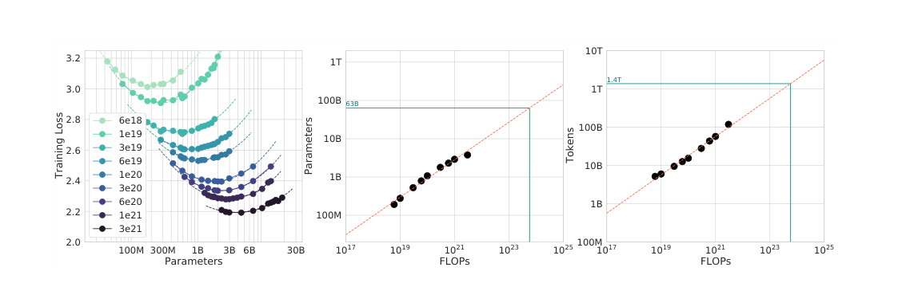

# Chinchilla：同样算力如何分配模型与数据

中文 | [English](./Chinchilla-Compute-Optimal-Training_en.md)

- **原文链接：** [论文原文](https://arxiv.org/abs/2203.15556v1)
- **发布日期：2022-03-29**

- **原论文：Training Compute-Optimal Large Language Models。**

**作者：Jordan Hoffmann、Sebastian Borgeaud、Arthur Mensch 等；2022 年。**

- **精读版本：arXiv:2203.15556v1，版本记录为 2022-03-29；本文整理于 2026-11-09。**
- **原文：[摘要与版本记录](https://arxiv.org/abs/2203.15556v1)；[完整 PDF](https://arxiv.org/pdf/2203.15556v1)。**
- **阅读范围：完整正文，以及附录 A–G 中数据、学习率调度、拟合、算力核算与优化器对照；关键结果直接对照 PDF 图表。本文为中文解读，不是训练复现。**

## 1. 一句话结论

**在固定预训练计算预算下，模型不是越大越好：当时不少模型参数太多、训练 token 太少。作者据此训练了参数只有 Gopher 四分之一、但读了更多数据的 Chinchilla，取得更好的整体表现。**

“参数更多”与“在同一预算下更好”是两回事。这就是整篇论文最想纠正的直觉。

**来源：第 1、3–5 节，表 1–3。文中的“当时”指论文研究的时代，不是对 2026 年模型的整体评价。**

## 2. 为什么要重新研究这个问题？

Kaplan 2020 的工作给出了有影响力的结论：增加计算预算时，模型参数应该增长得比训练数据快。于是，一个自然方向是不断做更大的模型。

Chinchilla 作者回头问： **如果总预算没变，把更多资源花在参数上，是不是挤掉了必要的训练量？**

教学上可以把计算预算想成一个矩形的面积：一条边是模型大小，另一条边是训练 token 数。面积固定时，一条边太长，另一条边就必须变短；关键是哪个形状最有利于降低损失。

这个比喻对应的近似为：

```math
C\approx6ND.
```

$`N`$ 是参数量，$`D`$ 是训练期间见到的 token 数，$`C`$ 是训练 FLOPs。这里的 $`D`$ 更接近“实际训练量”，不能直接等同于有多少条独立问题。

**来源：第 1 节公式 1、第 3.3 节和附录 F；矩形是教学类比。**

## 3. “计算最优”究竟优化什么？

论文的目标可以写成：

```math
(N_{\mathrm{opt}},D_{\mathrm{opt}})
=\arg\min_{N,D:\ \mathrm{FLOPs}(N,D)=C}L(N,D).
```

也就是： **在不超出这笔预训练计算预算的前提下，选择模型大小与训练量，让最终语言建模损失尽可能低。**

它没有直接优化以下目标：

- 一台特定 GPU 上的最快训练时间。
- 模型上线后全年训练加推理的总费用。
- 指令遵循、数学竞赛分数或安全性中的某一个指标。
- 只允许一个固定模型尺寸时的最佳训练长度。

所以，“Chinchilla-optimal”必须带着“对哪种预算与目标最优”来理解。

**来源：第 1 节问题定义及第 4–5 节。生命周期成本与固定模型场景的区别，是依据目标函数作出的解读。**

## 4. 实验不是只训练 Chinchilla 一次

作者先进行了超过 400 次模型训练，模型大小从约 7000 万到超过 160 亿参数，训练量大致覆盖 50 亿到 5000 亿 token，再用三种不同的方法估计最优规模。

主要缩放实验使用 MassiveText；作者还在 C4 和 GitHub 代码子集上做了补充分析。最后，才用更大的 70B Chinchilla 来检验预测方向。

要区分两层证据：

1. **小中规模扫参和拟合：** 用来寻找规律。
1. **大规模 Chinchilla 与 Gopher 对照：** 用来检验规律能否指导更大的模型。

不是“400 个模型都训练到了 70B”，也不是“只对比两个大模型就推导出一切”。

**来源：摘要，第 1、3 节，附录 C；正文不同段落对 token 范围使用了 400B 以上或约 500B 的概括，上面保留其数量级而不假装边界完全一致。**

## 5. 作者用三种方法交叉检查，分别怎么理解？

### 5.1 方法一：把很多训练曲线叠起来，找最低的一层

固定一组模型大小，对每个大小安排不同训练长度。这样，同一个模型不会只对应一个“训练到一半”的检查点，而会有针对不同训练时长设计的训练运行。

然后，在每一个计算预算上，看哪条曲线的损失最低。把这些最低点连接起来，就是“这一预算下最划算的模型与训练量”。

论文把这称为训练曲线的包络。可以将其理解为： **在一摞价格—效果曲线里，始终选相同价格下效果最好的一条。**

**来源：第 3.1 节、图 2、附录 D.1。**

### 5.2 方法二：固定预算，直接比较不同大小的模型

IsoFLOP 的意思是“相同浮点运算量”。同一预算下，小模型可以训练更多 token，大模型则只能训练较少 token。



***图源：图 3，PDF 第 6 页上部裁剪。左侧每条曲线固定一个计算预算；中、右两图将这些谷底的位置外推到更高预算。***

最关键的是左图的 U 形：

- 最左边模型太小，容量不足，读很多数据也难以弥补。
- 最右边模型太大，在当前预算下训练量不足。
- 中间谷底是更好的折中。

作者用了 9 档训练 FLOPs，范围从 $`6\times10^{18}`$ 到 $`3\times10^{21}`$。这些是缩放实验的预算，不是 70B 最终训练的预算。

**来源：第 3.2 节及图 3。**

### 5.3 方法三：拟合一个同时考虑模型和训练量的函数

论文提出：

```math
\widehat L(N,D)=E+\frac{A}{N^\alpha}+\frac{B}{D^\beta}.
```

三项可以直观理解为：

| 项 | 直觉 | 能不能直接当作独立测量？ |
| --- | --- | --- |
| $`E`$ | 即使模型与训练都很充分，数据本身仍有的不确定性 | 不能；这里是拟合项及理论解释 |
| $`A/N^\alpha`$ | 模型容量有限带来的差距 | 是函数模型中的分解，不是单独测出的物理量 |
| $`B/D^\beta`$ | 训练量有限、统计估计与优化不充分带来的差距 | 不能简单改名为“所有重复数据效应” |

固定模型后，不管再喂多少数据，第二项不会消失；固定训练量后，一味扩大参数，第三项也不会消失。

作者用所有相应实验的最终损失拟合系数，并使用对异常点较稳健的 Huber 损失，而不是强迫每个实验点都精确落在同一条曲线上。

**来源：第 3.3 节公式 2–4、图 4，附录 D.2。该分解有启发式理论动机，但幂律形式与系数仍需经验拟合。**

## 6. 为什么会得到“模型和数据大致一起翻倍”？

把固定预算约束代入：

```math
D=\frac{C}{6N},
```

则损失成为只关于 $`N`$ 的函数：

```math
\widehat L(N)=E+AN^{-\alpha}+B\left(\frac{6N}{C}\right)^\beta.
```

模型变大时，第一项误差下降，但因为预算固定，能训练的 token 更少，第二项误差上升。对这个函数求最小值，会得到：

```math
N_{\mathrm{opt}}\propto C^{\beta/(\alpha+\beta)},
\qquad
D_{\mathrm{opt}}\propto C^{\alpha/(\alpha+\beta)}.
```

读不懂导数也没关系： **这两个指数表达的就是，新增预算分别有多少用来增加模型、多少用来增加训练量。**

作者的三种方法给出的指数如下：

| 方法 | 参数随预算增长的指数 | token 随预算增长的指数 |
| --- | --- | --- |
| 方法一：训练曲线包络 | 0.50 | 0.50 |
| 方法二：IsoFLOP 谷底 | 0.49 | 0.51 |
| 方法三：参数化损失函数 | 0.46 | 0.54 |
| Kaplan 2020 对照 | 0.73 | 0.27 |

**来源：原论文表 2。只列中心估计，未抄录该表方法三中与舍入中心值不完全协调的区间数值；这些小数不是永恒常数。**

所以论文的概括是“接近等比例扩展”，而不是三个方法都精确等于 $`0.5`$。

**教学示例：如果预算增加四倍，按平方根规则，模型和训练 token 各增加约两倍；预算增加十倍，则各增加约** $`\sqrt{10}\approx3.16`$ **倍。模型和 token 同时翻倍，计算不是翻两倍，而是约四倍。**

## 7. 和 Kaplan 不同，关键不只是多做了几个实验

### 7.1 不能把长跑中途成绩当成短跑终点成绩

Kaplan 的许多训练使用固定长度的学习率调度。Chinchilla 作者指出：如果想评价只训练较短 token 量的方案，就应该让学习率调度也在相应终点附近完成下降。

如果拿一个很长训练计划的中途检查点，代替一个专门为短训练设计的终点，短训练方案可能会显得不公平地差。因为它还没有经历计划中的低学习率收尾。

**教学类比：一个准备跑马拉松的人跑到十公里时，不一定代表一个专门安排十公里比赛的人在终点的最好成绩。**

### 7.2 更大的拟合范围会暴露曲率

Chinchilla 的缩放实验包含更多较大的模型，作者观察到预算—最优模型关系在对数空间里有轻微弯曲。用很小模型区间拟合出的直线，未必能原封不动延伸到更大规模。

两点合在一起，说明“经验规律如何得到”会影响“规律预测什么”。但这不等于 Kaplan 的所有工作被推翻：平滑损失趋势、资源瓶颈和计算前沿这些思想仍然是基础。

**来源：第 2 节，附录 B、D.1、D.4、E。学习率调度是作者提出并实验支持的解释之一，不应声称所有指数差异都只由单一原因造成。**

## 8. 最终训练出的 Chinchilla，究竟证明了多少？

| 模型 | 参数量 | 训练 token |
| --- | --- | --- |
| Gopher | 280B | 300B |
| Chinchilla | 70B | 1.4T |

其中 B 是十亿、T 是万亿。作者将两者作为近似相同训练计算预算下的对照。

**来源：表 1、第 4 节。论文常概括为“模型四分之一、数据约四倍”；按表中 1.4T 与 300B 的数字直接相除，实际约为 4.67 倍，应避免把概括性的四倍当成精确等式。**

### 8.1 几个最有代表性的结果

| 指标 | Gopher | Chinchilla | 怎么理解 |
| --- | --- | --- | --- |
| MMLU，5-shot 平均准确率 | 60.0% | 67.6% | 增加 7.6 个百分点，不是相对只提高 7.6% |
| BIG-bench，所测任务平均准确率 | 54.4% | 65.1% | 提高 10.7 个百分点 |
| LAMBADA，zero-shot | 74.5% | 77.4% | 较小模型的平均能力并不因此更弱 |
| WikiText-103 困惑度 | 7.75 | 7.16 | 这里越低越好，不是准确率 |

**来源：第 4.2.1–4.2.4 节、表 6–7；MMLU 正文与表 6 为 67.6%，摘要写 67.5%。这里以明确实验表和对应正文的 67.6% 为准，并保留这一原文差异。**

不是每个任务都变好：MMLU 的 57 个子任务中，51 个更好、2 个不变、4 个更差；常识评测的 PIQA 表中两者相同。论文的整体成功不应写成“所有指标全面碾压”。

**来源：图 6、表 8。**

### 8.2 这是强证据，但不是完全纯净的两变量消融

最终 Chinchilla 与 Gopher 除了参数量和 token 量，还存在以下差异：

- AdamW 与 Adam 的优化器差异。
- 数据混合比例略有调整。
- tokenizer 的规范化处理不同。
- 优化器状态中保留更高精度权重的实现差异。

作者做了补充实验分析其中一些因素。因此，“更合理的规模分配确实有用”有很强支持；但不能把全部下游收益精确归因于参数和 token 这两个变量。

**来源：第 4.1 节、附录 A、G。**

## 9. “每个参数约 20 个 token”意味着什么？

Chinchilla 的 70B 与 1.4T 相除，得到：

```math
\frac{D}{N}=\frac{1.4\times10^{12}}{70\times10^9}=20.
```

表 3 的若干预算预测也在这一量级。因此它常被概括成一个便于记忆的经验规则。

但它 **不是** ：

- 任何模型的训练数据上限。
- 超过 20 个 token/参数就不能进步。
- 适用于所有训练目标的数据配比。

当模型部署尺寸被固定，或者推理成本比训练成本更重要时，延长小模型的训练可能具有不同的成本收益。那是在解另一个优化问题，不能用“偏离 Chinchilla 比例”直接判断做法错误。

**来源：第 3.4、4–5 节，表 3；后半段是根据目标函数适用范围所作的解读，不是本论文做过的生命周期最优实验。**

## 10. 精读时还要看到的四个边界

### 10.1 不要把推导出的最优点说成全部实测

三种方法在 Gopher 预算下预测的合适模型约为 40B–70B，作者最终只训练了其中的 70B。它证明预测方向有效，不证明 70B 是这个预算下精确唯一的最优值。

### 10.2 大规模检验仍然有限

作者承认，真正可比较的大规模运行主要是 Chinchilla 和 Gopher，而不是每个更大预算都有多模型、多随机种子的完整网格。

### 10.3 “不到一个 epoch”要分清所指对象

第 5 节关于缩放分析训练范围的说明，不意味着最终 Chinchilla 在所有数据子集上都没重复。附录 A 表 A1 明确显示，MassiveWeb 和 Wikipedia 子集分别约经过 1.24 和 3.40 个 epoch。总语料很大，不等于每个混合子集都只看一次。

### 10.4 拟合精确，不等于源文档所有数字完全一致

表 3 与紧接着的正文对某些模型的预测 token 量不同；摘要与 MMLU 表也存在 67.5%/67.6% 的差别。附录 F 还区分约 $`5.76\times10^{23}`$ 与更细核算的约 $`6.3\times10^{23}`$ FLOPs。阅读时应保留各数字的出处和核算口径，而不是强行拼成一张“绝对精确”的表。

**来源：第 3.4、4、5 节；表 3、6；附录 A、E、F。**

## 11. 核心证据与原文阅读路线

| 结论 | 证据类型 | 原文位置 |
| --- | --- | --- |
| 同预算下模型大小存在折中谷底 | IsoFLOP 实验 | 第 3.2 节，图 3 |
| 参数与 token 应大致等比例增长 | 三种拟合方法交叉验证 | 第 3.1–3.4 节，表 2 |
| 调度长度应与训练长度匹配 | 专项训练比较 | 第 2 节，附录 B、图 A1 |
| 70B/1.4T 比 280B/300B 有更好整体表现 | 大规模训练与下游评测 | 第 4 节，表 1、6–9 |
| 20 token/参数只是经验量级 | 模型配置与预算预测 | 表 1、3 |
| 曲率与有限验证限制远距离外推 | 作者讨论 | 第 5 节，附录 E |
| 最终模型存在优化器等额外变化 | 配置披露与补充消融 | 第 4.1 节，附录 G |

**原文阅读顺序建议：先看第 1 节的问题定义，再看图 3；接着读公式 2、4 和表 2；再读表 6 与第 4.1 节；最后一定读第 5 节及附录 B、A。不要只记 70B、1.4T 和“20”三个数字。**

## 12. 五个复习问答

**问 1：这篇论文说模型越小越好吗？**

不是。它说在给定训练预算下有合适的模型大小。模型太小、太大都可能不划算。

**问 2：参数和 token 各翻倍，计算量增加多少？**

在 $`C\approx6ND`$ 的近似下约四倍。

**问 3：为什么不能直接拿长训练的中途检查点评价短训练？**

因为学习率可能还没有按短预算完成下降，两种训练方案的优化状态不公平。

**问 4：1.4T 个 token 是 1.4T 个不同问题吗？**

不是。token 是分词后的序列单位，而且最终数据混合中部分子集发生重复。

**问 5：论文是否证明 70B 就是这一预算下精确唯一的最优模型？**

没有。不同拟合方法预测的合适范围约为 40B–70B，作者选择 70B 做大规模验证。实验支持“较小模型配更多训练数据”的方向，但没有穷举该预算下所有模型大小。
