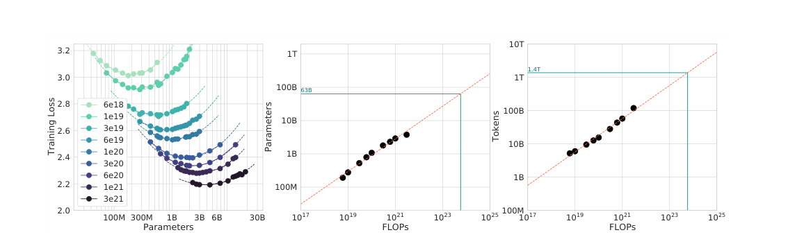

# Chinchilla: Allocating Models and Data Under the Same Compute Budget

[中文](./Chinchilla-Compute-Optimal-Training.md) | English

- **Source:** [Original paper](https://arxiv.org/abs/2203.15556v1)
- **Published: 2022-03-29**

- **Original paper: Training Compute-Optimal Large Language Models.**

**Authors: Jordan Hoffmann, Sebastian Borgeaud, Arthur Mensch, and colleagues; 2022.**

- **Version examined: arXiv:2203.15556v1, recorded as 2022-03-29; this note was compiled on 2026-11-09.**
- **Original sources: [Abstract and version history](https://arxiv.org/abs/2203.15556v1); [full PDF](https://arxiv.org/pdf/2203.15556v1).**
- **Reading scope: The complete main text and Appendices A–G on data, learning-rate schedules, fitting, compute accounting, and optimizer comparisons; key results were checked against the PDF figures and tables. This is an explanatory note, not a training reproduction.**

## 1. The conclusion in one sentence

**Under a fixed pretraining compute budget, bigger is not always better: many contemporary models had too many parameters and too few training tokens. Guided by this analysis, the authors trained Chinchilla with one-quarter of Gopher's parameters but more data, achieving better overall performance.**

Having more parameters and being better under the same budget are different propositions. Correcting this intuition is central to the paper.

**Sources: Sections 1 and 3–5, Tables 1–3. “Contemporary” refers to the paper's research period, not an overall assessment of models in 2026.**

## 2. Why revisit this question?

Kaplan's 2020 work produced an influential conclusion: model parameters should grow faster than training data as compute increases. Continually building larger models therefore seemed a natural direction.

The Chinchilla authors ask: **If the total budget stays fixed, does spending more on parameters displace necessary training volume?**

As a teaching analogy, compute budget can be viewed as a rectangle's area: model size is one side and training tokens the other. With area fixed, lengthening one side shortens the other; the question is which shape minimizes loss.

The corresponding approximation is:

```math
C\approx6ND.
```

$`N`$ is parameter count, $`D`$ the number of tokens seen during training, and $`C`$ training FLOPs. Here $`D`$ is closer to actual training volume than to the number of unique questions.

**Sources: Equation 1 in Section 1, Section 3.3, and Appendix F; the rectangle is a teaching analogy.**

## 3. What does compute-optimal mean?

The paper's objective can be written as:

```math
(N_{\mathrm{opt}},D_{\mathrm{opt}})
=\arg\min_{N,D:\ \mathrm{FLOPs}(N,D)=C}L(N,D).
```

In other words: **Choose model size and training volume to minimize final language-modeling loss without exceeding the pretraining compute budget.**

The objective does not directly optimize:

- The shortest training time on a particular GPU.
- Annual combined training and inference costs after deployment.
- A particular instruction-following, mathematical-examination, or safety metric.
- The best training duration when model size is fixed in advance.

“Chinchilla-optimal” must therefore be read as optimal for a specified budget and objective.

**Sources: The problem definition in Section 1 and Sections 4–5. The distinctions concerning lifetime cost and fixed-model settings follow from the objective function.**

## 4. The experiments involved more than one Chinchilla training run

The authors first conducted over 400 training runs, spanning roughly 70 million to over 16 billion parameters and approximately 5 billion to 500 billion training tokens, then estimated optimal scale using three methods.

The main scaling experiments use MassiveText, with additional analyses on C4 and GitHub code subsets. Only afterward is the larger 70B Chinchilla used to test the prediction's direction.

Two levels of evidence should be distinguished:

1. **Small- and medium-scale sweeps and fitting:** used to identify trends.
1. **The large-scale Chinchilla–Gopher comparison:** used to test whether those trends guide larger models.

It is neither the case that all 400 models were 70B nor that every conclusion was inferred solely from two large models.

**Sources: The abstract, Sections 1 and 3, and Appendix C. Different passages summarize the token range as over 400B or approximately 500B; the description above retains the scale without pretending the boundaries are identical.**

## 5. Understanding the three cross-checking approaches

### 5.1 Approach one: overlay training curves and find the lowest envelope

A family of model sizes is trained for different durations. A model is therefore not represented only by a checkpoint halfway through one run, but by runs designed for different training horizons.

At each compute budget, the authors identify the curve with the lowest loss. Connecting these points gives the most efficient model size and training volume for that budget.

The paper calls this the envelope of training curves. It can be understood as **always choosing the best result at the same price from a collection of cost–performance curves**.

**Sources: Section 3.1, Figure 2, and Appendix D.1.**

### 5.2 Approach two: compare model sizes directly at a fixed budget

IsoFLOP means equal floating-point operations. At the same budget, smaller models can process more tokens, while larger ones can process fewer.



***Figure source: Figure 3, cropped from the upper part of PDF page 6. Each left-hand curve fixes a compute budget; the middle and right panels extrapolate the locations of the minima to larger budgets.***

The U-shape in the left panel is the key:

- Models on the far left lack capacity, which reading much more data cannot fully compensate for.
- Models on the far right are too large to receive enough training under the budget.
- The valley in the middle offers a better trade-off.

The authors use 9 compute budgets from $`6\times10^{18}`$ to $`3\times10^{21}`$ FLOPs. These are scaling-experiment budgets, not the budget for the final 70B model.

**Sources: Section 3.2 and Figure 3.**

### 5.3 Approach three: fit a function of both model size and training volume

The paper proposes:

```math
\widehat L(N,D)=E+\frac{A}{N^\alpha}+\frac{B}{D^\beta}.
```

The three terms have the following interpretation:

| Term | Intuition | Is it a directly measured independent quantity? |
| --- | --- | --- |
| $`E`$ | Uncertainty inherent in the data even with ample model capacity and training | No; it is a fitted term with a theoretical interpretation |
| $`A/N^\alpha`$ | The gap caused by finite model capacity | A decomposition in the functional model, not a separately measured physical quantity |
| $`B/D^\beta`$ | The gap due to finite training, statistical estimation, and incomplete optimization | It cannot simply be renamed the effect of all data repetition |

With model size fixed, additional data cannot remove the second term. With training volume fixed, increasing parameters cannot remove the third term.

The authors fit coefficients to final losses from the corresponding experiments, using a Huber loss that is relatively robust to outliers rather than forcing every point exactly onto one curve.

**Sources: Equations 2–4 in Section 3.3, Figure 4, and Appendix D.2. The decomposition has heuristic theoretical motivation, but its power-law form and coefficients still require empirical fitting.**

## 6. Why should models and data roughly double together?

Substituting the fixed-budget constraint:

```math
D=\frac{C}{6N},
```

turns the loss into a function of $`N`$ alone:

```math
\widehat L(N)=E+AN^{-\alpha}+B\left(\frac{6N}{C}\right)^\beta.
```

As the model grows, the capacity error decreases. But the fixed budget permits fewer training tokens, increasing the other error term. Minimizing this function gives:

```math
N_{\mathrm{opt}}\propto C^{\beta/(\alpha+\beta)},
\qquad
D_{\mathrm{opt}}\propto C^{\alpha/(\alpha+\beta)}.
```

Calculus is not essential to the intuition: **these two exponents describe how the additional budget is split between model growth and training-volume growth**.

The three approaches yield the following exponents:

| Approach | Parameter-scaling exponent with budget | Token-scaling exponent with budget |
| --- | --- | --- |
| One: training-curve envelope | 0.50 | 0.50 |
| Two: IsoFLOP minima | 0.49 | 0.51 |
| Three: parametric loss model | 0.46 | 0.54 |
| Kaplan 2020 comparison | 0.73 | 0.27 |

**Source: Table 2. Only central estimates are listed; interval values for approach three that do not align perfectly with the rounded central value are not reproduced. These decimals are not eternal constants.**

The paper therefore summarizes the result as approximately equal scaling, not three methods giving exactly $`0.5`$.

**Teaching example: Four times the budget implies roughly twice the model and twice the training tokens under the square-root rule. Ten times the budget implies about** $`\sqrt{10}\approx3.16`$ **times each. Doubling both parameters and tokens costs approximately four times, not twice, the compute.**

## 7. The difference from Kaplan is not merely a few more experiments

### 7.1 A long race's midpoint is not a short race's finish

Many Kaplan runs use a fixed-length learning-rate schedule. The Chinchilla authors argue that evaluating a short-token-budget run requires a schedule that also completes its decay near that endpoint.

Using an intermediate checkpoint from a long training plan instead of a run designed to finish at a shorter budget can make short training appear unfairly poor: it has not yet benefited from the scheduled low-learning-rate finish.

**Teaching analogy: A marathon runner's performance at ten kilometers need not represent the best finish of a runner specifically preparing for a ten-kilometer race.**

### 7.2 A larger fitting range reveals curvature

Chinchilla's experiments include more large models, and the authors observe slight curvature in the budget–optimal-model relationship on logarithmic axes. A line fitted to tiny models may not extend unchanged to larger scales.

Together, these points show that how an empirical relationship is obtained affects what it predicts. This does not invalidate all of Kaplan's work: smooth loss trends, resource bottlenecks, and compute frontiers remain foundational ideas.

**Sources: Section 2 and Appendices B, D.1, D.4, and E. Learning-rate scheduling is one experimentally supported explanation proposed by the authors, not necessarily the sole cause of all exponent differences.**

## 8. What did the final Chinchilla model establish?

| Model | Parameters | Training tokens |
| --- | --- | --- |
| Gopher | 280B | 300B |
| Chinchilla | 70B | 1.4T |

B denotes billion and T trillion. The authors compare the two models as having approximately equal training compute budgets.

**Sources: Table 1 and Section 4. The paper often summarizes the change as one-quarter the model size and about four times the data. Dividing 1.4T by 300B gives approximately 4.67, so the rounded fourfold description should not be treated as an exact equality.**

### 8.1 Representative results

| Metric | Gopher | Chinchilla | Interpretation |
| --- | --- | --- | --- |
| MMLU, mean 5-shot accuracy | 60.0% | 67.6% | A gain of 7.6 percentage points, not merely a relative 7.6% increase |
| BIG-bench, mean accuracy on evaluated tasks | 54.4% | 65.1% | A gain of 10.7 percentage points |
| LAMBADA, zero-shot | 74.5% | 77.4% | A smaller model need not have weaker average capabilities |
| WikiText-103 perplexity | 7.75 | 7.16 | Lower is better; this is not accuracy |

**Sources: Sections 4.2.1–4.2.4 and Tables 6–7. MMLU is 67.6% in the body and Table 6 but 67.5% in the abstract. This note uses 67.6% from the explicit results table and corresponding discussion while preserving the discrepancy.**

Not every task improves: among MMLU's 57 subtasks, 51 improve, 2 are unchanged, and 4 worsen. PIQA is tied in the commonsense table. Overall success should not be rewritten as domination of every metric.

**Sources: Figure 6 and Table 8.**

### 8.2 Strong evidence, but not a perfectly pure two-variable ablation

Beyond parameters and tokens, the final Chinchilla and Gopher differ in:

- AdamW versus Adam optimization.
- Slightly adjusted data-mixture proportions.
- Tokenizer normalization.
- The implementation of higher-precision weights in optimizer state.

The authors perform supplementary experiments on some of these factors. The evidence strongly supports better scale allocation, but all downstream gains cannot be attributed precisely to parameters and tokens alone.

**Sources: Section 4.1 and Appendices A and G.**

## 9. What does about 20 tokens per parameter mean?

Dividing Chinchilla's 1.4T tokens by 70B parameters gives:

```math
\frac{D}{N}=\frac{1.4\times10^{12}}{70\times10^9}=20.
```

Several budget projections in Table 3 are of this order, leading to the familiar rule of thumb.

It is **not**:

- An upper limit on training data for every model.
- A claim that improvement stops beyond 20 tokens per parameter.
- A data ratio applicable to every training objective.

When deployment size is fixed or inference cost matters more than training cost, training a small model longer can have a different cost–benefit balance. That solves another optimization problem; deviation from the Chinchilla ratio alone does not make it wrong.

**Sources: Sections 3.4 and 4–5, Table 3. The latter discussion interprets the objective's scope; it is not a lifetime-cost optimization experiment conducted in this paper.**

## 10. Four further boundaries revealed by close reading

### 10.1 Predicted optima are not all directly measured

The three methods predict suitable sizes of roughly 40B–70B at the Gopher budget. The authors train only the 70B choice. This validates the direction, not a precisely unique optimum at 70B.

### 10.2 Large-scale validation remains limited

The authors acknowledge that the comparable large-scale runs are primarily Chinchilla and Gopher, not complete multi-model, multi-seed grids at every larger budget.

### 10.3 Less than one epoch requires attention to scope

Section 5's statement about the scaling-analysis regime does not mean that every data subset is unrepeated in the final Chinchilla run. Appendix A, Table A1 explicitly reports approximately 1.24 epochs for MassiveWeb and 3.40 for Wikipedia. A large overall corpus does not mean each mixture component is seen only once.

### 10.4 A precise fit does not make every number in the source consistent

Table 3 and the following prose give different predicted token counts for some models; the abstract and MMLU table differ at 67.5% versus 67.6%. Appendix F also distinguishes approximately $`5.76\times10^{23}`$ from the more detailed estimate of $`6.3\times10^{23}`$ FLOPs. These source locations and accounting conventions should be retained rather than forced into one supposedly exact table.

**Sources: Sections 3.4, 4, and 5; Tables 3 and 6; Appendices A, E, and F.**

## 11. Key evidence and a route through the paper

| Conclusion | Evidence type | Original location |
| --- | --- | --- |
| Model size has a trade-off minimum at fixed compute | IsoFLOP experiments | Section 3.2, Figure 3 |
| Parameters and tokens should grow in roughly equal proportions | Cross-checking three fitting approaches | Sections 3.1–3.4, Table 2 |
| Schedule length should match training length | Dedicated training comparisons | Section 2, Appendix B, Figure A1 |
| 70B/1.4T delivers better overall results than 280B/300B | Large-scale training and downstream evaluation | Section 4, Tables 1 and 6–9 |
| 20 tokens per parameter is a rule-of-thumb scale | Model configuration and budget projections | Tables 1 and 3 |
| Curvature and limited validation constrain distant extrapolation | Author discussion | Section 5, Appendix E |
| The final model includes optimizer and other changes | Configuration disclosure and supplementary ablations | Section 4.1, Appendix G |

**Suggested reading order: Start with the problem in Section 1 and Figure 3, then Equations 2 and 4 and Table 2, followed by Table 6 and Section 4.1. Finish with Section 5 and Appendices B and A. Do not remember only 70B, 1.4T, and 20.**

## 12. Five review questions

**Question 1: Does the paper say smaller models are always better?**

No. It says that an appropriate model size exists for a given training budget; both undersized and oversized models can be inefficient.

**Question 2: How much does compute grow if both parameters and tokens double?**

Approximately fourfold under $`C\approx6ND`$.

**Question 3: Why not evaluate short training using an intermediate checkpoint from a long run?**

The learning rate may not have finished decaying for the short budget, making the optimization states incomparable.

**Question 4: Are 1.4T tokens 1.4T different questions?**

No. Tokens are units in a tokenized sequence, and some components of the final data mixture are repeated.

**Question 5: Does the paper prove that 70B is the precisely unique optimum at this budget?**

No. Different fits predict a range of approximately 40B–70B, and the authors choose 70B for large-scale validation. The experiment supports smaller models with more training data but does not exhaustively test all sizes at that budget.
