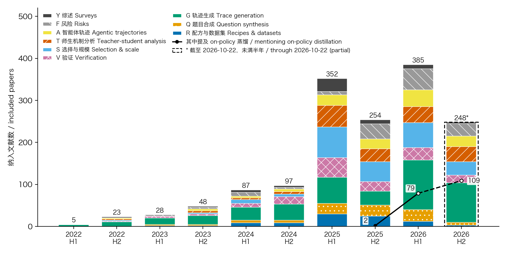
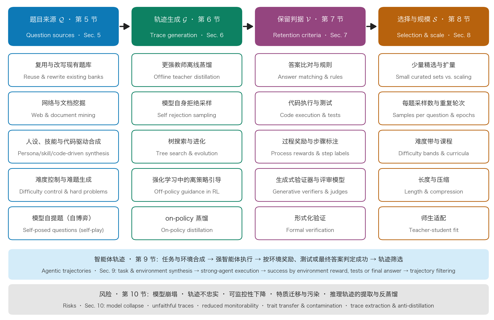

# 训练数据中的思维链合成：方法、证据与开放问题

中文 | [English](./CoT-Data-Synthesis-Literature-Review_en.md)

- **调研日期**: 2026-10-22（证据截止：arXiv 首版日期不晚于 2026-10-22）
- **范围**: 训练用思维链轨迹的构造：监督微调与蒸馏数据，含智能体轨迹与 on-policy 蒸馏；强化学习只涉及题目构造与难度控制。以 arXiv 为主，经关键词检索和施引扩展得到候选 13,589 篇，标题+摘要编码筛选 2,591 篇，纳入 1,527 篇，精读 237 份来源（本文统计）。检索与筛选方法见第 2 节。
- **结构**: 本综述分 8 个页面。本页包含摘要、第 1–3 节（引言、检索方法、分类框架）、第 11–13 节（综合讨论、开放问题、结论）与附录；第 4–10 节各占一页，见本页“第 4–10 节”一节。
- **依据**: 句末的上标数字是引用，对应文末参考来源中的精读文献；每条引用都有从该文献全文逐字摘录、并经脚本与全文核对的原文。标有（本文判断）、（本文推断）或（本文统计）的内容，是本文的综合分析或统计，不是来源原话。

## 摘要

推理轨迹（思维链）已成为大语言模型后训练数据中成本最高、复用最广的部分。本文按系统性文献综述的流程，检索了 2022 年 1 月至 2026 年 10 月的相关文献：从 13,589 篇候选文献中筛选出 2,591 篇进行编码，纳入 1,527 篇，并对其中 237 份来源做全文精读与逐字抽证（本文统计）。

本文提出一个以数据流水线为轴的分类框架，按题目来源、轨迹生成、验证与标注、选择与规模、智能体轨迹五个方面梳理代表方法与受控实验结论，并单独讨论合成推理数据的风险。分析表明：

- 研究重心正从“多找题”转向“每题多采样再按学生选择”，并在 2026 年快速转向 on-policy 蒸馏；而代码与智能体数据的瓶颈在任务多样性。
- “更强的教师更好”“答案正确的轨迹更好”“数据越多越好”“验证一定有益”这四条直觉都有设计良好的反例，其成立与否取决于学生规模、师生分布距离与训练预算。
- 以答案为条件的生成、长度惩罚与递归自训练，会以答案正确率察觉不到的方式损害数据。

本文最后整理了六组相互矛盾的结论及可检验的调和变量，并指出七个开放问题。

**关键词**：思维链；推理数据合成；知识蒸馏；监督微调；on-policy 蒸馏；数据选择；大语言模型

## 1 引言

### 1.1 研究背景

Wei 等人发现，在提示中给出一串中间推理步骤，能显著提升大语言模型完成复杂推理的能力[^68]。这一发现很快从推理时的技巧延伸为训练信号的来源。Distilling Step-by-Step 把大模型给出的理由作为多任务框架中的额外监督，用来训练小模型[^73]，微调后的 770M T5 模型超过了少样本提示下的 540B PaLM[^73]。STaR 让模型为题目生成理由，答错时以正确答案为提示重新生成，只在最终答对的理由上微调并反复迭代[^82]。Orca 则直接学习 GPT-4 的解释轨迹与逐步思考过程[^67]。

2025 年初，长思维链（long chain-of-thought，long CoT）同时推高了这一方向的规模与重要性。DeepSeek-R1 收集了约 600k 条与推理相关的训练样本[^80]，另有约 200k 条与推理无关的样本[^80]。它的一个结论直接推动了后续的数据工作：把更强的模型蒸馏到小模型上效果很好，而小模型若依靠大规模强化学习，需要巨大算力，且未必达到蒸馏的效果[^80]。

此后的工作在数据规模上走向两端（本文判断）：

- **小而精。** s1 用 1,000 道题检验了难度、多样性与质量三项选择准则[^86]。LIMO 提出“少即是多”的推理假说[^72]。
- **大规模。** OpenThoughts 在 1,000 多次消融实验之后，把数据扩到 1.2M 条[^4]。

到 2026 年，领域出现了三个变化（本文判断）。

1. **数据配方完全公开的模型出现。** Olmo 3 公开了推理监督微调数据的构造过程[^10]。ZGCM-1 开源了各阶段的数据与数据配方[^45]。
2. **合成对象从单轮解题扩展到多轮智能体轨迹。** OpenThoughts-Agent 给出了一条完全公开的智能体数据整理流水线[^34]。
3. **离线轨迹蒸馏逐渐让位于 on-policy 蒸馏。** Qwen3 对小模型同时使用 off-policy 与 on-policy 的强到弱蒸馏[^70]。Ask to Distill 指出，on-policy 蒸馏只需很少的训练题就能奏效[^56]。按本文的语料统计，摘要提及 on-policy 蒸馏的纳入文献，2025 年下半年只有 2 篇，2026 年上半年已有 79 篇（本文统计）。

与此同时，这一领域的若干结论相互冲突。OpenThoughts 在扩到 1.2M 条后宣称“多即是多”（more-is-more）[^57]。ZGCM-1 则发现，把候选池剪掉约一半后，六项基准均值从 67.78 升到 68.83[^45]。

在教师选择上：

- OpenThoughts 发现，QwQ-32B 在目标基准上弱于 DeepSeek-R1，却是更好的教师[^4]。
- AM 在同一批 1.89 million 条查询上做了对照[^60]。用 AM-Thinking-v1 蒸馏数据训练的学生在 AIME2024 上得到 84.3，用 DeepSeek-R1 蒸馏数据训练的只有 70.9[^60]。

在验证上：

- OpenThoughts 试过多种验证与答案过滤方法，没有一种带来显著提升[^4]。
- AM 的整条流水线却建立在按题型区分的验证之上[^1]。

本文认为，这些冲突大多不是谁对谁错，而是实验条件不同（本文判断）。

### 1.2 已有综述及本文定位

已有综述从不同角度覆盖了这一领域，可按组织方式分为四类（本文判断）。

**第一类：按推理方法组织，数据构造只是其中一节。** 早期的数学推理综述，把微调方法分为上下文示例选择、生成中间步骤、学习答案验证器、增强数据集、师生蒸馏等若干分支[^221]。从“系统 1 到系统 2”的综述，把推理模型的构造归纳为结构搜索、奖励建模、自我改进、宏动作与强化微调五类核心方法[^222]。强化推理综述的重点之一是自动化的数据构造[^224]。它描述了推理标注从人工标注转向大模型自动标注的过程[^224]。高效推理综述关注长思维链的冗长代价[^223]，并把方法分为基于模型、基于推理输出与基于输入提示三类[^223]。长思维链综述则围绕深度推理、广泛探索与可行反思三个特征展开[^77]。

**第二类：以合成数据为对象。** 大模型驱动的合成数据综述，按数据生成的一般工作流组织文献[^76]。一份面向文本与代码的合成数据综述，按 PRISMA 式流程选取 2020 年 1 月至 2025 年 4 月的文献[^226]，并给出提示式、检索增强与迭代自我精炼三类流水线的分类[^226]。合成数据最佳实践综述指出，合成数据可能含有基准题目的改写版本，使词元级去污染失效[^227]。大模型知识蒸馏综述，把知识获取策略分为标注、扩展、整理、特征、反馈与自我知识生成等类[^84]。

**第三类：专门讨论某一种范式或数据形态。** On-policy 蒸馏综述，按学生访问的状态、构造监督所用的信息与监督引起的更新三个维度组织文献[^225]。它指出，按教师给定的历史训练学生，会让学生在自己生成时遇到的历史上缺乏监督[^225]。思维链微调综述借“六顶思考帽”框架，对思维链微调方法分类[^229]。智能体数据综述把智能体数据表示为环境、任务信号、交互实现与可选验证器组成的四元组[^230]，并指出文献正转向以执行为依据的正确性与相对于学习者的难度[^230]。

**第四类：与本文最接近的两项工作。**

- DeepSeek-R1 复现综述，汇总了开源复现中的监督微调与强化学习数据[^228]，列出从 DeepSeek-R1 的 800k 到 LIMO 的 817 条等一系列开源数据集的规模[^228]。它还指出，只有 Light-R1 与 LIMO 的技术报告明确提到对常用推理基准做了去污染[^228]。
- 2026 年的一份后训练推理数据入门综述，自述综合了 150 余篇公开研究与系统报告[^231]。它围绕“有哪些数据对象、什么使数据有用、如何构造、如何扩展”四个问题组织文献[^231]，并说明作者没有重新运行训练配方，也没有审计污染[^231]。

本文与上述工作的区别有三点（本文判断）：

1. **以数据流水线为轴。** 本文按“题目来源、轨迹生成、验证、选择与规模”的阶段组织文献，而不是按推理方法或训练范式组织。
2. **文献规模与可复核性。** 本文按系统综述流程检索并筛选了 2,591 篇候选文献，纳入 1,527 篇，并对 237 份来源做全文精读与逐字抽证（本文统计）。
3. **聚焦受控证据。** 本文对 2025—2026 年的大量受控实验，统一记录教师、学生、基准与数据规模，并把相互矛盾的结论并列给出。

### 1.3 本文贡献与结构

本文的贡献有四点（本文判断）：

1. **分类框架。** 提出一个以数据流水线为轴的分类框架（第 3 节）。
2. **逐阶段梳理。** 按题目来源、轨迹生成、验证、选择与规模、智能体轨迹五个方面，梳理代表方法与受控实验结论（第 5—9 节），并以第 4 节回顾 2022—2024 年的发展脉络。
3. **失效模式与矛盾。** 归纳合成推理数据的主要失效模式，整理若干组相互矛盾的结论及可检验的调和变量（见第 10、11 节，本文判断）。
4. **可复核的方法记录。** 记录检索、筛选与编码的全过程（第 2 节）。

本文不讨论推理时的思维链提示技巧，也不讨论只做评测、不构造训练数据的工作（本文判断）。多模态思维链数据不在本文范围内（本文判断）。

## 2 文献检索与研究方法

本文按系统性文献综述的一般流程组织检索、筛选与证据抽取（本文判断）。检索记录、逐篇筛选记录与纳入文献清单未随本页发布，本节给出各步骤的规则与数量。

### 2.1 研究问题

本文围绕四个问题展开（本文判断）：

- **RQ1**：用于监督微调与蒸馏的推理轨迹，其题目从何而来，轨迹由谁生成？
- **RQ2**：什么样的检验决定一条轨迹被保留，各类检验的代价与误差如何？
- **RQ3**：在数据量、每题采样数、长度与配比上，哪些选择有受控实验支持，哪些结论相互冲突？
- **RQ4**：合成推理数据会以哪些方式失效，现有缓解手段的证据强度如何？

### 2.2 检索策略

检索源为 arXiv API（标题与摘要字段）与 Semantic Scholar Graph API（施引文献与引用计数），时间范围为 2022-01-01 至 2026-10-22（本文统计）。关键词检索按预设分类框架的九个方向各写一组或多组查询，共 64 组（本文统计）。各组查询原始命中合计 13,327 条，去重后得到 9,593 篇（本文统计）。

为弥补关键词检索对措辞的依赖，本文在每个方向上选取代表性种子文献，共 23 篇（本文统计），通过 Semantic Scholar 取回其全部带 arXiv 编号的施引文献。这一步得到 9,306 篇不同文献（本文统计）。对其中未被关键词检索覆盖的部分，按“标题含主题词、施引多篇种子或引用数不低于 150”的规则取回元数据，新增 3,975 篇（本文统计）。

召回检查以前期调研引用的 84 篇 arXiv 文献及 62 篇领域标志性文献为基准，共 146 篇（本文统计）。仅用关键词检索时，召回率为 79%（本文统计）；加入施引扩展后，召回率升至 86%（本文统计）。仍未召回的 20 篇直接按编号补入候选池（本文统计）。合并后的候选池共 13,589 篇（本文统计）。

### 2.3 筛选与编码

**预筛。** 候选池先经规则预筛：按主题正则对标题与摘要打分，结合学科类别、引用数与施引种子数排序（本文判断）。在各分数段抽样阅读后确定截断位置，并无条件保留高引用且标题含主题词的文献及全部召回基准文献。共有 2,591 篇进入人工编码筛选（本文统计）。

**编码手册。** 筛选依据统一的编码手册，仅以标题与摘要判断。纳入的文献按“类别—重要性分级—轨迹生成者—保留判据—领域”五个字段编码，排除的文献记录排除原因（本文判断）。筛选按引用排名交错切分为 9 块，由 9 个并行的 LLM 编码代理完成，每块约 288 篇（本文统计）。

**审计。** 合并后做了三项审计（本文判断）：

1. 核对全部召回基准文献的判定结果。
2. 逐条复核“被排除但引用数不低于 150 或标题含主题词”的文献（本文判断）。
3. 检查预筛阶段被截掉、但引用数高且标题含主题词的文献。

审计共人工改判 7 篇（本文统计）。其中，Textbooks Are All You Need[^112] 原被判为通用预训练数据，因其合成“教科书与习题”的做法是推理数据合成的直接前身，改为纳入（本文判断）。第三项审计检出的 15 篇未筛高引文献均为多模态思维链工作，属于本文明确排除的范围（本文统计）。

表 2-1 文献检索与筛选流程（本文统计）

| 阶段 | 数量（篇） |
| --- | ---: |
| 关键词检索：64 组查询原始命中 | 13,327 |
| 关键词检索：去重后 | 9,593 |
| 施引扩展：23 篇种子的施引文献（去重） | 9,306 |
| 施引扩展：按规则新增入池 | 3,975 |
| 召回检查补入 | 20 |
| 人工补入（检索后核对时发现） | 1 |
| 候选池合计 | 13,589 |
| 规则预筛后进入编码筛选 | 2,591 |
| 排除 | 1,064 |
| 纳入（A 级 149，B 级 390，C 级 988） | 1,527 |
| 全文精读并逐字抽证（含前期 84 篇 arXiv 文献与 7 份数据集卡、博客等） | 237 |

排除原因中，推理时技巧（不产生训练数据）240 篇，窄领域应用 222 篇，纯强化学习算法 153 篇，纯评测 128 篇，其他原因 321 篇（本文统计）。

### 2.4 全文精读与证据抽取

精读集由两部分组成（本文判断）：

- 前期调研已精读的 91 份来源，含 84 篇 arXiv 论文与 7 份数据集卡、博客和代码仓库文档（本文统计）。
- 本轮从 A、B 两级中按类别补选的 146 篇（本文统计）。补选原则是：每个方向的奠基工作、高引用代表作与 2026 年的新近进展均有覆盖。

全部论文抓取全文后，按八个主题分配给并行的 LLM 抽证代理（本文判断）。每条论断都须附上一段与原文逐字一致的引文，经脚本与全文核对后才能采用。本文正文中的数字均可在对应文献的逐字引文中找到（本文判断）。

文中凡标注（本文判断）（本文推断）（本文统计）的句子，是作者基于证据的综合或计算，不是所引文献的结论。

### 2.5 语料概览

图 2-1 给出纳入文献随时间的分布（本文统计）：

- 2022 年 28 篇，2023 年 76 篇，2024 年 184 篇（本文统计）。
- 2025 年骤增至 606 篇，2026 年截至 10 月 22 日已有 633 篇（本文统计）。

增长主要发生在 2025 年 DeepSeek-R1 发布之后（本文推断）。其中，“轨迹生成”方向在 2026 年上半年单期即有 118 篇（本文统计）。摘要提及 on-policy 蒸馏的纳入文献，2025 年下半年只有 2 篇，2026 年上半年升至 79 篇，下半年（未满）为 109 篇（本文统计）。这说明该方向在一年内从边缘方法变成了主要方向之一（本文判断）。



*图 2-1 纳入文献按半年与类别的分布，及其中提及 on-policy 蒸馏的篇数（本文统计；由标题与摘要编码，2026 年下半年截至 10 月 22 日）。*

表 2-2 纳入文献的类别与分级分布（本文统计；由标题与摘要编码）

| 类别 | 纳入篇数 | A 级 | B 级 | C 级 |
| --- | ---: | ---: | ---: | ---: |
| R 配方与数据集 | 92 | 24 | 30 | 38 |
| Q 题目合成 | 104 | 15 | 47 | 42 |
| G 轨迹生成 | 427 | 32 | 64 | 331 |
| V 验证与标注 | 156 | 11 | 23 | 122 |
| S 选择、规模与长度 | 231 | 10 | 69 | 152 |
| T 师生机制分析 | 174 | 12 | 52 | 110 |
| A 智能体轨迹 | 130 | 14 | 52 | 64 |
| F 风险与失效 | 145 | 12 | 31 | 102 |
| Y 综述与立场 | 68 | 19 | 22 | 27 |
| 合计 | 1527 | 149 | 390 | 988 |

从编码结果看（本文统计）：

- **轨迹生成者。** 在“轨迹生成”类中，由模型自身生成轨迹的工作 154 篇，多于由更强教师生成的 113 篇（本文统计）。
- **保留判据。** 以答案比对作为保留判据的工作 82 篇，明确不做正确性过滤的 55 篇（本文统计）。
- **领域分布。** 通用推理 683 篇、数学 356 篇、多领域 189 篇、智能体 154 篇，代码与科学分别只有 49 篇和 17 篇（本文统计）。

数学题有可自动比对的标准答案，这可能是该方向文献集中在数学上的主要原因（本文推断）。

表 2-3 各类别文献的轨迹生成者分布（本文统计；由摘要编码，“不适用”指文献不涉及轨迹生成）

| 类别 | 教师模型 | 模型自身 | 搜索 | 混合 | 人工 | 不适用 |
| --- | ---: | ---: | ---: | ---: | ---: | ---: |
| R | 47 | 14 | 0 | 15 | 1 | 15 |
| Q | 48 | 33 | 0 | 3 | 0 | 20 |
| G | 113 | 154 | 26 | 111 | 2 | 21 |
| V | 13 | 77 | 8 | 7 | 0 | 51 |
| S | 84 | 69 | 2 | 17 | 3 | 56 |
| T | 70 | 21 | 5 | 21 | 2 | 55 |
| A | 54 | 32 | 5 | 16 | 0 | 23 |

表 2-4 各类别文献采用的保留判据分布（本文统计；由摘要编码）

| 类别 | 答案比对 | 执行/测试 | 过程奖励 | 模型评审 | 形式化 | 混合 | 不过滤 | 不适用 |
| --- | ---: | ---: | ---: | ---: | ---: | ---: | ---: | ---: |
| R | 15 | 8 | 0 | 2 | 5 | 15 | 9 | 38 |
| Q | 28 | 16 | 0 | 4 | 2 | 3 | 9 | 42 |
| G | 82 | 7 | 5 | 18 | 2 | 14 | 55 | 244 |
| V | 17 | 10 | 68 | 21 | 14 | 12 | 1 | 13 |
| S | 54 | 0 | 0 | 1 | 0 | 5 | 26 | 145 |
| T | 23 | 0 | 0 | 0 | 0 | 1 | 17 | 133 |
| A | 16 | 18 | 1 | 7 | 0 | 13 | 5 | 70 |

### 2.6 局限

本文的检索与筛选有四点局限（本文判断）：

- 检索以 arXiv 为主，正式发表但未上传预印本的工作可能遗漏。
- 筛选只依据标题与摘要，分级与编码由多个 LLM 代理完成，虽经审计，仍可能存在判定不一致。
- 2026 年的大量文献尚未经同行评议，其结论的稳健性有待检验。
- 引用计数取自 Semantic Scholar，新近预印本的计数普遍偏低。

## 3 问题定义与分类框架

### 3.1 基本对象

**定义 1（思维链训练样本）**：一个训练样本是三元组 $`(q, r, a)`$（本文判断）。

- $`q`$ 是题目或任务描述，$`r`$ 是推理轨迹，$`a`$ 是最终答案。
- 在智能体场景中，$`r`$ 扩展为思考、工具调用与环境观察交替出现的多轮序列。
- 智能体数据综述把这类数据表示为环境说明、任务信号、交互实现与可选验证器组成的四元组[^230]。

**定义 2（合成流水线）**：一条思维链数据合成流水线，是从题目来源到训练集的映射（本文判断）：

```math
\mathcal{D} = \mathcal{S}\Big(\big\{(q, r, a) : q \in \mathcal{Q},\ r \sim \mathcal{G}(\cdot \mid q),\ \mathcal{V}(q, r, a) = 1\big\}\Big)
```

- $`\mathcal{Q}`$ 是题目来源。
- $`\mathcal{G}`$ 是轨迹生成者，可以是更强的教师模型、模型自身或搜索过程。
- $`\mathcal{V}`$ 是保留判据，即验证器。
- $`\mathcal{S}`$ 是在数据量、难度、长度与配比上的选择策略（本文判断）。

按这一定义，训练的目标通常是最小化学生在保留轨迹上的负对数似然（本文判断）：

```math
\mathcal{L}_{\mathrm{SFT}}(\theta) = -\mathbb{E}_{(q, r, a) \sim \mathcal{D}} \sum_{t} \log p_\theta\big(y_t \mid y_{<t}, q\big), \quad y = (r, a)
```

**On-policy 蒸馏改变了这一结构（本文判断）。** 轨迹不再由 $`\mathcal{G}`$ 预先生成，而是由学生自身采样。教师只在学生访问的状态上逐词元提供监督。On-policy 蒸馏综述指出，按参考答案或教师生成的回答训练时，学生是在另一来源提供的历史上学习，而生成时它依赖的是自己此前的预测[^225]。这正是 on-policy 方法要消除的错配[^225]。

### 3.2 分类框架

已有工作给出过几种分类。

- 长思维链资源索引按构造方式，把数据集分为人工标注、直接蒸馏、基于搜索的蒸馏与经验证的蒸馏四类[^63]。
- 后训练推理数据入门综述按“验证契约”排序数据：反馈在哪里进入、什么变成可训练的、哪些字段让信号可审计[^231]。
- 强化推理综述描述了推理标注从人工标注转向大模型自动标注的过程[^224]。

本文在此基础上，按数据流水线的阶段建立分类框架（见图 3-1 与表 3-1，本文判断）。框架的两个维度分别是“流水线阶段”与“信号来源”。阶段对应定义 2 中的 $`\mathcal{Q}`$、$`\mathcal{G}`$、$`\mathcal{V}`$ 与 $`\mathcal{S}`$。信号来源区分人工、更强教师、模型自身、搜索与环境执行，在图 3-1 的各框内容与表 2-3、表 2-4 的编码中体现（本文判断）。



*图 3-1 本文的分类框架（本文判断）。*

表 3-1 分类框架各阶段的典型设计与代表文献（本文判断，代表文献的具体结论见对应章节）

| 阶段 | 核心问题 | 典型设计 | 节 |
| --- | --- | --- | --- |
| 题目来源 $`\mathcal{Q}`$ | 题从哪里来、能否自动判对、难度如何控制 | 复用并改写现有题库；从网络与文档挖掘；按人设、技能或代码合成；按通过率控制难度；模型自提题 | 5 |
| 轨迹生成 $`\mathcal{G}`$ | 谁来写推理过程 | 更强教师离线蒸馏；模型自身拒绝采样；树搜索与进化；on-policy 蒸馏；强化学习中的离策略引导 | 6 |
| 保留判据 $`\mathcal{V}`$ | 什么样的轨迹算合格 | 答案比对；代码执行与测试；过程奖励与步骤标注；生成式验证器与评审模型；形式化验证 | 7 |
| 选择与规模 $`\mathcal{S}`$ | 留哪些、要多少、多长 | 少量精选与扩量；每题采样数与重复轮次；难度带与课程；长度与压缩；师生适配 | 8 |
| 智能体轨迹 | 多轮工具交互数据如何构造 | 环境与任务合成；强智能体执行；按环境奖励、测试或最终答案判定成功 | 9 |
| 风险 | 合成数据会以何种方式失效 | 模型崩塌；轨迹不忠实；可监控性下降；特质迁移与污染；推理轨迹的提取与反蒸馏 | 10 |

### 3.3 六份技术报告中的流水线

用这一框架对照 2024—2025 年六份代表性技术报告，可以看出两条分支（本文判断）：一支蒸馏更强的教师，另一支依靠模型自身的拒绝采样或强化学习。

**蒸馏教师一支。**

- **Tülu 3。** 以约 250K 个 Persona Hub 人设为条件，生成面向指令遵循、数学与代码的题目[^232]。数学多步解答由 GPT-4o 生成，代码由 claude-3-5-sonnet 生成[^232]。去污染采用 8-gram 匹配[^232]。在 Tülu 3 8B SFT 的留一消融中，去掉数学数据后，GSM 从 76.2 降到 64.1，MATH 从 31.5 降到 23.5[^232]。
- **STILL-2。** 使用 DeepSeek-R1-Lite-Preview 与 QwQ-32B-preview 两个类 o1 系统作教师[^233]。经预处理的 3.9K 条蒸馏样本，就使学生在 AIME 上达到 46.7%、在 MATH-OAI 上达到 90.2%[^233]；骨干模型分别为 13.3 与 80.0[^233]。
- **O1 Replication Journey 第二部分。** 只用数万条从 O1 蒸馏的长思维链做监督微调，基座模型在 AIME 上就超过了 O1-preview[^234]。作者同时指出，蒸馏得到的模型必然受教师能力约束，存在隐性的天花板效应[^234]。

**自我生成与强化学习一支。**

- **DeepSeekMath。** SFT 数据共 776K 条，配有思维链、程序思维链与工具集成三种解答格式[^235]。强化学习阶段使用约 144K 道题，每题采样 64 个输出[^235]。其统一范式分析发现，从实时策略采样的 Online RFT 显著优于从初始 SFT 模型采样的 RFT[^235]。但强化学习只提升了 Maj@K，没有提升 Pass@K[^235]。
- **Qwen2.5-Math。** 用奖励模型指导的拒绝采样迭代改进回答[^236]，最终思维链训练集含 2000K 条英文样本与 500K 条中文样本[^236]。强化学习只保留 8 个回答中有 2 至 5 个正确的题目，共 66K 道[^236]。
- **Kimi k1.5。** 以监督微调模型 10 次采样的通过率作为题目难度的代理[^237]。为避免“经错误推理得到正确答案”造成的假阳性，排除了选择题、判断题与证明题[^237]。人工抽查中，传统奖励模型的准确率约为 84.4，思维链奖励模型为 98.5[^237]。

表 3-2 六份技术报告的推理数据流水线对照（依据见各行引用）

| 报告 | 题目来源 | 轨迹生成者 | 保留判据 | 规模 |
| --- | --- | --- | --- | --- |
| Tülu 3 | 公开数据集加人设驱动的合成题目 | GPT-4o（数学）、claude-3-5-sonnet（代码） | 强化学习阶段用二值验证器；8-gram 去污染 | 强化学习约 30,000 条带标准答案的提示[^232] |
| STILL-2 | 竞赛数学、代码与科学题 | DeepSeek-R1-Lite-Preview、QwQ-32B-preview | 答案正确性与规则清洗 | 3.9K 条蒸馏样本[^233] |
| O1 Replication Journey 第二部分 | 竞赛级数学题 | O1 | 未见详细描述（本文判断） | 数万条长思维链[^234] |
| DeepSeekMath | GSM8K、MATH 等 | 标注解答与策略采样 | 强化学习阶段由奖励模型打分 | SFT 776K 条；强化学习约 144K 道题[^235] |
| Qwen2.5-Math | 标注题与合成题 | 当前最强模型自身 | 答案比对或加权投票，再按奖励模型取前 k[^236] | 2000K 条英文与 500K 条中文[^236] |
| Kimi k1.5 | STEM、竞赛与通用推理题 | 强化学习策略 | 通过率难度；思维链奖励模型[^237] | 约 800K 条思维链标注样本训练奖励模型[^237] |

这两条分支对应同一权衡（本文判断）：

- 蒸馏的启动成本低，但受教师天花板约束[^234]。
- 自我生成与强化学习可以越过教师，但更依赖验证器与题目覆盖[^237]。
- DeepSeekMath 的 Maj@K 与 Pass@K 结果提示，强化学习的收益可能更多来自对已有输出分布的锐化，而非能力边界的扩展[^235]。

### 3.4 公开流水线的共性与缺口

在这一框架下，开源复现中的典型监督微调数据流水线可以描述为（本文判断）：

- 题目取自基准训练集或网络爬取[^228]。
- 经去重、拒绝采样与标准答案验证多轮过滤[^228]。
- 验证方法按领域不同：数学题常用 Math Verify，代码题用执行或单元测试，通用任务用大模型评审[^228]。

思维链微调综述把思维链数据的获取分为人工标注与自动标注两类[^229]。在自动标注中，常用的做法是用答案验证器丢弃最终答案与标准答案冲突的思维链[^229]。

不过，答案正确并不保证推理过程正确。一份合成数据综述指出，大模型可能经由错误的解释得到正确答案，反之亦然[^226]。这一点贯穿后文各节（本文判断）：

- 第 7 节讨论验证器能在多大程度上弥补这一缺口。
- 第 8 节讨论答案错误的轨迹是否仍有训练价值。
- 第 10 节讨论答案正确的轨迹为何仍可能不忠实。

## 第 4–10 节

第 4–10 节各占一页：

- [4 发展脉络：从理由蒸馏到长思维链](./CoT-Data-Synthesis-Literature-Review-Ch04.md)
- [5 题目与任务来源](./CoT-Data-Synthesis-Literature-Review-Ch05.md)
- [6 轨迹生成：教师、自我与搜索](./CoT-Data-Synthesis-Literature-Review-Ch06.md)
- [7 验证与标注：什么算一条合格的轨迹](./CoT-Data-Synthesis-Literature-Review-Ch07.md)
- [8 选择、规模与长度](./CoT-Data-Synthesis-Literature-Review-Ch08.md)
- [9 智能体轨迹的合成](./CoT-Data-Synthesis-Literature-Review-Ch09.md)
- [10 风险与失效模式](./CoT-Data-Synthesis-Literature-Review-Ch10.md)

## 11 综合讨论：相互矛盾的结论与调和变量

前面各节分别讨论了流水线的各个阶段。把这些结论放在一起看，有六组明显相互冲突（本文判断）。

本节的写法是：先并列两方证据及其实验条件，再给出最可能解释分歧的变量（本文判断）。这些调和变量都是本文的推断，可以用受控实验检验（本文判断）。

### 11.1 数据越多越好，还是少而精更好

**支持扩量的证据。**

- OpenThoughts 在扩到 1.2M 条后宣称“多即是多”[^57]。
- NaturalThoughts 发现，按随机抽样扩大数据规模是一个强基线，且性能稳定增长[^5]。

**支持少而精的证据。**

- LIMO 只用很少的样本，在 AIME24 上达到 63.3%，在 MATH500 上达到 95.6%[^72]。
- LESS 选出的 5% 数据，常常优于全量训练[^164]。
- Select2Reason 只用 10% 的数据，就达到或超过全量微调[^173]。
- ZGCM-1 剪掉约一半候选池后，六项基准均值从 67.78 升到 68.83[^45]。

**本文认为三个变量最可能解释这一分歧（本文推断）。**

1. **基座模型是否已具备相应知识。** LIMO 的假说明确以“领域知识已在预训练中充分编码”为前提[^72]。在这一前提下，少量示范只是激活已有能力（本文推断）。
2. **候选池是否已经过教师预筛。** 若候选池已经过教师预筛，剩余数据的边际价值本就较低，剪枝更容易显出效果（本文推断）。
3. **比较时是否控制了训练预算。** 多数子集比较给每个子集相同的轮数，子集实际得到的优化步数更少（本文判断，依据见[^173][^164]）。DataRepetition 的结果说明，在固定更新预算下，这一点会改变结论[^18]：Olmo3-7B 在 400 条长思维链样本上训练 128 轮，比在 51,200 条样本上训练 1 轮高出 12 至 26 个百分点[^18]。

此外，开源复现综述指出，跨项目比较混淆了数据集与起始检查点[^228]。只有 DeepSeek-R1 蒸馏系列与 AM 从基座模型开始微调，其余方法依赖更强的 Instruct 模型[^228]。

### 11.2 更强的教师是否更好

**支持“教师越强越好”的证据。**

- AM 在同一批查询上对照了三个教师[^180]。用 AM-Thinking-v1 蒸馏数据训练的学生，在 AIME2024 上得到 84.3，用 DeepSeek-R1 蒸馏数据训练的只有 70.9[^180]。
- RevisitCapacityGap 发现，当候选教师之间的性能差距很大时，更强的教师往往更可取[^22]。

**支持“更强的教师未必更好”的证据。**

- OpenThoughts 发现，QwQ-32B 在目标推理基准上弱于 DeepSeek-R1，却是更好的教师[^4]。
- 在预训练阶段的蒸馏中，继续加强教师可能使蒸馏收益饱和甚至反转[^30]。
- Ask to Distill 发现，对 Qwen3-4B 学生，用 4B 教师时教师差距恢复率为 82.9%，换成更强的 30B-A3B 教师只有 32.8%[^56]。
- PerSyn 发现，路由器会把更多题目分给较小的教师，例如 Qwen2.5-3B-Instruct[^181]。

**本文认为三个变量最可能解释这一分歧（本文推断）。**

1. **候选教师之间的差距。**
2. **学生规模。**
3. **教师与学生在思维模式和分布上的接近程度。**

这三个变量都有直接证据：

- 小模型可学习性差距的研究表明，参数量不超过 3B 的学生，不能稳定地从长思维链或大模型蒸馏中获益[^71]。
- RSR 认为，蒸馏的关键是“数据与学生的适配度”[^13]。
- ForcedReasoning 观察到，最强的教师写出的轨迹最压缩，而压缩轨迹恰好省略了较弱学生无法自行补全的步骤[^64]。
- 对 on-policy 蒸馏的系统研究给出了成功的两个条件[^144]：学生与教师的思维模式相容，教师能提供学生尚未见过的新能力。

### 11.3 验证与过滤是否有益

**支持过滤有益的证据。**

- AM 的流水线建立在按题型区分的验证之上：数学题核对参考答案，代码题跑测试用例，其他任务借助奖励模型[^1]。
- AgentTuning 的智能体轨迹经过滤后，在两组评测上分别从 1.34 升到 1.96、从 0.47 升到 0.65[^186]。

**支持过滤无益的证据。**

- OpenThoughts 尝试了多种验证与答案过滤方法，没有一种带来显著提升[^4]。
- OpenResearcher 把学生、训练配方与评测协议都固定下来，只改变用于微调的轨迹[^202]。只用正确轨迹得到 54.81%，只用错误轨迹得到 55.06%，混合得到 54.46%[^202]。

**本文认为最可能的调和变量有两个（本文推断）。**

1. **学生规模。** OpenThoughts 附录给出了关键的一点：验证在 7B 规模上有害，在 32B 规模上有益[^4]。
2. **被过滤掉的数据本身是什么。** 在智能体场景中，被拒绝的数据若是格式或执行错误，过滤有益。若是格式完好、只差最终答案的长搜索轨迹，过滤几乎无益（本文推断，依据见[^186][^202]）。

### 11.4 答案正确的轨迹是否更好

**支持“答案正确更好”的证据。**

- ShapeOfThought 等工作把答案正确性作为常用的保留判据[^12]。
- 早期的拒绝采样流水线，几乎都以最终答案比对作为保留条件（本文判断，依据见第 4、5 节）。

**支持“答案正确与否影响不大”的证据。**

- 只用错误推理轨迹训练的模型，能达到用正确样本训练时 97.7% 的准确率[^54]。
- 用答案错误的长思维链样本训练，准确率只比用全部正确的样本低 3.2%[^169]。
- ShapeOfThought 发现，由更强模型生成但全部导向错误答案的思维链，同样能提升推理能力[^12]。

与之相对，结构比内容更关键[^169]：当 67% 的训练样本被打乱推理步骤时，模型在 AIME 2024 上的准确率下降 13.3%[^169]。

**以答案为条件的生成会造成正确性过滤看不到的损害。** 给教师看标准答案、要求它推出这个答案，所得思维链虽然通过了正确性过滤，却会损害蒸馏效果[^184]。在 MATH-500 上，这类数据使学生的准确率从 95.1 降到 78.9[^184]。

本文的推断是，“答案正确”只是数据质量的一个弱代理（本文推断）。真正影响学习的是三点（本文推断，依据见[^169][^184][^12]）：

- 推理结构是否完整；
- 生成过程是否被答案锚定；
- 轨迹是否接近学生的分布。

### 11.5 多找题还是每题多采样

**支持“每题多采样”的证据。** OpenThoughts3 对每道题用 QwQ-32B 标注 16 次，得到 1.2M 条数据[^58]。

**支持“多找题”的证据。**

- rStar-Coder 做了受控对照[^134]。37.7K 道种子题、每题 16 个解（共 603K），在 LiveCodeBench 上得到 54.7、在 USACO 2025 上得到 10.41[^134]。题目更多样的 580K 数据集分别得到 57.3 和 16.15[^134]。
- OpenThoughts-Agent 发现，重复使用少数几个最好的数据源，在最大规模的训练中收益递减[^34]。他们因此扩大数据源以增加多样性[^34]。

**本文的推断（本文推断）。** 单轮数学推理的答案空间较大，每题多采样能提供足够的探索。代码与智能体任务的瓶颈则更多在于题目与任务描述的多样性。

### 11.6 on-policy 自蒸馏是否有益

**有益的证据。** OPSD 在 Qwen3-1.7B 上把三项竞赛数学基准的均值从 37.1 提高到 43.4[^141]。

**有害的证据。**

- 对思维模型，带特权上下文的自蒸馏会使 avg@16 准确率相对下降最多 17%[^145]。
- 另一项研究观察到，性能最多下降 40%，原因是认知表述（epistemic verbalization）被抑制[^146]。

**本文认为可能的调节变量有三个（本文推断）。**

1. 推理时是否开启思考模式；
2. 教师获得的特权上下文有多少；
3. 评测预算。

### 11.7 一个共同结构

把六组矛盾放在一起看，大多数结论都依赖于“学生相对于数据所处的位置”（本文判断）。这个位置体现为三个方面：

- 学生规模；
- 学生与数据的分布距离；
- 学生已经掌握了多少。

ShapeOfThought 认为，构造更接近模型分布的数据集是关键[^12]。RSR 用学生对轨迹的词元秩与惊异度衡量适配度[^13]。ForcedReasoning 认为，推理数据作为监督信号的价值，取决于读它的模型[^64]。

这三条线索指向同一个方向：思维链数据的质量不是数据本身的属性，而是数据与学生之间的关系（本文判断）。

由此得到一条方法上的建议（本文判断）。报告思维链数据的效果时，至少应同时报告：

- 学生的规模与初始能力；
- SFT 之后的结果；
- SFT 再经强化学习之后的结果。

这样做的理由是：只看 SFT 后的分数，可能选错数据（本文判断）。多样化轨迹的研究表明，SFT 后平均准确率略低的数据，在强化学习后可能更好[^48]。按推理路线多样性挑选 SFT 数据，使 OLMo3-7B 在 SFT 未见过的环境上 pass@8 提高 16.9 分[^48]。

表 11-1 六组相互矛盾的结论与可能的调和变量（调和变量为本文推断）

| 编号 | 命题 | 支持证据 | 反对证据 | 可能的调和变量 |
| --- | --- | --- | --- | --- |
| C1 | 数据越多越好 | OpenThoughts 扩到 1.2M 条，称“多即是多”[^57]；随机扩量是强基线[^5] | 剪掉约一半候选池更好[^45]；5% 或 10% 子集可达到或超过全量[^164][^173] | 基座知识是否完整；候选池是否已预筛；是否控制更新预算[^18] |
| C2 | 更强的教师更好 | 同题对照中更强教师胜出[^180]；教师差距大时选强者[^22] | QwQ-32B 胜过 DeepSeek-R1[^4]；4B 教师恢复率高于 30B-A3B[^56]；小教师被分到更多题目[^181] | 候选教师差距；学生规模[^71]；师生分布与思维模式是否相容[^144] |
| C3 | 验证与过滤有益 | 按题型区分的多级验证[^1]；过滤后智能体指标提升[^186] | 验证与答案过滤无显著收益[^4]；只用错误轨迹与只用正确轨迹几乎相同[^202] | 学生规模（7B 有害、32B 有益）[^4]；被过滤数据的性质 |
| C4 | 答案正确的轨迹更好 | 以答案正确性为常规保留判据[^12] | 只用错误轨迹保留 97.7% 的效果[^54]；答案错误只低 3.2%[^169] | 推理结构完整性[^169]；生成是否被答案锚定[^184]；分布接近程度[^12] |
| C5 | 每题多采样即可 | 每题 16 次标注得到 1.2M 条[^58] | 题目多样的数据优于每题 16 个解[^134]；重复少数数据源收益递减[^34] | 答案空间大小；任务类型（单轮推理还是代码与智能体） |
| C6 | on-policy 自蒸馏有益 | Qwen3-1.7B 均值从 37.1 升到 43.4[^141] | 思维模型相对下降最多 17%[^145]；最多下降 40%[^146] | 是否开启思考模式；特权上下文多少；评测预算 |

## 12 开放问题与研究展望

综合前述各节，本文认为以下七个问题尚无充分证据回答（本文判断）。

### 12.1 三条扩量轴缺少同一框架下的对照

扩量有三条轴：每题多采样、多找题、重复训练（本文判断）。

- 每题多采样：OpenThoughts3 对每道题标注 16 次[^58]。
- 多找题：题目多样的数据优于每题 16 个解[^134]。
- 重复训练：在固定更新预算下，重复训练胜过扩量[^18]。

这三条轴各有证据，但据本文所检索的文献，还没有一项工作在固定的生成与训练预算下，同时比较这三者（本文判断）。

### 12.2 “过滤是否有益”缺少以学生规模为自变量的实验

现有证据中，只有 OpenThoughts 附录给出了两个规模点：验证在 7B 规模上有害，在 32B 规模上有益[^4]。若要确定过滤收益随学生规模变化的形态，需要在更多规模点上做受控实验（本文判断）。

### 12.3 前沿闭源模型的压缩轨迹能否用作训练数据

这个问题仍缺少公开实验（本文判断）：

- ForcedReasoning 明确说明，没有直接测试后训练蒸馏[^64]。
- REP 不从闭源商业模型中诱导隐藏推理，也不使用其输出做蒸馏[^65]。理由是主要服务提供方限制逆向工程、自动化提取输出，以及用其输出训练竞争模型[^65]。

这一问题因此同时受到方法与许可两方面的约束（本文判断）。

### 12.4 模型崩塌所需的真实数据比例缺少面向推理数据的实证

理论工作给出了阈值形式的结论：

- 一项统计分析认为，合成数据的量应比真实数据小指数级[^206]。
- 另一项工作给出了人类数据与合成数据之比的最低阈值[^47]。

但这些结论建立在简化模型上（本文判断）。在经答案验证的推理轨迹上，崩塌是否发生、发生的条件是什么，第 10 节所述文献均未直接检验（本文判断）。

### 12.5 步级过滤是否优于答案过滤，缺少成本对齐的对照

步级信号有三种常见来源，各有已知缺陷：

- **现成的过程奖励模型。** 在算法推理轨迹上，接入外部过程奖励模型的收益很小[^46]。
- **形式化标签。** 形式化验证可以高效地构造步级标签[^3]，但只适用于可形式化的任务（本文判断）。
- **共识法。** 当大量候选共享同一错误推理模式时，共识反而会放大错误[^23]。

在相同标注成本下，步级过滤是否优于答案过滤，尚无直接对照（本文判断）。

### 12.6 自我改进式数据合成缺少完整的成本与稳健性记录

递归式的数据合成框架，会在每批数据之后修订技能、提示与工作流[^53]。只有当候选方案能在有限的成本增幅内产生更难的有效任务时，才采纳它[^53]。作者明确指出，这一门槛既不保证成本效率提高，也不保证在未见任务上有改进[^53]。

R-Zero 的伪标签准确率，从最初的 79.0% 降到第三轮的 63.0%[^131]。这说明自我改进循环需要独立的稳健性评估（本文判断）。

### 12.7 On-policy 时代的“数据集”该如何定义与发布

当训练信号来自“题目加教师加评分规则”，而不是固定的轨迹时，复现所需公开的就不只是数据，还有教师与评分规则（本文判断）。

On-policy 蒸馏综述指出，一致性或即时准确率的提高，可能与解覆盖率下降、已有能力减弱或后续训练收益减少同时出现[^225]。后训练推理数据入门综述也说明，作者没有独立重跑训练配方、审计污染或验证每一个验证器[^231]。

本文认为，可审计的生成记录（题目、教师、采样参数、验证器版本、过滤日志）应成为数据发布的组成部分（本文判断）。

## 13 结论

本文以数据流水线为轴，综述了大语言模型训练数据中思维链的构造方法，涵盖以下环节：

- 题目来源；
- 轨迹生成；
- 验证与标注；
- 选择、规模与长度；
- 智能体轨迹的合成。

本文还单独讨论了合成推理数据的风险。研究经历了四个阶段（本文判断）：

1. **2022—2023 年：** 自举与蒸馏两条路线确立[^82][^73]。
2. **2024 年前后：** 过程监督与规模化扩题成为重点[^74][^75]。
3. **2025 年：** 长思维链蒸馏与少量精选并行发展[^80][^86]。
4. **2026 年：** 领域转向受控的配方实验与 on-policy 化[^4][^34][^56]。

本文的主要结论有三点（本文判断）。

**第一，扩量方式依任务而异。** 单轮推理数据的扩量，主要依靠每题采多条轨迹再做选择[^58][^4]。代码与多轮智能体数据的瓶颈，则更多在题目与任务的多样性[^134][^34]。

**第二，常见的三条质量直觉都有设计良好的反例**（本文判断，依据见第 11 节）。这三条直觉是：教师越强越好、答案正确的轨迹更好、数据越多越好。它们成立与否，取决于学生规模、学生与数据的分布距离以及训练预算。

**第三，最隐蔽的风险检测不出来。** 这类风险来自三个方面：

- 以答案为条件的生成[^184]；
- 长度惩罚[^36]；
- 递归自训练[^131]。

它们造成的损害，仅凭答案正确率无法发现（本文判断）。

数据质量取决于数据与学生之间的关系，而非数据本身（本文判断）。在这一前提下，未来的数据工作需要做到三点（本文判断）：

- 同时报告学生条件；
- 同时报告 SFT 之后与强化学习之后两个时点的结果；
- 同时公开生成与过滤的过程记录。

## 附录 A 公开思维链数据集与配方索引

表 A-1 代表性公开思维链数据集与配方（数字以数据集卡或原文为准）

| 数据集/配方 | 轨迹生成者 | 规模 | 验证与过滤 | 许可 |
| --- | --- | --- | --- | --- |
| OpenThoughts3-1.2M[^58] | QwQ-32B | 850,000 道数学题、250,000 道代码题、100,000 道科学题，每题标注 16 次[^58] | 不做答案过滤[^4] | apache-2.0[^58] |
| AM-Thinking-v1-Distilled[^60] | AM-Thinking-v1 / Qwen3-235B-A22B | 1.89 million 条共享查询[^60] | 按题型区分的验证[^60] | 仅限研究[^60] |
| AM-DeepSeek-R1-Distilled[^1] | 主要为 DeepSeek-R1 | 1.4 million 道题及其回答[^1] | 参考答案、测试用例、奖励模型[^1] | 仅限研究[^1] |
| OmniThought[^2] | DeepSeek-R1、QwQ-32B | 708K 道题，2 million 条以上轨迹[^2] | LLM 裁判，答案错误才剔除[^2] | — |
| NaturalThoughts / NaturalReasoning[^5][^61] | DeepSeek-R1 | 题库 2.8 million 道[^5]；公开子集 1.1 million 道[^61] | 模型分歧作为难度代理[^5] | cc-by-nc-4.0[^61] |
| Nemotron-Post-Training-v2[^59] | 多个开源模型 | 见数据集卡[^59] | 按题目质量与复杂度过滤[^59] | 以 CC-BY-4.0 为主[^59] |
| Nemotron-Cascade[^11] | DeepSeek-R1-0528 | 每题 7.8—17.6 条[^11] | 9-gram 去污染[^11] | 公开[^11] |
| Dolci-Think-SFT（Olmo 3）[^10] | QwQ-32B、DeepSeek R1 | 2,268,468 条 prompt[^10] | 6 类启发式过滤[^10] | 过滤非商用许可[^10] |
| ZGCM-1[^45] | 未点名的教师模型 | 4,921,933 条 SFT 样本[^45] | 规则过滤加模型分级[^45] | 全开源[^45] |
| OpenMathInstruct-2[^88] | Llama-3.1-405B-Instruct | 14M 条题解对（约 600K 道题）[^88] | 不精确过滤即可[^88] | — |
| OpenCodeReasoning[^89] | DeepSeek-R1 | 736,712 条，28,904 道题[^89] | 执行过滤（消融）[^89] | — |
| Synth[^50] | 微调的小型辅助模型 | 近 80B token[^50] | 符号重算（算术部分）[^50] | CC BY 4.0[^50] |

## 附录 B 代表方法速查

表 B-1 代表方法速查（一句话机制为本文概括）

| 方法 | 年份 | 所属阶段 | 一句话机制 |
| --- | --- | --- | --- |
| STaR[^82] | 2022 | 自举生成 | 答错时给出答案重新生成理由，只保留答对的轨迹并迭代 |
| TRICE[^90] | 2023 | 自举生成 | 把理由当潜变量，用 MCMC-EM 从后验中采样 |
| Evol-Instruct[^79] | 2023 | 题目 | 沿深度和广度两个方向进化指令 |
| MetaMath[^75] | 2023 | 题目 | 从多个视角改写题目 |
| Math-Shepherd[^85] | 2023 | 验证 | 用续写成功率自动标注步骤质量 |
| ReST-EM[^81] | 2023 | 自举生成 | 采样、二值过滤、微调，循环进行 |
| rStar-Math[^78] | 2025 | 搜索与验证 | MCTS 加代码执行，只保留可执行的步骤 |
| s1[^86] | 2025 | 选择 | 按难度、多样性、质量选出 1,000 条 |
| OpenThoughts[^4] | 2025 | 全流程 | 1,000 多次消融得到的配方 |
| GoldenGoose[^15] | 2026 | 题目 | 把网页文本变成掩码选择题 |
| FORT-Searcher[^33] | 2026 | 题目 | 用对抗 agent 检测并修复检索捷径 |
| MIMIC[^46] | 2026 | 生成与验证 | 由插桩执行状态翻译成 CoT，作为过程奖励 |
| StepLengthConfounding[^21] | 2026 | 选择 | 去除步长对似然类选择信号的混淆 |
| DeGMatch[^55] | 2026 | 选择 | 去掉群体级梯度主成分后再做目标匹配 |
| DataRepetition[^18] | 2026 | 规模 | 固定更新预算下，重复训练胜过扩充数据 |
| BehavioralEssence[^54] | 2026 | 选择 | 长 CoT 蒸馏传递的主要是行为而非事实 |
| SSR[^19] | 2026 | 风险缓解 | 先生成骨架再推理，降低答案锚定 |
| W2S-OPD[^38] | 2026 | on-policy | 用两个弱模型在 logit 空间构造代理教师 |
| A2D[^56] | 2026 | on-policy | 不依赖参考答案，学会为蒸馏出题 |
| Distilling Step-by-Step[^73] | 2023 | 轨迹生成 | 把大模型给出的理由作为多任务框架中的额外监督训练小模型 |
| GKD[^139] | 2023 | on-policy | 在学生自己生成的序列上，用教师分布逐词元监督 |
| ReST-MCTS\*[^136] | 2024 | 搜索 | 过程奖励引导的树搜索收集更高质量的推理轨迹用于自训练 |
| OmegaPRM[^155] | 2024 | 验证 | 用蒙特卡洛树搜索自动收集步级过程监督数据 |
| Persona Hub[^117] | 2024 | 题目 | 以大规模人设驱动多样化合成数据的生成 |
| LESS[^164] | 2024 | 选择 | 用低秩梯度相似度检索对目标能力最有影响的指令数据 |
| SWE-smith[^195] | 2025 | 智能体 | 规模化合成可执行的软件工程任务实例 |
| LUFFY[^140] | 2025 | 轨迹生成 | 在强化学习中引入离策略的高质量推理轨迹作为引导 |
| OPSD[^141] | 2026 | on-policy | 学生以特权上下文充当自己的教师做 on-policy 自蒸馏 |
| ExOPD[^142] | 2026 | on-policy | 把 on-policy 蒸馏视为奖励，并对奖励做外推 |

## 参考来源

[^68]: [Wei et al. — Chain-of-Thought Prompting Elicits Reasoning in Large Language Models (arXiv 2201.11903, 2022-01)](https://arxiv.org/abs/2201.11903v6)
[^73]: [Hsieh et al. — Distilling Step-by-Step! Outperforming Larger Language Models with Less Training Data and Smaller Model Sizes (arXiv 2305.02301, 2023-05)](https://arxiv.org/abs/2305.02301v2)
[^82]: [Zelikman et al. — STaR: Bootstrapping Reasoning With Reasoning (arXiv 2203.14465, 2022-03)](https://arxiv.org/abs/2203.14465v2)
[^67]: [Mukherjee et al. — Orca: Progressive Learning from Complex Explanation Traces of GPT-4 (arXiv 2306.02707, 2023-06)](https://arxiv.org/abs/2306.02707v1)
[^80]: [DeepSeek-AI — DeepSeek-R1: Incentivizing Reasoning Capability in LLMs via Reinforcement Learning (arXiv 2501.12948, 2025-01)](https://arxiv.org/abs/2501.12948v2)
[^86]: [Muennighoff et al. — s1: Simple test-time scaling (arXiv 2501.19393, 2025-01)](https://arxiv.org/abs/2501.19393v3)
[^72]: [Ye et al. — LIMO: Less is More for Reasoning (arXiv 2502.03387, 2025-02)](https://arxiv.org/abs/2502.03387v3)
[^4]: [Guha et al. — OpenThoughts: Data Recipes for Reasoning Models (arXiv 2506.04178, 2025-06)](https://arxiv.org/abs/2506.04178v2)
[^10]: [Olmo Team — Olmo 3 (arXiv 2512.13961, 2025-12)](https://arxiv.org/abs/2512.13961v2)
[^45]: [He et al. — ZGCM-1: A Fully Open and Extremely Efficient Foundation Model for Math and Agentic Search (arXiv 2609.13356, 2026-09)](https://arxiv.org/abs/2609.13356v2)
[^34]: [Raoof et al. — OpenThoughts-Agent: Data Recipes for Agentic Models (arXiv 2606.24855, 2026-06)](https://arxiv.org/abs/2606.24855v1)
[^70]: [Yang et al. — Qwen3 Technical Report (arXiv 2505.09388, 2025-05)](https://arxiv.org/abs/2505.09388v1)
[^56]: [Sun et al. — Ask to Distill: Learning to Synthesize Data for On-Policy Distillation (arXiv 2610.27450, 2026-10)](https://arxiv.org/abs/2610.27450v1)
[^57]: [OpenThoughts Team — OpenThoughts3: A New SOTA Reasoning Data Recipe (blog)](https://www.openthoughts.ai/blog/ot3)
[^60]: [a-m-team — AM-Thinking-v1-Distilled (Hugging Face dataset card)](https://huggingface.co/datasets/a-m-team/AM-Thinking-v1-Distilled)
[^1]: [Zhao et al. — 1.4 Million Open-Source Distilled Reasoning Dataset to Empower Large Language Model Training (arXiv 2503.19633, 2025-03)](https://arxiv.org/abs/2503.19633v1)
[^221]: [Ahn et al. — Large Language Models for Mathematical Reasoning: Progresses and Challenges (arXiv 2402.00157, 2024-01)](https://arxiv.org/abs/2402.00157)
[^222]: [Li et al. — From System 1 to System 2: A Survey of Reasoning Large Language Models (arXiv 2502.17419, 2025-02)](https://arxiv.org/abs/2502.17419)
[^224]: [Xu et al. — Towards Large Reasoning Models: A Survey of Reinforced Reasoning with Large Language Models (arXiv 2501.09686, 2025-01)](https://arxiv.org/abs/2501.09686)
[^223]: [Sui et al. — Stop Overthinking: A Survey on Efficient Reasoning for Large Language Models (arXiv 2503.16419, 2025-03)](https://arxiv.org/abs/2503.16419)
[^77]: [Chen et al. — Towards Reasoning Era: A Survey of Long Chain-of-Thought for Reasoning Large Language Models (arXiv 2503.09567, 2025-03)](https://arxiv.org/abs/2503.09567v5)
[^76]: [Long et al. — On LLMs-Driven Synthetic Data Generation, Curation, and Evaluation: A Survey (arXiv 2406.15126, 2024-06)](https://arxiv.org/abs/2406.15126v1)
[^226]: [Nadas et al. — Synthetic Data Generation Using Large Language Models: Advances in Text and Code (arXiv 2503.14023, 2025-03)](https://arxiv.org/abs/2503.14023)
[^227]: [Liu et al. — Best Practices and Lessons Learned on Synthetic Data (arXiv 2404.07503, 2024-04)](https://arxiv.org/abs/2404.07503)
[^84]: [Xu et al. — A Survey on Knowledge Distillation of Large Language Models (arXiv 2402.13116, 2024-02)](https://arxiv.org/abs/2402.13116v4)
[^225]: [Song & Zheng — A Survey of On-Policy Distillation for Large Language Models (arXiv 2604.00626, 2026-04)](https://arxiv.org/abs/2604.00626)
[^229]: [Chen et al. — Putting on the Thinking Hats: A Survey on Chain of Thought Fine-tuning from the Perspective of Human Reasoning Mechanism (arXiv 2510.13170, 2025-10)](https://arxiv.org/abs/2510.13170)
[^230]: [Zeng et al. — What Makes Good Agentic Data? An ACE Lens on Data Generation for LLM Agents (arXiv 2608.27260, 2026-08)](https://arxiv.org/abs/2608.27260)
[^228]: [Zhang et al. — 100 Days After DeepSeek-R1: A Survey on Replication Studies and More Directions for Reasoning Language Models (arXiv 2505.00551, 2025-05)](https://arxiv.org/abs/2505.00551)
[^231]: [Li et al. — A Primer in Post-Training Reasoning Data: What We Know About How It Works (arXiv 2606.02113, 2026-06)](https://arxiv.org/abs/2606.02113)
[^112]: [Gunasekar et al. — Textbooks Are All You Need (arXiv 2306.11644, 2023-06)](https://arxiv.org/abs/2306.11644)
[^63]: [Awesome-Long-Chain-of-Thought-Reasoning — curated repository index (GitHub, LightChen233)](https://github.com/LightChen233/Awesome-Long-Chain-of-Thought-Reasoning)
[^232]: [Lambert et al. — Tulu 3: Pushing Frontiers in Open Language Model Post-Training (arXiv 2411.15124, 2024-11)](https://arxiv.org/abs/2411.15124)
[^233]: [Min et al. — Imitate, Explore, and Self-Improve: A Reproduction Report on Slow-thinking Reasoning Systems (arXiv 2412.09413, 2024-12)](https://arxiv.org/abs/2412.09413)
[^234]: [Huang et al. — O1 Replication Journey -- Part 2: Surpassing O1-preview through Simple Distillation, Big Progress or Bitter Lesson? (arXiv 2411.16489, 2024-11)](https://arxiv.org/abs/2411.16489)
[^235]: [Shao et al. — DeepSeekMath: Pushing the Limits of Mathematical Reasoning in Open Language Models (arXiv 2402.03300, 2024-02)](https://arxiv.org/abs/2402.03300)
[^236]: [Yang et al. — Qwen2.5-Math Technical Report: Toward Mathematical Expert Model via Self-Improvement (arXiv 2409.12122, 2024-09)](https://arxiv.org/abs/2409.12122)
[^237]: [Kimi Team — Kimi k1.5: Scaling Reinforcement Learning with LLMs (arXiv 2501.12599, 2025-01)](https://arxiv.org/abs/2501.12599)
[^5]: [Li et al. — NaturalThoughts: Selecting and Distilling Reasoning Traces for General Reasoning Tasks (arXiv 2507.01921, 2025-07)](https://arxiv.org/abs/2507.01921v1)
[^164]: [Xia et al. — LESS: Selecting Influential Data for Targeted Instruction Tuning (arXiv 2402.04333, 2024-02)](https://arxiv.org/abs/2402.04333)
[^173]: [Yang et al. — Select2Reason: Efficient Instruction-Tuning Data Selection for Long-CoT Reasoning (arXiv 2505.17266, 2025-05)](https://arxiv.org/abs/2505.17266)
[^18]: [Kopiczko et al. — Data Repetition Beats Data Scaling in Long-CoT Supervised Fine-Tuning (arXiv 2602.11149, 2026-02)](https://arxiv.org/abs/2602.11149v2)
[^180]: [Tian et al. — Not All Correct Answers Are Equal: Why Your Distillation Source Matters (arXiv 2505.14464, 2025-05)](https://arxiv.org/abs/2505.14464)
[^22]: [Kajitsuka et al. — Revisiting the Capacity Gap in Chain-of-Thought Distillation from a Practical Perspective (arXiv 2604.08880, 2026-04)](https://arxiv.org/abs/2604.08880v2)
[^30]: [Lu & Liu — Strong Teacher Not Needed? On Distillation in LLM Pretraining (arXiv 2605.23857, 2026-05)](https://arxiv.org/abs/2605.23857v1)
[^181]: [Zhang et al. — Find Your Optimal Teacher: Personalized Data Synthesis via Router-Guided Multi-Teacher Distillation (arXiv 2510.10925, 2025-10)](https://arxiv.org/abs/2510.10925)
[^71]: [Li et al. — Small Models Struggle to Learn from Strong Reasoners (arXiv 2502.12143, 2025-02)](https://arxiv.org/abs/2502.12143v3)
[^13]: [Yang et al. — Which Reasoning Trajectories Teach Students to Reason Better? A Simple Metric of Informative Alignment (arXiv 2601.14249, 2026-01)](https://arxiv.org/abs/2601.14249v5)
[^64]: [Luo et al. — Capable yet Parsimonious: Extracting and Characterizing Hidden Chain-of-Thought in Frontier Models (arXiv 2609.26637, 2026-09)](https://arxiv.org/abs/2609.26637v1)
[^144]: [Li et al. — Rethinking On-Policy Distillation of Large Language Models: Phenomenology, Mechanism, and Recipe (arXiv 2604.13016, 2026-04)](https://arxiv.org/abs/2604.13016)
[^186]: [Zeng et al. — AgentTuning: Enabling Generalized Agent Abilities for LLMs (arXiv 2310.12823, 2023-10)](https://arxiv.org/abs/2310.12823)
[^202]: [Li et al. — OpenResearcher: A Fully Open Pipeline for Long-Horizon Deep Research Trajectory Synthesis (arXiv 2603.20278, 2026-03)](https://arxiv.org/abs/2603.20278)
[^12]: [Chandra et al. — Shape of Thought: When Distribution Matters More than Correctness in Reasoning Tasks (arXiv 2512.22255, 2025-12)](https://arxiv.org/abs/2512.22255v2)
[^54]: [Yu et al. — Facts Don't Speak Louder than Words: The Behavioral Essence of Long-CoT Distillation (arXiv 2610.17607, 2026-10)](https://arxiv.org/abs/2610.17607v1)
[^169]: [Li et al. — LLMs Can Easily Learn to Reason from Demonstrations Structure, not content, is what matters! (arXiv 2502.07374, 2025-02)](https://arxiv.org/abs/2502.07374)
[^184]: [Lee et al. — Answer-Conditioned Chains of Thought Degrade Verifiable-Reasoning Distillation in Large Language Models (arXiv 2607.14552, 2026-07)](https://arxiv.org/abs/2607.14552)
[^58]: [OpenThoughts Team — OpenThoughts3-1.2M (Hugging Face dataset card)](https://huggingface.co/datasets/open-thoughts/OpenThoughts3-1.2M)
[^134]: [Liu et al. — rStar-Coder: Scaling Competitive Code Reasoning with a Large-Scale Verified Dataset (arXiv 2505.21297, 2025-05)](https://arxiv.org/abs/2505.21297)
[^141]: [Zhao et al. — Self-Distilled Reasoner: On-Policy Self-Distillation for Large Language Models (arXiv 2601.18734, 2026-01)](https://arxiv.org/abs/2601.18734)
[^145]: [Kaur et al. — Rethinking On-Policy Self-Distillation for Thinking Models (arXiv 2607.05184, 2026-07)](https://arxiv.org/abs/2607.05184)
[^146]: [Kim et al. — Why Does Self-Distillation (Sometimes) Degrade the Reasoning Capability of LLMs? (arXiv 2603.24472, 2026-03)](https://arxiv.org/abs/2603.24472)
[^48]: [Zhang et al. — Selecting Diverse SFT Traces Improves Post-RL Generalization (arXiv 2609.33780, 2026-09)](https://arxiv.org/abs/2609.33780v1)
[^65]: [Lu et al. — Hidden Thoughts Are Not Secret: Reasoning Trace Exposure in LLMs (arXiv 2606.00642, 2026-05)](https://arxiv.org/abs/2606.00642v2)
[^206]: [Seddik et al. — How Bad is Training on Synthetic Data? A Statistical Analysis of Language Model Collapse (arXiv 2404.05090, 2024-04)](https://arxiv.org/abs/2404.05090)
[^47]: [Marchi et al. — Preventing Model Collapse: A Fisher-Rao Perspective on the Dynamics of Training with Synthetic Data (arXiv 2609.18878, 2026-09)](https://arxiv.org/abs/2609.18878v1)
[^46]: [Zhang et al. — The Imitation Game: When LLMs Learn to Reason Like Programs via Code-Centric Reasoning Data Synthesis (arXiv 2609.16076, 2026-09)](https://arxiv.org/abs/2609.16076v1)
[^3]: [Kamoi et al. — Efficient PRM Training Data Synthesis via Formal Verification (arXiv 2505.15960, 2025-05)](https://arxiv.org/abs/2505.15960v3)
[^23]: [Ling et al. — Correct Prediction, Wrong Steps? Consensus Reasoning Knowledge Graph for Robust Chain-of-Thought Synthesis (arXiv 2604.14121, 2026-04)](https://arxiv.org/abs/2604.14121v5)
[^53]: [Zhang et al. — Recursive Harness Self-Improvement for Frontier Reasoning Data Synthesis (arXiv 2610.03548, 2026-10)](https://arxiv.org/abs/2610.03548v1)
[^131]: [Huang et al. — R-Zero: Self-Evolving Reasoning LLM from Zero Data (arXiv 2508.05004, 2025-08)](https://arxiv.org/abs/2508.05004)
[^74]: [Lightman et al. — Let's Verify Step by Step (arXiv 2305.20050, 2023-05)](https://arxiv.org/abs/2305.20050v1)
[^75]: [Yu et al. — MetaMath: Bootstrap Your Own Mathematical Questions for Large Language Models (arXiv 2309.12284, 2023-09)](https://arxiv.org/abs/2309.12284v4)
[^36]: [Little — Length Penalties Make Chain-of-Thought Less Monitorable (arXiv 2607.09786, 2026-07)](https://arxiv.org/abs/2607.09786v4)
[^2]: [Cai et al. — Reasoning with OmniThought: A Large CoT Dataset with Verbosity and Cognitive Difficulty Annotations (arXiv 2505.10937, 2025-05)](https://arxiv.org/abs/2505.10937v1)
[^61]: [Meta AI — natural\_reasoning (Hugging Face dataset card)](https://huggingface.co/datasets/facebook/natural_reasoning)
[^59]: [NVIDIA — Nemotron-Post-Training-Dataset-v2 (Hugging Face dataset card)](https://huggingface.co/datasets/nvidia/Nemotron-Post-Training-Dataset-v2)
[^11]: [Wang et al. — Nemotron-Cascade: Scaling Cascaded Reinforcement Learning for General-Purpose Reasoning Models (arXiv 2512.13607, 2025-12)](https://arxiv.org/abs/2512.13607v2)
[^88]: [Toshniwal et al. — OpenMathInstruct-2: Accelerating AI for Math with Massive Open-Source Instruction Data (arXiv 2410.01560, 2024-10)](https://arxiv.org/abs/2410.01560v2)
[^89]: [Ahmad et al. — OpenCodeReasoning: Advancing Data Distillation for Competitive Coding (arXiv 2504.01943, 2025-04)](https://arxiv.org/abs/2504.01943v2)
[^50]: [Langlais et al. — It's All Training: A Fully Synthetic Single-Stage Recipe for LLMs (arXiv 2609.37891, 2026-09)](https://arxiv.org/abs/2609.37891v1)
[^90]: [Du Phan et al. — Training Chain-of-Thought via Latent-Variable Inference (arXiv 2312.02179, 2023-11)](https://arxiv.org/abs/2312.02179v1)
[^79]: [Xu et al. — WizardLM: Empowering large pre-trained language models to follow complex instructions (arXiv 2304.12244, 2023-04)](https://arxiv.org/abs/2304.12244v3)
[^85]: [Wang et al. — Math-Shepherd: Verify and Reinforce LLMs Step-by-step without Human Annotations (arXiv 2312.08935, 2023-12)](https://arxiv.org/abs/2312.08935v3)
[^81]: [Singh et al. — Beyond Human Data: Scaling Self-Training for Problem-Solving with Language Models (arXiv 2312.06585, 2023-12)](https://arxiv.org/abs/2312.06585v4)
[^78]: [Guan et al. — rStar-Math: Small LLMs Can Master Math Reasoning with Self-Evolved Deep Thinking (arXiv 2501.04519, 2025-01)](https://arxiv.org/abs/2501.04519v1)
[^15]: [Lu et al. — Golden Goose: A Simple Trick to Synthesize Unlimited RLVR Tasks from Unverifiable Internet Text (arXiv 2601.22975, 2026-01)](https://arxiv.org/abs/2601.22975v2)
[^33]: [Deng et al. — FORT-Searcher: Synthesizing Shortcut-Resistant Search Tasks for Training Deep Search Agents (arXiv 2606.12087, 2026-06)](https://arxiv.org/abs/2606.12087v2)
[^21]: [Wang et al. — On the Step Length Confounding in LLM Reasoning Data Selection (arXiv 2604.06834, 2026-04)](https://arxiv.org/abs/2604.06834v1)
[^55]: [Lee et al. — DeGMatch: Target-Aware Reasoning Data Selection via Deconfounded Gradient Matching (arXiv 2610.24963, 2026-10)](https://arxiv.org/abs/2610.24963v1)
[^19]: [Peng et al. — Measuring and Mitigating Post-hoc Rationalization in Reverse Chain-of-Thought Generation (arXiv 2602.14469, 2026-02)](https://arxiv.org/abs/2602.14469v4)
[^38]: [Yu et al. — Weak-to-Strong On-Policy Distillation (arXiv 2607.26246, 2026-07)](https://arxiv.org/abs/2607.26246v2)
[^139]: [Agarwal et al. — On-Policy Distillation of Language Models: Learning from Self-Generated Mistakes (arXiv 2306.13649, 2023-06)](https://arxiv.org/abs/2306.13649)
[^136]: [Zhang et al. — ReST-MCTS\*: LLM Self-Training via Process Reward Guided Tree Search (arXiv 2406.03816, 2024-06)](https://arxiv.org/abs/2406.03816)
[^155]: [Li et al. — Making Large Language Models Better Reasoners with Step-Aware Verifier (arXiv 2206.02336, 2022-06)](https://arxiv.org/abs/2206.02336)
[^117]: [Ge et al. — Scaling Synthetic Data Creation with 1,000,000,000 Personas (arXiv 2406.20094, 2024-06)](https://arxiv.org/abs/2406.20094)
[^195]: [Yang et al. — SWE-smith: Scaling Data for Software Engineering Agents (arXiv 2504.21798, 2025-04)](https://arxiv.org/abs/2504.21798)
[^140]: [Yan et al. — Learning to Reason under Off-Policy Guidance (arXiv 2504.14945, 2025-04)](https://arxiv.org/abs/2504.14945)
[^142]: [Yang et al. — Learning beyond Teacher: Generalized On-Policy Distillation with Reward Extrapolation (arXiv 2602.12125, 2026-02)](https://arxiv.org/abs/2602.12125)
