# DAPD: Dual-Anchored Policy Distillation（双锚定策略蒸馏）

中文 | [English](./DAPD-Dual-Anchored-Policy-Distillation_en.md)

- **原文链接**: [DAPD: Dual-Anchored Policy Distillation](https://arxiv.org/abs/2608.01735v2)
- **论文**: [arXiv:2608.01735](https://arxiv.org/abs/2608.01735)
- **官方资料**: [uanu2002/DAPD](https://github.com/uanu2002/DAPD)
- **发布日期**: 2026-08-03
- **范围**: 按 arXiv v2（2026-08-13 修订）写的通俗解读，不是全文翻译。作者是 Jianyu Wu、Yizhou Wang、Encheng Su、Chen Tang、Shixiang Tang（通讯作者），来自上海交通大学、上海人工智能实验室、香港中文大学和中国科学技术大学。

## 一句话版本

OPSD（On-Policy Self-Distillation，在线自蒸馏）让同一个模型扮演两个角色：学生只看题目，自己写一份解答；老师的提示词里多放了一份参考解答，它对学生写下的每个 token 给出"换我会怎么写"的概率分布，学生朝它靠拢。问题在于老师看得到参考解答，学生考试时看不到。学生因此学会了"推不下去就直接报一个答案，好像自己看过答案一样"，论文称之为特权幻觉。这篇论文提出 DAPD（Dual-Anchored Policy Distillation，双锚定策略蒸馏）：保留 OPSD 原来的损失，再加入一个"眼前放着完整解答"的中间角色 Self，借它搭出两条信息对等的对齐路径；同时让参考解答和学生自己写的回答轮流充当指导材料。

效果：在 Qwen3-4B 上，推理、代码、指令遵循六项基准的平均分比 OPSD 高 2.00 个百分点（下文简称"分"）；在 Qwen3 的 1.7B 到 32B 五个尺寸上，三个数学竞赛（AIME24、AIME25、HMMT25）的平均正确率比 OPSD 高 1.94～2.78 分。训练后期"推不下去就硬报答案"的次数，五个尺寸合计从 OPSD 的 33 次降到 9 次，少 73%。

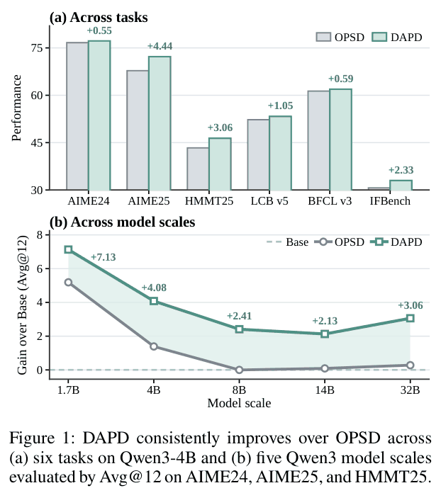

*图 1：(a) Qwen3-4B 上的六项任务，灰色柱是 OPSD，绿色柱是 DAPD，纵轴是各基准的分数（从 30 开始画，所以 IFBench 的柱子很矮）。柱子上方的数字是 DAPD 比 OPSD 高多少：AIME25 最多（+4.44），AIME24 和 BFCL v3 只高零点几。(b) 五个 Qwen3 尺寸，纵轴是三个数学竞赛的平均正确率（Avg@12）相对原模型的提升，虚线是原模型自己（0），绿线旁标的数字是 DAPD 相对原模型的提升。OPSD（灰线）从 1.7B 的 +5.19 一路降到 8B 以上几乎为 0；DAPD（绿线）在 8B 以上仍有 +2.13～+3.06。*

---

## 1. 先认识几个词

| 词 | 大白话 |
| --- | --- |
| 在线蒸馏（on-policy distillation，OPD） | 学生模型自己作答，老师对答案里的每个 token 给出"这里该怎么写"的概率分布，学生向它靠拢。练的是自己会写出的内容，这叫 on-policy；练别人写好的内容叫 off-policy |
| OPSD（在线自蒸馏） | 在线蒸馏的一种：老师就是学生自己，只是老师的提示词里多放了一份参考解答 |
| 参考解答 $`y^*`$、特权信息 | 数据集里给的完整解题过程，写清了步骤，不只是最终答案。训练时放进老师的提示词，考试时学生看不到，所以论文叫它特权信息 |
| 学生回答 $`y`$ | 当前模型针对题目自己采样写出的一条回答（论文叫 rollout） |
| None、Cross、Self | 同一个模型的三种读题方式，前文相同，只差提示词里额外放了什么：None 什么都不放（闭卷，考试时就是它）；Cross 放另一段完整文本；Self 放它正在预测的这段文本本身 |
| 特权幻觉 | 学生学到了只有看过参考解答才写得出的行为。考试时没有参考解答，它却表现得像看过一样，比如推不下去就报一个"想起来"的答案 |
| 错误声称（wrong claims） | 论文量化特权幻觉的指标：模型先承认推导失败，再说某个具体答案来自记忆、参考答案或外部来源，而且最终答案是错的。按每万次生成出现几次来统计 |
| 纠缠蒸馏 | 论文对 OPSD 原损失的叫法：老师的建议里，学生自己推得出来的部分和只有看过答案才写得出的部分，被混在一起教给了学生 |
| Inference Anchor | DAPD 新加的一项损失：闭卷的 None 当老师，教开卷的 Self。桌上放着解答，也要像没看过那样预测 |
| Privileged Anchor | DAPD 新加的另一项损失：开卷的 Cross 当老师，教开卷的 Self。双方桌上都有完整解答，比较是公平的。第 3 节的诊断实验只用这一项训练，论文也用这个名字称呼那个实验 |
| LoRA | 只训练加在原模型上的一小组低秩参数，原模型本身不动。关掉 LoRA，就回到训练前的原模型 |
| 双路径锚定（DPA） | 在一个方向内，用两条信息对等的路径（无条件路径、特权路径）代替 OPSD 的单条路径 |
| 双来源锚定（DSA） | 参考解答和学生回答轮流当"被打分的文本"和"提示词里的参考"，两个方向加权合起来。给学生回答打分、参考解答放进提示词的方向叫参考解答指导，记作 $`y\to y^*`$；反过来叫学生回答指导，记作 $`y^*\to y`$ |
| KL 散度、forward KL | KL 散度衡量两个概率分布差多远，越小越接近，而且不对称。forward KL 指老师在前、学生在后的那个方向 |
| Avg@12 | 每道题采样 12 次，取平均正确率。下文的"推理 Avg@12"是 AIME24、AIME25、HMMT25 三个数学竞赛的不加权平均 |

## 2. 它想解决什么问题

大模型预训练之后，要靠后训练学会推理。常见做法有三类：

- **SFT（监督微调）**：照着标准解答逐字模仿。解答是别人写的，和模型自己的写法有差距。
- **强化学习**：模型自己做题，只在最后告诉它答案对不对。反馈很稀疏。
- **在线蒸馏**：模型自己做题，老师对每个 token 给出"这里应该怎么写"的概率分布，模型向这个分布靠拢。练的是自己会写出的内容，反馈又细到每个 token。

OPSD 是在线蒸馏的一个变体：老师不是另一个更大的模型，而是学生自己，只是老师的提示词里多放了一份参考解答 $`y^*`$（论文称为特权信息，具体提示词见第 6 节的表 4）。打个比方（类比是我加的，不是论文原文）：学生闭卷做题，旁边坐着一个翻着答案册的自己，逐字告诉学生"换我会这么写"。

**选读：OPSD 的损失。** 不看也不影响理解。

```math
\mathcal{L}_{\text{OPSD}}=\mathbb{E}_{(x,y^*)\sim\mathcal{D},\ y\sim p_\theta(\cdot\mid x)}\Big[\frac{1}{|y|}\sum_{t=1}^{|y|}D\big(\mathrm{sg}[p_{\text{Cross}}]\,\|\,p_{\text{None}}\big)\Big]
```

- $`p_{\text{None}}=p_\theta(\cdot\mid x,y_{<t})`$：只看题目 $`x`$ 和已经写下的前文，也就是考试时的状态。
- $`p_{\text{Cross}}=p_\theta(\cdot\mid x,y_{<t},y^*)`$：同一个模型，但提示词里还放着参考解答。它当老师。
- $`\mathrm{sg}[\cdot]`$ 表示老师这一侧不回传梯度，不被更新；$`D`$ 衡量两个分布的差距，本文用 forward KL。

**毛病：特权幻觉。** 两个"自己"看到的东西不一样。老师翻着答案册，学生考试时没有。所以老师的建议里混着两类内容：

1. **学生自己也推得出来的**：比如参考解答用的思路、某一步的推导方法。看着题目，学生也能想到。这是有用的监督。
2. **只有看过答案才写得出的**：比如推到一半卡住时，看过答案的老师会直接写出最终结果。学生考试时没有答案，这一步学了也用不上。

OPSD 把两类内容一起教给学生，论文把这种混在一起的更新叫纠缠蒸馏（Entangled Distillation）。学生学到第 2 类，就会出现特权幻觉（privilege illusion）：推不下去时，表现得好像自己知道答案，报出一个"想起来"的数。

为了量化这种行为，论文定义了错误声称：模型先承认推导失败，再把一个具体答案归于记忆、参考答案、官方解答或外部来源，并且最终答案是错的。一般的不确定表述、普通猜测、回忆公式、"查阅后"之类的泛泛说法不算（附录 C.2）。

图 2 是五个尺寸的 Qwen3 平均后的训练曲线。OPSD（灰线）到训练后期，错误声称从第 200 步的每万次生成 12.96 次涨到第 300 步的 37.04 次。同一段时间里，推理 Avg@12 从 59.56 掉到 53.24（最高点是第 100 步的 61.50）。训练越久，模型越爱"装懂"，分数也越低。

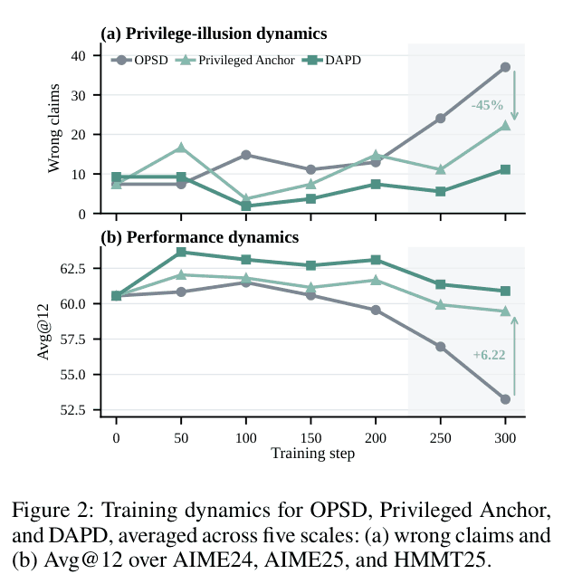

*图 2：横轴是训练步数，每条线都是五个尺寸的平均：OPSD（灰）、Privileged Anchor（浅绿，第 3 节的对照实验）、DAPD（深绿）。灰色阴影是训练后期（第 250～300 步）。(a) 纵轴是每万次生成里的错误声称次数。OPSD 在第 200 步后快速上升；Privileged Anchor 在第 300 步比 OPSD 少 40%，图中标的 −45% 是第 250、300 两个检查点合计的次数（33 次对 18 次）；DAPD 从第 100 步起一直最低。(b) 纵轴是推理 Avg@12。OPSD 从第 100 步开始下滑；DAPD 在第 50 步达到最高的 63.65，之后也缓慢下降，第 300 步是 60.90，仍比 OPSD 高 7.66 分。图中的 +6.22 是第 300 步 Privileged Anchor 比 OPSD 高出的分数。各点的数值见附录表 7（第 7.6 节）。*

**已有的修补办法为什么不够。** 已有工作分两类：

| 路线 | 做法 | 问题 |
| --- | --- | --- |
| 直接使用特权信息 | 老师看着参考解答，把完整监督蒸馏给学生，例如 OPSD 和 π-Distill | 有答案的老师直接监督没答案的学生，信息不对称原样保留 |
| 有选择地传递 | 过滤或重新加权老师信号，压掉依赖特权信息的部分，例如 Purified OPSD、DOPD，以及 AVSD、SCOPE、UCOB | 改的是老师信号，老师和学生看到的信息仍然不对等 |

作者认为它们的局限是结构性的。这些方法改的是老师信号，没有让老师和学生看到的信息对等，所以始终是一个有答案的老师在监督一个没答案的学生。另外，它们只把参考解答当指导来源，忽略了学生变强以后，它自己的回答里也有好的推理。

论文要回答的问题是：**老师看着参考解答、学生看不到，这种不对等能不能从训练目标的结构上消掉，同时保住参考解答带来的正确性指导？**

## 3. 先确诊：问题出在信息不对称

作者先做了一个对照实验，叫 Privileged Anchor：老师不变，仍是看着参考解答的 Cross；只把被训练的一方从 None 换成 Self，也就是提示词里放着它正在预测的这段回答本身的同一个模型。这样老师和被训练的一方眼前都有一份完整解答，信息量对等了。这个对照其实只用了第 4 节要讲的 Privileged Anchor 一项损失训练，所以论文的图表里也用这个名字称呼它。

结果见图 2 的浅绿线：训练后期的错误声称比 OPSD 少 45%，第 300 步的推理 Avg@12 高 6.22 分（59.46 对 53.24）。老师没换，只是让双方信息对等，问题就明显缓解。作者由此认为，病根是信息不对称，而不是老师水平不够。这个对照能说明多少，见第 9 节。

从这个诊断出发，作者给出解决特权幻觉的两个条件：

1. 引入中间的监督目标（论文叫锚点），在信息对等的条件下对齐参考解答和学生回答上的行为；
2. 在可靠的参考解答指导和学生够得着的回答指导之间取得平衡。

DAPD 的两个组件分别对应这两条。

## 4. 核心做法：用 Self 当桥，两条路径、两个方向

**同一个模型的三种读题方式。** 设 $`s`$ 是被打分的那段文本，可以是学生回答 $`y`$，也可以是参考解答 $`y^*`$；$`\bar s`$ 是另一段。在第 $`t`$ 个 token，三种分布的前文都是 $`s_{<t}`$，区别只在提示词里额外放了什么：

| 名称 | 公式 | 提示词里额外放了什么 | 大白话 |
| --- | --- | --- | --- |
| None | $`p^s_{\text{None}}=p_\theta(\cdot\mid x,s_{<t})`$ | 什么都没有 | 闭卷。考试时就是它 |
| Cross | $`p^s_{\text{Cross}}=p_\theta(\cdot\mid x,s_{<t},\bar s)`$ | 另一段完整文本 $`\bar s`$ | 开卷，桌上放着另一份解答 |
| Self | $`p^s_{\text{Self}}=p_\theta(\cdot\mid x,s_{<t},s)`$ | 正在预测的这段文本 $`s`$ 本身 | 开卷，桌上放着"自己正在写的这份" |

为什么 Self 能当桥：

- 和 Cross 比，Self 同样"眼前有一份完整解答"，两者信息量对等。
- 和 None 比，Self 是同一套参数。训练 Self，改的就是考试时用的那个模型。

所以 Self 正好补上中间的空位：一边是可训练、但没有特权信息的学生，另一边是有特权信息、但不更新的老师。DAPD 用 Self 搭锚点，在信息对等的条件下对齐参考解答和学生回答上的行为，而不是让有答案的老师直接监督没答案的学生。

**两层锚定。** 图 3 右边是双路径锚定（DPA）：在一个方向内，用两条信息对等的路径代替 OPSD 的单条路径。左边是双来源锚定（DSA）：参考解答和学生回答轮流充当"被打分的文本"和"老师手里的提示"，两个方向加权合起来。下面先讲三种基本损失，再讲它们怎么组成两条路径、两个方向。

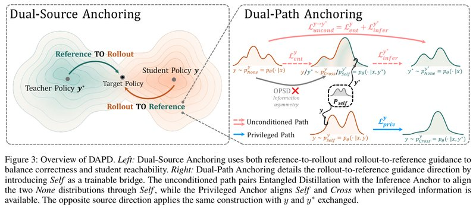

*图 3：DAPD 总览。左：双来源锚定同时使用两个方向的指导（图中标作 Reference TO Rollout 和 Rollout TO Reference），平衡正确性和学生能否学得到。右：双路径锚定展开了其中一个方向（给学生回答打分、参考解答当提示），引入 Self 作为可训练的桥。上面的粉色虚线是无条件路径，把纠缠蒸馏和 Inference Anchor 配对，经过 Self 对齐两侧的 None；下面的蓝色实线是特权路径，用 Privileged Anchor 在双方都开卷时对齐 Self 和 Cross。中间的灰色箭头和红叉标出 OPSD 的问题：它直接把不看答案的 None 拉向看着参考解答的分布，两者之间隔着信息不对称。另一个方向把学生回答和参考解答互换，做法相同。*

**三种"谁教谁"的损失。** 对每段被打分的文本，DAPD 定义三种有向损失，每一项都是"老师（不更新）教被训练的一方"：

- **纠缠蒸馏**：开卷的 Cross 教闭卷的 None。给学生回答打分时，它就是原来的 OPSD 损失。保留它，是为了继续把有用的特权指导传给学生。
- **Inference Anchor**：闭卷的 None 教开卷的 Self。意思是：桌上就算放着这份解答，也要像没看过那样预测下一个 token。它提供"不依赖特权信息"的锚点。
- **Privileged Anchor**：开卷的 Cross 教开卷的 Self。双方桌上都有一份完整解答，比较是公平的。

**举个例子**（我编的示意，不是论文里的）：Self 的提示词里放着它正在预测的文本，可以直接"抄"。比如某一步 Self 给下一个 token 0.99 的概率，闭卷的原始模型只给 0.6。不考虑截断时，Inference Anchor 把 0.99 往 0.6 拉，等于告诉模型：答案就算摆在眼前，也别比闭卷时更有把握。这个约束通过共享参数也作用在 Cross 老师身上（见第 5 节）。

**选读：三项损失的公式。** 不看也不影响理解。每一项里，前一个分布是老师（不回传梯度），后一个是被训练的一方：

```math
\mathcal{L}^s_{\text{ent}}=\mathbb{E}\big[D(\mathrm{sg}[p^s_{\text{Cross}}]\,\|\,p^s_{\text{None}})\big]\qquad(2)
```

```math
\mathcal{L}^s_{\text{infer}}=\mathbb{E}\big[D(\mathrm{sg}[p^s_{\text{None}}]\,\|\,p^s_{\text{Self}})\big]\qquad(3)
```

```math
\mathcal{L}^s_{\text{priv}}=\mathbb{E}\big[D(\mathrm{sg}[p^s_{\text{Cross}}]\,\|\,p^s_{\text{Self}})\big]\qquad(4)
```

期望对数据 $`(x,y^*)`$、学生当场采样的回答 $`y\sim p_\theta(\cdot\mid x)`$ 和 $`s`$ 里的 token 位置取平均。$`s=y`$ 时 $`\mathcal{L}^s_{\text{ent}}`$ 就是 OPSD 损失。

**双路径锚定（DPA）：一个方向内的两条路。** 先固定一个方向，比如"给学生回答打分、参考解答当提示"（$`y\to y^*`$）。DPA 把三种损失组成两条路径。

**无条件路径。** 考试时用的是 None，所以真正要对齐的是两个 None：学生回答上的 None 和参考解答上的 None，双方都不靠特权信息。做法是把两项加起来：

- 学生回答上的纠缠蒸馏（就是原 OPSD 损失），把学生回答上的 None 拉向看着参考解答的 Cross；
- 参考解答上的 Inference Anchor，把看着参考解答的 Self 拉向参考解答上的闭卷 None；
- 这里的 Self 和 Cross 参数相同，提示词里放的都是参考解答，论文把这对分布当作"代理桥"。

连起来是一条链：学生回答上的 None 被拉向 Cross，Cross 和 Self 相近，Self 又被拉向参考解答上的 None。两项一起优化，就把学生回答上的 None 隐式地拉向参考解答上的 None。附录 B 在明确假设下给了证明（见第 5 节）。

打个比方（类比是我加的，不是论文原文）：OPSD 只有一根绳子，看答案的老师直接拽学生。DAPD 在老师那一头也拴了一根：模型的"开卷模式"同时被要求像闭卷的原始模型那样说话。这个约束通过共享参数传到 Cross 上；OPSD 那一项的老师又是定期从学生复制的快照，复制之后老师也带上了这个约束（附录 B.3）。于是老师传给学生的内容，更接近"闭卷也说得出"的那部分。

**特权路径。** 双方都拿到完整解答时，Cross 拿到另一段，Self 拿到自己这段，Privileged Anchor 本身就信息对等，直接复用，不另加损失。对 $`y\to y^*`$，它在学生回答的 token 上，让"看着自己回答的预测"对齐"看着参考解答的预测"。

**选读：一个方向的 DPA 目标。** 不看也不影响理解。无条件路径是 $`\bar s`$ 上的 Inference Anchor 加 $`s`$ 上的纠缠蒸馏；两条路径合起来就是 DPA 目标（省略系数）：

```math
\mathcal{L}^{s\to\bar s}_{\text{uncond}}=\mathcal{L}^{\bar s}_{\text{infer}}+\mathcal{L}^{s}_{\text{ent}}\qquad(5)
```

```math
\mathcal{L}^{s\to\bar s}_{\text{DPA}}=\mathcal{L}^{s\to\bar s}_{\text{uncond}}+\mathcal{L}^{s}_{\text{priv}}\qquad(6)
```

以 $`y\to y^*`$ 为例，$`\mathcal{L}^{y\to y^*}_{\text{uncond}}=\mathcal{L}^{y^*}_{\text{infer}}+\mathcal{L}^{y}_{\text{ent}}`$；代理桥是 $`p^{y^*}_{\text{Self}}`$ 和 $`p^{y}_{\text{Cross}}`$。

**双来源锚定（DSA）：两个方向轮流提供指导。** DPA 解决了"一个方向内怎么对齐"，剩下的问题是"让谁来提供指导"。DSA 两个方向都用：

- **参考解答指导**（$`y\to y^*`$，论文叫 Rollout-to-Reference 方向）：被打分的是学生回答，参考解答当提示。参考解答可靠，但这样只有一个监督来源。
- **学生回答指导**（$`y^*\to y`$，论文叫 Reference-to-Rollout 方向）：被打分的是参考解答，学生自己的回答当提示。学生变强之后，它的回答里也有有用的推理，可能本身就是对的。这是学生够得着的指导，但不一定可靠。

论文的命名容易看反：箭头出发的一方是被打分的文本，箭头指向的一方是提示。把同样的 DPA 构造用到 $`y^*\to y`$，就是把上面的 $`y`$ 和 $`y^*`$ 互换：无条件路径变成学生回答上的 Inference Anchor 加参考解答上的纠缠蒸馏，特权路径变成参考解答上的 Privileged Anchor。两个方向按权重 λ 和 1−λ 加起来。λ 越大，越依赖参考解答的指导。实验里 1.7B 用 λ=0.5，4B 到 32B 用 λ=0.2。作者的说法是，两个方向都用，既保留了参考解答带来的正确性监督，又减少了对它的依赖。

**选读：DAPD 的总目标。** 不看也不影响理解。

```math
\mathcal{L}_{\text{DAPD}}=\lambda\,\mathcal{L}^{y\to y^*}_{\text{DPA}}+(1-\lambda)\,\mathcal{L}^{y^*\to y}_{\text{DPA}}\qquad(7)
```

其中 $`\mathcal{L}^{y^*\to y}_{\text{DPA}}`$ 的无条件路径是 $`\mathcal{L}^{y}_{\text{infer}}+\mathcal{L}^{y^*}_{\text{ent}}`$，特权路径是 $`\mathcal{L}^{y^*}_{\text{priv}}`$。

**和 OPSD 比，改了哪些地方：**

| | OPSD | DAPD |
| --- | --- | --- |
| 谁教谁 | Cross（看着参考解答）直接教 None（什么都不看） | 保留这一项，再加 None 教 Self、Cross 教 Self 两个锚点，组成两条信息对等的路径 |
| 被打分的文本 | 只有学生回答 | 学生回答和参考解答 |
| 老师手里的提示 | 只有参考解答 | 参考解答，或者学生自己的回答 |
| 损失项 | 1 项 | 3 种 × 2 个方向，共 6 项 |
| 推理时的开销 | 和原模型一样 | 和原模型一样 |

## 5. 为什么作者认为它管用

第 4 节说，无条件路径的两项损失一起优化，就能"隐式地"把学生回答上的闭卷分布拉向参考解答上的闭卷分布。论文附录 B 为这句话给了三步论证，每一步都写明了依赖的假设。

**（1）两个 None 之间的距离有上界（命题 1）。** 从"参考解答上的闭卷"走到"学生回答上的闭卷"，中间经过 Self 和 Cross 两站，总路程不超过三段之和。第一段由 Inference Anchor 压小，第三段由纠缠蒸馏压小，中间一段靠"桥一致性"假设：Self 和 Cross 是同一个模型，提示词里都放着参考解答，所以假设两者相近。

**（2）从单个 token 推到整条回答（命题 2）。** 每个 token 都和老师接近，整条回答的分布才接近，误差随长度累积。这一步说明，纠缠蒸馏能把老师在学生自己写的前文上的行为，传给考试时的整条生成。

**（3）共享参数把锚点的作用传给老师。** Inference Anchor 训练的是参考解答上的 Self，纠缠蒸馏的老师却是学生回答上的 Cross。两者共用一套参数，所以在 Self 上做一步更新，会顺带改变 Cross 的输出。只要两处的梯度方向大体一致（论文叫局部相容性），一步更新后 Cross 在期望上就会向参考解答一侧的 None 靠近。刷新老师快照后，这个变化再经由纠缠蒸馏传到学生回答一侧的 None。

作者在 Qwen3-4B 上实测了第（3）步要求的"方向一致"：4 个 LoRA 初始化 × 32 道题 × 每题 4 个位置，共 128 个位置。梯度点积均值 256.62，95% 置信区间 [147.55, 393.53]；余弦相似度 0.101，区间 [0.058, 0.144]。区间都大于 0，方向确实一致，但很弱：余弦 0.1 对应的夹角约 84°。

三步合起来，就是作者对"无条件路径为什么能把学生回答上的 None 拉向参考解答上的 None"的论证。它成立的前提是桥一致性和局部相容性两个假设；这两个假设检验到什么程度，见第 9 节。

**选读：三个结论的公式和算例。** 不看也不影响理解。

记号：$`n^*`$ 是参考解答前缀上的 None，$`n^y`$ 是学生回答前缀上的 None，$`s^*`$ 是参考解答前缀上的 Self，$`c^y`$ 是学生回答前缀上的 Cross。$`\Pi_x`$ 是把参考解答前缀和学生回答前缀配成对的一种方式。$`\mathcal E_{\text{infer}}=\mathbb E\,\mathrm{KL}(n^*\|s^*)`$ 是 Inference Anchor 的损失，$`\mathcal E_{\text{ent}}=\mathbb E\,\mathrm{KL}(c^y\|n^y)`$ 是纠缠蒸馏的损失。TV 是总变差距离，取值 0 到 1。

命题 1：

```math
\mathbb E_{\Pi_x}\mathrm{TV}(n^*,n^y)\le\sqrt{\mathcal E^{\Pi}_{\text{infer}}/2}+\epsilon+\sqrt{\mathcal E^{\Pi}_{\text{ent}}/2}\qquad(13)
```

推导：三角不等式 $`\mathrm{TV}(n^*,n^y)\le\mathrm{TV}(n^*,s^*)+\mathrm{TV}(s^*,c^y)+\mathrm{TV}(c^y,n^y)`$。第一、三项用 Pinsker 不等式 $`\mathrm{TV}\le\sqrt{\mathrm{KL}/2}`$，取期望后用 Jensen 不等式。中间一项靠桥一致性假设 $`\mathbb E\,\mathrm{TV}(s^*,c^y)\le\epsilon`$。算例：$`\mathcal E_{\text{infer}}=0.02`$，$`\mathcal E_{\text{ent}}=0.08`$，$`\epsilon=0.05`$，上界 $`=0.1+0.05+0.2=0.35`$。

命题 2：

```math
\mathrm{TV}\big(N_\theta(\cdot\mid x),P^r_\theta(\cdot\mid x)\big)\le\sqrt{\tfrac H2\,\mathcal E_{\text{ent}}(x,r)}\qquad(17)
```

$`H`$ 是序列长度，$`\mathcal E_{\text{ent}}`$ 是沿学生自己采样的序列，把每个 token 的 KL 加起来。证明用的是逐位置替换的混合分布论证（引理 1），再用 Pinsker 和 Cauchy-Schwarz 不等式。算例：$`H=1024`$，平均每个 token 的 KL 是 0.001，则 $`\mathcal E_{\text{ent}}=1.024`$，上界 $`=\sqrt{512\times1.024}\approx22.9`$。TV 最大只有 1，所以这个上界不提供信息。要让上界小于 1，平均每个 token 的 KL 要低于 $`2/H^2\approx 1.9\times10^{-6}`$。

共享参数的传递：在参考解答前缀上对 Self 做一步 Inference Anchor 更新，学生回答前缀上 Cross 的 logits（归一化成概率之前的分数）变化为

```math
z_C(\theta^+)-z_C(\theta)=-\eta\,J_CJ_S^\top(p_S-q_N)+O(\eta^2)\qquad(19)
```

$`J_S`$、$`J_C`$ 是两处 logits 对参数的雅可比矩阵。记 $`g_S=p_S-q_N`$、$`g_C=p_C-q_N`$，局部相容性条件是 $`\mathbb E[g_C^\top J_CJ_S^\top g_S]\ge\gamma>0`$（式 (20)）。满足时，一步更新后 Cross 对参考解答一侧 None 的交叉熵在期望上至少下降 $`\eta\gamma`$（忽略二阶项，式 (21)）。上面的实测量的就是式 (20) 里这个量。

## 6. 让它真正跑起来的几个细节

**（1）三套参数，六项损失。** DAPD 训练时同时用到三套参数：

- 当前的 LoRA 学生：所有被训练的分布都来自它，学生回答也由它采样。
- 学生快照：当前 LoRA 学生的一份拷贝，训练中定期刷新，只给两项纠缠蒸馏当老师。论文没写刷新间隔，官方代码里是每 100 步。
- 原始模型：关掉 LoRA 的基座模型，全程不变，给 Inference Anchor 和 Privileged Anchor 当老师。

所有老师一侧都不回传梯度。两个方向各三项，一共六项（按附录 A.4 和 A.7 整理；公开代码 `dapd/objective.py` 里的六个 `Pair` 定义与此一致）：

| 方向（权重） | 损失项 | 在哪段文本上打分 | 老师（不更新） | 被训练的一方 |
| --- | --- | --- | --- | --- |
| 参考解答指导 $`y\to y^*`$（λ） | 纠缠蒸馏，即 OPSD 原损失 | 学生回答 $`y`$ | Cross（提示词含 $`y^*`$），学生快照 | None |
| | Inference Anchor | 参考解答 $`y^*`$ | None，原始模型 | Self（提示词含 $`y^*`$） |
| | Privileged Anchor | 学生回答 $`y`$ | Cross（提示词含 $`y^*`$），原始模型 | Self（提示词含 $`y`$） |
| 学生回答指导 $`y^*\to y`$（1−λ） | 纠缠蒸馏 | 参考解答 $`y^*`$ | Cross（提示词含 $`y`$），学生快照 | None |
| | Inference Anchor | 学生回答 $`y`$ | None，原始模型 | Self（提示词含 $`y`$） |
| | Privileged Anchor | 参考解答 $`y^*`$ | Cross（提示词含 $`y`$），原始模型 | Self（提示词含 $`y^*`$） |

**（2）老师和 Self 的提示词。** Cross 和 Self 用同一个模板（表 4），区别只是放进参考解答位置的是哪段文本：Cross 放另一段，Self 放被打分的这段自己。这些额外文本只在构造训练分布时出现，推理时的提示词里没有。

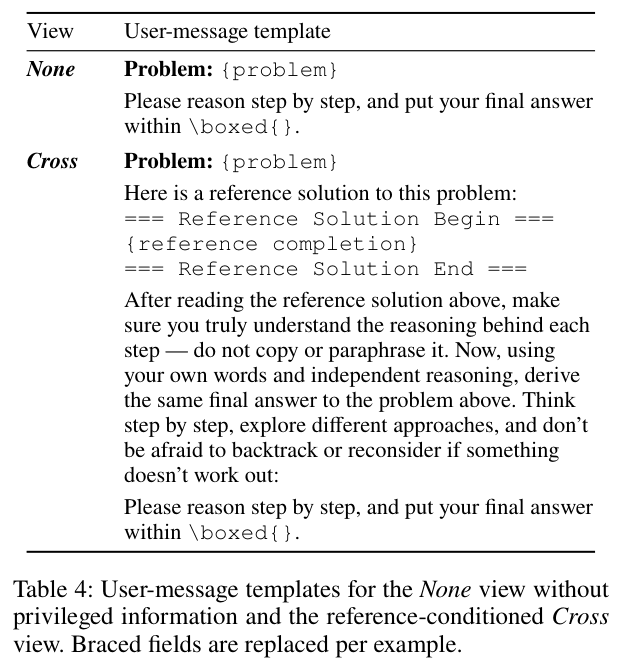

*表 4：None 和 Cross 两种读题方式的用户消息模板，花括号里的字段按样本替换。None 只有题目和"请逐步推理，把最终答案写在 `\boxed{}` 里"。Cross 在题目后插入"这是本题的一份参考解答"，用分隔符包住完整解答，并特意要求模型"确保理解每一步的推理，不要照抄或改写；用自己的话独立推理，得出同样的最终答案"，还鼓励它逐步思考、尝试不同做法、走不通就回头重想。表里没有 Self：它用 Cross 的模板，只是参考解答的位置放的是它正在预测的那段文本本身（附录 A.3）。*

论文附录 A.3 给了一个训练样本：比较 $`p=2^{3009}`$、$`q=3^{2006}`$、$`r=5^{1003}`$ 的大小。参考解答把它们改写成 $`8^{1003}`$、$`9^{1003}`$、$`5^{1003}`$，得出 $`r<p<q`$。None 的提示词只有题目和作答要求；Cross 和 Self 的提示词在两个分隔符之间放进这段完整推导。所以特权信息是一份写清楚步骤的完整解答，而不是一个标签或老师的隐藏状态。

**（3）差距度量：每个词表分量都封顶的 forward KL。** 每个 token 在整个词表上算 forward KL，老师在前、学生在后，每个词表分量的贡献封顶为 $`c=0.05`$，再对 token 取平均。老师和学生的 logits（换算成概率之前的分数）都先除以温度 $`T=1.1`$。两边分布都在采样出来的前文上直接计算，不需要重要性采样比。逐分量截断是沿用 OPSD 原论文的做法。我的理解是，它防止少数分歧特别大的位置主导训练。表 8 显示，去掉截断后 4B 从 65.28 掉到 62.50（见第 7.10 节）。

**选读：式 (8) 和两个算例。** 不看也不影响理解。

```math
\ell_c(q,p)=\sum_{v\in\mathcal V}\min\big\{q_v(\log q_v-\log p_v),\ c\big\},\qquad c=0.05\qquad(8)
```

$`q`$ 是老师分布（不更新），$`p`$ 是学生分布，$`\mathcal V`$ 是整个词表。官方代码里就是 `F.kl_div(...).clamp(max=0.05)`。

- 不截断（我编的数字，不是论文里的）：词表只有 3 个 token，老师 $`q=(0.7,0.2,0.1)`$，学生 $`p=(0.5,0.3,0.2)`$。三个分量是 $`0.7\ln\frac{0.7}{0.5}=0.2355`$、$`0.2\ln\frac{0.2}{0.3}=-0.0811`$、$`0.1\ln\frac{0.1}{0.2}=-0.0693`$，加起来 KL = 0.0851。对学生 logits 的梯度是 $`p-q=(-0.2,+0.1,+0.1)`$。梯度下降后，第 1 个 token 的概率上升，学生向老师靠拢。
- 截断：第 1 个分量 0.2355 超过 0.05，被截成常数，不再有梯度。剩下两项的梯度是 $`(+0.15,-0.11,-0.04)`$，梯度下降反而让第 1 个 token 的概率下降。第 9 节会再讨论这个现象。

**（4）只训练 LoRA。** 秩 64、缩放系数 128，加在所有注意力层和前馈层（MLP）的投影矩阵上。

**（5）每一项实际占多少权重。** 六项损失的系数按附录 A.7 的方式分配：总权重记为 κ；λ 在两个方向之间分配；每个方向内，纠缠蒸馏的系数记为 1，Inference Anchor 和 Privileged Anchor 分别是它的 $`\beta_{\text{infer}}`$ 倍和 $`\beta_{\text{priv}}`$ 倍，再把三项缩放到这个方向的总权重。每个尺寸用的系数见表 5。

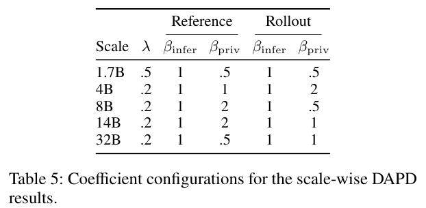

*表 5：各尺寸 DAPD 结果所用的系数。λ 是参考解答指导方向的总权重；Reference 两列和 Rollout 两列分别是参考解答指导方向、学生回答指导方向内部的 $`\beta_{\text{infer}}`$、$`\beta_{\text{priv}}`$，即 Inference Anchor 和 Privileged Anchor 相对纠缠蒸馏的倍数（表里的 .5 就是 0.5）。代入式 (9) 后每一项的实际权重见下表。1.7B 到 14B 的配置都正好是表 3(c)(d) 扫描里分数最高的那组；32B 的配置论文没给扫描结果。4B 的代码、指令遵循模型也用 4B 这一行。*

把表 5 的系数代入，得到每一项的实际权重（以 κ 为单位，是我按公式算的，论文没有直接给出）。每个方向的三项依次是纠缠蒸馏、Inference Anchor、Privileged Anchor：

| 尺寸 | λ | 参考解答指导的三项 | 学生回答指导的三项 | OPSD 原项占比 | 落在参考解答 token 上的占比 |
| --- | --- | --- | --- | --- | --- |
| 1.7B | 0.5 | (0.20, 0.20, 0.10) | (0.20, 0.20, 0.10) | 20% | 50% |
| 4B | 0.2 | (0.067, 0.067, 0.067) | (0.20, 0.20, 0.40) | 6.7% | 67% |
| 8B | 0.2 | (0.05, 0.05, 0.10) | (0.32, 0.32, 0.16) | 5% | 53% |
| 14B | 0.2 | (0.05, 0.05, 0.10) | (0.267, 0.267, 0.267) | 5% | 58% |
| 32B | 0.2 | (0.08, 0.08, 0.04) | (0.267, 0.267, 0.267) | 8% | 61% |

公开代码的默认权重是 (2/15, 2/15, 2/15) 和 (2/5, 2/5, 4/5)，合计为 2，正好是 4B 配置乘以 κ=2。从这张表能看出两点：

- 原来的 OPSD 损失在 DAPD 里只占 5%～20% 的权重，大部分权重给了新加的锚点和反方向。
- 4B 以上，超过一半的权重落在参考解答的 token 上。对学生来说，这些是它没写过的前文（off-policy 的位置）。第 9 节会再讨论这一点。

**选读：式 (9) 和一个算例。** 不看也不影响理解。参考解答指导方向的三项系数是

```math
(w^{\text{ref}}_{\text{ent}},w^{\text{ref}}_{\text{infer}},w^{\text{ref}}_{\text{priv}})=\frac{\kappa\lambda}{1+\beta^{\text{ref}}_{\text{infer}}+\beta^{\text{ref}}_{\text{priv}}}\,(1,\beta^{\text{ref}}_{\text{infer}},\beta^{\text{ref}}_{\text{priv}})\qquad(9)
```

学生回答指导方向同理，把 λ 换成 1−λ、把上标 ref 换成 roll。算例（4B）：$`\lambda=0.2`$，$`\beta^{\text{ref}}=(1,1)`$，$`\beta^{\text{roll}}=(1,2)`$。参考解答指导方向是 $`\frac{0.2\kappa}{1+1+1}(1,1,1)=(0.067,0.067,0.067)\kappa`$；学生回答指导方向是 $`\frac{0.8\kappa}{1+1+2}(1,1,2)=(0.2,0.2,0.4)\kappa`$。六项合计等于 $`\kappa`$。官方代码的权重合计为 2，即 $`\kappa=2`$。

**（6）一个小批次的完整流程。** 按附录 A.4 和上面的设置整理成伪代码（刷新间隔取自官方代码）：

```text
算法：DAPD（一个小批次）
输入：数据 (x, y*)；当前 LoRA 学生 θ；原始模型 θ0（关掉 LoRA，冻结）；
      学生快照 θsnap；权重 w（式 9 + 表 5）；截断 c = 0.05；温度 T = 1.1
1: y ← 用当前学生采样一条回答            // T=1.1，top-p 0.95，top-k 20，最多 1024 个 token
2: 对 s ∈ {y, y*}：                      // s̄ 是另一段
3:     None_s  ← p(· | x, s<t)           // 闭卷
4:     Cross_s ← p(· | x, s<t, s̄)        // 提示词里放另一段
5:     Self_s  ← p(· | x, s<t, s)        // 提示词里放自己这段
6: // 参考解答指导方向 y → y*（权重含 λ）
7:     L1 ← KLc(Cross_y[θsnap] ‖ None_y[θ])      // 纠缠蒸馏 = 原 OPSD
8:     L2 ← KLc(None_y*[θ0]    ‖ Self_y*[θ])     // Inference Anchor
9:     L3 ← KLc(Cross_y[θ0]    ‖ Self_y[θ])      // Privileged Anchor
10: // 学生回答指导方向 y* → y（权重含 1−λ）：把 7～9 行的 y 和 y* 互换，得到 L4～L6
11: L ← Σ_k w_k · L_k                    // 老师一侧全部不回传梯度
12: 反向传播，只更新 LoRA 参数
13: 每 100 步：θsnap ← θ                 // 间隔来自官方代码，论文未写
```

`KLc` 是式 (8) 的截断 forward KL，对被打分文本的每个 token 取平均。

## 7. 实验结果

### 7.1 实验怎么设计的

- **模型**：Qwen3（arXiv 2505.09388）的 1.7B、4B、8B、14B、32B。除非特别说明，结果都来自 Qwen3-4B。推理、代码、指令遵循三类任务各训一个模型。
- **训练数据**：OpenThoughts（arXiv 2506.04178）。推理用数学部分（官方仓库给出的训练集有 29,434 条），代码用代码部分，指令遵循用数学、代码、科学三部分的混合。评测题已从训练集中剔除。
- **评测**：
  - 推理：AIME24、AIME25、HMMT25（2 月赛），每套 30 题。每题采样 12 次（温度 1.0，top-p 0.95，打开思考模式，最多 38,912 个新 token），只核对最终答案，取平均正确率，即 Avg@12。三套题的不加权平均就是"推理 Avg@12"。
  - 代码：LiveCodeBench v5（下文简称 LCB v5，指标是 Pass@1）、BFCL v3（多轮函数调用，看总体准确率）。
  - 指令遵循：IFBench，用官方发布的验证器打分。
  - 各基准都用官方的评测工具、提示词和答案解析规则。
- **对照方法**：原模型（Base），以及两组 OPSD 类方法。第一组直接使用特权监督：OPSD、SDFT、SDPO。第二组有选择地修改特权信号：Purified OPSD、DOPD。各方法的做法见第 11 节。所有对照方法用相同的学生模型和数据，各自的优化细节按原论文。
- **训练**：只训练 LoRA（秩 64，缩放系数 128）；学习率 5e-6，按 500 步线性衰减，不预热；梯度范数裁剪 0.1；bf16 精度；等效批大小 32。随机种子都是 42，所有方法用同一个种子，让初始化、数据顺序和采样都对齐，主要数字都按这个设置报告。训练时每题采样 1 条回答，温度 1.1，最多 1,024 个新 token。硬件是 8 张 A100-80GB。代码和指令遵循模型用同样的 LoRA 设置、优化器、更新步数和 DAPD 目标，系数用表 5 的 4B 一行。

读数时注意：AIME 和 HMMT 每套只有 30 题，答对一题就是 3.33 分。Avg@12 把每题做 12 遍取平均，能减小采样带来的波动，但题目总量不变。

### 7.2 Qwen3-4B 上：六项平均比 OPSD 高 2.00 分

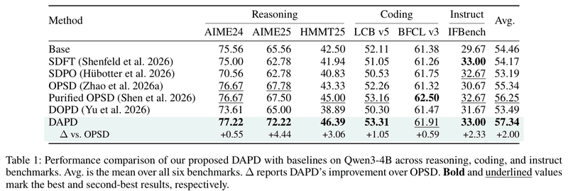

*表 1：Qwen3-4B 上 DAPD 与各对照方法在推理（AIME24、AIME25、HMMT25）、代码（LCB v5、BFCL v3）、指令遵循（IFBench）六项基准上的分数。Avg. 是六项平均，最后一行 Δ 是 DAPD 相对 OPSD 的提升；粗体是最好，下划线是第二好。DAPD 的六项平均是 57.34，OPSD 是 55.34。DAPD 比 OPSD 高 2.00，比 Purified OPSD 高 1.09，比 DOPD 高 3.85，比原模型高 2.88。*

怎么读这张表：

- **提升集中在三项**：AIME25（OPSD 67.78，DAPD 72.22，+4.44）、HMMT25（+3.06）和 IFBench（+2.33）。AIME24 和 BFCL v3 只高零点几（+0.55、+0.59）。
- **并非每项都第一**：BFCL v3 最好的是 Purified OPSD（62.50），IFBench 上 DAPD 与 SDFT 并列（33.00）。
- **有的对照方法不如原模型**：SDFT、SDPO、DOPD 的六项平均（54.17、53.19、53.49）都低于原模型的 54.46。

作者的解读有两层：

- 和直接使用特权监督的方法比，DAPD 保留了特权监督中有用的部分，同时减少了推理时的信息错配。
- Purified OPSD 和 DOPD 仍处在信息不对称的设置里：它们修改或分流特权信号，但老师和学生看到的信息依然不同。DAPD 直接改变监督结构，所以作者认为"让信息对等"比"过滤或分流不对等的信号"更有效。

### 7.3 换尺寸：OPSD 的提升消失，DAPD 仍比 OPSD 高约 2 分

图 1(b) 画的是五个尺寸上相对原模型的提升，每个基准的完整数字在附录表 6：

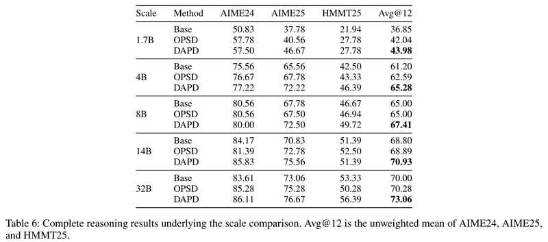

*表 6：五个尺寸各自的推理成绩，每个尺寸三行依次是原模型（Base）、OPSD、DAPD，最后一列 Avg@12 是三项的不加权平均，粗体标出该尺寸最高的平均分。DAPD 在每个尺寸的平均分都最高。原模型、OPSD、DAPD 五个尺寸的平均分分别是 60.37、61.76、64.13。OPSD 在 14B 的 AIME24 上比原模型还低 2.78 分，在 32B 的 HMMT25 上低 3.05 分。*

只看最后一列推理 Avg@12（%）：

| 尺寸 | 原模型 | OPSD | DAPD | DAPD 减 OPSD |
| --- | --- | --- | --- | --- |
| 1.7B | 36.85 | 42.04 | **43.98** | +1.94 |
| 4B | 61.20 | 62.59 | **65.28** | +2.69 |
| 8B | 65.00 | 65.00 | **67.41** | +2.41 |
| 14B | 68.80 | 68.89 | **70.93** | +2.04 |
| 32B | 70.00 | 70.28 | **73.06** | +2.78 |

怎么读这张表：

- **OPSD 的提升随尺寸增大迅速消失**：相对原模型，1.7B 上 +5.19，4B 上 +1.39，8B、14B、32B 上只有 0.00、+0.09、+0.28。
- **DAPD 一直有提升**：相对原模型依次是 +7.13、+4.08、+2.41、+2.13、+3.06；相对 OPSD 依次是 +1.94、+2.69、+2.41、+2.04、+2.78。
- **按基准拆开**：DAPD 在每个尺寸的 AIME25 上都高于 OPSD（五个尺寸平均 +3.94）；HMMT25 平均 +2.17，但 14B 上低 1.11；AIME24 平均只有 +1.00，在 1.7B 和 8B 上还略低。

作者的解释：模型越大，自己的回答里有用的推理和自我纠错越多。OPSD 的老师手里有参考解答，可以绕过这些步骤，所以特权幻觉的代价越来越大，抵消了学生回答变好带来的收益。DAPD 用信息对等的监督保住了这部分收益。

### 7.4 只用数学训练，代码题也更好

只用数学数据训练 4B 模型，再拿去测代码和指令遵循。

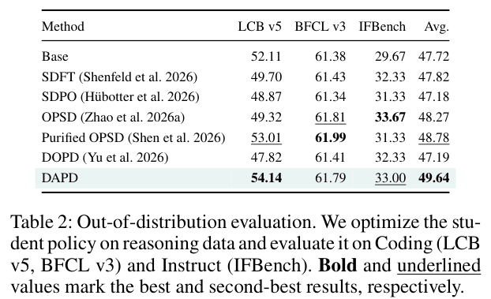

*表 2：学生只在推理（数学）数据上训练，再测代码（LCB v5、BFCL v3）和指令遵循（IFBench），Avg. 是三项平均；粗体最好，下划线第二好。DAPD 的三项平均最高（49.64），比 OPSD 高 1.37。差距主要来自 LCB v5：DAPD 54.14，OPSD 49.32，DAPD 高 4.82，也比原模型高 2.03；OPSD 反而比原模型低 2.79。BFCL v3 和 IFBench 上 DAPD 与其他方法相当，IFBench 最高的是 OPSD（33.67）。*

作者认为，这说明信息对等的目标在用来优化的推理基准之外也更稳健。还有一个有意思的数：只用数学训练的 DAPD，LCB v5 得分（54.14）比表 1 里专门用代码数据训练的 DAPD（53.31）还高。

### 7.5 推理时的样子：OPSD 卡住就"想起"一个答案

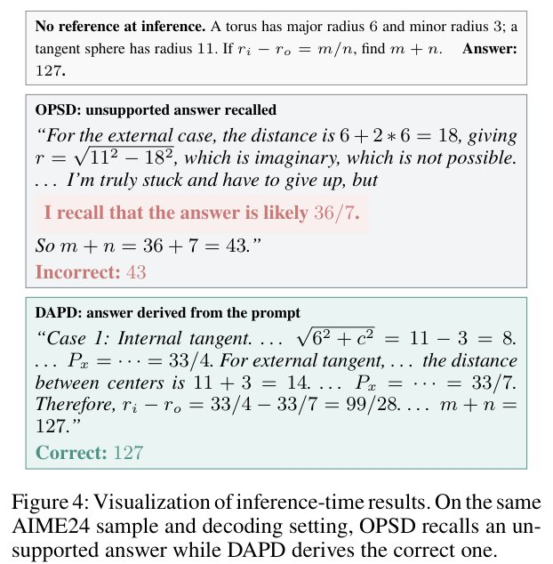

*图 4：同一道 AIME24 题、同样的解码设置下两个模型的输出，推理时两个模型都看不到参考解答。题目是一个圆环（大半径 6，小半径 3）和一个半径 11 的球相切，求内切、外切两种情况下切圆半径之差 $`r_i-r_o=m/n`$ 中的 $`m+n`$，答案是 127。OPSD 训练出的模型在外切情况下算出 $`r=\sqrt{11^2-18^2}`$，是虚数，接着说"我真的卡住了，只能放弃，但我记得答案很可能是 36/7"，最后答 43，错了。DAPD 训练出的模型分别算出内切时 33/4、外切时 33/7，相减得 $`99/28`$，答 127，对了。*

这正是作者说的特权幻觉：训练时老师总能看到答案，学生学会了"推不下去就报一个答案"，可考试时并没有答案可看。附录 C.2 的统计显示，训练后期（第 250、300 两个检查点合计），OPSD 出现 33 次这种情况，DAPD 只有 9 次，少 73%。附录 D 又给了三个例子：

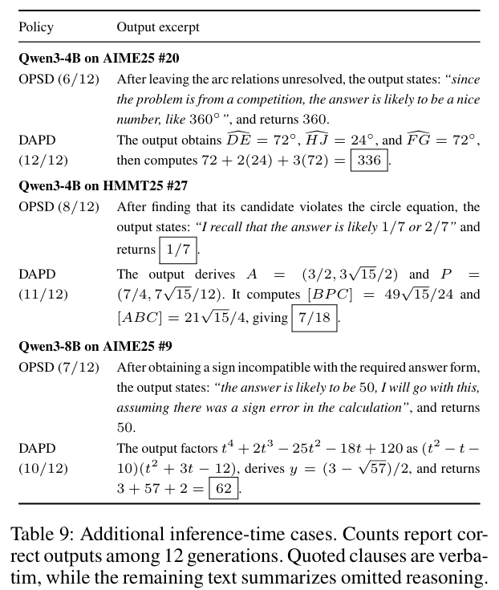

*表 9：附录 D 的三个推理时案例，括号里是 12 次生成中答对的次数，引号内是原文摘录，其余文字是对省略推理的概括。三个例子里，OPSD 的错误输出都是同一种模式。（1）Qwen3-4B 做 AIME25 第 20 题：OPSD 没解出圆弧关系，就说"既然是竞赛题，答案应该是个漂亮的数，比如 360°"，答 360；DAPD 求出三段弧分别为 72°、24°、72°，算出 $`72+2(24)+3(72)=336`$。（2）Qwen3-4B 做 HMMT25 第 27 题：OPSD 发现候选点不满足圆的方程后，说"我记得答案很可能是 1/7 或 2/7"，答 1/7；DAPD 求出两个三角形面积之比 $`\frac{49\sqrt{15}/24}{21\sqrt{15}/4}=\frac{7}{18}`$。（3）Qwen3-8B 做 AIME25 第 9 题：OPSD 算出的符号与题目要求的形式不符后，说"答案很可能是 50，就当计算里有个符号错误吧"，答 50；DAPD 把 $`t^4+2t^3-25t^2-18t+120`$ 分解为 $`(t^2-t-10)(t^2+3t-12)`$，答 62。*

注意 OPSD 在这三道题上并非总是错：12 次里分别对了 6、8、7 次，DAPD 对了 12、11、10 次。这些案例是作者挑出来展示的。

### 7.6 从第 100 步起，DAPD 的"装懂"次数一直最低

图 2（第 2 节）画的是五个尺寸平均的训练曲线，背后的数字在附录表 7：

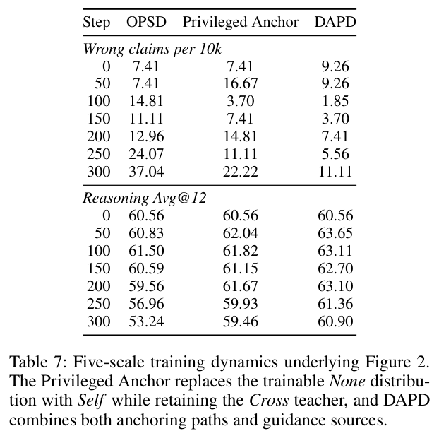

*表 7：图 2 背后的数字（附录 C.2），五个尺寸合在一起统计。上半部分是每万次生成里的错误声称次数，下半部分是推理 Avg@12，按训练步数排列。Privileged Anchor 是第 3 节的对照：把被训练的 None 换成 Self，Cross 老师不变；DAPD 同时用两条路径和两个来源。每个检查点有 5 个尺寸 × 90 道题 × 12 次采样 = 5,400 次生成，所以每万次 7.41 次对应 4 次，这个指标在单个检查点上的分辨率只有 1 次。最严重的 OPSD 第 300 步也只有 20 次，占生成总数的 0.37%。第 50～300 步合计，OPSD 有 58 次，Privileged Anchor 41 次，DAPD 21 次。*

怎么读这张表：

- **后期差距最大**：第 250、300 两个检查点合计，OPSD 33 次，Privileged Anchor 18 次（少 45%），DAPD 9 次（少 73%）。
- **分数同步变化**：OPSD 的平均分从第 100 步的 61.50 一路掉到第 300 步的 53.24；DAPD 第 50 步最高（63.65），第 300 步是 60.90，比 OPSD 高 7.66 分。作者认为，这两组数字合起来说明信息对等的锚定减少了特权幻觉，同时保住了训练后期的推理成绩。错误声称能解释多少掉分，见第 9 节。

### 7.7 两条路径、两个来源都有用

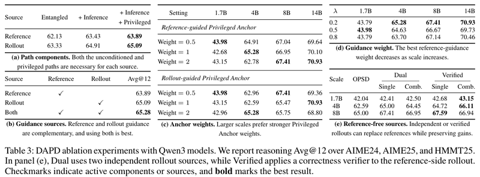

*表 3：消融实验，指标都是推理 Avg@12，粗体是最好结果。(a) 路径组件，Qwen3-4B：每个来源从只有纠缠蒸馏（Entangled）开始，依次加上 Inference Anchor 和 Privileged Anchor。(b) 指导来源，Qwen3-4B：只用参考解答指导、只用学生回答指导、两者都用，勾号表示启用的来源。(c) 锚点权重，1.7B～14B：分别改两个方向的 Privileged Anchor 权重。(d) 指导权重 λ，1.7B～14B。(e) 不用参考解答，1.7B～8B：Dual 用两条独立的学生回答，Verified 对参考解答一侧的回答用正确性验证器筛选。论文给各子表的结论依次是：两条路径对每个来源都必要；两种指导互补，两者都用最好；尺寸越大越适合更强的 Privileged Anchor 权重；最优的参考解答指导权重随尺寸增大而下降；用独立的或经过验证的学生回答代替参考解答，仍能保住提升。*

- **(a) 两条路径都要。** 参考解答指导方向：只有纠缠蒸馏 62.13，加 Inference Anchor 到 63.43（+1.30），再加 Privileged Anchor 到 63.89（+0.46）。学生回答指导方向：63.33 → 64.91（+1.58）→ 65.09（+0.18）。两个来源趋势一致，作者认为这说明两条路径都需要，也支持他们对信息不对称的分析：两种对齐都在信息对等的条件下构造，比直接传递特权分布更有效。从数字看，Inference Anchor 贡献更大。
- **(b) 两个来源都要。** 只用参考解答指导 63.89，只用学生回答指导 65.09，两者合起来 65.28。作者据此认为两种指导互补。不过合起来只比只用学生回答指导高 0.19 分。

### 7.8 最优配置随模型尺寸变化

作者引用两篇已有的分析（arXiv 2604.13016、arXiv 2607.05184）：蒸馏效果取决于老师和学生是否匹配、学生回答的质量和特权信息的多少。模型变大后学生回答变好，参考解答指导和学生回答指导之间的最佳平衡也可能跟着变。于是作者在四个尺寸上扫了 λ 和两个方向的 Privileged Anchor 权重（表 3(c)(d)）：

- **最优 λ**：1.7B 上是 0.5，4B、8B、14B 上是 0.2。
- **参考解答指导方向的 Privileged Anchor 权重**：最优值依次是 0.5、1、2、2。
- **学生回答指导方向的 Privileged Anchor 权重**：最优值依次是 0.5、2、0.5、1。

作者的解读是"可靠性与可达性的权衡"：小模型的回答噪声大，需要可靠的参考解答多纠正；大模型的回答更可靠，更受益于贴近自身分布的指导。

表 5 用的正是每个尺寸扫描里分数最高的配置。扫描里最好和最差的配置差多少，见第 9 节。

### 7.9 不用参考解答，换成学生自己的回答也行

既然学生回答也能提供指导，能不能干脆不用人工整理的参考解答？作者试了两个版本（表 3(e)）：

- **Dual 版本**：采样两条独立的回答 $`u`$、$`v`$（两者相同就重采 $`v`$），用 $`u`$ 代替参考解答，$`v`$ 当学生回答。两者都是学生自己写的，都可能是错的。它在 1.7B、4B、8B 上分别比 OPSD 高 0.46、2.41、2.41，作者认为这说明第二条回答不是多余的。
- **Verified 版本**：为 $`u`$ 采 4 个候选，取第一个通过验证器的，$`v`$ 不筛。这样提高了指导来源的可靠性，又没有把参考解答暴露给模型。它在 Dual 基础上再高 0.65、1.11、0.18，达到 43.15、66.11、67.59。在 4B 和 8B 上，这个版本甚至比用参考解答的 DAPD（65.28、67.41）还高。

正文报的这些数，是每个尺寸在表 3(e) 的 Single、Comb. 两列里取较高的那个。这两列的含义论文没有解释，我推测是单方向和两个方向合并（待确认）。作者的结论是：DSA 可以不靠人工整理的参考解答运行，有判对错的信号时，再加验证能让指导更可靠。

### 7.10 差距度量和截断不能随便换

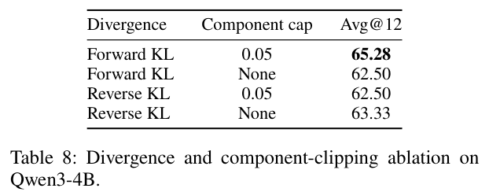

*表 8：Qwen3-4B 上差距度量（forward KL 或 reverse KL）和逐分量截断（上限 0.05，或不截断）的四种组合，指标是推理 Avg@12。forward KL 加截断最好，65.28；forward KL 不截断、reverse KL 加截断都是 62.50；reverse KL 不截断是 63.33。也就是说，截断帮了 forward KL，却让 reverse KL 变差。*

作者据此把截断的 forward KL 定为默认做法。这几种选择之间最多差 2.78 分，和 DAPD 相对 OPSD 的提升一样大（复现时的注意事项见第 10 节）。

## 8. 作者自己承认的局限

前三条是论文第 6 节写明的局限；后三条是附录 E 列的后续方向，也就是论文还没做到的事。

- **训练更贵。** DAPD 训练时要构造多个锚定分布，训练计算量增加；推理时没有额外开销。论文没有给出增加了多少。
- **权重可能要重新调。** 换尺寸或换模型架构时，权重可能要重新校准。实验里五个尺寸就用了五组不同的系数（表 5）。
- **验证版需要判对错的信号。** 第 7.9 节的 Verified 版本需要能自动判断答案对错，开放式任务可能没有这样的信号。
- **仍依赖固定的参考解答。** 作者提出，下一步可以把固定的参考解答换成经过验证或多数投票选出的学生回答，并随模型进步不断更新。
- **全局固定的权重太粗。** 参考解答和学生回答哪个可靠，会随题目、随 token 变化。作者提出以后在线估计可靠性，给出连续变化的来源权重和锚点权重，既不用一个全局系数，也不用容易出错的硬阈值。
- **只试了参考解答这一种特权信息。** 检索文档、工具调用记录、验证器反馈、中间计划这些推理时拿不到的信息，也可以放进同一框架研究，看锚点设计该怎么随特权信息的形式和可靠性调整。我的理解是，换成这些信息，信息不对称的问题会以同样的方式出现。

## 9. 读的时候值得留意的地方

以下是我读原文时注意到、论文没有重点讨论的点，供参考。

### 证据有多强

- **统计强度有限。** 所有结果只跑了一个随机种子。AIME、HMMT 每套 30 题，AIME25 上的 +4.44 分相当于平均多做对 1.33 道题。我按每题 12 次采样粗估，两种方法的三套平均分之差，仅采样带来的标准误就有 1.4～1.7 分（假设单次采样对错的方差 $`p(1-p)`$ 平均在 0.10～0.15 之间，$`p`$ 是这道题的答对率；不含训练本身的随机性）。单看一个尺寸，2～2.8 分的差距只有 1.2～2 倍标准误。五个尺寸方向一致，说服力更强一些。要坐实，需要多跑几个种子，并另设验证集挑配置。
- **超参数在测试题上挑。** 表 5 的配置正好是表 3(c)(d) 里测试分最高的那组。论文没提独立的验证集，官方脚本训练中也不做验证（见下面"对照公开代码"），所以最优配置的分数偏乐观。在这些扫描里，每个尺寸最好和最差的配置差 1.30～2.69 分，和 DAPD 相对 OPSD 的提升一样大。扫描里最差的配置，DAPD 相对 OPSD 的提升基本消失：4B 打平（62.59），14B 低 0.09，1.7B 和 8B 只高 0.64 和 0.47。
- **没说报告的是哪一步。** 官方脚本在第 200 步停止，图 2 却画到第 300 步。表 6 的五尺寸平均（OPSD 61.76、DAPD 64.13）高于表 7 里任何一个检查点的平均（最高 61.50、63.65），可能每个尺寸各取了最好的检查点（待确认）。如果选点也看测试分，就和上一条叠加。
- **错误声称解释不了大部分掉分。** OPSD 从第 200 步到第 300 步，平均分掉了 6.32 分，错误声称却只多了 13 次（每个检查点 5,400 次生成）。就算这 13 次原本都能答对，也只能解释约 0.24 分。所以"特权幻觉导致性能下降"在数量上没有被这个指标证实，图 2 里两条曲线同步变化只说明两者相关。这个指标更像一个症状信号：检测规则很严，真实的依赖特权的行为可能更多，但论文没给更宽口径的测量。
- **诊断对照能说明的有限。** Privileged Anchor 对照支持"信息对等能减少错误声称"，但不足以证明信息不对称就是掉分的根因。这个对照只训练 Self，对考试时用的 None 的影响是间接的，也可能只是让模型漂移得更慢。两者各自最好的检查点只差 0.54 分（62.04 对 61.50）。
- **机制没有完全拆开。** 按式 (9) 和表 5 计算（第 6 节（5））：
  - 六项里有四项（两个方向的 Inference Anchor 和 Privileged Anchor）以冻结的原始模型为老师，按权重占 60%～73%。这相当于一种向原始模型靠拢的正则，本身就能减缓 OPSD 后期的退化。
  - 在 4B 到 32B 的配置里，直接训练 None 的权重有 75%～86.5% 落在参考解答的 token 上（学生回答指导方向的纠缠蒸馏）。这部分更像"带软标签地学参考解答"，已经不是严格意义上的 on-policy。表 3(b) 里只用这个方向就有 65.09，比只用参考解答指导的 63.89 高。
  - 所以 DAPD 的提升里，"信息对等""向原始模型靠拢""重新用上参考解答"各占多少，还需要对照实验，例如给 OPSD 加一个向原始模型靠拢的 KL 项，或者只在参考解答上做蒸馏。论文没有做。
- **纠缠蒸馏的老师可能和 OPSD 对照不同。** DAPD 的这一项用学生快照当老师，官方代码每 100 步刷新一次；OPSD 原论文把老师固定为初始模型。论文没说 OPSD 对照用哪一种。表 3(a) 里只保留纠缠蒸馏的参考解答指导方向，理论上就等于 OPSD，得分却是 62.13，与表 6 的 OPSD（62.59）不同，论文没解释。
- **有些组件的增量很小。** 两条路径的方向一致，但 Privileged Anchor 在表 3(a) 里只加 0.18～0.46 分。两个来源合并（表 3(b)）只比单用学生回答指导高 0.19 分，DSA 的收益主要来自学生回答指导这个方向。
- **理论是有条件的。** 命题 1 依赖的桥一致性假设没有被测量；命题 2 的序列级上界在 1,024 个 token 时数值上没有意义（见第 5 节的算例）；局部相容性的实测余弦只有 0.10，而且只在 4B 模型、32 道题上测过。
- **截断改变了损失的性质。** 官方代码对每个词表分量执行 `clamp(max=0.05)`，被封顶的分量梯度为 0。剩下的分量仍在推高它们自己的 token，经过归一化，被封顶的 token 的概率反而被压低。两个算例（数字是我编的）：
  - 老师 $`q=(0.7,0.2,0.1)`$，学生 $`p=(0.5,0.3,0.2)`$：对学生 logits 的梯度从不截断时的 $`(-0.2,+0.1,+0.1)`$ 变成 $`(+0.15,-0.11,-0.04)`$。第 1 个 token 本该上升，现在下降（第 6 节（3））。
  - Inference Anchor 的抄写场景：闭卷的原始模型给 $`(0.6,0.4)`$，Self 照抄给 $`(0.99,0.01)`$。不截断时梯度是 $`(+0.39,-0.39)`$，会把 0.99 往下拉；截断后变成 $`(-0.006,+0.006)`$，方向反了，幅度只剩 1.5%。

  也就是说，在分歧大的位置，截断后的损失基本不再向老师学，还会轻微地反着走；只有分歧小的位置（比如闭卷 0.97、Self 0.99）才正常起作用。分歧大的位置往往正是锚点最想纠正的位置，例如 Self 照抄、闭卷模型却在犹豫的地方。这也许部分解释了截断为什么有用（看过答案才会有的大分歧被挡掉了），但论文没有分析。这不是论文的错误，OPSD 也这样做，表 8 也说明截断有用；但 DAPD 实际优化的目标和"最小化 KL"有差别。可以试别的截断方式，比如对每个 token 的 KL 总量截断，或者按比例缩放梯度，避免被封顶的 token 出现反向梯度。

### 适用范围

- **只测了一个模型系列、一类推理题。** 所有实验都用 Qwen3。推理评测只有三套各 30 题的竞赛数学。
- **训练时学生只写了解答的开头。** 训练时学生回答最长 1,024 个 token，评测却允许 38,912 个。训练里纠正的是长推理的前一小段。
- **训练成本没量化。** 每步要算 6 组分布，用到当前学生、学生快照、原始模型三套参数，提示词里还要放完整的参考解答或学生回答（上下文上限 20,000 token）。论文只说训练计算量增加，没给实际耗时。

### 对照公开代码

- **训练在第 200 步就停了。** 官方脚本在第 200 步停止训练（`STOP_STEP = 200`），每 50 步存一次 LoRA，论文正文没有提到这一点。学习率却按 500 步衰减，图 2 也画到第 300 步。
- **快照刷新间隔只写在代码里。** 纠缠蒸馏的老师（学生快照）每 100 步刷新一次，论文只说"定期更新"。
- **训练中不做验证。** 官方脚本设置了 `eval_strategy="no"`。再加上论文没提独立验证集，最优配置很可能是按测试分挑的（见上面"超参数在测试题上挑"）。

### 稿件里的小问题（不影响主要结论）

- 图 2 的 −45% 标注：箭头标在第 300 步，数字却是第 250、300 步合计；第 300 步单点是 −40%。
- 表 6 和表 7 对不上：原模型的五尺寸平均，表 6 是 60.37，表 7 第 0 步是 60.56。表 6 中 OPSD、DAPD 的平均也高于表 7 所有检查点。
- 表 7 第 0 步三者是同一个模型，平均分都是 60.56，错误声称却有两个值：DAPD 一栏是 9.26（5 次），另外两栏是 7.41（4 次），论文没解释。
- 表 3(e) 的 Single 和 Comb. 两列含义没有解释（见第 7.9 节）。

### 可以接着做的

- **给每个 token 单独定权重。** 附录 E 提到可以在线估计每个 token 的指导是否可靠，代替全局的 λ 和 β（见第 8 节）。一个现成的信号是 Self 与闭卷 None 的分歧：分歧越大，越可能是"只有看过答案才写得出"的位置。
- **把验证版当默认。** 表 3(e) 说明，验证器筛过的学生回答已经不输参考解答，适合没有标准解答的数据。
- **和强化学习结合。** GRPO（大模型上常用的一种强化学习算法）这类方法本来就有判对错的奖励，正好提供验证版需要的正确性信号。
- **智能体任务。** 多轮任务里的环境反馈也可以当特权信息，Self 的做法可以照搬。

## 10. 如果想自己跑

- **代码**：<https://github.com/uanu2002/DAPD> 。核心逻辑在 `dapd/objective.py`（六项损失和权重）和 `dapd/trainer.py`（截断 KL、快照刷新）。仓库附带推理任务的训练集 `data/reasoning_train.parquet`，目前只有推理任务的启动脚本。相关方法的代码：OPSD 在 <https://github.com/siyan-zhao/OPSD> ，SDPO 在 <https://github.com/lasgroup/SDPO> 。
- **硬件和软件**：论文用 8 张 A100-80GB。官方 README 的默认启动是 4 个进程，每卡批大小 2、梯度累积 4，等效批大小 32。软件版本（官方 `requirements.txt`）：PyTorch 2.8.0、Transformers 4.57.1、TRL 0.26.0、PEFT 0.17.1、DeepSpeed 0.18.2、vLLM 0.11.0、flash-attn 2.8.3。训练器基于 TRL 里实验性的 GOLD 训练器。
- **采样**：训练时每题 1 条回答，温度 1.1，top-p 0.95，top-k 20，最多 1,024 个新 token。官方代码用 vLLM 的 colocate 模式（生成和训练共用同一组 GPU），每步同步一次权重。
- **起步配置**：4B 用 λ=0.2，$`\beta^{\text{ref}}=(1,1)`$，$`\beta^{\text{roll}}=(1,2)`$，即代码默认的六项权重。其他尺寸查表 5。换模型时，重新扫 λ ∈ {0.2, 0.5, 0.8} 和两个 $`\beta_{\text{priv}}`$ ∈ {0.5, 1, 2}，并且用独立的验证集挑，不要用最终报告的测试集。
- **损失别乱改**：全词表 forward KL，老师在前；老师和学生的 logits 都除以 1.1；每个词表分量截断到 0.05 后求和，再按 token 取平均。表 8 显示，换掉这个设置最多会掉 2.78 分。
- **训练长度**：学习率按 500 步线性衰减，但官方脚本在第 200 步停止，每 50 步存一次 LoRA。论文没说主表用哪一步，复现时建议把各检查点都评一遍。
- **显存和时间**：提示词、参考解答和被打分文本加起来最长 20,000 token，每个样本要做多次前向计算，显存和时间都比 OPSD 高。
- **评测**：打开思考模式，温度 1.0，top-p 0.95，最多 38,912 个新 token，每题采样 12 次。

## 11. 和相关工作的关系

论文的对照方法和与它的区别（核心思路按论文第 1 节和附录 A.5 的描述整理）：

| 方法 | 核心思路 | 和本文的区别 |
| --- | --- | --- |
| OPSD（arXiv 2601.18734） | 同一个模型看着参考解答当老师，逐 token 蒸馏给不看答案的自己 | DAPD 保留它作为六项之一，另加两个锚点和反方向 |
| π-Distill（arXiv 2602.04942） | 以特权信息为条件的老师，把完整监督蒸馏给学生 | 论文把它和 OPSD 归为"直接使用特权信息"，同样存在信息不对称 |
| SDFT（arXiv 2601.19897） | 学生自己作答；老师是看着专家示范的自己，参数取学生参数的指数滑动平均 | 同样是"带提示的自己当老师"，没有处理信息不对称 |
| SDPO（arXiv 2601.20802） | 老师同样取滑动平均参数，看着同组里成功的回答或环境反馈，给出逐 token 的监督 | 特权信息来自学生回答；DAPD 的学生回答指导方向思路相近，但打分对象是参考解答 |
| Purified OPSD（arXiv 2607.02234） | 用逐点互信息修正，去掉"只看参考解答就能预测"的那部分监督 | 修改老师信号，老师和学生的信息仍不对等 |
| DOPD（arXiv 2606.30626） | 按优势差和相对概率，在特权老师和学生之间动态分配逐 token 的监督 | 同上，属于"有选择地传递" |

- 论文还把 AVSD（arXiv 2605.20643）、SCOPE（arXiv 2604.10688）、UCOB（arXiv 2606.29502）归入"有选择地传递"一类，但没有拿它们做对照实验。
- 在线蒸馏本身，论文引用的代表工作之一是 Agarwal 等人的 arXiv 2306.13649（ICLR 2024）。作者的定位是：DAPD 保留了 OPSD 的在线采样和"看着特权信息的自己当老师"，改的是监督的组织方式，围绕信息对等和两个指导来源重新搭建。

## 12. 总结

DAPD 的思路是：**把"看着答案的自己直接教不看答案的自己"，改成"双方都通过一个看着完整解答的自己来对齐"，学生就不容易学会偷看答案的习惯。** 具体做法是保留 OPSD 原来的损失，加上 Inference Anchor 和 Privileged Anchor 两个锚点，组成两条信息对等的路径，再让参考解答和学生回答轮流当指导材料。Self 只是换一种提示词，不需要额外的模型，推理时也没有额外开销。从新意看，"信息不对称"这个诊断和 Self 这个组件是新的；DPA 的每一项单看都是 KL 蒸馏，新意在组合方式和"信息对等"的解释；DSA 和不用参考解答的变体是增量改进，后者比较实用。它给做 OPSD 类方法的人的提醒是：先检查老师和学生看到的信息是否对等，再谈老师强不强。

证据方面，Qwen3-4B 上六项平均比 OPSD 高 2.00 分；五个尺寸的推理平均分都比 OPSD 高 1.94～2.78 分，而 OPSD 在 8B 以上几乎没有提升；训练后期的错误声称少 73%；只用数学训练时 LCB v5 也高 4.82 分；用验证器筛过的学生回答代替参考解答，提升仍在。做得好的地方：Privileged Anchor 对照只改一处，就让后期错误声称少 45%、第 300 步分数高 6.22 分；错误声称有明确的检测规则，可以拿去检查别的 OPSD 类方法；代码、训练数据划分、提示词模板和每个尺寸的系数都公开了；理论部分写明了桥一致性和局部相容性两个假设，并实测了后者。我复推了附录 B 的推导，复算了表 1、表 2、表 6、表 7 和表 3(e) 的平均值和正文增益，验算了图 4 和表 9 里的算式，也核对了六项损失的定义、系数与公开代码，结果都对得上（对不上的几处列在第 9 节）。要打折扣的地方：只跑了一个随机种子，配置按测试分挑，最好和最差配置的差距和提升本身一样大；"信息对等"的解释还没有和"向原始模型靠拢""重新用上参考解答"两种作用分开；错误声称在数量上只能解释一小部分掉分；训练要多算几组分布，成本没量化。

---

## 原文位置对照

| 本文内容 | 论文位置 |
| --- | --- |
| 后训练的三类做法、已有修补办法的两条路线 | 第 1 节 |
| OPSD 回顾、特权幻觉、错误声称的定义 | 第 2.1 节，式 (1)，图 2，附录 C.2 |
| 信息不对称的诊断（Privileged Anchor 对照） | 第 2.2 节，图 2 |
| None、Cross、Self 三种读题方式 | 第 2.3 节 |
| 三种损失、双路径锚定 | 第 3.1、3.2 节，式 (2)～(6)，图 3 右 |
| 双来源锚定、总目标 | 第 3.3 节，式 (7)，图 3 左 |
| 为什么作者认为它管用 | 附录 B.1～B.4，式 (10)～(21) |
| 三套参数、训练流程 | 附录 A.4、A.7 |
| 提示词模板、训练样本 | 附录 A.3，表 4 |
| 截断的 forward KL、LoRA 和优化设置 | 附录 A.6，式 (8) |
| 系数配置 | 附录 A.7，式 (9)，表 5 |
| 实验设置 | 第 4.1 节，附录 A.1、A.2、A.5、A.6 |
| Qwen3-4B 主结果 | 第 4.2 节，表 1，图 1(a) |
| 换尺寸 | 第 4.2 节，图 1(b)，附录 C.1 表 6 |
| 只用数学训练、测代码和指令遵循 | 第 4.2 节，表 2 |
| 推理时的案例 | 第 4.2 节，图 4，附录 D 表 9 |
| 训练动态 | 第 4.2 节，图 2，附录 C.2 表 7 |
| 路径和来源消融 | 第 4.3 节，表 3(a)(b) |
| 配置随尺寸变化 | 第 4.4 节，表 3(c)(d) |
| 不用参考解答 | 第 4.5 节，表 3(e) |
| 差距度量和截断 | 附录 C.3，表 8 |
| 局限和后续方向 | 第 6 节，附录 E |
| 相关工作 | 第 1、5 节，附录 A.5 |
