# DAPD: Dual-Anchored Policy Distillation

[中文](./DAPD-Dual-Anchored-Policy-Distillation.md) | English

- **Source**: [DAPD: Dual-Anchored Policy Distillation](https://arxiv.org/abs/2608.01735v2)
- **Paper**: [arXiv:2608.01735](https://arxiv.org/abs/2608.01735)
- **Official resources**: [uanu2002/DAPD](https://github.com/uanu2002/DAPD)
- **Published**: 2026-08-03
- **Scope**: A plain-language explainer based on arXiv v2 (revised 2026-08-13), not a full translation. The authors are Jianyu Wu, Yizhou Wang, Encheng Su, Chen Tang and Shixiang Tang (corresponding author), from Shanghai Jiao Tong University, Shanghai AI Laboratory, The Chinese University of Hong Kong and University of Science and Technology of China.

## In One Sentence

OPSD (On-Policy Self-Distillation) has one model play two roles. The student sees only the problem and writes its own solution. The teacher's prompt also holds a reference solution, and for every token the student writes, the teacher gives a distribution of "what I would write here", which the student moves toward. The problem is that the teacher can see the reference solution, while the student cannot see it at test time. So the student learns to "just state an answer when it gets stuck, as if it had seen the answer". The paper calls this privilege illusion. This paper proposes DAPD (Dual-Anchored Policy Distillation): it keeps OPSD's original loss and adds a middle role, Self, that "has the full solution in front of it", and uses it to build two alignment paths in which both sides have the same information; it also lets the reference solution and the student's own response take turns as the guidance material.

Results: on Qwen3-4B, the average score over six benchmarks in reasoning, code and instruction following is 2.00 percentage points higher than OPSD's (shortened to "points" below); on five Qwen3 sizes from 1.7B to 32B, the average accuracy on three math competitions (AIME24, AIME25, HMMT25) is 1.94 to 2.78 points higher than OPSD's. Late in training, the number of times the model "gets stuck and forces out an answer", summed over the five sizes, drops from 33 under OPSD to 9, which is 73% fewer.

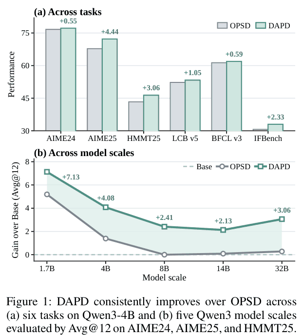

*Figure 1: (a) Six tasks on Qwen3-4B. Gray bars are OPSD, green bars are DAPD, and the y-axis is each benchmark's score (drawn from 30, so the IFBench bars are very short). The number above each bar is how much DAPD beats OPSD by: AIME25 gains the most (+4.44), while AIME24 and BFCL v3 gain only a few tenths. (b) Five Qwen3 sizes. The y-axis is the gain in average accuracy over the three math competitions (Avg@12) relative to the original model. The dashed line is the original model itself (0), and the numbers next to the green line are DAPD's gains over the original model. OPSD (gray line) falls steadily from +5.19 at 1.7B to almost 0 at 8B and above; DAPD (green line) still gains +2.13 to +3.06 at 8B and above.*

---

## 1. Key Terms

| Term | In plain words |
| --- | --- |
| On-policy distillation (OPD) | The student model writes its own response, and for every token in it the teacher gives a distribution of "what should be written here", which the student moves toward. It trains on content the student itself would write, which is called on-policy; training on content someone else wrote is called off-policy |
| OPSD (on-policy self-distillation) | A kind of on-policy distillation in which the teacher is the student itself; the only difference is that the teacher's prompt also holds a reference solution |
| Reference solution $`y^*`$, privileged information | The full worked solution given in the dataset, with the steps written out, not just the final answer. During training it goes into the teacher's prompt; at test time the student cannot see it, so the paper calls it privileged information |
| Student response $`y`$ | A response that the current model samples and writes by itself for the problem (the paper calls it a rollout) |
| None, Cross, Self | Three ways the same model reads a problem. The preceding text is the same, and the only difference is what is added to the prompt: None adds nothing (closed book, which is exactly the test-time setting); Cross adds another full text; Self adds the very text it is predicting |
| Privilege illusion | The student learns behavior that can only be produced after seeing the reference solution. At test time there is no reference solution, yet it acts as if it had seen one, for example stating an answer it "remembers" when it gets stuck |
| Wrong claims | The paper's metric for privilege illusion: the model first admits its derivation failed, then says a specific answer comes from memory, a reference answer or an outside source, and the final answer is wrong. Counted as occurrences per 10,000 generations |
| Entangled distillation | The paper's name for OPSD's original loss: in the teacher's advice, the parts the student could derive by itself and the parts that can only be written after seeing the answer are mixed together and taught to the student |
| Inference Anchor | One of the new losses DAPD adds: the closed-book None acts as teacher and teaches the open-book Self. With the solution on its desk, Self must still predict as if it had not seen it |
| Privileged Anchor | The other new loss DAPD adds: the open-book Cross acts as teacher and teaches the open-book Self. Both sides have the full solution on the desk, so the comparison is fair. The diagnostic experiment in Section 3 trains with this term alone, and the paper uses this name for that experiment too |
| LoRA | Trains only a small set of low-rank parameters added on top of the original model; the original model itself stays unchanged. Turn LoRA off and you are back to the original model before training |
| Dual-path anchoring (DPA) | Within one direction, uses two paths with the same information on both sides (the unconditional path and the privileged path) in place of OPSD's single path |
| Dual-source anchoring (DSA) | The reference solution and the student response take turns as "the text being scored" and "the reference in the prompt", and the two directions are combined with weights. The direction that scores the student response with the reference solution in the prompt is called reference-solution guidance, written $`y\to y^*`$; the reverse is called student-response guidance, written $`y^*\to y`$ |
| KL divergence, forward KL | KL divergence measures how far apart two distributions are; smaller means closer, and it is not symmetric. Forward KL is the direction with the teacher first and the student second |
| Avg@12 | Sample 12 times per problem and take the average accuracy. "Reasoning Avg@12" below is the unweighted average over three math competitions: AIME24, AIME25 and HMMT25 |

## 2. What Problem It Tackles

After pretraining, a large model has to learn reasoning through post-training. There are three common approaches:

- **SFT (supervised fine-tuning)**: copy a reference solution word for word. The solution was written by someone else, and it differs from the way the model itself writes.
- **Reinforcement learning**: the model solves problems itself and is told only at the end whether its answer is right. The feedback is very sparse.
- **On-policy distillation**: the model solves problems itself, and for every token the teacher gives a distribution of "what should be written here", which the model moves toward. It trains on content the model itself would write, and the feedback is as fine as every token.

OPSD is a variant of on-policy distillation: the teacher is not another, larger model but the student itself, and the only difference is that the teacher's prompt also holds a reference solution $`y^*`$ (the paper calls it privileged information; the exact prompt is in Table 4 of Section 6). An analogy (the analogy is mine, not the paper's): the student does the problem closed-book, while a copy of itself sits next to it with the answer book open and tells it, word by word, "this is how I would write it".

**Optional: the OPSD loss.** You can skip it and still follow the rest.

```math
\mathcal{L}_{\text{OPSD}}=\mathbb{E}_{(x,y^*)\sim\mathcal{D},\ y\sim p_\theta(\cdot\mid x)}\Big[\frac{1}{|y|}\sum_{t=1}^{|y|}D\big(\mathrm{sg}[p_{\text{Cross}}]\,\|\,p_{\text{None}}\big)\Big]
```

- $`p_{\text{None}}=p_\theta(\cdot\mid x,y_{<t})`$: sees only the problem $`x`$ and the text already written, which is the situation at test time.
- $`p_{\text{Cross}}=p_\theta(\cdot\mid x,y_{<t},y^*)`$: the same model, but with the reference solution also in the prompt. It acts as the teacher.
- $`\mathrm{sg}[\cdot]`$ means no gradient flows back through the teacher side, so the teacher is not updated; $`D`$ measures the gap between two distributions, and this paper uses forward KL.

**The flaw: privilege illusion.** The two "selves" see different things. The teacher has the answer book open, and the student does not have it at test time. So the teacher's advice mixes two kinds of content:

1. **Things the student could also derive by itself**: for example, the approach the reference solution takes, or how a certain step is derived. Looking at the problem, the student could think of these too. This is useful supervision.
2. **Things that can only be written after seeing the answer**: for example, when stuck halfway through, a teacher that has seen the answer will write out the final result directly. The student has no answer at test time, so learning this step does it no good.

OPSD teaches both kinds of content to the student together, and the paper calls this mixed update Entangled Distillation. Once the student learns type 2, privilege illusion appears: when it cannot push the derivation further, it acts as if it knows the answer and states a number it "remembers".

To quantify this behavior, the paper defines wrong claims: the model first admits its derivation failed, then attributes a specific answer to memory, a reference answer, an official solution or an outside source, and the final answer is wrong. General statements of uncertainty, ordinary guesses, recalling a formula, and vague phrases such as "after looking it up" do not count (Appendix C.2).

Figure 2 shows the training curves averaged over five Qwen3 sizes. Late in training, OPSD's wrong claims (gray line) rise from 12.96 per 10,000 generations at step 200 to 37.04 at step 300. Over the same stretch, reasoning Avg@12 drops from 59.56 to 53.24 (the peak is 61.50 at step 100). The longer the model trains, the more it "pretends to know", and the lower its score.

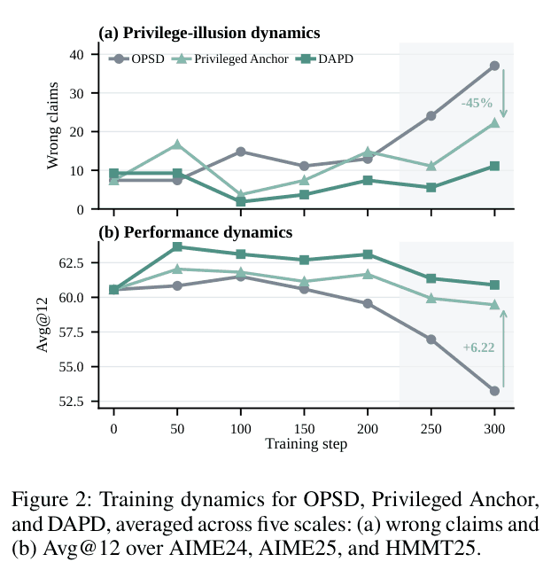

*Figure 2: The x-axis is training steps, and every line is the average over five sizes: OPSD (gray), Privileged Anchor (light green, the control experiment in Section 3) and DAPD (dark green). The gray shading marks late training (steps 250 to 300). (a) The y-axis is the number of wrong claims per 10,000 generations. OPSD rises quickly after step 200. Privileged Anchor has 40% fewer than OPSD at step 300, and the −45% marked in the plot is the total count over the two checkpoints at steps 250 and 300 (33 against 18). DAPD stays the lowest from step 100 on. (b) The y-axis is reasoning Avg@12. OPSD starts sliding from step 100. DAPD reaches its highest value, 63.65, at step 50, then also declines slowly, to 60.90 at step 300, still 7.66 points above OPSD. The +6.22 in the plot is how many points Privileged Anchor beats OPSD by at step 300. The value of every point is in Appendix Table 7 (Section 7.6).*

**Why existing fixes are not enough.** Existing work falls into two groups:

| Route | Method | Problem |
| --- | --- | --- |
| Use privileged information directly | The teacher looks at the reference solution and distills full supervision into the student, for example OPSD and π-Distill | A teacher with the answer directly supervises a student without it, so the information asymmetry stays as it is |
| Pass it on selectively | Filter or reweight the teacher signal to suppress the parts that depend on privileged information, for example Purified OPSD, DOPD, and AVSD, SCOPE and UCOB | They change the teacher signal, but the teacher and the student still see unequal information |

The authors argue that their limitation is structural. These methods change the teacher signal without making the information seen by the teacher and the student equal, so it is always a teacher with the answer supervising a student without it. Also, they treat only the reference solution as a source of guidance, and ignore that once the student gets stronger, its own responses also contain good reasoning.

The question the paper wants to answer is: **the teacher sees the reference solution and the student does not. Can this inequality be removed through the structure of the training objective, while keeping the correctness guidance that the reference solution brings?**

## 3. Diagnosis First: The Problem Is Information Asymmetry

The authors first ran a control experiment called Privileged Anchor. The teacher stays the same, still the Cross that looks at the reference solution; only the side being trained changes from None to Self, that is, the same model with the very response it is predicting placed in its prompt. This way both the teacher and the side being trained have a full solution in front of them, so they have the same amount of information. This control actually trains with only one loss, the Privileged Anchor described in Section 4, so the paper's figures and tables also call it by that name.

The results are the light green line in Figure 2: late in training, wrong claims are 45% fewer than under OPSD, and reasoning Avg@12 at step 300 is 6.22 points higher (59.46 against 53.24). The teacher was not changed; only the information on both sides was made equal, and the problem clearly eased. From this the authors conclude that the root cause is information asymmetry, not a teacher that is not good enough. How much this control can show is discussed in Section 9.

Starting from this diagnosis, the authors give two conditions for solving privilege illusion:

1. Introduce intermediate supervision targets (the paper calls them anchors) that align the behavior on the reference solution and on the student response while both sides have the same information;
2. Strike a balance between reliable reference-solution guidance and guidance from responses within the student's reach.

Each of DAPD's two components handles one of these two conditions.

## 4. Core Method: Self as the Bridge, Two Paths, Two Directions

**Three ways the same model reads a problem.** Let $`s`$ be the text being scored, which can be the student response $`y`$ or the reference solution $`y^*`$; $`\bar s`$ is the other text. At token $`t`$, all three distributions have $`s_{<t}`$ as the preceding text, and they differ only in what is added to the prompt:

| Name | Formula | What is added to the prompt | In plain words |
| --- | --- | --- | --- |
| None | $`p^s_{\text{None}}=p_\theta(\cdot\mid x,s_{<t})`$ | Nothing | Closed book. This is the test-time setting |
| Cross | $`p^s_{\text{Cross}}=p_\theta(\cdot\mid x,s_{<t},\bar s)`$ | The other full text $`\bar s`$ | Open book, with the other solution on the desk |
| Self | $`p^s_{\text{Self}}=p_\theta(\cdot\mid x,s_{<t},s)`$ | The very text $`s`$ being predicted | Open book, with "the copy it is writing right now" on the desk |

Why Self can act as the bridge:

- Compared with Cross, Self also "has a full solution in front of it", so the two have the same amount of information.
- Compared with None, Self uses the same set of parameters. Training Self changes the very model used at test time.

So Self fills exactly the gap in the middle: on one side is the student, which can be trained but has no privileged information; on the other is the teacher, which has privileged information but is not updated. DAPD uses Self to build anchors that align the behavior on the reference solution and on the student response while both sides have the same information, instead of letting a teacher with the answer directly supervise a student without it.

**Two layers of anchoring.** The right side of Figure 3 is dual-path anchoring (DPA): within one direction, it uses two paths with the same information on both sides in place of OPSD's single path. The left side is dual-source anchoring (DSA): the reference solution and the student response take turns as "the text being scored" and "the hint in the teacher's hands", and the two directions are combined with weights. Below, the three basic losses come first, then how they form two paths and two directions.

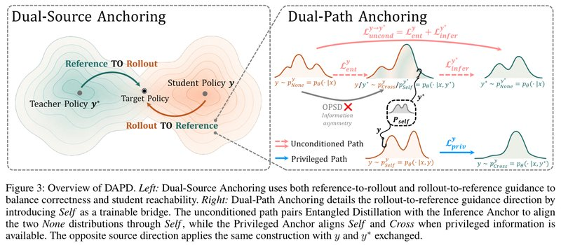

*Figure 3: DAPD overview. Left: dual-source anchoring uses guidance from both directions at once (labeled Reference TO Rollout and Rollout TO Reference in the figure), balancing correctness against whether the student can learn it. Right: dual-path anchoring expands one of the directions (scoring the student response, with the reference solution as the hint) and introduces Self as a trainable bridge. The pink dashed line at the top is the unconditional path, which pairs entangled distillation with the Inference Anchor and aligns the None on both sides through Self; the blue solid line at the bottom is the privileged path, which uses the Privileged Anchor to align Self and Cross while both sides are open-book. The gray arrow and red cross in the middle mark OPSD's problem: it pulls the None that does not see the answer directly toward the distribution that looks at the reference solution, with information asymmetry between the two. The other direction swaps the student response and the reference solution and works the same way.*

**Three "who teaches whom" losses.** For each text being scored, DAPD defines three directed losses, and each one is "a teacher (not updated) teaches the side being trained":

- **Entangled distillation**: the open-book Cross teaches the closed-book None. When scoring the student response, it is exactly the original OPSD loss. It is kept so that useful privileged guidance keeps reaching the student.
- **Inference Anchor**: the closed-book None teaches the open-book Self. The idea is: even with this solution on the desk, predict the next token as if you had not seen it. It provides an anchor that "does not rely on privileged information".
- **Privileged Anchor**: the open-book Cross teaches the open-book Self. Both sides have a full solution on the desk, so the comparison is fair.

**An example** (an illustration I made up, not from the paper): Self's prompt holds the very text it is predicting, so it can just "copy". Say at some step Self gives the next token a probability of 0.99, while the closed-book original model gives only 0.6. Ignoring clipping, the Inference Anchor pulls 0.99 toward 0.6, which amounts to telling the model: even with the answer right in front of you, do not be more confident than you are closed-book. Through the shared parameters, this constraint also acts on the Cross teacher (see Section 5).

**Optional: formulas for the three losses.** You can skip them and still follow the rest. In each term, the first distribution is the teacher (no gradient flows back) and the second is the side being trained:

```math
\mathcal{L}^s_{\text{ent}}=\mathbb{E}\big[D(\mathrm{sg}[p^s_{\text{Cross}}]\,\|\,p^s_{\text{None}})\big]\qquad(2)
```

```math
\mathcal{L}^s_{\text{infer}}=\mathbb{E}\big[D(\mathrm{sg}[p^s_{\text{None}}]\,\|\,p^s_{\text{Self}})\big]\qquad(3)
```

```math
\mathcal{L}^s_{\text{priv}}=\mathbb{E}\big[D(\mathrm{sg}[p^s_{\text{Cross}}]\,\|\,p^s_{\text{Self}})\big]\qquad(4)
```

The expectation averages over the data $`(x,y^*)`$, the response the student samples on the spot $`y\sim p_\theta(\cdot\mid x)`$, and the token positions in $`s`$. When $`s=y`$, $`\mathcal{L}^s_{\text{ent}}`$ is exactly the OPSD loss.

**Dual-path anchoring (DPA): two paths within one direction.** First fix one direction, say "score the student response, with the reference solution as the hint" ($`y\to y^*`$). DPA arranges the three losses into two paths.

**The unconditional path.** At test time the model runs as None, so what really needs aligning is the two Nones: the None on the student response and the None on the reference solution, neither of which relies on privileged information. The method adds two terms together:

- Entangled distillation on the student response (which is the original OPSD loss) pulls the None on the student response toward the Cross that looks at the reference solution;
- The Inference Anchor on the reference solution pulls the Self that looks at the reference solution toward the closed-book None on the reference solution;
- The Self and the Cross here share the same parameters, and both have the reference solution in the prompt; the paper treats this pair of distributions as a "proxy bridge".

Linked up, this forms a chain: the None on the student response is pulled toward Cross, Cross and Self are close, and Self is in turn pulled toward the None on the reference solution. Optimizing the two terms together implicitly pulls the None on the student response toward the None on the reference solution. Appendix B gives a proof under explicit assumptions (see Section 5).

An analogy (the analogy is mine, not the paper's): OPSD has only one rope, with the teacher who looks at the answer pulling the student directly. DAPD ties another rope at the teacher's end too: the model's "open-book mode" is also required to talk the way the closed-book original model does. This constraint reaches Cross through the shared parameters; and the teacher in the OPSD term is a snapshot copied from the student at regular intervals, so after each copy the teacher carries this constraint too (Appendix B.3). As a result, what the teacher passes to the student is closer to the part that "could be said closed-book too".

**The privileged path.** When both sides get a full solution, with Cross getting the other text and Self getting its own, the Privileged Anchor already has the same information on both sides, so it is reused directly and no extra loss is added. For $`y\to y^*`$, on the tokens of the student response, it aligns "the prediction that looks at its own response" with "the prediction that looks at the reference solution".

**Optional: the DPA objective for one direction.** You can skip it and still follow the rest. The unconditional path is the Inference Anchor on $`\bar s`$ plus entangled distillation on $`s`$; the two paths together make up the DPA objective (coefficients omitted):

```math
\mathcal{L}^{s\to\bar s}_{\text{uncond}}=\mathcal{L}^{\bar s}_{\text{infer}}+\mathcal{L}^{s}_{\text{ent}}\qquad(5)
```

```math
\mathcal{L}^{s\to\bar s}_{\text{DPA}}=\mathcal{L}^{s\to\bar s}_{\text{uncond}}+\mathcal{L}^{s}_{\text{priv}}\qquad(6)
```

Taking $`y\to y^*`$ as an example, $`\mathcal{L}^{y\to y^*}_{\text{uncond}}=\mathcal{L}^{y^*}_{\text{infer}}+\mathcal{L}^{y}_{\text{ent}}`$; the proxy bridge is $`p^{y^*}_{\text{Self}}`$ and $`p^{y}_{\text{Cross}}`$.

**Dual-source anchoring (DSA): the two directions take turns providing guidance.** DPA settles "how to align within one direction", and the remaining question is "who provides the guidance". DSA uses both directions:

- **Reference-solution guidance** ($`y\to y^*`$, which the paper calls the Rollout-to-Reference direction): the text being scored is the student response, and the reference solution is the hint. The reference solution is reliable, but this way there is only one source of supervision.
- **Student-response guidance** ($`y^*\to y`$, which the paper calls the Reference-to-Rollout direction): the text being scored is the reference solution, and the student's own response is the hint. Once the student gets stronger, its responses also contain useful reasoning and may well be correct. This is guidance within the student's reach, but not necessarily reliable.

The paper's naming is easy to read backward: the side the arrow starts from is the text being scored, and the side the arrow points to is the hint. Applying the same DPA construction to $`y^*\to y`$ means swapping $`y`$ and $`y^*`$ above: the unconditional path becomes the Inference Anchor on the student response plus entangled distillation on the reference solution, and the privileged path becomes the Privileged Anchor on the reference solution. The two directions are added with weights λ and 1−λ. The larger λ is, the more the method relies on reference-solution guidance. In the experiments, 1.7B uses λ=0.5, and 4B to 32B use λ=0.2. The authors' claim is that using both directions keeps the correctness supervision the reference solution brings while reducing reliance on it.

**Optional: DAPD's overall objective.** You can skip it and still follow the rest.

```math
\mathcal{L}_{\text{DAPD}}=\lambda\,\mathcal{L}^{y\to y^*}_{\text{DPA}}+(1-\lambda)\,\mathcal{L}^{y^*\to y}_{\text{DPA}}\qquad(7)
```

Here the unconditional path of $`\mathcal{L}^{y^*\to y}_{\text{DPA}}`$ is $`\mathcal{L}^{y}_{\text{infer}}+\mathcal{L}^{y^*}_{\text{ent}}`$, and its privileged path is $`\mathcal{L}^{y^*}_{\text{priv}}`$.

**What changes compared with OPSD:**

| | OPSD | DAPD |
| --- | --- | --- |
| Who teaches whom | Cross (looking at the reference solution) directly teaches None (looking at nothing) | Keeps this term and adds two anchors, None teaches Self and Cross teaches Self, forming two paths with the same information on both sides |
| Text being scored | Only the student response | The student response and the reference solution |
| Hint in the teacher's hands | Only the reference solution | The reference solution, or the student's own response |
| Loss terms | 1 term | 3 kinds × 2 directions, 6 terms in total |
| Inference cost | Same as the original model | Same as the original model |

## 5. Why the Authors Think It Works

Section 4 says that optimizing the two losses of the unconditional path together "implicitly" pulls the closed-book distribution on the student response toward the closed-book distribution on the reference solution. Appendix B of the paper gives a three-step argument for this statement, and each step states the assumptions it relies on.

**(1) The distance between the two Nones has an upper bound (Proposition 1).** Going from "closed-book on the reference solution" to "closed-book on the student response" passes through two stops, Self and Cross, and the total distance is no more than the sum of the three legs. The first leg is made small by the Inference Anchor, the third by entangled distillation, and the middle leg relies on a "bridge consistency" assumption: Self and Cross are the same model, and both have the reference solution in the prompt, so the two are assumed to be close.

**(2) From a single token to a whole response (Proposition 2).** Only when every token is close to the teacher is the distribution of the whole response close, and the error accumulates with length. This step shows that entangled distillation can carry the teacher's behavior on the preceding text the student wrote itself over to the whole generation at test time.

**(3) Shared parameters carry the anchor's effect to the teacher.** The Inference Anchor trains the Self on the reference solution, while the teacher in entangled distillation is the Cross on the student response. The two share one set of parameters, so an update step on Self also changes Cross's output. As long as the gradient directions at the two places roughly agree (the paper calls this local compatibility), after one update step Cross moves, in expectation, toward the None on the reference-solution side. After the teacher snapshot is refreshed, this change then passes through entangled distillation to the None on the student-response side.

The authors measured the "agreement in direction" that step (3) requires on Qwen3-4B: 4 LoRA initializations × 32 problems × 4 positions per problem, 128 positions in total. The mean gradient dot product is 256.62, with a 95% confidence interval of [147.55, 393.53]; the cosine similarity is 0.101, with an interval of [0.058, 0.144]. Both intervals are above 0, so the directions do agree, but only weakly: a cosine of 0.1 corresponds to an angle of about 84°.

Taken together, the three steps are the authors' argument for "why the unconditional path can pull the None on the student response toward the None on the reference solution". It holds only under two assumptions, bridge consistency and local compatibility; how far these two assumptions have been tested is discussed in Section 9.

**Optional: formulas and worked examples for the three results.** You can skip them and still follow the rest.

Notation: $`n^*`$ is the None on a reference-solution prefix, $`n^y`$ is the None on a student-response prefix, $`s^*`$ is the Self on a reference-solution prefix, and $`c^y`$ is the Cross on a student-response prefix. $`\Pi_x`$ is one way of pairing reference-solution prefixes with student-response prefixes. $`\mathcal E_{\text{infer}}=\mathbb E\,\mathrm{KL}(n^*\|s^*)`$ is the Inference Anchor loss, and $`\mathcal E_{\text{ent}}=\mathbb E\,\mathrm{KL}(c^y\|n^y)`$ is the entangled distillation loss. TV is the total variation distance, which takes values from 0 to 1.

Proposition 1:

```math
\mathbb E_{\Pi_x}\mathrm{TV}(n^*,n^y)\le\sqrt{\mathcal E^{\Pi}_{\text{infer}}/2}+\epsilon+\sqrt{\mathcal E^{\Pi}_{\text{ent}}/2}\qquad(13)
```

Derivation: the triangle inequality $`\mathrm{TV}(n^*,n^y)\le\mathrm{TV}(n^*,s^*)+\mathrm{TV}(s^*,c^y)+\mathrm{TV}(c^y,n^y)`$. The first and third terms use Pinsker's inequality $`\mathrm{TV}\le\sqrt{\mathrm{KL}/2}`$, followed by Jensen's inequality after taking expectations. The middle term relies on the bridge consistency assumption $`\mathbb E\,\mathrm{TV}(s^*,c^y)\le\epsilon`$. Worked example: $`\mathcal E_{\text{infer}}=0.02`$, $`\mathcal E_{\text{ent}}=0.08`$, $`\epsilon=0.05`$, so the upper bound $`=0.1+0.05+0.2=0.35`$.

Proposition 2:

```math
\mathrm{TV}\big(N_\theta(\cdot\mid x),P^r_\theta(\cdot\mid x)\big)\le\sqrt{\tfrac H2\,\mathcal E_{\text{ent}}(x,r)}\qquad(17)
```

$`H`$ is the sequence length, and $`\mathcal E_{\text{ent}}`$ adds up the KL of every token along the sequence the student sampled itself. The proof uses a hybrid-distribution argument that swaps one position at a time (Lemma 1), then Pinsker's and the Cauchy-Schwarz inequalities. Worked example: $`H=1024`$ and an average per-token KL of 0.001 give $`\mathcal E_{\text{ent}}=1.024`$, and the upper bound $`=\sqrt{512\times1.024}\approx22.9`$. TV is at most 1, so this upper bound carries no information. For the upper bound to be below 1, the average per-token KL must be below $`2/H^2\approx 1.9\times10^{-6}`$.

Transfer through shared parameters: after one Inference Anchor update step on Self on a reference-solution prefix, the logits (the scores before they are normalized into probabilities) of Cross on a student-response prefix change by

```math
z_C(\theta^+)-z_C(\theta)=-\eta\,J_CJ_S^\top(p_S-q_N)+O(\eta^2)\qquad(19)
```

$`J_S`$ and $`J_C`$ are the Jacobians of the logits at the two places with respect to the parameters. Writing $`g_S=p_S-q_N`$ and $`g_C=p_C-q_N`$, the local compatibility condition is $`\mathbb E[g_C^\top J_CJ_S^\top g_S]\ge\gamma>0`$ (Eq. (20)). When it holds, after one update step the cross-entropy of Cross with respect to the None on the reference-solution side drops, in expectation, by at least $`\eta\gamma`$ (ignoring second-order terms, Eq. (21)). The measurement above is of exactly this quantity in Eq. (20).

## 6. Details That Make It Actually Run

**(1) Three sets of parameters, six loss terms.** DAPD uses three sets of parameters at the same time during training:

- The current LoRA student: every distribution being trained comes from it, and it also samples the student responses.
- The student snapshot: a copy of the current LoRA student, refreshed at regular intervals during training, which acts as teacher only for the two entangled distillation terms. The paper does not give the refresh interval; in the official code it is every 100 steps.
- The original model: the base model with LoRA turned off, unchanged throughout, which acts as teacher for the Inference Anchor and the Privileged Anchor.

No gradient flows back through any teacher side. Each of the two directions has three terms, six in total (compiled from Appendices A.4 and A.7; the six `Pair` definitions in the released code `dapd/objective.py` match this):

| Direction (weight) | Loss term | Text scored on | Teacher (not updated) | Side being trained |
| --- | --- | --- | --- | --- |
| Reference-solution guidance $`y\to y^*`$ (λ) | Entangled distillation, which is the original OPSD loss | Student response $`y`$ | Cross (prompt contains $`y^*`$), student snapshot | None |
| | Inference Anchor | Reference solution $`y^*`$ | None, original model | Self (prompt contains $`y^*`$) |
| | Privileged Anchor | Student response $`y`$ | Cross (prompt contains $`y^*`$), original model | Self (prompt contains $`y`$) |
| Student-response guidance $`y^*\to y`$ (1−λ) | Entangled distillation | Reference solution $`y^*`$ | Cross (prompt contains $`y`$), student snapshot | None |
| | Inference Anchor | Student response $`y`$ | None, original model | Self (prompt contains $`y`$) |
| | Privileged Anchor | Reference solution $`y^*`$ | Cross (prompt contains $`y`$), original model | Self (prompt contains $`y^*`$) |

**(2) The prompts for the teacher and Self.** Cross and Self use the same template (Table 4); the only difference is which text goes into the reference-solution slot: Cross gets the other text, and Self gets the very text being scored. This extra text appears only when building the training distributions, and is not in the prompt at inference time.

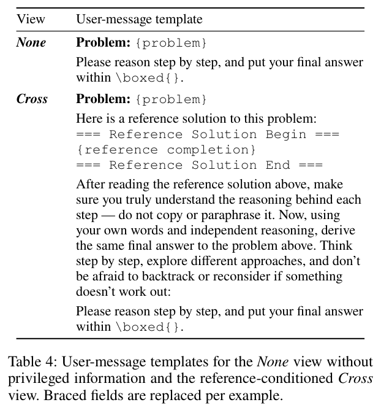

*Table 4: User-message templates for the two ways of reading a problem, None and Cross; the fields in curly braces are filled in per sample. None has only the problem and "please reason step by step and put the final answer in `\boxed{}`". Cross inserts "here is a reference solution to this problem" after the problem, wraps the full solution in delimiters, and specifically asks the model to "make sure you understand the reasoning in every step, do not copy or rephrase it; reason independently in your own words and reach the same final answer". It also encourages the model to think step by step, try different approaches, and go back and rethink when stuck. Self is not in the table: it uses Cross's template, except that the reference-solution slot holds the very text it is predicting (Appendix A.3).*

Appendix A.3 of the paper gives a training sample: compare the sizes of $`p=2^{3009}`$, $`q=3^{2006}`$ and $`r=5^{1003}`$. The reference solution rewrites them as $`8^{1003}`$, $`9^{1003}`$ and $`5^{1003}`$, and concludes $`r<p<q`$. None's prompt has only the problem and the answering instructions; the prompts of Cross and Self put this full derivation between two delimiters. So the privileged information is a full solution with its steps written out, not a label or the teacher's hidden state.

**(3) The gap measure: forward KL with each vocabulary term capped.** For each token, forward KL is computed over the whole vocabulary, with the teacher first and the student second; the contribution of each vocabulary term is capped at $`c=0.05`$, and the result is then averaged over tokens. The logits (the scores before conversion into probabilities) of both the teacher and the student are first divided by a temperature $`T=1.1`$. Both distributions are computed directly on the sampled preceding text, so no importance-sampling ratio is needed. Per-term clipping follows the original OPSD paper. My understanding is that it keeps a few positions with especially large disagreement from dominating training. Table 8 shows that without clipping, 4B drops from 65.28 to 62.50 (see Section 7.10).

**Optional: Eq. (8) and two worked examples.** You can skip them and still follow the rest.

```math
\ell_c(q,p)=\sum_{v\in\mathcal V}\min\big\{q_v(\log q_v-\log p_v),\ c\big\},\qquad c=0.05\qquad(8)
```

$`q`$ is the teacher distribution (not updated), $`p`$ is the student distribution, and $`\mathcal V`$ is the whole vocabulary. In the official code this is just `F.kl_div(...).clamp(max=0.05)`.

- Without clipping (numbers I made up, not from the paper): the vocabulary has only 3 tokens, the teacher is $`q=(0.7,0.2,0.1)`$ and the student is $`p=(0.5,0.3,0.2)`$. The three terms are $`0.7\ln\frac{0.7}{0.5}=0.2355`$, $`0.2\ln\frac{0.2}{0.3}=-0.0811`$ and $`0.1\ln\frac{0.1}{0.2}=-0.0693`$, which add up to KL = 0.0851. The gradient with respect to the student logits is $`p-q=(-0.2,+0.1,+0.1)`$. After a gradient descent step, the probability of token 1 rises and the student moves toward the teacher.
- With clipping: the term for token 1, 0.2355, exceeds 0.05, so it is clipped to a constant and no longer has a gradient. The gradient of the remaining two terms is $`(+0.15,-0.11,-0.04)`$, so gradient descent instead lowers the probability of token 1. Section 9 comes back to this effect.

**(4) Only LoRA is trained.** Rank 64 and scaling factor 128, applied to the projection matrices of all attention layers and feed-forward layers (MLP).

**(5) How much weight each term actually gets.** The coefficients of the six losses are assigned as in Appendix A.7: the total weight is written κ; λ splits it between the two directions; within each direction, the coefficient of entangled distillation is set to 1, the Inference Anchor and the Privileged Anchor get $`\beta_{\text{infer}}`$ times and $`\beta_{\text{priv}}`$ times that, and the three terms are then scaled to that direction's total weight. The coefficients used for each size are in Table 5.

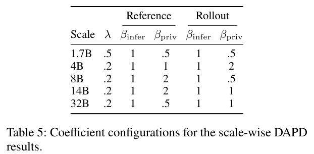

*Table 5: Coefficients used for each size's DAPD results. λ is the total weight of the reference-solution guidance direction. The two Reference columns and the two Rollout columns are $`\beta_{\text{infer}}`$ and $`\beta_{\text{priv}}`$ within the reference-solution guidance direction and within the student-response guidance direction respectively, that is, the multiples of the Inference Anchor and the Privileged Anchor relative to entangled distillation (the .5 in the table is 0.5). The actual weight of each term after substituting into Eq. (9) is in the table below. The settings for 1.7B to 14B are each exactly the highest-scoring setting in the sweeps of Table 3(c)(d); for the 32B setting the paper gives no sweep results. The 4B code and instruction-following models also use the 4B row.*

Substituting the coefficients from Table 5 gives each term's actual weight (in units of κ; I computed these from the formula, and the paper does not give them directly). The three terms in each direction are, in order, entangled distillation, the Inference Anchor and the Privileged Anchor:

| Size | λ | Three terms of reference-solution guidance | Three terms of student-response guidance | Share of the original OPSD term | Share on reference-solution tokens |
| --- | --- | --- | --- | --- | --- |
| 1.7B | 0.5 | (0.20, 0.20, 0.10) | (0.20, 0.20, 0.10) | 20% | 50% |
| 4B | 0.2 | (0.067, 0.067, 0.067) | (0.20, 0.20, 0.40) | 6.7% | 67% |
| 8B | 0.2 | (0.05, 0.05, 0.10) | (0.32, 0.32, 0.16) | 5% | 53% |
| 14B | 0.2 | (0.05, 0.05, 0.10) | (0.267, 0.267, 0.267) | 5% | 58% |
| 32B | 0.2 | (0.08, 0.08, 0.04) | (0.267, 0.267, 0.267) | 8% | 61% |

The released code's default weights are (2/15, 2/15, 2/15) and (2/5, 2/5, 4/5), which sum to 2, exactly the 4B setting multiplied by κ=2. This table shows two things:

- The original OPSD loss gets only 5% to 20% of the weight in DAPD; most of the weight goes to the new anchors and the reverse direction.
- From 4B up, more than half of the weight falls on reference-solution tokens. For the student, these are preceding text it never wrote (off-policy positions). Section 9 comes back to this point.

**Optional: Eq. (9) and a worked example.** You can skip them and still follow the rest. The coefficients of the three terms in the reference-solution guidance direction are

```math
(w^{\text{ref}}_{\text{ent}},w^{\text{ref}}_{\text{infer}},w^{\text{ref}}_{\text{priv}})=\frac{\kappa\lambda}{1+\beta^{\text{ref}}_{\text{infer}}+\beta^{\text{ref}}_{\text{priv}}}\,(1,\beta^{\text{ref}}_{\text{infer}},\beta^{\text{ref}}_{\text{priv}})\qquad(9)
```

The student-response guidance direction works the same way, with λ replaced by 1−λ and the superscript ref replaced by roll. Worked example (4B): $`\lambda=0.2`$, $`\beta^{\text{ref}}=(1,1)`$, $`\beta^{\text{roll}}=(1,2)`$. The reference-solution guidance direction is $`\frac{0.2\kappa}{1+1+1}(1,1,1)=(0.067,0.067,0.067)\kappa`$; the student-response guidance direction is $`\frac{0.8\kappa}{1+1+2}(1,1,2)=(0.2,0.2,0.4)\kappa`$. The six terms add up to $`\kappa`$. The weights in the official code add up to 2, that is, $`\kappa=2`$.

**(6) The full flow for one mini-batch.** Pseudocode compiled from Appendix A.4 and the settings above (the refresh interval is taken from the official code):

```text
Algorithm: DAPD (one mini-batch)
Input: data (x, y*); current LoRA student θ; original model θ0 (LoRA off, frozen);
      student snapshot θsnap; weights w (Eq. 9 + Table 5); clipping c = 0.05; temperature T = 1.1
1: y ← sample one response from the current student  // T=1.1, top-p 0.95, top-k 20, at most 1024 tokens
2: for s ∈ {y, y*}:                      // s̄ is the other one
3:     None_s  ← p(· | x, s<t)           // closed book
4:     Cross_s ← p(· | x, s<t, s̄)        // the other one in the prompt
5:     Self_s  ← p(· | x, s<t, s)        // its own text in the prompt
6: // reference-solution guidance direction y → y* (weights include λ)
7:     L1 ← KLc(Cross_y[θsnap] ‖ None_y[θ])      // entangled distillation = original OPSD
8:     L2 ← KLc(None_y*[θ0]    ‖ Self_y*[θ])     // Inference Anchor
9:     L3 ← KLc(Cross_y[θ0]    ‖ Self_y[θ])      // Privileged Anchor
10: // student-response guidance direction y* → y (weights include 1−λ): swap y and y* in lines 7 to 9 to get L4 to L6
11: L ← Σ_k w_k · L_k                    // no gradient flows back through any teacher side
12: backpropagate, update only the LoRA parameters
13: every 100 steps: θsnap ← θ           // interval from the official code, not given in the paper
```

`KLc` is the clipped forward KL of Eq. (8), averaged over every token of the text being scored.

## 7. Experimental Results

### 7.1 How the experiments were set up

- **Models**: the 1.7B, 4B, 8B, 14B and 32B sizes of Qwen3 (arXiv 2505.09388). Unless stated otherwise, results are from Qwen3-4B. One model is trained for each of the three task types: reasoning, code and instruction following.
- **Training data**: OpenThoughts (arXiv 2506.04178). Reasoning uses the math portion (the training set given in the official repository has 29,434 examples), code uses the code portion, and instruction following uses a mix of the math, code and science portions. Evaluation problems were removed from the training set.
- **Evaluation**:
  - Reasoning: AIME24, AIME25 and HMMT25 (the February contest), 30 problems each. Each problem is sampled 12 times (temperature 1.0, top-p 0.95, thinking mode on, at most 38,912 new tokens); only the final answer is checked, and the average accuracy is taken, which is Avg@12. The unweighted average over the three sets is "reasoning Avg@12".
  - Code: LiveCodeBench v5 (LCB v5 below, measured by Pass@1) and BFCL v3 (multi-turn function calling, scored by overall accuracy).
  - Instruction following: IFBench, scored with the officially released verifier.
  - Every benchmark uses its official evaluation tools, prompts and answer-parsing rules.
- **Baselines**: the original model (Base), and two groups of OPSD-style methods. The first group uses privileged supervision directly: OPSD, SDFT and SDPO. The second group selectively modifies the privileged signal: Purified OPSD and DOPD. How each method works is in Section 11. All baselines use the same student model and data, and each one's optimization details follow its original paper.
- **Training**: only LoRA is trained (rank 64, scaling factor 128); learning rate 5e-6 with linear decay over 500 steps and no warmup; gradient-norm clipping at 0.1; bf16 precision; effective batch size 32. The random seed is always 42, and all methods use the same seed so that initialization, data order and sampling line up; the main numbers are all reported under this setting. During training, 1 response is sampled per problem, at temperature 1.1, with at most 1,024 new tokens. The hardware is 8 A100-80GB GPUs. The code and instruction-following models use the same LoRA settings, optimizer, number of update steps and DAPD objective, with the coefficients from the 4B row of Table 5.

A note on reading the numbers: AIME and HMMT have only 30 problems per set, so getting one more problem right is worth 3.33 points. Avg@12 averages 12 attempts at each problem, which reduces the noise from sampling, but the total number of problems stays the same.

### 7.2 On Qwen3-4B: the six-benchmark average is 2.00 points above OPSD

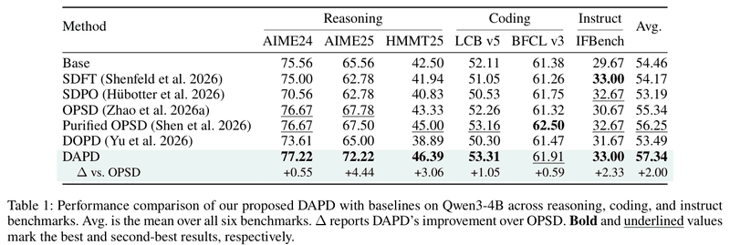

*Table 1: Scores of DAPD and each baseline on Qwen3-4B on six benchmarks in reasoning (AIME24, AIME25, HMMT25), code (LCB v5, BFCL v3) and instruction following (IFBench). Avg. is the six-benchmark average, and Δ in the last row is DAPD's gain over OPSD; bold is the best, and underline is the second best. DAPD's six-benchmark average is 57.34, and OPSD's is 55.34. DAPD is 2.00 above OPSD, 1.09 above Purified OPSD, 3.85 above DOPD and 2.88 above the original model.*

How to read this table:

- **The gains concentrate in three benchmarks**: AIME25 (OPSD 67.78, DAPD 72.22, +4.44), HMMT25 (+3.06) and IFBench (+2.33). AIME24 and BFCL v3 gain only a few tenths (+0.55, +0.59).
- **Not first on every benchmark**: the best on BFCL v3 is Purified OPSD (62.50), and on IFBench DAPD ties with SDFT (33.00).
- **Some baselines do worse than the original model**: the six-benchmark averages of SDFT, SDPO and DOPD (54.17, 53.19, 53.49) are all below the original model's 54.46.

The authors' interpretation has two layers:

- Compared with the methods that use privileged supervision directly, DAPD keeps the useful part of privileged supervision while reducing the information mismatch at inference time.
- Purified OPSD and DOPD still sit in a setting of information asymmetry: they modify or reroute the privileged signal, but the teacher and the student still see different information. DAPD changes the structure of the supervision directly, so the authors argue that "making the information equal" works better than "filtering or rerouting an unequal signal".

### 7.3 Across sizes: OPSD's gains vanish, while DAPD stays about 2 points above OPSD

Figure 1(b) plots the gains relative to the original model on five sizes, and the full numbers for each benchmark are in Appendix Table 6:

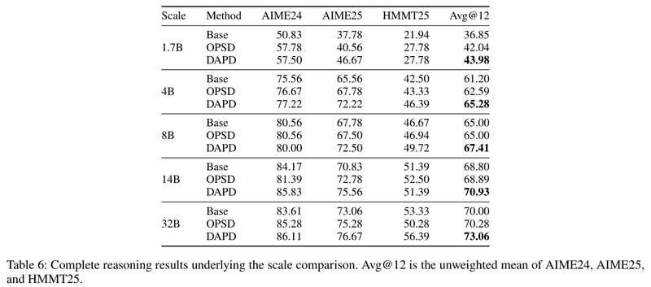

*Table 6: Reasoning results for each of the five sizes. For each size, the three rows are, in order, the original model (Base), OPSD and DAPD; the last column, Avg@12, is the unweighted average of the three benchmarks, and bold marks the highest average for that size. DAPD has the highest average at every size. Averaged over the five sizes, the original model, OPSD and DAPD score 60.37, 61.76 and 64.13 respectively. OPSD is even 2.78 points below the original model on AIME24 at 14B, and 3.05 points below it on HMMT25 at 32B.*

Looking only at the last column, reasoning Avg@12 (%):

| Size | Original model | OPSD | DAPD | DAPD minus OPSD |
| --- | --- | --- | --- | --- |
| 1.7B | 36.85 | 42.04 | **43.98** | +1.94 |
| 4B | 61.20 | 62.59 | **65.28** | +2.69 |
| 8B | 65.00 | 65.00 | **67.41** | +2.41 |
| 14B | 68.80 | 68.89 | **70.93** | +2.04 |
| 32B | 70.00 | 70.28 | **73.06** | +2.78 |

How to read this table:

- **OPSD's gains vanish quickly as size grows**: relative to the original model, it gains +5.19 at 1.7B and +1.39 at 4B, but only 0.00, +0.09 and +0.28 at 8B, 14B and 32B.
- **DAPD gains at every size**: relative to the original model, +7.13, +4.08, +2.41, +2.13 and +3.06 in order; relative to OPSD, +1.94, +2.69, +2.41, +2.04 and +2.78 in order.
- **Broken down by benchmark**: DAPD beats OPSD on AIME25 at every size (+3.94 averaged over the five sizes); on HMMT25 the average gain is +2.17, but it is 1.11 lower at 14B; on AIME24 the average gain is only +1.00, and it is even slightly lower at 1.7B and 8B.

The authors' explanation: the larger the model, the more useful reasoning and self-correction its own responses contain. OPSD's teacher has the reference solution in hand and can skip these steps, so the cost of privilege illusion keeps growing and cancels out the benefit of the student's better responses. DAPD keeps this benefit with supervision in which both sides have the same information.

### 7.4 Trained only on math, it also does better on code

The 4B model is trained only on math data, then tested on code and instruction following.

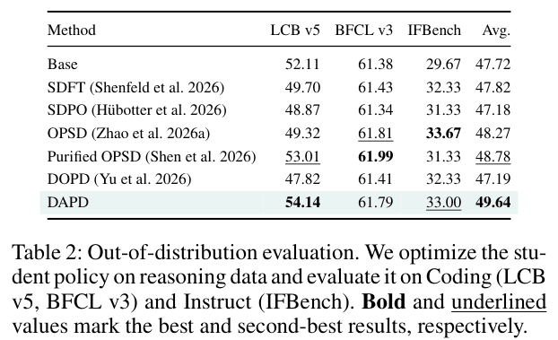

*Table 2: The student is trained only on reasoning (math) data, then tested on code (LCB v5, BFCL v3) and instruction following (IFBench); Avg. is the three-benchmark average. Bold is the best, and underline is the second best. DAPD has the highest three-benchmark average (49.64), 1.37 above OPSD. The gap comes mainly from LCB v5: DAPD scores 54.14 and OPSD 49.32, so DAPD is 4.82 higher and also 2.03 above the original model, while OPSD is instead 2.79 below the original model. On BFCL v3 and IFBench, DAPD is on par with the other methods, and the highest on IFBench is OPSD (33.67).*

The authors take this to mean that the objective with equal information on both sides also holds up better beyond the reasoning benchmarks it was optimized on. One more interesting number: DAPD trained only on math scores higher on LCB v5 (54.14) than the DAPD in Table 1 that was trained specifically on code data (53.31).

### 7.5 What inference looks like: when OPSD gets stuck, it "remembers" an answer

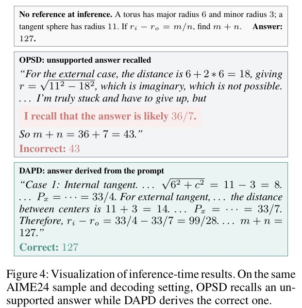

*Figure 4: Outputs of the two models on the same AIME24 problem under the same decoding settings; neither model can see the reference solution at inference time. In the problem, a torus (major radius 6, minor radius 3) is tangent to a sphere of radius 11, and the task is to find $`m+n`$, where $`r_i-r_o=m/n`$ is the difference between the radii of the tangency circles in the internally and externally tangent cases; the answer is 127. The model trained with OPSD computes $`r=\sqrt{11^2-18^2}`$ in the externally tangent case, which is imaginary, then says "I'm really stuck and can only give up, but I remember the answer is likely 36/7", and finally answers 43, which is wrong. The model trained with DAPD computes 33/4 for the internal case and 33/7 for the external case, subtracts them to get $`99/28`$, and answers 127, which is right.*

This is exactly the privilege illusion the authors describe: during training the teacher can always see the answer, so the student learns to "state an answer when it gets stuck", yet at test time there is no answer to look at. The counts in Appendix C.2 show that late in training (the two checkpoints at steps 250 and 300 combined), OPSD does this 33 times and DAPD only 9 times, 73% fewer. Appendix D gives three more examples:

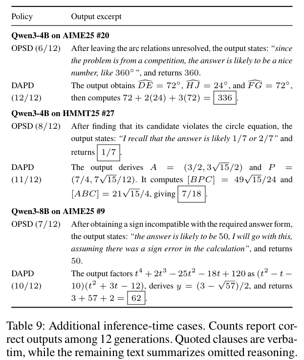

*Table 9: The three inference-time cases from Appendix D. The numbers in parentheses are how many of the 12 generations were correct; text in quotes is excerpted from the original, and the rest summarizes the omitted reasoning. In all three examples, OPSD's wrong outputs follow the same pattern. (1) Qwen3-4B on AIME25 problem 20: OPSD fails to work out the arc relations, then says "since this is a competition problem, the answer should be a nice number, like 360°", and answers 360; DAPD finds the three arcs to be 72°, 24° and 72°, and computes $`72+2(24)+3(72)=336`$. (2) Qwen3-4B on HMMT25 problem 27: after OPSD finds that a candidate point does not satisfy the circle's equation, it says "I remember the answer is likely 1/7 or 2/7", and answers 1/7; DAPD finds the ratio of the two triangles' areas, $`\frac{49\sqrt{15}/24}{21\sqrt{15}/4}=\frac{7}{18}`$. (3) Qwen3-8B on AIME25 problem 9: after the sign OPSD computes does not match the form the problem asks for, it says "the answer is likely 50, let's just assume there is a sign error in the calculation", and answers 50; DAPD factors $`t^4+2t^3-25t^2-18t+120`$ into $`(t^2-t-10)(t^2+3t-12)`$ and answers 62.*

Note that OPSD is not always wrong on these three problems: it gets 6, 8 and 7 of the 12 right respectively, while DAPD gets 12, 11 and 10. These cases were picked by the authors for display.

### 7.6 From step 100 on, DAPD always has the fewest "pretending to know" cases

Figure 2 (Section 2) plots the training curves averaged over five sizes, and the numbers behind it are in Appendix Table 7:

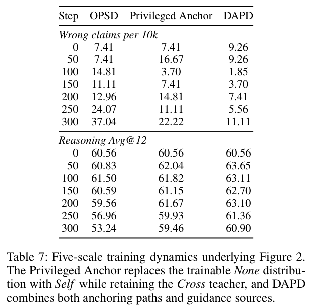

*Table 7: The numbers behind Figure 2 (Appendix C.2), counted over the five sizes together. The upper half is the number of wrong claims per 10,000 generations, and the lower half is reasoning Avg@12, listed by training step. Privileged Anchor is the control from Section 3: the None being trained is replaced by Self, and the Cross teacher stays the same; DAPD uses both paths and both sources at once. Each checkpoint has 5 sizes × 90 problems × 12 samples = 5,400 generations, so 7.41 per 10,000 corresponds to 4 occurrences, and the resolution of this metric at a single checkpoint is just 1 occurrence. Even the worst case, OPSD at step 300, has only 20 occurrences, 0.37% of all generations. Summed over steps 50 to 300, OPSD has 58, Privileged Anchor 41 and DAPD 21.*

How to read this table:

- **The gap is largest late in training**: over the two checkpoints at steps 250 and 300 combined, OPSD has 33, Privileged Anchor 18 (45% fewer) and DAPD 9 (73% fewer).
- **The scores move in step**: OPSD's average score falls steadily from 61.50 at step 100 to 53.24 at step 300; DAPD peaks at step 50 (63.65) and is at 60.90 at step 300, 7.66 points above OPSD. The authors argue that the two sets of numbers together show that anchoring with equal information on both sides reduces privilege illusion while preserving reasoning performance late in training. How much of the score drop the wrong claims can explain is discussed in Section 9.

### 7.7 Both paths and both sources help

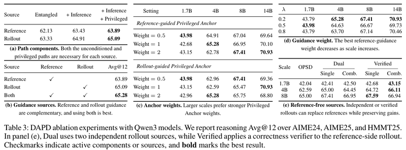

*Table 3: Ablations; every metric is reasoning Avg@12, and bold is the best result. (a) Path components, Qwen3-4B: each source starts from entangled distillation alone (Entangled), then adds the Inference Anchor and the Privileged Anchor in turn. (b) Guidance sources, Qwen3-4B: reference-solution guidance only, student-response guidance only, and both; a check mark shows which sources are enabled. (c) Anchor weights, 1.7B to 14B: the Privileged Anchor weight of each direction is varied separately. (d) Guidance weight λ, 1.7B to 14B. (e) Without the reference solution, 1.7B to 8B: Dual uses two independent student responses, and Verified filters the responses on the reference-solution side with a correctness verifier. The paper's conclusions for the sub-tables are, in order: both paths are necessary for every source; the two kinds of guidance complement each other, and using both is best; larger sizes suit a stronger Privileged Anchor weight; the best reference-solution guidance weight decreases as size grows; replacing the reference solution with independent or verified student responses still keeps the gains.*

- **(a) Both paths are needed.** Reference-solution guidance direction: entangled distillation alone gives 62.13, adding the Inference Anchor brings it to 63.43 (+1.30), and then adding the Privileged Anchor brings it to 63.89 (+0.46). Student-response guidance direction: 63.33 → 64.91 (+1.58) → 65.09 (+0.18). The two sources follow the same trend. The authors take this to show that both paths are needed, and as support for their analysis of information asymmetry: both alignments are built with equal information on both sides, and work better than passing on the privileged distribution directly. Judging by the numbers, the Inference Anchor contributes more.
- **(b) Both sources are needed.** Reference-solution guidance alone gives 63.89, student-response guidance alone gives 65.09, and both together give 65.28. From this the authors conclude that the two kinds of guidance complement each other. However, the combination is only 0.19 points above student-response guidance alone.

### 7.8 The best settings change with model size

The authors cite two earlier analyses (arXiv 2604.13016, arXiv 2607.05184): how well distillation works depends on whether the teacher and the student match, on the quality of the student responses, and on how much privileged information there is. As the model grows, its student responses get better, so the best balance between reference-solution guidance and student-response guidance may shift as well. So the authors swept λ and the Privileged Anchor weights of both directions on four sizes (Table 3(c)(d)):

- **Best λ**: 0.5 at 1.7B, and 0.2 at 4B, 8B and 14B.
- **Privileged Anchor weight in the reference-solution guidance direction**: the best values are 0.5, 1, 2 and 2 in order.
- **Privileged Anchor weight in the student-response guidance direction**: the best values are 0.5, 2, 0.5 and 1 in order.

The authors read this as "a trade-off between reliability and reachability": a small model's responses are noisy, so it needs more correction from the reliable reference solution; a large model's responses are more reliable, so it benefits more from guidance close to its own distribution.

Table 5 uses exactly the highest-scoring setting from each size's sweep. How far apart the best and worst settings in the sweeps are is discussed in Section 9.

### 7.9 Without the reference solution, the student's own responses also work

Since student responses can also provide guidance, can the human-curated reference solution be dropped altogether? The authors tried two versions (Table 3(e)):

- **The Dual version**: sample two independent responses $`u`$ and $`v`$ (resampling $`v`$ if the two are identical), use $`u`$ in place of the reference solution, and use $`v`$ as the student response. Both are written by the student itself, and either may be wrong. It beats OPSD by 0.46, 2.41 and 2.41 at 1.7B, 4B and 8B respectively, and the authors take this to show that the second response is not redundant.
- **The Verified version**: sample 4 candidates for $`u`$ and take the first one that passes the verifier; $`v`$ is not filtered. This makes the guidance source more reliable without exposing the reference solution to the model. It adds another 0.65, 1.11 and 0.18 on top of Dual, reaching 43.15, 66.11 and 67.59. At 4B and 8B, this version even beats DAPD with the reference solution (65.28, 67.41).

The numbers reported in the main text are, for each size, the higher of the two columns Single and Comb. in Table 3(e). The paper does not explain what these two columns mean; my guess is a single direction and the two directions combined (to be confirmed). The authors' conclusion: DSA can run without a human-curated reference solution, and when there is a signal that judges right and wrong, adding verification makes the guidance more reliable.

### 7.10 The gap measure and clipping cannot be swapped freely

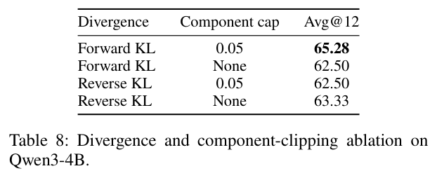

*Table 8: The four combinations of gap measure (forward KL or reverse KL) and per-term clipping (a cap of 0.05, or no clipping) on Qwen3-4B; the metric is reasoning Avg@12. Forward KL with clipping is the best, at 65.28; forward KL without clipping and reverse KL with clipping both get 62.50; reverse KL without clipping gets 63.33. In other words, clipping helps forward KL but makes reverse KL worse.*

On this basis, the authors make clipped forward KL the default. These choices differ by up to 2.78 points, as large as DAPD's gain over OPSD (notes for reproducing it are in Section 10).

## 8. Limitations the Authors Acknowledge

The first three are limitations stated in Section 6 of the paper; the last three are future directions listed in Appendix E, that is, things the paper has not done yet.

- **Training costs more.** DAPD has to build several anchoring distributions during training, which increases the training compute; there is no extra cost at inference time. The paper does not say how much the cost increases.
- **The weights may need retuning.** When changing size or model architecture, the weights may need to be recalibrated. In the experiments, the five sizes already use five different sets of coefficients (Table 5).
- **The verified version needs a signal that judges right and wrong.** The Verified version in Section 7.9 needs a way to judge automatically whether an answer is right, and open-ended tasks may not have such a signal.
- **It still relies on a fixed reference solution.** The authors suggest that a next step could replace the fixed reference solution with student responses chosen by verification or majority vote, updated continually as the model improves.
- **A fixed global weight is too coarse.** Which of the reference solution and the student response is reliable changes from problem to problem and from token to token. The authors suggest estimating reliability online in the future, to give continuously varying source weights and anchor weights, using neither a single global coefficient nor error-prone hard thresholds.
- **Only one kind of privileged information, the reference solution, was tried.** Information that is unavailable at inference time, such as retrieved documents, tool-call logs, verifier feedback and intermediate plans, could also be studied in the same framework, to see how the anchor design should adapt to the form and reliability of the privileged information. My understanding is that with these kinds of information, the information asymmetry problem would show up in the same way.

## 9. Points Worth Noticing While Reading

Below are points I noticed while reading the paper that it does not discuss at length, offered for reference.

### How strong the evidence is

- **The statistical strength is limited.** Every result comes from a single random seed. AIME and HMMT have 30 problems per set, so the +4.44 points on AIME25 amounts to getting 1.33 more problems right on average. By my rough estimate with 12 samples per problem, for the difference between the two methods' three-set average scores, the standard error from sampling alone is 1.4 to 1.7 points (assuming the variance of a single sample's right-or-wrong outcome, $`p(1-p)`$, averages between 0.10 and 0.15, where $`p`$ is the problem's solve rate; this leaves out the randomness of training itself). For a single size, a gap of 2 to 2.8 points is only 1.2 to 2 standard errors. The five sizes all point the same way, which is somewhat more convincing. To nail it down would take several more seeds, plus a separate validation set for choosing settings.
- **The hyperparameters were chosen on the test problems.** The settings in Table 5 are exactly the ones with the highest test scores in Table 3(c)(d). The paper mentions no separate validation set, and the official scripts do no validation during training (see "Checked against the released code" below), so the scores of the best settings are on the optimistic side. In these sweeps, the best and worst settings for each size differ by 1.30 to 2.69 points, as large as DAPD's gain over OPSD. With the worst setting in each sweep, DAPD's gain over OPSD mostly disappears: 4B ties (62.59), 14B is 0.09 lower, and 1.7B and 8B are only 0.64 and 0.47 higher.
- **It does not say which step is reported.** The official scripts stop at step 200, yet Figure 2 runs to step 300. The five-size averages in Table 6 (OPSD 61.76, DAPD 64.13) are higher than the average at any single checkpoint in Table 7 (at most 61.50 and 63.65), so perhaps each size took its own best checkpoint (to be confirmed). If the checkpoints were also chosen by test score, this adds to the previous point.
- **Wrong claims do not explain most of the score drop.** From step 200 to step 300, OPSD's average score drops by 6.32 points, but wrong claims rise by only 13 (out of 5,400 generations per checkpoint). Even if all 13 of these would otherwise have been answered correctly, they could explain only about 0.24 points. So this metric does not confirm, in quantity, that "privilege illusion causes the performance drop"; the two curves moving together in Figure 2 only show that the two are correlated. The metric is more like a symptom signal: the detection rules are strict, and there may be more real privilege-dependent behavior, but the paper gives no measurement with a broader definition.
- **The diagnostic control can show only so much.** The Privileged Anchor control supports "equal information reduces wrong claims", but it is not enough to prove that information asymmetry is the root cause of the score drop. This control trains only Self, so its effect on the None used at test time is indirect, and it may simply make the model drift more slowly. The best checkpoints of the two differ by only 0.54 points (62.04 against 61.50).
- **The mechanisms are not fully separated.** Computed from Eq. (9) and Table 5 (Section 6 (5)):
  - Four of the six terms (the Inference Anchor and the Privileged Anchor of both directions) use the frozen original model as teacher, and they take 60% to 73% of the weight. This amounts to a regularizer that pulls toward the original model, which by itself can slow OPSD's degradation late in training.
  - In the 4B to 32B settings, 75% to 86.5% of the weight that directly trains None falls on reference-solution tokens (entangled distillation in the student-response guidance direction). This part is more like "learning the reference solution with soft labels", and is no longer on-policy in the strict sense. In Table 3(b), this direction alone already gets 65.09, higher than the 63.89 of reference-solution guidance alone.
  - So how much of DAPD's gain comes from "equal information", from "pulling toward the original model" and from "using the reference solution again" still needs control experiments, for example adding a KL term to OPSD that pulls toward the original model, or distilling only on the reference solution. The paper does not do this.
- **The teacher in entangled distillation may differ from the one in the OPSD baseline.** This term in DAPD uses the student snapshot as teacher, refreshed every 100 steps in the official code; the original OPSD paper fixes the teacher as the initial model. The paper does not say which one the OPSD baseline uses. In Table 3(a), the reference-solution guidance direction with only entangled distillation kept should in theory equal OPSD, yet it scores 62.13, which differs from OPSD's 62.59 in Table 6, and the paper does not explain this.
- **Some components add very little.** The two paths point the same way, but the Privileged Anchor adds only 0.18 to 0.46 points in Table 3(a). Combining the two sources (Table 3(b)) is only 0.19 points above student-response guidance alone, so DSA's benefit comes mainly from the student-response guidance direction.
- **The theory is conditional.** The bridge consistency assumption that Proposition 1 relies on was not measured; the sequence-level upper bound of Proposition 2 is numerically meaningless at 1,024 tokens (see the worked example in Section 5); the measured cosine for local compatibility is only 0.10, and it was measured only on the 4B model and 32 problems.
- **Clipping changes the nature of the loss.** The official code applies `clamp(max=0.05)` to each vocabulary term, and a capped term has a gradient of 0. The remaining terms still push up their own tokens, so after normalization the probability of the capped token is pushed down instead. Two worked examples (the numbers are mine):
  - Teacher $`q=(0.7,0.2,0.1)`$, student $`p=(0.5,0.3,0.2)`$: the gradient with respect to the student logits changes from $`(-0.2,+0.1,+0.1)`$ without clipping to $`(+0.15,-0.11,-0.04)`$. Token 1 should rise, but now falls (Section 6 (3)).
  - The copying scenario for the Inference Anchor: the closed-book original model gives $`(0.6,0.4)`$, and Self copies and gives $`(0.99,0.01)`$. Without clipping the gradient is $`(+0.39,-0.39)`$, which pulls 0.99 down; with clipping it becomes $`(-0.006,+0.006)`$, which points the other way and keeps only 1.5% of the magnitude.

  In other words, at positions with large disagreement, the clipped loss basically stops learning from the teacher and even moves slightly the opposite way; only positions with small disagreement (for example closed-book 0.97, Self 0.99) work normally. Positions with large disagreement are often exactly the ones the anchors most want to correct, for example where Self copies while the closed-book model hesitates. This may partly explain why clipping helps (the large disagreements that only arise from seeing the answer are blocked out), but the paper does not analyze it. This is not an error in the paper: OPSD does the same, and Table 8 also shows that clipping helps; but the objective DAPD actually optimizes differs from "minimizing KL". One could try other ways of clipping, for example clipping the total KL of each token, or scaling the gradient proportionally, so that capped tokens do not get a reversed gradient.

### Where it applies

- **Only one model family and one kind of reasoning problem were tested.** All experiments use Qwen3. The reasoning evaluation has only three sets of competition math with 30 problems each.
- **During training the student writes only the start of a solution.** During training, student responses are at most 1,024 tokens long, while evaluation allows 38,912. What training corrects is the first short stretch of a long chain of reasoning.
- **The training cost is not quantified.** Each step computes 6 sets of distributions using three sets of parameters (the current student, the student snapshot and the original model), and the prompt also has to hold a full reference solution or student response (context limit 20,000 tokens). The paper only says the training compute increases, and gives no actual run time.

### Checked against the released code

- **Training stops at step 200.** The official scripts stop training at step 200 (`STOP_STEP = 200`) and save the LoRA every 50 steps, which the main text of the paper does not mention. Yet the learning rate decays over 500 steps, and Figure 2 runs to step 300.
- **The snapshot refresh interval appears only in the code.** The teacher for entangled distillation (the student snapshot) is refreshed every 100 steps, while the paper only says it is "updated periodically".
- **No validation during training.** The official scripts set `eval_strategy="no"`. Combined with the paper not mentioning a separate validation set, this makes it quite likely that the best settings were chosen by test score (see "The hyperparameters were chosen on the test problems" above).

### Small issues in the manuscript (none affect the main conclusions)

- The −45% label in Figure 2: the arrow points at step 300, but the number is the total over steps 250 and 300; step 300 alone is −40%.
- Tables 6 and 7 do not match: for the original model's five-size average, Table 6 gives 60.37, while step 0 of Table 7 gives 60.56. The OPSD and DAPD averages in Table 6 are also higher than at every checkpoint in Table 7.
- At step 0 of Table 7, all three are the same model and all have an average score of 60.56, yet wrong claims have two values: the DAPD column shows 9.26 (5 occurrences), and the other two columns show 7.41 (4 occurrences); the paper does not explain this.
- The meaning of the two columns Single and Comb. in Table 3(e) is not explained (see Section 7.9).

### What could be done next

- **Give each token its own weight.** Appendix E mentions estimating online whether each token's guidance is reliable, in place of the global λ and β (see Section 8). One ready-made signal is the disagreement between Self and the closed-book None: the larger the disagreement, the more likely the position is one that "can only be written after seeing the answer".
- **Make the verified version the default.** Table 3(e) shows that student responses filtered by a verifier already do as well as the reference solution, which suits data that has no reference solution.
- **Combine it with reinforcement learning.** Methods like GRPO (a reinforcement learning algorithm commonly used on large models) already have a reward that judges right and wrong, which provides exactly the correctness signal the verified version needs.
- **Agent tasks.** Environment feedback in multi-turn tasks could also serve as privileged information, and the Self approach could be carried over as is.

## 10. If You Want to Run It Yourself

- **Code**: <https://github.com/uanu2002/DAPD>. The core logic is in `dapd/objective.py` (the six losses and their weights) and `dapd/trainer.py` (clipped KL, snapshot refresh). The repository includes the reasoning training set `data/reasoning_train.parquet`, and for now it has launch scripts only for the reasoning task. Code for related methods: OPSD is at <https://github.com/siyan-zhao/OPSD>, and SDPO is at <https://github.com/lasgroup/SDPO>.
- **Hardware and software**: the paper uses 8 A100-80GB GPUs. The official README's default launch uses 4 processes, a per-GPU batch size of 2 and gradient accumulation of 4, for an effective batch size of 32. Software versions (from the official `requirements.txt`): PyTorch 2.8.0, Transformers 4.57.1, TRL 0.26.0, PEFT 0.17.1, DeepSpeed 0.18.2, vLLM 0.11.0 and flash-attn 2.8.3. The trainer is based on the experimental GOLD trainer in TRL.
- **Sampling**: during training, 1 response per problem, temperature 1.1, top-p 0.95, top-k 20, at most 1,024 new tokens. The official code uses vLLM's colocate mode (generation and training share the same set of GPUs) and syncs the weights once per step.
- **Starting settings**: for 4B, use λ=0.2, $`\beta^{\text{ref}}=(1,1)`$ and $`\beta^{\text{roll}}=(1,2)`$, which are the code's default six weights. For other sizes, look them up in Table 5. When switching models, re-sweep λ ∈ {0.2, 0.5, 0.8} and both $`\beta_{\text{priv}}`$ ∈ {0.5, 1, 2}, and choose with a separate validation set, not the test set you finally report on.
- **Do not change the loss casually**: forward KL over the full vocabulary, with the teacher first; both the teacher's and the student's logits are divided by 1.1; each vocabulary term is clipped at 0.05 before summing, then the result is averaged over tokens. Table 8 shows that changing this setting can cost up to 2.78 points.
- **Training length**: the learning rate decays linearly over 500 steps, but the official scripts stop at step 200 and save the LoRA every 50 steps. The paper does not say which step the main tables use, so it is worth evaluating every checkpoint when reproducing it.
- **Memory and time**: the prompt, the reference solution and the text being scored add up to at most 20,000 tokens, and each sample needs several forward passes, so both GPU memory and time are higher than for OPSD.
- **Evaluation**: thinking mode on, temperature 1.0, top-p 0.95, at most 38,912 new tokens, 12 samples per problem.

## 11. Relation to Related Work

The paper's baselines and how they differ from it (the core ideas are compiled from the descriptions in Section 1 and Appendix A.5 of the paper):

| Method | Core idea | Difference from this paper |
| --- | --- | --- |
| OPSD (arXiv 2601.18734) | The same model, looking at the reference solution, acts as teacher and distills per-token into itself without the answer | DAPD keeps it as one of the six terms, and adds two anchors and the reverse direction |
| π-Distill (arXiv 2602.04942) | A teacher conditioned on privileged information distills full supervision into the student | The paper groups it with OPSD under "using privileged information directly", and it has the same information asymmetry |
| SDFT (arXiv 2601.19897) | The student writes its own response; the teacher is itself looking at an expert demonstration, with parameters set to an exponential moving average of the student's parameters | Also "itself with a hint as the teacher", and does not address information asymmetry |
| SDPO (arXiv 2601.20802) | The teacher likewise uses moving-average parameters, and looks at successful responses in the same group or at environment feedback to give per-token supervision | The privileged information comes from student responses; DAPD's student-response guidance direction is a similar idea, but what it scores is the reference solution |
| Purified OPSD (arXiv 2607.02234) | Uses a pointwise mutual information correction to remove the part of the supervision that "can be predicted from the reference solution alone" | Modifies the teacher signal, and the teacher and the student still have unequal information |
| DOPD (arXiv 2606.30626) | Dynamically splits per-token supervision between the privileged teacher and the student, based on the advantage gap and relative probability | Same as above; it belongs to "passing it on selectively" |

- The paper also puts AVSD (arXiv 2605.20643), SCOPE (arXiv 2604.10688) and UCOB (arXiv 2606.29502) in the "passing it on selectively" group, but does not run them as baselines.
- For on-policy distillation itself, one of the representative works the paper cites is arXiv 2306.13649 by Agarwal et al. (ICLR 2024). The authors position DAPD this way: it keeps OPSD's on-policy sampling and "itself, looking at privileged information, as the teacher", and what it changes is how the supervision is organized, rebuilding it around equal information and two guidance sources.

## 12. Summary

DAPD's idea is: **change "the self that looks at the answer directly teaches the self that does not" into "both sides align through a self that looks at a full solution", and the student becomes less likely to pick up the habit of peeking at the answer.** Concretely, it keeps OPSD's original loss, adds two anchors, the Inference Anchor and the Privileged Anchor, to form two paths with the same information on both sides, and then lets the reference solution and the student response take turns as the guidance material. Self is just a different prompt; it needs no extra model and adds no extra cost at inference time. In terms of novelty, the diagnosis of "information asymmetry" and the Self component are new; each term of DPA on its own is KL distillation, and the novelty lies in how they are combined and in the "equal information" interpretation; DSA and the variant without the reference solution are incremental improvements, and the latter is fairly practical. Its reminder for people working on OPSD-style methods is: first check whether the teacher and the student see the same information, and only then ask whether the teacher is strong.

On the evidence: on Qwen3-4B, the six-benchmark average is 2.00 points above OPSD; at all five sizes, the reasoning average is 1.94 to 2.78 points above OPSD, while OPSD gains almost nothing at 8B and above; wrong claims late in training are 73% fewer; when trained only on math, LCB v5 is also 4.82 points higher; and with verifier-filtered student responses in place of the reference solution, the gains remain. What it does well: the Privileged Anchor control changes just one thing, yet cuts late-training wrong claims by 45% and raises the score at step 300 by 6.22 points; wrong claims have explicit detection rules that can be used to check other OPSD-style methods; the code, the training data split, the prompt templates and the coefficients for each size are all public; and the theory section states the two assumptions, bridge consistency and local compatibility, and measures the latter. I redid the derivations in Appendix B, recomputed the averages in Tables 1, 2, 6, 7 and 3(e) and the gains stated in the main text, checked the arithmetic in Figure 4 and Table 9, and checked the definitions and coefficients of the six losses against the released code; everything matches (the few places that do not are listed in Section 9). What calls for a discount: only one random seed was run, the settings were chosen by test score, and the gap between the best and worst settings is as large as the gain itself; the "equal information" explanation has not yet been separated from the two effects of "pulling toward the original model" and "using the reference solution again"; in quantity, wrong claims explain only a small part of the score drop; and training has to compute several extra sets of distributions, with the cost not quantified.

---

## Where Things Are in the Paper

| In this note | In the paper |
| --- | --- |
| The three post-training approaches, the two routes of existing fixes | Section 1 |
| OPSD recap, privilege illusion, the definition of wrong claims | Section 2.1, Eq. (1), Figure 2, Appendix C.2 |
| Diagnosis of information asymmetry (the Privileged Anchor control) | Section 2.2, Figure 2 |
| The three ways of reading a problem: None, Cross, Self | Section 2.3 |
| The three losses, dual-path anchoring | Sections 3.1 and 3.2, Eqs. (2) to (6), Figure 3 right |
| Dual-source anchoring, the overall objective | Section 3.3, Eq. (7), Figure 3 left |
| Why the authors think it works | Appendices B.1 to B.4, Eqs. (10) to (21) |
| The three sets of parameters, the training flow | Appendices A.4 and A.7 |
| Prompt templates, training sample | Appendix A.3, Table 4 |
| Clipped forward KL, LoRA and optimization settings | Appendix A.6, Eq. (8) |
| Coefficient settings | Appendix A.7, Eq. (9), Table 5 |
| Experimental setup | Section 4.1, Appendices A.1, A.2, A.5 and A.6 |
| Main results on Qwen3-4B | Section 4.2, Table 1, Figure 1(a) |
| Across sizes | Section 4.2, Figure 1(b), Appendix C.1 Table 6 |
| Training only on math, testing on code and instruction following | Section 4.2, Table 2 |
| Inference-time cases | Section 4.2, Figure 4, Appendix D Table 9 |
| Training dynamics | Section 4.2, Figure 2, Appendix C.2 Table 7 |
| Path and source ablations | Section 4.3, Table 3(a)(b) |
| How the settings change with size | Section 4.4, Table 3(c)(d) |
| Without the reference solution | Section 4.5, Table 3(e) |
| Gap measure and clipping | Appendix C.3, Table 8 |
| Limitations and future directions | Section 6, Appendix E |
| Related work | Sections 1 and 5, Appendix A.5 |
