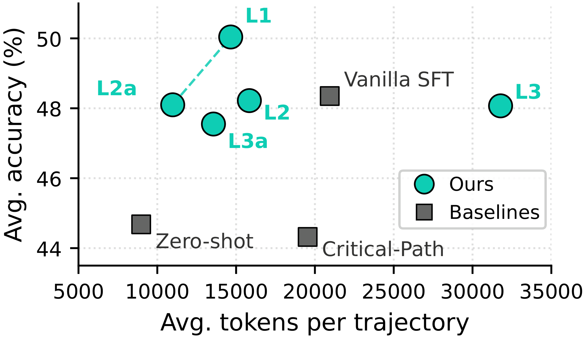
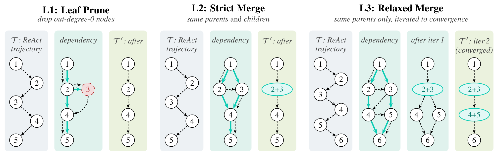
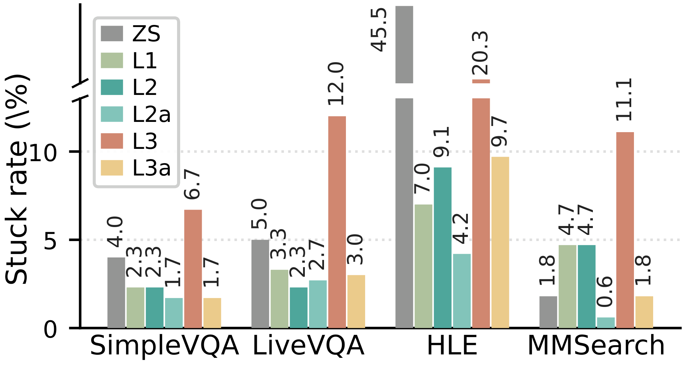
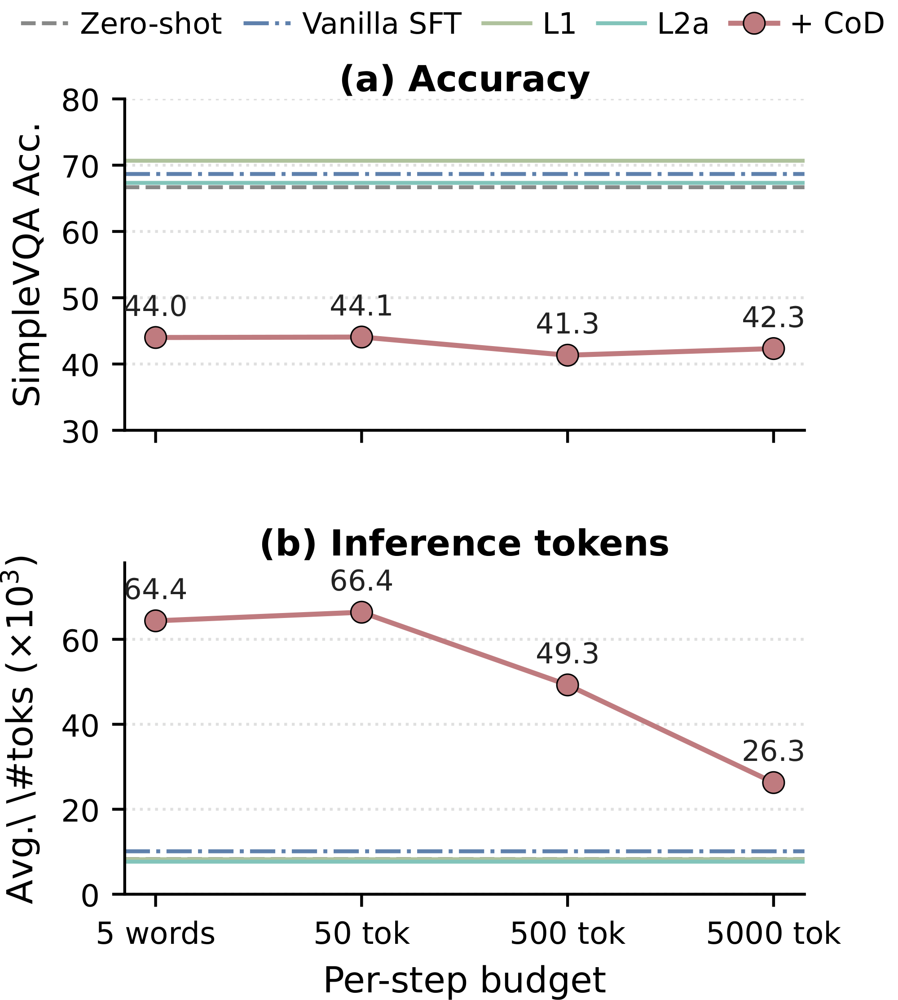
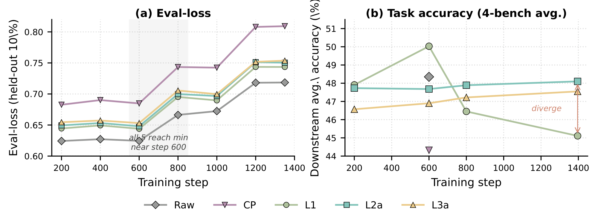
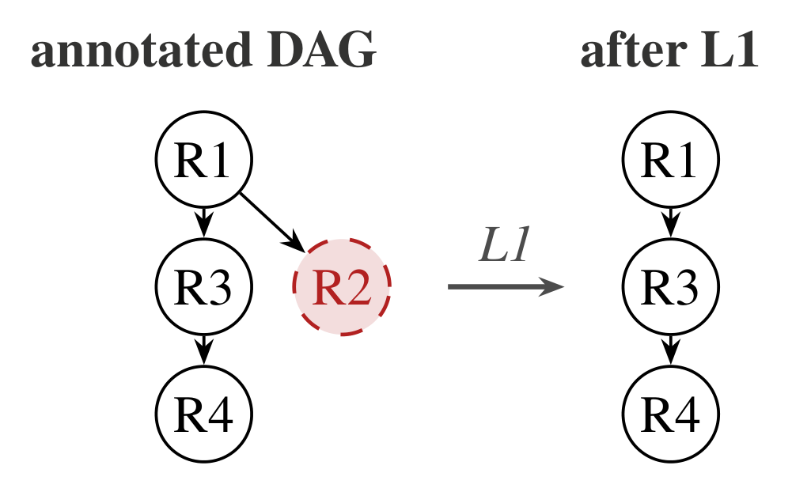
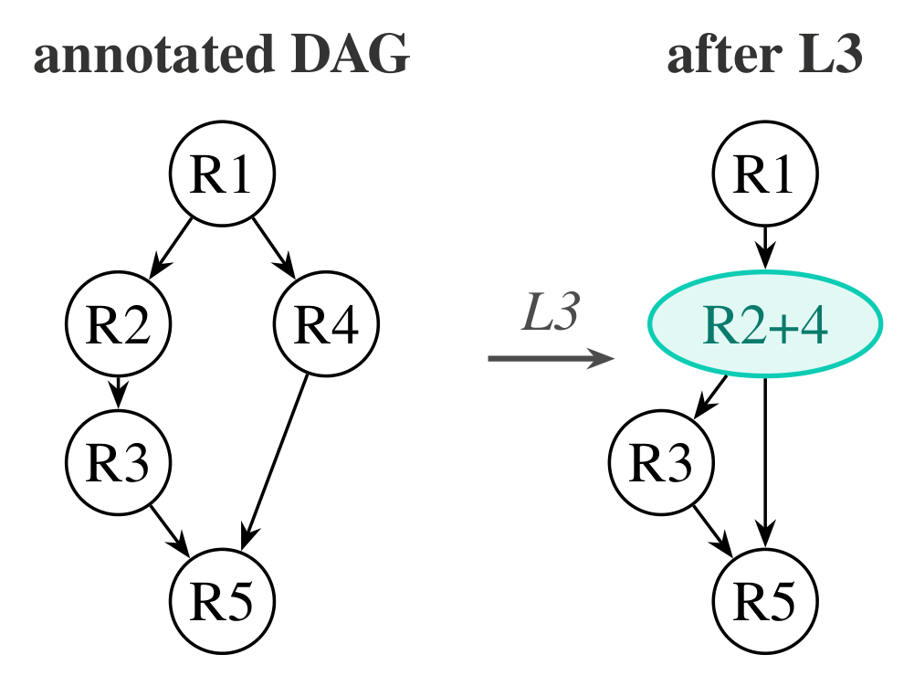

# 面向高效多轮智能体微调的依赖感知轨迹精炼

中文 | [English](./Dependency-Aware-Trajectory-Refinement_en.md)

- **原文链接**: [Dependency-Aware Trajectory Refinement for Efficient Multi-Turn Agent Fine-Tuning](https://arxiv.org/abs/2609.18417v1)
- **论文**: [arXiv:2609.18417](https://arxiv.org/abs/2609.18417)（AACL 2026 Findings）
- **发布日期**: 2026-09-16
- **译注**: 本文是 arXiv v1 版的非官方全文中译，含正文、附录、全部图表和参考文献。原文以 [CC BY 4.0](https://creativecommons.org/licenses/by/4.0/) 许可发布，本译文沿用同一许可。格式上的改动：图 1、3、4、6 取自 arXiv 源文件中的矢量图，渲染为 PNG；用 TikZ 绘制的图 2 和附录 I 的两张 DAG 示意图从 arXiv PDF 截取；图 5、附录 I 的轮次框和附录 J 的提示词框改为文本代码块（框的颜色和框内的粗体、斜体未保留），框的标题放在代码块首行或上方的说明里；图 2 图注中的两种箭头图例写成 ⇢ 和 →；多行表头和合并单元格改为普通 Markdown 表格，表 9、10 中的彩色增减值改为普通文本；摘要中的链接文字“here”换成了仓库名；Humanity’s Last Exam 一条参考文献与原 PDF 一样只列出前 19 位作者；参考文献按 arXiv HTML 版的条目整理，DOI 链接统一写成 doi.org 形式；交叉引用改为纯文本。提示词、附录 I 的轨迹内容、参考文献，以及模型和数据集名称保留英文。英文版是原文转成的 Markdown，格式改动相同。

Zhuo Chen$`^{1}`$, Zhen Zhang, Xinyu Wang, Kewei Tu$`^{1}`$\*

$`^{1}`$School of Information Science and Technology, ShanghaiTech University; $`^{1}`$Shanghai Engineering Research Center of Intelligent Vision and Imaging; `chenzhuo@shanghaitech.edu.cn`

\* 通讯作者。

## 摘要

多轮智能体轨迹中常常包含冗余的轮次（失败的工具调用、并行的子查询、仅用于验证的步骤），它们同时抬高了训练和推理成本。我们提出把每条轨迹看作一个*轮次级依赖 DAG*，用它揭示哪些轮次在全局上对最终答案起支撑作用，并在经过这个 DAG 精炼的轨迹上微调智能体。给定一个由 LLM 标注的 DAG，这些编辑是确定性的、可解释的，还可以选择再做一步改写。在这些精炼轨迹上训练的模型，始终能以更低的推理成本超过在原始轨迹上训练的模型。具体来说，在四个多模态 QA 基准上，我们的精炼方法使下游准确率比 Vanilla SFT 最多提高 1.7 个百分点（比一个 LLM 删除基线最多提高 5.7 个百分点），同时把每个样本的推理消息数最多减少约 40%、推理 token 数最多减少约 48%，从而大幅节省计算和服务成本。代码见 [Chord-Chen-30/LLaMA-Factory-lite](https://github.com/Chord-Chen-30/LLaMA-Factory-lite)。

## 1 引言

将推理与检索调用交替进行的工具增强型多模态智能体，如今代表了视觉问答领域的最先进水平 (Yao et al., 2023; Schick et al., 2023; Qin et al., 2023; Deng et al., 2023; Xie et al., 2024)。要从一个预训练模型出发训练这样的智能体，通常需要高质量的多轮轨迹，来示范如何使用工具解决复杂问题。这些轨迹很有价值，但信息密度并不总是很高。在合成这些轨迹时，源模型不可避免地会执行失败的搜索、反复核对已经确认的事实，或者分出并行的子查询，而这些子查询的结果从未进入最终答案。成本于是在训练和推理两个阶段不断累积。

一个很自然的想法是在 SFT 之前先压缩轨迹。我们关注两种截然不同的操作。第一种是直观的基线方法**轮次删除**，它不具备依赖 DAG 所提供的上下文感知：由一个 LLM 评判模型把对最终答案而言冗余的中间轮次标记出来。我们通过实验发现，这种做法激进但有损，因为删除一个其事实仍被引用的轮次，会让学生模型“凭空捏造来源”。与之相对，我们提出的方法在依赖图上操作。我们先在轮次之上构建一个 DAG，再进行两个层级的结构剪枝。第一层移除非终端的叶子节点，第二层合并相互独立的兄弟轮次。



*图 1：**准确率与推理成本的权衡。** **L1** 达到最高准确率。**L2a** 在 Vanilla SFT 的准确率水平上把推理 token 减半。*



*图 2：在结构化依赖 DAG 上的三个层级的精炼。对每个层级，trajectory 面板按记录的轮次顺序连线（⇢），dependency 面板在相同节点上叠加实际的数据依赖（→），after 面板展示改写后的轨迹。第 1 轮是用户查询，编号最大的轮次是助手的回答。*

一旦把轨迹重新表述为轮次级依赖 DAG，编辑就变得*确定、可解释，而且应用起来代价很低*。我们实例化了三种激进程度递增的变体（叶子剪枝、严格合并、宽松合并），每一种都保留原始轨迹中起支撑作用的依赖，之后还可以再接一步 LLM 改写。我们的结果揭示了两个互补的最佳平衡点（图 1）。叶子剪枝（**L1**）锚定了高准确率一端，比 Critical-Path 基线高 +5.7 个百分点。带 LLM 改写的严格合并（**L2a**）锚定了高性价比一端，在与 Vanilla SFT 准确率相当的同时，每个样本只用 11.0 K 推理 token，而 Vanilla SFT 需要 20.9 K。这两个点共同界定了我们所比较的 SFT 系统中最好的准确率–成本权衡。我们还注意到，最激进的变体，即宽松合并（**L3**），对推理时采用的“每回合一次工具调用”协议很敏感：相当一部分样本会陷入更长的交互循环，推理成本明显更高。结构编辑在保留推理时预期的训练–测试交互模式时效果最好。

**贡献。** (1) 一种看待智能体轨迹的依赖 DAG 视角，它把轨迹精炼变成一个透明、确定的图编辑问题，并给出三个具体层级的结构编辑。(2) 在四个多模态 QA 基准上，用我们精炼后的轨迹训练出的模型，以大幅更低的推理成本超过了 Vanilla SFT 的准确率。(3) 一种 LLM 改写扩展，用来弥合轮次合并带来的训练/推理格式差距，并附有一项分析，把每个编辑层级的行为与这一差距联系起来。

## 2 方法

### 2.1 预备知识

我们在 ReAct 范式 (Yao et al., 2023) 下讨论智能体轨迹，在这一范式中，智能体交替进行推理和行动来解决任务。一条智能体轨迹 $`\mathcal{T}`$ 是由若干*轮次*组成的序列。第 1 轮是用户的问题。第 $`2..N-1`$ 轮各由一个助手回合（`<think>`+`<tool_call>`）和紧随其后的一个用户回合（`<tool_response>`）组成。第 $`N`$ 轮是助手的最终答案（`<think>`+`<answer>`）。我们把 $`\mathcal{T}`$ 精炼成一个 $`\mathcal{T}'`$，它保留最终答案，且所含轮次不多于 $`\mathcal{T}`$。

### 2.2 轮次级依赖 DAG

对每条轨迹 $`\mathcal{T}`$，我们抽取一个 DAG $`G(\mathcal{T})`$，其边 $`i \to j`$ 记录*在全局上起支撑作用*的依赖。即轮次 $`i`$ 产生了一个具体的产物（数字、命名实体、URL、中间结论），轮次 $`j`$ 用它来得出最终答案。仅表示叙述性指代的边（“……没有帮助，让我试试……”）被排除在外。解析之后，通过深度优先遍历去除所有的环。我们用附录 J 中给出的提示词查询 GPT-5.4 来获得这些边。

### 2.3 三个层级的结构编辑

我们按激进程度递增的顺序应用三种编辑，如图 2 所示：

**叶子剪枝（L1）。** 迭代地移除所有出度为零的轮次，但第 1 轮（用户查询）和第 $`N`$ 轮（助手答案）除外。这些节点对应走进死胡同的工具调用（检索失败、被放弃的子查询），它们的输出不会流向任何下游轮次。

**严格合并（L2）。** 两个具有相同上游上下文和相同下游消费者的轮次，在数据流中是可以互换的。从最终答案的角度看，它们是同一逻辑步骤的并行计算。**L2** 把这些兄弟轮次融合成一个。这样做消除了冗余的并行，同时保留了 DAG 中的每一条依赖。**L2** 在 **L1** 的基础上应用。

**宽松合并（L3）。** **L3** 放宽了 **L2** 的准则，只要求父节点相同，而不管下游消费者是谁，并迭代地应用这一规则。由于每次合并都会改变其下游节点的父节点集合，一遍处理之后可能出现新的兄弟对，因此我们会一直融合下去，直到没有候选为止。在图 2（**L3** 面板）中，把 {2,3} 合并为 2+3 之后，轮次 4 和 5 拥有了共同的新父节点 2+3，于是在第二遍处理中被融合为 4+5。**L3** 在 **L1** 的基础上应用。

**规范格式。** 所有编辑都保持每个回合只有一个外层标签（助手一侧为 `<think>` + `<tool_call>`/`<answer>`，用户一侧为 `<tool_response>`）。合并后的内容在标签内部拼接。

### 2.4 LLM 改写合并（L2a、L3a）

合并后轮次的 `<think>` 是由若干条互不相干的思路拼接而成的，这种模式在原始轨迹中并不存在。**L2a** 和 **L3a** 对 **L2** 和 **L3** 合并后的 `<think>` 进行 LLM 改写，生成一段连贯的文字，同时保留每一次子任务切换和每一处对工具调用的引用（提示词见附录 J）。`<tool_call>` 和 `<tool_response>` 的内容保持原样。

## 3 实验

### 3.1 实验设置

**训练数据。** 我们使用 6196 条多模态、使用工具的轨迹，它们扩展自 Geng et al. (2025)。表 1 报告了在一个*公平比较子集*上每种编辑带来的消息数和 token 数削减，该子集由 1334 条至少被一种编辑修改过的轨迹组成。**Critical-Path** 最激进，**L1** 最保守。**L2** 和 **L3** 介于两者之间，其中 **L3** 比 **L2** 删除更多轮次，但删除的 token 更少。

**对比的系统。** (i) **Zero-shot**：未经 SFT 的基座模型 `Qwen3-VL-30B-A3B-Thinking` (Bai et al., 2025)。(ii) **Vanilla SFT**：在未经修改的 6196 条原始轨迹上做 SFT。(iii) **Critical-Path**：由一个 LLM 把每个中间轮次标记为“保留或删除”，并通过一项溯源检查（grounding check）否决那些会让最终答案中的命名实体失去出处的删除。(iv) **我们的方法**：在同一基座上，用经过 **L1**–**L3a** 轨迹精炼的数据做 SFT。完整设置见附录 A 和 B。

**基准。** 我们在四个多模态、使用工具的 QA 数据集上评测：SimpleVQA（视觉事实性，300；Cheng et al., 2025）、LiveVQA（近期知识的视觉问答，300；Fu et al., 2025）、HLE（高难度知识问题，330；Phan et al., 2026）和 MMSearch（多模态搜索，171；Jiang et al., 2024）。我们报告由 `gpt-5-nano` 评判的准确率，以及两个效率代理指标。

| 配置 | 平均消息数 | 消息削减 | 平均 token 数 | token 削减 |
| --- | --- | --- | --- | --- |
| *原始* | 11.77 | — | 3,692 | — |
| Critical-Path | 8.29 | 29.46% | 2,781 | 24.65% |
| **L1** | 9.63 | 18.18% | 3,096 | 16.15% |
| **L2** | 9.22 | 21.61% | 3,091 | 16.28% |
| **L3** | 8.87 | 24.67% | 3,087 | 16.39% |
| **L2a** | 9.22 | 21.61% | 3,080 | 16.57% |
| **L3a** | 8.87 | 24.67% | 3,067 | 16.93% |

*表 1：训练集上的消息数与 token 数削减。*

### 3.2 主要结果

表 2 报告了四个基准上的任务准确率、平均消息数和 token 数，以及由此导出的性价比比值。总体来看，叶子剪枝（**L1**）的准确率最高，而改写后的严格合并（**L2a**）是性价比最高的变体。从这些结果中可以得出三点关键观察：

(i) 同时突破准确率与效率的极限。我们的方法成功解开了高准确率与高成本之间的紧密耦合。**L1** 创下了新的性能上限（平均准确率 50.04%），比 Vanilla SFT 高 +1.7 个百分点。与此同时，**L2a** 重新定义了推理效率，在所有 SFT 变体中取得了最高的单位 token 准确率，同时保持与基线相当的准确率。把 4 个基准的平均值拆开来看，在各 SFT 系统中，**L2a** 在每一个基准上都一致地是消息数最少、也是 token 数最少的（附录 C）。

| | | Zero-shot | Vanilla SFT | Critical Path | **L1** | **L2** | **L3** | **L2a** | **L3a** |
| --- | --- | --- | --- | --- | --- | --- | --- | --- | --- |
| *任务准确率* | SimpleVQA | 66.67 | 68.67 | 60.67 | **70.67** | 68.67 | 66.67 | 67.33 | 64.33 |
| | LiveVQA | 48.00 | 51.00 | 46.33 | **53.67** | 51.33 | 50.33 | 51.00 | 51.00 |
| | HLE | 8.48 | 9.39 | 11.21 | 10.30 | 10.30 | **11.52** | **11.52** | 8.79 |
| | MMSearch | 55.56 | 64.33 | 59.06 | 65.50 | 62.57 | 63.74 | 62.57 | **66.08** |
| | **平均准确率** | 44.68 | 48.35 | 44.32 | **50.04** | 48.22 | 48.07 | 48.10 | 47.55 |
| *推理效率* | 平均消息数 | 41.67 | 23.94 | 27.33 | 15.90 | 22.25 | 30.19 | **14.30** | 16.63 |
| | 平均 token 数 | **8,977**† | 20,940 | 19,540 | 14,657 | 15,841 | 31,779 | 10,977 | 13,766 |
| *性价比* | 准确率 / 消息数 | 1.07 | 2.02 | 1.62 | 3.15 | 2.17 | 1.59 | **3.36** | 2.86 |
| | 准确率 / token（×10³） | 4.98† | 2.31 | 2.27 | 3.41 | 3.04 | 1.51 | **4.38** | 3.45 |

*表 2：四个多模态 QA 基准上的主要结果。**粗体**表示每行中的最优值。† 为伪影：Zero-shot 在 HLE 上经常陷入卡死循环（见附录 D），拉低了它的 token 平均值。*

(ii) 在多样的部署约束下灵活选择准确率与成本。当计算预算充足时，**L1** 是最佳选择，在四个基准中的三个上表现领先。反之，在严格的成本或延迟约束下，**L2a** 提供了一个理想的即插即用替代方案，在不牺牲准确率的情况下把 token 开销削减约 48%。

(iii) 边界探索与各自的专长。宽松合并（**L3**）在标准任务上增加了 token 成本，但在高难度的 HLE 数据集上取得了 11.52% 的峰值准确率，显示出在复杂推理上的潜力。相比之下，**Critical-Path** 基线大幅下降，证实了粗暴地删除中间轮次会损害泛化能力。

## 4 分析

本节首先分析宽松合并为什么会提高卡死率，以及 LLM 改写如何缩小这一差距。其次，我们把 Chain-of-Draft 作为推理时基线进行比较。第三，我们检验 L1 的保留节点集合在换用其他标注模型时是否稳定。



*图 3：卡死率（%），即触及 128 轮智能体循环上限的样本比例。*

### 4.1 轨迹合并与改写

当一个合并组包含子节点各不相同的兄弟节点时，训练中的回合会把多个工具响应聚合进同一个 `<tool_response>` 块。这种格式偏离了典型的多轮交互，造成的偏移可能扰乱模型在推理时的行为。结果是，在全部四个基准上，样本在 **L3** 下触及 128 轮智能体循环上限的频率是在 **L2** 下的 2–3 倍（图 3）。排除这些卡死样本后，**L3** 的消息数中位数几乎与 **L2** 的持平。**L2** 把合并限制在可互换的兄弟节点之间，从而避免了这种分布偏移。

**L2a** 和 **L3a** 把拼接起来的 `<think>` 内容改写成一段连贯的推理。在 **L3** 上，这种改写既在很大程度上弥合了卡死率的差距（图 3），又在准确率相当的情况下大幅降低了每个样本的成本（消息数减少 45%，token 数减少 57%）。**L3a** 与 **L2a** 之间剩余的差距是结构性的，因为 **L3** 融合的是下游消费者各不相同的兄弟节点，而这种模式仅靠改写无法重塑。



*图 4：在 SimpleVQA 上对 Chain-of-Draft 做的扫描，与 Zero-shot、Vanilla SFT、**L1** 和 **L2a** 的对比。*

### 4.2 与 Chain-of-Draft 的比较

我们还测试了 Chain of Draft (Xu et al., 2025)，这是一种只靠提示词、用于压缩单次回答中思维链的方法；我们把它作为推理时基线，用在未经修改的 Zero-shot 模型上，智能体循环和评判模型保持不变。在 SimpleVQA 上把每一步的预算从 5 个词扫到 5000 个 token（图 4），准确率比 Zero-shot 低约 22 个百分点，而 token 数上升到 Zero-shot 平均值的 6–8 倍。CoD 针对的是简短的单轮推理；在多轮工具循环中收紧每一轮的 `<think>`，会让智能体在还没理清子问题时就调用工具，因而更加浪费。因此我们没有把 CoD 列入表 2。面向单次回答任务、只靠提示词的压缩方法在这里无法迁移，这支持在训练前编辑轨迹，而不是在推理时约束生成。

### 4.3 标注模型之间的一致性

我们用两个替代的标注模型重新标注训练轨迹，并以 GPT-5.4 的结果为参照，比较 L1 所使用的保留节点集合（表 3）。Kept-P 是替代标注模型保留的轮次中、GPT-5.4 也保留的比例。Kept-R 是 GPT-5.4 保留的轮次中、替代标注模型也保留下来的比例。两者都还原出了同样的起支撑作用的核心，区别主要在于剪枝的激进程度。

| 标注模型 | Kept-P | Kept-R | Kept-F1 |
| --- | --- | --- | --- |
| `claude-sonnet-4-6` | 0.916 | 0.819 | 0.865 |
| `deepseek-v4-pro` | 0.990 | 0.575 | 0.727 |

*表 3：与 GPT-5.4 相比的保留节点一致性。*

### 4.4 其他实验

附录内容包括训练和推理设置（附录 A–B）、按基准拆分的成本明细（附录 C）、关于卡死率的说明（附录 D）、合并格式的对齐（附录 E）、DPO 的结果与设置（附录 F–G）、checkpoint 选择（附录 H）、一个 DAG 定性示例（附录 I）以及提示词模板（附录 J）。

## 5 相关工作

将推理与搜索、网页访问或系统级操作交替进行的工具使用型 LLM 智能体，如今已是主流做法 (Yao et al., 2023; Schick et al., 2023; Qin et al., 2023; Deng et al., 2023; Xie et al., 2024; Yao et al., 2024)，而在来自更强 LLM 的多轮轨迹上做 SFT 是主流的微调路线 (Zeng et al., 2024)。

在思路上更接近的，是三类追求更好的 SFT *数据*的工作。“少即是多”路线通过人工、质量评分或影响力估计来挑选 SFT 样本，并表明经过挑选的小规模语料可以媲美更大的含噪语料 (Zhou et al., 2023; Cao et al., 2024; Liu et al., 2024)。推理步骤监督对单个回答内部的各个步骤进行编辑或打分，要么通过自训练生成新的推理依据 (Zelikman et al., 2022)，要么借助步骤级的过程奖励 (Wang et al., 2024)。轨迹合成则通过由教师驱动的智能体流程，从零生成智能体训练数据 (Mitra et al., 2024)。

这些方法要么作用于整个样本之间，要么作用于单个回答内部，要么靠生成新数据，都没有触及智能体轨迹的内部结构。我们把每条轨迹重新表述为轮次级依赖 DAG，并在其内部进行确定性的编辑，从而把轨迹精炼变成一个透明的图编辑问题。

## 6 结论

我们把每条多轮智能体轨迹重新表述为轮次级依赖 DAG，并应用三种确定性的结构编辑，外加一个可选的 LLM 改写变体。在四个多模态 QA 基准上，叶子剪枝（**L1**）锚定了高准确率一端，比 Vanilla SFT 高 +1.7 个百分点；带改写的严格合并（**L2a**）则锚定了高性价比一端，在 Vanilla SFT 的准确率水平上把每个样本的推理 token 减半。图编辑视角让每种编辑背后的结构假设变得明确，也为精炼多轮智能体轨迹提供了一个通用的抓手。

## 局限性

我们的研究仅限于一个基座模型系列（`Qwen3-VL-30B-A3B-Thinking`）。所提出的编辑作用于训练数据而非模型权重，但训练加上逐个 checkpoint 的评测已经接近我们的计算预算，因此跨基座模型和跨模态的迁移留待后续工作。依赖标注和 merge-think 改写在数据准备阶段各增加一遍标注模型调用，这些一次性成本相对于第 3.2 节中推理时的节省，很快就能摊销掉。

## 致谢

本工作得到了上海科技大学信息科学与技术学院（SIST）计算机科学与通信核心设施平台的支持。

## 参考文献

- S. Bai, Y. Cai, R. Chen, K. Chen, X. Chen, Z. Cheng, L. Deng, W. Ding, C. Gao, C. Ge, W. Ge, Z. Guo, Q. Huang, J. Huang, F. Huang, B. Hui, S. Jiang, Z. Li, M. Li, M. Li, K. Li, Z. Lin, J. Lin, X. Liu, J. Liu, C. Liu, Y. Liu, D. Liu, S. Liu, D. Lu, R. Luo, C. Lv, R. Men, L. Meng, X. Ren, X. Ren, S. Song, Y. Sun, J. Tang, J. Tu, J. Wan, P. Wang, P. Wang, Q. Wang, Y. Wang, T. Xie, Y. Xu, H. Xu, J. Xu, Z. Yang, M. Yang, J. Yang, A. Yang, B. Yu, F. Zhang, H. Zhang, X. Zhang, B. Zheng, H. Zhong, J. Zhou, F. Zhou, J. Zhou, Y. Zhu, and K. Zhu (2025). Qwen3-vl technical report. arXiv:2511.21631, <https://arxiv.org/abs/2511.21631>
- Y. Cao, Y. Kang, C. Wang, and L. Sun (2024). Instruction mining: instruction data selection for tuning large language models. arXiv:2307.06290, <https://arxiv.org/abs/2307.06290>
- X. Cheng, W. Zhang, S. Zhang, J. Yang, X. Guan, X. Wu, X. Li, G. Zhang, J. Liu, Y. Mai, Y. Zeng, Z. Wen, K. Jin, B. Wang, W. Zhou, Y. Lu, T. Li, W. Huang, and Z. Li (2025). SimpleVQA: multimodal factuality evaluation for multimodal large language models. arXiv:2502.13059, <https://arxiv.org/abs/2502.13059>
- X. Deng, Y. Gu, B. Zheng, S. Chen, S. Stevens, B. Wang, H. Sun, and Y. Su (2023). Mind2Web: towards a generalist agent for the web. arXiv:2306.06070
- M. Fu, Y. Peng, D. Chen, Z. Zhou, B. Liu, Y. Wan, Z. Zhao, P. S. Yu, and R. Krishna (2025). Seeking and updating with live visual knowledge. arXiv:2504.05288, <https://arxiv.org/abs/2504.05288>
- X. Geng, P. Xia, Z. Zhang, X. Wang, Q. Wang, R. Ding, C. Wang, J. Wu, Y. Zhao, K. Li, Y. Jiang, P. Xie, F. Huang, and J. Zhou (2025). WebWatcher: breaking new frontier of vision-language deep research agent. arXiv:2508.05748, <https://arxiv.org/abs/2508.05748>
- D. Jiang, R. Zhang, Z. Guo, Y. Wu, J. Lei, P. Qiu, P. Lu, Z. Chen, G. Song, P. Gao, et al. (2024). MMSearch: benchmarking the potential of large models as multi-modal search engines. arXiv preprint arXiv:2409.12959.
- W. Liu, W. Zeng, K. He, Y. Jiang, and J. He (2024). What makes good data for alignment? a comprehensive study of automatic data selection in instruction tuning. arXiv:2312.15685, <https://arxiv.org/abs/2312.15685>
- A. Mitra, L. D. Corro, G. Zheng, S. Mahajan, D. Rouhana, A. Codas, Y. Lu, W. Chen, O. Vrousgos, C. Rosset, F. Silva, H. Khanpour, Y. Lara, and A. Awadallah (2024). AgentInstruct: toward generative teaching with agentic flows. arXiv:2407.03502, <https://arxiv.org/abs/2407.03502>
- L. Phan, A. Gatti, Z. Han, N. Li, J. Hu, H. Zhang, C. B. C. Zhang, M. Shaaban, J. Ling, S. Shi, M. Choi, A. Agrawal, A. Chopra, A. Khoja, R. Kim, R. Ren, J. Hausenloy, O. Zhang, M. Mazeika, and 1103 others (2026). Humanity’s last exam. arXiv:2501.14249, <https://doi.org/10.1038/s41586-025-09962-4>, <https://arxiv.org/abs/2501.14249>
- Y. Qin, S. Liang, Y. Ye, K. Zhu, L. Yan, Y. Lu, Y. Lin, X. Cong, X. Tang, B. Qian, S. Zhao, L. Hong, R. Tian, R. Xie, J. Zhou, M. Gerstein, D. Li, Z. Liu, and M. Sun (2023). ToolLLM: facilitating large language models to master 16000+ real-world apis. arXiv:2307.16789, <https://arxiv.org/abs/2307.16789>
- R. Rafailov, A. Sharma, E. Mitchell, S. Ermon, C. D. Manning, and C. Finn (2024). Direct preference optimization: your language model is secretly a reward model. arXiv:2305.18290, <https://arxiv.org/abs/2305.18290>
- T. Schick, J. Dwivedi-Yu, R. Dessì, R. Raileanu, M. Lomeli, L. Zettlemoyer, N. Cancedda, and T. Scialom (2023). Toolformer: language models can teach themselves to use tools. arXiv:2302.04761, <https://arxiv.org/abs/2302.04761>
- P. Wang, L. Li, Z. Shao, R. Xu, D. Dai, Y. Li, D. Chen, Y. Wu, and Z. Sui (2024). Math-shepherd: verify and reinforce LLMs step-by-step without human annotations. In Proceedings of the 62nd Annual Meeting of the Association for Computational Linguistics (Volume 1: Long Papers), L. Ku, A. Martins, and V. Srikumar (Eds.), Bangkok, Thailand, pp. 9426–9439. <https://aclanthology.org/2024.acl-long.510/>, <https://doi.org/10.18653/v1/2024.acl-long.510>
- T. Xie, D. Zhang, J. Chen, X. Li, S. Zhao, R. Cao, T. J. Hua, Z. Cheng, D. Shin, F. Lei, Y. Liu, Y. Xu, S. Zhou, S. Savarese, C. Xiong, V. Zhong, and T. Yu (2024). OSWorld: benchmarking multimodal agents for open-ended tasks in real computer environments. arXiv:2404.07972
- S. Xu, W. Xie, L. Zhao, and P. He (2025). Chain of draft: thinking faster by writing less. arXiv:2502.18600, <https://arxiv.org/abs/2502.18600>
- S. Yao, N. Shinn, P. Razavi, and K. Narasimhan (2024). τ-Bench: a benchmark for tool-agent-user interaction in real-world domains. arXiv:2406.12045, <https://arxiv.org/abs/2406.12045>
- S. Yao, J. Zhao, D. Yu, N. Du, I. Shafran, K. Narasimhan, and Y. Cao (2023). ReAct: synergizing reasoning and acting in language models. In International Conference on Learning Representations (ICLR).
- E. Zelikman, Y. Wu, J. Mu, and N. D. Goodman (2022). STaR: bootstrapping reasoning with reasoning. arXiv:2203.14465, <https://arxiv.org/abs/2203.14465>
- A. Zeng, M. Liu, R. Lu, B. Wang, X. Liu, Y. Dong, and J. Tang (2024). AgentTuning: enabling generalized agent abilities for LLMs. In Findings of the Association for Computational Linguistics: ACL 2024, L. Ku, A. Martins, and V. Srikumar (Eds.), Bangkok, Thailand, pp. 3053–3077. <https://aclanthology.org/2024.findings-acl.181/>, <https://doi.org/10.18653/v1/2024.findings-acl.181>
- Y. Zheng, R. Zhang, J. Zhang, Y. Ye, and Z. Luo (2024). LlamaFactory: unified efficient fine-tuning of 100+ language models. In Proceedings of the 62nd Annual Meeting of the Association for Computational Linguistics (Volume 3: System Demonstrations), Y. Cao, Y. Feng, and D. Xiong (Eds.), Bangkok, Thailand, pp. 400–410. <https://aclanthology.org/2024.acl-demos.38/>, <https://doi.org/10.18653/v1/2024.acl-demos.38>
- C. Zhou, P. Liu, P. Xu, S. Iyer, J. Sun, Y. Mao, X. Ma, A. Efrat, P. Yu, L. YU, S. Zhang, G. Ghosh, M. Lewis, L. Zettlemoyer, and O. Levy (2023). LIMA: less is more for alignment. In Advances in Neural Information Processing Systems, A. Oh, T. Naumann, A. Globerson, K. Saenko, M. Hardt, and S. Levine (Eds.), Vol. 36, pp. 55006–55021. <https://proceedings.neurips.cc/paper_files/paper/2023/file/ac662d74829e4407ce1d126477f4a03a-Paper-Conference.pdf>

## 附录 A 训练设置

所有 SFT 系统（Vanilla SFT、Critical-Path、**L1**–**L3a**）都在完全相同的超参数下（表 4），以全参数更新的方式微调同一个基座模型 `Qwen3-VL-30B-A3B-Thinking` (Bai et al., 2025)。各系统之间唯一的区别是训练轨迹。训练集按 90/10 划分为训练集和验证集，每个系统的最佳 checkpoint 按 4 个留出基准上的准确率来选择（附录 H）。实现基于 LLaMA-Factory (Zheng et al., 2024)。

| 超参数 | 取值 |
| --- | --- |
| 基座模型 | `Qwen3-VL-30B-A3B-Thinking` |
| 更新方式 | 全参数 |
| Epoch 数 | 4 |
| 学习率 | 5×10⁻⁶ |
| 学习率调度 | cosine，10% warm-up |
| 精度 | bf16 |
| 优化器分片 | DeepSpeed ZeRO-3 |
| 梯度累积 | 2 |
| `ddp_timeout` | 1.8×10⁸ s |
| 训练 / 验证划分 | 90 / 10 |

*表 4：训练设置，所有 SFT 系统共用。*

## 附录 B 推理设置

我们使用标准的智能体循环，每个助手回合一次工具调用，总共最多 128 轮。推理服务通过 `vLLM` 部署（TP=8，bf16）。128 轮的上限起到安全网的作用。我们把触及这一上限的评测样本比例报告为*卡死率*（见第 4 节和附录 D）。

## 附录 C 各数据集的推理成本

表 5–6 把表 2 中每样本消息数和 token 数这两列展开成系统 × 数据集的网格。两个指标都在每个基准的样本上取平均，最右一列重现了主表中报告的 4 个基准平均值。**L2a** 在每个基准上都一致地是消息数最少的（表 5）。在 SFT 系统中，它在全部四个基准上的 token 数也都是最好的（表 6）。Zero-shot 在 LiveVQA、HLE 和 MMSearch 上看似很低的 token 数，以及它在 HLE 上的 119.26 条消息，都是它在 HLE 上 45.5% 的卡死循环率带来的副作用（附录 D）：卡死循环会不断产生简短的重复消息，直到触及轮次上限。

| 系统 | SimpleVQA | LiveVQA | HLE | MMSearch | **平均** |
| --- | --- | --- | --- | --- | --- |
| Zero-shot | 16.69 | 18.71 | 119.26† | 12.03 | 41.67 |
| Vanilla SFT | 12.51 | 26.31 | 36.60 | 20.33 | 23.94 |
| Critical-Path | 19.27 | 25.79 | 43.41 | 20.87 | 27.33 |
| **L1** | 11.09 | 15.37 | 21.58 | 15.56 | 15.90 |
| **L2** | 14.03 | 17.34 | 36.53 | 21.11 | 22.25 |
| **L3** | 26.09 | 28.56 | 39.90 | 26.20 | 30.19 |
| **L2a** | **10.84** | **14.93** | **20.04** | **11.39** | **14.30** |
| **L3a** | 11.25 | 15.62 | 27.61 | 12.04 | 16.63 |

*表 5：按系统和数据集统计的每样本平均**消息数**。**粗体** = 该列最优（仅在 SFT 系统之间比较）。† Zero-shot 的伪影，见上文正文。*

| 系统 | SimpleVQA | LiveVQA | HLE | MMSearch | **平均** |
| --- | --- | --- | --- | --- | --- |
| Zero-shot | 8,278 | **10,757**† | **11,488**† | **5,385** | **8,977**† |
| Vanilla SFT | 10,106 | 28,176 | 26,880 | 18,596 | 20,940 |
| Critical-Path | 12,531 | 22,804 | 26,820 | 16,005 | 19,540 |
| **L1** | 8,241 | 18,081 | 16,012 | 16,293 | 14,657 |
| **L2** | 9,133 | 14,461 | 21,750 | 18,018 | 15,841 |
| **L3** | 25,532 | 39,353 | 30,834 | 31,396 | 31,779 |
| **L2a** | **7,665** | 13,264 | 13,816 | 9,161 | 10,977 |
| **L3a** | 8,485 | 14,435 | 18,709 | 13,437 | 13,766 |

*表 6：按系统和数据集统计的每样本平均 **token 数**，在完整的 assistant+user 轨迹上用 `Qwen2Tokenizer` 计算。**粗体** = 该列最优。† Zero-shot 的伪影，见上文正文。*

| | 平均准确率（%） | 平均消息数 | 准确率/消息数 | 准确率/token ×10³ |
| --- | --- | --- | --- | --- |
| Zero-shot | 44.68 | 41.67 | 1.07 | 4.98† |
| Vanilla SFT | 48.35 | 23.94 | 2.02 | 2.31 |
| Critical-Path | 44.32 | 27.33 | 1.62 | 2.27 |
| **L1** | **50.04** | 15.90 | 3.15 | 3.41 |
| **L2** | 48.22 | 22.25 | 2.17 | 3.04 |
| **L3** | 48.07 | 30.19 | 1.59 | 1.51 |
| **L2a** | 48.10 | **14.30** | **3.36** | **4.38** |
| **L3a** | 47.55 | 16.63 | 2.86 | 3.45 |

*表 7：性价比汇总，复述表 2 最下面的一块。**粗体** = 该列最优。两种性价比比值都由该行的平均准确率和对应的平均消息数 / token 数计算得出。† Zero-shot 的准确率/token 比值继承了表 6 中卡死循环造成的伪影。**L2a** 在两种比值上都严格优于每一个 SFT 基线。*

## 附录 D 关于卡死率的说明

各数据集的卡死率细分见第 4 节。这里补充两个那里没有涉及的旁支观察。第一，Zero-shot 在 HLE 上 45.5% 的卡死率解释了附录 C 中 Zero-shot 平均 token 数异常偏低的现象，因为卡死的 rollout 在没有 `<answer>` 的情况下结束，并在 128 轮上限处被截断。第二，**L3a** 在 HLE 上（相对于 **L2a**）残留的偏高，与第 4 节中格式不匹配的解释一致，因为 merge-think 改写无法完全重塑 **L3** 产生的多响应 `<tool_response>` 块。

## 附录 E 合并粒度与推理时的格式对齐

**L2**/**L2a** 和 **L3**/**L3a** 使用密切相关的合并原语，却表现出明显不同的推理行为（表 5–6，附录 D）。本附录说明这一差距从何而来，并给出它所提示的设计规则。

**格式差距。** 推理时的智能体循环是严格串行的。在绝大多数助手回合中，一个 `<tool_call>` 标签只携带一个 JSON 调用，随后的用户回合返回一个 `<tool_response>`，内含该调用的结果。合并在两侧都保留了规范的外层标签，但把 $`k \geq 2`$ 个兄弟节点的*内容*拼接在标签内部。合并后的 `<tool_call>` 于是包含 $`k`$ 个 JSON 调用，而合并后的 `<tool_response>` 以“Previous tool call results:”开头，包含对应的 $`k`$ 个结果。两个外层标签各装有 $`k`$ 项的轮次，是推理循环不会产生的一种配置（图 5）。

```text
(a) Merged training round
assistant
  <think> … </think>
  <tool_call> {call_a} {call_b} </tool_call>
user
  <tool_response>
    Previous tool call results:
    resp_a; resp_b
  </tool_response>

(b) Inference-time loop
assistant: <think> … </think> <tool_call> call_x </tool_call>
user: <tool_response> resp_x </tool_response>
assistant: <think> … </think> <tool_call> call_y </tool_call>
user: <tool_response> resp_y </tool_response>
```

*图 5：合并后训练轮次的消息模式 (a) 与典型推理时循环 (b) 的对比。在 (a) 中，一个 `<tool_call>` 标签装有 $`k`$ 个 JSON 调用，一个 `<tool_response>` 标签装有对应的 $`k`$ 个结果；而 (b) 中的循环通常每个回合只产生一个调用/结果。*

**为什么 L2 和 L3 不同。** 两种编辑都会产生上面那种多项模式，但频率不同，下游结构也不同（表 8）。*(i) 频率。* **L2** 要求父节点*和*子节点都匹配，产生 1,044 次融合；**L3** 只匹配父节点，产生 3,234 次（约 3 倍），主要体现为每个样本中的合并次数增多（受影响的样本只从 19.0% 增加到 21.3%）。*(ii) 下游对齐。* **L2** 只合并流向同一个下一轮次的兄弟节点，因此每个合并后的用户回合仍然只有一个消费者——这与推理时“一个用户回合 → 一个后续 `<think>`”的模式相同。**L3** 可能把原本流向不同子节点的兄弟节点捆绑在一起，以失去这种一一对应的结构为代价换取更密集的压缩；保留更严格的 **L2** 规则是更贴合推理的选择。

| 合并组大小 | **L2** | **L3** |
| --- | --- | --- |
| 2 | 709 | 2,491 |
| 3 | 230 | 586 |
| 4 | 83 | 122 |
| ≥5 | 22 | 35 |
| 融合总数 | 1,044 | 3,234 |
| 受影响样本数 | 1,175 (19.0%) | 1,322 (21.3%) |

*表 8：在 6,196 条轨迹的语料上，按大小统计的合并组，以及受影响训练样本的比例。*

**设计规则。** 轮次级合并应当保留原始轨迹的下游使用模式。具体来说，应要求合并准则在父节点*和*子节点上都匹配；当下游消费者不同时，应优先选择叶子剪枝而不是融合。这样可以让训练时用户回合的分布接近推理循环所产生的分布。

| | | Vanilla SFT | +DPO\[**CP**\] | +DPO\[**L1**\] | $`\Delta_V`$ | +DPO\[**L2**\] | $`\Delta_V`$ | +DPO\[**L3**\] | $`\Delta_V`$ | +DPO\[**L2a**\] | $`\Delta_V`$ | +DPO\[**L3a**\] | $`\Delta_V`$ |
| --- | --- | --- | --- | --- | --- | --- | --- | --- | --- | --- | --- | --- | --- |
| *任务准确率* | SimpleVQA | 68.67 | *发散*† | 70.00 | +1.3 | **70.67** | +2.0 | 67.33 | −1.3 | 68.33 | −0.3 | 66.67 | −2.0 |
| | LiveVQA | 51.00 | *发散*† | 52.00 | +1.0 | **53.67** | +2.7 | 50.67 | −0.3 | 50.33 | −0.7 | 50.00 | −1.0 |
| | HLE | 9.39 | *发散*† | 12.42 | +3.0 | 12.12 | +2.7 | **12.73** | +3.3 | 12.42 | +3.0 | 10.91 | +1.5 |
| | MMSearch | **64.33** | *发散*† | 54.39 | −9.9 | 59.06 | −5.3 | 57.89 | −6.4 | 53.22 | −11.1 | 60.23 | −4.1 |
| | **平均准确率** | 48.35 | *发散*† | 47.20 | −1.2 | **48.88** | +0.5 | 47.16 | −1.2 | 46.08 | −2.3 | 46.95 | −1.4 |
| *推理效率* | 平均消息数 | 23.94 | *发散*† | 11.60 | −12.3 | 11.43 | −12.5 | 12.03 | −11.9 | 11.25 | −12.7 | **10.23** | −13.7 |
| | 平均 token 数（10³） | 20.9 | *发散*† | 4.8 | −16.1 | 4.5 | −16.5 | 4.7 | −16.2 | 4.6 | −16.4 | **4.0** | −16.9 |
| *性价比* | 准确率/消息数 | 2.02 | *发散*† | 4.07 | +2.0 | 4.28 | +2.3 | 3.92 | +1.9 | 4.09 | +2.1 | **4.59** | +2.6 |
| | 准确率/10³ token | 2.31 | *发散*† | 9.85 | +7.5 | 10.98 | +8.7 | 9.99 | +7.7 | 10.10 | +7.8 | **11.63** | +9.3 |

*表 9：从 Vanilla SFT 出发的共享基座 DPO。$`\Delta_V`$：+DPO 减去 Vanilla SFT。†发散（上下文溢出）。*

| | | **Critical-P.** SFT | **Critical-P.** +DPO | **Critical-P.** Δ | **L1** SFT | **L1** +DPO | **L1** Δ | **L2** SFT | **L2** +DPO | **L2** Δ | **L3** SFT | **L3** +DPO | **L3** Δ | **L2a** SFT | **L2a** +DPO | **L2a** Δ | **L3a** SFT | **L3a** +DPO | **L3a** Δ |
| --- | --- | --- | --- | --- | --- | --- | --- | --- | --- | --- | --- | --- | --- | --- | --- | --- | --- | --- | --- |
| *任务准确率* | SimpleVQA | 60.67 | 68.00 | +7.3 | **70.67** | 68.00 | −2.7 | 68.67 | 64.67 | −4.0 | 66.67 | 66.67 | 0 | 67.33 | 68.67 | +1.3 | 64.33 | 66.00 | +1.7 |
| | LiveVQA | 46.33 | 48.67 | +2.3 | **53.67** | 51.00 | −2.7 | 51.33 | 49.33 | −2.0 | 50.33 | 51.00 | +0.7 | 51.00 | 50.67 | −0.3 | 51.00 | 52.67 | +1.7 |
| | HLE | 11.21 | 8.48 | −2.7 | 10.30 | 10.91 | +0.6 | 10.30 | 12.12 | +1.8 | 11.52 | 13.33 | +1.8 | 11.52 | **14.55** | +3.0 | 8.79 | 10.91 | +2.1 |
| | MMSearch | 59.06 | 58.48 | −0.6 | 65.50 | 62.57 | −2.9 | 62.57 | 60.82 | −1.8 | 63.74 | **66.08** | +2.3 | 62.57 | 59.06 | −3.5 | 66.08 | 63.74 | −2.3 |
| | **平均准确率** | 44.32 | 45.91 | +1.6 | **50.04** | 48.12 | −1.9 | 48.22 | 46.73 | −1.5 | 48.07 | 49.27 | +1.2 | 48.10 | 48.24 | +0.1 | 47.55 | 48.33 | +0.8 |
| *推理效率* | 平均消息数 | 27.33 | 14.12 | −13.2 | 15.90 | **13.86** | −2.0 | 22.25 | 16.52 | −5.7 | 30.19 | 22.08 | −8.1 | 14.30 | 14.48 | +0.2 | 16.63 | 15.60 | −1.0 |
| | 平均 token 数（10³） | 19.5 | 5.2 | −14.4 | 14.7 | **5.3** | −9.4 | 15.8 | 6.1 | −9.8 | 31.8 | 8.8 | −23.0 | 11.0 | 5.5 | −5.5 | 13.8 | 5.8 | −7.9 |
| *性价比* | 准确率/消息数 | 1.62 | 3.25 | +1.6 | 3.15 | 3.47 | +0.3 | 2.17 | 2.83 | +0.7 | 1.59 | 2.23 | +0.6 | 3.36 | 3.33 | −0.0 | 2.86 | 3.10 | +0.2 |
| | 准确率/10³ token | 2.27 | 8.90 | +6.6 | 3.41 | **9.14** | +5.7 | 3.04 | 7.71 | +4.7 | 1.51 | 5.62 | +4.1 | 4.38 | 8.80 | +4.4 | 3.45 | 8.28 | +4.8 |

*表 10：在每种设置各自的 SFT checkpoint 上进行的匹配基座 DPO。Δ：+DPO 减去该设置的 SFT。*

## 附录 F 在“精炼 vs. 原始”偏好对上做 DPO

每一种结构编辑都会免费产生一个共享同一最终答案的偏好对：把精炼后的轨迹作为“chosen”，把原始轨迹作为“rejected”（数量：Critical-Path 4,446；**L1** 986；**L2**/**L2a** 1,175；**L3**/**L3a** 1,322）。我们把这些偏好对接入后续的 DPO (Rafailov et al., 2024) 阶段，采用两种方案，二者唯一的区别是 DPO 的起始 checkpoint。

**共享基座方案。** 先在原始轨迹上训练一个 Vanilla SFT 模型，然后从这个共享基座出发运行 DPO，每次换用一种设置的偏好对，见表 9。所有五种可迁移的设置都把推理成本压到了远低于 Vanilla SFT 的水平。**L2** 的偏好对在准确率上最强，**L3a** 的偏好对在性价比上最强。Critical-Path 的偏好对把 Vanilla SFT 推离了分布，训练发散。

**匹配基座方案。** 从每种设置各自的 SFT checkpoint 出发做 DPO，见表 10。与共享基座相比，准确率保留得更好，token 数仍会下降，但仍高于共享基座方案的区间。共享基座更适合追求性价比的部署。当准确率本身是首要目标时，匹配基座更稳妥。

## 附录 G DPO 设置

我们使用 sigmoid DPO 加上一个在 chosen 上的 NLL 锚定项进行训练（表 11）。**L1** 使用 200 步和 $`\alpha_{\mathrm{RPO}}=0.7`$；其余设置使用 300 步和 $`\alpha_{\mathrm{RPO}}=0.5`$。每 50 步保存一个 checkpoint，并按 mix-dev 准确率而不是 eval-loss 来选择。

| 超参数 | 取值 |
| --- | --- |
| 损失函数 | sigmoid DPO + chosen 上的 NLL |
| $`\beta`$（DPO 温度） | 0.1 |
| $`\alpha_{\mathrm{RPO}}`$（NLL 权重） | 0.5（**L1** 为 0.7） |
| 最大步数 | 300（**L1** 为 200） |
| 学习率 | 5×10⁻⁷ |
| 学习率调度 | cosine，5% warm-up |
| 最大序列长度 | 16,384 |
| 每设备 batch | 1 |
| 梯度累积 | 2 |
| 全局 batch | 16 |
| 硬件 | 8×80 GiB GPU |
| 优化器 | DeepSpeed ZeRO-3 |
| 注意力实现 | SDPA |

*表 11：DPO 训练设置（各 SFT 基座共用）。*



*图 6：eval-loss 曲线（左，密集的记录间隔）与下游 4 个基准准确率（右，评测过的四个 checkpoint）的对比，对象为 **L1**、**L2a**、**L3a**。*

## 附录 H Checkpoint 选择

我们在训练数据中留出的 10% 上，每 200 步记录一次 eval-loss（表 12 上半部分，以及图 6 左）。然而，下游任务准确率需要对每个候选 checkpoint 在四个基准上运行完整的智能体循环，代价很高。在我们的计算预算之内，我们为自己的各种编辑评测了四个 checkpoint，即第 200、600、800 和 1396 步（最终），而为 Vanilla SFT 和 Critical-Path 只评测了第 600 步的一个 checkpoint（按与我们的编辑相同的规则选出）。更密集的扫描留待后续工作。

| 步数 | 原始 | CP | **L1** | **L2a** | **L3a** |
| --- | --- | --- | --- | --- | --- |
| *eval-loss（训练数据中留出的 10%）* | | | | | |
| 200 | 0.6243 | 0.6827 | 0.6445 | 0.6494 | 0.6545 |
| 400 | 0.6272 | 0.6902 | 0.6494 | 0.6532 | 0.6573 |
| 600 | 0.6245 | 0.6848 | 0.6440 | 0.6480 | 0.6531 |
| 800 | 0.6663 | 0.7434 | 0.6952 | 0.6999 | 0.7056 |
| 1000 | 0.6724 | 0.7424 | 0.6897 | 0.6967 | 0.6997 |
| 1200 | 0.7181 | 0.8080 | 0.7436 | 0.7512 | 0.7518 |
| 1350 | 0.7185 | 0.8092 | 0.7435 | 0.7504 | 0.7537 |
| *下游任务准确率（%，4 个基准平均）* | | | | | |
| 200 | — | — | 47.91 | 47.73 | 46.57 |
| 600 | 48.35 | 44.32 | **50.04** | 47.68 | 46.90 |
| 800 | — | — | 46.45 | 47.89 | 47.22 |
| 1396 | — | — | 45.11 | **48.10** | **47.55** |

*表 12：eval-loss 与下游准确率的对比。*

**最佳 checkpoint 汇总。** 按 4 个基准的平均准确率，**L1、Vanilla SFT 和 Critical-Path** 选择第 **600** 步，而 **L2a 和 L3a** 实际上选择的是第 **1396** 步。

**eval-loss 与准确率脱钩。** **L1**、**L2a**、**L3a** 三者的 eval-loss 轨迹相似（在第 600 步附近达到最低，之后上升），但下游准确率却出现分化。**L1** 在第 600 步达到峰值（50.04%），在第 800 步降到 46.45%，在第 1396 步降到 45.11%（相对峰值 −4.9 个百分点）。**L2a** 和 **L3a** 则从第 600 步起*单调*上升（**L2a** 为 47.68 → 47.89 → 48.10，**L3a** 为 46.90 → 47.22 → 47.55，单位均为 %）。如果只按 eval-loss 选 checkpoint，所有方法都会选第 600 步，这恰好是 **L1** 的峰值，但对 **L2a**/**L3a** 来说是个糟糕的选择。因此，在合并后的轨迹上训练的实践者应当按下游指标而不是 eval-loss 来选择 checkpoint。在第 1396 步之后继续训练会超出 4 个 epoch 的 SFT 预算，并且需要在完整的智能体循环上评测更多 checkpoint，每增加一个 checkpoint 都会让推理成本翻倍。eval-loss 从第 600 步起就一直在上升，因此尽管 **L2a**/**L3a** 的下游指标仍在攀升，继续训练也有不小的过拟合风险。更大计算预算下的扫描留待后续工作。

## 附录 I 定性示例

**源样本。** 训练语料中的样本 `_idx=1581`。用户展示了一张带有“SAGE Publishing”品牌标识和“Live Product Training”横幅的图片，并提问：“*SAGE Publishing 是谁创立的？在那之后的头十年里，又是谁设立了公司在伦敦的第一个海外办事处？*”标准答案的结尾是“Sara Miller McCune（与 George McCune 一起）于 1965 年创立了 SAGE，SAGE Publications Ltd. 于 1971 年在伦敦成立”。

下文中，每个灰色框是原始轨迹中的一个轮次，顶部的标题栏写明该轮次及其角色。第 1 轮是用户问题（图片 + 文本）。第 2–4 轮是助手回合，其中的 **think** 和 **call** 之后跟着一个用户侧的 **resp**。第 5 轮是助手最终的 **answer**。红色边框的框表示被某种编辑删除的轮次，青色边框的框表示由合并产生的轮次。

### 原始轨迹（8 条消息，5 个轮次）

```text
R1 (user)
[image: SAGE Publishing logo on a Live Product Training banner]
Who founded SAGE Publishing, and within the first decade after
that, who established the company’s first international office in
London?
```

```text
R2 (assistant + user)
think   Identify who founded SAGE Publishing, then look up the
        London office. Start with the founder.
call    web_search("Who founded SAGE Publishing")
resp    “24-year-old Sara Miller McCune founded Sage in 1965 …”
        (Wikipedia / About-SAGE)
```

```text
R3 (assistant + user)
think   Now find who set up SAGE’s first international office in
        London.
call    web_search("SAGE first international office London established by who and when")
resp    Same About-SAGE snippet as R2, with no new fact about
        the London office.
```

```text
R4 (assistant + user)
think   The previous result added nothing new. Try SAGE’s own
        50-year history page directly.
call    visit_url("https://us.sagepub.com/.../sage-50-year-history.pdf")
resp    “1971: SAGE Publications, Ltd. established in London. Sara
        and George hired David Brooks …”
```

```text
R5 (assistant)
think   I have what I need.
answer  Sara Miller McCune (with George McCune) founded SAGE, and
        the first international office was established in London in 1971.
```

### 标注得到的 DAG（提示词 A）

在这条轨迹上运行严格版提示词（附录 J，提示词 A），标注 LLM 输出了三条边，并附有以下经过删节的理由。

- `R2→R3`：“第 2 轮得出了具体的创始人身份 *Sara Miller McCune*，第 3 轮用它来构造下一次搜索。”
- `R4→R5`：“第 4 轮得出了关键的历史事实：*SAGE Publications, Ltd. 于 1971 年在伦敦成立*，第 5 轮用它得出结论：第一个海外办事处设在伦敦，且在头十年之内。”
- `R2→R5`：“第 2 轮确定了 Sara Miller McCune 是创始人，第 5 轮把这一点与‘1971 年伦敦’这一事实结合起来，回答了完整的问题。”

**没有从 R1 出发的边。** 提示词 A 要求标注模型只标出在全局上起支撑作用的边，即轮次 $`j`$ 使用了轮次 $`i`$ 产生的某个具体检索事实。用户查询本身（R1）是之后每一轮的主题，但它不提供任何可供下游轮次使用的*新检索事实*，因此严格准则会正确地省略所有 `R1→*` 边。有两项结构上的保证让这种做法从构造上就是安全的。第一，叶子剪枝只移除出度为 0、且既不是第 1 轮也不是编号最大轮次的节点，所以即使 R1 在标注 DAG 中没有任何边，它也永远不会成为删除候选。第二，合并函数（第 2.4 节）会跳过最小轮次编号小于 2 的合并组，所以即使 R1 出现在某个合并集合中，它的消息也不会被改动。因此，无论标注模型是否输出 `R1→*` 边，合并拓扑都完全相同。

根据标注出的边得到的 DAG 是 `R2→R3`、`R2→R5` 和 `R4→R5`。R3 的出度为 0（没有任何下游轮次使用它产生的东西），这使它成为 L1 要剪掉的叶子。

### L1（叶子剪枝）之后：6 条消息，4 个轮次

R3 在标注 DAG 中的出度为 0，因此 **L1** 将其删除。R1、R2、R4、R5 保持不变。

```text
R3 (pruned by L1: out-degree 0)
think (removed)    call (removed)    resp (removed)
```

**L1** 之后保留下来的轨迹是 `R1 → R2 → R4 → R5`，即 R1、R2、R4、R5 的原始框保持不变（不再重复画出）。

### L2a（严格合并 + LLM 改写）之后：4 条消息，3 个轮次

在 **L1** 之后的标注 DAG 中，R2 和 R4 的父节点集合都为空（提示词 A 不输出任何 `R1→*` 边），子节点集合也相同（{R5}）。严格合并规则把它们融合成一个轮次 `R2+4`。注意，即使提示词 A 输出了 `R1→R2` 和 `R1→R4`，这两个轮次也会共享父节点 {R1} 和子节点 {R5}，同样的合并仍会触发。它们的两段 **think** 内容被拼接起来，并由标注 LLM 改写成一段连贯的文字（即下方所示的 `<think>`）。原来的两次调用以两个 JSON 参数的形式放在同一个 `<tool_call>` 标签中，两段 **resp** 内容则加上前缀“Previous tool call results:”，在同一个用户回合中给出。

```text
R2+4 (merged by L2a, covering original R2 and R4)
think   The image shows SAGE Publishing’s branding on a Live
        Product Training banner. The question has two parts (who founded
        SAGE Publishing and who established its first London office within
        the first decade) and these are likely connected, so first locate
        the founder, then look at SAGE’s early history for when and how the
        London office was set up.
call    web_search("Who founded SAGE Publishing"),
        visit_url("https://us.sagepub.com/.../sage-50-year-history.pdf")
resp    Previous tool call results:
          (1) “24-year-old Sara Miller McCune founded Sage in
          1965 …”
          (2) “1971: SAGE Publications, Ltd. established in
          London. Sara and George hired David Brooks …”
```

完整的 **L2a** 轨迹是 `R1 → R2+4 → R5`（R5 与原始轨迹相同）。

**要点。** 两种不同的效果在同一条轨迹上叠加。第一，叶子剪枝（**L1**）删除了多余的后续搜索，其证据早已在 R2 中。第二，带改写的严格合并（**L2a**）把两个实质上不同的子查询（“谁创立的”与“第一个海外办事处在哪里”）折叠进同一个推理轮次，其 `<think>` 读起来是一条完整的思维链，而不是用分号拼接起来的两段互不相干的内容。R5 中的最终答案保持不变。

### 另外两个只看 DAG 的案例

为了单独展示每种编辑在拓扑上的作用，我们再给出训练语料中的两个样本，只画出 DAG，省略每个轮次的内容。第一个样本只触发 L1，第二个只触发 L3。

**样本 A（`_idx=6061`），仅 L1。** 标注 DAG 中的边为 `R1→R2`、`R1→R3`、`R3→R4`。轮次 R2 的出度为 0，且不是编号最大的轮次，因此 **L1** 将其剪掉。L2 和 L3 作用于兄弟组，而剩下的图中没有共享父节点的兄弟节点，所以二者都不起作用。轨迹从 6 条消息缩减为 4 条。



**样本 C（`_idx=13`），仅 L3。** 标注 DAG 中的边为 `R1→R2`、`R1→R4`、`R2→R3`、`R3→R5`、`R4→R5`。没有哪个轮次是可删除的叶子，所以 **L1** 不起作用。对于 **L2**，R2 的子节点是 {R3}，而 R4 的子节点是 {R5}，所以严格准则（父节点*和*子节点都相同）也不会触发。**L3** 只要求共享父节点，而 R2 和 R4 的父节点都是 {R1}，因此它们被合并成一个轮次 `R2+4`。剩下的边变为 `R1→R2+4`、`R2+4→R3`、`R2+4→R5`、`R3→R5`。轨迹从 8 条消息缩减为 6 条。



结合上面的样本 B（`_idx=1581`），这三个样本分别单独展示了三种编辑原语。真实轨迹常常会把它们串联起来，就像样本 B 那样（先 L1，再 L2a）。

## 附录 J 提示词模板

本附录汇集了文中使用的 LLM 提示词：

- **提示词 A，DAG 标注**：抽取所有编辑都要用到的轮次级依赖 DAG（第 2.2 节）。
- **提示词 B，Critical-Path KEEP/REMOVE**：我们用来对比的 LLM 删除基线（第 3.1 节）。
- **提示词 C，Merge-think 改写**：把原样拼接的 `<think>` 块变成一段连贯的文字，供 **L2a**/**L3a** 使用（第 2.4 节）。
- **提示词 D，LLM 作为评判**：把模型最终的 `<answer>` 与标准答案对比打分。在所有表格中用作任务准确率指标（第 3.1 节）。

*提示词 A：DAG 标注。*

```text
# Role
You are an expert in logical reasoning and causal analysis. Your task
is to analyze a multi-round AI Agent trajectory and deconstruct it
into a Directed Acyclic Graph (DAG) that captures only the
dependencies that actually matter for producing the final answer.

# Task Description
The trajectory is organized by “Rounds.” You will be told which
round contains the final answer (typically the last round). Your job
is to decide, for every candidate edge Round i -> Round j,
whether Round j would have been impossible or clearly wrong
without Round i’s concrete contribution — judged globally
against the final answer, not by local narrative flow.

# Definition of a Dependency Edge (Round i -> Round j)
An edge exists only if ALL of the following are true:
1. Concrete carry-over: A specific fact, number, entity, URL,
identifier, or inferred conclusion that Round j actually uses
was first produced in Round i — and cannot be obtained from any
other earlier round or from the original query alone.
2. Globally load-bearing: Removing Round i would break Round
j’s ability to make progress toward the final answer in Round N. If
Round j could have been produced by skipping Round i (perhaps with
minor rewording), do NOT add the edge.
3. Not mere narrative / chronological continuity: Do NOT add
an edge just because Round j’s <think> text mentions, reacts
to, or rhetorically references Round i.

# Anti-Patterns — Do NOT Add an Edge When:
• Dead-end rounds: Round i returned information
not used anywhere downstream (including Round N).
• Redundant confirmation: Round j merely
re-verifies a fact already established in an earlier round.
• Parallel independent lookups: Round i and j are
both sub-queries derived from a common ancestor, with no information
flowing from one to the other.
• Pure stylistic/continuity reference: “continuing
from the previous step” without consuming any output of Round i.

# Be Aggressive About Pruning Edges
Default to NOT adding an edge. When in doubt, ask: “If I deleted
Round i from the transcript, would Round j still reach the same
conclusion (perhaps via trivial rewording)?” If yes — do not add
the edge.

# Output Format
JSON edge list, each entry naming the concrete fact/artifact carried:
[{"source": "Round X", "target": "Round Y",
  "reason": "Round X produced <fact> which
  Round Y uses to <purpose>"}, ...]

# Input Trajectory
{INPUT_TRAJ_STRING}
```

*提示词 B：Critical-Path KEEP/REMOVE 基线（生产环境所用提示词的英文译文）。*

```text
System. You are a rigorous, conservative cleaning assistant
for multi-modal Agent research data. Your task is to prune
unnecessary reasoning / tool-call rounds so the training data is more
efficient, while keeping the remaining trajectory logically coherent
and self-consistent. Output compact JSON only; do not wrap in
markdown code fences.

User.
# Background
Below is one Agent trajectory. Each middle round consists of an
assistant turn (with <think> and <tool_call>)
followed by a user turn (tool_response). The
final assistant turn emits <answer>.

# Goal
Decide which middle rounds can be deleted entirely, such
that the trajectory becomes more concise without changing the
correctness of the final answer.

# Typical removable rounds
1. Failed / empty result: tool_response is “Page not found”,
empty, or irrelevant, and no later round adjusts strategy based on
it.
2. Redundant repeat: this tool_call overlaps a prior one,
information already obtained.
3. Abandoned branch: this round tried a direction but no
later think/tool_call uses its output, and the final answer is
unrelated.
4. Extra re-verification: the key fact already entered the
answer via an earlier round; this round only reconfirms.
5. Over-long reasoning prep: the tool_call output of this
round does not appear in the evidence chain for the final answer.

# Non-removable rounds
Concrete artefacts of this round (number, year, name, link, image
description, …) appear directly in the final answer; OR
some kept round’s think / tool_call explicitly references this
round’s output; OR this round is a non-skippable step in the
reasoning chain.

# Coherence hard constraint
After deleting a round, the next kept round’s <think> prefix
must not read as a reference to the deleted content (e.g., “let’s
try another link”, “that didn’t work”, “another search”,
“hmm”). To repair such dangling references, you may supply a
minimal rewrite (patch_think) for the affected
kept round. The rewrite must preserve its conclusion and subsequent
tool_call, only altering the opening one or two sentences.
null means no rewrite needed.

# Conservative principle
When in doubt, keep the round. If no round can be safely
deleted, return remove: [].

# Output Format
Strict JSON, no markdown:
{
  "status": "reduce" | "non_reducible" | "illogical",
  "remove": [<round_id_int>, ...],
  "patch_think": { "<id>": "<rewritten think>", ... },
  "reason": "<short justification>"
}
• reduce: at least one deletable round.
• non_reducible: all rounds load-bearing or
patch_think cannot fix coherence.
• illogical: trajectory itself is broken (answer
mismatched, final answer missing, …).
• remove must not include Round 1 or the final
answer round.

# Input Trajectory
{INPUT_TRAJ_STRING}
```

*提示词 C：Merge-think 改写（L2a、L3a 使用）。*

```text
Your task is to merge multiple <think></think> segments from
a trajectory of model outputs into a single coherent reasoning
passage.

Context: These <think> segments originally came from
separate turns in a multi-turn user–assistant conversation, where
each <think> block was followed by tool_call arguments. It
has now been determined that the think contents and the tool_calls
can each be consolidated into a single turn. Your job is to merge the
think segments into one logical, coherent reasoning passage.

Requirements:
• Preserve the original intent and logical flow of the
reasoning.
• If the original think segments reference or describe
tool_calls (tool invocations), you must retain that meaning — do
not drop references to which tools are being used or why.
• Smooth out the transitions: the current think contents
are crudely concatenated with semicolons (;) and line
breaks. Rewrite them so they read as one continuous, natural chain of
thought rather than disjoint fragments.
• Do not add new reasoning that wasn’t present in the
original; only restructure and connect what is already there.
• Compress for token efficiency without losing information.
Eliminate redundancy, repeated context, filler phrases, and verbose
restatements. Merge overlapping points — but every distinct piece
of information, decision, and tool-call reference must still be
present in the output.

Input (concatenated think contents):
{CONCATED_THINK}

Output format: Plain text only. Do not wrap the output in any special
tags (no <think>, no XML, no markdown code fences).
```

*提示词 D：LLM 作为评判（gpt-5-nano）。*

```text
Your job is to look at a question, a gold target, and a predicted
answer, and then assign a grade of either [CORRECT, INCORRECT,
NOT_ATTEMPTED]. First, examples of each grade; then a new example.

CORRECT examples (predicted answer is equivalent to the
gold target):
Q: “What are the names of Barack Obama’s children?”; Gold: “Malia
Obama and Sasha Obama”. Accept: “sasha and malia obama”; “most
people would say Malia and Sasha, but I’m not sure…”; “…Malia Ann and Natasha Marian, but commonly Malia and Sasha…”.
A predicted answer is CORRECT iff it fully contains the gold
information, contradicts nothing in it, and only semantic meaning
matters (case / punctuation / order do not). Hedging is allowed as
long as the gold is fully included.

INCORRECT examples (predicted answer contradicts the gold):
“Malia.”; “Malia, Sasha, and Susan.”; “Obama has no children.”;
“either Malia and Sasha. Or Malia and Jackie…”. A factual
statement contradicting the gold is INCORRECT, even if hedged.

NOT_ATTEMPTED examples (predicted answer neither contains
nor contradicts the gold):
“I don’t know.”; “I need more context.”; “He has two children. I
know one is Malia, but I’m not sure about the other.”

Additional rules:
• Numbers must be correct to the last significant figure
in the gold (“120k”→ accept 115k–124k; reject 100k or 113k).
• Gold may carry extra info beyond the question; predicted
need only cover what the question asked.
• Do not punish omissions clearly inferred from the
question (“San Francisco” for “San Francisco, California”).
• Tolerate typos in names if clearly the same person.

Here is a new example. Simply reply with A, B, or
C (no other text).
Question: {query}
Gold target: {reference_answer}
Predicted answer: {generated_answer}

Grade as one of:
A: CORRECT
B: INCORRECT
C: NOT_ATTEMPTED
Return only the single letter.
```
