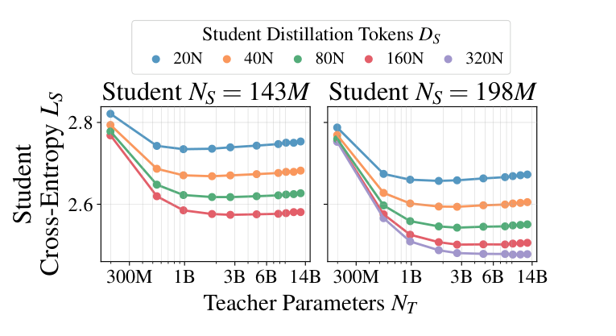
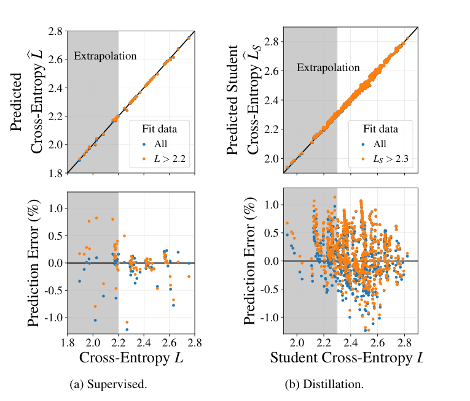
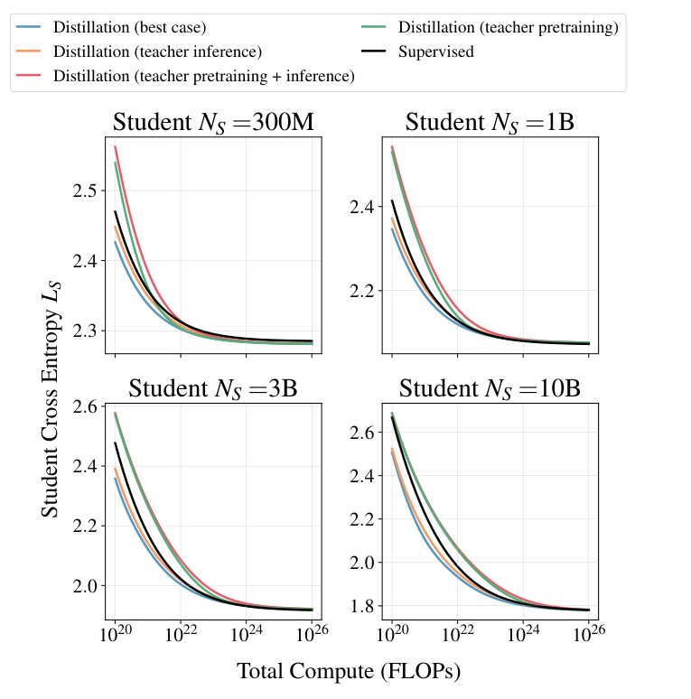

# 蒸馏缩放规律：教师、学生与计算预算

中文 | [English](./Distillation-Scaling-Laws_en.md)

- **原文链接：** [Distillation Scaling Laws](https://arxiv.org/abs/2502.08606v2)
- **发布日期：2025-02-12**

**原论文：Distillation Scaling Laws。作者：Dan Busbridge、Amitis Shidani、Floris Weers、Jason Ramapuram、Etai Littwin、Russ Webb。发表于 ICML 2025；本文固定精读 arXiv:2502.08606v2，修订日期为 2025 年 7 月 25 日，首版发表于 2025 年 2 月 12 日。**

**原始来源：[版本固定摘要页](https://arxiv.org/abs/2502.08606v2)；[69 页完整 PDF](https://arxiv.org/pdf/2502.08606v2)；[版本固定 HTML](https://arxiv.org/html/2502.08606v2)。下文页码均为 PDF 页码，与论文页脚一致。**

**阅读范围：通读正文第 1—9 页及第 10 页的影响声明；重点细读附录 A、D、F、G，并补读 E.1、E.2—E.7、H.1、I 中与实验、边界和计算量有关的内容。原图、公式和表格已对照 PDF 核验；这是一份精读，不是训练复现。**

本文用 **[论文实测]** 标记实验观察，用 **[论文拟合或外推]** 标记从模型拟合、数值优化得到的结论，用 **[教学示例]** 标记另设条件的计算，用 **[解读]** 标记对论文方法和适用条件的解释。

## 一、一句话抓住论文

**在本文的同分布语言模型预训练设置下，蒸馏可能帮助固定大小的学生更快接近自己的能力上限，但教师不是越强越好，收益也不是无限持续；尤其要先问：教师已经存在，还是需要专门训练？它的成本由一个学生承担，还是可以复用？**

这句话有两个限定。第一，比较的是相同资源约束下的效果，不是只看蒸馏后的分数有没有提高。第二，论文研究的是通用文本的下一词概率建模，采用真实文本上下文上的完整概率分布蒸馏，而不是让教师生成完整答案再做指令微调。

**来源：v2 第 1、5、6 节，第 2、7—9 页；[结论与适用条件](https://arxiv.org/pdf/2502.08606v2#page=9)。**

## 二、为什么要研究这个问题？

假设最终只能部署一个小模型。直接训练它，可以把预算全部用于学生；先训练一个大教师再蒸馏，可能让每个学生训练 token 更有价值，却要额外支付教师的训练和推理费用。

这就产生三个不同的问题：固定学生大小与数据量时，选谁做教师？固定总计算量时，要多少学生数据、配多大的教师？假如教师还不存在，先造教师是否比直接训练学生更划算？只有第一个问题得到肯定答案，并不能推出第三个也成立。

论文中的“过度训练”或 overtraining，不是说已经发生过拟合，而是： **相对只追求预训练计算最优的配置，固定一个较小模型，让它读更多 token，以换取较低的部署推理成本。** 作者希望蒸馏能够降低这种小模型长期训练的代价。

**来源：v2 第 1 节，第 1—2 页；第 5 节，第 6—9 页，[研究动机与资源约束](https://arxiv.org/pdf/2502.08606v2#page=2)。**

## 三、先认清实验到底做了什么

### 3.1 它不是“教师生成完整答案，学生照着背”

**[论文实测]** 教师和学生都读取 C4 英文文本中的上下文。在一个位置上，教师输出整个词表的下一 token 概率分布，学生学习这个分布。例如，上下文后面可能接多个合理词；真实文本只出现了其中一个，教师却能同时给出多个候选的概率。

设上下文为 $`c`$，真实下一 token 为 $`y`$，教师分布为 $`p_T(a\mid c)`$，学生分布为 $`q_S(a\mid c)`$。普通语言模型预训练的目标为

```math
\mathcal L_{\mathrm{NTP}}=-\log q_S(y\mid c).
```

温度为 $`1`$ 时，本文蒸馏目标的核心是

```math
\mathcal L_{\mathrm{KD}}
=-\sum_{a\in\mathcal V}p_T(a\mid c)\log q_S(a\mid c).
```

它等于教师到学生的前向 KL 散度加上一个与学生参数无关的教师熵。因此优化学生时，等价于最小化

```math
D_{\mathrm{KL}}(p_T\Vert q_S)
=\sum_{a\in\mathcal V}p_T(a\mid c)
\log\frac{p_T(a\mid c)}{q_S(a\mid c)}.
```

论文总训练目标还允许混合真实 token 损失，并加入稳定训练的 Z-loss。主体实验取混合系数 $`\lambda=1`$、温度 $`\tau=1`$：即纯教师分布监督，而不是混合真实标签的主实验。

**来源：v2 第 3、4.1 节，第 3—4 页，公式 4、6、7；附录 G，第 59—64 页，[训练目标与超参数](https://arxiv.org/pdf/2502.08606v2#page=3)。**

**[解读]** 本文的完整概率分布蒸馏，与序列级硬蒸馏有重要区别：前者在真实 C4 上下文上学习教师对整个词表的概率分配；后者把教师生成的序列作为学生的训练文本。论文附录 A 将硬蒸馏列为仍需验证的方向，因此这里的缩放规律应限定在已研究的训练流程中。

**来源：v2 附录 A，第 23 页，明确限定完整概率分布蒸馏，并将序列级硬蒸馏列为待验证方向；[方法边界](https://arxiv.org/pdf/2502.08606v2#page=23)。**

### 3.2 一张实验“身份证”

| 项目 | 本文实际口径 |
| --- | --- |
| 模型 | 同类 Transformer，采用多头注意力、RMSNorm、RoPE；主体研究报告约 143M—12.6B 非嵌入参数模型 |
| 上下文 | 长度 4096；采用简化的最大更新参数化 $`\mu`$P，使不同规模的学习率更容易保持一致 |
| 数据 | 英文 C4；附录 I 报告约 180B token，教师、学生各使用约 90B 不同划分的独有 token |
| 训练量 | 从数十亿到最高 512B 已处理 token；超过各自约 90B 的部分存在重复 |
| 主要评估 | 对真实验证文本的交叉熵，单位 nats/token，越低越好 |
| 拟合数据 | 附录 F 报告 73 个监督拟合样本和 697 个蒸馏拟合样本，不等于全部实验运行总数 |
| 计算量 | 浮点运算次数 FLOPs，不是 GPU 数、显存大小或实际耗时 |

**来源：v2 第 4.1 节及表 1，第 4 页；附录 F.1—F.3 与表 6，第 58—59 页；附录 I 与表 13，第 68—69 页，[模型与数据细节](https://arxiv.org/pdf/2502.08606v2#page=68)。**

这里最容易误读的是“数据变大”。$`D_S`$ 表示学生累计处理的 token 数，不自动等于独立数据量，更不等于 prompt 条数。本文大规模运行确实包含重复数据；不能把从 90B 训练到 512B 描述成新增了同样数量的独有文本。

此外， **训练时模仿教师的损失，与论文要预测的学生验证损失，不是一个量。** 后者是学生对真实验证文本给出的概率有多好：学生把教师模仿得更像，不保证它对真实文本预测得更好。

**来源：v2 表 1 与第 4 页脚注 3；附录 A、第 23 页；附录 I、第 69 页，[数据重复与验证口径](https://arxiv.org/pdf/2502.08606v2#page=69)。**

## 四、公式 8：把“教师强度”与“学生能否学会”分开

### 4.1 先建立不蒸馏时的参照

论文先为普通真实文本预训练拟合

```math
L(N,D)=E+\left(\frac{A}{N^\alpha}+\frac{B}{D^\beta}\right)^\gamma.
```

$`N`$ 是非嵌入参数量，$`D`$ 是训练 token 数；$`E`$ 是拟合中的不可约损失项。括号内两项分别描述模型容量与数据量不足造成的余量。各系数由实验拟合，不是普适常数。

对一个指定学生，定义

```math
\widetilde L_S=L(N_S,D_S).
```

它回答： **同样大小、同样训练量的学生，如果不用教师而直接训练，会达到什么验证交叉熵？** 这是刻画学生学习能力的参照，不是当前蒸馏训练损失。

**来源：v2 第 2 节公式 1，第 2 页；表 1，第 4 页，[监督参照与符号](https://arxiv.org/pdf/2502.08606v2#page=4)。**

### 4.2 先看真正的公式，再拆解

下面保留原公式 8 的结构；为避免把两套参数混用，蒸馏项的 $`A,B`$ 按附录 F.2 公式 46 明写成 $`A',B'`$：

```math
\begin{aligned}
L_S(N_S,D_S,L_T)
={}&L_T\\
&+\frac{1}{L_T^{c_0}}
\left[1+\left(\frac{L_T}{d_1\widetilde L_S}\right)^{1/f_1}\right]^{-c_1f_1}
\left(\frac{A'}{N_S^{\alpha'}}+\frac{B'}{D_S^{\beta'}}\right)^{\gamma'}.
\end{aligned}
```

**来源：v2 第 4.3 节公式 8，第 6 页；附录 F.2 公式 46，第 58 页；表 6，第 59 页。[公式 8 原文](https://arxiv.org/pdf/2502.08606v2#page=6)、[蒸馏参数的独立记号](https://arxiv.org/pdf/2502.08606v2#page=58)。**

把它分成三块看：

1. **教师自身的基准误差 $`L_T`$。** 学生是在模仿一个有误差的教师，不是直接面对理想的真实分布。
1. **学生资源不足的项。** 最后一个括号随学生参数和 token 增加而减小，表达“更能装、也学得更久”。
1. **教师与学生相对能力的修正。** 中间的折断幂律项，允许教师变强之后，知识反而越来越难被这个学生吸收。

“折断幂律”不是曲线突然断裂，而是对数坐标上的斜率可以从一个区间平滑转到另一个区间。为看清它，令

```math
r=\frac{L_T}{d_1\widetilde L_S}.
```

其中 $`d_1`$ 决定转折位置，$`f_1`$ 控制转折的平滑程度，$`c_1`$ 控制两个区域的斜率差异；$`c_0`$ 则控制额外的教师损失依赖。单看方括号，有

```math
\left(1+r^{1/f_1}\right)^{-c_1f_1}
\approx
\begin{cases}
1,&r\ll1,\\
r^{-c_1},&r\gg1.
\end{cases}
```

**[解读]** 对很强的教师，$`L_T`$ 变小虽然降低第一项，却可能通过 $`L_T^{-c_0}`$ 放大学生难以模仿的余量。因此总结果不是“教师损失越低，学生一定越好”。而增加 $`D_S`$ 不仅缩小最后的资源项，还改变 $`\widetilde L_S`$，进而改变最适合学生的教师。

需要注意：$`L_T/\widetilde L_S=d_1`$ 是折断项的转折位置， **不是可以直接拿来当最优教师的公式** 。最佳 $`L_T`$ 要最小化整个表达式。也不要把 $`\alpha'`$ 或 $`\beta'`$ 单独当成最终可观察斜率，因为外层指数和转折项都在起作用。

这套设计还要求：学生规模与训练量同时趋于无限时，能够逼近给定教师；教师极差时，学生不会凭空获得强信号。不过，这些合理的边界条件并不等于完整理论推导。

**来源：v2 第 4.3 节，第 5—6 页；附录 A，第 23 页；[函数形式的动机与限制](https://arxiv.org/pdf/2502.08606v2#page=5)。上面的分区近似为对原公式的教学展开，不是论文另报的实验规律。**

## 五、关键实验如何支持它？

### 5.1 不是只沿一条“模型越大越好”的曲线采样

作者组合了三种实验：固定教师、在学生端保持相同 FLOPs 改变参数与训练量；固定学生、在教师端保持相同 FLOPs 改变参数与训练量；再固定不同的 token/参数比例，观察更广泛的教师—学生组合。

等 FLOPs 曲线的意义是：避免把“参数更多”和“训练也更多”的影响混在一起。图 3b 把不同参数量、不同训练量的教师改用其验证损失 $`L_T`$ 排列后，学生结果呈现更统一的关系。 **[论文实测与拟合]** 这支持在本文架构与数据条件下，用教师交叉熵概括教师提供的学习信号；不是证明任何两个同分教师在所有任务上都可互换。

**来源：v2 第 4.2—4.3 节，图 2、3，第 4—5 页；附录 E.4，图 38，第 49 页，[解耦教师参数量与教师能力](https://arxiv.org/pdf/2502.08606v2#page=5)。**

### 5.2 图 4：容量差距不是“教师一大就有害”



***原图来源：v2 图 4，第 5 页；仅裁剪原图形区域，没有重绘数据。[原始页面](https://arxiv.org/pdf/2502.08606v2#page=5)。横轴是教师参数量，纵轴是学生对真实数据的验证交叉熵；颜色区分学生累计训练 token 数。***

**[论文实测]** 两个面板固定学生为 143M、198M。沿一条颜色线从左向右走，学生先明显受益，之后改善减弱，部分曲线再上升。也就是说， **不足够强的教师不好，远超当前学生学习能力的教师也未必最好。** 增加学生训练量会降低曲线，并改变容量差距的表现。

图 37 进一步展示：教师变强时，教师与学生之间的 KL 散度总体增加。这个结果提示学生越来越难忠实模仿教师，并不说明“大教师本身质量更差”。图 3b 又提醒我们，教师参数量只是影响能力的一条路径；同样大小的教师，多训练一段时间也可能改变匹配关系。

**来源：v2 图 4，第 5 页；附录 E.3 图 37，第 48—49 页；第 4.3 节公式 8，第 6 页，[容量差距的直接证据](https://arxiv.org/pdf/2502.08606v2#page=48)。**

### 5.3 图 5：拟合得准，还要看有没有留出更强模型



***原图来源：v2 图 5，第 6 页；横轴为实测损失，上半图纵轴为预测损失，下半图为相对预测误差。蓝色使用全部样本拟合，橙色只用较弱模型拟合；灰色区域是对更强模型的外推检查。[原始页面](https://arxiv.org/pdf/2502.08606v2#page=6)。***

**[论文拟合或外推]** 蒸馏拟合共有 697 个样本。作者另用损失约在 $`2.3`$ 以上的 551 个较弱学生样本拟合，再预测更低损失的学生；正文称相对预测误差约在 $`1\%`$ 量级。不能把这说成“每个点都严格小于 $`1\%`$”，图中确有超出该范围的点。

这个验证比“把所有点拟合得很漂亮”更有价值：它要求曲线对没有用于估计系数的更强模型仍有解释力。但这不是对新数据域、新架构、任意超大计算预算的保证。附录 F 使用稳健的 Huber 拟合、多初值优化，并用重采样报告参数区间；参数区间也不等于 AIME 外推区间。

**来源：v2 第 4.4 节与图 5，第 6 页；附录 F.1—F.3，第 58—59 页。正文/图注用 $`L_S>2.3`$，附录用 $`L_S\ge2.3`$，本笔记不臆测恰好等于边界的样本。[拟合样本与方法](https://arxiv.org/pdf/2502.08606v2#page=59)。**

### 5.4 学生超过教师，究竟超过了什么？

**[论文实测]** 图 41 右侧用 546M 教师蒸馏 1.82B 学生：在有限数据区间，学生的真实数据交叉熵略低于教师；继续增加蒸馏 token 后，学生损失又回升并接近教师。同时，教师到学生的 KL 仍持续下降。它清楚区分了“越来越像教师”和“越来越接近真实文本分布”。

这不是“小学生全面超越大教师”的证明：该例学生反而更大，指标是验证交叉熵，作者也明确说没有解释为什么学生能在中间区间超过教师。

**[解读或建议：公式边界]** 公式 8 在所报正系数下，是 $`L_T`$ 加非负余项，因此严格不能表达 $`L_S<L_T`$。所以图 41 的轻微超越是实测现象，而不是公式 8 已经推导出的能力。一个总体预测良好的经验模型，仍可能漏掉局部现象。

**来源：v2 附录 E.7 与图 41，第 51 页；公式 8，第 6 页；表 6，第 59 页。[弱到强实例及作者未解释的部分](https://arxiv.org/pdf/2502.08606v2#page=51)。公式的非负性判断是本笔记对原式的直接检查。**

## 六、四套计算账本：表 5 比一句“蒸馏省算力”更重要

### 6.1 三笔开销，两个开关

设 $`F(N)`$ 为模型每处理一个 token 的前向 FLOPs。论文计算式为

```math
C\approx3F(N_S)D_S+
F(N_T)\left(\delta_T^{\mathrm{Lgt}}D_S+
3\delta_T^{\mathrm{Pre}}D_T\right).
```

三项依次是：学生训练、教师给学生生成概率、教师预训练。系数 $`3`$ 来自“一次前向加约两倍前向量的反向”。两个 $`\delta`$ 表示相应教师成本是否计入本次预算。

| 表 5 场景 | $`\delta_T^{\mathrm{Lgt}}`$ | $`\delta_T^{\mathrm{Pre}}`$ | 本次需要承担的账目 |
| --- | ---: | ---: | --- |
| 最佳情形：教师完全摊销 | 0 | 0 | 只有学生训练；教师训练和输出成本均已由别处承担或充分复用 |
| 只计教师推理 | 1 | 0 | 学生训练加教师输出；已有教师，但还得为学生跑它 |
| 只计教师预训练 | 0 | 1 | 学生训练加教师训练；教师输出可存储复用，输出成本被摊薄 |
| 教师预训练加推理 | 1 | 1 | 三笔全计；专为一个学生训练并使用教师 |

**来源：v2 公式 9、表 2，第 6 页；附录 D.4.1 的表 5、公式 29，第 35 页；附录 H.1 公式 70，第 65 页。[四类场景原表](https://arxiv.org/pdf/2502.08606v2#page=35)。**

**[解读]** “教师已有”通常对应第二行，不是第一行；“教师会服务多个学生”也不自动让所有成本归零。若不同学生用不同上下文，教师输出仍可能每次都要重新计算。表中的零表示当前分析不承担该成本，不表示物理上没有发生计算。

常见近似 $`F(N)\approx2N`$ 在本文的小模型、长上下文设置下不够准。作者加入注意力和词表投影修正；例如表 13 的 546M 模型，用 $`2N`$ 近似会低估前向计算约 $`22.96\%`$。因此不能只拿参数量乘 token 数，便声称已经核算完整成本，更不能直接换算成墙钟耗时。

**来源：v2 第 5 节，第 6 页；附录 H.1 公式 69，第 65 页；表 13，第 68 页，[计算量修正](https://arxiv.org/pdf/2502.08606v2#page=68)。**

### 6.2 一个检查过的教学账本

**[教学示例]** 使用表 13 的修正前向估计：546M 学生每 token 约 $`1.415\times10^9`$ FLOPs，1.82B 教师约 $`4.28\times10^9`$ FLOPs。另设学生处理 $`10^{10}`$ token、教师预训练 $`4\times10^{10}`$ token；这两个训练量是教学设定，不是某条论文实验记录。

```math
\begin{aligned}
C_{\mathrm{student}}&=3(1.415\times10^9)(10^{10})=4.245\times10^{19},\\
C_{\mathrm{logits}}&=(4.28\times10^9)(10^{10})=4.28\times10^{19},\\
C_{\mathrm{teacher}}&=3(4.28\times10^9)(4\times10^{10})=5.136\times10^{20}.
\end{aligned}
```

| 账本 | 总成本，单位为 $`10^{19}`$ FLOPs |
| --- | ---: |
| 最佳情形 | 4.245 |
| 只计教师推理 | 8.525 |
| 只计教师预训练 | 55.605 |
| 三笔全计 | 59.885 |

这只是核算同一套配置， **没有证明蒸馏与直接训练达到同等效果** 。但它已经说明：漏掉教师训练，结论可能完全变样。

**来源：前向计算常数取自 v2 表 13，第 68 页；账本按公式 9 计算，训练量与计算结果均属教学示例。[常数出处](https://arxiv.org/pdf/2502.08606v2#page=68)。**

如果 $`K`$ 个学生可以共用同一教师、同一批输入的缓存概率，且每个学生训练量相同，平均成本可写成

```math
\overline C=3F(N_S)D_S+
\frac{3F(N_T)D_T+F(N_T)D_S}{K}.
```

这是 **[教学示例]** 中明确假定完全复用后的摊销式，不是论文新增定律。若只能共享教师权重、不能共享输出，则只有教师训练项除以 $`K`$，输出项不能除。实际缓存还要考虑存储和读写；FLOPs 账本没有覆盖这些全部工程成本。

## 七、图 8 给出的决策：什么时候蒸馏值得？



***原图来源：v2 图 8，第 8 页；固定学生大小，横轴为总 FLOPs，纵轴为通过缩放律优化得到的学生交叉熵。黑色为监督预训练，蓝/橙色不计教师预训练，绿/红色计入教师预训练。[原始页面](https://arxiv.org/pdf/2502.08606v2#page=8)。这些是拟合模型上的最优曲线，不是每个坐标都有实训点。***

**[论文拟合或外推]** 作者固定学生参数量，在总 FLOPs 约束下优化教师大小、教师训练 token 和学生蒸馏 token，得到以下趋势：

- **教师已有或成本充分摊销时，适度预算下蒸馏更有利。** 蓝、橙曲线在部分区域低于监督曲线。
- **把专用教师训练成本全部计入时，直接监督训练通常更划算。** 红、绿曲线未展示相对监督训练的成本优势；极大预算下可以接近。
- **预算足够大时，蒸馏优势缩小。** 直接监督学习能够逼近相同学生模型的能力边界；学生越大，优势消失对应的预算通常越大。

这不等于“蒸馏久了总会变差”。多数情形下，蒸馏久了学生仍会变好，只是相同新增预算直接训练可能更划算。也不等于“有教师就一定划算”：教师强度、推理费用和学生学习量仍需匹配。

**来源：v2 第 5.1、5.3 节，图 6、8，第 7—8 页；附录 D.1、D.4.2、D.5，第 31、35—36、45—46 页，[最优成本与收益比较](https://arxiv.org/pdf/2502.08606v2#page=8)。**

教师的最佳训练策略也随账本变化：只付推理费时，倾向选择训练充分、推理较便宜的教师；只付教师训练费、不付输出费时，倾向按监督计算最优方式训练教师；两种教师费用都计入时，小预算更像后一种，学生 token 很多以后，更倾向延长教师训练而非无限增大教师。

这里有重要外推警报：附录 D 的数值优化允许教师训练量达到 $`10^{17}`$ token，在不计教师训练费用的情形，最优解碰到了这个上限。这是“忽略某项成本后优化器如何选择”的结果，不是作者真训过该规模，也不是已通过相同规模实验验证的训练配方。

**来源：v2 附录 D.4.1、D.4.4—D.4.6，第 35、38—42 页；[教师推理场景与优化上限](https://arxiv.org/html/2502.08606v2#A4.SS4.SSS4)。**

## 八、附录告诉我们：哪些结论不能扩大？

**第一，前向 KL 优势有范围。** 附录 G.5 只给出 1.82B 教师到 546M 学生这一配置的比较：前向 KL 的真实数据交叉熵为 2.42，反向 KL 为 2.70，差为 0.28 nats/token。这一比较不足以确定其他训练流程、任务或教师—学生组合中的最佳 KL 方向。表中分布运算量的比较，也不能读成整个反向 KL 训练必然慢一倍。

**来源：v2 附录 G.5、表 7，第 63—64 页，[KL 方向比较的具体范围](https://arxiv.org/pdf/2502.08606v2#page=64)。**

**第二，完整分布不是可随意替换的细节。** 附录 G.1—G.4 支持主体采用纯蒸馏、单位温度；过强的 Top-k/Top-p 截断会损害效果，混合真实 token 监督可缓解。因此不能删去概率尾部、换成硬答案之后，还原封不动使用这些系数。

**来源：v2 附录 G.1—G.4，图 51—54，第 60—63 页，[截断与目标混合消融](https://arxiv.org/pdf/2502.08606v2#page=63)。**

**第三，较低通用文本交叉熵不自动意味着较高 AIME。** 图 35 中，一些英文常识、补全任务与交叉熵关系紧密；但 GSM8K、MMLU 的大多数模型表现接近低水平基线，作者明确说 C4 不适合据此充分研究推理能力。本文没有 AIME 缩放实验。

**来源：v2 附录 E.1、图 35，第 47 页；附录 A，第 23 页，[下游评估与推理限制](https://arxiv.org/pdf/2502.08606v2#page=47)。**

**第四，公式不是普适物理定律。** 附录 A 明确限定了英文 C4、同分布训练与蒸馏、Transformer 架构及完整概率目标。换教师来源域、换架构、换数据重复方式，都可能改变规律；公式也不是从第一性原理严格推导的。无限数据下与监督学习边界接近，是数值一致性检查，不是所有训练算法共享相同可达最优点的证明。

**来源：v2 附录 A，第 23 页；附录 E.6、图 40，第 50—51 页，[作者集中列出的限制](https://arxiv.org/pdf/2502.08606v2#page=23)。**

**第五，原文也有需要审慎处理之处。** 附录 D.5 最后一段把某些节省比例写在“教师预训练加推理”名下，但同节前文与图 33 的红色曲线不支持这一归类。本笔记不引用那些节省比例，也不擅自替作者更正；预算结论依据表 5、图 8 与图 33 一致的部分。公式 8 无法精确表示学生略优于教师的问题，也已单独说明。

**来源：v2 附录 D.5，第 45—46 页，尤其图 33 与第 46 页末段；[可核对的原文不一致](https://arxiv.org/pdf/2502.08606v2#page=46)。**

## 九、精简证据核对表

| 已核对的主张 | 证据类别 | 精确定位与必须保留的条件 |
| --- | --- | --- |
| 实验是英文 C4 上的完整分布蒸馏，师生使用不同数据划分 | **论文实测设置** | **第 4.1 节，第 4 页；附录 A，第 23 页；附录 I，第 69 页。限定真实文本上下文上的完整分布监督。** |
| 固定学生资源时，教师增强可能先有益、后变得不适配 | **论文实测** | **图 4，第 5 页；图 37，第 48 页。参数量不是唯一因果解释。** |
| 蒸馏拟合使用 697 个样本，并以 551 个较弱学生样本检查外推 | **论文拟合或外推** | **图 5，第 6 页；附录 F.2，第 59 页。约百分之一量级误差不等于新域保证。** |
| 四套成本账本会改变是否值得蒸馏的判断 | **论文建模与优化** | **公式 9/表 2，第 6 页；表 5，第 35 页；图 8，第 8 页。零成本是账目边界。** |
| 学生可以在有限数据区间取得低于教师的真实数据交叉熵 | **论文实测** | **图 41，第 51 页。具体弱到强实例中学生更大，且公式 8 不精确表达这一超越。** |
| 前向 KL 比反向 KL 的损失低 0.28 nats/token | **论文实测** | **表 7，第 64 页。仅所报 1.82B 教师到 546M 学生配置。** |
| 较低文本交叉熵不等于所有下游能力都得到验证 | **边界核对与解读** | **附录 A，第 23 页；图 35，第 47 页。所用数据和模型不足以充分检验推理能力。** |

**全表原始来源：固定版本 [2502.08606v2 PDF](https://arxiv.org/pdf/2502.08606v2)，不是其他版本或独立复现。**

## 十、原文阅读路线

**[解读]** 第一遍先读表 1、图 4、图 5、图 8，把变量、容量差距、拟合检验和成本决策串起来；第二遍对照公式 8 与附录 F.2，注意监督和蒸馏两套系数；第三遍读表 5 与附录 D.4.4—D.4.6，理解为什么换账本就要换教师策略；最后读附录 A、图 35、图 41、表 7，主动寻找不能外推的部分。

**原文定位：表 1 第 4 页；图 4 第 5 页；公式 8/图 5 第 6 页；图 8 第 8 页；表 5 第 35 页；D.4.4—D.4.6 第 38—42 页；图 35 第 47 页；图 41 第 51 页；F.2 第 58—59 页；表 7 第 64 页。[版本固定全文](https://arxiv.org/pdf/2502.08606v2)。**

## 十一、五个复习问答

### 1. 为什么论文中的“监督学习”不能直接理解成指令 SFT？

这里是对真实 C4 文本做下一 token 预测。它和蒸馏共享语言建模任务及数据分布，区别主要是目标使用真实 token 还是教师概率分布；并非在比较“有人工指令标签”和“没有人工指令标签”。

### 2. 为什么有了更强教师，学生可能反而学差？

更强教师自身的误差更小，但其分布也可能更难被当前学生在有限训练量内模仿。公式 8 同时表达这两股力量；增加学生规模或训练量会改变匹配关系，所以不是教师一变大就有害。

### 3. 已经有教师，是不是就可以忽略教师所有成本？

不能。通常只是不计它过去的预训练成本，仍要支付给学生生成概率的前向计算。只有同一批输出能充分复用时，输出费用才可进一步摊薄。

### 4. 学生的 KL 不断下降，为什么真实数据损失还能回升？

KL 下降说明学生越来越忠实地模仿教师；教师并非真实分布本身。图 41 中较大的学生曾略优于弱教师，继续模仿后反而接近教师的误差水平。这两个指标回答的问题不同。

### 5. 为什么同一套蒸馏配置，换一种成本核算方式就可能不划算？

因为学生训练、教师输出和教师预训练是不同的开销。教师已经存在时，过去的训练成本可以不计入本次预算；如果必须专门训练教师，这部分成本就可能超过蒸馏带来的收益。论文的四种计算场景正是在区分这些条件。
