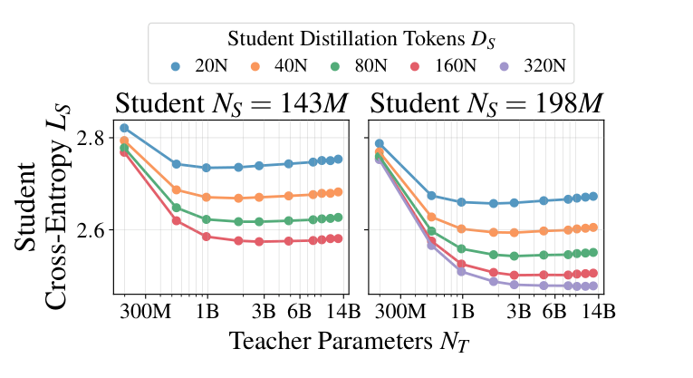
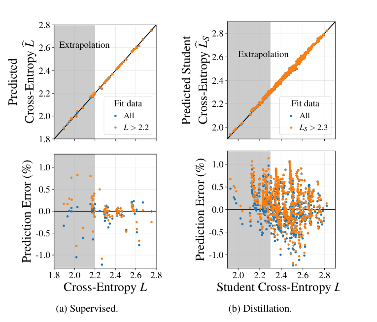
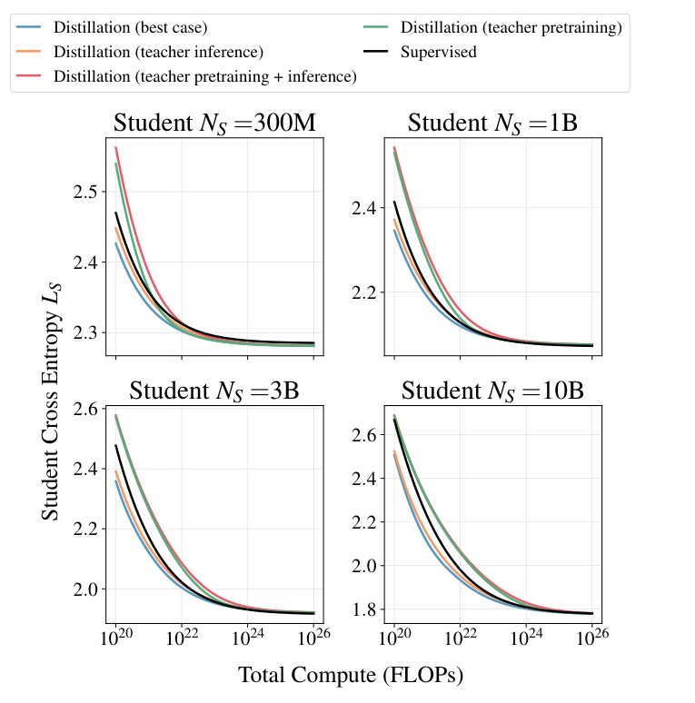

# Distillation Scaling Laws: Teachers, Students, and Compute Budgets

[中文](./Distillation-Scaling-Laws.md) | English

- **Source:** [Distillation Scaling Laws](https://arxiv.org/abs/2502.08606v2)
- **Published: 2025-02-12**

**Original paper: Distillation Scaling Laws. Authors: Dan Busbridge, Amitis Shidani, Floris Weers, Jason Ramapuram, Etai Littwin, and Russ Webb. Published at ICML 2025. This note examines arXiv:2502.08606v2, revised 2025-07-25; the first version appeared 2025-02-12.**

**Original sources: [Versioned abstract](https://arxiv.org/abs/2502.08606v2); [complete 69-page PDF](https://arxiv.org/pdf/2502.08606v2); [versioned HTML](https://arxiv.org/html/2502.08606v2). Page references below are PDF pages, matching the printed page numbers.**

**Reading scope: Main text on pages 1–9 and the impact statement on page 10; detailed reading of Appendices A, D, F, and G, supplemented by experimental, scope, and compute details in E.1, E.2–E.7, H.1, and I. Original figures, equations, and tables were checked against the PDF. This is a close reading, not a training reproduction.**

This note marks experimental observations as **[Measured]**, conclusions from fitting or numerical optimization as **[Fitted or extrapolated]**, calculations under separately specified conditions as **[Teaching example]**, and explanations of methods and assumptions as **[Interpretation]**.

## 1. The paper in one sentence

**In the paper's same-distribution language-model pretraining setting, distillation may help a fixed-size student approach its capability limit faster, but stronger teachers are not always better and gains do not continue indefinitely. Crucially, does the teacher already exist or need dedicated training, and are its costs borne by one student or reused?**

Two qualifications matter. First, the comparison concerns performance under the same resource constraints, not simply whether distillation improves a score. Second, the task is general-text next-token probability modeling using full-distribution distillation on real-text contexts, not generating complete teacher answers for instruction finetuning.

**Sources: v2 Sections 1, 5, and 6, pages 2 and 7–9; [conclusions and conditions](https://arxiv.org/pdf/2502.08606v2#page=9).**

## 2. Why study this problem?

Suppose deployment permits only a small model. Direct training spends the budget entirely on that student. Training a large teacher first and then distilling may make each student token more valuable, but introduces teacher-training and teacher-inference costs.

This creates three questions: Which teacher is best at fixed student size and data volume? How much student data and what teacher size are best at fixed total compute? If no teacher exists, is training one first more economical than directly training the student? A positive answer to the first does not settle the third.

Here overtraining does not mean overfitting. It means **fixing a relatively small model and training it on more tokens than a pretraining-compute-optimal configuration, in exchange for lower deployment inference costs**. The authors hope distillation can reduce the expense of such extended small-model training.

**Sources: v2 Section 1, pages 1–2, and Section 5, pages 6–9; [motivation and constraints](https://arxiv.org/pdf/2502.08606v2#page=2).**

## 3. Establish what the experiments actually do

### 3.1 This is not memorizing complete teacher-generated answers

**[Measured]** Teacher and student both read contexts from English C4 text. At each position, the teacher supplies a next-token distribution over the whole vocabulary and the student learns it. Several continuations may be reasonable; the actual text contains only one, while the teacher can assign probabilities to multiple alternatives.

Let $`c`$ be the context, $`y`$ the actual next token, $`p_T(a\mid c)`$ the teacher distribution, and $`q_S(a\mid c)`$ the student distribution. Ordinary language-model pretraining uses:

```math
\mathcal L_{\mathrm{NTP}}=-\log q_S(y\mid c).
```

At temperature $`1`$, the core distillation objective is:

```math
\mathcal L_{\mathrm{KD}}
=-\sum_{a\in\mathcal V}p_T(a\mid c)\log q_S(a\mid c).
```

This equals the forward KL from teacher to student plus teacher entropy, which is independent of student parameters. Student optimization is therefore equivalent to minimizing:

```math
D_{\mathrm{KL}}(p_T\Vert q_S)
=\sum_{a\in\mathcal V}p_T(a\mid c)
\log\frac{p_T(a\mid c)}{q_S(a\mid c)}.
```

The full objective also allows mixing the actual-token loss and includes a stabilizing Z-loss. Main experiments use mixing coefficient $`\lambda=1`$ and temperature $`\tau=1`$: pure teacher-distribution supervision rather than a mixture with true labels.

**Sources: v2 Sections 3 and 4.1, pages 3–4, Equations 4, 6, and 7; Appendix G, pages 59–64; [objectives and hyperparameters](https://arxiv.org/pdf/2502.08606v2#page=3).**

**[Interpretation]** Full-distribution distillation differs importantly from sequence-level hard distillation. The former learns the teacher's vocabulary distribution on real C4 contexts; the latter uses teacher-generated sequences as student training text. Appendix A lists hard distillation as a direction still requiring validation, so this scaling law should remain scoped to the studied procedure.

**Source: v2 Appendix A, page 23, explicitly limits the work to full-distribution distillation and lists sequence-level hard distillation as unverified; [method boundaries](https://arxiv.org/pdf/2502.08606v2#page=23).**

### 3.2 Experimental identification card

| Item | Actual convention in this paper |
| --- | --- |
| Models | Related Transformers with multi-head attention, RMSNorm, and RoPE; the main study reports approximately 143M–12.6B non-embedding parameters |
| Context | Length 4096; simplified maximal-update parametrization $`\mu`$P facilitates consistent learning rates across scales |
| Data | English C4; Appendix I reports approximately 180B tokens split into approximately 90B unique tokens each for teachers and students |
| Training volume | From billions to as many as 512B processed tokens; runs beyond each approximately 90B split repeat data |
| Main evaluation | Cross-entropy on real validation text, in nats/token; lower is better |
| Fitting data | Appendix F reports 73 supervised fitting samples and 697 distillation fitting samples, not the total number of all experimental runs |
| Compute | Floating-point operations, not GPU count, memory capacity, or wall-clock time |

**Sources: v2 Section 4.1 and Table 1, page 4; Appendices F.1–F.3 and Table 6, pages 58–59; Appendix I and Table 13, pages 68–69; [model and data details](https://arxiv.org/pdf/2502.08606v2#page=68).**

Data growth is easily misread. $`D_S`$ denotes cumulative student tokens processed, not necessarily unique data and certainly not prompt count. Larger runs repeat data; training from 90B to 512B tokens does not add that many unique text tokens.

Also, **the training loss for imitating the teacher is not the student validation loss that the paper predicts**. The latter measures probabilities assigned to real validation text. Becoming a closer teacher imitator need not improve prediction of real text.

**Sources: v2 Table 1 and footnote 3 on page 4; Appendix A, page 23; Appendix I, page 69; [repetition and evaluation conventions](https://arxiv.org/pdf/2502.08606v2#page=69).**

## 4. Equation 8: separate teacher quality from the student's ability to learn

### 4.1 Establish a nondistilled reference

The paper first fits ordinary real-text pretraining with:

```math
L(N,D)=E+\left(\frac{A}{N^\alpha}+\frac{B}{D^\beta}\right)^\gamma.
```

$`N`$ is non-embedding parameter count, $`D`$ training tokens, and $`E`$ a fitted irreducible-loss term. The bracketed terms describe residuals due to limited capacity and data. The coefficients are empirically fitted, not universal constants.

For a particular student, define:

```math
\widetilde L_S=L(N_S,D_S).
```

This asks: **What validation cross-entropy would a student of the same size and training volume achieve without a teacher?** It is a reference for learning ability, not the current distillation training loss.

**Sources: v2 Equation 1 in Section 2, page 2, and Table 1, page 4; [supervised reference and notation](https://arxiv.org/pdf/2502.08606v2#page=4).**

### 4.2 The actual equation, then its components

The structure of Equation 8 is preserved below. To avoid mixing coefficient sets, its distillation $`A,B`$ are explicitly written $`A',B'`$, as in Appendix F.2, Equation 46:

```math
\begin{aligned}
L_S(N_S,D_S,L_T)
={}&L_T\\
&+\frac{1}{L_T^{c_0}}
\left[1+\left(\frac{L_T}{d_1\widetilde L_S}\right)^{1/f_1}\right]^{-c_1f_1}
\left(\frac{A'}{N_S^{\alpha'}}+\frac{B'}{D_S^{\beta'}}\right)^{\gamma'}.
\end{aligned}
```

**Sources: v2 Equation 8 in Section 4.3, page 6; Appendix F.2, Equation 46, page 58; Table 6, page 59. [Original Equation 8](https://arxiv.org/pdf/2502.08606v2#page=6); [separate distillation coefficient notation](https://arxiv.org/pdf/2502.08606v2#page=58).**

Read it in three parts:

1. **The teacher's baseline error $`L_T`$.** The student imitates an imperfect teacher rather than directly targeting an ideal true distribution.
1. **Limited student resources.** The last bracket decreases with student parameters and tokens, representing more capacity and more learning.
1. **A correction for relative teacher–student ability.** The middle broken-power-law term allows stronger teachers to become harder for a particular student to learn from.

A broken power law need not have a discontinuity. Its slope on logarithmic axes can transition smoothly between regimes. To make this clear, define:

```math
r=\frac{L_T}{d_1\widetilde L_S}.
```

$`d_1`$ sets the transition location, $`f_1`$ its smoothness, $`c_1`$ the difference between regime slopes, and $`c_0`$ an additional dependence on teacher loss. The square-bracketed term alone behaves as:

```math
\left(1+r^{1/f_1}\right)^{-c_1f_1}
\approx
\begin{cases}
1,&r\ll1,\\
r^{-c_1},&r\gg1.
\end{cases}
```

**[Interpretation]** For very strong teachers, a smaller $`L_T`$ lowers the first term but may enlarge the student's imitation residual through $`L_T^{-c_0}`$. Lower teacher loss therefore need not mean a better student. Increasing $`D_S`$ both shrinks the final resource term and changes $`\widetilde L_S`$, thereby changing the most suitable teacher.

The condition $`L_T/\widetilde L_S=d_1`$ locates the broken term's transition; **it is not itself a formula for the optimal teacher**. The best $`L_T`$ minimizes the whole expression. Nor should $`\alpha'`$ or $`\beta'`$ alone be treated as the observable slope, because the outer exponent and transition term also contribute.

The design additionally requires a student with unlimited size and training volume to approach a given teacher, and an extremely poor teacher not to provide a strong signal from nothing. These reasonable boundary conditions are not a complete theoretical derivation.

**Sources: v2 Section 4.3, pages 5–6, and Appendix A, page 23; [functional motivation and limitations](https://arxiv.org/pdf/2502.08606v2#page=5). The regime approximations above explain the original equation; they are not separately reported experimental laws.**

## 5. How do the key experiments support the model?

### 5.1 More than sampling one bigger-is-better curve

The authors combine three designs: fixing teachers while varying student parameters and tokens at equal FLOPs; fixing students while varying teacher parameters and tokens at equal FLOPs; and holding different tokens-per-parameter ratios to observe broader teacher–student combinations.

Equal-FLOP curves disentangle more parameters from more training. In Figure 3b, expressing teachers of different sizes and training volumes through validation loss $`L_T`$ produces a more unified relationship for students. **[Measured and fitted]** This supports using teacher cross-entropy to summarize supervision within these architectures and data conditions, not interchangeability of all equally scoring teachers on every task.

**Sources: v2 Sections 4.2–4.3, Figures 2–3, pages 4–5; Appendix E.4, Figure 38, page 49; [separating teacher size and quality](https://arxiv.org/pdf/2502.08606v2#page=5).**

### 5.2 Figure 4: capacity gaps do not mean large teachers are always harmful



***Original figure source: v2 Figure 4, page 5; only the graph region is cropped, with no data redrawing. [Original page](https://arxiv.org/pdf/2502.08606v2#page=5). The x-axis is teacher parameters, the y-axis student validation cross-entropy on real data, and colors distinguish cumulative student training tokens.***

**[Measured]** The panels fix students at 143M and 198M. Along a given color, stronger teachers first help substantially, then yield weaker improvements, with some curves turning upward. **A weak teacher is undesirable, but a teacher far beyond the student's current learning ability may not be best either.** More student training lowers the curves and changes how the capacity gap appears.

Figure 37 further shows that teacher–student KL generally increases as teachers improve. This indicates harder imitation, not poorer large-teacher quality. Figure 3b also reminds us that parameter count is only one route to teacher strength; more training at the same size can alter the match.

**Sources: v2 Figure 4, page 5; Appendix E.3, Figure 37, pages 48–49; Section 4.3, Equation 8, page 6; [direct capacity-gap evidence](https://arxiv.org/pdf/2502.08606v2#page=48).**

### 5.3 Figure 5: good fitting also requires held-out stronger models



***Original figure source: v2 Figure 5, page 6. The x-axis is measured loss; the upper y-axis is predicted loss and the lower y-axis relative prediction error. Blue fits all samples, orange fits weaker models only, and gray marks stronger-model extrapolation. [Original page](https://arxiv.org/pdf/2502.08606v2#page=6).***

**[Fitted or extrapolated]** There are 697 distillation fitting samples. A separate fit uses 551 weaker students with loss around or above $`2.3`$ to predict lower-loss students. The body describes relative prediction error on the order of $`1\%`$; this is not a strict below-$`1\%`$ guarantee for every point, as some plotted errors exceed it.

This is more informative than fitting every point attractively: the curve must predict stronger models not used to estimate its coefficients. It still does not guarantee new-domain, new-architecture, or arbitrary-budget performance. Appendix F uses robust Huber fitting, multiple initializations, and resampling-based parameter intervals; those intervals are not AIME extrapolation intervals.

**Sources: v2 Section 4.4 and Figure 5, page 6; Appendices F.1–F.3, pages 58–59. The body/caption uses $`L_S>2.3`$ while the appendix uses $`L_S\ge2.3`$; this note does not speculate about samples exactly on the boundary. [Samples and fitting methods](https://arxiv.org/pdf/2502.08606v2#page=59).**

### 5.4 What does outperforming the teacher mean?

**[Measured]** Figure 41's right side distills a 546M teacher into a 1.82B student. Over a finite data range, student cross-entropy on real data falls slightly below the teacher's, then rises toward it with further distillation tokens. Teacher-to-student KL keeps falling. This clearly separates becoming more teacher-like from becoming closer to the true text distribution.

It does not show a small student comprehensively surpassing a large teacher: the student is larger in this example, the metric is validation cross-entropy, and the authors explicitly leave the intermediate-range outperformance unexplained.

**[Interpretation: equation boundary]** With the reported positive coefficients, Equation 8 adds a nonnegative residual to $`L_T`$ and therefore cannot strictly express $`L_S<L_T`$. Figure 41's slight outperformance is a measured phenomenon, not a capability derived by Equation 8. An empirically useful global model can still miss local behavior.

**Sources: v2 Appendix E.7 and Figure 41, page 51; Equation 8, page 6; Table 6, page 59. [Weak-to-strong example and unexplained behavior](https://arxiv.org/pdf/2502.08606v2#page=51). The nonnegativity observation is this note's direct check of the equation.**

## 6. Four compute accounts: Table 5 matters more than saying distillation saves compute

### 6.1 Three expenses and two switches

Let $`F(N)`$ denote a model's forward FLOPs per token. The paper uses:

```math
C\approx3F(N_S)D_S+
F(N_T)\left(\delta_T^{\mathrm{Lgt}}D_S+
3\delta_T^{\mathrm{Pre}}D_T\right).
```

The terms are student training, teacher probability generation, and teacher pretraining. The factor $`3`$ represents one forward pass plus a backward pass costing roughly twice as much. The two $`\delta`$ switches determine whether the corresponding teacher costs count toward this budget.

| Table 5 scenario | $`\delta_T^{\mathrm{Lgt}}`$ | $`\delta_T^{\mathrm{Pre}}`$ | Costs included |
| --- | ---: | ---: | --- |
| Best case: fully amortized teacher | 0 | 0 | Student training only; teacher training and outputs are paid elsewhere or sufficiently reused |
| Teacher inference only | 1 | 0 | Student training plus teacher outputs; an existing teacher still has to run for the student |
| Teacher pretraining only | 0 | 1 | Student and teacher training; outputs can be cached and reused to amortize generation |
| Teacher pretraining and inference | 1 | 1 | All three costs; a teacher is trained and used specifically for one student |

**Sources: v2 Equation 9 and Table 2, page 6; Appendix D.4.1, Table 5 and Equation 29, page 35; Appendix H.1, Equation 70, page 65. [Original scenario table](https://arxiv.org/pdf/2502.08606v2#page=35).**

**[Interpretation]** An existing teacher usually corresponds to the second row, not the first. Serving multiple students does not automatically eliminate all costs either. Different student contexts can require new teacher outputs each time. Zero means a cost lies outside the current accounting boundary, not that the computation never occurred.

The common approximation $`F(N)\approx2N`$ is insufficiently accurate for the paper's small models and long contexts. The authors add attention and vocabulary-projection corrections; for the 546M model in Table 13, $`2N`$ underestimates forward compute by approximately $`22.96\%`$. Parameter count times tokens alone is therefore not a complete cost accounting and cannot directly yield wall-clock time.

**Sources: v2 Section 5, page 6; Appendix H.1, Equation 69, page 65; Table 13, page 68; [compute corrections](https://arxiv.org/pdf/2502.08606v2#page=68).**

### 6.2 A checked teaching example

**[Teaching example]** Using Table 13's corrected forward estimates, a 546M student costs approximately $`1.415\times10^9`$ FLOPs/token and a 1.82B teacher $`4.28\times10^9`$. Separately assume $`10^{10}`$ student tokens and $`4\times10^{10}`$ teacher-pretraining tokens. These two volumes are teaching assumptions, not a reported experimental run.

```math
\begin{aligned}
C_{\mathrm{student}}&=3(1.415\times10^9)(10^{10})=4.245\times10^{19},\\
C_{\mathrm{logits}}&=(4.28\times10^9)(10^{10})=4.28\times10^{19},\\
C_{\mathrm{teacher}}&=3(4.28\times10^9)(4\times10^{10})=5.136\times10^{20}.
\end{aligned}
```

| Accounting scenario | Total cost in $`10^{19}`$ FLOPs |
| --- | ---: |
| Best case | 4.245 |
| Teacher inference only | 8.525 |
| Teacher pretraining only | 55.605 |
| All three costs | 59.885 |

This only accounts for one configuration and **does not establish equal performance between distillation and direct training**. It does demonstrate that omitting teacher training can radically change the conclusion.

**Source: Forward-compute constants are from v2 Table 13, page 68; accounting follows Equation 9. The training volumes and calculated totals are teaching examples. [Constant sources](https://arxiv.org/pdf/2502.08606v2#page=68).**

If $`K`$ students share one teacher and cached probabilities for the same inputs, with equal training volumes, average cost can be written as:

```math
\overline C=3F(N_S)D_S+
\frac{3F(N_T)D_T+F(N_T)D_S}{K}.
```

This amortization formula assumes complete reuse in the **[Teaching example]**; it is not another law proposed by the paper. If only teacher weights can be shared, only teacher training is divided by $`K`$, not output generation. Caching also entails storage and I/O costs outside the FLOPs account.

## 7. Figure 8: when is distillation worthwhile?



***Original figure source: v2 Figure 8, page 8. At fixed student size, the x-axis is total FLOPs and the y-axis cross-entropy optimized using the scaling law. Black denotes supervised pretraining; blue/orange exclude teacher pretraining, while green/red include it. [Original page](https://arxiv.org/pdf/2502.08606v2#page=8). These are optima of fitted models, not training measurements at every coordinate.***

**[Fitted or extrapolated]** Holding student parameter count fixed, the authors optimize teacher size, teacher-training tokens, and student-distillation tokens under a total FLOPs constraint, obtaining these trends:

- **With an existing or sufficiently amortized teacher, distillation is favorable at moderate budgets.** Blue and orange lie below supervised training in some regions.
- **When dedicated teacher training is fully charged, direct supervised training is generally more economical.** Red and green do not show a cost advantage over supervision, though they can approach it at very large budgets.
- **Distillation's advantage narrows with sufficient budget.** Direct supervised learning approaches the same student's capacity boundary; larger students generally retain an advantage up to larger budgets.

This does not mean longer distillation always worsens the student. Usually it still improves, but the same incremental budget may be better spent on direct training. Nor is having a teacher sufficient: teacher quality, inference cost, and student training volume must still be matched.

**Sources: v2 Sections 5.1 and 5.3, Figures 6 and 8, pages 7–8; Appendices D.1, D.4.2, and D.5, pages 31, 35–36, and 45–46; [optimal cost and performance](https://arxiv.org/pdf/2502.08606v2#page=8).**

The best teacher-training strategy changes with the accounting boundary. Paying only inference favors well-trained, inexpensive-to-run teachers; paying teacher training but not outputs favors supervised-compute-optimal teachers. With both costs included, small budgets resemble the latter setting, while larger student-token volumes favor longer teacher training rather than unbounded teacher-size growth.

An important extrapolation warning: Appendix D's numerical optimization permits $`10^{17}`$ teacher-training tokens, and optima hit this ceiling when teacher-training cost is omitted. This describes an optimizer's choice after removing a cost term, not an actual training run or a recipe validated at that scale.

**Sources: v2 Appendices D.4.1 and D.4.4–D.4.6, pages 35 and 38–42; [teacher-inference scenario and optimization bound](https://arxiv.org/html/2502.08606v2#A4.SS4.SSS4).**

## 8. Which conclusions cannot be generalized?

**First, the forward-KL advantage has a specific scope.** Appendix G.5 compares a 1.82B teacher and 546M student: real-data cross-entropy is 2.42 with forward KL and 2.70 with reverse KL, a 0.28 nats/token gap. This does not determine the best direction for other procedures, tasks, or pairs. The distribution-operation comparison also does not establish that complete reverse-KL training is necessarily twice as slow.

**Sources: v2 Appendix G.5 and Table 7, pages 63–64; [scope of the KL comparison](https://arxiv.org/pdf/2502.08606v2#page=64).**

**Second, full distributions are not an interchangeable detail.** Appendices G.1–G.4 support pure distillation and unit temperature in the main setup. Aggressive Top-k/Top-p truncation hurts, while mixing real-token supervision can help. These coefficients cannot be reused unchanged after deleting probability tails or switching to hard answers.

**Sources: v2 Appendices G.1–G.4, Figures 51–54, pages 60–63; [truncation and mixed-objective ablations](https://arxiv.org/pdf/2502.08606v2#page=63).**

**Third, lower general-text cross-entropy does not automatically imply better AIME performance.** Figure 35 shows close relationships for some English commonsense and completion tasks, but most models remain near low baselines on GSM8K and MMLU. The authors explicitly state that C4 is unsuitable for a thorough reasoning study. There is no AIME scaling experiment.

**Sources: v2 Appendix E.1 and Figure 35, page 47; Appendix A, page 23; [downstream evaluation and reasoning limitations](https://arxiv.org/pdf/2502.08606v2#page=47).**

**Fourth, the equation is not a universal physical law.** Appendix A limits the work to English C4, same-distribution training and distillation, Transformers, and full-probability targets. Teacher-source domains, architectures, and repetition patterns may change the relationship. The equation is not derived from first principles. Agreement with supervised boundaries at infinite data is a numerical consistency check, not proof that all algorithms reach the same optimum.

**Sources: v2 Appendix A, page 23; Appendix E.6 and Figure 40, pages 50–51; [author-stated limitations](https://arxiv.org/pdf/2502.08606v2#page=23).**

**Fifth, the source contains points requiring caution.** The last paragraph of Appendix D.5 attributes some savings ratios to teacher pretraining plus inference, but the preceding discussion and Figure 33's red curve do not support that classification. This note does not quote those ratios or silently correct the authors; its budget conclusions use the consistent portions of Table 5, Figure 8, and Figure 33. Equation 8's inability to exactly represent slight student outperformance is separately noted above.

**Source: v2 Appendix D.5, pages 45–46, especially Figure 33 and the final paragraph on page 46; [source inconsistency](https://arxiv.org/pdf/2502.08606v2#page=46).**

## 9. Concise evidence checklist

| Verified claim | Evidence category | Precise location and necessary qualification |
| --- | --- | --- |
| English-C4 full-distribution distillation uses different teacher/student splits | **Measured setup** | **Section 4.1, page 4; Appendix A, page 23; Appendix I, page 69. Limited to full-distribution supervision on real-text contexts.** |
| Stronger teachers can first help and later become less suitable at fixed student resources | **Measured** | **Figure 4, page 5; Figure 37, page 48. Parameter count is not the sole causal explanation.** |
| The fit uses 697 samples, with 551 weaker students used for an extrapolation test | **Fitted or extrapolated** | **Figure 5, page 6; Appendix F.2, page 59. Roughly one-percent errors do not guarantee performance in new domains.** |
| Four accounting scenarios alter whether distillation is worthwhile | **Modeling and optimization** | **Equation 9/Table 2, page 6; Table 5, page 35; Figure 8, page 8. Zero cost denotes an accounting boundary.** |
| Students can briefly achieve lower real-data cross-entropy than their teacher | **Measured** | **Figure 41, page 51. The specific weak-to-strong example has a larger student, and Equation 8 does not exactly express the outperformance.** |
| Forward KL yields loss 0.28 nats/token below reverse KL | **Measured** | **Table 7, page 64. Limited to the reported 1.82B teacher and 546M student.** |
| Lower text cross-entropy does not validate every downstream capability | **Scope check and interpretation** | **Appendix A, page 23; Figure 35, page 47. The data and models do not thoroughly test reasoning capability.** |

**Original source for the whole table: the fixed [2502.08606v2 PDF](https://arxiv.org/pdf/2502.08606v2), not another version or an independent reproduction.**

## 10. A route through the original paper

**[Interpretation]** First read Table 1 and Figures 4, 5, and 8 to connect variables, capacity gaps, fitting validation, and cost decisions. Next compare Equation 8 with Appendix F.2, keeping supervised and distillation coefficients separate. Then read Table 5 and Appendices D.4.4–D.4.6 to understand why accounting changes teacher strategy. Finish with Appendix A, Figures 35 and 41, and Table 7 to identify limits to extrapolation.

**Locations: Table 1, page 4; Figure 4, page 5; Equation 8/Figure 5, page 6; Figure 8, page 8; Table 5, page 35; D.4.4–D.4.6, pages 38–42; Figure 35, page 47; Figure 41, page 51; F.2, pages 58–59; Table 7, page 64. [Versioned full paper](https://arxiv.org/pdf/2502.08606v2).**

## 11. Five review questions

### 1. Why is supervised learning here not simply instruction SFT?

It is next-token prediction on real C4 text. It shares the language-modeling task and data distribution with distillation, differing mainly in whether targets are actual tokens or teacher probabilities. The comparison is not between having and lacking human instruction labels.

### 2. Why can a stronger teacher produce a worse student?

A stronger teacher has lower error but may be harder for the current student to imitate within a limited training volume. Equation 8 models both forces. More student capacity or training changes the match, so teacher growth is not inherently harmful.

### 3. Can all teacher costs be ignored when a teacher already exists?

No. Usually only past pretraining cost is excluded; generating probabilities still requires forward computation. Output cost can be further amortized only when the same outputs are sufficiently reused.

### 4. Why can real-data loss rise while student KL keeps falling?

Lower KL means closer imitation, but the teacher is not the true distribution. Figure 41's larger student temporarily outperforms the weaker teacher, then approaches the teacher's error level with further imitation. The metrics answer different questions.

### 5. Why can the same distillation configuration become uneconomical under another cost convention?

Student training, teacher outputs, and teacher pretraining are distinct expenses. An existing teacher's historical training can lie outside the current budget, whereas dedicated teacher training may cost more than distillation saves. The four scenarios distinguish precisely these conditions.
