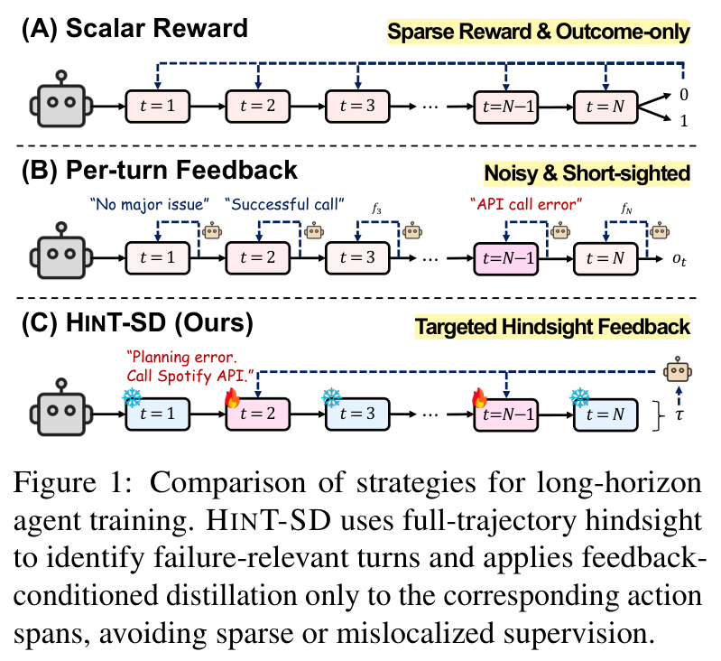
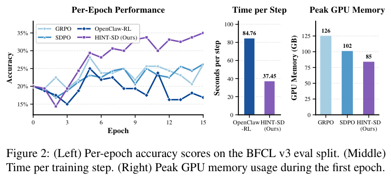
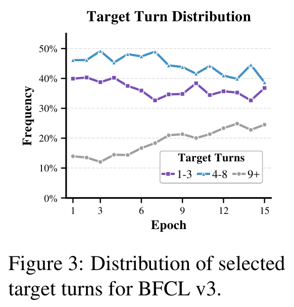

# HINT-SD: Targeted Hindsight Self-Distillation for Long-Horizon Agents（面向长程智能体的定向事后自蒸馏）

中文 | [English](./HINT-SD-Targeted-Hindsight-Self-Distillation_en.md)

- **原文链接**: [HINT-SD: Targeted Hindsight Self-Distillation for Long-Horizon Agents](https://arxiv.org/abs/2605.17873v3)
- **论文**: [arXiv:2605.17873](https://arxiv.org/abs/2605.17873)
- **官方资料**: [wgcyeo/HINT-SD](https://github.com/wgcyeo/HINT-SD)
- **发布日期**: 2026-05-18
- **范围**: 按 arXiv v3（2026-10-02 修订）写的通俗解读，不是全文翻译。论文发表于 EMNLP 2026 Findings。作者是 Woongyeong Yeo、Yumin Choi（并列一作）、Taekyung Ki、Sung Ju Hwang，来自韩国科学技术院（KAIST），Hwang 同时属于 DeepAuto.ai。

## 一句话版本

让大模型当"智能体"（agent）完成一长串操作，比如先查航班、再订票、再给这张票买保险，训练时通常只能拿到最后一个信号：任务成没成。这篇论文提出 HINT-SD（Targeted Hindsight Self-Distillation，定向事后自蒸馏）：任务失败后，让模型自己把整段操作记录从头到尾复盘一遍，挑出真正需要改的一到三步，给每一步写一两句修改意见；然后只在这几步上，让"看过意见的自己"当老师，逐个 token 地教"没看意见的自己"。其余步骤不参与训练。

效果：在多轮函数调用测试 BFCL v3 和 App 操作测试 AppWorld 上，用 Qwen3-4B 训练后，HINT-SD 的平均成功率分别是 41.88% 和 18.46%，比各自最强的对照方法高 10.32 和 8.72 个百分点（下文简称"分"）。和每一步都请裁判打分的 OpenClaw-RL 相比，每个训练步的耗时从 84.76 秒降到 37.45 秒，快 2.26 倍。默认设置下，整个过程不需要比自己更强的老师模型。

---

## 1. 先认识几个词

| 词 | 大白话 |
| --- | --- |
| 智能体（agent） | 由大模型来调用工具、API 或操作网页，一步步完成一个多步任务 |
| 轨迹（trajectory） | 智能体做一次任务的完整记录：每一步看到的环境状态、做的动作、环境的返回。也叫 rollout |
| 稀疏奖励 | 只在任务结束时给一个分数（成功 1，失败 0），中间各步没有反馈 |
| 强化学习（RL） | 让模型自己去做，按得分高低调整：得分高的做法以后多做，得分低的少做 |
| GRPO | 大模型上常用的一种强化学习算法：同一道题做几次，按各次总分的相对高低更新，一条轨迹里的每一步得到同一个分 |
| SFT（监督微调） | 拿现成的示范让模型照着学 |
| 信用分配（credit assignment） | 判断一条轨迹里的每一步对最终成败负多大责任 |
| 自蒸馏（self-distillation） | 同一个模型既当老师又当学生：老师多看一些信息，学生朝老师的预测靠拢 |
| 特权信息 | 训练时只给老师看、学生看不到的信息，比如报错、点评、修改意见 |
| 事后复盘（hindsight） | 任务结束后回头看完整条轨迹，再判断是哪一步出的问题 |
| 分析器（hindsight analyzer） | HINT-SD 里负责复盘的角色：读失败的轨迹，挑出要改的步骤并写修改意见。它就是被训练的模型自己（默认用它的滑动平均副本，见 3.2 节） |
| KL 散度 | 衡量两个概率分布差多远的一个数，越小越接近 |
| 滑动平均副本（EMA） | 模型参数的一个"慢半拍"的副本：学生每更新一次，它只朝学生挪一小步 |
| LoRA | 一种省资源的微调方法：原模型参数不动，只训练额外加上的少量参数 |
| Avg@4、Best@4 | 每道测试题跑 4 次。Avg@4 是 4 次的平均成功率；Best@4 是 4 次里至少成功一次的题目比例（论文没写明定义，见 4.1 节） |

## 2. 它想解决什么问题

### 2.1 长任务只知道结果，不知道错在哪

现在的大模型智能体要通过工具、API、网页完成多步任务。一次完整的尝试叫一条轨迹：模型看到环境状态，做一个动作（比如调用一个函数），环境返回结果，模型再做下一个动作，往复十几到几十步。

用强化学习训练这类智能体时，奖励通常只有最后一个：任务成功给 1，失败给 0。这种奖励很"稀疏"。一条 20 步的轨迹失败了，模型既不知道是哪一步出的问题，也不知道该怎么改。

### 2.2 已有的补救办法，各有短板

论文图 1 把训练思路分成三种：



*图 1：训练长程智能体的三种思路，从上到下依次是（A）只给最终分数、（B）每一步都给反馈、（C）HINT-SD，每个方框是一步。HINT-SD 用整条轨迹的事后复盘找出与失败有关的步骤，只在这些步骤对应的动作片段上做"以意见为条件的蒸馏"，避免监督太稀疏或放错位置。*

- **（A）只给最终分数**：GRPO 这类方法把最后的 0 或 1 分给每一步，每一步得到同样的分。图中的标签是"奖励稀疏、只看结果"。
- **（B）每一步都给反馈**：每走一步，就根据这一步之后环境的反应（工具返回了什么、用户说了什么）给这一步打分或写文字提示。图中的标签是"嘈杂、短视"：评判只看眼前一步的结果。
- **（C）HINT-SD**：先看完整条轨迹，再回头挑出真正出问题的步骤（图中第 2 步和第 N−1 步，带火焰标记），只训练这几步；其余步骤（雪花标记）不动。

论文点名了三类已有方法：

1. **给每一步算"功劳分"**（如 AgentEvolver）：让大模型判断每个动作对最终结果的贡献，换成过程奖励。它能指出哪一步坏了事，但给出的仍然只是一个数字，说不出正确做法。模型还得碰巧做成一次，才能学到正确的动作。
2. **用文字反馈做自蒸馏**（如 SDPO、RLTF）：把报错信息、文字点评当作"特权信息"只给老师看，老师据此逐个 token 指导学生。指导很细，但放到多轮任务里，如果把反馈放在第一步之前，或者对整条轨迹都做蒸馏，就会出现错位：学生在出错那一步之后已经走上了另一条路，看过反馈的老师本来不会走到这里。老师在这些后续 token 上给的意见，主要被"前面早已走偏"的累积差异主导，很难对应到某一步该怎么改。
3. **每一步都请裁判看一眼**（如 OpenClaw-RL）：根据每个动作之后的下一个状态，给这一步打分并写文字提示。反馈落在了具体动作上，但每一步都要评一次，开销大；而且裁判只看这一步的直接结果，几步之后才暴露的失败很难追到源头。

### 2.3 论文的诊断："相关性稀疏"

论文把问题概括为 relevance-sparsity（相关性稀疏）：一条失败的轨迹里，真正需要纠正的动作只有少数几个，其余步骤要么本来就对，要么只是前面错误的连锁后果。对所有步骤都施加监督，既浪费训练预算，又会带来噪声。

更麻烦的是，长任务里的错误常常在好几步之后才暴露。某一步调用 API 没有报错，返回结果看起来也合理，但里面埋着一个错误假设，几步之后才导致失败；反过来，最后那个报错的动作可能只是更早错误的后果。只在看到报错的那一步上纠正，改到的只是症状。

打个比方（类比是我加的，不是论文原文）：下棋输了复盘时，高手找的是那一两步败着。真正丢子的那一步，常常只是前面某步失误的结果。

所以论文的主张是：先确定反馈该落在哪一步，再拿反馈去更新模型。

## 3. 核心做法：复盘挑出错的几步，只在这几步上自己教自己

先约定几个记号。一条轨迹写成 $`\tau = (s_1, a_1, \ldots, s_T, a_T)`$：$`s_t`$ 是第 $`t`$ 步看到的环境状态（工具输出、报错信息等），$`a_t`$ 是第 $`t`$ 步的动作，$`h_t = (s_1, a_1, \ldots, s_t)`$ 是做第 $`t`$ 个动作之前的全部历史。

对每条失败的轨迹，HINT-SD 做两件事：先复盘挑步骤，再在挑中的步骤上自蒸馏。成功的轨迹直接跳过。

### 3.1 第一步：整段复盘，挑出要改的步骤

把失败的轨迹完整交给模型自己（论文叫 hindsight analyzer，下面简称"分析器"），让它返回一小组"（第几步，这一步的修改意见）"：

```math
\mathcal{H}_\theta(\tau) \mapsto \{(i, f_i)\}_{i \in \mathcal{I}}, \quad \mathcal{I} \subseteq \{1,\ldots,T\}
```

- $`\mathcal{I}`$：被挑中的步骤编号，通常只有一两个；
- $`f_i`$：一段自然语言的修改意见，说明第 $`i`$ 步为什么导致失败、应该怎么改。

按官方代码，分析器能看到任务描述、每一步的动作和环境返回、每步奖励，以及最终成没成功。论文附录图 5 给出了提示词（原文是英文，这里只译大意，花括号处填入具体内容）：

```text
你在分析失败的 AppWorld 工具调用轨迹。找出最多 {max_steps} 个出错的步骤（1 到 {max_steps} 个，按先后排序）。对每个出错步骤分别写一条修改意见，少于三句话，只针对这一步的错误。只输出 JSON。

输出格式：{"failures": [{"step": 步骤编号, "feedback": "这一步的修改意见"}, ...]}
```

官方代码里 BFCL 用的版本，还在提示词里列出了常见错误：用错工具、参数错误、漏掉必需的调用。方法有两个版本：

- **HINT-SD-Single**：只找第一个出错的步骤，给一条意见（提示词见附录图 6）；
- **HINT-SD-Multi**：最多找 3 个出错步骤，每步一条意见。

因为看完了整条轨迹再判断，分析器可以略过那些"局部看着有问题、其实只是后果"的步骤，把意见落到病根上。这一步同时决定了两件事：意见写什么，用在哪一步。

**例子**（论文附录图 7，AppWorld 的一条训练轨迹）。任务是："在 Spotify 上放一个歌单，歌要够我今天健身用，中途不想换歌单。健身计划在 Simple Note 里。"

| 步骤 | 智能体做了什么 | 环境返回 |
| --- | --- | --- |
| 第 1～13 步 | 拿到账号信息，登录 Simple Note，找到健身笔记，算出今天要练多久；转到 Spotify 登录，登录结果存进变量 `login_result` | （原文只给了概括） |
| 第 14 步 | `apis.spotify.search_playlists(query="workout")` | 401 错误：未授权，access token 缺失、无效或过期 |
| 第 15 步 | 同样的搜索，加上 `access_token=spotify_access_token["access_token"]` | `NameError`：`spotify_access_token` 未定义 |
| 第 16～20 步 | 在登录状态已经乱掉的情况下继续尝试 | 到结束也没放成歌单 |

分析器只给了两条意见：

- **第 14 步**：这次 API 调用缺少 access token，要在 `search_playlists` 里把它作为参数传进去。
- **第 15 步**：变量 `spotify_access_token` 没有定义，应该用上一步得到的 `login_result`。

第 16～20 步同样没成功，分析器没给它们写意见。论文的解读是：分析器把意见放在了智能体丢掉 Spotify 登录状态的那两步上，没有在轨迹开头给一条笼统的意见。

### 3.2 第二步：只在挑中的步骤上，让"看过意见的自己"教"没看意见的自己"

对每个挑中的步骤 $`i`$，同一个模型扮演两个角色：

- **学生**：只看原来的历史 $`h_i`$，也就是它当时真实看到的内容。
- **老师**：看 $`h_i`$，再加上修改意见 $`f_i`$。官方代码的做法是在第 $`i`$ 个动作之前插一条用户消息 "Consider the following feedback to solve this step:"（参考下面的意见完成这一步），后面接意见原文。

两个角色读的是同一段文字：学生当时实际写出的动作 $`a_i`$。读到每个 token 时，两边各给出一个"下一个 token 是什么"的概率分布。训练就是让学生的分布向老师靠拢：

```math
\mathcal{L} = \sum_{i\in\mathcal{I}} \sum_{t=1}^{|a_i|} D_\mathrm{KL}\Big(\pi_\theta(\cdot \mid h_i, a_{i,< t}) \;\Big\|\; \texttt{sg}\big(\pi_\theta(\cdot \mid h_i, f_i, a_{i,< t})\big)\Big)
```

逐项看：

- $`\pi_\theta(\cdot \mid h_i, a_{i,<t})`$：学生在第 $`i`$ 步、已经写出动作的前 $`t-1`$ 个 token 时，对下一个 token 的预测；
- $`\pi_\theta(\cdot \mid h_i, f_i, a_{i,<t})`$：老师在同一位置的预测，区别只是多看了意见 $`f_i`$；
- $`D_\mathrm{KL}`$：衡量两个分布差多少。学生放前面、老师放后面，叫 reverse KL：在学生自己觉得可能的 token 上，惩罚它和老师的分歧；
- $`\texttt{sg}`$（stop-gradient）：老师那一侧不求梯度，只当参照答案；
- 两层求和：外层只遍历挑中的步骤 $`\mathcal{I}`$，内层只遍历这些步骤动作里的 token。没被挑中的步骤、成功的轨迹，都不产生损失。

**算一个数**（我编的示意，不是论文里的）。还是 Spotify 的第 14 步，学生写到 `search_playlists(query="workout"` 时，下一个 token 该是什么？表里的概率是我为演示编的：

| 下一个 token | 学生（没看意见） | 老师（看了"要加 access token"） |
| --- | --- | --- |
| `)`（直接结束调用） | 0.7 | 0.1 |
| `,`（继续加参数） | 0.2 | 0.8 |
| 其他 | 0.1 | 0.1 |

这个位置的损失是 $`0.7\ln\frac{0.7}{0.1} + 0.2\ln\frac{0.2}{0.8} + 0.1\ln\frac{0.1}{0.1} \approx 1.362 - 0.277 + 0 \approx 1.08`$。梯度会把 `,` 的概率往上推，把 `)` 往下压。而在 `apis.spotify.` 这类两边看法一致的 token 上，损失接近 0，模型基本不动。

这就比"整条轨迹得 0 分"细得多：被明显修改的，只是意见改变了老师想法的那几个 token。

**老师其实是一个慢半拍的副本**。公式里老师和学生都写成 $`\pi_\theta`$。按论文附录和官方代码，实际的老师是学生的滑动平均副本（EMA）：训练开始时从学生复制一份，之后学生每更新一次，老师的参数只朝学生挪 0.1%（代码里是 `teacher ← 0.999·teacher + 0.001·student`）。官方代码里，写意见的分析器用的也是这个副本。这样老师比学生稳，又能慢慢跟上学生的进步。

### 3.3 训练的完整流程

1. 每个训练任务，用当前模型跑 4 条轨迹（官方代码默认 BFCL 最多 20 步，AppWorld 最多 40 步）。
2. 成功的轨迹直接跳过。成功指环境给满分，AppWorld 要所有单元测试都通过，只通过一部分也算失败。
3. 每条失败的轨迹交给分析器，拿回最多 3 个"（步骤，意见）"（Single 版只拿 1 个）。
4. 每个挑中的步骤单独做成一条训练样本：学生输入是原历史，老师输入是原历史加意见，两边都去读学生当时写的那个动作。
5. 在这些动作的 token 上算 3.2 节的损失，只更新学生。
6. 老师按滑动平均向学生靠近一点，再开始下一次循环。

官方代码里，HINT-SD 的损失只有这一项蒸馏，没有 GRPO 那种按奖励加分减分的项。最终的成败只用来决定"这条轨迹要不要复盘"。由此有两个直接后果（这是我从方法本身推出来的，论文没有单独做实验）：

- 同一道题 4 次全失败时，GRPO 学不到东西，因为 4 条轨迹分数一样；HINT-SD 只要分析器能挑出步骤，照样有训练信号。
- 反过来，HINT-SD 从不直接强化成功的做法，只纠正失败里的错误步骤。

## 4. 实验结果

### 4.1 实验怎么设计的

**两个测试环境**：

- **BFCL v3**（伯克利函数调用排行榜第 3 版）：多轮函数调用，模型要在多轮对话里按接口规范正确调用函数。论文只用多轮部分的 Base 和 Long Context 两类，按 5:1:4 分成训练、验证、测试集。题数论文没有直接写，下面是我推算的：这两类各 200 题，训练 200 题、验证 40 题、测试 160 题，和表 1 分数的小数位对得上。
- **AppWorld**：在模拟的日常 App 环境（Spotify、Simple Note、文件系统等）里写代码调用 API 完成任务，最后用单元测试检查环境的最终状态，指标是 Task Goal Completion（任务目标完成率）。

**指标**：每道测试题跑 4 次。Avg@4 是 4 次的平均成功率；Best@4 是 4 次里至少成功 1 次的题目比例（论文没明确定义，这是和数字对得上的理解）。

**模型和算力**：主力模型是 Qwen3-4B-Instruct-2507，另在 Qwen2.5-3B 和 7B 的 Instruct 版本上验证。所有需要采样的方法都是每题采样 4 条轨迹、训练 15 轮，用 LoRA 微调。训练用 TRL 库，采样用 vLLM，都在单张 NVIDIA H200 上跑。最后报告的是验证集上奖励最高的检查点。

**对照方法**：

| 方法 | 做法 | 用到的信号 |
| --- | --- | --- |
| Initial | 不训练，直接测 | 无 |
| SFT | 用 GPT-5.4-mini 跑出的成功轨迹做监督微调（每题最多采 10 条，都没成功就取得分最高的） | 更强模型的示范 |
| GRPO | 只用最后的成败分数，整条轨迹每一步得同样的分 | 0/1 结果 |
| SDPO | 失败后写一条针对整段的意见，放在任务开头给老师看，再对整条轨迹的所有动作做蒸馏（原方法是单轮的，作者扩展到多轮） | 一条全局文字意见 |
| OpenClaw-RL | 每一步之后，裁判根据下一个状态给这一步打分、写提示；分数用于强化学习，提示用于蒸馏 | 每步的分数和提示 |

### 4.2 主要结果：HINT-SD-Multi 四项指标都是第一

论文表 1（%）：

| 方法 | BFCL v3 Avg@4 | BFCL v3 Best@4 | AppWorld Avg@4 | AppWorld Best@4 |
| --- | --- | --- | --- | --- |
| Initial | 25.94 | 36.25 | 5.98 | 13.85 |
| SFT | 28.44 | 38.13 | 6.82 | 13.16 |
| GRPO | 31.56 | 41.25 | 7.49 | 15.21 |
| SDPO | 30.78 | 40.00 | 9.74 | 19.32 |
| OpenClaw-RL | 28.28 | 45.00 | 7.65 | 12.31 |
| HINT-SD-Single | 36.25 | 43.13 | 16.54 | 29.40 |
| **HINT-SD-Multi** | **41.88** | **48.75** | **18.46** | **31.11** |

怎么读这张表：

- **HINT-SD-Multi 四项全第一**。和每一项里最强的对照比：BFCL Avg@4 高 10.32 分（对 GRPO），Best@4 高 3.75 分（对 OpenClaw-RL）；AppWorld Avg@4 高 8.72 分，Best@4 高 11.79 分（都是对 SDPO）。AppWorld 的平均成功率是未训练模型的约 3 倍。
- **摘要里"最多高 13.60 个百分点"的出处**：这是 Multi 和 OpenClaw-RL 在 BFCL Avg@4 上的差（41.88 − 28.28）。和最强对照比，差距是上面的 10.32。
- **只改第一个错误步骤的 Single 也很强**：四项里有三项超过所有对照。例外是 BFCL Best@4，43.13 低于 OpenClaw-RL 的 45.00。从 Single 到 Multi 还能再涨。论文的解读是，在一条轨迹里纠正多个错误点，同样多的轨迹能提供更多纠错信号。
- **对照方法的表现符合论文的"放错位置"诊断**：GRPO 比未训练模型好，但受限于稀疏奖励；SDPO 用了文字意见，但把意见摊到了整条轨迹，包括本来就对的步骤；OpenClaw-RL 在 BFCL 上的 Best@4 是对照里最高的（45.00），Avg@4 却是训练过的方法里最低的（28.28）。也就是说，4 次里偶尔能做对，平均下来不行。论文的解释是，每步的局部提示在不同样本间不稳定。
- **SFT 收效很小**。它用的是更强模型 GPT-5.4-mini 的示范，BFCL Avg@4 也只涨了 2.5 分，AppWorld Best@4 还略低于未训练模型。

### 4.3 训练更快、更省显存



*图 2：左图横轴是训练轮数，纵轴是每轮训练后在 BFCL v3 验证集上的准确率；紫色方块是 HINT-SD，浅蓝圆点、中蓝三角、深蓝菱形分别是 GRPO、SDPO、OpenClaw-RL。中图是每个训练步的耗时（秒），只比了 OpenClaw-RL 和 HINT-SD；右图是第一轮训练中的显存峰值（GB），只比了 GRPO、SDPO 和 HINT-SD。柱子上的数是论文标出的。图注和正文都没说中图、右图是在哪个测试环境上量的。*

- **左图**：四种方法都从 20.0% 起步。HINT-SD 在第 2 轮跌到 14.4%，是四条线里最低的；从第 4 轮起一直在最上面，第 15 轮到 35.0%。GRPO 和 SDPO 最后都是 26.2%，OpenClaw-RL 上下波动，最后是 16.9%。这几个数论文没有标，是我从 PDF 里这张图的矢量数据读出来的。曲线上的数都是 0.625% 的整数倍，和"验证集 40 题、每题跑 4 次"对得上。题目少，所以曲线抖得厉害。
- **中图**：每个训练步，OpenClaw-RL 要 84.76 秒，HINT-SD 只要 37.45 秒，快 2.26 倍。论文的解释是：OpenClaw-RL 每一步都要生成一次反馈，HINT-SD 每条失败轨迹只复盘一次，也只在少数几步上做蒸馏。
- **右图**：第一轮训练里的显存峰值，GRPO 126 GB、SDPO 102 GB、HINT-SD 85 GB。按附录的描述，GRPO 和 SDPO 都要在整条轨迹的所有动作上算损失，HINT-SD 只在挑中的几段上算。

### 4.4 该改的步骤分散在整条轨迹里，还随训练往后移



*图 3：BFCL v3 上被挑中的步骤落在轨迹的什么位置。横轴是训练轮数，纵轴是这一轮被挑中的步骤里各组所占的比例；紫色方块是第 1～3 步，蓝色三角是第 4～8 步，灰色圆点是第 9 步及以后。*

- 被挑中的步骤并不集中在开头。前 15 轮合计：36.7% 落在第 1～3 步，44.8% 在第 4～8 步，18.5% 在第 9 步及以后。
- 第 9 步及以后的比例随训练上升，从 14.0% 涨到 24.5%。论文的解释是：前面的错误逐渐被改掉，需要纠正的地方就往后移。
- 附录图 4 给了更细的统计：被挑中步骤的平均位置是第 5.32 步，有 10.0% 落在第 10 步之后。

论文据此认为，意见要放到具体步骤上：很多该改的地方离任务开头很远，把意见当成开头的一句全局提示，很难对上这些位置。

### 4.5 同一句意见，放在出错那一步之前更管用

这个实验不训练模型，只看把意见塞进上下文后，任务成功率能涨多少。对未训练模型的每条失败轨迹，分析器给出一条意见和一个目标步骤，然后用同一条意见做两种干预：

- **放在开头**：从头重新跑一遍，意见在任务一开始就给；
- **放在目标步骤**：先原样重放失败轨迹的前半段，在目标步骤的动作之前插入意见，再让模型接着往下做。

两种做法都和各自不加意见的版本比，意见插入后一直留在上下文里。

论文表 2（单位是分：比不加意见时，成功率多出多少）：

| 测试环境 | 放在开头 | 放在目标步骤 | 差值 |
| --- | --- | --- | --- |
| BFCL v3 | +2.68 | +8.67 | +5.99 |
| AppWorld | +0.44 | +2.16 | +1.72 |

同一句提醒，开工前说作用很小；在快要犯错的那一步之前说，作用大得多。论文据此认为，挑出来的步骤确实"可以下手"，在这里给老师看意见，产生的指导信号也更强。

### 4.6 意见由谁来写：自己写已经够强，换更强的模型还能再涨

论文表 3（%）：

| 意见来源 | BFCL Avg@4 | BFCL Best@4 | AppWorld Avg@4 | AppWorld Best@4 |
| --- | --- | --- | --- | --- |
| 滑动平均老师（默认） | 41.88 | 48.75 | 18.46 | 31.11 |
| 直接用环境输出 | 36.25 | 42.50 | 15.90 | 27.86 |
| 初始模型写意见（不更新） | 37.50 | 45.63 | 14.40 | 28.89 |
| 更强的 GPT-5.4-mini | 48.59 | 52.50 | 20.81 | 35.04 |

- **直接用环境输出**：不让模型写复盘意见，直接拿环境返回的原始信息当意见。效果比默认做法差。我的理解是，原始报错只说明出了什么事，不说该怎么改。
- **初始模型写意见**（写意见的模型一直停在训练前）：也比默认做法差。论文的解读是，写意见的模型最好跟着学生一起进步。
- **换成更强的 GPT-5.4-mini 写意见**：效果还能再涨，BFCL Avg@4 到 48.59。意见越好，收益越大。论文强调的是，默认做法不依赖任何外部大模型，已经很强。

我的一个观察：就 Avg@4 而言，这张表里最差的变体也超过了表 1 的所有对照方法。也就是说，意见来源差一些时，HINT-SD 仍然领先。不过论文没说"直接用环境输出"这一版是怎么挑步骤的。

### 4.7 分析器挑得准不准：约九成挑在和失败有关的步骤上

作者在 BFCL v3 上收集了 631 条失败轨迹，分析器一共挑出 765 个步骤（平均每条约 1.2 步，这是我用两个数相除算的，上限是 3 步）。然后请 GPT-5.4-mini 当阅卷人，做两件事：给每个被挑中的步骤标错误类型；另外独立地从完整轨迹里找出和失败有关的步骤，当作参考答案。论文把这个参考答案叫"银标准"（silver reference），意思是它不是人工标注的金标准。

论文表 4：

| 错误类型 | 占被挑中步骤的比例 | 和参考答案挑在同一步 | 相差不超过一步 |
| --- | --- | --- | --- |
| 显性执行错误（调用报错等） | 58.2% | 85.4% | 92.6% |
| 隐性推理或状态跟踪错误 | 32.5% | 57.4% | 85.1% |

- 两类合计 90.7%：被挑中的步骤里，约九成被阅卷人认为确实和失败有关。
- 分析器不只会抓"报错了"这种一眼能看出的错误，也能抓到推理和状态跟踪上的隐性错误，比如忘了自己处在什么状态、编造了一个不存在的订单号。
- 隐性错误更难定位到确切哪一步：只有 57.4% 挑在同一步，放宽到相差一步才有 85.1%。

### 4.8 换成 Qwen2.5-3B、7B 也有效

在 Qwen2.5-3B-Instruct 和 Qwen2.5-7B-Instruct 上重做 BFCL v3 实验。论文表 5（Avg@4，均值 ± 标准差，%）：

| 方法 | Qwen2.5-3B | Qwen2.5-7B |
| --- | --- | --- |
| Initial | 8.59 ± 1.02 | 21.31 ± 0.92 |
| SFT | 9.53 ± 0.87 | 24.79 ± 0.82 |
| GRPO | 10.32 ± 0.74 | 26.05 ± 0.85 |
| SDPO | 9.23 ± 0.83 | 25.44 ± 1.34 |
| **HINT-SD-Multi** | **17.34 ± 0.76** | **38.23 ± 0.59** |

比最强对照 GRPO，3B 高 7.02 分，7B 高 12.18 分。3B 的分数是未训练时的两倍。论文的解读是：小模型也能给自己写出有用的意见，模型变大以后涨得更多。这张表没有 OpenClaw-RL，也只测了 BFCL。

### 4.9 多跑几次，领先幅度远大于波动

附录给了多次运行的均值和标准差。论文附录表 6（Avg@4，均值 ± 标准差，%）：

| 方法 | BFCL v3 | AppWorld |
| --- | --- | --- |
| Initial | 24.84 ± 0.68 | 5.77 ± 0.76 |
| SFT | 28.13 ± 0.72 | 6.21 ± 0.56 |
| GRPO | 30.97 ± 0.63 | 7.59 ± 0.81 |
| SDPO | 30.23 ± 0.85 | 8.32 ± 0.92 |
| OpenClaw-RL | 29.13 ± 0.90 | 7.83 ± 0.67 |
| HINT-SD-Single | 35.85 ± 0.82 | 17.02 ± 0.83 |
| **HINT-SD-Multi** | **42.32 ± 0.71** | **18.39 ± 0.79** |

标准差都不超过 0.92，而 HINT-SD-Multi 比最强对照高出 10 分以上。领先幅度远大于运行间的波动。

### 4.10 两个例子：全局意见只总结整段的失败，定点意见改到具体动作上

附录图 8、图 9 用两个例子对比"一条针对整段的全局意见"和 HINT-SD 的"每步一条意见"。

**BFCL 订机票**。任务：用用户的银行卡和 access token，订一张 2026 年 11 月 12 日从 Crescent Hollow 飞纽约的经济舱机票；对话后面还要求给这次行程买保险、开发票、处理客服请求。

- 第 3 步：查到票价是 300 美元。
- 第 4 步（被挑中）：智能体发现票价和预期的 850 美元对不上，于是向用户确认，没有调用 `book_flight` 订票。
- 接着用户把这次行程当作已经订好，要求买 100 美元的旅行保险。
- 第 5 步（被挑中）：智能体用一个编造的订单号 `bk_12345` 去买保险，返回"找不到订单"。
- 第 7 步（被挑中）：又用这个订单号去取发票，同样"找不到订单"。

| 意见类型 | 内容 |
| --- | --- |
| 全局意见 | 根本原因只有一个：从来没有订成票，后面买保险、开发票、找客服用的都是不存在的订单号。建议在任何依赖订单的操作之前先调用 `book_flight`。 |
| HINT-SD 每步意见 | 第 4 步：用 `book_flight` 发起预订。第 5 步：不要用编造的订单号 `bk_12345` 买保险。第 7 步：等订票成功、拿到有效订单号之后再取发票。 |

两种意见找到的是同一个病根。区别在于，HINT-SD 把它拆到了"病根第一次出现"和"错误往后传"的每一个具体动作上。

**AppWorld 文件整理**。任务：把 `~/photos/` 下每个度假地的子文件夹分别打成 tar 包，放进 `~/photos/vacations/`，然后删掉原文件夹。

- 第 1 步（被挑中）：`import tarfile`，想用本地文件系统操作，结果环境不允许使用 `tarfile` 模块。
- 第 3 步（被挑中）：调用 `list_directory`，环境报错"没有这个 API"。文档里写的是 `show_directory`。
- 第 5 步（被挑中）：改用 `show_directory`，又报参数错误。之后看到的 API 文档显示，它要求用具名参数，并且要传 `access_token`。

| 意见类型 | 内容 |
| --- | --- |
| 全局意见 | 盯着后面一次登录失败，建议调用 `apis.file_system.login` 时用完整邮箱地址。 |
| HINT-SD 每步意见 | 第 1 步：不要用被禁止的系统模块，改用环境提供的 API。第 3 步：把 `list_directory` 换成文档里有的 `show_directory`。第 5 步：先登录，再把 `access_token` 作为具名参数传进去。 |

这个例子里，全局意见只盯着后面的登录失败；HINT-SD 的意见指出了前面三处 API 用法和登录上的错误，每一处都能直接改。

## 5. 作者自己承认的局限

- **训练信号的好坏取决于意见对不对。** 分析器要能找到真正可改的出错步骤，还要提出能让任务成功的改法。这要求初始模型有足够的指令遵循能力和解题能力，才能读懂失败的轨迹。作者认为结果说明小模型也能写出有用的意见，后续可以给意见生成加额外的监督或约束。
- **接入真实工具有风险。** 智能体可能执行错误、越权或有害的操作。因为方法依赖模型给自己写的反馈，这些有害行为、已有的偏见和失败模式可能被自我强化。真实部署前需要相应的防护。

## 6. 读的时候值得留意的地方

以下是我读原文时注意到、论文没有重点讨论的点，供参考。

### 证据有多强

- **测试集很小。** BFCL 测试集只有 160 题（我的推算，见 4.1 节），Best@4 上一道题就是 0.625 分：HINT-SD-Multi 比 OpenClaw-RL 高的 3.75 分，相当于多做对 6 道题。验证集只有 40 题（同样是推算），图 2 左图的曲线和"按验证集挑最好的检查点"都会受随机波动影响。
- **效率数字的口径不统一。** 耗时只和 OpenClaw-RL 比（84.76 对 37.45 秒），显存只和 GRPO、SDPO 比（126、102 对 85 GB），没有一组数字把四种方法的耗时和显存放在一起。
- **缺一组拆开看的对照。** 从 SDPO 到 HINT-SD，同时变了三样东西：意见是按步骤写还是只写一条全局的，意见插在哪一步，损失算在哪些 token 上。论文没有训练"按步骤插意见、但所有步骤都算损失"或"意见放开头、只在挑中步骤算损失"这类中间版本。表 2 只比了推理时意见放在哪里，没有训练。所以这三样各贡献多少，分不开。
- **意见质量由另一个大模型判定。** 表 4 的错误类型和参考答案都来自 GPT-5.4-mini，没有人工核对。按这个判法，约 9% 的被挑步骤和失败无关。
- **平均每条只挑了 1.2 步。** 表 4 的统计里（论文没写是哪个版本），631 条失败轨迹一共挑出 765 步。如果这是 Multi，它挑的步数和 Single 差不多，BFCL Avg@4 却高 5.6 分。这个差距来自多挑的那些步骤，还是来自两份提示词挑出的步骤不同（Single 只找第一个错误），论文没有分析。
- **一些对照细节没写。** SDPO 的全局意见由哪个模型写、OpenClaw-RL 的裁判用哪个模型，论文没说，这会影响对比是否公平。表 1 是一次运行还是多次平均也没说。附录表 6 是多次运行的均值，和表 1 不完全一样（比如 Multi 在 BFCL 上是 42.32 对 41.88），但没写跑了几次。

### 适用范围

- **只在两个基准、三个模型上测过。** 基准是 BFCL v3 和 AppWorld，模型只有 Qwen3-4B 和 Qwen2.5 的 3B、7B；换模型的实验只在 BFCL 上做，也没有 OpenClaw-RL。更大的模型、带思考模式的模型、真实网页或真实 App 上的效果，论文没有测。

### 对照公开代码

- **AppWorld 用的是哪个测试切分，论文和代码对不上。** 论文没写 AppWorld 测试集有多少题，我从 Best@4 的小数位推算是 585 题，正好等于 AppWorld 官方的 test_normal（168 题）加 test_challenge（417 题）；官方代码的数据脚本却只把 test_normal 写成测试集。论文没写用了哪个切分，照代码默认值复现，分数可能对不上。论文和代码默认值的其他差别见第 7 节。
- **"复盘整条轨迹"在代码里有长度上限。** 官方代码默认只把步骤记录的最后 12,000 个字符交给分析器，更早的部分换成一句 "[earlier trajectory omitted]"，任务描述始终保留。AppWorld 一条轨迹最多 40 步，很长时开头几步分析器看不到，而论文强调的恰恰是能追到更早的病根。论文实验是否用了这个默认值，正文没写。

### 稿件里的小问题（不影响主要结论）

- **正文说的显存对比对象和图对不上。** 正文写"显存从 126 GB 降到 85 GB，比每步反馈的对照方法少 1.48 倍"，但图 2 里 126 GB 标的是 GRPO；每步反馈的对照方法是 OpenClaw-RL，它的显存图里没有。
- **v1 和 v3 的主要数字相同，标题数字换了口径。** 两版的表 1、表 2、表 3 数字完全一样。v3 新增了图 1 的示意图、表 4（意见质量）、表 5（换模型）和附录表 6（多次运行的标准差）。摘要里，v1 写"最多高 18.80%"，这是 AppWorld Best@4 上对 OpenClaw-RL 的差（31.11 − 12.31）；v3 写"平均最多高 13.60 个百分点"，这是 BFCL Avg@4 上对 OpenClaw-RL 的差。网上看到 18.80 这个数时，指的是同一组实验。

## 7. 如果想自己跑

官方仓库（Apache-2.0 许可）的 README 写了完整步骤：用 uv 装依赖，跑 `scripts/setup_bfcl.sh` 或 `scripts/setup_appworld.sh` 准备数据，另开一个终端启动环境服务，再用 `scripts/train.sh` 训练、`scripts/eval.sh` 评测。论文和代码默认值有几处不同：

| 设置 | 论文 | 官方代码默认 |
| --- | --- | --- |
| 模型 | Qwen3-4B-Instruct-2507 | 同 |
| LoRA | 只加在 query、value 投影上，r=32，α=64，dropout 0.05 | 同 |
| 学习率 | BFCL 5e-6，AppWorld 3e-6 | 两个都是 5e-6 |
| 学习率预热 | 前 5% 的训练步 | 不预热 |
| 老师滑动平均 | 更新率 0.001 | decay 0.999，相同 |
| 训练轮数、每题轨迹数 | 15、4 | 同 |
| 每条失败轨迹最多挑几步 | 3 | 3 |
| 每条轨迹最多几步 | 没写 | BFCL 20，AppWorld 40 |
| AppWorld 测试集 | 没写（我从分数推算是 585 题，见第 6 节） | test_normal，168 题 |

按论文设置跑 AppWorld，可以这样覆盖默认值（`train.sh` 会读这些环境变量）：

```bash
LEARNING_RATE=3e-6 WARMUP_STEPS=0.05 bash scripts/train.sh Qwen/Qwen3-4B-Instruct-2507 --backend appworld
```

代码里还有几处论文没提的细节：

- KL 只在学生概率最高的 100 个 token 上算，其余概率合并成一项（`distillation_topk=100`、`distillation_add_tail=True`）。
- 交给分析器的步骤记录只保留最后 12,000 个字符，见第 6 节。
- 意见最长 512 个 token，采样温度 0.6、top-p 0.95；每一步的输出最长 1,024 个 token，上下文最长 24,576 个 token。
- 批大小 1，梯度累积 2 步。

## 8. 和相关工作的关系

下表按论文第 1 节和附录 C 对已有方法的说法整理：

| 方法 | 训练信号从哪来 | 信号用在哪 | 论文认为的不足 |
| --- | --- | --- | --- |
| GRPO | 最终成败（0 或 1） | 整条轨迹，每一步同样的分 | 不知道哪一步错了，也不知道怎么改 |
| AgentEvolver、GiGPO、HCAPO 等信用分配方法 | 给每一步估一个贡献分 | 按分数给各步加减分 | 能指出坏步骤，但给的仍是数字；正确做法还得靠碰巧成功的轨迹去学 |
| Reflexion、Self-Refine、CRITIC | 文字反馈或工具反馈 | 推理时反复修改输出 | 只在推理时改，不把反馈学进参数 |
| SDPO、RLTF | 报错、点评等文字反馈，只给老师看 | 整条输出（放到多轮任务里，就是意见放开头、整条轨迹都蒸馏） | 意见被摊到无关或本来就对的步骤上；出错之后，老师和学生走的路已经对不上 |
| OpenClaw-RL | 每一步之后的下一个状态，生成分数和文字提示 | 每一步 | 每步都要评，开销大；只看眼前一步，追不到几步之后才暴露的失败 |
| **HINT-SD** | 对整条失败轨迹的事后复盘，挑 1 到 3 步并写意见 | 只在挑中步骤的动作 token 上 | |

HINT-SD 的蒸馏方式和 SDPO 一样，都是"看过意见的自己当老师"；它也和 HCAPO 一样用了事后回看（hindsight）。新的地方在于把这两件事接了起来：回看的结果决定蒸馏落在哪几步。

我的理解是，这篇和 SDPO（arXiv 2601.20802）、OPSD（arXiv 2601.18734）、SDFT（arXiv 2601.19897）属于同一类思路：让多看了一些信息的自己当老师。HINT-SD 新加的一步，是先决定老师在哪几步上开口。

## 9. 总结

HINT-SD 的做法可以概括成一句话：**任务做砸了先整段复盘，挑出真正该改的一到三步，每步写一两句意见，然后只在这几步上，让看过意见的自己逐 token 教没看意见的自己。** 它针对的是长任务里"反馈放错位置"的问题：只给最终分数太粗；每一步都评太贵，而且只看眼前；把一条全局意见摊到整条轨迹上，信号会被稀释，还会和学生实际走过的路对不上。

论文的结果是：在 BFCL v3 和 AppWorld 上，Qwen3-4B 的平均成功率分别到 41.88% 和 18.46%，比最强对照高约 10 分和 9 分；每个训练步的耗时比每步都评的 OpenClaw-RL 少一半多。前提是模型要能读懂失败轨迹、写出对的意见，意见写得越好效果越好（换 GPT-5.4-mini 来写，BFCL 能到 48.59%）。需要留意的是测试集不大，一些对照的细节也没有交代。

---

## 原文位置对照

| 本文内容 | 论文位置 |
| --- | --- |
| 问题和动机、三种训练思路 | 第 1 节，图 1 |
| 记号、整段复盘生成意见 | 第 2 节（Problem Setup、Hindsight Feedback Generation），式 (1)(2)，附录图 5、图 6 |
| 只在挑中步骤上自蒸馏 | 第 2 节（Targeted Self-Distillation），式 (3) |
| Spotify 例子 | 附录 B.3，附录图 7 |
| 测试环境、指标、对照方法 | 第 3.1 节，附录 A.1 |
| 训练设置（LoRA、学习率、滑动平均老师、检查点选择） | 附录 A.2 |
| 主要结果 | 第 3.2 节，表 1 |
| 训练曲线、耗时、显存 | 第 3.2 节，图 2 |
| 被挑中步骤的分布 | 第 3.2 节，图 3；附录 B.1，附录图 4 |
| 意见放在哪里 | 第 3.2 节，表 2 |
| 意见由谁来写 | 第 3.2 节，表 3 |
| 分析器挑得准不准 | 第 3.2 节，表 4 |
| 换模型 | 第 3.2 节，表 5 |
| 多次运行 | 附录 B.2，附录表 6 |
| 全局意见和每步意见的例子 | 附录 B.3，附录图 8、图 9 |
| 局限和风险 | Limitations、Ethical Considerations 两节 |
| 复现设置 | 附录 A.2；代码默认值来自官方仓库，论文里没有 |
| 和相关工作的关系 | 第 1 节，附录 C |
