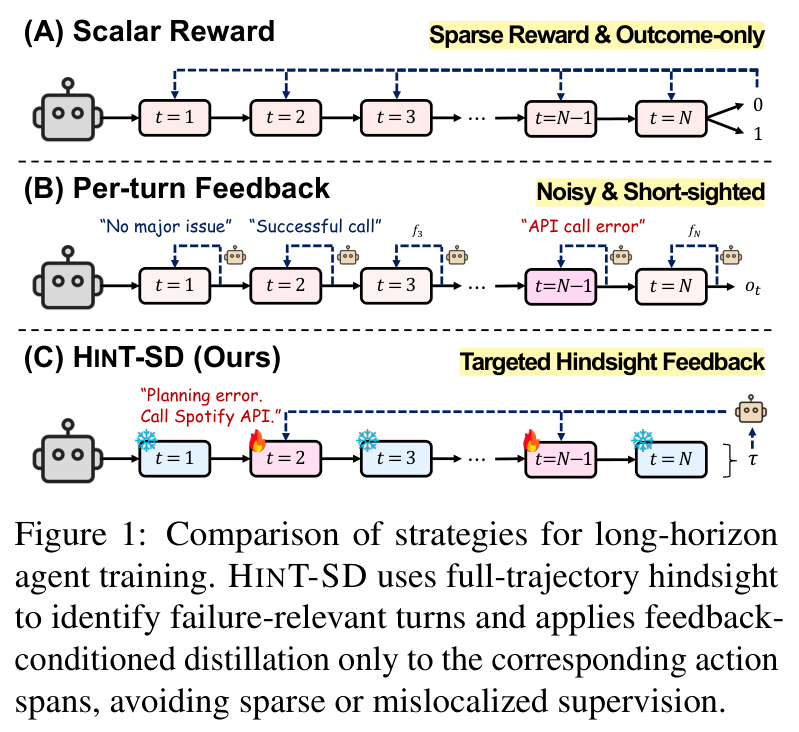
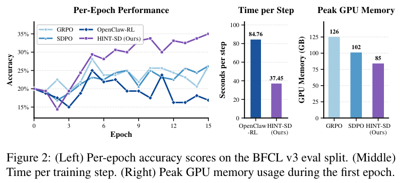
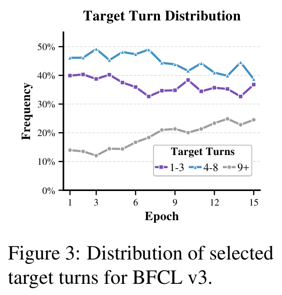

# HINT-SD: Targeted Hindsight Self-Distillation for Long-Horizon Agents

[中文](./HINT-SD-Targeted-Hindsight-Self-Distillation.md) | English

- **Source**: [HINT-SD: Targeted Hindsight Self-Distillation for Long-Horizon Agents](https://arxiv.org/abs/2605.17873v3)
- **Paper**: [arXiv:2605.17873](https://arxiv.org/abs/2605.17873)
- **Official resources**: [wgcyeo/HINT-SD](https://github.com/wgcyeo/HINT-SD)
- **Published**: 2026-05-18
- **Scope**: A plain-language explainer based on arXiv v3 (revised 2026-10-02), not a full translation. The paper appears in EMNLP 2026 Findings. The authors are Woongyeong Yeo, Yumin Choi (co-first authors), Taekyung Ki and Sung Ju Hwang, from the Korea Advanced Institute of Science and Technology (KAIST); Hwang is also affiliated with DeepAuto.ai.

## In One Sentence

When a large model works as an "agent" and carries out a long chain of operations, such as looking up flights, then booking a ticket, then buying insurance for that ticket, training usually gets only one signal at the end: whether the task succeeded. This paper proposes HINT-SD (Targeted Hindsight Self-Distillation): after a task fails, the model itself reviews the whole operation log from start to finish, picks out the one to three steps that really need changing, and writes one or two sentences of revision advice for each; then, on those few steps only, the "self that has read the advice" acts as the teacher and teaches the "self that has not read it", token by token. The remaining steps take no part in training.

Results: on the multi-turn function-calling benchmark BFCL v3 and the app-operation benchmark AppWorld, after training Qwen3-4B, HINT-SD reaches average success rates of 41.88% and 18.46%, 10.32 and 8.72 percentage points (called "points" below) above the strongest baseline on each. Compared with OpenClaw-RL, which asks a judge to score every step, the time per training step drops from 84.76 seconds to 37.45 seconds, 2.26× faster. In the default setting, the whole process needs no teacher model stronger than the model itself.

---

## 1. Key Terms

| Term | In plain words |
| --- | --- |
| Agent | A large model that calls tools or APIs, or operates web pages, to complete a multi-step task one step at a time |
| Trajectory | The full record of one attempt at a task by an agent: at each step, the environment state it saw, the action it took and what the environment returned. Also called a rollout |
| Sparse reward | A single score given only when the task ends (1 for success, 0 for failure), with no feedback on the steps in between |
| Reinforcement learning (RL) | Let the model try on its own and adjust by score: do high-scoring behavior more often later, and low-scoring behavior less |
| GRPO | An RL algorithm widely used on large models: attempt the same problem several times and update by how each attempt's total score compares with the others; every step in one trajectory gets the same score |
| SFT (supervised fine-tuning) | Have the model learn by imitating ready-made demonstrations |
| Credit assignment | Judging how much each step in a trajectory is responsible for the final success or failure |
| Self-distillation | The same model is both teacher and student: the teacher sees some extra information, and the student moves toward the teacher's predictions |
| Privileged information | Information shown only to the teacher during training and hidden from the student, such as error messages, critiques or revision advice |
| Hindsight review | After the task ends, look back over the whole trajectory and then judge which step caused the problem |
| Analyzer (hindsight analyzer) | The role in HINT-SD that does the review: it reads a failed trajectory, picks out the steps to change and writes revision advice. It is the model being trained itself (by default its moving-average copy, see Section 3.2) |
| KL divergence | A number that measures how far apart two probability distributions are; the smaller it is, the closer they are |
| Moving-average copy (EMA) | A copy of the model parameters that lags "half a beat" behind: each time the student updates, it moves only a small step toward the student |
| LoRA | A resource-saving fine-tuning method: the original model parameters stay frozen, and only a small number of added parameters are trained |
| Avg@4, Best@4 | Each test problem is run 4 times. Avg@4 is the average success rate over the 4 runs; Best@4 is the share of problems solved at least once in the 4 runs (the paper does not state the definition, see Section 4.1) |

## 2. What Problem It Tackles

### 2.1 Long tasks reveal only the outcome, not where things went wrong

Today's large-model agents need to complete multi-step tasks through tools, APIs and web pages. One full attempt is called a trajectory: the model sees the environment state, takes an action (such as calling a function), the environment returns a result, and the model takes the next action, back and forth for a dozen or so to several dozen steps.

When such agents are trained with RL, there is usually only one reward, at the end: 1 if the task succeeds, 0 if it fails. This kind of reward is very "sparse". When a 20-step trajectory fails, the model knows neither which step caused the problem nor how to fix it.

### 2.2 Existing remedies each have weak spots

Figure 1 of the paper sorts training approaches into three kinds:



*Figure 1: three approaches to training long-horizon agents, from top to bottom (A) final score only, (B) feedback at every step and (C) HINT-SD; each box is one step. HINT-SD uses a hindsight review of the whole trajectory to find the steps tied to the failure, and does "advice-conditioned distillation" only on the action spans of those steps, which keeps the supervision from being too sparse or put in the wrong place.*

- **(A) Final score only**: methods like GRPO give the final 0 or 1 to every step, so every step gets the same score. The label in the figure is "sparse reward, outcome only".
- **(B) Feedback at every step**: after each step, that step gets a score or a text hint based on how the environment reacted to it (what the tool returned, what the user said). The label in the figure is "noisy, myopic": the judgment looks only at the immediate result of that one step.
- **(C) HINT-SD**: first look at the whole trajectory, then go back and pick out the steps that really caused the problem (steps 2 and N−1 in the figure, marked with flames), and train only those steps; the remaining steps (marked with snowflakes) are left alone.

The paper names three kinds of existing methods:

1. **Compute "credit" for each step** (for example AgentEvolver): have a large model judge how much each action contributed to the final outcome, and turn that into a process reward. It can point out which step spoiled things, but what it gives is still just a number that cannot say what the right move is. The model still has to happen to succeed once before it can learn the right action.
2. **Self-distillation with text feedback** (for example SDPO and RLTF): error messages and text critiques are treated as "privileged information" shown only to the teacher, and the teacher uses them to guide the student token by token. The guidance is fine-grained, but in a multi-turn task, if the feedback is placed before the first step, or distillation is applied to the whole trajectory, a mismatch appears: after the faulty step the student has already gone down another path, one that the teacher who saw the feedback would never have reached. The teacher's guidance on these later tokens is dominated by the accumulated gap from "having gone off course long before", and is hard to map to how any one step should change.
3. **Ask a judge to look at every step** (for example OpenClaw-RL): based on the next state after each action, give that step a score and write a text hint. The feedback lands on specific actions, but every step has to be judged once, which is costly; and since the judge looks only at the direct result of that step, a failure that surfaces only several steps later is hard to trace back to its source.

### 2.3 The paper's diagnosis: "relevance sparsity"

The paper sums up the problem as relevance-sparsity: in a failed trajectory, only a few actions really need correcting, and the other steps are either already right or just knock-on effects of earlier errors. Supervising every step both wastes training budget and adds noise.

Worse, errors in long tasks often surface only several steps later. An API call at some step raises no error and its result looks reasonable, but it hides a wrong assumption that causes the failure several steps later; conversely, the last action that raised an error may just be the result of an earlier mistake. Correcting only the step where the error showed up fixes only the symptom.

An analogy (the analogy is mine, not from the paper): when reviewing a lost chess game, a strong player looks for the one or two losing moves. The move where a piece was actually lost is often just the result of an earlier mistake.

So the paper's position is: first decide which step the feedback should land on, then use the feedback to update the model.

## 3. Core Method: Review the Trajectory to Pick Out the Few Wrong Steps, Then Self-Teach Only on Them

First, some notation. A trajectory is written $`\tau = (s_1, a_1, \ldots, s_T, a_T)`$: $`s_t`$ is the environment state seen at step $`t`$ (tool outputs, error messages and so on), $`a_t`$ is the action at step $`t`$, and $`h_t = (s_1, a_1, \ldots, s_t)`$ is the full history before taking action $`t`$.

For each failed trajectory, HINT-SD does two things: first it reviews the trajectory and picks steps, then it self-distills on the picked steps. Successful trajectories are skipped.

### 3.1 Step one: review the whole run and pick the steps to change

Hand the whole failed trajectory to the model itself (the paper calls it the hindsight analyzer, "analyzer" for short below), and have it return a small set of "(step number, revision advice for that step)" pairs:

```math
\mathcal{H}_\theta(\tau) \mapsto \{(i, f_i)\}_{i \in \mathcal{I}}, \quad \mathcal{I} \subseteq \{1,\ldots,T\}
```

- $`\mathcal{I}`$: the numbers of the picked steps, usually just one or two;
- $`f_i`$: a piece of natural-language revision advice explaining why step $`i`$ led to the failure and how it should change.

According to the official code, the analyzer sees the task description, each step's action and environment return, the per-step reward, and whether the task finally succeeded. Figure 5 in the paper's appendix gives the prompt (the original is in English; only its gist is given here, and the curly braces are filled with the actual content):

```text
You are analyzing a failed AppWorld tool-calling trajectory. Find at most {max_steps} faulty steps (1 to {max_steps}, in order). For each faulty step, write one piece of revision advice, in fewer than three sentences, addressing only that step's error. Output JSON only.

Output format: {"failures": [{"step": step number, "feedback": "revision advice for this step"}, ...]}
```

The version used for BFCL in the official code also lists common errors in the prompt: using the wrong tool, wrong arguments, and missing a required call. The method comes in two versions:

- **HINT-SD-Single**: finds only the first faulty step and gives one piece of advice (prompt in appendix Figure 6);
- **HINT-SD-Multi**: finds up to 3 faulty steps, with one piece of advice per step.

Because it judges only after seeing the whole trajectory, the analyzer can skip steps that "look wrong locally but are really just consequences", and aim its advice at the root cause. This step decides two things at once: what the advice says, and which step it is applied to.

**Example** (appendix Figure 7 of the paper, an AppWorld training trajectory). The task is: "Play a playlist on Spotify with enough songs to last my workout today; I don't want to switch playlists midway. The workout plan is in Simple Note."

| Step | What the agent did | Environment return |
| --- | --- | --- |
| Steps 1-13 | Got the account details, logged in to Simple Note, found the workout note and worked out how long today's workout is; switched to Spotify and logged in, storing the login result in the variable `login_result` | (the paper gives only a summary) |
| Step 14 | `apis.spotify.search_playlists(query="workout")` | 401 error: unauthorized, the access token is missing, invalid or expired |
| Step 15 | The same search, adding `access_token=spotify_access_token["access_token"]` | `NameError`: `spotify_access_token` is not defined |
| Steps 16-20 | Kept trying with the login state already in a mess | Never managed to play the playlist by the end |

The analyzer gave only two pieces of advice:

- **Step 14**: this API call is missing the access token; pass it as an argument in `search_playlists`.
- **Step 15**: the variable `spotify_access_token` is not defined; use the `login_result` obtained in the previous step.

Steps 16-20 did not succeed either, and the analyzer wrote no advice for them. The paper's reading is that the analyzer put its advice on the two steps where the agent lost its Spotify login state, rather than giving one vague piece of advice at the start of the trajectory.

### 3.2 Step two: only on the picked steps, the "self that read the advice" teaches the "self that did not"

For each picked step $`i`$, the same model plays two roles:

- **Student**: sees only the original history $`h_i`$, that is, what it actually saw at the time.
- **Teacher**: sees $`h_i`$ plus the revision advice $`f_i`$. The official code does this by inserting a user message "Consider the following feedback to solve this step:" before action $`i`$, followed by the advice text.

Both roles read the same text: the action $`a_i`$ that the student actually wrote at the time. At each token, each side gives a probability distribution over "what the next token is". Training pulls the student's distribution toward the teacher's:

```math
\mathcal{L} = \sum_{i\in\mathcal{I}} \sum_{t=1}^{|a_i|} D_\mathrm{KL}\Big(\pi_\theta(\cdot \mid h_i, a_{i,<t}) \;\Big\|\; \texttt{sg}\big(\pi_\theta(\cdot \mid h_i, f_i, a_{i,<t})\big)\Big)
```

Term by term:

- $`\pi_\theta(\cdot \mid h_i, a_{i,<t})`$: the student's prediction of the next token at step $`i`$, once it has written the first $`t-1`$ tokens of the action;
- $`\pi_\theta(\cdot \mid h_i, f_i, a_{i,<t})`$: the teacher's prediction at the same position; the only difference is that it also sees the advice $`f_i`$;
- $`D_\mathrm{KL}`$: measures how much two distributions differ. With the student first and the teacher second, it is called reverse KL: on the tokens the student itself finds likely, it penalizes the student's disagreement with the teacher;
- $`\texttt{sg}`$ (stop-gradient): no gradient is taken on the teacher's side, which serves only as the reference;
- The two sums: the outer one runs only over the picked steps $`\mathcal{I}`$, and the inner one only over the tokens in those steps' actions. Steps that were not picked, and successful trajectories, produce no loss.

**A worked number** (a toy example I made up, not from the paper). Take step 14 of the Spotify task again: when the student has written `search_playlists(query="workout"`, what should the next token be? I made up the probabilities in the table for illustration:

| Next token | Student (no advice) | Teacher (saw "add the access token") |
| --- | --- | --- |
| `)` (ends the call right away) | 0.7 | 0.1 |
| `,` (adds another argument) | 0.2 | 0.8 |
| Other | 0.1 | 0.1 |

The loss at this position is $`0.7\ln\frac{0.7}{0.1} + 0.2\ln\frac{0.2}{0.8} + 0.1\ln\frac{0.1}{0.1} \approx 1.362 - 0.277 + 0 \approx 1.08`$. The gradient pushes the probability of `,` up and that of `)` down. On tokens such as `apis.spotify.`, where both sides agree, the loss is close to 0 and the model barely moves.

This is much finer-grained than "the whole trajectory scores 0": the only tokens that change noticeably are the few where the advice changed the teacher's mind.

**The teacher is actually a copy that lags half a beat behind**. In the formula, both teacher and student are written $`\pi_\theta`$. According to the paper's appendix and the official code, the actual teacher is a moving-average copy (EMA) of the student: it is copied from the student when training starts, and after that, each time the student updates, the teacher's parameters move only 0.1% toward the student (in the code, `teacher ← 0.999·teacher + 0.001·student`). In the official code, the analyzer that writes the advice also uses this copy. This keeps the teacher steadier than the student while letting it slowly keep up with the student's progress.

### 3.3 The full training loop

1. For each training task, run 4 trajectories with the current model (by default the official code allows at most 20 steps on BFCL and at most 40 on AppWorld).
2. Skip successful trajectories. Success means the environment gives full marks; AppWorld requires all unit tests to pass, and passing only some of them still counts as failure.
3. Give each failed trajectory to the analyzer and get back up to 3 "(step, advice)" pairs (the Single version gets only 1).
4. Turn each picked step into its own training sample: the student's input is the original history, the teacher's input is the original history plus the advice, and both sides read the action the student wrote at the time.
5. Compute the loss from Section 3.2 on the tokens of these actions, and update only the student.
6. Move the teacher a little toward the student by the moving average, then start the next round.

In the official code, HINT-SD's loss has only this one distillation term, with no GRPO-style term that adds or subtracts by reward. The final success or failure is used only to decide "whether this trajectory gets reviewed". Two direct consequences follow (I derived these from the method itself; the paper runs no separate experiment on them):

- When all 4 attempts at a problem fail, GRPO learns nothing, because the 4 trajectories have the same score; HINT-SD still has a training signal as long as the analyzer can pick out steps.
- Conversely, HINT-SD never directly reinforces what worked; it only corrects the wrong steps in failures.

## 4. Experimental Results

### 4.1 How the experiments were set up

**Two test environments**:

- **BFCL v3** (version 3 of the Berkeley Function Calling Leaderboard): multi-turn function calling, where the model has to call functions correctly according to the interface spec over a multi-turn conversation. The paper uses only two categories of the multi-turn part, Base and Long Context, split 5:1:4 into training, validation and test sets. The paper does not state the problem counts directly; the following is my own inference: 200 problems in each of the two categories, with 200 for training, 40 for validation and 160 for test, which matches the decimal places of the scores in Table 1.
- **AppWorld**: the model writes code that calls APIs to complete tasks in a simulated environment of everyday apps (Spotify, Simple Note, a file system and so on), and unit tests check the final state of the environment at the end; the metric is Task Goal Completion.

**Metrics**: each test problem is run 4 times. Avg@4 is the average success rate over the 4 runs; Best@4 is the share of problems solved at least 1 time in the 4 runs (the paper does not define it explicitly; this is the reading that matches the numbers).

**Models and compute**: the main model is Qwen3-4B-Instruct-2507, with extra checks on the Instruct versions of Qwen2.5-3B and 7B. Every method that needs sampling samples 4 trajectories per problem and trains for 15 epochs, fine-tuning with LoRA. Training uses the TRL library and sampling uses vLLM, all on a single NVIDIA H200. The reported checkpoint is the one with the highest reward on the validation set.

**Baselines**:

| Method | What it does | Signal used |
| --- | --- | --- |
| Initial | No training, tested as is | None |
| SFT | Supervised fine-tuning on successful trajectories run by GPT-5.4-mini (up to 10 samples per problem; if none succeeds, the highest-scoring one is taken) | Demonstrations from a stronger model |
| GRPO | Uses only the final success-or-failure score; every step in the trajectory gets the same score | 0/1 outcome |
| SDPO | After a failure, writes one piece of advice about the whole run, places it at the start of the task for the teacher to see, then distills on all actions in the trajectory (the original method is single-turn; the authors extended it to multi-turn) | One piece of global text advice |
| OpenClaw-RL | After each step, a judge scores that step and writes a hint based on the next state; the score is used for RL and the hint for distillation | Per-step score and hint |

### 4.2 Main results: HINT-SD-Multi is first on all four metrics

Table 1 of the paper (%):

| Method | BFCL v3 Avg@4 | BFCL v3 Best@4 | AppWorld Avg@4 | AppWorld Best@4 |
| --- | --- | --- | --- | --- |
| Initial | 25.94 | 36.25 | 5.98 | 13.85 |
| SFT | 28.44 | 38.13 | 6.82 | 13.16 |
| GRPO | 31.56 | 41.25 | 7.49 | 15.21 |
| SDPO | 30.78 | 40.00 | 9.74 | 19.32 |
| OpenClaw-RL | 28.28 | 45.00 | 7.65 | 12.31 |
| HINT-SD-Single | 36.25 | 43.13 | 16.54 | 29.40 |
| **HINT-SD-Multi** | **41.88** | **48.75** | **18.46** | **31.11** |

How to read this table:

- **HINT-SD-Multi is first on all four**. Against the strongest baseline on each metric: 10.32 points higher on BFCL Avg@4 (vs. GRPO) and 3.75 points higher on Best@4 (vs. OpenClaw-RL); 8.72 points higher on AppWorld Avg@4 and 11.79 points higher on Best@4 (both vs. SDPO). The average success rate on AppWorld is about 3× that of the untrained model.
- **Where the abstract's "up to 13.60 percentage points" comes from**: it is the gap between Multi and OpenClaw-RL on BFCL Avg@4 (41.88 − 28.28). Against the strongest baseline, the gap is the 10.32 above.
- **Single, which fixes only the first faulty step, is also strong**: it beats all baselines on three of the four metrics. The exception is BFCL Best@4, where its 43.13 is below OpenClaw-RL's 45.00. Going from Single to Multi brings further gains. The paper's reading is that correcting several error points within one trajectory lets the same number of trajectories provide more correction signal.
- **The baselines behave as the paper's diagnosis of supervision "put in the wrong place" predicts**: GRPO beats the untrained model but is held back by sparse reward; SDPO uses text advice but spreads it over the whole trajectory, including steps that were already right; OpenClaw-RL has the highest BFCL Best@4 among the baselines (45.00), yet the lowest Avg@4 among the trained methods (28.28). In other words, it occasionally gets a problem right in 4 tries but does poorly on average. The paper's explanation is that the local per-step hints are unstable across samples.
- **SFT helps very little**. Even with demonstrations from the stronger model GPT-5.4-mini, BFCL Avg@4 rises by only 2.5 points, and AppWorld Best@4 is even slightly below the untrained model.

### 4.3 Faster training with less GPU memory



*Figure 2: in the left panel, the x-axis is the training epoch and the y-axis is the accuracy on the BFCL v3 validation set after each epoch; purple squares are HINT-SD, and light-blue circles, medium-blue triangles and dark-blue diamonds are GRPO, SDPO and OpenClaw-RL respectively. The middle panel shows the time per training step (seconds), comparing only OpenClaw-RL and HINT-SD; the right panel shows the peak GPU memory during the first epoch of training (GB), comparing only GRPO, SDPO and HINT-SD. The numbers on the bars are the ones the paper labels. Neither the caption nor the main text says which test environment the middle and right panels were measured on.*

- **Left panel**: all four methods start at 20.0%. HINT-SD drops to 14.4% at epoch 2, the lowest of the four lines; from epoch 4 on it stays on top, reaching 35.0% at epoch 15. GRPO and SDPO both end at 26.2%, while OpenClaw-RL swings up and down and ends at 16.9%. The paper does not label these numbers; I read them from the vector data of this figure in the PDF. Every value on the curves is an integer multiple of 0.625%, which matches "40 validation problems, each run 4 times". With so few problems, the curves are very jumpy.
- **Middle panel**: per training step, OpenClaw-RL takes 84.76 seconds and HINT-SD only 37.45 seconds, 2.26× faster. The paper's explanation: OpenClaw-RL has to generate feedback once for every step, while HINT-SD reviews each failed trajectory only once and distills on only a few steps.
- **Right panel**: the peak GPU memory in the first epoch of training is 126 GB for GRPO, 102 GB for SDPO and 85 GB for HINT-SD. As the appendix describes it, GRPO and SDPO both compute the loss over all actions in the whole trajectory, while HINT-SD computes it only on the few picked spans.

### 4.4 The steps to fix are spread across the whole trajectory and move later as training goes on



*Figure 3: where in the trajectory the picked steps fall on BFCL v3. The x-axis is the training epoch and the y-axis is each group's share of the steps picked in that epoch; purple squares are steps 1-3, blue triangles are steps 4-8, and gray circles are step 9 and later.*

- The picked steps are not concentrated at the start. Over the first 15 epochs combined, 36.7% fall in steps 1-3, 44.8% in steps 4-8 and 18.5% in step 9 and later.
- The share of step 9 and later rises over training, from 14.0% to 24.5%. The paper's explanation: as earlier errors are gradually fixed, the places that need correcting move later.
- Appendix Figure 4 gives finer statistics: the average position of the picked steps is step 5.32, and 10.0% fall after step 10.

From this the paper argues that advice should be placed on specific steps: many of the places that need fixing are far from the start of the task, and advice given as one global hint at the start is hard to line up with these positions.

### 4.5 The same advice works better right before the faulty step

This experiment trains no model; it only measures how much the task success rate rises once the advice is put into the context. For each failed trajectory of the untrained model, the analyzer gives one piece of advice and one target step, and then the same advice is used in two interventions:

- **At the start**: rerun from the beginning, with the advice given right at the start of the task;
- **At the target step**: first replay the first part of the failed trajectory as it was, insert the advice before the action at the target step, then let the model carry on from there.

Each intervention is compared with its own version without the advice, and once inserted, the advice stays in the context.

Table 2 of the paper (in points: how much higher the success rate is than without the advice):

| Test environment | At the start | At the target step | Difference |
| --- | --- | --- | --- |
| BFCL v3 | +2.68 | +8.67 | +5.99 |
| AppWorld | +0.44 | +2.16 | +1.72 |

The same reminder does little when given before the work starts, and much more when given right before the step where the mistake is about to happen. From this the paper argues that the picked steps really are "actionable", and that showing the teacher the advice here also produces a stronger guidance signal.

### 4.6 Who writes the advice: self-written advice is already strong, and a stronger model adds more

Table 3 of the paper (%):

| Advice source | BFCL Avg@4 | BFCL Best@4 | AppWorld Avg@4 | AppWorld Best@4 |
| --- | --- | --- | --- | --- |
| Moving-average teacher (default) | 41.88 | 48.75 | 18.46 | 31.11 |
| Raw environment output | 36.25 | 42.50 | 15.90 | 27.86 |
| Initial model writes the advice (not updated) | 37.50 | 45.63 | 14.40 | 28.89 |
| Stronger GPT-5.4-mini | 48.59 | 52.50 | 20.81 | 35.04 |

- **Raw environment output**: instead of having the model write review advice, use the raw information returned by the environment as the advice. It does worse than the default. My understanding is that a raw error message only says what went wrong, not how to fix it.
- **Initial model writes the advice** (the advice-writing model stays as it was before training): also worse than the default. The paper's reading is that the model writing the advice should improve along with the student.
- **Switching to the stronger GPT-5.4-mini to write the advice**: results rise further, with BFCL Avg@4 reaching 48.59. Better advice brings bigger gains. What the paper stresses is that the default approach relies on no external large model and is already strong.

One observation of mine: on Avg@4, even the worst variant in this table beats every baseline in Table 1. That is, HINT-SD still leads when the advice source is weaker. However, the paper does not say how the "raw environment output" version picks its steps.

### 4.7 How accurate the analyzer's picks are: about nine in ten land on steps related to the failure

The authors collected 631 failed trajectories on BFCL v3, and the analyzer picked 765 steps in total (about 1.2 steps per trajectory on average, which I computed by dividing the two numbers; the cap is 3 steps). Then GPT-5.4-mini was asked to act as grader and do two things: label the error type of each picked step; and, independently, find the steps related to the failure in the full trajectory, to serve as the reference answer. The paper calls this reference a "silver reference", meaning it is not a human-annotated gold standard.

Table 4 of the paper:

| Error type | Share of picked steps | Same step as the reference | At most one step apart |
| --- | --- | --- | --- |
| Explicit execution errors (failed calls and the like) | 58.2% | 85.4% | 92.6% |
| Implicit reasoning or state-tracking errors | 32.5% | 57.4% | 85.1% |

- The two types add up to 90.7%: of the picked steps, about nine in ten were judged by the grader to be truly related to the failure.
- The analyzer catches not only obvious errors like "the call failed", but also implicit errors in reasoning and state tracking, such as forgetting what state it is in or making up a booking ID that does not exist.
- Implicit errors are harder to pin to the exact step: only 57.4% are picked at the same step, and the figure reaches 85.1% only when one step apart is allowed.

### 4.8 It also works on Qwen2.5-3B and 7B

The BFCL v3 experiment was redone on Qwen2.5-3B-Instruct and Qwen2.5-7B-Instruct. Table 5 of the paper (Avg@4, mean ± standard deviation, %):

| Method | Qwen2.5-3B | Qwen2.5-7B |
| --- | --- | --- |
| Initial | 8.59 ± 1.02 | 21.31 ± 0.92 |
| SFT | 9.53 ± 0.87 | 24.79 ± 0.82 |
| GRPO | 10.32 ± 0.74 | 26.05 ± 0.85 |
| SDPO | 9.23 ± 0.83 | 25.44 ± 1.34 |
| **HINT-SD-Multi** | **17.34 ± 0.76** | **38.23 ± 0.59** |

Against the strongest baseline, GRPO, the 3B model is 7.02 points higher and the 7B model 12.18 points higher. The 3B score is twice that of the untrained model. The paper's reading is that even small models can write useful advice for themselves, and that the gains grow as the model gets larger. This table has no OpenClaw-RL, and it covers only BFCL.

### 4.9 Over several runs, the lead is far larger than the variation

The appendix gives the mean and standard deviation over multiple runs. Appendix Table 6 of the paper (Avg@4, mean ± standard deviation, %):

| Method | BFCL v3 | AppWorld |
| --- | --- | --- |
| Initial | 24.84 ± 0.68 | 5.77 ± 0.76 |
| SFT | 28.13 ± 0.72 | 6.21 ± 0.56 |
| GRPO | 30.97 ± 0.63 | 7.59 ± 0.81 |
| SDPO | 30.23 ± 0.85 | 8.32 ± 0.92 |
| OpenClaw-RL | 29.13 ± 0.90 | 7.83 ± 0.67 |
| HINT-SD-Single | 35.85 ± 0.82 | 17.02 ± 0.83 |
| **HINT-SD-Multi** | **42.32 ± 0.71** | **18.39 ± 0.79** |

No standard deviation exceeds 0.92, while HINT-SD-Multi is more than 10 points above the strongest baseline. The lead is far larger than the run-to-run variation.

### 4.10 Two examples: global advice only sums up the whole failure, while targeted advice fixes specific actions

Appendix Figures 8 and 9 use two examples to compare "one piece of global advice for the whole run" with HINT-SD's "one piece of advice per step".

**BFCL flight booking**. Task: using the user's bank card and access token, book an economy-class ticket from Crescent Hollow to New York on 2026-11-12; later in the conversation the user also asks to buy insurance for the trip, get an invoice and handle a customer-service request.

- Step 3: finds that the fare is 300 dollars.
- Step 4 (picked): the agent notices that the fare does not match the expected 850 dollars, so it asks the user to confirm and does not call `book_flight` to book the ticket.
- Next, the user treats the trip as already booked and asks to buy 100 dollars of travel insurance.
- Step 5 (picked): the agent uses a made-up booking ID `bk_12345` to buy the insurance and gets "booking not found".
- Step 7 (picked): it uses the same booking ID to get the invoice and again gets "booking not found".

| Advice type | Content |
| --- | --- |
| Global advice | There is only one root cause: the ticket was never booked, so buying insurance, getting the invoice and contacting customer service later all used a booking ID that does not exist. It suggests calling `book_flight` before any operation that depends on the booking. |
| HINT-SD per-step advice | Step 4: use `book_flight` to make the booking. Step 5: do not buy insurance with the made-up booking ID `bk_12345`. Step 7: get the invoice only after the booking succeeds and you have a valid booking ID. |

Both kinds of advice find the same root cause. The difference is that HINT-SD breaks it down onto each specific action, both "where the root cause first appears" and "where the error carries forward".

**AppWorld file organizing**. Task: pack each vacation-spot subfolder under `~/photos/` into its own tar archive, put the archives in `~/photos/vacations/`, then delete the original folders.

- Step 1 (picked): `import tarfile`, trying to work with the local file system, but the environment does not allow the `tarfile` module.
- Step 3 (picked): calls `list_directory`, and the environment returns the error "no such API". The documentation lists `show_directory`.
- Step 5 (picked): switches to `show_directory` and gets an argument error. The API documentation it sees afterwards shows that the call requires named arguments and an `access_token`.

| Advice type | Content |
| --- | --- |
| Global advice | Fixates on a later login failure and suggests using the full email address when calling `apis.file_system.login`. |
| HINT-SD per-step advice | Step 1: do not use the forbidden system module; use the APIs the environment provides instead. Step 3: replace `list_directory` with `show_directory`, which is in the documentation. Step 5: log in first, then pass `access_token` as a named argument. |

In this example, the global advice fixates only on the later login failure; HINT-SD's advice points out the three earlier errors in API usage and login, each of which can be fixed directly.

## 5. Limitations the Authors Acknowledge

- **The quality of the training signal depends on whether the advice is right.** The analyzer has to find the faulty steps that can really be fixed, and also propose fixes that make the task succeed. This requires the initial model to have enough instruction-following and problem-solving ability to understand a failed trajectory. The authors think the results show that even small models can write useful advice, and that future work can add extra supervision or constraints to advice generation.
- **Connecting to real tools carries risk.** The agent may carry out wrong, unauthorized or harmful operations. Because the method relies on feedback the model writes for itself, such harmful behavior, existing biases and failure modes may reinforce themselves. Real deployment needs matching safeguards first.

## 6. Points Worth Noticing While Reading

Below are points I noticed while reading the paper that it does not discuss at length, offered for reference.

### How strong the evidence is

- **The test set is small.** The BFCL test set has only 160 problems (my inference, see Section 4.1), so one problem is worth 0.625 points on Best@4: HINT-SD-Multi's 3.75-point lead over OpenClaw-RL amounts to 6 more problems solved. The validation set has only 40 problems (also inferred), so both the curves in the left panel of Figure 2 and "picking the best checkpoint on the validation set" are affected by random noise.
- **The efficiency numbers are not measured on a common basis.** Time is compared only with OpenClaw-RL (84.76 vs. 37.45 seconds), and memory only with GRPO and SDPO (126 and 102 vs. 85 GB); no single set of numbers puts the time and memory of all four methods side by side.
- **An ablation that separates the factors is missing.** Going from SDPO to HINT-SD changes three things at once: whether the advice is written per step or as one global piece, which step the advice is inserted at, and which tokens the loss is computed on. The paper does not train intermediate versions such as "advice inserted per step, but loss on all steps" or "advice at the start, loss only on the picked steps". Table 2 only compares where the advice goes at inference time, without training. So how much each of the three contributes cannot be told apart.
- **Advice quality is judged by another large model.** The error types and the reference answer in Table 4 both come from GPT-5.4-mini, with no human check. By this judgment, about 9% of the picked steps are unrelated to the failure.
- **Only 1.2 steps are picked per trajectory on average.** In the Table 4 statistics (the paper does not say which version), 765 steps are picked from 631 failed trajectories. If this is Multi, it picks about as many steps as Single, yet scores 5.6 points higher on BFCL Avg@4. The paper does not analyze whether this gap comes from the extra steps picked or from the two prompts picking different steps (Single looks only for the first error).
- **Some baseline details are missing.** The paper does not say which model writes SDPO's global advice or which model OpenClaw-RL uses as its judge, which affects whether the comparison is fair. It also does not say whether Table 1 is a single run or an average of several. Appendix Table 6 gives means over multiple runs that do not fully match Table 1 (for example, Multi on BFCL is 42.32 vs. 41.88), but it does not say how many runs there were.

### Where it applies

- **Tested on only two benchmarks and three models.** The benchmarks are BFCL v3 and AppWorld, and the models are only Qwen3-4B and the 3B and 7B Qwen2.5 models; the model-swap experiment was run only on BFCL, and without OpenClaw-RL. The paper does not test larger models, models with a thinking mode, or real web pages and real apps.

### Checked against the released code

- **The paper and the code disagree on which AppWorld test split is used.** The paper does not say how many problems the AppWorld test set has; from the decimal places of Best@4 I infer 585, which is exactly AppWorld's official test_normal (168 problems) plus test_challenge (417 problems); yet the data script in the official code sets only test_normal as the test set. The paper does not say which split it used, so a reproduction with the code defaults may not match its scores. Other differences between the paper and the code defaults are in Section 7.
- **"Reviewing the whole trajectory" has a length cap in the code.** By default, the official code passes only the last 12,000 characters of the step log to the analyzer and replaces the earlier part with the line "[earlier trajectory omitted]", while always keeping the task description. An AppWorld trajectory can run up to 40 steps, and when it is very long the analyzer cannot see the first few steps, yet what the paper stresses is exactly the ability to trace back to earlier root causes. The main text does not say whether the paper's experiments used this default.

### Small issues in the manuscript (none affect the main conclusions)

- **The memory comparison in the text does not match the figure.** The text says "memory drops from 126 GB to 85 GB, 1.48× less than the per-step feedback baseline", but in Figure 2 the 126 GB bar is GRPO; the per-step feedback baseline is OpenClaw-RL, whose memory does not appear in the figure.
- **v1 and v3 share the main numbers, but the headline number is measured differently.** Tables 1, 2 and 3 have exactly the same numbers in both versions. v3 adds the diagram in Figure 1, Table 4 (advice quality), Table 5 (other models) and appendix Table 6 (standard deviations over multiple runs). In the abstract, v1 says "up to 18.80% higher", which is the gap to OpenClaw-RL on AppWorld Best@4 (31.11 − 12.31); v3 says "up to 13.60 percentage points higher on average", which is the gap to OpenClaw-RL on BFCL Avg@4. When you see the number 18.80 online, it refers to the same set of experiments.

## 7. If You Want to Run It Yourself

The README of the official repository (Apache-2.0 license) gives the full steps: install dependencies with uv, run `scripts/setup_bfcl.sh` or `scripts/setup_appworld.sh` to prepare the data, start the environment server in a separate terminal, then train with `scripts/train.sh` and evaluate with `scripts/eval.sh`. The paper and the code defaults differ in a few places:

| Setting | Paper | Official code default |
| --- | --- | --- |
| Model | Qwen3-4B-Instruct-2507 | Same |
| LoRA | Added only to the query and value projections, r=32, α=64, dropout 0.05 | Same |
| Learning rate | BFCL 5e-6, AppWorld 3e-6 | 5e-6 for both |
| Learning-rate warmup | The first 5% of training steps | No warmup |
| Teacher moving average | Update rate 0.001 | decay 0.999, the same |
| Training epochs, trajectories per problem | 15, 4 | Same |
| Max steps picked per failed trajectory | 3 | 3 |
| Max steps per trajectory | Not stated | BFCL 20, AppWorld 40 |
| AppWorld test set | Not stated (I infer 585 problems from the scores, see Section 6) | test_normal, 168 problems |

To run AppWorld with the paper's settings, you can override the defaults like this (`train.sh` reads these environment variables):

```bash
LEARNING_RATE=3e-6 WARMUP_STEPS=0.05 bash scripts/train.sh Qwen/Qwen3-4B-Instruct-2507 --backend appworld
```

The code also has a few details the paper does not mention:

- The KL is computed only on the 100 tokens the student finds most likely, and the remaining probability is merged into one term (`distillation_topk=100`, `distillation_add_tail=True`).
- The step log passed to the analyzer keeps only the last 12,000 characters, see Section 6.
- Advice is at most 512 tokens long, the sampling temperature is 0.6 and top-p is 0.95; each step's output is at most 1,024 tokens, and the context is at most 24,576 tokens.
- Batch size 1, with 2 gradient-accumulation steps.

## 8. Relation to Related Work

The table below is compiled from what Section 1 and Appendix C of the paper say about existing methods:

| Method | Where the training signal comes from | Where the signal is applied | Shortcomings according to the paper |
| --- | --- | --- | --- |
| GRPO | Final success or failure (0 or 1) | The whole trajectory, with the same score for every step | Knows neither which step went wrong nor how to fix it |
| Credit-assignment methods such as AgentEvolver, GiGPO and HCAPO | An estimated contribution score for each step | Adds or subtracts credit for each step by its score | Can point out bad steps, but what it gives is still a number; the right move still has to be learned from trajectories that happen to succeed |
| Reflexion, Self-Refine, CRITIC | Text feedback or tool feedback | Revising the output repeatedly at inference time | Changes things only at inference time and does not learn the feedback into the parameters |
| SDPO, RLTF | Text feedback such as error messages and critiques, shown only to the teacher | The whole output (in a multi-turn task, this means the advice goes at the start and the whole trajectory is distilled) | The advice is spread over unrelated steps or steps that were already right; after an error, the paths of teacher and student no longer match |
| OpenClaw-RL | The next state after each step, used to generate a score and a text hint | Every step | Every step has to be judged, which is costly; it looks only at the immediate step and cannot trace failures that surface only several steps later |
| **HINT-SD** | A hindsight review of the whole failed trajectory, which picks 1 to 3 steps and writes advice | Only on the action tokens of the picked steps | |

HINT-SD distills the same way SDPO does, with "the self that has read the advice as the teacher"; like HCAPO, it also uses hindsight. What is new is that it connects the two: the result of the hindsight review decides which steps the distillation lands on.

My understanding is that this paper, SDPO (arXiv 2601.20802), OPSD (arXiv 2601.18734) and SDFT (arXiv 2601.19897) share the same line of thinking: let the self that sees some extra information act as the teacher. The step HINT-SD adds is to first decide at which steps the teacher speaks up.

## 9. Summary

HINT-SD's approach can be summed up in one sentence: **when a task goes wrong, first review the whole run, pick out the one to three steps that really need changing, write one or two sentences of advice for each, then, only on those steps, have the self that has read the advice teach the self that has not, token by token.** It targets the problem of "feedback put in the wrong place" in long tasks: a final score alone is too coarse; judging every step is too expensive and looks only at the immediate step; spreading one piece of global advice over the whole trajectory dilutes the signal and does not match the path the student actually took.

The paper's results: on BFCL v3 and AppWorld, Qwen3-4B's average success rate reaches 41.88% and 18.46%, about 10 and 9 points above the strongest baseline; the time per training step is cut by more than half compared with OpenClaw-RL, which judges every step. This assumes the model can understand failed trajectories and write correct advice, and the better the advice, the better the results (with GPT-5.4-mini writing it, BFCL reaches 48.59%). Keep in mind that the test sets are not large, and some details of the baselines are not given.

---

## Where Things Are in the Paper

| In this note | In the paper |
| --- | --- |
| Problem and motivation, the three training approaches | Section 1, Figure 1 |
| Notation, generating advice from a review of the whole run | Section 2 (Problem Setup, Hindsight Feedback Generation), Eq. (1)(2), appendix Figures 5 and 6 |
| Self-distillation only on the picked steps | Section 2 (Targeted Self-Distillation), Eq. (3) |
| The Spotify example | Appendix B.3, appendix Figure 7 |
| Test environments, metrics, baselines | Section 3.1, Appendix A.1 |
| Training setup (LoRA, learning rate, moving-average teacher, checkpoint selection) | Appendix A.2 |
| Main results | Section 3.2, Table 1 |
| Training curves, time, GPU memory | Section 3.2, Figure 2 |
| Distribution of the picked steps | Section 3.2, Figure 3; Appendix B.1, appendix Figure 4 |
| Where the advice goes | Section 3.2, Table 2 |
| Who writes the advice | Section 3.2, Table 3 |
| How accurate the analyzer's picks are | Section 3.2, Table 4 |
| Other models | Section 3.2, Table 5 |
| Multiple runs | Appendix B.2, appendix Table 6 |
| Examples of global advice vs. per-step advice | Appendix B.3, appendix Figures 8 and 9 |
| Limitations and risks | The Limitations and Ethical Considerations sections |
| Reproduction settings | Appendix A.2; the code defaults come from the official repository, not the paper |
| Relation to related work | Section 1, Appendix C |
