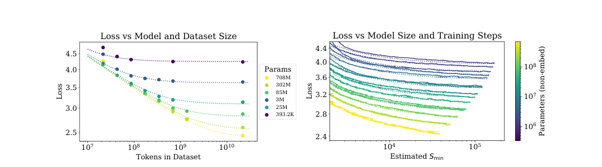
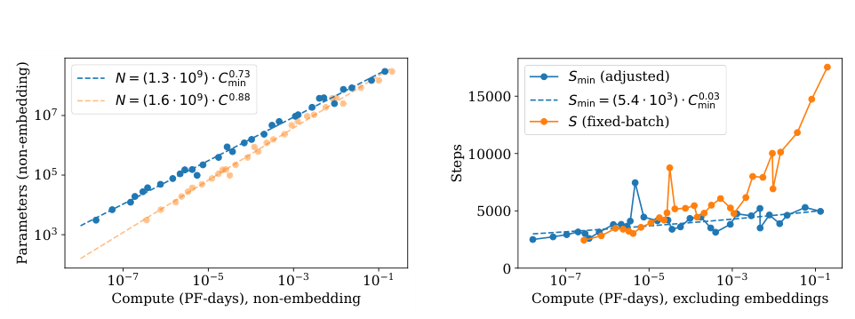

# Kaplan：语言模型缩放定律

中文 | [English](./Kaplan-Scaling-Laws-for-Neural-Language-Models_en.md)

- **原文链接：** [论文原文](https://arxiv.org/abs/2001.08361v1)
- **发布日期：2020-01-23**

- **原论文：Scaling Laws for Neural Language Models。**

**作者：Jared Kaplan、Sam McCandlish、Tom Henighan 等；2020 年。**

- **精读版本：arXiv:2001.08361v1，2020-01-23；本文整理于 2026-11-09。**
- **原文：[摘要与版本记录](https://arxiv.org/abs/2001.08361v1)；[完整 PDF](https://arxiv.org/pdf/2001.08361v1)。**
- **阅读范围：正文第 1–8 节，以及附录 A、B、C 和与批量、学习率、拟合相关的附录 D。本文是解释与评析，不是逐字翻译，也没有复现训练。**

## 1. 先用一句话说清楚

**这篇论文发现：在它研究的语言模型与训练条件下，增加模型参数、训练数据和计算量，能让预测下一个 token 的损失按照相当平滑的规律下降；因此，小规模实验可以帮助估计大规模训练的收益。**

它最重要的贡献，不是第一次说“大模型往往更好”，而是把这句话变成了可测量、可拟合、可做预算的关系。

但论文里另一条广为流传的结论——增加预算时应该主要增加模型、相对少增加数据——需要放回 2020 年的实验条件理解。后来的 Chinchilla 论文对这一具体分配比例作了重要修正。不能把“存在可预测的缩放趋势”和“某一组缩放指数永远正确”混为一谈。

**来源：原论文第 1.1、1.2、6、8 节；关于后续修正，参见 [Chinchilla，2022，第 2–3 节](https://arxiv.org/abs/2203.15556v1)。**

## 2. 作者到底想解决什么问题？

在一笔固定的训练预算下，有几种选择：

1. 训练一个更大的模型，但只让它读一部分数据。
1. 训练一个较小的模型，让它读更多数据、训练更久。
1. 在模型大小、数据量和训练时间之间寻找中间方案。

哪种选择更划算？如果每次都直接训练一次最大模型来试错，代价太高。

作者希望先训练许多小模型，观察规律，再回答三个问题：

- 参数量增加，性能怎样变化？
- 数据量增加，性能怎样变化？
- 预算固定时，参数和训练量应该怎样分配？

**教学类比：模型大小像一个学生可使用的学习容量，数据像教材，计算像学习过程消耗的总资源。容量大但没时间学，不一定好；教材多但模型能力太有限，也会遇到瓶颈。这个类比仅解释资源约束，不是对神经网络的机制证明。**

## 3. 先分清四个量，后面才不会读偏

| 符号 | 论文中的意思 | 不应该把它当成什么 |
| --- | --- | --- |
| $`N`$ | 模型中不含词嵌入和位置嵌入的参数数量 | 不是今天模型名中的总参数口径自动等价物 |
| $`D`$ | 数据集包含的 token 数 | 不是问题数，也不是文件数 |
| $`C`$ | 估算的训练浮点运算量 | 不是 GPU 小时，也不是墙钟时间 |
| $`L`$ | 在文本分布上评测的平均交叉熵损失，单位是 nats/token | 不是具体任务的正确率，也不是人工偏好分数 |

### 3.1 “损失降低”到底意味着什么？

一个语言模型看到前文后，会为下一个 token 分配概率。真实 token 得到的概率越低，损失越大。用标准记号表达这个目标：

```math
L=-\mathbb{E}_{(x,y)\sim\mathcal{D}}\log p_\theta(y\mid x).
```

其中，$`x`$ 是前文，$`y`$ 是真实的下一个 token。这里的公式是对论文训练目标的标准化写法，不是论文新增的模型。

**教学示例：如果同一个真实 token 的概率从 0.1 提升到 0.2，它的损失会从约 2.303 降到约 1.609。这说明预测更贴近数据，但不等于某张考试卷的正确率提高了同样比例。**

### 3.2 数据集大小与“读过多少 token”也不是一回事

设每个批次包含 $`B`$ 个 token，更新 $`S`$ 步，那么训练处理量是：

```math
D_{\mathrm{seen}}=BS.
```

如果重复阅读数据，$`D_{\mathrm{seen}}`$ 会大于数据集的独立规模 $`D`$。只有在不重复数据的相应设置下，两者才可以直接对应。论文研究有限数据过拟合时的 $`D`$，不能无条件替换为“原数据集重复十个 epoch 后的总 token 数”。

作者近似估算非嵌入训练计算为：

```math
C\approx6NBS=6ND_{\mathrm{seen}}.
```

这个近似忽略了一些与上下文长度、嵌入和小算子有关的计算。论文也明确提醒，极长上下文下它可能不够准确。

**来源：第 1.3、2.1 节；附录 C。**

## 4. 实验是怎么做的？

这不是根据几个现成模型的排行榜做回归。作者自己训练了一系列模型，主动改变参数量、数据量、深宽比、上下文长度和批量。

| 项目 | 论文设置 |
| --- | --- |
| 主要架构 | 仅解码器 Transformer；另有 LSTM、循环 Transformer 对照 |
| 主要数据 | WebText2，来自经过筛选的网页文本 |
| 数据总量 | 约 2030 万篇文档、229 亿 token，另划出约 6.6 亿 token 作测试 |
| 参数范围 | 最小约 768 个、最大约 15 亿个非嵌入参数；极小模型属于探索边界 |
| 数据子集范围 | 约 2200 万至 230 亿 token |
| 常用上下文 | 1024 token |
| 主要指标 | 文本交叉熵；还测试其他文本分布上的损失 |

并非上表中每个实验点都用于所有拟合。比如只有一层的极小模型、尚未充分收敛的最大模型，会在部分幂律拟合中被排除。

**来源：第 2.2、2.3、3 节；附录 D.7。数值描述的是论文实验，不是当前推荐配置。**

## 5. 核心发现一：瓶颈由谁决定，就看谁的缩放曲线

### 5.1 参数受限时

当数据足够多、训练足够充分，主要限制来自模型容量时，作者得到：

```math
L(N)\approx\left(\frac{N_c}{N}\right)^{\alpha_N},
\qquad \alpha_N\approx0.076.
```

这里的 $`N_c`$ 是拟合出来的尺度系数，不是“应该训练这么大”的推荐参数量。

**教学计算：参数翻倍后，损失比例约为：**

```math
\frac{L(2N)}{L(N)}=2^{-0.076}\approx0.949.
```

也就是在适用区间里，参数翻倍对应损失降低约 5.1%。不是正确率翻倍，也不是每个任务都提高 5.1 个百分点。

### 5.2 数据受限时

当模型足够大，但数据有限，并通过早停选择最佳测试损失时，作者得到：

```math
L(D)\approx\left(\frac{D_c}{D}\right)^{\alpha_D},
\qquad \alpha_D\approx0.095.
```

**教学计算：数据翻倍，损失乘以** $`2^{-0.095}\approx0.936`$ **，约下降 6.4%；数据增加十倍，损失也不是减少十倍。**

### 5.3 计算受限时

在模型大小和训练过程按计算效率作适当配置后，论文得到近似关系：

```math
L(C_{\min})\propto C_{\min}^{-0.050}.
```

这里必须注意 $`C_{\min}`$ 的下标：它是作者根据批量效率做过校正、估计达到某个损失所需的最小非嵌入计算量，不完全等于未经处理的每次实验实际消耗。

**来源：第 1.2 节公式 1.1–1.3、第 3 节、第 5.1 节公式 5.5、图 13。上面的翻倍百分比是代入论文指数的教学计算。**

### 5.4 为什么幂律在图上像直线？

对 $`L(D)=KD^{-\alpha}`$ 两边取对数：

```math
\log L(D)=\log K-\alpha\log D.
```

所以在横纵轴都取对数的图里，它接近直线。斜率代表“资源成倍增长时，损失按多大比例减少”。

**这里需要横纵轴同时取对数：直线描述的是损失与资源的幂律关系，而不是损失随资源数量线性下降。**

## 6. 核心发现二：只增加一种资源，迟早会碰到另一种瓶颈

如果一直增加数据，小模型是否就能无限变好？论文的答案是否定的：固定参数量后，数据越多，改善逐渐趋缓。反过来，固定少量数据、不断增大模型，也会进入数据受限区间。



***图源：原论文图 4，PDF 第 5 页，上半页裁剪。左图每条曲线固定一个模型，横轴为数据集 token 数；右图是经过批量校正的训练步数曲线。原图与数值未重绘。***

读左图时，关注同一条曲线的右端：数据继续增加，曲线却越来越平。它不是说“更多数据有害”，而是说 **当前模型大小可能已经成为主要限制，多给教材也不再带来同等幅度的收益** 。

为同时描述参数和数据，作者提出：

```math
L(N,D)=\left[\left(\frac{N_c}{N}\right)^{\alpha_N/\alpha_D}+\frac{D_c}{D}\right]^{\alpha_D}.
```

不要急着背公式，先看两个极限：

- 数据趋于充足时，第二项消失，剩下参数限制。
- 模型趋于充足时，第一项消失，剩下数据限制。

这个表达式把两个瓶颈放进同一个模型，是一种有经验数据支持的函数假设，不是从 Transformer 的微观计算严格推出来的定理。

### 一个容易被忽略的数字区别

前面的单因素拟合使用了 $`\alpha_D\approx0.095`$；第 4.2 节联合拟合的表 2 则给出 $`\alpha_D=0.103`$、$`\alpha_N=0.076`$。联合拟合里：

```math
\frac{\alpha_N}{\alpha_D}\approx\frac{0.076}{0.103}\approx0.74.
```

因此，论文得到避免明显数据瓶颈时，数据规模约随参数量的 $`0.74`$ 次幂增加的关系。不能把不同实验拟合出来的指数随意混合，再要求所有小数精确一致。

**来源：第 4.1–4.2 节、公式 4.1–4.4、表 2、图 9。该数据配比关系不是后面“固定计算预算最优”的同一个优化问题。**

## 7. 核心发现三：固定预算时，“把小模型练到极致”可能不划算

论文观察到，大模型达到同一损失水平所需要的训练样本和更新次数通常更少。于是，计算预算有限时，与其把一个小模型训练到几乎不能再进步，不如换一个大一些的模型，训练到尚未完全收敛就停止。

这句话里的“没收敛就停止”不等于“随便训练几步就够”。它比较的是 **用同一笔计算预算能获得的最佳结果** ，不是问某个固定模型是否还有进步空间。

在论文的计算前沿估计中：

```math
N_{\mathrm{opt}}\propto C_{\min}^{0.73},
\qquad
D_{\mathrm{seen,opt}}\propto C_{\min}^{0.27}.
```

**教学计算：预算扩大十倍，这组指数对应模型约扩大** $`10^{0.73}\approx5.37`$ **倍、训练 token 量约扩大** $`10^{0.27}\approx1.86`$ **倍。二者相乘约为十倍。**



***图源：图 14，PDF 第 16 页上部裁剪。这里同时画出固定批量与经过批量校正的结果，不能把所有线都叫“直接实测的最优训练方案”。***

论文进一步估计，更多数据处理量的增长主要可由更大批量承担，而串行更新步数增长很慢。可是 **更少串行步数不自动意味着更短的实际训练时间** ：模型并行、设备利用率和通信都会影响墙钟时间。

**来源：第 5.1、6.1–6.2 节，图 12–14。上述资源倍率为指数换算，不是某次新训练的测量。**

## 8. 这篇论文为什么重要，又为什么不能当“永恒公式”？

### 8.1 它的重要性：让规模决策可以被实验检验

“我觉得再大一点会更强”变成了“在已测范围内，某个函数能解释损失变化，我们可以拿更大规模的点验证外推”。这给训练预算规划提供了一套研究方法。

### 8.2 论文自己也写出了规律会失效的理由

第 6.3 节发现，把不同拟合关系一直向极大规模延伸，会出现彼此矛盾的预测；自然语言又有不可消除的不确定性，所以损失不可能一路沿原幂律降到零。作者据此讨论了可能的失效尺度，但强调数值对指数非常敏感。

**不能把这段猜测写成“论文证明了语言模型在某个固定万亿参数阈值上达到上限”。它是远超实测区间的推测，不是规模实验结果。**

### 8.3 适用边界

1. **数据与 tokenizer 有关。** 拟合常数不是通用物理常数；换 tokenizer，损失的数值口径也会变化。
1. **架构结论有范围。** “深宽比影响弱”是在一定范围和指标下得到的，不等于架构、延迟、显存都不重要。
1. **小数据区间可能不同。** 最小数据集上的拟合较差，正则化和数据增强没有被充分优化。
1. **学习率调度会影响预算比较。** 附录 C 已承认短训练可能应使用不同学习率；Chinchilla 后来特别研究了调度长度与训练长度匹配的问题。
1. **损失不等于全部能力。** 作者在第 8 节明确把“损失改善是否转化成任务能力”留作需要进一步研究的问题。
1. **参数—数据比例不是现行配置建议。** 该论文的 $`0.73/0.27`$ 与 Chinchilla 的接近 $`0.5/0.5`$ 不一致；阅读前者时应同时理解后者为什么改变实验设计。

**来源：第 1.2、3、6.3、8 节，附录 C、D.6–D.7；[Chinchilla 第 2 节与附录 B](https://arxiv.org/pdf/2203.15556v1)。**

## 9. 核心证据速查

| 判断 | 证据类型 | 原文位置 |
| --- | --- | --- |
| 参数、数据与计算增长伴随平滑损失下降 | 训练实验 + 幂律拟合 | 第 3 节，图 1、公式 1.1–1.3 |
| 固定模型后，数据收益趋缓 | 有限数据实验 | 图 4、9，第 4 节 |
| 联合拟合的数据指数为 0.103，不是单因素的 0.095 | 拟合结果 | 表 2 与公式 1.2 |
| 固定预算最优配置偏向增加模型 | 批量校正后的前沿估计 | 第 5.1、6.1 节，图 14 |
| 收敛到底不一定最省计算 | 模型大小与训练量对比 | 图 2、12，附录 B |
| 极远外推会出现内部矛盾 | 公式外推与作者猜测 | 第 6.3 节、图 15 |
| 规律没有完整理论证明 | 作者自述限制 | 附录 C |

**以上位置均指 [2001.08361v1](https://arxiv.org/pdf/2001.08361v1)，不是后人重拟合的结果。**

## 10. 原文阅读路线

先读第 1.1 节抓住问题，再看图 4 和图 9理解瓶颈，然后读第 1.3 节统一符号，再看第 5.1 节了解批量校正。最后读图 14、第 6.3 节和附录 C：它们分别说明作者怎样分预算，以及为什么这些关系不能无限外推。

数学基础较弱时，可以先跳过附录 B 的推导，但不要跳过适用条件。

## 11. 五个复习问答

**问 1：模型参数翻倍，就意味着准确率翻倍吗？**

不意味着。论文描述的是文本交叉熵的相对变化；具体任务正确率需要另外测。

**问 2：把同一份数据重复十遍，等于数据规模扩大十倍吗？**

不等于。它增加了处理 token 数和训练量，却没有等比例增加独立的数据内容。

**问 3：既然大模型更样本高效，是不是应该选预算能装下的最大模型？**

不是。模型太大时每个 token 的计算昂贵，给定预算下可能来不及充分训练；论文讨论的是最优折中。

**问 4：为什么“数据随参数的 0.74 次幂增加”与“数据随计算的 0.27 次幂增加”不冲突？**

它们首先回答不同问题：一个关注有限数据过拟合边界，一个关注计算受限时的最优训练分配。把它们都向极大规模外推才会出现论文自己讨论的张力，不能把局部关系当成全局恒等式。

**问 5：这篇论文最值得带走的是什么？**

不是记住某个小数，而是学会先明确指标与预算，再设计规模实验，最后用留出规模验证拟合。经验规律有用，前提是知道它在什么条件下得到。
