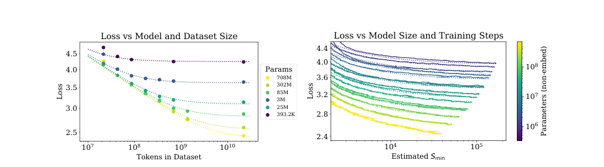
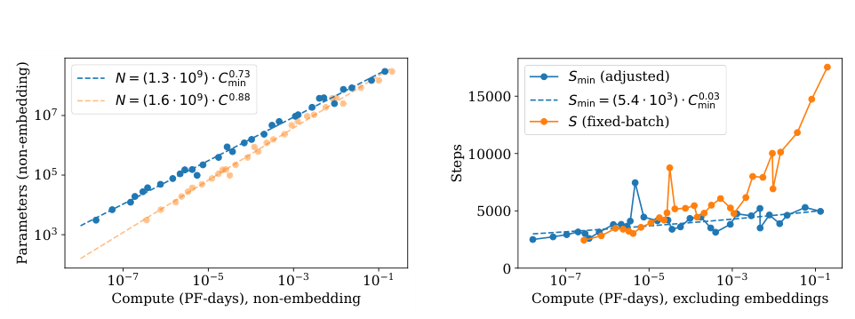

# Kaplan: Scaling Laws for Neural Language Models

[中文](./Kaplan-Scaling-Laws-for-Neural-Language-Models.md) | English

- **Source:** [Original paper](https://arxiv.org/abs/2001.08361v1)
- **Published: 2020-01-23**

- **Original paper: Scaling Laws for Neural Language Models.**

**Authors: Jared Kaplan, Sam McCandlish, Tom Henighan, and colleagues; 2020.**

- **Version examined: arXiv:2001.08361v1, 2020-01-23; this note was compiled on 2026-11-09.**
- **Original sources: [Abstract and version history](https://arxiv.org/abs/2001.08361v1); [full PDF](https://arxiv.org/pdf/2001.08361v1).**
- **Reading scope: Sections 1–8, Appendices A, B, and C, and the parts of Appendix D concerning batch size, learning rates, and fitting. This is an explanation and appraisal, not a word-for-word translation or a training reproduction.**

## 1. The paper in one sentence

**Under the language-model and training conditions studied, increasing model parameters, training data, and compute reduces next-token prediction loss according to remarkably smooth relationships; small-scale experiments can therefore help estimate the returns from larger-scale training.**

Its main contribution is not being the first to say that larger models often perform better, but turning that observation into relationships that can be measured, fitted, and used for budgeting.

Another widely repeated conclusion—that additional budget should mostly go toward model size, with relatively less growth in data—must be understood in the context of the 2020 experiments. The later Chinchilla paper substantially revised that particular allocation ratio. The existence of predictable scaling trends does not mean that one set of scaling exponents is always correct.

**Sources: Sections 1.1, 1.2, 6, and 8 of the paper; for the subsequent revision, see [Chinchilla, 2022, Sections 2–3](https://arxiv.org/abs/2203.15556v1).**

## 2. What problem are the authors trying to solve?

A fixed training budget allows several choices:

1. Train a larger model, but let it see only part of the data.
1. Train a smaller model on more data and for longer.
1. Seek an intermediate allocation of model size, data, and training time.

Which is more economical? Testing every choice by training the largest model directly would be prohibitively expensive.

The authors instead train many small models, study the trends, and ask three questions:

- How does performance change as parameter count increases?
- How does performance change as data volume increases?
- With a fixed budget, how should parameters and training volume be allocated?

**Teaching analogy: Model size resembles a student's available learning capacity, data resembles textbooks, and compute resembles the resources consumed while studying. Large capacity with no time to study may not help; plentiful textbooks with insufficient capacity also create a bottleneck. This analogy explains resource constraints, not the mechanism of neural networks.**

## 3. Distinguish four quantities before reading the results

| Symbol | Meaning in this paper | What it should not be confused with |
| --- | --- | --- |
| $`N`$ | Model parameters excluding token and positional embeddings | Not automatically the same parameter-count convention used in current model names |
| $`D`$ | Number of tokens in the dataset | Not the number of questions or files |
| $`C`$ | Estimated training floating-point operations | Not GPU-hours or wall-clock time |
| $`L`$ | Mean cross-entropy evaluated on a text distribution, in nats/token | Not task accuracy or a human preference score |

### 3.1 What does lower loss mean?

A language model assigns probabilities to the next token given preceding text. The lower the probability assigned to the actual token, the greater the loss. In standard notation, the objective is:

```math
L=-\mathbb{E}_{(x,y)\sim\mathcal{D}}\log p_\theta(y\mid x).
```

Here, $`x`$ is the context and $`y`$ is the actual next token. This is a standardized expression of the paper's training objective, not an additional model proposed by the paper.

**Teaching example: If the probability of the same actual token rises from 0.1 to 0.2, its loss falls from approximately 2.303 to 1.609. This means prediction is closer to the data, not that accuracy on an examination rises by the same proportion.**

### 3.2 Dataset size is not the same as tokens processed

If each batch contains $`B`$ tokens and training performs $`S`$ updates, the training volume is:

```math
D_{\mathrm{seen}}=BS.
```

With repeated data, $`D_{\mathrm{seen}}`$ exceeds the dataset's unique size $`D`$. The two correspond directly only in the relevant no-repetition setting. The paper's $`D`$ in its finite-data overfitting analysis cannot simply be replaced by the total tokens processed over ten epochs of the same dataset.

The authors approximate non-embedding training compute as:

```math
C\approx6NBS=6ND_{\mathrm{seen}}.
```

This approximation omits some computation associated with context length, embeddings, and smaller operations. The paper explicitly cautions that it may be inaccurate for very long contexts.

**Sources: Sections 1.3 and 2.1; Appendix C.**

## 4. How were the experiments conducted?

This is not a regression over the leaderboard scores of a few existing models. The authors train a family of models while deliberately varying parameter count, data volume, aspect ratio, context length, and batch size.

| Item | Paper setting |
| --- | --- |
| Main architecture | Decoder-only Transformers, with LSTM and recurrent-Transformer comparisons |
| Main data | WebText2, comprising filtered web text |
| Total data | Approximately 20.3 million documents and 22.9 billion tokens, with approximately 660 million tokens set aside for testing |
| Parameter range | Approximately 768 to 1.5 billion non-embedding parameters; the tiny models explore the boundary of the range |
| Dataset-subset range | Approximately 22 million to 23 billion tokens |
| Typical context | 1024 tokens |
| Main metric | Text cross-entropy, including loss on other text distributions |

Not every experiment in these ranges contributes to every fit. For example, tiny one-layer models and the largest models that have not sufficiently converged are excluded from some power-law fits.

**Sources: Sections 2.2, 2.3, and 3; Appendix D.7. These numbers describe the experiments, not current recommended configurations.**

## 5. Finding one: identify the limiting resource before reading its scaling curve

### 5.1 When parameters are limiting

With sufficient data and training, when model capacity is the main constraint, the authors obtain:

```math
L(N)\approx\left(\frac{N_c}{N}\right)^{\alpha_N},
\qquad \alpha_N\approx0.076.
```

Here, $`N_c`$ is a fitted scale coefficient, not a recommendation to train a model of that size.

**Teaching calculation: Doubling parameters gives an approximate loss ratio of:**

```math
\frac{L(2N)}{L(N)}=2^{-0.076}\approx0.949.
```

Within the applicable range, doubling parameters therefore reduces loss by approximately 5.1%. It does not double accuracy or improve every task by 5.1 percentage points.

### 5.2 When data is limiting

For sufficiently large models with limited data, using early stopping to select the best test loss, the authors obtain:

```math
L(D)\approx\left(\frac{D_c}{D}\right)^{\alpha_D},
\qquad \alpha_D\approx0.095.
```

**Teaching calculation: Doubling data multiplies loss by** $`2^{-0.095}\approx0.936`$ **, a decrease of approximately 6.4%; ten times more data does not reduce loss tenfold.**

### 5.3 When compute is limiting

With model size and training configured appropriately for compute efficiency, the paper obtains:

```math
L(C_{\min})\propto C_{\min}^{-0.050}.
```

The subscript in $`C_{\min}`$ matters: this is an estimate of the minimum non-embedding compute required to reach a loss, adjusted for batch-size efficiency, not simply the unadjusted compute consumed by each experimental run.

**Sources: Equations 1.1–1.3 in Section 1.2, Section 3, Equation 5.5 in Section 5.1, and Figure 13. The doubling percentages above are teaching calculations using the paper's exponents.**

### 5.4 Why does a power law look straight on a plot?

Taking logarithms of $`L(D)=KD^{-\alpha}`$ gives:

```math
\log L(D)=\log K-\alpha\log D.
```

It is therefore approximately straight when both axes are logarithmic. Its slope describes the proportional reduction in loss as resources grow multiplicatively.

**Both axes must be logarithmic here: the straight line describes a power-law relationship between loss and resources, not a linear decrease in loss with resource quantity.**

## 6. Finding two: expanding only one resource eventually reveals another bottleneck

Can a small model improve indefinitely if more data is added? The paper's answer is no: with parameter count fixed, additional data produces progressively smaller improvements. Conversely, continually increasing model size with a small fixed dataset enters a data-limited regime.



***Figure source: Original Figure 4, cropped from the upper half of PDF page 5. Each left-hand curve fixes a model and varies dataset tokens; the right panel shows batch-adjusted training-step curves. The original figures and values are not redrawn.***

In the left panel, focus on the right end of each curve: data keeps increasing, but the curve flattens. This does not mean more data is harmful. It means **the current model size may have become the main limitation, so additional textbooks no longer yield equally large gains**.

To describe parameters and data jointly, the authors propose:

```math
L(N,D)=\left[\left(\frac{N_c}{N}\right)^{\alpha_N/\alpha_D}+\frac{D_c}{D}\right]^{\alpha_D}.
```

Rather than memorizing it immediately, consider two limits:

- As data becomes abundant, the second term disappears, leaving the parameter limitation.
- As model capacity becomes abundant, the first term disappears, leaving the data limitation.

This expression combines two bottlenecks in one model. It is an empirically supported functional hypothesis, not a theorem derived rigorously from the Transformer's microscopic computation.

### An easily missed numerical distinction

The earlier single-factor fit uses $`\alpha_D\approx0.095`$, whereas the joint fit in Table 2 of Section 4.2 gives $`\alpha_D=0.103`$ and $`\alpha_N=0.076`$. For that joint fit:

```math
\frac{\alpha_N}{\alpha_D}\approx\frac{0.076}{0.103}\approx0.74.
```

The paper thus obtains a relationship in which data grows approximately as parameter count to the power $`0.74`$ to avoid a substantial data bottleneck. Exponents from different fits should not be mixed while expecting every decimal to remain exactly consistent.

**Sources: Sections 4.1–4.2, Equations 4.1–4.4, Table 2, and Figure 9. This data-allocation relationship solves a different problem from the later fixed-compute optimum.**

## 7. Finding three: pushing a small model to its limit may waste a fixed budget

The paper finds that larger models typically reach the same loss with fewer training examples and updates. Under a compute constraint, it may therefore be better to train a somewhat larger model and stop short of full convergence than to keep training a smaller one until almost no improvement remains.

Stopping before convergence does not mean a few arbitrary updates suffice. The comparison is about **the best result obtainable with the same compute budget**, not whether a particular fixed model has room to improve.

The paper's estimated compute frontier gives:

```math
N_{\mathrm{opt}}\propto C_{\min}^{0.73},
\qquad
D_{\mathrm{seen,opt}}\propto C_{\min}^{0.27}.
```

**Teaching calculation: With ten times the budget, these exponents imply approximately** $`10^{0.73}\approx5.37`$ **times the model size and** $`10^{0.27}\approx1.86`$ **times the training tokens. Their product is approximately ten.**



***Figure source: Figure 14, cropped from the upper part of PDF page 16. Fixed-batch and batch-adjusted results are both shown; not every line represents a directly measured optimal training configuration.***

The paper further estimates that most growth in tokens processed can be accommodated through larger batches, with serial update counts growing slowly. However, **fewer serial updates do not automatically mean shorter wall-clock training time**: model parallelism, device utilization, and communication all matter.

**Sources: Sections 5.1 and 6.1–6.2, Figures 12–14. The resource multipliers are exponent conversions, not measurements from a new training run.**

## 8. Why is the paper important, and why is it not an eternal formula?

### 8.1 Its importance: scale decisions become experimentally testable

The intuition that a larger model might be stronger becomes a statement that a function explains observed loss changes and can be tested on larger held-out scales. This provides a research method for planning training budgets.

### 8.2 The paper itself explains why the relationships must break down

Section 6.3 finds that extrapolating different fitted relationships to extremely large scales produces contradictory predictions. Natural language also contains irreducible uncertainty, so loss cannot follow the original power law down to zero. The authors discuss possible breakdown scales but emphasize their sensitivity to the exponents.

**This speculation must not be rewritten as proof of a fixed trillion-parameter ceiling for language models. It extrapolates far beyond the measured range; it is not a large-scale experimental result.**

### 8.3 Scope and limitations

1. **Data and tokenization matter.** The fitted constants are not universal physical constants; changing the tokenizer also changes the numerical convention for loss.
1. **Architecture claims have boundaries.** Weak sensitivity to aspect ratio in a particular range and metric does not make architecture, latency, and memory irrelevant.
1. **Small-data regimes may differ.** Fits are poorer for the smallest datasets, and regularization and data augmentation were not extensively optimized.
1. **Learning-rate schedules affect budget comparisons.** Appendix C acknowledges that shorter runs may require different learning rates; Chinchilla later explicitly studies matching schedule length to training length.
1. **Loss is not the entirety of capability.** Section 8 explicitly leaves the translation of lower loss into task improvements as a question for further work.
1. **The parameter–data ratio is not a current configuration recommendation.** The paper's $`0.73/0.27`$ differs from Chinchilla's approximately $`0.5/0.5`$; reading the former requires understanding why the latter changes the experimental design.

**Sources: Sections 1.2, 3, 6.3, and 8; Appendices C and D.6–D.7; [Chinchilla Section 2 and Appendix B](https://arxiv.org/pdf/2203.15556v1).**

## 9. Key evidence at a glance

| Claim | Evidence type | Original location |
| --- | --- | --- |
| More parameters, data, and compute accompany smooth loss improvements | Training experiments and power-law fits | Section 3, Figure 1, Equations 1.1–1.3 |
| Data yields diminishing returns with a fixed model | Finite-data experiments | Figures 4 and 9, Section 4 |
| The joint data exponent is 0.103 rather than the single-factor 0.095 | Fitted result | Table 2 and Equation 1.2 |
| The fixed-budget optimum favors model growth | Batch-adjusted frontier estimate | Sections 5.1 and 6.1, Figure 14 |
| Training to convergence is not necessarily compute-efficient | Comparisons of model size and training volume | Figures 2 and 12, Appendix B |
| Very distant extrapolation creates internal contradictions | Equation extrapolation and author speculation | Section 6.3, Figure 15 |
| The laws lack a complete theoretical derivation | Author-stated limitation | Appendix C |

**All locations refer to [2001.08361v1](https://arxiv.org/pdf/2001.08361v1), not subsequent refits.**

## 10. A route through the original paper

Start with Section 1.1 for the question, Figures 4 and 9 for bottlenecks, Section 1.3 for notation, and Section 5.1 for batch correction. Finish with Figure 14, Section 6.3, and Appendix C: they explain the budget allocation and why the relationships cannot be extrapolated indefinitely.

Readers with less mathematical background can initially skip the Appendix B derivations, but should not skip the assumptions.

## 11. Five review questions

**Question 1: Does doubling parameters double accuracy?**

No. The paper describes relative changes in text cross-entropy. Task accuracy must be measured separately.

**Question 2: Does repeating a dataset ten times make the dataset ten times larger?**

No. It increases processed tokens and training volume, not unique data content proportionally.

**Question 3: If larger models are more sample-efficient, should the largest affordable model always be chosen?**

No. Each token is more expensive for an oversized model, which may receive insufficient training under a fixed budget. The paper studies the best trade-off.

**Question 4: Why are data scaling with parameters to the power 0.74 and with compute to the power 0.27 not immediately contradictory?**

They answer different questions: one concerns finite-data overfitting, the other optimal training allocation under a compute constraint. Extending both to extremely large scales creates the tension the paper itself discusses. Local relationships are not global identities.

**Question 5: What is the most useful lesson?**

Not memorizing a decimal, but defining the metric and budget, designing scaling experiments, and testing fits on held-out scales. Empirical relationships are useful only with an understanding of the conditions under which they were obtained.
