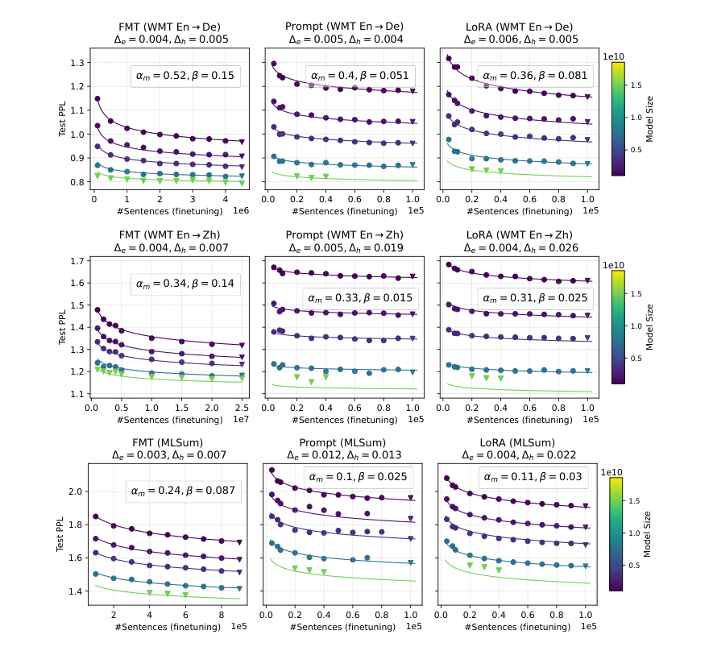

# 微调缩放规律：数据、模型与方法

中文 | [English](./LLM-Finetuning-Scaling-Laws_en.md)

- **原文链接：** [论文原文](https://arxiv.org/abs/2402.17193v1)
- **发布日期：2024-02-27**

- **原论文：When Scaling Meets LLM Finetuning: The Effect of Data, Model and Finetuning Method。**

**作者：Biao Zhang、Zhongtao Liu、Colin Cherry、Orhan Firat；ICLR 2024。**

- **精读版本：arXiv:2402.17193v1，2024-02-27；整理日期：2026-11-09。**
- **原文：[版本化摘要](https://arxiv.org/abs/2402.17193v1)；[完整 PDF](https://arxiv.org/pdf/2402.17193v1)。**
- **阅读范围：完整正文及附录的超参数、拟合系数、生成质量、留出检验和少样本迁移结果。本文解释证据与边界，不是逐字翻译，没有训练复现。**

## 1. 一句话结论

**这篇论文不是问“大模型预训练怎么分预算”，而是问“已经有了预训练模型，微调效果会怎样随数据量、模型大小和微调方法变化”。作者发现：这些因素之间可以拟合出规律，但不同任务、不同微调方法的规律并不一样。**

所以，它没有给出一个“LoRA 永远最好”或“只要多喂数据就一定追上”的简单答案。

**来源：摘要、第 1、4、5、7 节。**

## 2. 先认识三个微调方法

### 2.1 全参数微调：整台机器都允许调

Full-Model Tuning，简称 FMT，允许更新模型的全部参数。它的调整空间很大，但也可能更容易改变原有行为。

### 2.2 Prompt Tuning：模型不动，只学一段输入向量

这里的 Prompt 不是让人手写更长的提示词，而是在输入前放一段 **可训练的连续向量** ，通常叫 soft prompt。基础模型参数保持不变，只更新这段向量。

### 2.3 LoRA：模型主体不动，学习一个低秩修正

原始权重为 $`W`$，微调后使用：

```math
W'=W+BA.
```

其中 $`A`$、$`B`$ 是较小的可训练矩阵；低秩维度 $`r`$ 控制修正的自由度。提高 $`r`$，通常会增加可训练参数，但不等于基础模型本身变大。

本文把 Prompt 与 LoRA 都归入参数高效微调 PET。后文一定要分清 **扩大基础模型** 和 **扩大附加可训练模块** 这两个旋钮。

**来源：第 2 节 Finetuning Settings。**

## 3. 作者具体做了哪些实验？

作者预训练了英德与英中两组双语模型，使用仅解码器 Transformer、多查询注意力和修改后的 UL2 目标，再将它们用于下游微调。

| 实验维度 | 扫描范围或设置 |
| --- | --- |
| 基础模型大小 | 1B、2B、4B、8B、16B |
| 预训练数据规模 | 英德约 84B–283B token；英中约 84B–206B token |
| Prompt 长度 | 50–600 个可训练向量位置 |
| LoRA 秩 | 4–128 |
| PET 微调数据 | 8000–10 万个样本 |
| FMT 英德翻译 | 10 万–450 万个样本 |
| FMT 英中翻译 | 100 万–2500 万个样本 |
| FMT 多语言摘要 | 10 万–90 万个样本 |

**来源：表 1。正文有“up to 20M”的概述，但表 1 明确包含 25M 英中样本设置；此处采用实验设置表的范围。B 表示十亿，M 表示百万。**

关键控制条件是：除模型大小实验外，其他缩放实验主要基于相应的 **1B 模型** 。它并不是把所有维度随意组合成一个大网格。

为了减少随机抽样噪声，每个设置使用三个不同的微调数据随机子集运行，并报告平均结果。选择检查点时看开发集表现，拟合缩放规律时看测试指标。

**来源：第 2 节 Evaluation。**

### 3.1 这里到底评测什么？

- 缩放拟合使用论文标为 **Test PPL** 的量，越低越好。
- 翻译实际生成质量使用 **BLEURT** ，不是 BLEU。
- 摘要生成质量使用 **RougeL** ，越高越好。
- 生成时采用贪心解码。

**重要的原文口径提醒：标准困惑度通常写成** $`\mathrm{PPL}=\exp(L_{\mathrm{CE}})`$ **，因此不小于 1；但本文一些标为 Test PPL 的图出现了小于 1 的刻度。本次阅读没有找到足以消除这个差异的归一化定义。因此下面把它谨慎称为“论文的拟合损失指标”，不擅自认定它就是未经变换的标准 PPL，也不把它改叫交叉熵。**

**来源：第 2 节 Evaluation、图 1–3；标准 PPL 与图中数值范围的比较属于阅读核对，不是对作者实现错误的确定诊断。**

## 4. 核心公式：两个因素不是简单相加，而是共同影响可改善部分

作者以微调数据量 $`D_f`$ 为中心，每次再选择另一个因素 $`X`$，提出：

```math
\widehat L(X,D_f)=E+\frac{A}{X^\alpha D_f^\beta}.
```

| 符号 | 含义 |
| --- | --- |
| $`D_f`$ | 微调数据中的样本数量 |
| $`X`$ | 当前实验的另一项资源：基础模型大小、预训练 token 量，或 PET 模块大小 |
| $`E`$ | 在这个拟合形式中的剩余下限项 |
| $`A`$ | 尺度系数 |
| $`\alpha`$ | $`X`$ 扩大时，可改善部分下降的速度 |
| $`\beta`$ | 微调数据增加时，可改善部分下降的速度 |

**最重要的限定：$`X`$ 每次代表一个因素。论文没有证明模型量、预训练量、LoRA 参数量和微调数据量四者同时服从同一个四维公式。**

### 4.1 不背公式，先看它怎么用

令可改善部分为：

```math
R(X,D_f)=\widehat L(X,D_f)-E.
```

基础模型或其他资源翻倍时：

```math
R(2X,D_f)=2^{-\alpha}R(X,D_f).
```

微调数据翻倍时：

```math
R(X,2D_f)=2^{-\beta}R(X,D_f).
```

因此，指数较大意味着“同样成倍增加这一资源，可改善部分缩小得更快”。它不等于 BLEURT 或正确率提高同样比例。

### 4.2 一个取自拟合系数的教学例子

在英德翻译的 FMT 模型规模实验中，表 4 给出 $`\alpha_m=0.52`$、$`\beta=0.15`$。

**教学计算，而不是新实验：**

```math
2^{-0.52}\approx0.697,\qquad 2^{-0.15}\approx0.901.
```

按该拟合，模型翻倍会让可改善部分约缩小 30.3%，数据翻倍约缩小 9.9%。但 **这不是同成本比较** ：基础模型翻倍和增加同倍微调样本，训练及推理成本并不相等。不能据此推出“买大模型总比标数据划算”。

**来源：公式 1、图 2、表 4。计算仅演示指数的意义，且只讨论 $`L-E`$。**

## 5. 为什么作者选择乘法式？它真的全面胜过加法式吗？

作者也比较了类似 Chinchilla 的加法形式：

```math
\widehat L_{\mathrm{add}}(X,D_f)=E+\frac{A}{X^\alpha}+\frac{B}{D_f^\beta}.
```

乘法式将两种资源放进同一个可改善项；加法式则为两种资源分别保留一个误差项。作者依据拟合点与留出点的误差来比较它们，而不是只用直觉判断。

英德实验的表 2中，模型规模维度平均留出误差为：乘法式 0.0048，加法式 0.0079；预训练数据维度则是 0.0068 与 0.0069，差距很小。

但精读不能停在“乘法式更好”这句口号。附录表 6 中，MLSum 的三类缩放平均误差反而都是加法式更低：

| MLSum 缩放因素 | 乘法式平均留出误差 | 加法式平均留出误差 |
| --- | --- | --- |
| 模型大小 | 0.014 | 0.013 |
| 预训练数据量 | 0.007 | 0.005 |
| PET 参数量 | 0.0055 | 0.004 |

**更准确的结论是：两种形式都能描述不少实验，乘法式在部分设置中略有优势，因此作者选它继续分析；不能把它当作任何微调任务都必须遵循的唯一形式。**

**来源：第 3 节、表 2、附录表 6。上述反例直接来自论文表格，不是另一次研究。**

## 6. 主要结果之一：更好的基础模型，往往比多加一点可训练参数更重要

作者发现，在所测任务中，扩大基础模型的缩放指数通常大于增加预训练 token 的指数。例如英德 FMT 中，模型指数约 0.52，预训练数据指数约 0.21。

这支持一个局部结论： **对这些翻译与摘要任务，较大的基础模型通常提供更好的微调起点。**

但不能把它改写为“预训练数据不重要”：预训练数据实验使用中间检查点作为代理，作者承认这不是在每个数据预算上单独优化的最佳模型；任务又比较偏向闭合式生成，可能没有体现开放知识生成对数据覆盖的需求。

**来源：第 2、4 节、图 2–3、表 4。**

### 6.1 提高 LoRA 秩，为什么没有同样明显的收益？

表 4 中 PET 大小的拟合指数非常接近零。例如，英德 LoRA 的指数为 $`-0.0017`$，英中 LoRA 为 $`0.0044`$，远小于相关的基础模型规模指数。

直觉上： **增加基础模型的能力储备，和给同一个模型更多微调自由度，不是同一回事。** 如果限制不在低秩修正的容量上，继续提高秩未必有效；Prompt 过长还可能变得更难优化。

作者确实观察到部分配置的轻微逆向趋势，但这里不能推出“LoRA 秩越大越差”或“低秩永远足够”。这些结论受限于 1B 基座、具体任务、数据与超参数范围。

**来源：第 4 节、图 4、表 4。**

## 7. 主要结果之二：全参数微调更能利用大数据，但没有普适赢家

在表 4 的三个任务中，FMT 的数据指数 $`\beta`$ 分别为 0.15、0.14、0.087，均高于相应 PET 的数据指数。作者据此认为，FMT 更“吃数据”，也更能从数据规模增加中获得收益。

这里“吃数据”有两面：小数据时，大调整空间可能难以用好；数据充分时，同样的调整空间又可能成为优势。

LoRA 的数据缩放一般优于 Prompt；而只用少量数据时，Prompt 也可能有竞争力。因此，不同曲线之间可能存在交叉点。



***图源：原论文图 2，PDF 第 5 页裁剪。每列一种微调方法、每行一种任务。横轴和坐标量级并不统一，不能把图中的横向距离直接当成等数据、等成本比较。***

### 7.1 图 5 的“临界数据量”是什么性质？

作者用拟合函数求解不同方法预测性能相等的位置，从而得到在何种数据量下可能更适合某方法。

**这些临界点属于拟合外推，不是作者在每个临界数据量都实际训练过。** 某些预测远超实际 PET 数据扫描范围，不能把它们当成已经实测确认的精确阈值。

附录公式 3还分析了一个特殊情况：两方法损失差固定为各自下限项之差。这个条件不一定等于零，所以它不是任意两方法“性能恰好相等”的通用闭式解。

**来源：第 5 节、图 5，以及附录 Analyzing the critical finetuning data size。**

## 8. 主要结果之三：目标任务进步，不等于其他能力一起进步

作者还检查了相关语言方向的迁移：例如在英中翻译上微调后，再测法语、德语、印地语等到中文的翻译。

在这些相关任务上，Prompt 与 LoRA 通常比 FMT 更能保留迁移表现。附录的少样本生成实验也观察到，FMT 更容易损害原有少样本行为，而 PET 相对稳健。

但这是 **特定的相关翻译方向与少样本设置** ，不是全面的通用能力保持实验，更不能写成“LoRA 保证不会遗忘”。

**来源：第 5 节、图 6，附录图 11–14。**

## 9. 读论文时，最值得注意的五个限制

### 9.1 有留出数据，不代表全是远距离外推

作者留出了模型 16B、部分较大微调数据与 PET 配置来检验预测；但预训练数据轴上有些留出点位于已有范围内。因此，其中既有外推，也有插值。不能把所有“held-out error”都叫“超大规模外推误差”。

### 9.2 16B 真的出现了预测偏差

图 2 的英中任务中，Prompt 与 LoRA 在 16B 留出点上的误差明显增大。作者认为可能与可拟合模型规模点较少，以及该 16B 预训练模型的不稳定有关，附录图 10给出了预训练偏离趋势的证据。

这正是缩放研究应该报告的失败案例：预测不准时，不应该只画漂亮的平均趋势。

### 9.3 不同方法不是等计算预算比较

FMT 与 PET 扫描的数据范围不同。附录优化设置还使用不同的学习率与批量，训练受最大 epoch 和最大步数共同限制。论文主要研究性能随资源变量的变化，不是给出经过完全等成本控制的商业性价比排行。

### 9.4 拟合指标与生成质量不是一一对应

表 7 多数设置中，两者相关性较强，但英德 FMT 的模型规模实验相关系数只有 $`-0.184`$，且没有该表的显著性标记。不能说“损失降低多少，翻译质量就必然提高多少”。

### 9.5 模型家族与任务覆盖有限

结果来自特定双语模型及翻译、摘要任务，没有实验覆盖当前各种模型家族、长程智能体、数学推理 RL 或学生前缀蒸馏。

**来源：表 1、4、7，第 2、4–5 节，附录优化设置及图 10。**

## 10. 核心证据与阅读路线

| 主张 | 证据类型 | 原文位置 |
| --- | --- | --- |
| 微调数据与另一因素可联合拟合 | 多规模实验 + 函数拟合 | 公式 1、第 3–4 节 |
| 乘法形式不是所有任务逐项更优 | 留出误差对照 | 表 2、附录表 6 |
| 基础模型规模收益常强于预训练量 | 不同资源轴的拟合系数 | 图 2–3、表 4 |
| 增大 PET 模块收益有限 | 秩与 Prompt 长度扫描 | 图 4、表 4 |
| FMT 的数据缩放更强 | 各方法的数据指数 | 表 4 |
| 16B 存在外推失败 | 留出点与原模型分析 | 图 2、附录图 10 |
| PET 较能保留相关迁移行为 | 零/少样本实验 | 图 6、附录图 11–14 |

**建议先读第 2 节和表 1明确实验范围，再看公式 1与图 2–4，之后读图 5；最后对照附录表 6、7及图 10。后半部分用于核对正文概括的适用范围和例外。**

## 11. 五个复习问答

**问 1：这里的 Prompt Tuning 就是提示词工程吗？**

不是。它训练的是连续向量参数，而不只是改写自然语言提示。

**问 2：$`X`$ 同时包含模型、预训练数据和 LoRA 参数吗？**

不是。每次联合分析是微调数据量与其中一个因素。

**问 3：指数大，就一定更省钱吗？**

不一定。指数衡量相对规模变化带来的指标变化；不同资源的真实成本不同。

**问 4：乘法式赢过加法式，已经是定理了吗？**

不是。甚至本文自己的部分留出表格里，加法式误差更小。

**问 5：论文的留出检验是否都能准确预测更大模型？**

不是。英中任务的 16B 模型在 Prompt 和 LoRA 设置下出现了明显偏差。作者将其与拟合尺度有限及基础模型的预训练不稳定联系起来，说明拟合规律仍有适用边界。
