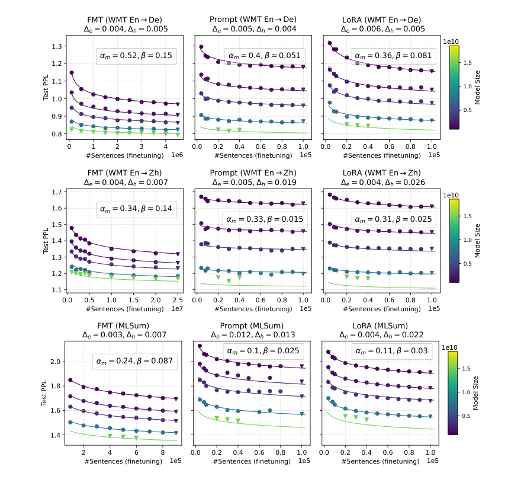

# Finetuning Scaling Laws: Data, Models, and Methods

[中文](./LLM-Finetuning-Scaling-Laws.md) | English

- **Source:** [Original paper](https://arxiv.org/abs/2402.17193v1)
- **Published: 2024-02-27**

- **Original paper: When Scaling Meets LLM Finetuning: The Effect of Data, Model and Finetuning Method.**

**Authors: Biao Zhang, Zhongtao Liu, Colin Cherry, and Orhan Firat; ICLR 2024.**

- **Version examined: arXiv:2402.17193v1, 2024-02-27; compiled on 2026-11-09.**
- **Original sources: [Versioned abstract](https://arxiv.org/abs/2402.17193v1); [full PDF](https://arxiv.org/pdf/2402.17193v1).**
- **Reading scope: The complete main text and appendix material on hyperparameters, fitted coefficients, generation quality, held-out validation, and few-shot transfer. This note explains the evidence and its boundaries; it is not a word-for-word translation or a training reproduction.**

## 1. The conclusion in one sentence

**Rather than asking how to budget pretraining, this paper asks how finetuning performance changes with data volume, model size, and finetuning method once a pretrained model exists. These factors can follow fitted relationships, but the relationships differ across tasks and methods.**

It therefore offers no simple answer such as LoRA always being best or additional data inevitably closing every gap.

**Sources: The abstract and Sections 1, 4, 5, and 7.**

## 2. Three finetuning methods

### 2.1 Full-model tuning: adjust the entire model

Full-Model Tuning, or FMT, updates all model parameters. Its large adjustment space can be useful but may also change existing behavior more readily.

### 2.2 Prompt tuning: freeze the model and learn input vectors

Prompt tuning does not mean manually writing longer prompts. It prepends **trainable continuous vectors**, usually called a soft prompt. The base-model parameters remain fixed; only these vectors are updated.

### 2.3 LoRA: freeze the main model and learn a low-rank correction

For original weights $`W`$, finetuning uses:

```math
W'=W+BA.
```

Here $`A`$ and $`B`$ are smaller trainable matrices, and the rank $`r`$ controls the correction's degrees of freedom. Raising $`r`$ generally increases trainable parameters but does not enlarge the base model itself.

The paper groups Prompt and LoRA under parameter-efficient tuning, or PET. **Enlarging the base model** and **enlarging the added trainable module** must be treated as separate controls.

**Source: Finetuning Settings in Section 2.**

## 3. What experiments did the authors run?

The authors pretrain English–German and English–Chinese bilingual models using decoder-only Transformers, multi-query attention, and a modified UL2 objective, then finetune them on downstream tasks.

| Experimental dimension | Range or setting |
| --- | --- |
| Base-model size | 1B, 2B, 4B, 8B, 16B |
| Pretraining data | Approximately 84B–283B tokens for English–German and 84B–206B for English–Chinese |
| Prompt length | 50–600 trainable vector positions |
| LoRA rank | 4–128 |
| PET finetuning data | 8,000–100,000 examples |
| FMT English–German translation | 100,000–4.5 million examples |
| FMT English–Chinese translation | 1 million–25 million examples |
| FMT multilingual summarization | 100,000–900,000 examples |

**Source: Table 1. The prose summarizes the range as up to 20M, but Table 1 explicitly includes a 25M English–Chinese setting. This note uses the experimental table. B denotes billion and M million.**

A key control is that, outside the model-size experiments, the other scaling experiments mainly use the corresponding **1B model**. The study does not arbitrarily combine all dimensions into one enormous grid.

To reduce sampling noise, each configuration is run on three different random subsets of finetuning data and the results are averaged. Checkpoints are selected by development-set performance; scaling fits use test metrics.

**Source: Evaluation in Section 2.**

### 3.1 What exactly is evaluated?

- Scaling fits use the quantity labeled **Test PPL**, for which lower is better.
- Translation generation quality uses **BLEURT**, not BLEU.
- Summarization quality uses **RougeL**, for which higher is better.
- Generation uses greedy decoding.

**Important measurement caveat: Standard perplexity is usually written as** $`\mathrm{PPL}=\exp(L_{\mathrm{CE}})`$ **and is at least 1, yet some plots labeled Test PPL show values below 1. This reading did not locate a normalization definition sufficient to resolve the discrepancy. The discussion therefore cautiously calls it the paper's fitted loss metric, without assuming untransformed standard PPL or relabeling it cross-entropy.**

**Sources: Evaluation in Section 2 and Figures 1–3. Comparing standard PPL with the plotted range is a reading check, not a definitive diagnosis of an implementation error.**

## 4. The core equation: two factors jointly influence the reducible part

The authors center each analysis on finetuning data $`D_f`$ and select one other factor $`X`$:

```math
\widehat L(X,D_f)=E+\frac{A}{X^\alpha D_f^\beta}.
```

| Symbol | Meaning |
| --- | --- |
| $`D_f`$ | Number of finetuning examples |
| $`X`$ | The other resource in the experiment: base-model size, pretraining tokens, or PET-module size |
| $`E`$ | The residual lower-bound term in this fitted form |
| $`A`$ | Scale coefficient |
| $`\alpha`$ | Rate at which the reducible part decreases as $`X`$ grows |
| $`\beta`$ | Rate at which the reducible part decreases as finetuning data grows |

**The crucial limitation is that $`X`$ denotes one factor at a time. The paper does not establish a single four-dimensional equation jointly covering model size, pretraining volume, LoRA parameters, and finetuning data.**

### 4.1 Interpret the equation before memorizing it

Define the reducible part as:

```math
R(X,D_f)=\widehat L(X,D_f)-E.
```

Doubling the base model or other resource gives:

```math
R(2X,D_f)=2^{-\alpha}R(X,D_f).
```

Doubling finetuning data gives:

```math
R(X,2D_f)=2^{-\beta}R(X,D_f).
```

A larger exponent therefore means a larger proportional decrease in the reducible part for the same multiplicative resource increase. It does not mean an equal proportional improvement in BLEURT or accuracy.

### 4.2 A teaching example using fitted coefficients

For the English–German FMT model-size experiment, Table 4 gives $`\alpha_m=0.52`$ and $`\beta=0.15`$.

**Teaching calculation, not a new experiment:**

```math
2^{-0.52}\approx0.697,\qquad 2^{-0.15}\approx0.901.
```

Under this fit, doubling the model shrinks the reducible part by approximately 30.3%, while doubling data shrinks it by approximately 9.9%. But **this is not an equal-cost comparison**: doubling the base model and doubling finetuning examples entail different training and inference costs. It does not follow that acquiring a larger model always beats labeling more data.

**Sources: Equation 1, Figure 2, and Table 4. The calculation illustrates the exponents and concerns only $`L-E`$.**

## 5. Why choose the multiplicative form, and does it always beat the additive form?

The authors also compare an additive form resembling Chinchilla's:

```math
\widehat L_{\mathrm{add}}(X,D_f)=E+\frac{A}{X^\alpha}+\frac{B}{D_f^\beta}.
```

The multiplicative form places the two resources in one reducible term; the additive form retains a separate error term for each. The authors compare fitting and held-out errors rather than deciding purely by intuition.

For English–German in Table 2, mean held-out errors on the model-size dimension are 0.0048 for the multiplicative form and 0.0079 for the additive form. On the pretraining-data dimension, they are 0.0068 and 0.0069, a very small difference.

Close reading should not stop at the slogan that multiplication is better. In Appendix Table 6, the additive form has lower mean errors for all three MLSum scaling dimensions:

| MLSum scaling factor | Multiplicative mean held-out error | Additive mean held-out error |
| --- | --- | --- |
| Model size | 0.014 | 0.013 |
| Pretraining data | 0.007 | 0.005 |
| PET parameters | 0.0055 | 0.004 |

**A more precise conclusion is that both forms describe many experiments, with a slight multiplicative advantage in some settings that motivates the authors' subsequent analysis. It is not the uniquely correct form for every finetuning task.**

**Sources: Section 3, Table 2, and Appendix Table 6. These counterexamples come directly from the paper's tables, not another study.**

## 6. Finding one: a better base model often matters more than a larger trainable module

Across the tasks studied, the base-model scaling exponent is typically larger than the pretraining-token exponent. For example, English–German FMT has a model exponent of approximately 0.52 versus a pretraining-data exponent of approximately 0.21.

This supports a local conclusion: **larger base models generally provide better finetuning starting points for these translation and summarization tasks**.

It should not be restated as pretraining data being unimportant. The data-scaling experiments use intermediate checkpoints as proxies, which the authors acknowledge are not independently optimized for each data budget. The relatively closed generation tasks may also underrepresent the data-coverage demands of open-ended knowledge generation.

**Sources: Sections 2 and 4, Figures 2–3, and Table 4.**

### 6.1 Why are LoRA-rank gains less pronounced?

The fitted PET-size exponents in Table 4 are near zero: English–German LoRA is $`-0.0017`$ and English–Chinese LoRA is $`0.0044`$, far smaller than the corresponding base-model exponents.

Intuitively, **expanding a base model's capabilities differs from giving the same model more finetuning freedom**. If low-rank correction capacity is not the bottleneck, more rank may not help; longer soft prompts may also become harder to optimize.

Some configurations exhibit slight inverse trends, but this does not establish that greater LoRA rank is always worse or that low rank always suffices. The conclusions are limited to the 1B base models, tasks, data, and hyperparameter ranges studied.

**Sources: Section 4, Figure 4, and Table 4.**

## 7. Finding two: full-model tuning uses large datasets better, without a universal winner

Across the three tasks in Table 4, FMT's data exponents $`\beta`$ are 0.15, 0.14, and 0.087, each higher than its PET counterparts. The authors interpret FMT as more data-hungry and better able to benefit from additional finetuning data.

Data hunger has two sides: a large adjustment space may be difficult to use with little data, but can become an advantage when data is abundant.

LoRA generally scales better with data than Prompt, while Prompt can remain competitive at small data sizes. Different performance curves can therefore intersect.



***Figure source: Original Figure 2, cropped from PDF page 5. Columns represent methods and rows tasks. X-axis ranges and scales differ, so horizontal distances are not directly comparable in data volume or cost.***

### 7.1 What kind of evidence are the critical data sizes in Figure 5?

The authors solve for where fitted performance functions for different methods are equal, estimating which method might suit a given data volume.

**These thresholds are fitted extrapolations, not experiments at every predicted crossover.** Some lie far outside the measured PET data range and should not be treated as precisely validated thresholds.

Appendix Equation 3 analyzes a special case where the difference between two methods' losses equals the difference between their lower-bound terms. That condition need not be zero, so it is not a general closed-form solution for equal performance between arbitrary methods.

**Sources: Section 5, Figure 5, and the appendix discussion Analyzing the critical finetuning data size.**

## 8. Finding three: progress on the target task need not preserve other capabilities

The authors also examine related translation directions: after English–Chinese finetuning, for example, they test translation from French, German, Hindi, and other languages into Chinese.

Prompt and LoRA generally preserve transfer performance better than FMT on these related tasks. Appendix few-shot-generation experiments likewise find that FMT more readily damages existing few-shot behavior, while PET is more robust.

These are **specific related translation directions and few-shot settings**, not comprehensive tests of general capability retention. They do not guarantee that LoRA never forgets.

**Sources: Section 5, Figure 6, and Appendix Figures 11–14.**

## 9. Five important limitations

### 9.1 Held-out validation is not always distant extrapolation

The authors hold out 16B models and some larger finetuning-data and PET settings, but some held-out pretraining-data points fall within the observed range. The validation therefore combines interpolation and extrapolation; not every held-out error measures ultra-large-scale extrapolation.

### 9.2 The 16B prediction genuinely deviates

In Figure 2's English–Chinese task, Prompt and LoRA show larger errors at the held-out 16B point. The authors suggest the limited number of fitting scales and instability of that 16B pretrained model as explanations; Appendix Figure 10 shows deviations in pretraining performance.

This is precisely the kind of failure a scaling study should report, rather than displaying only attractive average trends.

### 9.3 Methods are not compared at equal compute

FMT and PET use different data ranges. Appendix optimization settings also use different learning rates and batch sizes, with training capped by both epochs and steps. The study concerns performance as resource variables change, not a fully equal-cost commercial value ranking.

### 9.4 The fitted metric and generation quality are not in one-to-one correspondence

Table 7 usually shows strong correlation, but English–German FMT's model-scaling experiment has a coefficient of only $`-0.184`$ and no significance marker. A given reduction in loss does not guarantee a corresponding improvement in translation quality.

### 9.5 Model-family and task coverage is limited

The results concern particular bilingual models and translation/summarization tasks. They do not experimentally cover all current model families, long-horizon agents, mathematical-reasoning RL, or student-prefix distillation.

**Sources: Tables 1, 4, and 7; Sections 2 and 4–5; appendix optimization settings and Figure 10.**

## 10. Key evidence and reading route

| Claim | Evidence type | Original location |
| --- | --- | --- |
| Finetuning data and one other factor can be fitted jointly | Multi-scale experiments and function fitting | Equation 1, Sections 3–4 |
| The multiplicative form is not best in every task and setting | Held-out error comparison | Table 2, Appendix Table 6 |
| Base-model scale often has stronger effects than pretraining volume | Fitted coefficients across resource axes | Figures 2–3, Table 4 |
| Enlarging PET modules yields limited gains | Rank and prompt-length sweeps | Figure 4, Table 4 |
| FMT scales more strongly with data | Method-specific data exponents | Table 4 |
| Extrapolation can fail at 16B | Held-out points and base-model analysis | Figure 2, Appendix Figure 10 |
| PET better preserves related transfer behavior | Zero- and few-shot experiments | Figure 6, Appendix Figures 11–14 |

**Start with Section 2 and Table 1 to establish scope, then Equation 1 and Figures 2–4, followed by Figure 5. Finish with Appendix Tables 6–7 and Figure 10 to inspect exceptions and the limits of the main claims.**

## 11. Five review questions

**Question 1: Is prompt tuning the same as prompt engineering?**

No. It trains continuous-vector parameters, not merely natural-language wording.

**Question 2: Does $`X`$ jointly denote model size, pretraining data, and LoRA parameters?**

No. Each joint analysis combines finetuning data with one other factor.

**Question 3: Does a larger exponent necessarily mean lower cost?**

No. Exponents describe metric changes under proportional scaling; the actual costs of different resources differ.

**Question 4: Is multiplicative superiority over additive scaling a theorem?**

No. Some held-out comparisons in the paper itself favor the additive form.

**Question 5: Do all held-out tests accurately predict larger models?**

No. The English–Chinese 16B models show substantial deviations for Prompt and LoRA. The authors connect these to a limited fitting range and unstable base-model pretraining, demonstrating that the fitted relationship has boundaries.
