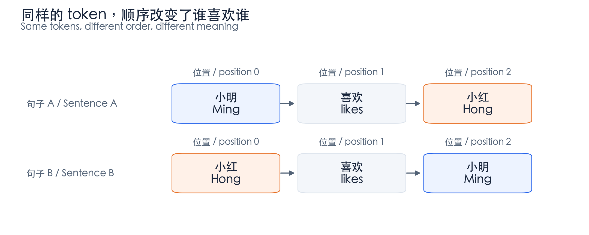
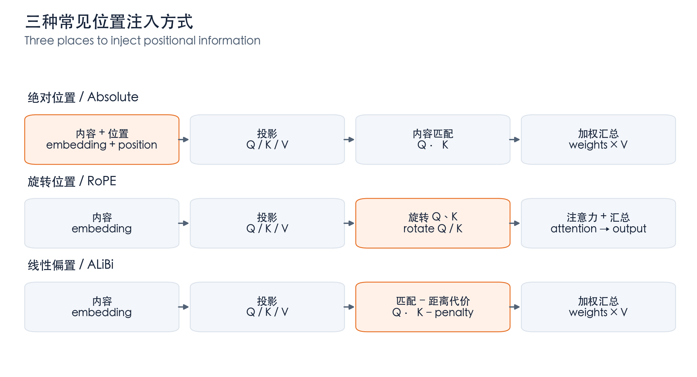
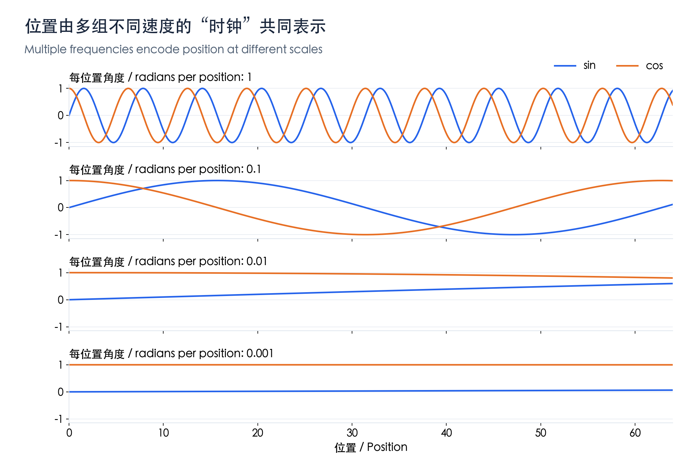
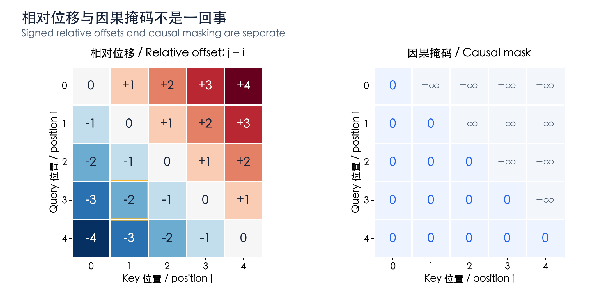
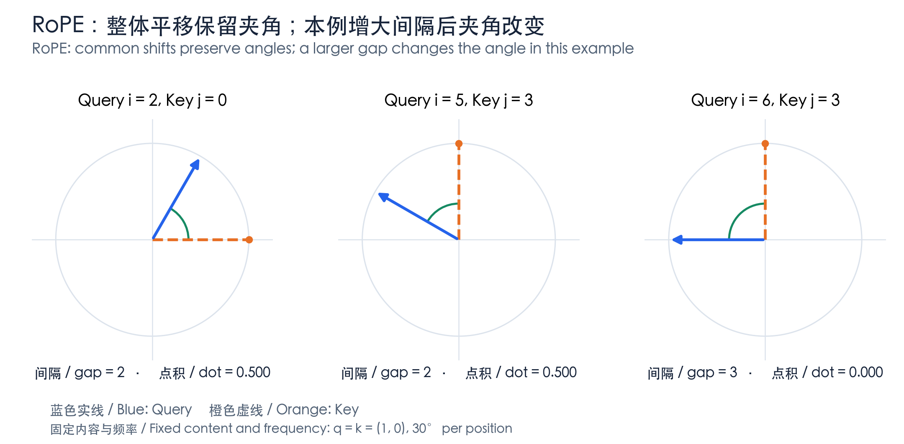
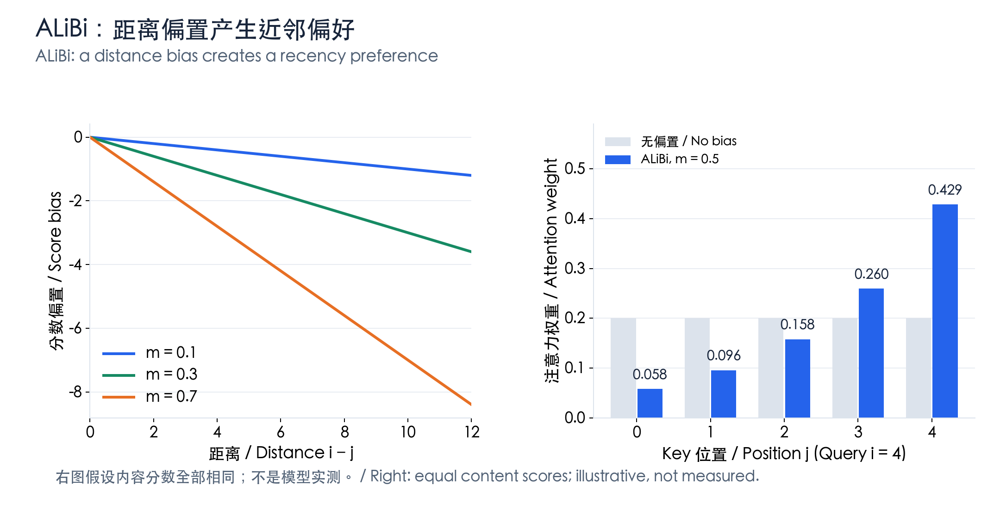
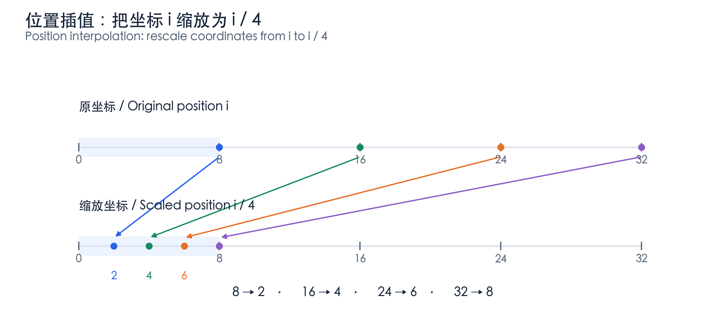
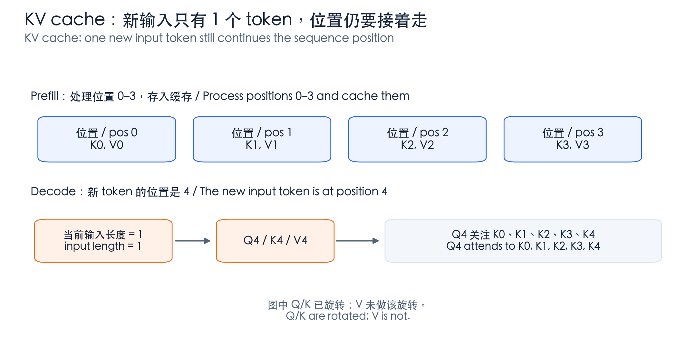

# LLM 位置编码：从直觉到 RoPE 的图解详解

中文 | [English](./LLM-Positional-Encoding-Illustrated_en.md)

- **原文链接**: **基于公开论文与实现的原创图解。** [**RoFormer**](https://arxiv.org/abs/2104.09864) · [**Transformer**](https://arxiv.org/abs/1706.03762)
- **整理日期**: 2026-11-06

本文沿着“为什么需要位置 → 把位置放在哪里 → RoPE 为什么有效 → 长上下文与 KV cache”展开。可以先读每节的例子和图，再看公式。

**示例说明：所有示意图均为原创绘制；小维度向量、角度、斜率与注意力权重均为明确设定的教学例子，不是某个模型的实测结果。图中中英文共用相同数值。**

## 1. 先用一句话理解

> **位置编码让模型不只知道“有哪些 token”，还知道“它们在哪里、谁在前面、彼此相隔多远”。**

### 1.1 同样的词，顺序不同，意思不同



*图 1：同一种颜色表示同一个 token；交换位置后，谁喜欢谁发生改变。为方便，暂把每个词当作一个 token。*

token embedding 通常是一次查表：$`e_i=E[t_i]`$。同一个 token 出现在不同位置，查出来的初始向量相同。张量的第几行只是一种存储位置，不会自动成为向量中可被模型读取的“位置编号”。

但**没有显式位置编码，不等于因果 LLM 完全没有顺序信息**。因果掩码已经限制“只能看自己和前面的 token”，这种不对称结构本身可以提供顺序线索。位置编码提供的是更明确、可直接利用的位置表示。**来源说明：原始 Transformer 的位置设计见 [1]；没有显式位置编码的因果模型研究见 [5]。**

## 2. 位置信息到底加在哪里？

在一个 attention head 中，位置 $`i`$ 的隐藏向量 $`h_i`$ 被投影成 Query、Key、Value：

```math
q_i=W_Qh_i,\qquad k_i=W_Kh_i,\qquad v_i=W_Vh_i.
```

- Query：我想找什么信息？
- Key：我这里有什么，值得你关注？
- Value：如果你关注我，我提供什么内容？

位置 $`i`$ 对位置 $`j`$ 的分数、权重和输出分别为：

```math
\begin{aligned}
s_{ij}&=\frac{q_i^\top k_j}{\sqrt{d_h}}+M_{ij},\\
\alpha_{ij}&=\frac{\exp(s_{ij})}{\sum_\ell\exp(s_{i\ell})},\\
o_i&=\sum_j\alpha_{ij}v_j.
\end{aligned}
```

其中 $`d_h`$ 是每个 head 的维度，$`M_{ij}`$ 是掩码。后面的“旋转”“加偏置”，主要是在改变这些分数如何计算。**公式来源：[1]。**



*图 2：橙色框表示位置操作；此图省略残差、归一化、缩放、掩码和 softmax 等细节，不是完整 Transformer 计算图。*

先抓住三个入口：**绝对位置向量加在输入上；RoPE 改变 Q/K；ALiBi 直接改变注意力分数。**

## 3. 绝对位置编码：告诉模型“你在第几位”

### 3.1 可学习的位置表

最直观的做法是为每个位置学习一个向量 $`p_i`$，和 token embedding 相加：

```math
h_i^{(0)}=e_i+p_i,\qquad
P\in\mathbb{R}^{L_{\max}\times d_{\mathrm{model}}}.
```

可以把它想成两张表：一张回答“是什么 token”，另一张回答“在第几位”。下面给同一个“猫”token 人为设置四维向量：

| 项目 | 位置 $`0`$ | 位置 $`3`$ |
| --- | --- | --- |
| token 向量 | $`(1,\ 0.2,\ -0.3,\ 0.5)`$ | $`(1,\ 0.2,\ -0.3,\ 0.5)`$ |
| 位置向量 | $`(0,\ 0,\ 0,\ 0)`$ | $`(0.1,\ -0.2,\ 0.3,\ -0.1)`$ |
| 相加后的输入 | $`(1,\ 0.2,\ -0.3,\ 0.5)`$ | $`(1.1,\ 0,\ 0,\ 0.4)`$ |

**这是教学构造；真实模型的位置零向量不必全为零。** 同一个 token 因为所处位置不同，进入网络的表示就不同。位置表只覆盖有限范围；扩展表的大小，不会自动训练好新位置。

### 3.2 正余弦位置编码：多组不同速度的时钟

不一定要学习位置表，也可以用公式生成位置向量。原始 Transformer 使用：

```math
\begin{aligned}
p_{i,2r}&=\sin(i\omega_r),\\
p_{i,2r+1}&=\cos(i\omega_r),\\
\omega_r&=10000^{-2r/d_{\mathrm{model}}}.
\end{aligned}
```

每一对维度对应一个“时钟”：位置 $`i`$ 变大，时钟的相位 $`i\omega_r`$ 随之变化。不同维度使用不同频率，而不是全都重复同一个时钟。



*图 3：教学设定为八维位置向量、基数 10000。高频组变化快；低频组在这段范围内变化很慢。*

在图中的设定下，四组频率为 $`(1,\ 0.1,\ 0.01,\ 0.001)`$。例如第一组从位置 $`0`$ 到 $`1`$，由 $`(0,1)`$ 变为约 $`(0.8415,0.5403)`$；第二组则变为约 $`(0.0998,0.9950)`$。

这类似同时看秒针、分针和时针：**不同变化速度提供不同尺度的位置线索**。但单个正弦通道并不能独立确定位置；模型利用的是多个通道的组合。**来源说明：公式及设计动机见 [1]；图中数值由该公式计算。**

## 4. 相对位置：告诉模型“你们相隔多少”

### 4.1 绝对编号不同，相对关系可以相同

假设当前位置是 $`i=3`$，关注的历史 token 在 $`j=1`$，相对位移为 $`j-i=-2`$。若整体向后平移到 $`i=8`$、$`j=6`$，相对位移仍为 $`-2`$：都是“看前面两个位置”。



*图 4：行是 Query 位置，列是 Key 位置。左图黄色边框处为 i=3、j=1；右图只允许关注自己与历史，未来位置被屏蔽。*

左图描述“相隔多少、方向如何”；右图决定“能不能看”。**负位移不是负注意力，掩码也不是距离编码。**

### 4.2 两种常见的相对位置注入形式

可以给相对位移一个向量，让它参与 Query 匹配：

```math
s_{ij}=
\frac{q_i^\top(k_j+r^K_{j-i})}{\sqrt{d_h}}+M_{ij}.
```

也可以给相对位移一个标量偏置，直接加到分数上：

```math
s_{ij}=
\frac{q_i^\top k_j}{\sqrt{d_h}}+b_{j-i}+M_{ij}.
```

实际方法可能截断距离、按距离分桶、区分不同 head，或者在 Value 路径上也加入相对信息。以上是两种理解模板，不是所有模型的统一实现。**来源说明：相对位置向量形式参考 [2]；后文 ALiBi 是标量偏置的一种特例。**

## 5. RoPE：按位置旋转 Q/K，让内积出现相对位移

RoPE 是 Rotary Position Embedding，旋转位置编码。它的关键不是“给向量加一段位置内容”，而是**根据位置改变向量的方向**。下面先看一个二维组。**来源：[3]。**

### 5.1 先看一根箭头如何旋转

二维旋转矩阵为：

```math
R(\phi)=
\begin{pmatrix}
\cos\phi&-\sin\phi\\
\sin\phi&\cos\phi
\end{pmatrix}.
```

位置 $`i`$ 的 Query 和位置 $`j`$ 的 Key 分别旋转为：

```math
\widetilde q_i=R(i\theta)q_i,\qquad
\widetilde k_j=R(j\theta)k_j.
```

旋转保持长度：$`\|R(\phi)q\|=\|q\|`$。所以，它不是简单把向量放大或缩小，而是调整方向，进而影响内积。

### 5.2 一个可以手算的例子

人为设定所有位置的初始内容向量都为 $`q_i=k_j=(1,0)^\top`$，每个位置旋转 $`\theta=\pi/6`$，即 $`30^\circ`$。



*图 5：蓝色是 Query，橙色是 Key。前两幅整体平移但夹角相同；第三幅增大间隔后，夹角变为直角。*

| 情况 | Query 位置 $`i`$ | Key 位置 $`j`$ | 两根箭头的夹角 | 旋转后内积 |
| --- | --- | --- | --- | --- |
| A | $`2`$ | $`0`$ | $`60^\circ`$ | $`0.5`$ |
| B：共同向后移三位 | $`5`$ | $`3`$ | $`60^\circ`$ | $`0.5`$ |
| C：只将 Query 再后移一位 | $`6`$ | $`3`$ | $`90^\circ`$ | $`0`$ |

例如情况 A：

```math
\widetilde q_2=
\begin{pmatrix}1/2\\ \sqrt{3}/2\end{pmatrix},
\qquad
\widetilde k_0=
\begin{pmatrix}1\\0\end{pmatrix},
\qquad
\widetilde q_2^\top\widetilde k_0=\frac12.
```

在这个特设例子中，内积等于夹角的余弦。真实模型的内容向量不同、长度也不一定为一，不能把所有 attention 分数都简化成余弦值。

### 5.3 为什么最后只出现相对位移？

利用旋转矩阵的性质：

```math
\begin{aligned}
\widetilde q_i^\top\widetilde k_j
&=(R(i\theta)q_i)^\top(R(j\theta)k_j)\\
&=q_i^\top R(i\theta)^\top R(j\theta)k_j\\
&=q_i^\top R((j-i)\theta)k_j.
\end{aligned}
```

最关键的是：

```math
R(i\theta)^\top R(j\theta)=R((j-i)\theta).
```

> **按绝对位置分别旋转，算内积时，位置因素自然变成相对位移。**

共同平移后 $`(j+c)-(i+c)=j-i`$，因此**固定内容向量时**，这个内积不变。注意这里保留了位移的正负号；并不是只剩下没有方向的距离。

真实上下文发生变化时，内容向量 $`q_i`$、$`k_j`$ 也可能改变。因此这不意味着“把一段文本移到别的位置，整个模型输出必定不变”。

### 5.4 高维 RoPE 是多组二维旋转

假设一个 head 中参与旋转的维度为偶数 $`d_r`$，把它们分成 $`d_r/2`$ 组，每组使用不同频率：

```math
\theta_r=B^{-2r/d_r},\qquad
\widetilde q_i^{(r)}=R(i\theta_r)q_i^{(r)},\qquad
r=0,\ldots,d_r/2-1.
```

如果整个 head 都旋转，$`d_r=d_h`$；也有只旋转部分维度的设计。不同实现可能采用相邻维度配对或前后半区配对，必须与模型训练时的约定一致。

经典形式常用 $`B=10000`$；不同模型或扩展方案可以修改基数和频率。取 $`d_r=8`$、$`B=10000`$ 时，仍会得到图 3 那样的四组速度，但**现在它们用于旋转内容向量，不是把正余弦值直接加到输入上**。

### 5.5 RoPE 不保证注意力随距离单调下降

只看图 5 的单位向量设定，内积就随相位振荡。真实分数还包含内容、多个频率组及后续 softmax。因此“RoPE 编入相对位移”不等于“离得越远，所有 token 的注意力都越小”。

## 6. ALiBi：直接扣掉一个距离代价

对 causal attention，ALiBi 可以写成：

```math
s_{ij}^{(h)}
=
\frac{(q_i^{(h)})^\top k_j^{(h)}}{\sqrt{d_h}}
-m_h(i-j),
\qquad j\le i.
```

其中 $`m_h>0`$ 是第 $`h`$ 个 head 的斜率。距离越远，偏置越负；不同 head 的斜率不同，对近邻的偏好强度也不同。**来源：[4]。**



*图 6：左图只画位置偏置；右图人为令内容分数全部相同，比较加入偏置前后的 softmax 权重。*

### 6.1 一个五 token 的完整计算

令 Query 在 $`i=4`$，所有内容分数都是 $`2`$，取 $`m=0.5`$。计算结果为：

| Key 位置 $`j`$ | 距离 $`i-j`$ | ALiBi 偏置 | 加偏置后的分数 | softmax 权重（约） |
| --- | --- | --- | --- | --- |
| $`0`$ | $`4`$ | $`-2`$ | $`0`$ | $`0.0580`$ |
| $`1`$ | $`3`$ | $`-1.5`$ | $`0.5`$ | $`0.0956`$ |
| $`2`$ | $`2`$ | $`-1`$ | $`1`$ | $`0.1577`$ |
| $`3`$ | $`1`$ | $`-0.5`$ | $`1.5`$ | $`0.2600`$ |
| $`4`$ | $`0`$ | $`0`$ | $`2`$ | $`0.4287`$ |

原先五个位置平分注意力，各为 $`0.2`$；加入偏置后，较近位置获得更多权重。但若远处内容匹配特别强，它仍可能胜出。例如远处原始分数为 $`5`$，扣掉 $`2`$ 后仍有 $`3`$，高于当前位置的 $`2`$。

所以，**单调变化的是 ALiBi 的距离偏置，不一定是最终注意力。** RoPE 则连位置引起的分数变化也不必单调。

## 7. 为什么“公式能算很远”不等于“能处理长上下文”？

### 7.1 算得出，与学会使用，是两回事

正余弦与 RoPE 都能计算训练范围以外的位置，但模型可能没有学会如何利用这些位置、相位组合和远距离依赖。因此不能仅凭位置公式无限可算，就断言上下文也能无限扩展。

### 7.2 位置插值：把更长范围压回熟悉的尺度

一个基本思路是取缩放系数 $`c>1`$，把位置改成 $`i'=i/c`$，相应的旋转角度变为：

```math
\phi_{i,r}=\frac{i}{c}\theta_r.
```



*图 7：原坐标 8、16、24、32 分别映射到 2、4、6、8。这里画的是教学位置坐标，不是在给某个模型标注上下文窗口的端点。*

压缩也有代价：原来相邻位置在某一频率上的相位差是 $`\theta_r`$，缩放后变成 $`\theta_r/c`$，局部位置变化被压得更小。模型通常需要适配，不能把“改比例”当成无损扩容。

Position Interpolation 和 YaRN 都围绕 RoPE 的长上下文扩展展开，但具体频率调整、训练安排与缩放设计不同。这里的 $`i/c`$ 是理解插值的基础，不代表所有方案。**来源：[6]、[7]。**

长上下文要分三层看：**位置能表示到多远、模型能有效利用多远、系统能承担多长的计算与缓存。** 修改位置编码并不会自动消除 attention 和 KV cache 的开销。

## 8. RoPE 与 KV cache：当前位置不等于本次输入长度

常见实现先从隐藏状态得到 Q/K/V，再旋转 Q/K，并把旋转后的 K 与未做该旋转的 V 缓存下来。后续生成新 token 时，只需计算新位置的表示，再与历史缓存交互。**实现来源：[8]；这是该公开实现的做法，不代表所有架构完全相同。**



*图 8：已有四个 token 时，新 token 的位置是 4，虽然本次输入张量只有一个 token。Query 还可以关注当前 token 自己的 K4。*

对其中一个二维组，新 Query 与第一个历史 Key 的内积为：

```math
\widetilde q_4^\top\widetilde k_0
=q_4^\top R(-4\theta)k_0.
```

如果错误地把新位置重置成 $`0`$，就把“相隔四个位置”误当成“同一位置”。

因此，代码中的 `position_ids`、缓存位置和 RoPE 频率约定必须协调一致。缓存了某种旋转规则下的 K 后，不能随意换一套坐标或频率再去匹配。

Q/K 主要影响“从哪里取、取多少”，V 提供“取到什么内容”；常见 RoPE 不旋转 V，是一种设计选择，不是数学禁止。

## 9. 一张对照表与四个自检问题

| 方法 | 主要操作位置 | 核心直觉 | 不能误解成 |
| --- | --- | --- | --- |
| 可学习绝对位置 | 输入 embedding | 为位置学习一个向量 | 扩展表就自动具备长上下文能力 |
| 正余弦绝对位置 | 输入 embedding | 多频率时钟的组合 | 公式可算就一定能外推 |
| 相对位置向量／偏置 | attention 的关系项 | 表示有方向的相对位移 | 所有模型都用同一条公式 |
| RoPE | Query、Key | 按位置旋转，内积出现相对位移 | 分数只由距离决定或必然随距离下降 |
| ALiBi | attention 分数 | 直接加入距离代价 | 远处内容再相关也不可能获得高权重 |

1. **为什么同样的 token 还需要位置？** 因为同样的 token 集合可以组成不同顺序与含义。
1. **RoPE 直接编码绝对位置还是相对位置？** 用绝对位置执行旋转，在固定内容向量的内积中体现相对位移。
1. **共同平移后，整个模型一定不变吗？** 不一定；只有上述固定内容向量下的位置关系保持不变。
1. **能把 RoPE 算到一百万位置，就支持一百万上下文吗？** 不能据此得出结论，还需要训练、评测和系统支持。

## 参考资料

**[1] Attention Is All You Need。原始 attention 与正余弦位置编码。** [**来源**](https://arxiv.org/abs/1706.03762)

**[2] Self-Attention with Relative Position Representations。相对位置向量的代表性设计。** [**来源**](https://arxiv.org/abs/1803.02155)

**[3] RoFormer: Enhanced Transformer with Rotary Position Embedding。RoPE 的旋转形式、频率与相对位置性质。** [**来源**](https://arxiv.org/abs/2104.09864)

**[4] Train Short, Test Long: Attention with Linear Biases Enables Input Length Extrapolation。ALiBi 的线性距离偏置。** [**来源**](https://arxiv.org/abs/2108.12409)

**[5] The Impact of Positional Encoding on Length Generalization in Transformers。显式位置编码与无显式位置编码模型的长度泛化研究。** [**来源**](https://arxiv.org/abs/2305.19466)

**[6] Extending Context Window of Large Language Models via Positional Interpolation。位置插值的动机与方法。** [**来源**](https://arxiv.org/abs/2306.15595)

**[7] YaRN: Efficient Context Window Extension of Large Language Models。RoPE 上下文扩展方法。** [**来源**](https://arxiv.org/abs/2309.00071)

**[8] Meta Llama — llama/model.py。公开实现中的 Q/K 旋转和 KV cache 路径。** [**来源**](https://github.com/meta-llama/llama/blob/main/llama/model.py)

**引用说明：本文为原创通俗讲解，不是上述论文的逐字翻译。示意图和手算例子用于解释数学结构，不用于证明某种方法在特定模型上的效果。**
