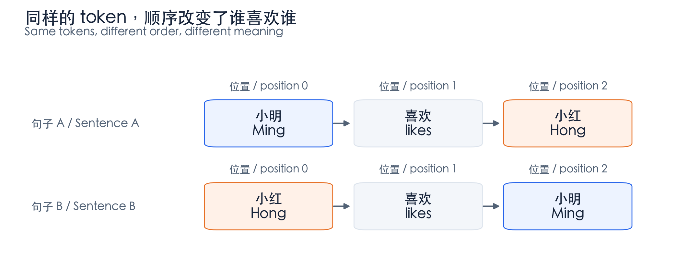
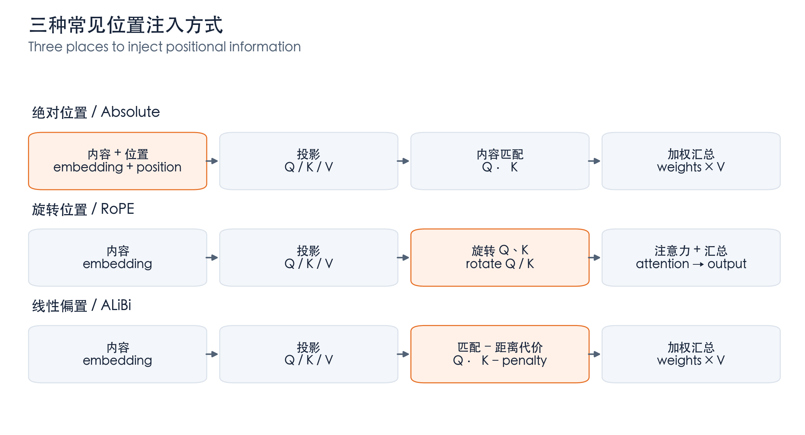
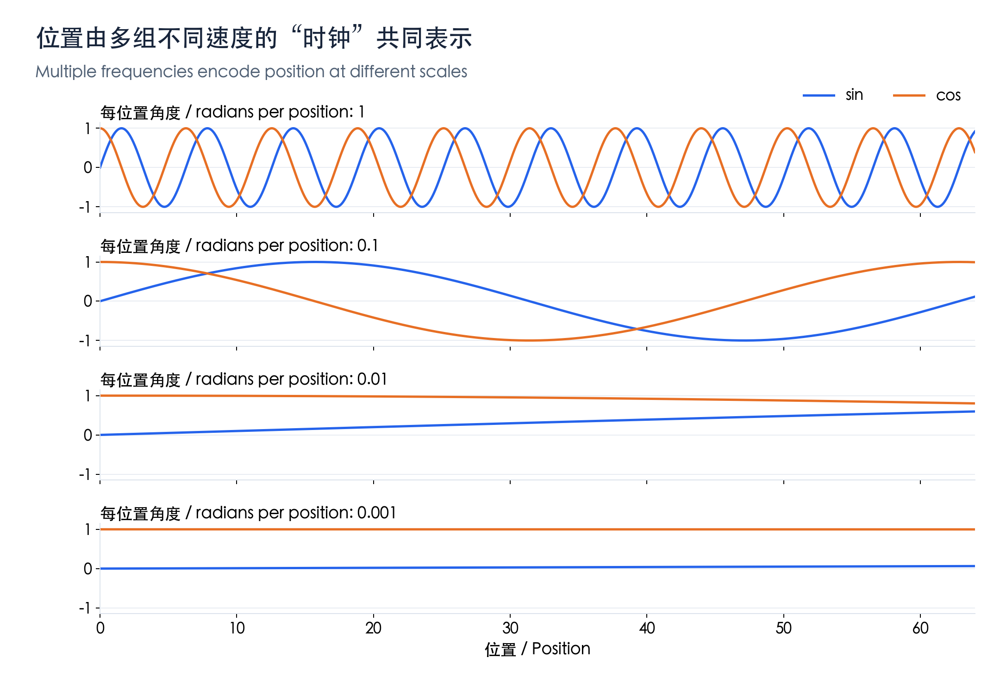
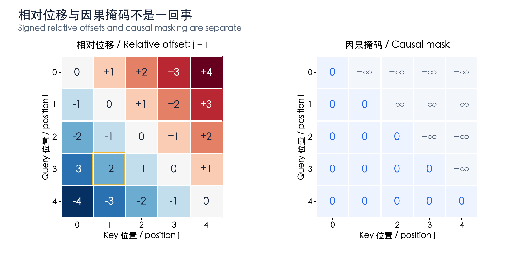
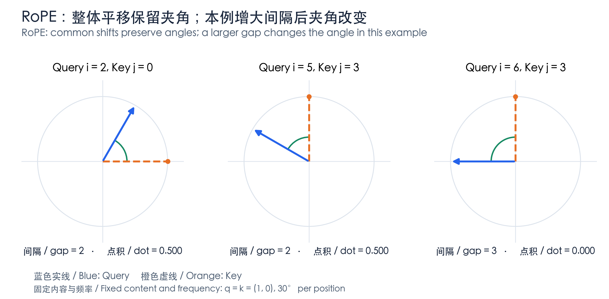
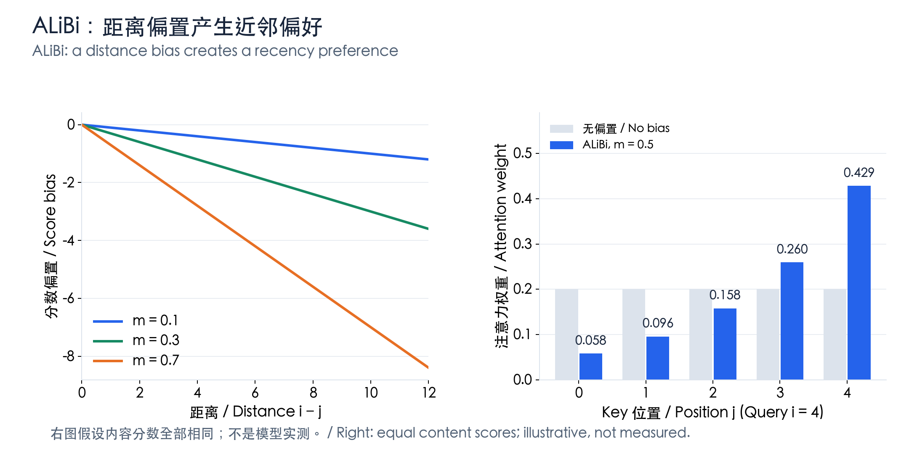
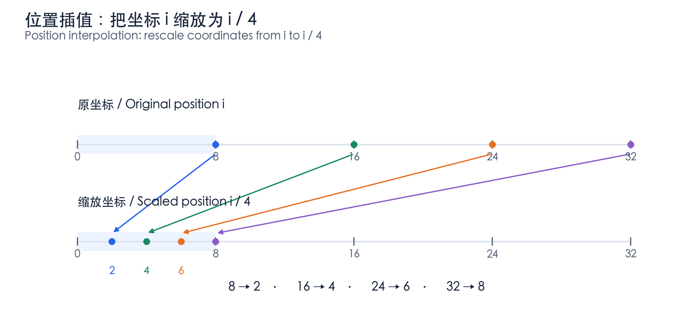
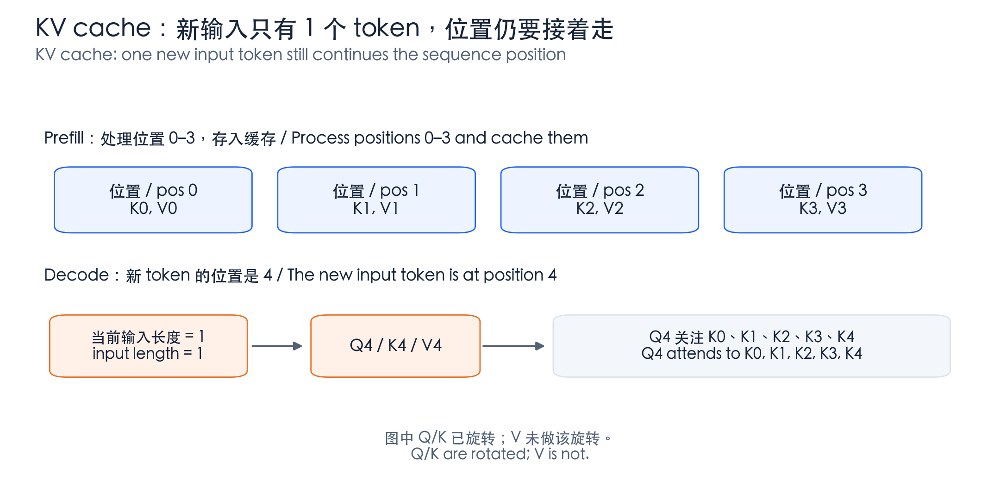

# LLM Positional Encoding: An Illustrated Guide from Intuition to RoPE

[中文](./LLM-Positional-Encoding-Illustrated.md) | English

- **Source**: **An original illustrated explanation based on public papers and implementations.** [**RoFormer**](https://arxiv.org/abs/2104.09864) · [**Transformer**](https://arxiv.org/abs/1706.03762)
- **Compiled**: 2026-11-06

This guide follows four questions: why position is needed, where it enters the model, why RoPE works, and how it relates to long context and the KV cache. Read each example and figure first, then the formulas.

**Example note: all figures are original. Low-dimensional vectors, angles, slopes, and attention weights are explicitly constructed teaching examples, not measurements from a particular model. Chinese and English labels use the same numerical values.**

## 1. The one-sentence intuition

> **Positional encoding helps a model know not only which tokens are present, but where they are, which comes first, and how far apart they are.**

### 1.1 The same words can mean different things in a different order



*Figure 1: the same color identifies the same token. Swapping positions changes who likes whom. Each word is treated as one token for simplicity.*

A token embedding is typically a lookup: $`e_i=E[t_i]`$. The same token at different positions receives the same initial vector. Its row in a tensor is a storage location, not automatically a position identifier encoded in the vector.

However, **a causal LLM without explicit positional encoding is not necessarily devoid of order information**. The causal mask restricts attention to the current and preceding tokens, and this asymmetric structure can itself provide ordering cues. Positional encoding supplies a more explicit, directly usable representation. **Sources: see [1] for the original Transformer design and [5] for causal models without explicit positional encoding.**

## 2. Where does positional information enter?

In an attention head, position $`i`$ has a hidden vector $`h_i`$, which is projected into a query, a key, and a value:

```math
q_i=W_Qh_i,\qquad k_i=W_Kh_i,\qquad v_i=W_Vh_i.
```

- Query: what information am I looking for?
- Key: what do I have that might deserve your attention?
- Value: what content do I provide if you attend to me?

The score, weight, and output for position $`i`$ attending to position $`j`$ are:

```math
\begin{aligned}
s_{ij}&=\frac{q_i^\top k_j}{\sqrt{d_h}}+M_{ij},\\
\alpha_{ij}&=\frac{\exp(s_{ij})}{\sum_\ell\exp(s_{i\ell})},\\
o_i&=\sum_j\alpha_{ij}v_j.
\end{aligned}
```

Here $`d_h`$ is the head dimension and $`M_{ij}`$ is the mask. The rotations and biases discussed below mainly change how these scores are computed. **Formula source: [1].**



*Figure 2: orange boxes mark positional operations. Residuals, normalization, scaling, masking, softmax, and other details are omitted; this is not a complete Transformer computation graph.*

Remember three entry points: **absolute position vectors are added to the input; RoPE transforms Q/K; ALiBi directly changes attention scores.**

## 3. Absolute positional encoding: tell the model which position it occupies

### 3.1 A learned position table

The most direct approach learns a vector $`p_i`$ for each position and adds it to the token embedding:

```math
h_i^{(0)}=e_i+p_i,\qquad
P\in\mathbb{R}^{L_{\max}\times d_{\mathrm{model}}}.
```

Think of two tables: one answers which token it is, the other which position it occupies. Below, we assign illustrative four-dimensional vectors to the same token, “cat”:

| Item | Position $`0`$ | Position $`3`$ |
| --- | --- | --- |
| Token vector | $`(1,\ 0.2,\ -0.3,\ 0.5)`$ | $`(1,\ 0.2,\ -0.3,\ 0.5)`$ |
| Position vector | $`(0,\ 0,\ 0,\ 0)`$ | $`(0.1,\ -0.2,\ 0.3,\ -0.1)`$ |
| Sum used as input | $`(1,\ 0.2,\ -0.3,\ 0.5)`$ | $`(1.1,\ 0,\ 0,\ 0.4)`$ |

**This is a teaching construction; a real model's position-zero vector need not be all zeros.** The same token enters the network with different representations at different positions. A position table covers a finite range; enlarging it does not automatically train the new positions.

### 3.2 Sinusoidal encoding: clocks ticking at different speeds

Position vectors can also be generated by a formula rather than learned in a table. The original Transformer uses:

```math
\begin{aligned}
p_{i,2r}&=\sin(i\omega_r),\\
p_{i,2r+1}&=\cos(i\omega_r),\\
\omega_r&=10000^{-2r/d_{\mathrm{model}}}.
\end{aligned}
```

Each pair of dimensions acts like a clock: as position $`i`$ increases, its phase $`i\omega_r`$ changes. Different dimensions use different frequencies rather than repeating the same clock.



*Figure 3: an eight-dimensional position vector with base 10000. High-frequency pairs change quickly; low-frequency pairs change slowly over this range.*

In this example the four frequencies are $`(1,\ 0.1,\ 0.01,\ 0.001)`$. From position $`0`$ to $`1`$, the first pair changes from $`(0,1)`$ to approximately $`(0.8415,0.5403)`$, while the second changes to approximately $`(0.0998,0.9950)`$.

It is like looking at second, minute, and hour hands together: **different speeds provide positional cues at different scales**. A single sine channel does not uniquely determine position; the model uses the channels jointly. **Source: formulas and design motivation in [1]; plotted values are calculated from the formula.**

## 4. Relative position: tell the model how far apart tokens are

### 4.1 Different absolute positions can share the same relation

If the current position is $`i=3`$ and a historical token is at $`j=1`$, the relative offset is $`j-i=-2`$. Shift both to $`i=8`$ and $`j=6`$, and the offset remains $`-2`$: in both cases, look two positions back.



*Figure 4: rows are query positions and columns are key positions. The yellow outline on the left marks i=3, j=1. The right permits only the current and earlier positions and blocks the future.*

The left describes offset and direction; the right decides whether attention is permitted. **A negative offset is not a negative attention weight, and a mask is not a distance encoding.**

### 4.2 Two common ways to inject relative position

A relative offset can have a vector that participates in query matching:

```math
s_{ij}=
\frac{q_i^\top(k_j+r^K_{j-i})}{\sqrt{d_h}}+M_{ij}.
```

Alternatively, an offset can have a scalar bias added directly to the score:

```math
s_{ij}=
\frac{q_i^\top k_j}{\sqrt{d_h}}+b_{j-i}+M_{ij}.
```

Actual methods may clip distances, bucket them, vary by head, or also add relative information to the value path. These are conceptual templates, not one universal implementation. **Source: the relative-vector form follows [2]; ALiBi below is one special case of scalar bias.**

## 5. RoPE: rotate Q/K by position so their dot product contains a relative offset

RoPE stands for Rotary Position Embedding. Rather than adding positional content to a vector, it **changes the vector's direction according to position**. Start with one two-dimensional pair. **Source: [3].**

### 5.1 Start by rotating an arrow

The two-dimensional rotation matrix is:

```math
R(\phi)=
\begin{pmatrix}
\cos\phi&-\sin\phi\\
\sin\phi&\cos\phi
\end{pmatrix}.
```

The query at position $`i`$ and the key at position $`j`$ are rotated into:

```math
\widetilde q_i=R(i\theta)q_i,\qquad
\widetilde k_j=R(j\theta)k_j.
```

Rotation preserves length: $`\|R(\phi)q\|=\|q\|`$. It does not simply enlarge or shrink the vector; it changes its direction and consequently its dot product with another vector.

### 5.2 A hand-calculable example

For this example, set the initial content vectors at every position to $`q_i=k_j=(1,0)^\top`$, with $`\theta=\pi/6`$, or $`30^\circ`$, of rotation per position.



*Figure 5: blue denotes Query and orange denotes Key. The first two pairs differ by a common shift but retain the same angle; increasing the gap in the third makes the vectors perpendicular.*

| Case | Query position $`i`$ | Key position $`j`$ | Angle between the arrows | Rotated dot product |
| --- | --- | --- | --- | --- |
| A | $`2`$ | $`0`$ | $`60^\circ`$ | $`0.5`$ |
| B: shift both three positions forward | $`5`$ | $`3`$ | $`60^\circ`$ | $`0.5`$ |
| C: shift only Query one more position | $`6`$ | $`3`$ | $`90^\circ`$ | $`0`$ |

For case A:

```math
\widetilde q_2=
\begin{pmatrix}1/2\\ \sqrt{3}/2\end{pmatrix},
\qquad
\widetilde k_0=
\begin{pmatrix}1\\0\end{pmatrix},
\qquad
\widetilde q_2^\top\widetilde k_0=\frac12.
```

In this specially constructed example, the dot product equals the cosine of the angle. Real content vectors differ and need not have unit length, so attention scores in general cannot be reduced to these cosine values.

### 5.3 Why does the positional factor contain only a relative offset?

Using the properties of rotation matrices:

```math
\begin{aligned}
\widetilde q_i^\top\widetilde k_j
&=(R(i\theta)q_i)^\top(R(j\theta)k_j)\\
&=q_i^\top R(i\theta)^\top R(j\theta)k_j\\
&=q_i^\top R((j-i)\theta)k_j.
\end{aligned}
```

The key identity is:

```math
R(i\theta)^\top R(j\theta)=R((j-i)\theta).
```

> **Rotate each vector by its absolute position, and the positional factor in their dot product naturally becomes a relative offset.**

After a common shift, $`(j+c)-(i+c)=j-i`$, so the dot product remains unchanged **when the content vectors are fixed**. The signed offset is preserved; it is not merely an unsigned distance.

When the actual context changes, the content vectors $`q_i`$ and $`k_j`$ may change too. This does not imply that relocating text must leave the entire model output unchanged.

### 5.4 High-dimensional RoPE consists of multiple two-dimensional rotations

Let an even number $`d_r`$ of dimensions within a head participate in rotation. Split them into $`d_r/2`$ pairs, each with a different frequency:

```math
\theta_r=B^{-2r/d_r},\qquad
\widetilde q_i^{(r)}=R(i\theta_r)q_i^{(r)},\qquad
r=0,\ldots,d_r/2-1.
```

If the entire head rotates, $`d_r=d_h`$; some designs rotate only part of the head. Implementations may pair adjacent dimensions or corresponding dimensions in two halves, and this convention must match training.

The classic form commonly uses $`B=10000`$; models and extension schemes can change the base and frequencies. With $`d_r=8`$ and $`B=10000`$, the four rates match those in Figure 3, but **they now rotate content vectors rather than add sine/cosine values directly to the input**.

### 5.5 RoPE does not guarantee monotonically decreasing attention with distance

Even the unit-vector example in Figure 5 has a dot product that oscillates with phase. Real scores also depend on content, multiple frequency pairs, and the subsequent softmax. Encoding relative offsets does not mean every token must receive less attention as its distance increases.

## 6. ALiBi: subtract a distance-dependent penalty

For causal attention, ALiBi can be written as:

```math
s_{ij}^{(h)}
=
\frac{(q_i^{(h)})^\top k_j^{(h)}}{\sqrt{d_h}}
-m_h(i-j),
\qquad j\le i.
```

Here $`m_h>0`$ is the slope for head $`h`$. More distant positions receive a more negative bias. Heads use different slopes and therefore different strengths of recency preference. **Source: [4].**



*Figure 6: the left shows only the positional bias. The right assumes identical content scores and compares softmax weights before and after adding the bias.*

### 6.1 A complete five-token calculation

Place Query at $`i=4`$, set every content score to $`2`$, and choose $`m=0.5`$. The result is:

| Key position $`j`$ | Distance $`i-j`$ | ALiBi bias | Score after adding bias | Softmax weight (approx.) |
| --- | --- | --- | --- | --- |
| $`0`$ | $`4`$ | $`-2`$ | $`0`$ | $`0.0580`$ |
| $`1`$ | $`3`$ | $`-1.5`$ | $`0.5`$ | $`0.0956`$ |
| $`2`$ | $`2`$ | $`-1`$ | $`1`$ | $`0.1577`$ |
| $`3`$ | $`1`$ | $`-0.5`$ | $`1.5`$ | $`0.2600`$ |
| $`4`$ | $`0`$ | $`0`$ | $`2`$ | $`0.4287`$ |

Initially the five positions share attention equally at $`0.2`$ each. The bias shifts weight toward nearby positions. A distant token can still win if its content match is strong: an original score of $`5`$, after a penalty of $`2`$, becomes $`3`$, still exceeding the current position's score of $`2`$.

Thus, **ALiBi's distance bias is monotonic, but final attention need not be**. For RoPE, even the position-induced change in the score need not be monotonic.

## 7. Why being able to compute distant positions does not guarantee long-context ability

### 7.1 Computing a representation differs from learning to use it

Sinusoidal encoding and RoPE can both compute positions beyond the training range, but a model may not have learned to use those positions, phase combinations, or long-distance dependencies. Computability alone does not imply unlimited context.

### 7.2 Position interpolation: compress a longer range into a familiar scale

A basic approach chooses a scale factor $`c>1`$ and uses position $`i'=i/c`$, changing the rotation angle to:

```math
\phi_{i,r}=\frac{i}{c}\theta_r.
```



*Figure 7: original coordinates 8, 16, 24, and 32 map to 2, 4, 6, and 8. These are illustrative position coordinates, not the context-window endpoints of a particular model.*

Compression has a cost: neighboring positions originally differed in phase by $`\theta_r`$ at a frequency, but after scaling the difference is $`\theta_r/c`$. Local positional changes become smaller. A model generally needs adaptation; changing the ratio is not lossless expansion.

Position Interpolation and YaRN both address RoPE-based context extension, but differ in frequency adjustments, training, and scaling design. The $`i/c`$ mapping is a basic intuition, not a description of every scheme. **Sources: [6], [7].**

Assess long context at three levels: **how far positions can be represented, how far the model can use information effectively, and how much computation and caching the system can support**. Changing positional encoding does not automatically remove attention or KV-cache costs.

## 8. RoPE and the KV cache: current position is not the current input length

A common implementation projects Q/K/V, rotates Q/K, and caches the rotated K with V, which does not undergo that rotation. For the next token, it computes the new position's representations and interacts with the historical cache. **Implementation source: [8]; this describes that public implementation, not every architecture.**



*Figure 8: after four tokens, the new token is at position 4 even though the current input tensor contains only one token. Query may also attend to the current token's own K4.*

For one two-dimensional pair, the new Query and the first historical Key have the dot product:

```math
\widetilde q_4^\top\widetilde k_0
=q_4^\top R(-4\theta)k_0.
```

Resetting the new position to $`0`$ would incorrectly treat a four-position separation as the same position.

Therefore, `position_ids`, cache positions, and the RoPE frequency convention must be consistent. Once keys are cached under one rotation rule, changing coordinates or frequencies arbitrarily breaks that consistency.

Q/K mainly determine where to retrieve information and how much; V supplies the retrieved content. Leaving V unrotated is a common design choice, not a mathematical prohibition.

## 9. A comparison table and four self-checks

| Method | Main operation site | Core intuition | Do not infer |
| --- | --- | --- | --- |
| Learned absolute position | Input embedding | Learn a vector for each position | Enlarging the table automatically gives long-context ability |
| Sinusoidal absolute position | Input embedding | Combine clocks at multiple frequencies | Computability guarantees extrapolation |
| Relative vectors or biases | Relational attention terms | Represent signed relative offsets | All models use one formula |
| RoPE | Query and Key | Rotate by position so the dot product contains relative offsets | Scores depend only on distance or necessarily decay with it |
| ALiBi | Attention scores | Add a direct distance penalty | A distant but relevant token cannot receive high weight |

1. **Why do the same tokens still need position?** The same token set can form different orders and meanings.
1. **Does RoPE directly encode absolute or relative position?** It uses absolute positions to rotate vectors, producing relative offsets in the dot product when content vectors are fixed.
1. **Does a common shift leave the entire model unchanged?** Not necessarily; the invariance applies to the stated positional relation with fixed content vectors.
1. **Does computing RoPE at position one million imply a million-token context?** No; training, evaluation, and system support are still required.

## References

**[1] Attention Is All You Need. Original attention and sinusoidal positional encoding.** [**Source**](https://arxiv.org/abs/1706.03762)

**[2] Self-Attention with Relative Position Representations. A representative relative-position-vector design.** [**Source**](https://arxiv.org/abs/1803.02155)

**[3] RoFormer: Enhanced Transformer with Rotary Position Embedding. RoPE rotations, frequencies, and relative-position properties.** [**Source**](https://arxiv.org/abs/2104.09864)

**[4] Train Short, Test Long: Attention with Linear Biases Enables Input Length Extrapolation. ALiBi's linear distance bias.** [**Source**](https://arxiv.org/abs/2108.12409)

**[5] The Impact of Positional Encoding on Length Generalization in Transformers. Length generalization with and without explicit positional encoding.** [**Source**](https://arxiv.org/abs/2305.19466)

**[6] Extending Context Window of Large Language Models via Positional Interpolation. Motivation and method for position interpolation.** [**Source**](https://arxiv.org/abs/2306.15595)

**[7] YaRN: Efficient Context Window Extension of Large Language Models. A RoPE-based context-extension method.** [**Source**](https://arxiv.org/abs/2309.00071)

**[8] Meta Llama — llama/model.py. Q/K rotation and the KV-cache path in a public implementation.** [**Source**](https://github.com/meta-llama/llama/blob/main/llama/model.py)

**Citation note: this is an original explanatory guide, not a verbatim translation of the papers. Diagrams and hand calculations explain mathematical structure; they do not establish performance on a particular model.**
