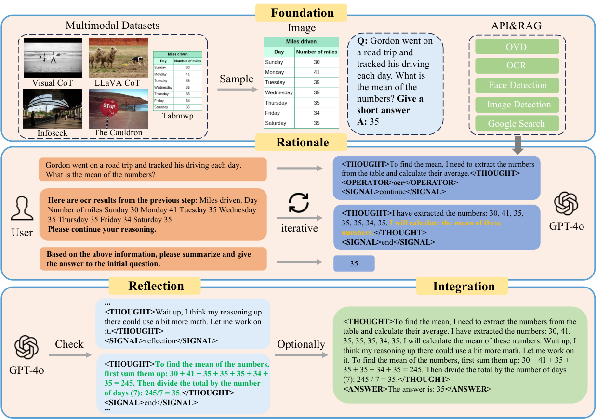
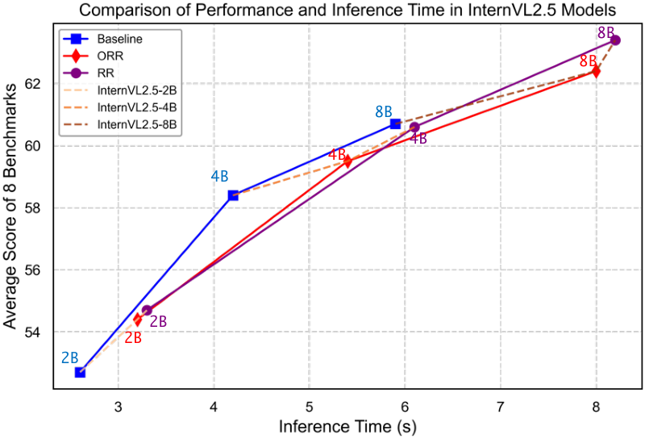

# MMAT-1M: A Large Reasoning Dataset for Multimodal Agent Tuning

[中文](./MMAT-1M-Multimodal-Agent-Tuning.md) | English

- **Source**: [MMAT-1M: A Large Reasoning Dataset for Multimodal Agent Tuning](https://arxiv.org/abs/2507.21924)
- **Paper**: [arXiv:2507.21924](https://arxiv.org/abs/2507.21924) · [ICCV 2025 version](https://openaccess.thecvf.com/content/ICCV2025/html/Gao_MMAT-1M_A_Large_Reasoning_Dataset_for_Multimodal_Agent_Tuning_ICCV_2025_paper.html)
- **Published**: 2025-07-29
- **Official resources**: [GitHub repository](https://github.com/VIS-MPU-Agent/MMAT-1M) · [Hugging Face dataset](https://huggingface.co/datasets/VIS-MPU-Agent/MMAT-1M)
- **Test environment**: macOS, Python 3.12.13, `datasets` 5.1.0; data from revision `b5bf713` on Hugging Face (2025-08-04), accessed 2026-10-22

## Key Points

This is a dataset paper from a Baidu team, published at ICCV 2025. Its core is a data engine that uses GPT-4o to mass-produce multimodal agent trajectories: it adds reasoning, tool calls and reflection to existing visual QA data, and the result is used to fine-tune open-source multimodal models so that small models also learn to reason while calling tools.

### 1. Why is it needed? (Motivation)

There are roughly two ways to teach a model step-by-step reasoning and tool use. One is to drive a large model with prompts (HuggingGPT, ReAct and the like); how well it works depends on how well the model understands instructions, and every call goes to a large model, which is expensive. The other is agent tuning: fine-tuning on purpose-built trajectory data so that even small models can plan, reason and use tools nearly as well as proprietary large models; on the text-only side there is already work such as AgentTuning and FireAct.

Agent-tuning data for multimodal models is still scarce and small: LLaVA-Plus rewrites LLaVA-158K into 117K tool-use samples, and T3-Agent's MM-Traj has 20K tasks with tool-use trajectories. The paper sees three problems with existing data:

- **A narrow distribution**, which limits gains across diverse benchmarks;
- **No reflection mechanism**, so a model is easily led astray when a visual tool makes a mistake;
- **Inflexible reasoning and tool use**, which makes the data hard to apply in practice.

MMAT-1M sets out to fill this gap with a million-scale dataset that covers diverse tasks, includes reflection, and comes in both one-turn and multi-turn formats.

### 2. How does it work? (Data Engine)



*Figure 2 of the paper: the data engine has four stages, Foundation, Rationale, Reflection and Integration, and produces two formats, RR and ORR. The example in the figure finds the mean of the miles driven on each day of a week.*

1. **Foundation**: take images and QA pairs from public datasets. To unify the answer style, short-answer samples get a format instruction appended to the question, while the answer itself is left unchanged. It also prepares 5 external tools:
   - Image Caption: following CCoT, GPT-4o first builds a scene graph for the question (the objects, attributes and relationships relevant to answering it), then writes an image description from the scene graph;
   - OVD (open-vocabulary object detection): Grounding DINO detects the objects mentioned in the scene graph;
   - OCR: PaddleOCR recognizes the text in the image;
   - Face Detection: deepface locates faces;
   - RAG: GPT-4o writes a search query, and the Google API returns the top-k most relevant results.
2. **Rationale**: GPT-4o reasons over several turns. In each turn it first writes a thought, then decides which tools to call (none, one or several) and whether to search; the tool results come back as the next user message, until it sends an end signal, and finally the answer is asked for separately. GPT-4o knows the ground-truth answer while generating, and the prompt tells it to "approach the standard answer through reasoning, but not use the standard answer directly".
3. **Reflection**: the authors found two kinds of problems in trajectories generated this way. One is skipped steps, most visible in math problems, where key calculations are left out; the other is "reasoning cheating", where the reasoning cannot actually lead to the answer, but GPT-4o, knowing the answer, forces it to fit. There is a prompt for each: the math reflection asks GPT-4o to check whether the calculation was left out between the second-to-last step and the last one, and to fill it in if so; the general reflection asks it to judge whether the reasoning cheated and to give the reason. Samples found to have a problem get a reflection inserted into the trajectory.
4. **Integration** (optional): the multi-turn RR format has to wait for tools to return round after round, which does not suit latency-sensitive uses. Inspired by LUMOS, the authors compress it into the one-turn ORR format: the results of all tools except RAG are put into the input in advance, wrapped in special markers, and the output is just one thought and one answer. The cost is that the model can no longer call tools dynamically at inference time, and it gets no search results.

Finally, the authors had Doubao-1.5-Vision-Pro-32K score every sample from 0.0 to 1.0 on five criteria (coherence, relevance, accuracy, completeness and image-text integration), and report that over 89% show high-quality reasoning. The paper gives no score threshold for "high quality" and does not say whether the remaining samples were removed.

### 3. What does the dataset look like? (Dataset)

| Source | Dialogues | Main content |
| --- | --- | --- |
| Visual CoT | 434,265 | Documents, charts, fine-grained understanding, general VQA, relational reasoning |
| The Cauldron | 215,680 | 10 subsets, including table QA, scene text, UI screenshots, chart captions, and geometry and diagram reasoning |
| InfoSeek | 131,400 | Visual information-seeking QA that needs external knowledge to answer |
| LLaVA-CoT | 98,561 | General VQA, science, math, document understanding |
| TabMWP | 23,059 | Math word problems built on tables |
| Total | 902,965 | 1,090,263 QA pairs in all |

Other statistics in Table 1 of the paper:

- In the source data, 93.7% of dialogues have a single round of QA (846,389), 28,646 have 2 rounds, and 27,930 have 3 or more;
- Counted by QA pair, 70.0% take 3 reasoning steps, 20.3% take 4, 9.0% take 5 or more, and 0.7% take 2;
- Tool calls: Image Caption 620,644, OCR 471,866, RAG 205,682, OVD 156,237, Face Detection 20,077;
- Reflection: 46,508 general reflections and 11,139 math reflections, 57,647 in total.

Compared with similar datasets (LLaVA-Plus-v1 117K, Visual CoT 438K, LLaVA-CoT 100K, MM-Traj 20K), MMAT-1M is the largest, and the only one among them that has tool calls, web search, CoT and reflection all together and offers both one-turn and multi-turn formats.

Each record has only two fields, `messages` (the dialogue) and `images` (relative image paths); the images themselves are not in the dataset. RR is the multi-turn format: the system prompt describes the reasoning flow and the tag format of each turn but does not list the available tools, so the model can learn the tool names (`image_caption`, `ocr`, `object_detection`, `face_detection`) only from the training data. In each turn the assistant writes `<THOUGHT>`, adds `<OPERATOR>` (a tool name) and `<RAG>` (a search query) as needed, and ends with `<SIGNAL>` for the next step: `continue` to go on, `reflection` to reflect, and `end` to finish reasoning. Tool results come back as user messages; once reasoning ends, the user asks it to "summarize and answer the initial question", and the assistant outputs only the answer. Here is a DocVQA sample from the validation set (abridged):

```text
system     You are an advanced multimodal reasoner. ... (RR system prompt describing the reasoning flow and tag format, omitted here)
user       <image>what is the department mentioned in the slip ?
           Short answer required. Please start your reasoning.
assistant  <THOUGHT>To identify the department mentioned in the slip, I should extract the text from the image.</THOUGHT>
           <OPERATOR>ocr</OPERATOR>
           <SIGNAL>continue</SIGNAL>
user       Here are ocr results from the previous step:
           - ocr information: U.S.DEPARTMENT CF AGRICULTURE DATE Hapr REFERENCE SLIP ...
           Please continue your reasoning.
assistant  <THOUGHT>The OCR results show that the department mentioned in the slip is 'U.S. DEPARTMENT OF AGRICULTURE'.</THOUGHT>
           <SIGNAL>end</SIGNAL>
user       Based on the above information, please summarize and give the answer to the initial question: ...
assistant  U.S. Department of agriculture
```

ORR is the one-turn format: tool results are written into the input in advance, wrapped in markers such as `<|begin_api_invoke|>` and `<|begin_result_of_api|>`, and the assistant outputs `<THOUGHT>` and `<ANSWER>` in one go. Here is a WTQ table QA sample from the validation set (abridged):

```text
system     ... Respond in the format like this:
           <THOUGHT>your reasoning</THOUGHT>
           <ANSWER>The answer is: your answer</ANSWER>
user       <image>Was it dallas or ottawa that won the game on december 9, 1993?
           Use the following operators to help answer the question:
           <|begin_api_invoke|>image_caption<|end_api_invoke|>
           <|begin_result_of_api|>
           The image is a table listing hockey game results from 1993-1994, ... on December 9, 1993, Dallas won against Ottawa with a score of 6-1 ...
           <|end_result_of_api|>
           <|begin_api_invoke|>ocr<|end_api_invoke|>
           <|begin_result_of_api|>
           ['Date', 'Winning Team', 'Score', 'Losing Team', ...]
           <|end_result_of_api|>
assistant  <THOUGHT>... According to the OCR results, on December 9, 1993, the game was between Dallas and Ottawa. The winning team recorded was Dallas with a score of 6, while Ottawa had a score of 1.</THOUGHT>
           <ANSWER>The answer is: Dallas.</ANSWER>
```

The paper's OVD tool is called `label_bbox` in ORR and `object_detection` in RR, and its results are formatted differently in the two. The paper trains models on each format separately; to train on a mix of both, it is best to unify the tool names and result formats first.

### 4. How is it trained, and how well does it work? (Training and Results)

Training is LoRA fine-tuning with ms-swift for just 1 epoch, with learning rate 4e-5, batch size 1, max length 16384, BF16 and DeepSpeed ZeRO-2; the paper does not give the LoRA rank, the number of GPUs or the training time. Each of the five models (Llama-3.2-11B-Vision-Instruct, MiniCPM-V-2.6, InternVL2.5-2B/4B/8B) is trained once on ORR and once on RR.

Evaluation runs 8 benchmarks with VLMEvalKit: MMStar, MMMU, MathVista, MathVision (these two math benchmarks use testmini), AI2D, OCRBench, RealWorldQA and HallusionBench; Dyn-VQA, scored by F1-Recall, additionally tests retrieval augmentation and multi-hop reasoning. Search during evaluation uses Google, taking at most 3 results each time.

Average over the 8 benchmarks (OCRBench is scored out of 1000 and is converted to a 100-point scale before averaging):

| Model | Baseline | ORR | RR |
| --- | --- | --- | --- |
| Llama-3.2-11B-Vision-Instruct | 52.2 | 54.6 | 55.3 |
| MiniCPM-V-2.6 | 58.0 | 58.8 | 59.9 |
| InternVL2.5-2B | 52.7 | 54.4 | 54.7 |
| InternVL2.5-4B | 58.4 | 59.5 | 60.6 |
| InternVL2.5-8B | 60.7 | 62.4 | 63.4 |

For reference, GPT-4o scores 65.6.

- All five models' averages rise, and for every model RR scores higher than ORR.
- The biggest gains are on RealWorldQA and HallusionBench: computed from Table 3 of the paper, RR gains 5.8 and 4.6 points respectively, averaged over the five models.
- OCRBench is RR's weakest benchmark: three of the five models fall below baseline, while ORR beats RR on all five. The paper's explanation is that although RR can correct some errors, text that OCR misreads still drags down the final result, while ORR uses the image description to mitigate OCR errors.
- Against GPT-4o, InternVL2.5-8B-RR is higher on MMStar (65.3 vs 65.1), MathVista (64.8 vs 60.0) and OCRBench (839 vs 806), and close on AI2D (84.2 vs 84.9) and HallusionBench (55.8 vs 56.2); on MathVista and OCRBench, though, the 8B baseline (64.5, 819) was already above GPT-4o. The gaps on MMMU (57.3 vs 70.7) and MathVision (21.7 vs 30.4) remain large.

Results on the retrieval-augmented benchmark Dyn-VQA (Query is the input the model actually uses for retrieval, and Golden Query is a prompt optimized for the final retrieval step):

| Model | Query baseline | Query RR | Golden Query baseline | Golden Query RR |
| --- | --- | --- | --- | --- |
| Llama-3.2-11B-Vision-Instruct | 29.4 | 38.0 | 34.6 | 45.1 |
| MiniCPM-V-2.6 | 32.7 | 35.9 | 39.2 | 44.4 |
| InternVL2.5-2B | 19.3 | 30.9 | 26.0 | 38.8 |
| InternVL2.5-4B | 23.3 | 35.4 | 31.1 | 42.1 |
| InternVL2.5-8B | 27.0 | 36.8 | 35.2 | 44.0 |

RR raises the five models' Query scores by 3.2–12.1 points, but the best, 38.0, is still well below GPT-4o's 52.0 (61.5 with Golden Query) and OmniSearch (GPT-4V)'s 50.0.

The ablation numbers largely match InternVL2.5-8B in Table 3 (the paper does not name the model it used). The averages here are over 9 items (the 8 benchmarks plus Dyn-VQA), and the Dyn-VQA column corresponds to Golden Query in the table above:

| Setting | Tools | Search | 9-item average | Dyn-VQA |
| --- | --- | --- | --- | --- |
| Baseline | ✗ | ✗ | 57.9 | 35.2 |
| RR format, no fine-tuning, prompting only | ✓ | ✓ | 55.0 | 31.5 |
| RR, search only | ✗ | ✓ | 57.3 | 43.4 |
| RR, tools only | ✓ | ✗ | 59.8 | 35.4 |
| ORR | ✓ | ✗ | 59.6 | 36.6 |
| R (rationale, no reflection) | ✓ | ✓ | 60.2 | 42.9 |
| RR | ✓ | ✓ | 61.3 | 44.0 |

- Without fine-tuning, having the baseline model call tools in the RR format actually drops the average from 57.9 to 55.0, which shows this way of calling tools has to be learned through fine-tuning.
- Reflection adds 1.1 points (60.2 → 61.3).
- Search mainly lifts Dyn-VQA (35.4 → 44.0); with search but no tools, the 9-item average (57.3) is even below baseline.



*Figure 3 of the paper: the 8-benchmark average (vertical axis) and inference time (horizontal axis) of Baseline, ORR and RR at the three InternVL2.5 sizes.*

The figure prints no values. Converting each marker's pixel position into values using the grid gives roughly these times (the converted vertical coordinates differ from the Table 3 averages by less than 0.1, so the reading is reliable):

| Model | Baseline | ORR | RR |
| --- | --- | --- | --- |
| InternVL2.5-2B | 2.6 s | 3.2 s | 3.3 s |
| InternVL2.5-4B | 4.2 s | 5.4 s | 6.1 s |
| InternVL2.5-8B | 5.9 s | 8.0 s | 8.2 s |

ORR and RR take 0.6–2.3 s longer than baseline, about 23%–45% more time. ORR is not much faster than RR: just 0.1–0.2 s at 2B and 8B, and 0.7 s at 4B. The experiments section itself only says RR costs "slightly" more than ORR, which does not quite match the data engine section's claim that ORR "significantly improves inference speed". The paper also does not explain how the time was measured, for example whether it includes calls to external tools.

Last comes a qualitative experiment. MMAT-1M has no celebrity-recognition tool, so on a question like "which university gave the person in the image an honorary Doctor of Fine Arts degree", the fine-tuned InternVL2.5-8B can only run face detection and then search for "the person", and it answers wrong. When the authors add one sentence to the prompt saying it "can also call a face recognition tool", the model calls this tool it never saw in training, gets the name, searches again and answers correctly. From this the paper concludes that the fine-tuned model has some zero-shot ability to call new tools, though it works less well than with tools it was trained on. The paper gives only this one example.

### 5. How do you use it? (Usage)

- **Files**: Hugging Face has 4 JSONL files: the training set's ORR at 1.69 GB and RR at 3.02 GB, and the validation set's ORR at 17 MB and RR at 30 MB. Calling `load_dataset` on the whole repo joins the two training files into the train split: 1,642,687 rows, with ORR in the first 748,751 and RR in the last 893,936; the validation split has 16,592 rows (ORR 7,563, RR 9,029).
- **To use only one format, load it by file** (tested):

```python
from datasets import load_dataset

# Load only the RR validation set (30 MB); when data_files names a single file, the split is always called "train"
rr = load_dataset("VIS-MPU-Agent/MMAT-1M", data_files="dataset_qa_rr_val_all_RR_sys.jsonl", split="train")
print(len(rr), rr[0]["images"])  # 9029 ['../datasets/llava-cot/geoqa+/images/9767.png']
```

- **You have to gather the images yourself**: the 17 image archives listed on the dataset card are hosted on S3, which returned `NoSuchBucket` when accessed on 2026-10-22. On 2025-12-24 the project team replied in [GitHub issue #1](https://github.com/VIS-MPU-Agent/MMAT-1M/issues/1) that the original bucket is no longer available and only the annotation JSON is provided for now; the images have to be found in each original public dataset by the paths in the annotations (such as `../datasets/viscot_dataset/docvqa/...`).
- **The licenses are mixed**: the Visual CoT, LLaVA-CoT and InfoSeek parts are Apache 2.0; The Cauldron's subsets each have their own license, and prompts derived from it are CC BY 4.0; the TabMWP part is CC BY-NC-SA 4.0, for non-commercial use only. Check each source before commercial use.

## Test Log

The statistics below were computed on 2026-10-22 on the data version above: the validation set was downloaded and counted record by record, and the training set was read row by row through Hugging Face's datasets-server API.

- **How many rows of each format the train split holds**: a binary search over row numbers for where the system prompt changes, plus a check of 16 random rows, shows rows 0–748,750 are ORR and rows 748,751–1,642,686 are RR. Adding the validation set, RR totals 902,965, exactly the paper's dialogue count; ORR totals 756,314, 16% fewer than RR, while the paper only says both formats are trained on MMAT-1M (1,090,263 QA pairs) and never mentions ORR being smaller. By source, InfoSeek's share is clearly lower in ORR, and InfoSeek relies on search the most (68% of its RR validation samples search): in the validation set InfoSeek makes up 5.9% of ORR and 14.8% of RR; sampling 10 random chunks of 50 rows from each format in the training set gives 5.2% versus 15.4%.
- **The validation set matches Table 1 of the paper**: Table 1's "reasoning steps" correspond to the number of assistant turns in each QA pair (including the final turn that gives the answer); the RR validation set has 0.7% at 2 steps, 69.9% at 3, 20.2% at 4 and 9.1% at 5 or more, against the paper's 0.7%, 70.0%, 20.3% and 9.0%. Per 100 QA pairs, the validation set has 56.7 image-description calls, 44.0 OCR calls, 13.5 object-detection calls, 2.0 face-detection calls, 19.5 searches and 5.6 reflections; dividing Table 1's totals by 1,090,263 QA pairs gives 56.9, 43.3, 14.3, 1.8, 18.9 and 5.3.
- **Most trajectories are short**: of the 9,029 dialogues in the RR validation set, 65.4% are "one round of tool calls → end reasoning → answer", and most of the "3-step" samples, roughly seven in ten of Table 1, look like this.
- **ORR inputs**: all 7,563 validation records come with `image_caption` results filled in, 69.4% also with `label_bbox`, 57.2% with OCR and 30.9% with face-detection results.
- **Reflection segments**: the RR validation set has 593 occurrences of `<SIGNAL>reflection</SIGNAL>`. The sentence that triggers reflection comes in only 13 fixed wordings, such as "Hold on, I need to double-check. The reasoning might be a bit off and could have some sneaky shortcuts.", all boilerplate along the lines of "the reasoning may have gaps". In the reflection content that follows, 483 (81%) are general reflections explaining why the preceding reasoning counts as "cheating"; the rest are almost all math reflections that fill in the omitted derivation. The two come at about 8:2, matching the ratio in Table 1. The paper says general reflection makes the reasoning "aware of the cheating and corrects it", but the general reflection prompt (Figure 7 of the paper) only asks GPT-4o to state why the reasoning cheated, and the data looks the same: each of these 483 reflections ends with `<SIGNAL>end</SIGNAL>` right after pointing out the cheating, with no more tool calls or re-reasoning, and the next turn gives the final answer as usual.
- **The image description often already contains the answer**: Image Caption is generated by GPT-4o with the question in view (the scene-graph prompt includes the question). For example, an InfoSeek question in the RR validation set asks what the plant in the image is named after; the image description says "a vibrant iris flower, named after the Greek goddess Iris", and the answer is exactly Iris. The ORR sample above is the same: its image description already says Dallas beat Ottawa. Among single-QA ORR validation samples, after removing yes/no answers, option letters, answers shorter than 4 characters and answers that already appear in the question, 5,057 remain, and for 36.5% of them the answer text (ignoring case and common punctuation) appears verbatim in the `image_caption` result; among single-QA RR validation samples that called `image_caption`, the same measure gives 19.4%. The experiments section does not say which models provide the image description, OCR and detection tools at evaluation time, which is worth keeping in mind when reading the comparison with GPT-4o.
- **Recomputing the paper's tables**: Table 3's averages are over the 8 benchmarks (OCRBench divided by 10 first) and Table 5's are over 9 items (Dyn-VQA added), and both tables' averages can be reproduced. Two things don't match: InternVL2.5-8B's baseline MathVista is 64.5 in Table 3 but 65.1 in Table 5; and the text says the InternVL2.5 series gains 31.9% to 60.1% relative on Dyn-VQA, while the numbers in both columns of Table 4 give 25.0% to 60.1%. The abstract's "2.7%" and "8.8%" are absolute differences, not relative gains: the first is the 8-benchmark average going from 60.7 to 63.4, and the second is Dyn-VQA's Golden Query column going from 35.2 to 44.0; the Query column goes from 27.0 to 36.8.
