# The Many Faces of On-Policy Distillation: Pitfalls, Mechanisms, and Fixes（在线蒸馏的多面性：陷阱、成因与补救）

中文 | [English](./Many-Faces-of-On-Policy-Distillation_en.md)

- **原文链接**: [The Many Faces of On-Policy Distillation: Pitfalls, Mechanisms, and Fixes](https://arxiv.org/abs/2605.11182v2)
- **论文**: [arXiv:2605.11182](https://arxiv.org/abs/2605.11182)
- **发布日期**: 2026-05-11
- **范围**: 按 arXiv v2（2026-05-24 修订）写的通俗解读，不是全文翻译。作者是 Siqi Zhu、Xuyan Ye、Hongyu Lu、Weiye Shi、Ge Liu，来自伊利诺伊大学厄巴纳-香槟分校（UIUC，Zhu 和 Liu）、中国人民大学（Ye 和 Lu）和北京大学（Shi）。Ye、Lu、Shi 并列第二作者，工作在 UIUC 实习期间完成。论文和 arXiv 页面都没有给出代码链接。

## 一句话版本

在线蒸馏是一类大模型后训练方法：学生模型自己写回答，老师在这份回答上逐个 token 给出"换我会怎么写"的概率分布，学生朝老师靠拢。老师是另一个更强的模型时，叫 OPD（On-Policy Distillation，在线蒸馏）；老师是学生自己、只是多看了一份"小抄"（比如标准答案或系统提示词）时，叫 OPSD（On-Policy Self-Distillation，在线自蒸馏）。已有研究对两者的评价好坏参半，这篇论文用一系列对照实验查它们什么时候管用、什么时候失败、为什么失败。作者找出三个失败原因：学生写的半截答案会把老师带偏；为省显存只在前 K 个候选 token 上算损失时，梯度会多出一项偏差；OPSD 的学生考试时看不到小抄，只能学到各题小抄的共同部分。对应的补救办法是：改用不带这项偏差的 Top-K 损失，蒸馏前先用强化学习在训练集上调一调老师、让它的输出分布更接近学生，学生输出不像样时先做一轮 SFT（监督微调）。

主要发现：数学推理上，OPD 的效果很依赖选哪个老师、用哪种损失，选错了训练会崩，模型最后只会输出一长串 "maybe"；OPSD 在作者测试的数学设置里没有带来提升。风格对齐和系统提示内化上，OPSD 有效，前期涨得比 GRPO、PPO 这两种强化学习方法快，安全对齐上 GRPO 后来居上。两组代表性的数字：让 Qwen3-14B 接着 Qwen3-1.7B 写的半截答案往下做 GPQA-Diamond，准确率从它独立作答时的 62.1% 掉到 46.0%，少了约 16 个百分点（下文简称"分"），198 道题里 40 道原本做对的被带错，只有 8 道原本做错的被带对；一个经强化学习调过的 1.7B 老师，Math500 成绩和 Qwen3-8B 差不多（0.82 对 0.83），当老师却明显更好用，训练中它和学生的 Top-20 候选 token 重合率升到约 0.95，8B 老师一直在 0.6 左右。

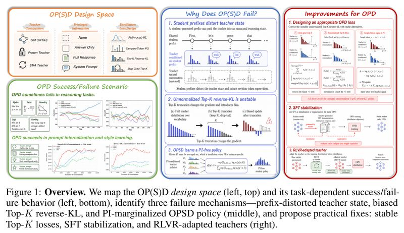

*图 1：论文的总览。左上是 OP(S)D（论文对 OPD 和 OPSD 的合称）的设计空间，左下是它在不同任务上成功或失败的表现；中间是三个失败机制：被学生前缀扭曲的老师状态、有偏差的 Top-K 反向 KL、对小抄取平均的 OPSD 策略；右边是补救办法：稳定的 Top-K 损失、SFT 稳定化、经 RLVR 调整的老师。左边回答"有哪些做法、在哪成功、在哪失败"，中间回答"为什么失败"，右边回答"怎么补"，下文按这个顺序展开。*

---

## 1. 先认识几个词

| 词 | 大白话 |
| --- | --- |
| OPD（On-Policy Distillation，在线蒸馏） | 学生自己作答，一个更强的老师模型在学生的回答上逐 token 给出参考分布，学生朝它靠拢 |
| OPSD（On-Policy Self-Distillation，在线自蒸馏） | 老师就是学生自己，只是多看了一份小抄。论文把 OPD 和 OPSD 合称 OP(S)D |
| 小抄（PI，privileged information，特权信息） | 只有老师训练时能看、学生考试时看不到的信息，比如标准答案、完整解题过程、系统提示词、用户偏好。"小抄"是本文的叫法 |
| on-policy 和 off-policy | 在学生自己生成的回答上学，叫 on-policy（下文也叫"在线"）；在别人事先写好的回答上学，叫 off-policy（"离线"） |
| 反向 KL 和正向 KL | KL 散度衡量两个概率分布差多远。它不对称，所以有两个方向：反向 KL 让学生抓住老师的一个峰，正向 KL 让学生盖住老师的所有峰 |
| Top-K 近似 | 每个位置只取前 K 个候选 token 计算损失，以节省显存 |
| stop-gradient | 求梯度时把某个量当作常数，不对它求导。PyTorch 里就是 `detach()` |
| 策略梯度（policy gradient）和优势（advantage） | 强化学习的一种更新方式：给每个 token 一个分数（优势），为正就提高这个 token 的概率，为负就降低 |
| GRPO、PPO | 两种常用的强化学习算法。GRPO 每题采样多个回答，按组内相对好坏打分；PPO 用一个价值模型估计好坏 |
| RLVR | 用能自动判对错的奖励（比如数学题答案对不对）做强化学习 |
| SFT（监督微调） | 直接让模型逐字模仿给定的回答 |
| 思考模式（thinking） | Qwen3 的一种生成模式：先在 `<think>…</think>` 里写推理过程，再给出答案。"关闭思考"就是不写这一段 |
| log 概率（logprob） | 模型给某个 token 的概率取对数，越接近 0 表示越确定 |
| EMA（指数滑动平均） | 老师的参数每一步只朝学生当前的参数挪一小步，比直接用学生自己当老师更稳 |
| 系统提示内化 | 训练后的模型不需要那段系统提示词，也能表现得像看过它一样，比如写得简洁、遵守安全规则 |

## 2. 它想解决什么问题

在线蒸馏被看作很有前景的大模型后训练方法：学生在自己写出的回答上被逐 token 纠正，练的正是自己真实会犯的错误，而且每个 token 都有反馈。论文引言列了 OPD 的几个用处：把多个更强老师的能力整合进一个学生，减轻灾难性遗忘（学新东西时把旧本事忘掉），提高样本效率。OPSD 连更强的模型都不需要，能把训练时才有的上下文（标准答案、系统提示词、用户偏好）变成学生自己的本事。

| 路线 | 做法 | 问题 |
| --- | --- | --- |
| 离线训练（SFT、离线蒸馏） | 学生模仿老师或人工事先写好的回答 | 练的是别人写的回答，学生没在自己会犯的错误上被纠正 |
| 强化学习（GRPO、PPO） | 学生自己作答，按整道题的对错给一个分 | 一道题只有一个分，信号粗；要生成到最终答案才能打分，生成长度得设得很大 |
| OPD 和 OPSD | 学生自己作答，老师逐 token 给参考分布 | 已有结果互相矛盾：有的工作报告它在系统提示内化、知识内化和推理上有效，也有工作报告训练不稳定、成绩变差 |

报告有效的工作包括论文文献 [7]、[9]，报告不稳定和退化的是 [10]、[11]（方括号里是论文的参考文献编号，对应的论文见第 10 节）。

论文要回答的问题是：**OPD 和 OPSD 什么时候管用，什么时候失败，背后是什么机制？** 作者在数学推理、风格对齐、系统提示内化三类任务上，把成功和失败的场景都测了，再针对失败的情况找原因、试补救办法。

## 3. 作者怎么查的：把在线蒸馏拆成三个选择

**OPD 怎么训。** 学生自己写回答。学生每写一个 token，老师都给出"换成我，这个位置会写什么"的概率分布，学生把自己的分布往老师那边调。训练数据是学生自己写出来的回答，所以是 on-policy；与之相对，off-policy 训练用的是老师或人工事先写好的范文。在线的好处是学生在自己真实会犯的错误上被纠正，而且每个 token 都有反馈，比强化学习"整道题只给一个对错分"细得多。OPD 的老师是一个更强的模型，比如用 Qwen3-8B 教 Qwen3-1.7B。

**OPSD 怎么训。** 老师就是学生自己，只是多看了一份小抄。论文把小抄叫 privileged information（PI，特权信息），可以是标准答案、完整解题过程、系统提示词、用户偏好等。训练时，老师看着小抄给学生的回答逐 token 打分；考试时学生看不到小抄，要靠自己。

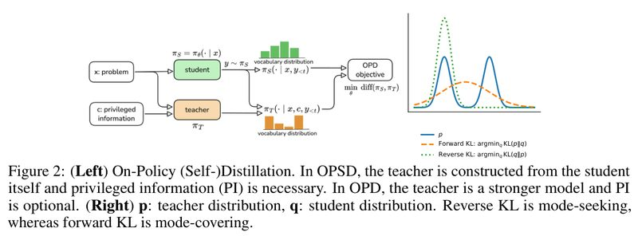

*图 2 左：在线（自）蒸馏的流程。OPSD 的老师由学生本身加小抄构成，小抄必不可少；OPD 的老师是更强的模型，小抄可有可无。右：p 是老师分布，q 是学生分布。蓝线是老师的分布，有两个峰，表示两种写法老师都认可；橙色虚线是按正向 KL 学出的学生，为了不漏掉老师的任何一种写法，摊成一个又宽又矮的分布，最高点落在两个峰之间，哪种写法都不像；绿色点线是按反向 KL 学出的学生，挑中一个峰学准。论文图注的说法是：反向 KL 倾向于抓住一个峰（mode-seeking），正向 KL 倾向于盖住所有峰（mode-covering）。*

OPD 一般用反向 KL。作者的理由是（论文第 3 节）：正向 KL 会逼学生去写老师喜欢、学生自己却很少写的 token；反向 KL 保留学生原本的高概率写法，也更不容易灾难性遗忘。

**省显存的两种近似。** 每个位置都要比较老师和学生在整个词表上的概率，词表有十几万个 token，回答又长达几千个 token，显存吃不消。常见的省法有两种：

- **Top-K 近似**：只取前 K 个候选 token（比如 K=20）计算反向 KL。
- **只看采样到的 token**：只看学生实际写出的那个 token，把"老师的 log 概率减去学生的 log 概率"当作奖励，按强化学习的策略梯度方式更新。论文里叫 sampled-token 或 PG 形式。

第一种近似如果直接用、不做修正，会让训练崩溃，原因见第 5.2 节。

**三个设计选择。** 论文把一个 OP(S)D 方法拆成三个基本独立的选择（对应图 1 左上，论文附录 A.3）：

| 维度 | 选项 |
| --- | --- |
| 老师怎么来 | 学生自己（参数实时共享）、冻结的模型（如初始学生，或另一个更强的模型）、学生参数的 EMA |
| 小抄给什么 | 不给、只给最终答案、给完整解题过程、给系统提示词 |
| 损失怎么算 | 全词表 KL、只看采样 token 的 PG 形式、Top-K 反向 KL、stop-gradient 的 Top-K 反向 KL |

前两个维度主要是 OPSD 要选的：标准 OPD 的老师是固定的外部模型，一般不给小抄。损失怎么算则两者都要选。作者的查法是在这几个维度上换选项，在会失败和会成功的两类任务上做对照，再针对失败的情况做专门的测量，比如让老师接着学生的半截答案往下写。

## 4. 实验结果

### 4.1 实验怎么设计的

学生和老师都来自 Qwen3 系列（1.7B、4B、8B、14B，以及 4B-Instruct 和 1.7B-Base）。数学训练数据主要是 OpenThoughts 和 DAPO-Math-17k，评测用 Math500、AIME24、AIME25。对照方法是两种强化学习算法 GRPO 和 PPO。

论文表 1（附录 A.1）列了四种方法的默认训练超参数，节选如下：

| 设置 | OPD | OPSD | GRPO | PPO |
| --- | --- | --- | --- | --- |
| 每批题数 | 64 | 64 | 32 | 64 |
| 每题采样回答数 | 1 | 1 | 8 | 1 |
| 训练时回答最长 token 数 | 4096 | 4096 | 8192 | 8192 |
| 训练目标 | Top-K 反向 KL（K=20） | Top-K 反向 KL（K=20） | 策略梯度 | PPO |
| 老师 | 外部老师 | 第 0 步的学生自己（冻结） | 无 | 无 |
| 老师的小抄 | 无 | 最终答案或完整解题过程 | 无 | 无 |

四种方法都用 Adam 优化器、学习率 2×10⁻⁶、余弦衰减、前 10% 步数做学习率预热、采样温度 1.0、top-p 0.95；评测时回答最长 16384 token。没有特别说明时，OPD 和 OPSD 用 stop-gradient 且在 Top-K 内归一化的反向 KL（这两种改法见第 6.1 节），OPSD 关闭思考模式。所有实验在 10 张 NVIDIA RTX PRO 6000 Blackwell 上完成。

下表把各任务的设置和结果放在一起，后面各小节逐个展开：

| 任务 | 方法 | 小抄是什么 | 所有题共用一份小抄吗 | 结果 |
| --- | --- | --- | --- | --- |
| 数学推理 | OPSD | 每题的最终答案，或完整解题过程 | 否 | 没有提升（图 3） |
| 数学推理 | OPD（老师 Qwen3-8B，不归一化的 Top-20 损失） | 不给 | 不适用 | 先涨后崩（图 4） |
| 数学推理 | OPD（老师换成经 RL 调整的 Qwen3-1.7B） | 不给 | 不适用 | 稳定提升，Math500 从约 0.69 升到约 0.75（图 13，第 6.2 节） |
| 情绪表达、角色扮演 | OPSD | 每题对应的情绪说明或角色设定 | 每题不同，但属于同一类风格规则 | 有效，比 GRPO、PPO 涨得快（图 5） |
| 推理压缩 | OPSD | 一段要求"简洁作答"的提示词 | 是 | 准确率不降，评测回答长度从约 5200 token 压到约 1800（图 6） |
| 安全对齐 | OPSD | 四条安全规则 | 是 | 前期涨得快，后来被 GRPO 超过（图 7） |
| 劝捐对话 | OPSD | 被劝者的背景、性格和劝说策略 | 否 | 训练 20～30 步后崩溃（附录 A.13） |

规律已经能看出来：小抄体现的是一条共同规则（固定的提示词，或同一类风格要求）时，OPSD 好用；小抄是每题各不相同、只对这一题有用的具体信息（答案、解题过程、某个人的背景）时，OPSD 失败。第 5.3 节解释原因。

### 4.2 数学推理：OPSD 没有效果

设置：学生 Qwen3-1.7B，在 OpenThoughts 的数学题上训练（只保留带可验证 `\boxed{}` 答案的英文题）。老师是训练开始时的学生自己再加小抄，损失用 stop-gradient 的 Top-20 反向 KL。

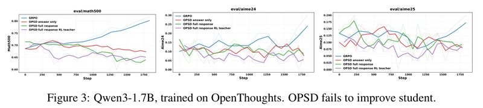

*图 3：Qwen3-1.7B 在 OpenThoughts 上训练，OPSD 没能提升学生。三张图从左到右是 Math500、AIME24、AIME25，横轴是训练步数。蓝线 GRPO 在 Math500 上从约 0.70 一路涨到约 0.80，AIME 上也在上升。另外三条是 OPSD：红线小抄只给答案，绿线小抄给完整解题过程，紫线先用 GRPO 把"看小抄的老师"练强。三条 OPSD 曲线都在原地打转，甚至下滑。数值是读图估计。*

有两个反直觉的地方：

- **小抄给完整解题过程，比只给答案还差。** 作者认为，更丰富的小抄可能加大师生之间的不匹配，而不是改善监督。
- **老师练强了，学生反而更差。** 紫线这组实验本来是要检验"是不是看小抄的老师太弱"，结果老师用 GRPO 练强后，学生反而更差。论文的结论是：光有小抄，不能让数学上的 OPSD 生效。

### 4.3 数学推理：OPD 先涨后崩

设置：学生 Qwen3-1.7B，老师 Qwen3-8B，都关闭思考模式，在 OpenThoughts 上训练。这组实验用的是不做归一化的 Top-20 反向 KL，它的问题在第 5.2 节讲。

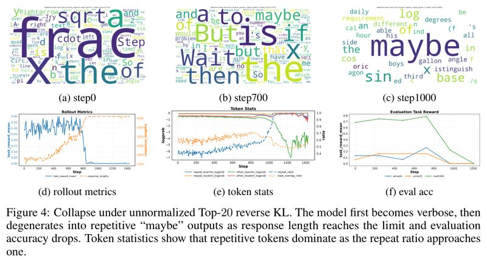

*图 4：不归一化的 Top-20 反向 KL 导致崩溃。论文图注的说法是：模型先变得啰嗦，随着回答长度顶到上限，退化成不断重复 "maybe"，评测准确率随之下跌；token 统计显示，重复比例接近 1 时，重复 token 占了绝大多数。上排 (a)～(c) 是学生回答里重复片段的词云（按三元组判断是否重复），下排 (d)～(f) 是训练中的回答统计、token 统计和评测准确率，横轴是训练步数。*

从图上可以看到：

- **词云**：第 0 步多是 frac、sqrt、x 这类数学符号，重复比例 0.51；第 700 步 But、Wait、if、maybe 这类改口词变多，重复比例 0.79；第 1000 步 maybe 占了绝对主导，重复比例 0.998。
- **(d) 回答统计**：训练奖励在约 800 步前维持在 0.2～0.4，之后跌到接近 0。回答长度（橙线）从约 1500 token 一路涨到 4000 的上限。
- **(e) token 统计**：重复比例陡增，师生 Top-K 候选的重合率同时崩塌。
- **(f) 评测准确率**：Math500 在约 750 步前维持在 0.7～0.8，到 1000 步跌到约 0.2，1200 步接近 0。

词云上的重复比例是图里标出的数，其余数值是读图估计。

附录 A.16、A.17 给了两个真实输出。第 700 步时，一道格点计数题的回答写得很冗长，"but" 出现了 10 次。第 1000 步时，模型开头复述了一句题目，接着写 "Wait, maybe maybe maybe…"，之后全是 "maybe"，论文展示时截掉了后面 24025 个字符。

### 4.4 风格对齐：OPSD 有效

两个测试集：

- **EmotionBench**：给一个生活情境，要求模型带着某种情绪作答（共 8 种，比如愤怒、焦虑、内疚）。老师的小抄写明"你正感到愤怒，原因是个人观点被无视"，学生只看到情境本身。
- **CharacterBench**：多轮角色扮演，从 11 个维度检查人设是否前后一致。老师的小抄是完整的角色设定（性格、说话方式、价值观、背景故事），学生只看到之前的对话。原始对话是中文。

训练时的奖励由 Gemini-2.0-Flash 打分，判断学生的回答有没有表达出目标风格。

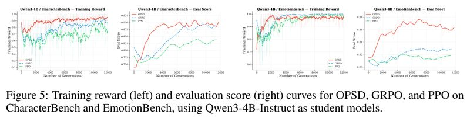

*图 5：以 Qwen3-4B-Instruct 为学生，OPSD（红）、GRPO（蓝）、PPO（绿）在 CharacterBench（左边两张）和 EmotionBench（右边两张）上的训练奖励和评测分数。横轴是累计生成的回答数，同一横坐标下三种方法的采样预算相同。红线 OPSD 涨得最快：CharacterBench 上约 6000 次生成就达到约 0.90，GRPO 到 1 万次左右才追上，PPO 停在约 0.84；EmotionBench 上 OPSD 评测分数最高约 0.87，GRPO 和 PPO 停在 0.82～0.83。数值是读图估计。*

附录 A.20 有一个训练后的例子。CharacterBench 里有个保守、只认中世纪传统的吟游诗人 Agares，被问到"你是怎么成为吟游诗人的"。学生没看角色设定，回答仍然保持了推崇传统诗歌、中世纪欧洲背景和自述式的叙事风格。

### 4.5 系统提示内化：OPSD 有效，但有上限

"系统提示内化"指的是：训练时老师看着一段系统提示词作答，训练完的学生不需要这段提示词，也能表现得像看过它一样。和风格对齐不同，这里所有题共用同一段提示词。

**推理压缩。** 老师的提示词要求"简洁、正确作答，不要冗余步骤，不要复述题目"，学生只看题目。学生是 Qwen3-8B（思考模式），数据是 DAPO-Math-17k，对照方法是加了长度惩罚的 GRPO。

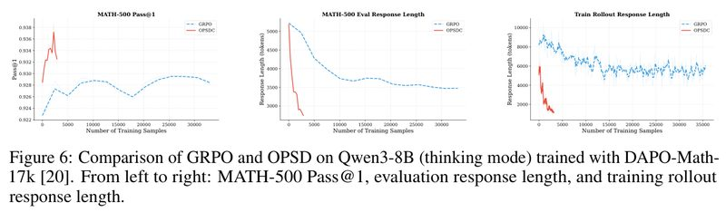

*图 6：Qwen3-8B（思考模式）在 DAPO-Math-17k 上训练，GRPO（蓝）与 OPSD（红，图例写作 OPSDC）的对比。从左到右：MATH-500 Pass@1、评测回答长度、训练时的回答长度，横轴是训练样本数。红线在约 3000 个训练样本内，把评测回答长度从约 5200 token 压到约 1800，准确率没有下降；蓝线 GRPO 用了 3 万多个样本，回答长度只降到约 3500。注意左图纵轴只跨 0.922～0.938，两条线相差约 1 分。数值是读图估计。*

红线只画到约 3000 个样本，更长训练下会怎样，图里看不出来。作者还指出一个效率优势：强化学习要生成到最终答案才能打分，生成长度得设得很大；OP(S)D 逐 token 给信号，生成可以短一些。他们也发现，这个应用要 8B 这样足够强的模型才有效，和论文文献 [18] 的发现一致。

**安全对齐。** 老师的提示词是四条安全规则：不协助有害或违法行为；礼貌拒绝不安全的请求；尽量给出安全的替代方案；对正常请求保持有用和中立。学生是 Qwen3-1.7B，数据是 Wildguardmix。

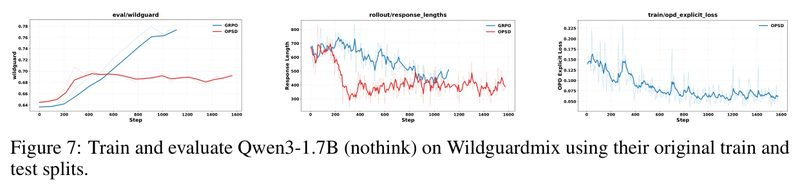

*图 7：Qwen3-1.7B（关闭思考模式）在 Wildguardmix 的原始训练集上训练、测试集上评测。左图是评测分数，横轴是训练步数：红线 OPSD 前 400 步从约 0.645 涨到约 0.695，之后基本不动；蓝线 GRPO 涨得慢，但一直涨到约 0.775。中、右两图是训练时的回答长度和 OPSD 的蒸馏损失。数值是读图估计。*

论文的说法是，OPSD 的最终表现受老师限制。这里的老师默认是冻结在第 0 步、看着安全规则的同一个模型，我的理解是，学生大致只能逼近它的水平；GRPO 没有这个限制，在 OPSD 停滞后还在继续涨。

## 5. 为什么会失败：三个机制

### 5.1 学生的半截答案把老师带偏

OPD 里，老师不是自己从头解题，而是接着学生写到一半的答案，判断下一个 token 该写什么。一个能独立解出题的强老师，被迫站在学生选的那条路上时，可能就不知道该怎么往下走了。

作者做了一个直接的测量（附录 A.22）。在 GPQA-Diamond（198 道研究生水平的科学选择题）上，先让 Qwen3-14B 老师独立作答；再把学生 Qwen3-1.7B 的回答随机截断，让老师接着写完。两次都用确定性解码（温度 0），只认明确写出 "Final Answer" 或 `\boxed{}` 的答案。

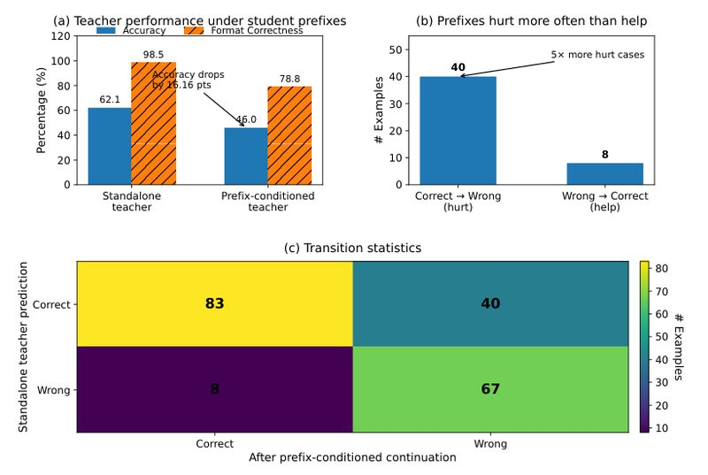

*附录 A.22 配图（论文没有给它编号）：(a) 学生前缀下老师的表现，蓝柱是准确率，橙色斜线柱是答案格式正确率。老师独立作答准确率 62.1%，接着学生的前缀写降到 46.0%，少了 16.16 分；格式正确率也从 98.5% 降到 78.8%。(b) 前缀害人的次数多于帮人：40 道原本做对、接了前缀后做错，只有 8 道原本做错、接了前缀后做对，害人的次数是帮人的 5 倍。(c) 前后对错的转移统计：198 道题里 83 道两次都对，67 道两次都错。*

附录 A.22 给的原始计数是：老师独立作答做对 123 道，接着前缀写只做对 91 道，净少 32 道。我核对过这几个数是自洽的：123/198 = 62.12%，91/198 = 45.96%；转移表里 83 + 40 = 123，83 + 8 = 91，四格合计 198，净减 40 − 8 = 32 题。

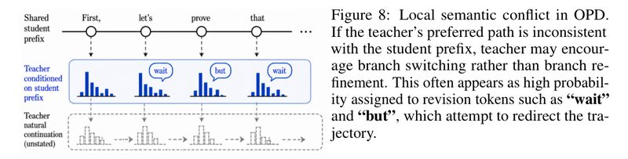

*图 8：OPD 中的局部语义冲突（示意图）。最上面一行是学生已经写下的前缀（"First, let's prove that…"）；中间是老师接着这个前缀给出的分布，概率最高的经常是 wait、but 这类改口词；最下面的虚线框是老师自己本来会怎么写，学生看不到。论文图注的说法是：如果老师偏好的路线和学生前缀不一致，老师可能鼓励换一条路，而不是把当前这条路走好，表现为给改口词很高的概率，试图把轨迹拉回去。*

学生按中间那排分布学习，就会学到"写一半就 wait 一下、换个思路"。论文认为，在数学推理中，这种不可靠的监督会让推理变得冗长、前后不一致。这和图 4 里改口词越来越多的现象相符，不过图 4 的崩溃，论文主要归因于下一节的损失偏差。

### 5.2 只算 Top-K 时，梯度里多出一个 "+1"

为了省显存，常见做法是每个位置只取前 K 个候选 token 算反向 KL（第 3 节）。论文指出，这样截断会让梯度多出一项偏差。

用白话说：反向 KL 对学生求梯度时，每个候选 token 前面有一个系数，等于"学生概率与老师概率之比取 log，再加 1"。在全词表上，所有 token 的 "+1" 部分加起来正好抵消，因为所有 token 的概率加起来恒等于 1，对一个常数求导得 0。只在前 K 个候选上算时，这 K 个 token 的概率加起来不再恒等于 1，"+1" 就留了下来（式子见本节末尾的选读）。

**这会改变更新方向。** 按论文的说法，每个候选 token 是被提高还是压低，看这个系数的正负：小于 0 就提高，大于 0 就压低。

- 没有 "+1"：老师给的概率比学生高，学生就提高这个 token。这是我们想要的。
- 有 "+1"：老师的概率要超过学生的 e 倍（约 2.72 倍），学生才会提高它。

举个数：老师给某个 token 0.5，学生给 0.3。老师更喜欢它，学生本该跟着提高。没有 "+1" 时，系数是 $`\log(0.3/0.5) = -0.51`$，小于 0，提高。有 "+1" 时，系数是 −0.51 + 1 = 0.49，大于 0，反而压低。老师的概率要超过 2.72 × 0.3 ≈ 0.82，学生才会提高它。

于是候选集合里的 token 普遍被压低，学生偏离老师的分布。论文认为，这可能把学生推向不稳定的低概率续写，并用它解释图 4 的崩溃。

**一个玩具验证**（我自己算的，不在论文里）：固定 3 个候选 token，老师在上面的概率是 0.55、0.30、0.10，合计 0.95。用不归一化的 Top-K 损失训练到收敛，学生在每个候选上的概率都恰好是老师的 1/e，即 0.20、0.11、0.04，合计只剩 0.35，其余 0.65 的概率跑到了损失看不见的 token 上。换成第 6.1 节的 stop-gradient 版本，学生收敛到和老师一样的 0.55、0.30、0.10。

**一个容易观察的症状**（同样是我的推算）：在不归一化的目标下，每个 token 的损失项 $`p\log(p/t)`$ 在 $`p=t/e`$ 时取最小值 $`-t/e`$，是个负数。真正的 KL 散度永远不小于 0，所以训练中这个损失持续变成负数，说明学生在候选集合上的概率被系统性地压到了老师之下。图 11 里崩溃的那条红线，损失正是一路降到了约 −0.17。

这几处我做过验算：全词表上 "+1" 项的贡献确实为 0，数值验算误差约 10⁻⁸；在 Top-K 上用自动求导比较，不归一化和 stop-gradient 两种损失的梯度之差恰好等于 "+1" 项。需要说明的是（这是我的看法），"老师的概率超过学生的 e 倍才会被提高"是逐个 token 看系数正负的说法；实际更新经过 softmax 相互耦合，单步方向不完全由一个系数决定。不过上面玩具实验的收敛点正好是"学生 = 老师 / e"，和论文的说法一致。

**选读：论文里的三个式子。** 不看也不影响理解。记 $`p_\theta`$ 为学生分布，$`p_T`$ 为老师分布。全词表反向 KL（论文式 (2)）对学生参数求梯度，得到式 (3)：

```math
\nabla_\theta D_{\mathrm{KL}}(p_\theta\|p_T)=\sum_{v}p_\theta(v)\Big[\log\frac{p_\theta(v)}{p_T(v)}+1\Big]\nabla_\theta\log p_\theta(v)
```

括号里的 "+1" 在全词表上会自动抵消，因为

```math
\sum_{v}p_\theta(v)\nabla_\theta\log p_\theta(v)=\nabla_\theta\sum_{v}p_\theta(v)=\nabla_\theta 1=0
```

只在 Top-K 集合 $`S_K`$ 上求和时（式 (6)），这 K 个 token 的概率和不再恒为 1，"+1" 就留了下来（式 (8)、(9)，$`\pi_S`$、$`\pi_T`$ 分别是学生和老师）：

```math
\nabla_\theta\mathcal L_{\text{Top-}K\text{-RKL}}=\sum_{v\in S_K}\pi_S(v)\Big[\log\frac{\pi_S(v)}{\pi_T(v)}+1\Big]\nabla_\theta\log\pi_S(v)
```

### 5.3 OPSD 只能学到各份小抄下都说得通的写法

学生考试时看不到小抄，所以 OPSD 实际上是让一个看不到小抄的学生，同时去贴近各种小抄下的老师。论文推出，这个问题的最优解是各种小抄下老师分布的几何平均，再归一化（式 (10)、(11)，见下面的选读）。

几何平均的特点是：只要有一份小抄下老师认为某个写法几乎不可能，这个写法就会被压得很低。学生最后学到的，是在每份小抄下都说得过去的写法。

**选读：式 (10) 和式 (11)。** 不看也不影响理解。记 $`x`$ 为题目，$`I`$ 为小抄。OPSD 实际在解：

```math
\min_{p_S}\ \mathbb{E}_{(x,I)\sim\mathcal D}\Big[D_{\mathrm{KL}}\big(p_S(\cdot\mid x)\,\|\,p_T(\cdot\mid x,I)\big)\Big]
```

它的最优解是：

```math
p_S^\star(y\mid x)=\frac{\exp\big(\mathbb E_{I\sim\mathcal D(\cdot\mid x)}\log p_T(y\mid x,I)\big)}{\sum_{y'}\exp\big(\mathbb E_{I\sim\mathcal D(\cdot\mid x)}\log p_T(y'\mid x,I)\big)}
```

**举个例子**（我编的示意，不是论文里的）：学生拿不准答案是 12 还是 15，两份可能的小抄对应两个老师。

| 下一步怎么写 | 看到"答案是 12"的老师 | 看到"答案是 15"的老师 | 学生的最优解（几何平均） |
| --- | --- | --- | --- |
| 直接写 12 | 0.90 | 0.0001 | 0.08 |
| 直接写 15 | 0.0001 | 0.90 | 0.08 |
| 先验算一下 | 0.10 | 0.10 | 0.84 |

学生最常做的，是两个老师都不反对的事（先验算一下）；两个老师各自最想做的事（直接写 12 或直接写 15），学生反而很少做。如果改用算术平均，结果会是 0.45、0.45、0.10，差别很大。我在概率单纯形上暴力搜索过这个例子，得到的最优解（0.080、0.079、0.841）和闭式解（0.080、0.080、0.840）一致。

**这里的"平均"要站在学生的角度理解**（这是我的补充）。公式里的平均，是对"学生从题目上分不清的那些小抄"取的。如果学生能从题目本身推出小抄，就不存在平均的问题：EmotionBench 的情境本身就暗示了该表达哪种情绪，CharacterBench 的前文对话已经透露了角色性格，所以这两个任务的小抄虽然每题不同，OPSD 仍然有效。劝捐任务里被劝者的背景从对话开头推不出来，于是失败。数学题的答案虽然由题目唯一决定，但要推出它就得先会解题，而这正是要学的本事。

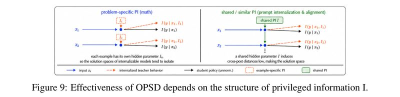

*图 9：OPSD 是否有效，取决于小抄 I 的结构（示意图）。左半边是数学，每道题有自己的小抄（$`I_1`$、$`I_2`$），橙色虚线表示看了各自小抄的老师会把每道题引向各自的方向，黑线是学生的策略，学生没法用一套行为同时模仿它们。右半边是提示内化和对齐，所有题共用同一份小抄 $`I`$（绿框），老师在各题上的行为遵循同一条规则，学生可以把这条规则压进参数里，变成一种习惯。*

论文的说法是：数学题的小抄引出彼此不兼容的老师行为，学生被推向这些行为的共同部分，因此远弱于看着小抄的老师。

附录 A.15 有个例子。在 DAPO-Math-17k 上只给最终答案当小抄，Qwen3-1.7B 自蒸馏后学会了跳过推理、直接报答案。一道饼图题，学生直接输出 $`\boxed{7}`$。我的理解是，这和上面的机制对得上：看得到答案的老师直接写答案很自然，学生学走了"直接写答案"这个习惯，却学不走答案本身。（我算了一下，这个 7 也是错的：按饼图，汉堡占 1 − 1/3 − 1/5 − 3/10 = 1/6，30 美元的 1/6 是 5 美元。论文没有点评这一点。）

**换一个更强的老师也没用。** 为了排除"老师太弱"这个解释，作者让 Qwen3-8B 当老师、Qwen3-1.7B 当学生做 OPD，比较三种情况：不给小抄、给答案、给完整解题过程。

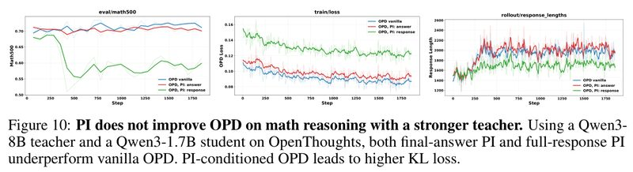

*图 10：在数学推理上，即便老师更强，小抄也帮不了 OPD。以 Qwen3-8B 为老师、Qwen3-1.7B 为学生在 OpenThoughts 上训练，三张图从左到右是 Math500、训练损失、回答长度，横轴是训练步数。Math500 上，蓝线（不给小抄）和红线（给答案）都在 0.70～0.72 之间，蓝线略高；绿线（给完整解题过程）跌到 0.55～0.60。损失图里，第 0 步就是给完整过程最高、给答案其次、不给最低，加了小抄的 OPD 损失更高。数值是读图估计。*

作者据此认为：小抄加大了师生分布的差距，小抄越长，差距越大，并没有带来更好的蒸馏信号。

## 6. 怎么补救

### 6.1 换一个没有偏差的损失

论文推荐的是 stop-gradient 版本（式 (12)）：求梯度时，把学生自己的 log 概率当成常数，不对它求导。这样梯度（式 (13)）里就没有 "+1" 了，更新方向回到"老师比学生高就提高"。它已经不是严格的反向 KL 梯度。作者的理由是：它更接近策略梯度的视角，"老师 log 概率减学生 log 概率"扮演的是优势的角色，不该参与求导。

另外两种写法也能避开这个问题：

| 改法 | 做法 | 优点 | 缺点 |
| --- | --- | --- | --- |
| Stop-gradient Top-K（式 (12)） | 求梯度时把学生自己的 log 概率当常数 | 去掉 "+1"，仍利用 K 个候选的信息 | 不是严格的反向 KL 梯度 |
| Top-K 内归一化（式 (15)） | 把 K 个候选的概率重新归一化到和为 1，再算 KL | 归一化后概率和恒为 1，"+1" 自然抵消（式 (16)） | 只匹配候选之间的相对比例，不管这些候选整体占多少概率，不再忠实近似全词表 KL |
| 采样 token + 策略梯度（式 (4)） | 只看学生实际写出的那个 token，把 log 概率差当奖励 | 天然没有这个问题 | 每个位置只用一个 token，拿到的老师信号比较稀疏 |

**选读：stop-gradient 版本的式子。** 不看也不影响理解。论文式 (12) 是：

```math
\mathcal L_{\text{SG-Top}K}(t)=-\sum_{v\in S_K}\pi_S(v)\Big[\log\pi_T(v)-\mathrm{stopgrad}\big(\log\pi_S(v)\big)\Big]
```

意思是：求梯度时，方括号里学生自己的 log 概率当成常数。还可以这样理解（这是我的推导）：全词表梯度里的 "+1" 本来就抵消了，剩下的部分是 $`\sum_v \pi_S(v)\log\frac{\pi_S(v)}{\pi_T(v)}\nabla_\theta\log\pi_S(v)`$。把这个和式只截到 K 个候选上，正好就是式 (13)。也就是说，stop-gradient 版本是"先求全词表的梯度，再截断"；不归一化版本是"先截断损失，再求导"，截断破坏了 "+1" 的抵消。

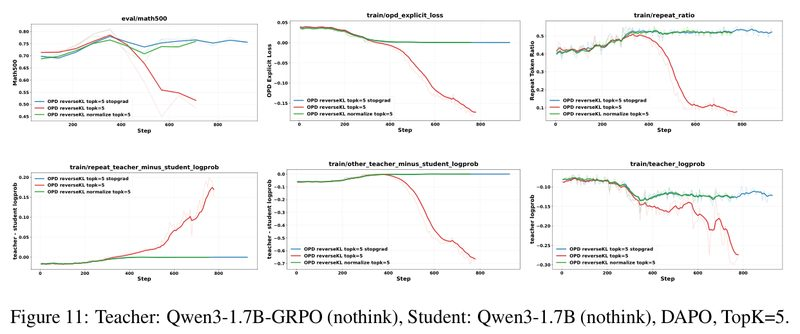

*图 11：老师 Qwen3-1.7B-GRPO，学生 Qwen3-1.7B（两者都关闭思考模式），数据 DAPO，K=5，比较三种 Top-K 损失：不归一化（红）、stop-gradient（蓝）、Top-K 内归一化（绿），横轴是训练步数。前 350 步三者差不多，Math500 都涨到约 0.78。之后红线崩了：Math500 跌到约 0.52，损失变成负数并一路降到约 −0.17，老师对学生所写 token 的平均 log 概率也从约 −0.08 降到约 −0.28，说明学生写的东西越来越不像老师会写的。蓝线和绿线基本稳定在 0.75 左右，绿线中途有一次小幅下探。数值是读图估计。*

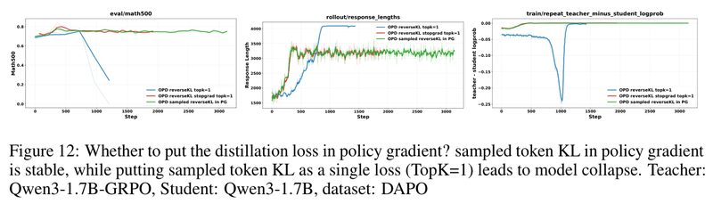

*图 12：蒸馏信号要不要放进策略梯度？老师 Qwen3-1.7B-GRPO，学生 Qwen3-1.7B，数据 DAPO。论文图注的说法是：把采样 token 的 KL 放进策略梯度是稳定的，把它当作一个单独的损失（TopK=1）会导致崩溃。三张图从左到右是 Math500、回答长度、重复 token 上老师减学生的 log 概率，横轴是训练步数。不归一化的 Top-1（蓝）在约 1000 步后崩溃，Math500 跌到约 0.25，回答长度早在约 800 步就顶到 4000 多 token 的上限；stop-gradient 的 Top-1（红）和策略梯度形式（绿）都稳定在 0.75 左右，绿线一直训练到 3000 步也没出问题。数值是读图估计。*

附录图 15 补充说明，把 K 从 5 加到 20 也消除不了崩溃，stop-gradient 版本则保持稳定。作者的结论：无论用 stop-gradient、Top-K 内归一化还是策略梯度形式，修正这项有偏的梯度是稳定蒸馏的关键。

**Top-K 集合怎么取，还有个工程问题。** 理想做法是在每个位置，用学生自己的 Top-K 候选去查老师的概率。但推理引擎 SGLang 的接口只接受一份对所有位置通用的 token 列表，不支持每个位置各给一份（附录 A.6）。如果把所有位置的候选取并集统一查询，最坏情况下显存是理想情况的 $`\min(|V|, TK)/K`$ 倍（$`|V|`$ 是词表大小，$`T`$ 是回答长度）。比如回答长 4096 个 token、K=20 时，这个倍数可达 4096。作者的折中办法是只在师生 Top-K 的交集上反向传播（式 (17)）。他们引用前人工作 [21] 说，用交集和用学生的 Top-K 效果相当。（这个倍数我核对过：并集最多含 $`\min(|V|, TK)`$ 个 token，除以理想情况的 K 即得。）

**代码层面差在哪**（我写的示意，不是论文里的；论文没有公开代码）。两种写法只差一个 `detach()`：

```python
# logp_s: 学生在每个位置、每个候选 token 上的 log 概率，形状 [T, K]，带梯度
# logp_t: 老师在同样位置、同样候选上的 log 概率，形状 [T, K]，不带梯度
# mask:   该候选是否同时在师生两边的 Top-K 里（式 17）
p_s = logp_s.exp()

# 式 6：不归一化的 Top-K 反向 KL。求导后梯度里带 "+1"，会崩
loss_bad = (p_s * (logp_s - logp_t) * mask).sum(-1).mean()

# 式 12：stop-gradient 版本。括号里学生自己的 log 概率不参与求导
loss_sg = -(p_s * (logp_t - logp_s.detach()) * mask).sum(-1).mean()
```

对 `loss_bad` 求导，`logp_s` 本身也贡献一份梯度，正好是多出来的 "+1"；`loss_sg` 把它挡掉了。两个损失在同一组参数下算出的数值完全相同，只有梯度不同，所以要确认用的是哪一种，得看代码。训练中损失一路变成负数，则说明用的是有偏的那种（见第 5.2 节）。

### 6.2 先用强化学习调一调老师

作者的思路是：蒸馏前先在训练分布上用 RLVR 调一调老师，既能提高它在这类题上的成绩，也可能让它的输出分布更接近学生，从而减轻第 5.1 节说的师生不匹配。

具体做法：先用强化学习把一个 Qwen3-1.7B 在 DAPO 上训练 200 步（论文原文是 "train with DAPO"，DAPO 既是算法名也是数据集名），得到的模型叫 Qwen3-1.7B-GRPO。它在三个数学基准上的成绩和 Qwen3-8B 差不多。然后分别让这两个模型当老师，在 OpenThoughts 上蒸馏一个 Qwen3-1.7B 学生。

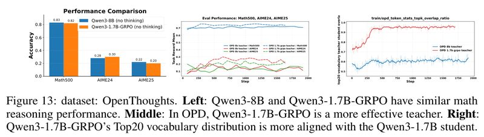

*图 13：数据 OpenThoughts。左：两个老师的数学成绩，Math500、AIME24、AIME25 分别是 0.83/0.28/0.22（Qwen3-8B）和 0.82/0.30/0.20（Qwen3-1.7B-GRPO），基本打平。中：用两个老师分别蒸馏 Qwen3-1.7B 学生，虚线是 1.7B-GRPO 当老师，实线是 8B 当老师；训练中后段虚线在三个基准上基本都高于实线，Math500 约 0.74～0.76 对 0.70～0.72，AIME24 约 0.2～0.3 对 0.1～0.2；两种老师下，学生的起点都是 Math500 约 0.69。右：老师和学生 Top-20 候选 token 的重合率，1.7B-GRPO 老师（红）升到约 0.95，8B 老师（蓝）一直在 0.6 左右。中、右两图的数值是读图估计。*

结论：**光看老师的榜单成绩，判断不了它在 OPD 里好不好用。** 和学生分布更接近的老师，逐 token 的指导更"接得上"学生自己的写法，监督效果更好，即使它的基准成绩并不更高。作者还认为，这条"先用 RL 强化老师、再蒸馏"的路线，可以替代给小抄的 OP(S)D。

### 6.3 学生输出不像样时，先做 SFT

设置：老师 Qwen3-4B（关闭思考模式），学生 Qwen3-1.7B-Base（没有经过指令微调的基础模型）。作者发现，这个学生一开始在部分题目上会输出乱码（非英文的 Unicode 字符），不是普通的推理错误，而是没有语义结构的退化文本。面对这种输出，老师给不出有意义的信号，直接做 OPD 就不稳定。

解决办法是先 SFT 再 OPD（附录 A.23）：

1. 把 OpenThoughts 中答案不是 `\boxed{}` 格式的题去掉，前 3 万道题留给 SFT，其余留给后面的 OPD。
2. 老师在前 3 万道题上作答（温度 0.3，最多 4096 token，每题 1 个回答），丢掉答错的、没写 `\boxed{}` 的、有重复文本的，最多保留 2 万条。
3. 用这些老师写的回答对学生做 SFT（学习率 1×10⁻⁵，训练 2 轮，用 LlamaFactory 框架，关闭思考模式以匹配老师的输出格式），再做 OPD。

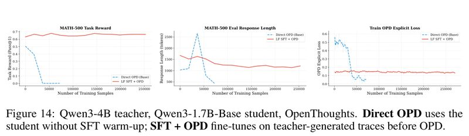

*图 14：老师 Qwen3-4B，学生 Qwen3-1.7B-Base，数据 OpenThoughts。蓝色虚线（Direct OPD）是学生不经 SFT 预热直接做 OPD，红线是先在老师生成的回答上做 SFT、再做 OPD。三张图从左到右是 MATH-500 准确率、评测回答长度、训练损失，横轴是累计训练样本数。直接 OPD：MATH-500 从约 0.50 跌到 0，回答长度先冲到约 2650 token，再塌到约 450。先 SFT：MATH-500 从约 0.63 升到 0.66～0.68 并保持住，回答长度从约 1650 降到约 1200 并保持稳定。数值是读图估计。*

右图有个容易误判的地方：直接 OPD 的损失从约 0.5 降到接近 0，准确率却同时降到 0。损失低不代表学得好。

论文表 3（附录 A.23.1），老师生成的 SFT 数据在对应学生下的似然：

| 设置 | 学生 | 平均 NLL | PPL |
| --- | --- | --- | --- |
| SFT 前，Qwen3-4B 的回答 | Qwen3-1.7B-Base | 0.640 | 1.896 |
| SFT 后，Qwen3-4B 的回答 | Qwen3-1.7B-Base-SFT | 0.335 | 1.397 |

*平均 NLL 是学生给这些回答的负 log 概率的平均值，PPL（困惑度）等于它的指数，两者越低，表示 SFT 数据离学生的分布越近。我核对过：$`e^{0.640} = 1.896`$，$`e^{0.335} = 1.398`$，论文写 1.397，差别来自 NLL 的四舍五入。*

SFT 把学生的分布拉近了老师。作者的解释是：SFT 让学生自己采样出的回答保持在"格式正常"的区域，老师的反馈在这个区域里才有效。此前也有工作用监督数据稳定 OPD：Luo 等人 [23] 把 OPD 和基于标准答案的 SFT 结合，抑制回答越写越长；Li 等人 [21] 用老师写的回答微调学生，缩小师生差距。本文观察到的是另一种不稳定来源：学生输出乱码。

## 7. 附录里的其他发现

论文共 32 页：正文 10 页，参考文献 2 页，附录 20 页。下面是附录里对理解 OPD 有帮助的几条。附录图 15～23 没有放进本文，只转述结论。

**老师的信号集中在哪里**（附录 A.9～A.11，图 16～18）。作者统计了学生写出的每个 token 上"老师 log 概率减学生 log 概率"（下称信号，越负表示老师越不认同）：

- **师生差距越大，信号越强。** Qwen3-8B 老师给 Qwen3-1.7B 的回答打分，信号多在 −0.1 上下，开头更强（最强约 −0.2）；给 8B 自己生成的回答打分，信号多在 0～−0.04，只有开头接近 −0.1。自蒸馏的信号整体偏弱。
- **信号集中在回答前部。** 越往后，信号越弱，不同小抄之间的差别也越小。作者认为前面 token 的监督更重要。
- **信号集中在答错的回答上。** 以关闭思考模式的设置为例，老师带小抄时，答错的回答在最终答案 token 上的信号是 −0.25～−0.36，答对的只有 −0.03～−0.04；老师不带小抄时差距小一些（−0.10 对 −0.05）。也就是说，OPD 主要在纠错，对已经正确的推理帮助有限。
- **老师的能力比小抄更决定信号的样子。** 同一道题上，三个用 8B 老师的实验信号分布彼此相似，两个用 1.7B 老师的是另一种分布；小抄能让信号变强，但改变不了基本形状。

**通用推理上 OPD 也没有稳定收益**（附录 A.12，图 19、20）。学生 Qwen3-1.7B、老师 Qwen3-8B，在 Mixture of Thoughts 的科学子集上训练，GPQA-Diamond 上下波动，MMLU-Pro 只有小幅提升。信号的分布规律和数学上一样。

**劝捐对话上 OPSD 崩溃**（附录 A.13，图 21）。任务是多轮对话劝对方给"救助儿童会"捐款，小抄是被劝者的背景、性格和劝说策略，属于每段对话各不相同的信息。1.7B 学生在 20～30 步后崩溃，4B 学生崩得更厉害。OPSD 很快把回答截断率推到接近 1，也就是回答几乎都写到了长度上限；学生对自己所写 token 的 log 概率也持续下降，说明它越来越不确定。GRPO 则平稳上升。

**思考模式被"带歪"**（附录 A.14，图 22）。这组实验沿用 OPSD 原论文 [7] 的设置：学生关闭思考模式、老师开启思考模式。学生会慢慢学会在回答里输出 `<think>` 这类控制 token，出现 `<think>…</think>…<think>` 这样格式错乱的输出。学生不仅学了答案的分布，连老师隐藏推理用的控制符号也学了。

**老师要不要跟着学生一起更新**（附录 A.3.1）。冻结的老师稳定，但能力有上限；跟着学生更新的老师（学生自己或 EMA）常被认为能更好地利用小抄，作者认为这并没有保证。除非直接用 RL 之类的方法针对任务训练老师，否则没理由指望单靠 OP(S)D 就能得到比初始老师更会用小抄的老师。

**token 熵和老师信号只有弱相关**（附录 A.21，图 23）。受前人工作 [28] 启发，作者检查了 token 熵能否指导蒸馏，相关系数只有 −0.11（8B 学生）和 −0.21（1.7B 学生），证据不足。

**评测里的两个坑**（附录 A.8）：

1. **评测时的最大生成长度。** OPD 常让回答变长、变啰嗦。如果评测时的长度上限太小，回答还没写到答案就被截断，准确率的涨跌可能只反映"能不能在长度内写完"，不反映推理能力。
2. **只看训练前期。** OPD 前期涨得快，GRPO 涨得慢，但在作者的观察中，GRPO 能持续涨得更久、最终更高。只拿前期比较就说 OPD 更省样本，会忽略性能上限。

## 8. 作者自己承认的局限

论文没有专门的局限章节，下面几条来自结论和正文里作者自己的说明。

- **只测了有限的模型家族和规模。** 结论里说，这些发现基于有限的模型家族和模型规模，更大规模下可能表现不同。全文只用了 Qwen3 系列，学生最大 8B，老师最大 14B。
- **三种损失改法各有代价。** stop-gradient 版本不是严格的反向 KL 梯度；Top-K 内归一化只匹配候选之间的相对比例，不再忠实近似全词表 KL；策略梯度形式每个位置只用学生采样到的那个 token，拿到的老师信号稀疏（论文第 6.1 节）。
- **留给以后的方向。** 作者建议把 SFT、RL、OPD 串成一个迭代的自我改进流程：SFT 提供稳定的起点，RL 提升具体任务上的表现，OPD 再把改进后的行为蒸馏回学生。论文分别试了"先 RL 调老师再蒸馏"和"先 SFT 再蒸馏"，完整的迭代流程没有做。

## 9. 读的时候值得留意的地方

以下是我读原文时注意到、论文没有重点讨论的点，供参考。

### 证据有多强

- **看不到随机种子和误差范围。** 全文没有提到随机种子、误差条或显著性检验，曲线看起来都是单次运行。论文第 6.2 节说用 1.7B-GRPO 老师蒸馏"显著优于"（significantly outperforms）用 8B 老师蒸馏，但没有做检验；Math500 上 3～5 分的差距比较明显，图 13 的 AIME 曲线本身波动很大。
- **机制 1 的证据是间接的。** 第 5.1 节的 GPQA 实验说明老师接着学生前缀写会变差，但它是推理时的测量，不是训练实验，用的还是另一组模型（14B 老师）和另一个数据集；训练中这个机制贡献多大，没有直接测量。图 4 的崩溃同时用了有偏的损失，机制 1 和机制 2 的影响没有拆开。
- **GPQA 的 16 分下降里，很大一部分是没按格式给出答案。** 论文给的格式正确率 98.48% 和 78.79% 分别对应 195 题和 156 题能解析出答案。只看能解析的回答，准确率从 63.1%（123/195）降到 58.3%（91/156），只降约 5 分；其余的下降来自多出来的 39 道没能按格式给出答案的题。格式失败本身也可能是被带偏的表现（比如被带进死胡同、迟迟给不出结论），论文没有区分这两种情况。
- **"数学上 OPSD 无效"只测了反向 KL。** OPSD 原论文 [7] 用的是全词表正向 KL 加逐 token 截断（clipping），约 100 步收敛。[7] 自己的消融里，反向 KL 和 JSD 几乎没有提升：在 Qwen3-1.7B、AIME25 上，反向 KL 从 36.7 到 37.5 又回落到 35.0，正向 KL 才把成绩提到 43.9。本文的 OPSD 用的恰好是反向 KL（stop-gradient 的 Top-20 版本），训练近 1800 步，没有提升，这和 [7] 里反向 KL 的结果其实一致。本文没有测正向 KL 的 OPSD，所以这个结论至少要加上"用反向 KL 时"的限定。另外，论文第 3 节说 OPD 不宜用正向 KL（见本文第 3 节），这是针对外部老师的 OPD 说的，[7] 的 OPSD 恰恰是靠正向 KL 起效的。两篇放在一起看，数学上 OPSD 成败的一个关键变量可能是 KL 的方向，而不只是小抄的结构；这一点两篇论文都没有直接验证。
- **RL 老师实验有混淆因素。** Qwen3-1.7B-GRPO 和学生本来就是同一个模型，分布接近有一部分是因为同源。论文没有对 8B 老师也做 RL 调整来做对照，所以分不清起作用的是"RL 调整"还是"同一个模型"。另外，从图 13 看，蒸馏出的学生 Math500 约 0.75，还不如老师 Qwen3-1.7B-GRPO 本身的 0.82。如果目标只是得到更好的 1.7B 模型，直接用这个老师就行。这条路线更适合的场景，可能是把多个经 RL 训练的专家合并进一个学生（论文引言提到的用法），但论文没有做这类实验。
- **修掉损失偏差以后，师生不匹配仍在限制涨幅。** 图 10、图 13 里，8B 老师蒸馏 1.7B 学生没有崩，但 Math500 基本停在 0.70～0.72，而这个学生训练前大约是 0.69～0.70。按附录 A.1 的默认设置推断，这两组实验用的应是修正后的损失。换成和学生同源的 1.7B-GRPO 老师，才涨到 0.75 左右。我的理解是，三个机制里，损失偏差决定"会不会崩"，师生不匹配决定"能涨多少"。
- **数学上，OPD 不一定比直接做 RL 强。** 从论文自己的曲线看，图 3 里直接对 Qwen3-1.7B 做 GRPO，Math500 训到约 0.80；图 13 里用两种老师蒸馏，学生只到约 0.75 和 0.71，AIME 上两者接近。两张图的设置未必完全一致，GRPO 每步的采样量也是 OPD 的 4 倍（32 题 × 8 个回答，对 64 题 × 1 个回答），但这和附录 A.8"GRPO 最终上限更高"的提醒是一致的。
- **式 (11) 解释数学失败，还需要一个没写明的前提。** 式 (11) 对每道题 $`x`$ 单独取平均。数学题的答案由题目唯一决定，严格按公式，每道题的最优学生就是看着这份小抄的老师，不存在平均。要得出"学生只能学到共同部分"，还需要一个论文没写明的前提：学生的能力有限，没法从题目算出小抄，只能用同一套行为应付很多道题（图 9 的示意隐含了这一点）。第 5.3 节"站在学生的角度理解平均"那段，是我对这个前提的一种理解。
- **机制 3 的适用边界没有判别标准。** 论文第 4.2 节原话说风格对齐的小抄也是"每题不同"的，OPSD 却有效。论文用"小抄遵循相似的潜在结构"来解释，但没有给出可以事先检验的判别标准。
- **风格对齐靠 LLM 评分。** 训练奖励由 Gemini-2.0-Flash 打分，可能带有评委偏好。
- **表 3 没说测的是哪些回答。** 论文没说明 SFT 后的 NLL 是在训练用过的回答上测的，还是在留出的回答上测的。如果是前者，NLL 下降有一部分只是记住了训练数据。

### 适用范围

- **OPSD 什么时候能用，可以先看小抄是什么。** 按论文的结果和第 5.3 节的分析，所有题共用的规则（系统提示词、风格要求、安全规则）适合 OPSD；每道题各不相同、学生光看题目推不出来的信息（比如数学题的答案和解法、某个人的背景），OPSD 大概率没用。这是我根据论文结论归纳的经验规则，论文没有给出判别标准（见上一条）。

### 稿件里的小问题（不影响主要结论）

- **风格对齐少了 8B 的结果。** 论文第 4.2 节说用了 Qwen3-4B-Instruct 和 Qwen3-8B 两个学生，但图 5 只画了 4B，全文没有给出 8B 的结果。
- **默认损失的说法不一致。** 附录 A.1 说默认用"stop-gradient 且归一化"的 Top-K 反向 KL；论文第 6.1 节把 stop-gradient 和归一化当作两种独立的改法，没给出两者叠加时的公式；图 4 等实验又用了不归一化的版本。读每个实验时要看它自己写的损失。
- **图 12 标题的用词。** 标题把 "TopK=1" 和"采样 token 的 KL"当成一回事。按式 (17)，Top-1 集合是师生各自概率最高候选的交集，不一定是学生实际采样到的 token（采样温度 1.0）。论文没有说明实现里 TopK=1 是否就是采样 token。
- **图 16 的子图引用。** 附录 A.9 正文说 8B 老师给自己生成的回答打分见图 16b，按子图标题应是图 16c；图 16b 是 1.7B 学生开启思考模式的情况。

### 如果自己训练（我根据论文结论整理的检查清单；论文没有公开代码，这些都得按论文描述自己实现）

- **用 Top-K 近似反向 KL 时，别用不归一化的原始形式。** 改用 stop-gradient、Top-K 内归一化，或采样 token 的策略梯度形式（第 6.1 节）。训练时盯着损失，持续变负是危险信号（这一条是我根据公式推出的，见第 5.2 节）。
- **选老师别只看榜单分数。** 还要看它和学生的分布有多接近，比如 Top-K 候选的重合率；必要时先用 RL 在训练分布上调一调老师（第 6.2 节）。
- **学生会输出乱码或格式错乱时，先用老师写的回答做一轮 SFT，再做 OPD**（第 6.3 节）。
- **师生的思考模式不一致时（比如学生关、老师开），检查学生输出里有没有混入 `<think>` 控制符**（第 7 节）。
- **盯住早期预警信号。** 回答长度、重复比例、wait/but/maybe 这类改口词的比例、师生 Top-K 重合率。图 4 中，回答长度从第 200 步左右就开始上涨，改口词在第 700 步已经很多，准确率到第 1000 步才崩（读图估计）。
- **评测要公平。** 生成长度上限要够；和 RL 比较时看完整的训练曲线和最终上限，不要只看前期（第 7 节，附录 A.8）。

## 10. 和相关工作的关系

论文引用的工作里，本文提到过的有下面这些。方括号里是论文的参考文献编号。

| 主题 | 论文 | 和本文的关系 |
| --- | --- | --- |
| OPD 基础 | [1] Agarwal 等，On-Policy Distillation of Language Models: Learning from Self-Generated Mistakes（2024），<https://arxiv.org/abs/2306.13649> | 在线蒸馏的奠基工作 |
| OPD 基础 | [2] Gu 等，MiniLLM: On-Policy Distillation of Large Language Models，<https://arxiv.org/abs/2306.08543> | 用反向 KL 做大模型蒸馏 |
| OPD 基础 | [5] Kevin Lu、Thinking Machines Lab，On-Policy Distillation（2025），博客 <https://thinkingmachines.ai/blog/on-policy-distillation> | 把 OPD 用在数学推理上 |
| 自蒸馏与上下文蒸馏 | [7] Zhao 等，Self-Distilled Reasoner: On-Policy Self-Distillation for LLMs，<https://arxiv.org/abs/2601.18734> | OPSD 原论文，用全词表正向 KL，在数学上报告了正面结果；它的设置和结果见第 7 节、第 9 节 |
| 自蒸馏与上下文蒸馏 | [6] Shenfeld 等，Self-Distillation Enables Continual Learning（SDFT），<https://arxiv.org/abs/2601.19897> | 用自蒸馏做持续学习；本文附录引用它作为 EMA 老师和全词表梯度近似的出处之一 |
| 自蒸馏与上下文蒸馏 | [24] Hübotter 等，Reinforcement Learning via Self-Distillation（SDPO），<https://arxiv.org/abs/2601.20802> | 带尾部概率的 Top-K 反向 KL、EMA 老师 |
| 自蒸馏与上下文蒸馏 | [9] Ye 等，On-Policy Context Distillation for Language Models，<https://arxiv.org/abs/2602.12275> | 把上下文蒸馏做成在线形式 |
| 自蒸馏与上下文蒸馏 | [18] Sang 等，CRISP: Compressed Reasoning via Iterative Self-Policy Distillation，<https://arxiv.org/abs/2603.05433> | 推理压缩，同样发现需要足够大的模型（第 4.5 节） |
| OPD 失败分析与稳定化 | [10] Fu 等，Revisiting On-Policy Distillation: Empirical Failure Modes and Simple Fixes，<https://arxiv.org/abs/2603.25562> | 同样报告 OPD 的失败模式并给出修补；附录提到它用老师的 Top-K 集合 |
| OPD 失败分析与稳定化 | [11] Kim 等，Why Does Self-Distillation (Sometimes) Degrade the Reasoning Capability of LLMs?，<https://arxiv.org/abs/2603.24472> | 自蒸馏损害推理能力的分析 |
| OPD 失败分析与稳定化 | [21] Li 等，Rethinking On-Policy Distillation of LLMs: Phenomenology, Mechanism, and Recipe，<https://arxiv.org/abs/2604.13016> | Top-K 交集做法和"SFT 缩小师生差距"的来源（第 6.1、6.3 节） |
| OPD 失败分析与稳定化 | [23] Luo 等，Demystifying OPD: Length Inflation and Stabilization Strategies for LLMs，<https://arxiv.org/abs/2604.08527> | 分析 OPD 回答越写越长，用 SFT 稳定（第 6.3 节） |
| 熵和蒸馏 | [28] Jin 等，Entropy-Aware On-Policy Distillation of Language Models，<https://arxiv.org/abs/2603.07079> | 老师的熵高时在反向 KL 之外加上正向 KL；本文附录 A.21 受它启发，检查了熵和老师信号的相关性（第 7 节） |

- **另一种绕开机制 3 的办法**（这是我的看法，不是论文的内容）。BSD 论文（<https://arxiv.org/abs/2610.26397>）的消融实验里，纯 OPSD（不要判卷器）训练中途从 63.3 掉到 55.8，答案越写越短，和本文附录 A.15 里"跳过推理、直接报答案"的现象相似。BSD 让判卷器决定奖惩方向，小抄只决定惩罚落在哪些 token 上，可以看作避开机制 3 的一种办法。
- **实验用到的数据集**：OpenThoughts [22]（<https://arxiv.org/abs/2506.04178>）、DAPO-Math-17k [20]（<https://arxiv.org/abs/2503.14476>）。

## 11. 总结

这是一篇实证分析论文，没有提出新方法。它把此前互相矛盾的 OPD、OPSD 结果放进同一个框架里解释：**OPSD 管不管用，看小抄是所有题共用的规则，还是每题各不相同的具体信息；OPD 稳不稳，看损失怎么写、老师离学生有多近。** 作者把失败现象和三个具体机制对上（学生前缀把老师带偏、Top-K 损失多出的 "+1" 偏差、OPSD 只能学到各份小抄的共同部分），再用对照实验验证了三种补救办法；其中先做 SFT 这一招，论文自己也指出前人 [21]、[23] 用过。

证据上，最扎实的是 Top-K 偏差这一条：有推导，K=1、5、20 三组对照里不归一化版本都崩，改掉偏差后都稳定（图 11、12 和附录图 15）；学生前缀干扰老师也有直接测量（GPQA 实验）。论文的关键推导和 GPQA 的计数我核对过，都对得上。论文正反两面都测了，既有数学、劝捐这类失败场景，也有风格对齐、提示内化这类成功场景，结论落在"什么条件下好用"上。补救办法容易落地：改一行损失、加一轮 SFT 都很便宜；用 RL 调老师需要额外训练，但走的是现成的 RLVR 流程。SGLang 接口问题、评测长度上限、只看前期的比较偏差这些工程细节，也都写得很透明，是实际训练中会踩的坑。不足在于：只用了 Qwen3 系列、规模不大，也没有报告误差范围；"数学上 OPSD 无效"只测了反向 KL；在数学上，蒸馏出的学生（Math500 约 0.75）还不如直接做 GRPO（约 0.80）。

---

## 原文位置对照

| 本文内容 | 论文位置 |
| --- | --- |
| 一句话版本、总览图 | 摘要，第 1 节，图 1 |
| 问题和动机 | 第 1、2 节 |
| OPD 和 OPSD、两种 KL、两种省显存的近似 | 第 3 节，式 (1)～(5)，图 2 |
| 三个设计选择 | 附录 A.3，图 1 左上 |
| 实验设置、超参数 | 附录 A.1，表 1 |
| 数学推理：OPSD 无效、OPD 先涨后崩 | 第 4.1 节，图 3、图 4，附录 A.16、A.17 |
| 风格对齐 | 第 4.2 节，图 5，附录 A.20 |
| 系统提示内化：推理压缩、安全对齐 | 第 4.2 节，图 6、图 7，附录 A.18、A.19 |
| 机制 1：学生前缀把老师带偏 | 第 5.1 节，图 8，附录 A.22 |
| 机制 2：Top-K 的 "+1" 偏差 | 第 5.1 节，式 (6)～(9) |
| 机制 3：OPSD 只学到小抄的共同部分 | 第 5.2 节，式 (10)、(11)，图 9、图 10，附录 A.15 |
| 补救 1：没有偏差的损失、SGLang 的工程问题 | 第 6.1 节，式 (12)～(17)，图 11、图 12，附录 A.6、A.7，图 15 |
| 补救 2：先用 RL 调老师 | 第 6.2 节，图 13 |
| 补救 3：先 SFT 再 OPD | 第 6.3 节，图 14，附录 A.23，表 2、表 3 |
| 老师信号分析、通用推理 | 附录 A.9～A.12，图 16～20 |
| 劝捐对话、思考模式被带歪 | 附录 A.13、A.14，图 21、图 22 |
| 老师要不要跟着更新、熵和信号的相关性 | 附录 A.3.1、A.21，图 23 |
| 评测里的两个坑 | 附录 A.8 |
| 局限和展望 | 第 7 节 |
| 梯度分解和逐项推导（本文没有展开） | 附录 A.4、A.5 |
