# The Many Faces of On-Policy Distillation: Pitfalls, Mechanisms, and Fixes

[中文](./Many-Faces-of-On-Policy-Distillation.md) | English

- **Source**: [The Many Faces of On-Policy Distillation: Pitfalls, Mechanisms, and Fixes](https://arxiv.org/abs/2605.11182v2)
- **Paper**: [arXiv:2605.11182](https://arxiv.org/abs/2605.11182)
- **Published**: 2026-05-11
- **Scope**: A plain-language explainer based on arXiv v2 (revised 2026-05-24), not a full translation. The authors are Siqi Zhu, Xuyan Ye, Hongyu Lu, Weiye Shi and Ge Liu, from the University of Illinois Urbana-Champaign (UIUC, Zhu and Liu), Renmin University of China (Ye and Lu) and Peking University (Shi). Ye, Lu and Shi are joint second authors, and the work was done during internships at UIUC. Neither the paper nor the arXiv page gives a code link.

## In One Sentence

On-policy distillation is a family of post-training methods for large models: the student model writes its own response, the teacher goes over that response token by token and gives a "here is what I would write" distribution, and the student moves toward the teacher. When the teacher is a separate, stronger model, this is called OPD (On-Policy Distillation); when the teacher is the student itself, only with an extra "cheat sheet" to look at (such as the reference solution or a system prompt), it is called OPSD (On-Policy Self-Distillation). Earlier studies give both mixed reviews, and this paper runs a series of controlled experiments to find out when they work, when they fail, and why they fail. The authors identify three causes of failure: the half-finished answer the student has written can lead the teacher astray; when the loss is computed only over the top K candidate tokens to save GPU memory, the gradient picks up an extra bias term; and the OPSD student cannot see the cheat sheet at test time, so it can only learn what the cheat sheets of different questions have in common. The matching fixes are: switch to a Top-K loss without this bias; before distillation, tune the teacher on the training set with reinforcement learning so that its output distribution moves closer to the student's; and when the student's outputs are not yet presentable, run a round of SFT (supervised fine-tuning) first.

Main findings: on math reasoning, how well OPD works depends heavily on which teacher and which loss are used; with the wrong choice, training collapses and the model ends up outputting nothing but a long string of "maybe"; OPSD brought no improvement in the math settings the authors tested. On style alignment and system-prompt internalization, OPSD works, and early on it rises faster than the two RL methods GRPO and PPO; on safety alignment, GRPO catches up and overtakes it later. Two representative sets of numbers: when Qwen3-14B continues half-finished answers written by Qwen3-1.7B on GPQA-Diamond, its accuracy drops from 62.1% when it answers on its own to 46.0%, about 16 percentage points lower (called "points" below); of the 198 questions, 40 that it originally got right were led astray, and only 8 that it originally got wrong were led to the right answer. A 1.7B teacher tuned with RL scores about the same as Qwen3-8B on Math500 (0.82 vs. 0.83), yet works clearly better as a teacher: during training, the overlap between its Top-20 candidate tokens and the student's rises to about 0.95, while the 8B teacher stays around 0.6.

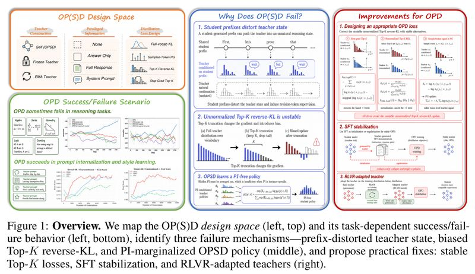

*Figure 1: Overview of the paper. Top left is the design space of OP(S)D (the paper's collective name for OPD and OPSD), and bottom left is where it succeeds or fails on different tasks; the middle shows the three failure mechanisms: teacher states distorted by the student's prefix, a biased Top-K reverse KL, and an OPSD policy that averages over cheat sheets; the right shows the fixes: a stable Top-K loss, SFT stabilization, and a teacher adjusted with RLVR. The left answers "what approaches exist, where they succeed, where they fail", the middle answers "why they fail", and the right answers "how to fix it"; the rest of this note follows that order.*

---

## 1. Key Terms

| Term | In plain words |
| --- | --- |
| OPD (On-Policy Distillation) | The student answers on its own, a stronger teacher model gives a reference distribution at each token of the student's response, and the student moves toward it |
| OPSD (On-Policy Self-Distillation) | The teacher is the student itself, only with an extra cheat sheet to look at. The paper calls OPD and OPSD together OP(S)D |
| Cheat sheet (PI, privileged information) | Information that only the teacher can see during training and the student cannot see at test time, such as the reference solution, the full solution steps, a system prompt or user preferences. "Cheat sheet" is this note's name for it |
| on-policy and off-policy | Learning on responses the student generated itself is called on-policy (also "online"); learning on responses someone else wrote in advance is called off-policy ("offline") |
| Reverse KL and forward KL | KL divergence measures how far apart two distributions are. It is not symmetric, so it has two directions: reverse KL makes the student grab one of the teacher's peaks, and forward KL makes the student cover all of the teacher's peaks |
| Top-K approximation | At each position, only the top K candidate tokens are used to compute the loss, to save GPU memory |
| stop-gradient | Treat a quantity as a constant when computing gradients, so it is not differentiated. In PyTorch this is `detach()` |
| Policy gradient and advantage | An RL update rule: each token gets a score (the advantage); if it is positive, the token's probability is raised, and if it is negative, lowered |
| GRPO, PPO | Two common RL algorithms. GRPO samples several responses per question and scores each by how good it is relative to the rest of its group; PPO uses a value model to estimate how good it is |
| RLVR | RL with a reward that can be checked automatically (for example, whether a math answer is correct) |
| SFT (supervised fine-tuning) | Train the model to imitate a given response word for word |
| Thinking mode | A generation mode of Qwen3: the model first writes its reasoning inside `<think>…</think>`, then gives the answer. "Thinking off" means skipping this part |
| Log probability (logprob) | The log of the probability the model gives a token; the closer it is to 0, the more certain the model is |
| EMA (exponential moving average) | At each step, the teacher's parameters move only a small step toward the student's current parameters, which is more stable than using the student itself as the teacher directly |
| System-prompt internalization | After training, the model behaves as if it had seen a system prompt even without it, for example writing concisely or following safety rules |

## 2. What Problem It Tackles

On-policy distillation is seen as a promising post-training method for large models: the student is corrected per-token on responses it wrote itself, so it practices on exactly the mistakes it really makes, and every token gets feedback. The paper's introduction lists several uses of OPD: merging the abilities of several stronger teachers into one student, reducing catastrophic forgetting (forgetting old skills while learning new ones), and improving sample efficiency. OPSD does not even need a stronger model, and can turn context that exists only during training (the reference solution, a system prompt, user preferences) into the student's own skill.

| Approach | How it works | Problem |
| --- | --- | --- |
| Off-policy training (SFT, off-policy distillation) | The student imitates responses written in advance by a teacher or by people | It practices on responses others wrote, so the student is not corrected on the mistakes it would make itself |
| Reinforcement learning (GRPO, PPO) | The student answers on its own and gets one score for whether the whole question is right | Each question gets only one score, so the signal is coarse; scoring needs the generation to reach the final answer, so the generation length has to be set very large |
| OPD and OPSD | The student answers on its own, and the teacher gives a reference distribution per token | Existing results contradict each other: some work reports that it is effective for system-prompt internalization, knowledge internalization and reasoning, while other work reports unstable training and worse scores |

Work reporting it effective includes the paper's references [7] and [9]; work reporting instability and degradation is [10] and [11] (the numbers in square brackets are the paper's reference numbers; the corresponding papers are listed in Section 10).

The question the paper sets out to answer is: **when do OPD and OPSD work, when do they fail, and what mechanism lies behind this?** The authors test both success and failure cases on three kinds of tasks (math reasoning, style alignment and system-prompt internalization), then look for the causes of the failures and try fixes.

## 3. How the Authors Investigated: Splitting On-Policy Distillation into Three Choices

**How OPD trains.** The student writes its own response. For every token the student writes, the teacher gives a distribution over "what I would write at this position", and the student adjusts its own distribution toward the teacher's. The training data are responses the student wrote itself, so this is on-policy; off-policy training, by contrast, uses model answers written in advance by a teacher or by people. The benefit of on-policy training is that the student is corrected on the mistakes it really makes, and every token gets feedback, which is much finer than RL's "one right-or-wrong score for the whole question". The OPD teacher is a stronger model, for example Qwen3-8B teaching Qwen3-1.7B.

**How OPSD trains.** The teacher is the student itself, only with an extra cheat sheet to look at. The paper calls the cheat sheet privileged information (PI), which can be the reference solution, the full solution steps, a system prompt, user preferences and so on. During training, the teacher looks at the cheat sheet and scores the student's response per token; at test time the student cannot see the cheat sheet and must rely on itself.

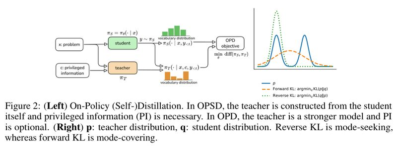

*Figure 2 left: the on-policy (self-)distillation pipeline. The OPSD teacher is the student itself plus a cheat sheet, and the cheat sheet is required; the OPD teacher is a stronger model, and the cheat sheet is optional. Right: p is the teacher distribution and q is the student distribution. The blue line is the teacher's distribution, which has two peaks, meaning the teacher accepts both ways of writing; the orange dashed line is the student learned with forward KL, which, so as not to miss any of the teacher's ways of writing, spreads into a wide, low distribution whose highest point falls between the two peaks and resembles neither way of writing; the green dotted line is the student learned with reverse KL, which picks one peak and learns it accurately. The paper's caption puts it this way: reverse KL tends to grab one peak (mode-seeking), and forward KL tends to cover all peaks (mode-covering).*

OPD usually uses reverse KL. The authors' reasoning (Section 3 of the paper): forward KL forces the student to write tokens that the teacher likes but the student itself rarely writes; reverse KL keeps the student's own high-probability ways of writing and is also less prone to catastrophic forgetting.

**Two approximations that save GPU memory.** Every position requires comparing the teacher's and the student's probabilities over the whole vocabulary; the vocabulary has well over a hundred thousand tokens and responses run to several thousand tokens, which is more than GPU memory can handle. There are two common ways to save memory:

- **Top-K approximation**: compute the reverse KL only over the top K candidate tokens (for example K=20).
- **Sampled token only**: look only at the token the student actually wrote, treat "the teacher's log probability minus the student's log probability" as the reward, and update the way RL policy gradient does. The paper calls this the sampled-token or PG form.

Used directly without correction, the first approximation makes training collapse; Section 5.2 explains why.

**Three design choices.** The paper breaks an OP(S)D method into three largely independent choices (top left of Figure 1; Appendix A.3 of the paper):

| Dimension | Options |
| --- | --- |
| Where the teacher comes from | The student itself (parameters shared in real time), a frozen model (such as the initial student, or another, stronger model), an EMA of the student's parameters |
| What the cheat sheet contains | Nothing, only the final answer, the full solution steps, a system prompt |
| How the loss is computed | Full-vocabulary KL, the PG form that looks only at the sampled token, Top-K reverse KL, Top-K reverse KL with stop-gradient |

The first two dimensions are mainly choices for OPSD: in standard OPD the teacher is a fixed external model, usually given no cheat sheet. How to compute the loss is a choice for both. The authors' method is to swap options along these dimensions, run controlled comparisons on two kinds of tasks (ones where the method fails and ones where it succeeds), and then make targeted measurements of the failure cases, such as having the teacher continue writing from the student's half-finished answer.

## 4. Experimental Results

### 4.1 How the experiments were set up

Both students and teachers come from the Qwen3 family (1.7B, 4B, 8B, 14B, plus 4B-Instruct and 1.7B-Base). The math training data are mainly OpenThoughts and DAPO-Math-17k, and evaluation uses Math500, AIME24 and AIME25. The baselines are two RL algorithms, GRPO and PPO.

Table 1 of the paper (Appendix A.1) lists the default training hyperparameters of the four methods; an excerpt:

| Setting | OPD | OPSD | GRPO | PPO |
| --- | --- | --- | --- | --- |
| Questions per batch | 64 | 64 | 32 | 64 |
| Responses sampled per question | 1 | 1 | 8 | 1 |
| Max response length in training (tokens) | 4096 | 4096 | 8192 | 8192 |
| Training objective | Top-K reverse KL (K=20) | Top-K reverse KL (K=20) | Policy gradient | PPO |
| Teacher | External teacher | The student itself at step 0 (frozen) | None | None |
| Teacher's cheat sheet | None | Final answer or full solution steps | None | None |

All four methods use the Adam optimizer, learning rate 2×10⁻⁶, cosine decay, learning-rate warmup over the first 10% of steps, sampling temperature 1.0 and top-p 0.95; at evaluation, responses are at most 16384 tokens. Unless stated otherwise, OPD and OPSD use a reverse KL with stop-gradient that is normalized within the Top-K (Section 6.1 covers these two changes), and OPSD runs with thinking mode off. All experiments ran on 10 NVIDIA RTX PRO 6000 Blackwell GPUs.

The table below puts the settings and results of each task together; the subsections that follow go through them one by one:

| Task | Method | What the cheat sheet is | Do all questions share one cheat sheet? | Result |
| --- | --- | --- | --- | --- |
| Math reasoning | OPSD | Each question's final answer, or the full solution steps | No | No improvement (Figure 3) |
| Math reasoning | OPD (teacher Qwen3-8B, unnormalized Top-20 loss) | None | Not applicable | Rises, then collapses (Figure 4) |
| Math reasoning | OPD (teacher swapped for an RL-tuned Qwen3-1.7B) | None | Not applicable | Steady improvement, Math500 rises from about 0.69 to about 0.75 (Figure 13, Section 6.2) |
| Emotional expression, role-play | OPSD | The emotion description or character setting for each question | Different for each question, but all the same kind of style rule | Effective, rises faster than GRPO and PPO (Figure 5) |
| Reasoning compression | OPSD | A prompt asking for "concise answers" | Yes | Accuracy holds, evaluation response length shrinks from about 5200 tokens to about 1800 (Figure 6) |
| Safety alignment | OPSD | Four safety rules | Yes | Rises fast early, later overtaken by GRPO (Figure 7) |
| Donation-persuasion dialogue | OPSD | The persuadee's background, personality and the persuasion strategy | No | Collapses after 20 to 30 training steps (Appendix A.13) |

A pattern is already visible: when the cheat sheet expresses one shared rule (a fixed prompt, or one kind of style requirement), OPSD works well; when the cheat sheet is specific information that differs from question to question and is useful only for that question (an answer, a solution, a particular person's background), OPSD fails. Section 5.3 explains why.

### 4.2 Math reasoning: OPSD has no effect

Setup: the student is Qwen3-1.7B, trained on the math problems in OpenThoughts (keeping only English problems with a verifiable `\boxed{}` answer). The teacher is the student itself at the start of training plus a cheat sheet, and the loss is Top-20 reverse KL with stop-gradient.

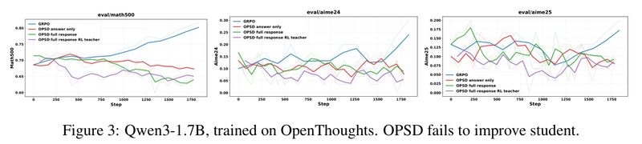

*Figure 3: Qwen3-1.7B trained on OpenThoughts; OPSD fails to improve the student. The three panels, left to right, are Math500, AIME24 and AIME25, and the horizontal axis is training steps. The blue line, GRPO, climbs on Math500 from about 0.70 all the way to about 0.80, and also rises on AIME. The other three are OPSD: on the red line the cheat sheet gives only the answer, on the green line it gives the full solution steps, and on the purple line the "teacher with the cheat sheet" is first made stronger with GRPO. All three OPSD curves go nowhere or even slide down. The values are read off the plot.*

Two things are counterintuitive:

- **A cheat sheet with the full solution steps does worse than one with only the answer.** The authors think a richer cheat sheet may widen the mismatch between teacher and student rather than improve the supervision.
- **A stronger teacher makes the student worse.** The purple-line experiment was meant to test "whether the teacher with the cheat sheet is too weak", but after the teacher was made stronger with GRPO, the student got worse instead. The paper's conclusion: a cheat sheet alone cannot make OPSD work on math.

### 4.3 Math reasoning: OPD rises, then collapses

Setup: the student is Qwen3-1.7B and the teacher is Qwen3-8B, both with thinking mode off, trained on OpenThoughts. This experiment uses Top-20 reverse KL without normalization, whose problem is covered in Section 5.2.

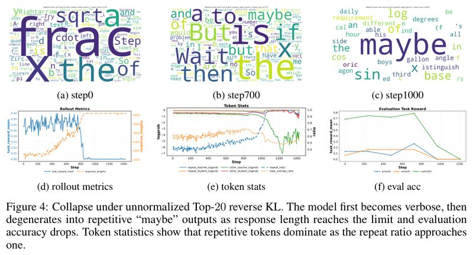

*Figure 4: Unnormalized Top-20 reverse KL causes collapse. The paper's caption puts it this way: the model first becomes verbose, then, as the response length hits the cap, degenerates into repeating "maybe" over and over, and evaluation accuracy falls with it; the token statistics show that when the repetition ratio approaches 1, repeated tokens make up the vast majority. The top row, (a) to (c), shows word clouds of the repeated fragments in the student's responses (repetition is judged by trigrams); the bottom row, (d) to (f), shows response statistics, token statistics and evaluation accuracy during training, with training steps on the horizontal axis.*

The figure shows:

- **Word clouds**: at step 0 they are mostly math symbols like frac, sqrt and x, with a repetition ratio of 0.51; at step 700 backtracking words like But, Wait, if and maybe become more common, with a repetition ratio of 0.79; at step 1000 maybe dominates completely, with a repetition ratio of 0.998.
- **(d) Response statistics**: the training reward stays at 0.2 to 0.4 until about step 800, then falls to near 0. The response length (orange line) climbs from about 1500 tokens all the way to the 4000 cap.
- **(e) Token statistics**: the repetition ratio shoots up, and at the same time the overlap between the teacher's and the student's Top-K candidates collapses.
- **(f) Evaluation accuracy**: Math500 stays at 0.7 to 0.8 until about step 750, falls to about 0.2 by step 1000, and is near 0 at step 1200.

The repetition ratios on the word clouds are the numbers printed in the figure; the other values are read off the plot.

Appendices A.16 and A.17 give two real outputs. At step 700, the response to a lattice-point counting problem is very long-winded, and "but" appears 10 times. At step 1000, the model opens by restating one sentence of the problem, then writes "Wait, maybe maybe maybe…", and after that it is all "maybe"; the paper cut the remaining 24025 characters when showing it.

### 4.4 Style alignment: OPSD works

Two test sets:

- **EmotionBench**: given an everyday situation, the model must respond with a certain emotion (8 in total, such as anger, anxiety and guilt). The teacher's cheat sheet states "you are feeling angry because your personal views were ignored", while the student sees only the situation itself.
- **CharacterBench**: multi-turn role-play, checking along 11 dimensions whether the persona stays consistent. The teacher's cheat sheet is the full character setting (personality, way of speaking, values, backstory), while the student sees only the conversation so far. The original dialogues are in Chinese.

The training reward is scored by Gemini-2.0-Flash, which judges whether the student's response expresses the target style.

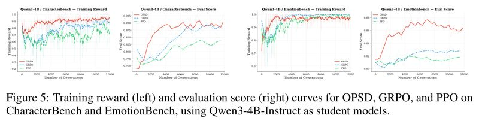

*Figure 5: Training reward and evaluation scores of OPSD (red), GRPO (blue) and PPO (green) on CharacterBench (left two panels) and EmotionBench (right two panels), with Qwen3-4B-Instruct as the student. The horizontal axis is the cumulative number of generated responses, so at the same x-value the three methods have the same sampling budget. The red line, OPSD, rises fastest: on CharacterBench it reaches about 0.90 after about 6000 generations, GRPO catches up only at around 10,000, and PPO stops at about 0.84; on EmotionBench OPSD's evaluation score peaks at about 0.87, while GRPO and PPO stop at 0.82 to 0.83. The values are read off the plot.*

Appendix A.20 has an example after training. CharacterBench has a conservative bard, Agares, who accepts only medieval traditions, and he is asked "how did you become a bard?". The student never saw the character setting, yet its answer still keeps the reverence for traditional poetry, the medieval European setting and the first-person narrative style.

### 4.5 System-prompt internalization: OPSD works, but with a ceiling

"System-prompt internalization" means: during training the teacher answers while looking at a system prompt, and after training the student behaves as if it had seen that prompt without needing it. Unlike style alignment, here all questions share the same prompt.

**Reasoning compression.** The teacher's prompt asks it to "answer concisely and correctly, with no redundant steps and without restating the problem", while the student sees only the problem. The student is Qwen3-8B (thinking mode), the data are DAPO-Math-17k, and the baseline is GRPO with a length penalty.

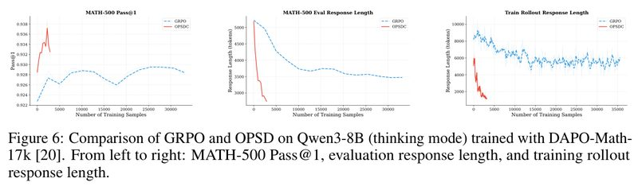

*Figure 6: Qwen3-8B (thinking mode) trained on DAPO-Math-17k, comparing GRPO (blue) and OPSD (red, labeled OPSDC in the legend). Left to right: MATH-500 Pass@1, evaluation response length, and response length during training, with the number of training samples on the horizontal axis. Within about 3000 training samples, the red line cuts the evaluation response length from about 5200 tokens to about 1800 without any drop in accuracy; the blue line, GRPO, uses over 30,000 samples and only brings the response length down to about 3500. Note that the vertical axis of the left panel spans only 0.922 to 0.938, so the two lines differ by about 1 point. The values are read off the plot.*

The red line only goes to about 3000 samples, so the figure does not show what happens with longer training. The authors also point out an efficiency advantage: RL needs the generation to reach the final answer before it can score it, so the generation length has to be set very large; OP(S)D gives a signal per token, so generations can be shorter. They also find that this application works only with a strong enough model such as 8B, consistent with the findings of the paper's reference [18].

**Safety alignment.** The teacher's prompt is four safety rules: do not assist harmful or illegal activities; politely refuse unsafe requests; offer safe alternatives where possible; stay helpful and neutral on normal requests. The student is Qwen3-1.7B, and the data are Wildguardmix.

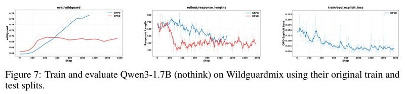

*Figure 7: Qwen3-1.7B (thinking mode off) trained on Wildguardmix's original training set and evaluated on its test set. The left panel is the evaluation score, with training steps on the horizontal axis: the red line, OPSD, rises from about 0.645 to about 0.695 over the first 400 steps and then barely moves; the blue line, GRPO, rises slowly but keeps going up to about 0.775. The middle and right panels are the response length during training and OPSD's distillation loss. The values are read off the plot.*

The paper says OPSD's final performance is limited by the teacher. Here the teacher is, by default, the same model frozen at step 0 and looking at the safety rules; my reading is that the student can roughly only approach its level, while GRPO has no such limit and keeps rising after OPSD stalls.

## 5. Why It Fails: Three Mechanisms

### 5.1 The student's half-finished answer leads the teacher astray

In OPD, rather than solving the problem from scratch, the teacher continues from the answer the student has half written and judges what the next token should be. A strong teacher that can solve a problem on its own may no longer know how to go on once it is forced onto the path the student chose.

The authors made a direct measurement (Appendix A.22). On GPQA-Diamond (198 graduate-level multiple-choice science questions), they first had the Qwen3-14B teacher answer on its own; then they cut the student Qwen3-1.7B's responses at random points and had the teacher finish them. Both runs use deterministic decoding (temperature 0), and only answers that explicitly write "Final Answer" or `\boxed{}` count.

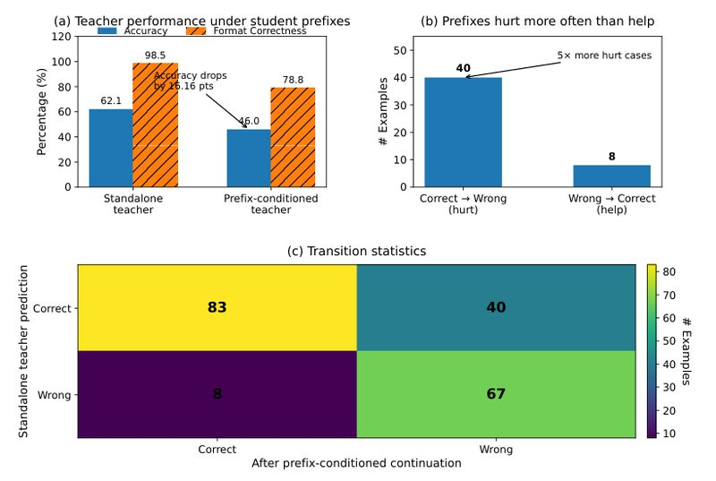

*Appendix A.22 figure (the paper gives it no number): (a) the teacher's performance under student prefixes; blue bars are accuracy and orange hatched bars are the answer-format correctness rate. The teacher's accuracy is 62.1% when answering on its own and drops to 46.0% when continuing the student's prefix, 16.16 points lower; the format correctness rate also drops from 98.5% to 78.8%. (b) Prefixes hurt more often than they help: 40 questions were right originally and wrong after the prefix, and only 8 were wrong originally and right after the prefix, so prefixes hurt 5× as often as they help. (c) Transition counts between the two runs: of the 198 questions, 83 were right both times and 67 were wrong both times.*

The raw counts in Appendix A.22: the teacher gets 123 questions right on its own and only 91 when continuing prefixes, a net loss of 32. I checked that these numbers are consistent: 123/198 = 62.12%, 91/198 = 45.96%; in the transition table, 83 + 40 = 123, 83 + 8 = 91, the four cells sum to 198, and the net loss is 40 − 8 = 32 questions.

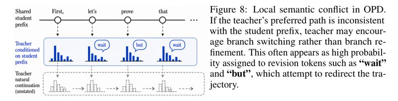

*Figure 8: Local semantic conflict in OPD (schematic). The top row is the prefix the student has already written ("First, let's prove that…"); the middle is the distribution the teacher gives after this prefix, where the highest-probability tokens are often backtracking words like wait and but; the dashed box at the bottom is how the teacher itself would have written it, which the student cannot see. The paper's caption puts it this way: if the teacher's preferred route does not match the student's prefix, the teacher may encourage switching to another route instead of following the current one well, which shows up as high probabilities on backtracking words, trying to pull the trajectory back.*

A student that learns from the middle row's distribution learns to "stop halfway, say wait, and switch approach". The paper argues that in math reasoning this unreliable supervision makes reasoning long-winded and inconsistent. This fits the growing number of backtracking words in Figure 4, though the paper mainly attributes the collapse in Figure 4 to the loss bias in the next section.

### 5.2 With Top-K only, the gradient picks up an extra "+1"

To save GPU memory, the common practice is to compute the reverse KL over only the top K candidate tokens at each position (Section 3). The paper points out that truncating like this adds a bias term to the gradient.

In plain words: when you take the gradient of reverse KL with respect to the student, each candidate token gets a coefficient equal to "the log of the ratio of the student's probability to the teacher's, plus 1". Over the full vocabulary, the "+1" parts of all tokens add up to exactly cancel, because the probabilities of all tokens always sum to 1, and the derivative of a constant is 0. When the loss is computed only over the top K candidates, the probabilities of these K tokens no longer always sum to 1, so the "+1" remains (the formulas are in the optional reading at the end of this section).

**This changes the update direction.** According to the paper, whether each candidate token is raised or pushed down depends on the sign of this coefficient: below 0, it is raised; above 0, it is pushed down.

- Without the "+1": if the teacher gives a higher probability than the student, the student raises this token. This is what we want.
- With the "+1": the teacher's probability must exceed e times the student's (about 2.72×) before the student raises it.

A worked number: the teacher gives a token 0.5 and the student gives it 0.3. The teacher likes it more, so the student should follow and raise it. Without the "+1", the coefficient is $`\log(0.3/0.5) = -0.51`$, below 0, so it is raised. With the "+1", the coefficient is −0.51 + 1 = 0.49, above 0, so it is pushed down instead. The teacher's probability would have to exceed 2.72 × 0.3 ≈ 0.82 for the student to raise it.

So tokens in the candidate set are generally pushed down, and the student drifts away from the teacher's distribution. The paper argues this may push the student toward unstable low-probability continuations, and uses it to explain the collapse in Figure 4.

**A toy check** (my own calculation, not in the paper): fix 3 candidate tokens on which the teacher's probabilities are 0.55, 0.30 and 0.10, summing to 0.95. Trained to convergence with the unnormalized Top-K loss, the student's probability on each candidate is exactly 1/e of the teacher's, that is 0.20, 0.11 and 0.04, which sum to only 0.35; the remaining 0.65 of probability has moved to tokens the loss cannot see. With the stop-gradient version from Section 6.1 instead, the student converges to the same 0.55, 0.30 and 0.10 as the teacher.

**An easy-to-spot symptom** (also my own derivation): under the unnormalized objective, each token's loss term $`p\log(p/t)`$ reaches its minimum $`-t/e`$ at $`p=t/e`$, a negative number. A true KL divergence is never below 0, so if this loss keeps going negative during training, the student's probabilities on the candidate set are being systematically pushed below the teacher's. On the red line that collapses in Figure 11, the loss does fall all the way to about −0.17.

I verified these points: over the full vocabulary the "+1" term's contribution is indeed 0, with a numerical error of about 10⁻⁸; comparing with autograd on the Top-K, the difference between the gradients of the unnormalized and stop-gradient losses is exactly the "+1" term. One caveat (this is my view): "a token is raised only if the teacher's probability exceeds e times the student's" describes the sign of each token's coefficient taken one at a time; the actual update couples the tokens through the softmax, so the direction of a single step is not fully set by one coefficient. Still, the convergence point of the toy experiment above is exactly "student = teacher / e", which matches what the paper says.

**Optional reading: the paper's three formulas.** Skipping them does not affect understanding. Let $`p_\theta`$ be the student distribution and $`p_T`$ the teacher distribution. Taking the gradient of the full-vocabulary reverse KL (the paper's Eq. (2)) with respect to the student's parameters gives Eq. (3):

```math
\nabla_\theta D_{\mathrm{KL}}(p_\theta\|p_T)=\sum_{v}p_\theta(v)\Big[\log\frac{p_\theta(v)}{p_T(v)}+1\Big]\nabla_\theta\log p_\theta(v)
```

Over the full vocabulary, the "+1" in the brackets cancels automatically, because

```math
\sum_{v}p_\theta(v)\nabla_\theta\log p_\theta(v)=\nabla_\theta\sum_{v}p_\theta(v)=\nabla_\theta 1=0
```

When the sum runs only over the Top-K set $`S_K`$ (Eq. (6)), the probabilities of these K tokens no longer always sum to 1, so the "+1" remains (Eqs. (8) and (9), where $`\pi_S`$ and $`\pi_T`$ are the student and the teacher):

```math
\nabla_\theta\mathcal L_{\text{Top-}K\text{-RKL}}=\sum_{v\in S_K}\pi_S(v)\Big[\log\frac{\pi_S(v)}{\pi_T(v)}+1\Big]\nabla_\theta\log\pi_S(v)
```

### 5.3 OPSD can only learn what makes sense under every cheat sheet

The student cannot see the cheat sheet at test time, so OPSD in effect asks a student without the cheat sheet to match the teacher under all the different cheat sheets at once. The paper derives that the optimum of this problem is the geometric mean of the teacher's distributions under the various cheat sheets, renormalized (Eqs. (10) and (11); see the optional reading below).

A property of the geometric mean: as soon as the teacher considers a way of writing nearly impossible under even one cheat sheet, that way of writing is pushed very low. What the student ends up learning is the way of writing that is acceptable under every cheat sheet.

**Optional reading: Eqs. (10) and (11).** Skipping them does not affect understanding. Let $`x`$ be the question and $`I`$ the cheat sheet. OPSD actually solves:

```math
\min_{p_S}\ \mathbb{E}_{(x,I)\sim\mathcal D}\Big[D_{\mathrm{KL}}\big(p_S(\cdot\mid x)\,\|\,p_T(\cdot\mid x,I)\big)\Big]
```

Its optimum is:

```math
p_S^\star(y\mid x)=\frac{\exp\big(\mathbb E_{I\sim\mathcal D(\cdot\mid x)}\log p_T(y\mid x,I)\big)}{\sum_{y'}\exp\big(\mathbb E_{I\sim\mathcal D(\cdot\mid x)}\log p_T(y'\mid x,I)\big)}
```

**An example** (an illustration I made up, not from the paper): the student is unsure whether the answer is 12 or 15, and the two possible cheat sheets correspond to two teachers.

| What to write next | Teacher who saw "the answer is 12" | Teacher who saw "the answer is 15" | Student's optimum (geometric mean) |
| --- | --- | --- | --- |
| Write 12 directly | 0.90 | 0.0001 | 0.08 |
| Write 15 directly | 0.0001 | 0.90 | 0.08 |
| Check the calculation first | 0.10 | 0.10 | 0.84 |

What the student does most often is the thing neither teacher objects to (checking the calculation first); the thing each teacher most wants to do (writing 12 directly, or writing 15 directly) is what the student rarely does. With an arithmetic mean instead, the result would be 0.45, 0.45 and 0.10, which is very different. I brute-force searched the probability simplex for this example, and the optimum I found (0.080, 0.079, 0.841) matches the closed-form solution (0.080, 0.080, 0.840).

**The "average" here should be understood from the student's side** (this is my addition). The average in the formula is taken over "the cheat sheets the student cannot tell apart from the question". If the student can infer the cheat sheet from the question itself, there is no averaging problem: in EmotionBench the situation itself hints at which emotion to express, and in CharacterBench the earlier conversation already reveals the character's personality, so although the cheat sheets of these two tasks differ from question to question, OPSD still works. In the donation-persuasion task, the persuadee's background cannot be inferred from the start of the conversation, so it fails. The answer to a math problem is uniquely determined by the problem, but inferring it requires first knowing how to solve the problem, which is exactly the skill to be learned.

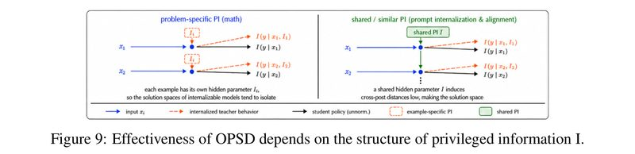

*Figure 9: Whether OPSD works depends on the structure of the cheat sheet I (schematic). The left half is math, where each question has its own cheat sheet ($`I_1`$, $`I_2`$); the orange dashed lines show that teachers who saw their respective cheat sheets steer each question in its own direction, the black line is the student's policy, and the student cannot imitate them all with one set of behaviors. The right half is prompt internalization and alignment, where all questions share the same cheat sheet $`I`$ (green box); the teacher's behavior on every question follows the same rule, and the student can compress this rule into its parameters and turn it into a habit.*

The paper puts it this way: the cheat sheets of math problems elicit mutually incompatible teacher behaviors, and the student is pushed toward what these behaviors have in common, so it ends up far weaker than the teacher looking at the cheat sheet.

Appendix A.15 has an example. With only the final answer as the cheat sheet on DAPO-Math-17k, Qwen3-1.7B learns through self-distillation to skip the reasoning and report the answer directly. On a pie-chart problem, the student outputs $`\boxed{7}`$ directly. My reading is that this fits the mechanism above: for a teacher who can see the answer, writing the answer directly is natural, so the student picks up the habit of "writing the answer directly" but cannot pick up the answer itself. (I worked it out, and this 7 is also wrong: by the pie chart, burgers take 1 − 1/3 − 1/5 − 3/10 = 1/6, and 1/6 of 30 dollars is 5 dollars. The paper does not comment on this.)

**A stronger teacher does not help either.** To rule out the explanation that "the teacher is too weak", the authors ran OPD with Qwen3-8B as the teacher and Qwen3-1.7B as the student, comparing three cases: no cheat sheet, the answer, and the full solution steps.

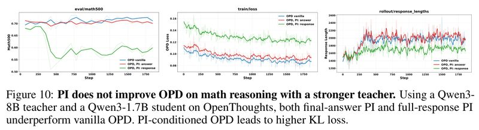

*Figure 10: On math reasoning, the cheat sheet does not help OPD even with a stronger teacher. Trained on OpenThoughts with Qwen3-8B as the teacher and Qwen3-1.7B as the student; the three panels, left to right, are Math500, training loss and response length, with training steps on the horizontal axis. On Math500, the blue line (no cheat sheet) and the red line (the answer) both sit between 0.70 and 0.72, with the blue line slightly higher; the green line (the full solution steps) falls to 0.55 to 0.60. In the loss panel, already at step 0 the full solution steps give the highest loss, the answer the next highest, and no cheat sheet the lowest, so OPD with a cheat sheet has a higher loss. The values are read off the plot.*

From this the authors conclude that the cheat sheet widens the gap between the teacher's and the student's distributions, and the longer the cheat sheet, the wider the gap; it does not bring a better distillation signal.

## 6. How to Fix It

### 6.1 Switch to a loss without the bias

The paper recommends the stop-gradient version (Eq. (12)): when computing the gradient, treat the student's own log probability as a constant and do not differentiate it. Then the gradient (Eq. (13)) has no "+1", and the update direction goes back to "raise it if the teacher is higher than the student". It is no longer the strict reverse KL gradient. The authors' reasoning: it is closer to the policy-gradient view, in which "the teacher's log probability minus the student's log probability" plays the role of the advantage and should not be differentiated.

Two other formulations also avoid this problem:

| Change | How it works | Pros | Cons |
| --- | --- | --- | --- |
| Stop-gradient Top-K (Eq. (12)) | Treat the student's own log probability as a constant when computing the gradient | Removes the "+1" while still using the information in the K candidates | Not the strict reverse KL gradient |
| Normalization within the Top-K (Eq. (15)) | Renormalize the probabilities of the K candidates to sum to 1, then compute the KL | After normalization the probabilities always sum to 1, so the "+1" cancels naturally (Eq. (16)) | Matches only the relative proportions among the candidates, ignoring how much total probability they hold, so it no longer faithfully approximates the full-vocabulary KL |
| Sampled token + policy gradient (Eq. (4)) | Look only at the token the student actually wrote, and use the log-probability difference as the reward | Free of this problem by construction | Uses only one token per position, so the teacher signal it gets is fairly sparse |

**Optional reading: the formula of the stop-gradient version.** Skipping it does not affect understanding. The paper's Eq. (12) is:

```math
\mathcal L_{\text{SG-Top}K}(t)=-\sum_{v\in S_K}\pi_S(v)\Big[\log\pi_T(v)-\mathrm{stopgrad}\big(\log\pi_S(v)\big)\Big]
```

This means: when computing the gradient, the student's own log probability inside the square brackets is treated as a constant. Another way to see it (this is my derivation): in the full-vocabulary gradient the "+1" already cancels, and what remains is $`\sum_v \pi_S(v)\log\frac{\pi_S(v)}{\pi_T(v)}\nabla_\theta\log\pi_S(v)`$. Truncating this sum to just the K candidates gives exactly Eq. (13). In other words, the stop-gradient version "first takes the full-vocabulary gradient, then truncates"; the unnormalized version "first truncates the loss, then differentiates", and the truncation breaks the cancellation of the "+1".

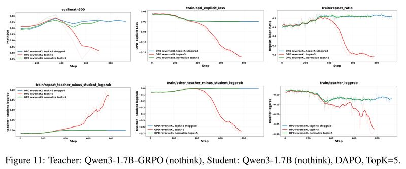

*Figure 11: Teacher Qwen3-1.7B-GRPO, student Qwen3-1.7B (both with thinking mode off), data DAPO, K=5, comparing three Top-K losses: unnormalized (red), stop-gradient (blue) and normalized within the Top-K (green), with training steps on the horizontal axis. For the first 350 steps the three are about the same, and Math500 rises to about 0.78 for all of them. Then the red line collapses: Math500 falls to about 0.52, the loss turns negative and falls all the way to about −0.17, and the teacher's average log probability on the tokens the student writes also drops from about −0.08 to about −0.28, showing that what the student writes looks less and less like what the teacher would write. The blue and green lines stay roughly stable around 0.75, with one small dip in the green line midway. The values are read off the plot.*

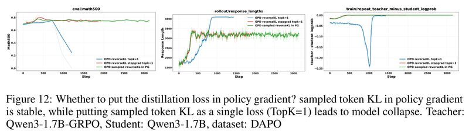

*Figure 12: Should the distillation signal go into the policy gradient? Teacher Qwen3-1.7B-GRPO, student Qwen3-1.7B, data DAPO. The paper's caption puts it this way: putting the sampled token's KL into the policy gradient is stable, while treating it as a separate loss (TopK=1) leads to collapse. The three panels, left to right, are Math500, response length, and the teacher's minus the student's log probability on repeated tokens, with training steps on the horizontal axis. The unnormalized Top-1 (blue) collapses after about 1000 steps, with Math500 falling to about 0.25, and its response length already hit the cap of a little over 4000 tokens at about step 800; the stop-gradient Top-1 (red) and the policy-gradient form (green) both stay stable around 0.75, and the green line shows no problem even when trained all the way to step 3000. The values are read off the plot.*

Appendix Figure 15 adds that raising K from 5 to 20 does not remove the collapse either, while the stop-gradient version stays stable. The authors' conclusion: whether through stop-gradient, normalization within the Top-K or the policy-gradient form, correcting this biased gradient is the key to stable distillation.

**Choosing the Top-K set also raises an engineering problem.** The ideal is to use the student's own Top-K candidates at each position to look up the teacher's probabilities. But the interface of the inference engine SGLang accepts only one token list shared by all positions, and does not support a separate list for each position (Appendix A.6). If the candidates of all positions are merged into one union and queried together, the GPU memory in the worst case is $`\min(|V|, TK)/K`$ times the ideal ($`|V|`$ is the vocabulary size and $`T`$ is the response length). For example, with a 4096-token response and K=20, this factor can reach 4096. The authors' compromise is to backpropagate only over the intersection of the teacher's and the student's Top-K (Eq. (17)). Citing earlier work [21], they say that using the intersection works about as well as using the student's Top-K. (I checked this factor: the union holds at most $`\min(|V|, TK)`$ tokens, and dividing by the ideal case's K gives it.)

**Where the difference lies in code** (my own sketch, not from the paper; the paper has not released code). The two versions differ by a single `detach()`:

```python
# logp_s: the student's log probability at each position for each candidate token, shape [T, K], with gradient
# logp_t: the teacher's log probability at the same positions for the same candidates, shape [T, K], no gradient
# mask:   whether the candidate is in both the teacher's and the student's Top-K (Eq. 17)
p_s = logp_s.exp()

# Eq. 6: unnormalized Top-K reverse KL. Its gradient carries the "+1", and training collapses
loss_bad = (p_s * (logp_s - logp_t) * mask).sum(-1).mean()

# Eq. 12: the stop-gradient version. The student's own log probability inside the parentheses is not differentiated
loss_sg = -(p_s * (logp_t - logp_s.detach()) * mask).sum(-1).mean()
```

When `loss_bad` is differentiated, `logp_s` itself also contributes a share of the gradient, which is exactly the extra "+1"; `loss_sg` blocks it. Under the same parameters the two losses compute exactly the same value and differ only in the gradient, so to confirm which one is used, you have to read the code. If the loss keeps going negative during training, that shows the biased one is in use (see Section 5.2).

### 6.2 Tune the teacher with RL first

The authors' idea: before distillation, tune the teacher on the training distribution with RLVR; this both improves its scores on this kind of problem and may move its output distribution closer to the student's, easing the teacher-student mismatch described in Section 5.1.

Concretely: first train a Qwen3-1.7B with RL on DAPO for 200 steps (the paper's wording is "train with DAPO", and DAPO is both an algorithm name and a dataset name); the resulting model is called Qwen3-1.7B-GRPO. Its scores on three math benchmarks are about the same as Qwen3-8B's. Then each of these two models serves as the teacher to distill a Qwen3-1.7B student on OpenThoughts.

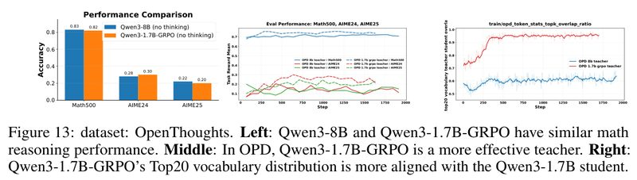

*Figure 13: Data OpenThoughts. Left: the two teachers' math scores on Math500, AIME24 and AIME25 are 0.83/0.28/0.22 (Qwen3-8B) and 0.82/0.30/0.20 (Qwen3-1.7B-GRPO), roughly a tie. Middle: each of the two teachers distills a Qwen3-1.7B student; the dashed lines have 1.7B-GRPO as the teacher and the solid lines have 8B as the teacher; in the middle and later parts of training, the dashed lines are generally above the solid lines on all three benchmarks, with Math500 at about 0.74 to 0.76 vs. 0.70 to 0.72, and AIME24 at about 0.2 to 0.3 vs. 0.1 to 0.2; under both teachers, the student starts at about 0.69 on Math500. Right: the overlap between the teacher's and the student's Top-20 candidate tokens; the 1.7B-GRPO teacher (red) rises to about 0.95, while the 8B teacher (blue) stays around 0.6. The values in the middle and right panels are read off the plot.*

Conclusion: **a teacher's leaderboard scores alone cannot tell you whether it will work well in OPD.** A teacher whose distribution is closer to the student's gives per-token guidance that "connects" better with the student's own way of writing, and supervises better, even if its benchmark scores are not higher. The authors also argue that this route of "first strengthening the teacher with RL, then distilling" can replace OP(S)D with a cheat sheet.

### 6.3 When the student's outputs are not presentable, do SFT first

Setup: the teacher is Qwen3-4B (thinking mode off) and the student is Qwen3-1.7B-Base (a base model without instruction tuning). The authors found that at first this student outputs gibberish (non-English Unicode characters) on some problems: degenerate text with no semantic structure, not ordinary reasoning errors. Faced with such output, the teacher cannot give a meaningful signal, so running OPD directly is unstable.

The fix is SFT first, then OPD (Appendix A.23):

1. Remove the problems in OpenThoughts whose answers are not in `\boxed{}` format; keep the first 30,000 problems for SFT and the rest for the later OPD.
2. The teacher answers the first 30,000 problems (temperature 0.3, at most 4096 tokens, 1 response per problem); responses that are wrong, lack `\boxed{}` or contain repeated text are discarded, and at most 20,000 are kept.
3. Run SFT on the student with these teacher-written responses (learning rate 1×10⁻⁵, 2 epochs, with the LlamaFactory framework, thinking mode off to match the teacher's output format), then run OPD.

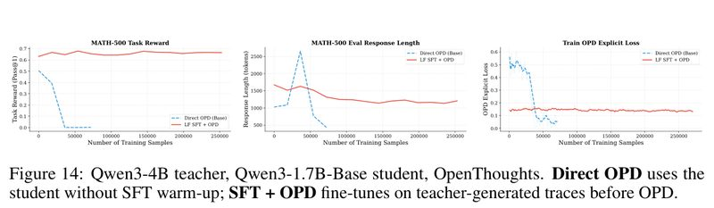

*Figure 14: Teacher Qwen3-4B, student Qwen3-1.7B-Base, data OpenThoughts. The blue dashed line (Direct OPD) is the student running OPD directly without an SFT warm-up, and the red line is SFT on teacher-generated responses first, then OPD. The three panels, left to right, are MATH-500 accuracy, evaluation response length and training loss, with the cumulative number of training samples on the horizontal axis. Direct OPD: MATH-500 falls from about 0.50 to 0, and the response length first shoots up to about 2650 tokens, then collapses to about 450. SFT first: MATH-500 rises from about 0.63 into the range 0.66 to 0.68 and holds there, and the response length drops from about 1650 to about 1200 and stays stable. The values are read off the plot.*

The right panel has a spot that is easy to misread: direct OPD's loss falls from about 0.5 to near 0, while its accuracy falls to 0 at the same time. A low loss does not mean the model learned well.

Table 3 of the paper (Appendix A.23.1) gives the likelihood of the teacher-generated SFT data under the corresponding student:

| Setting | Student | Mean NLL | PPL |
| --- | --- | --- | --- |
| Before SFT, Qwen3-4B's responses | Qwen3-1.7B-Base | 0.640 | 1.896 |
| After SFT, Qwen3-4B's responses | Qwen3-1.7B-Base-SFT | 0.335 | 1.397 |

*Mean NLL is the average negative log probability the student gives these responses, and PPL (perplexity) is its exponential; the lower both are, the closer the SFT data are to the student's distribution. I checked: $`e^{0.640} = 1.896`$ and $`e^{0.335} = 1.398`$, while the paper writes 1.397; the difference comes from rounding the NLL.*

SFT pulls the student's distribution closer to the teacher's. The authors' explanation: SFT keeps the responses the student samples itself in the "well-formatted" region, and only in this region is the teacher's feedback effective. Earlier work has also used supervised data to stabilize OPD: Luo et al. [23] combine OPD with SFT on reference solutions to curb responses that keep getting longer; Li et al. [21] fine-tune the student on teacher-written responses to narrow the teacher-student gap. This paper observes a different source of instability: the student outputting gibberish.

## 7. Other Findings in the Appendix

The paper has 32 pages in total: 10 pages of main text, 2 pages of references and 20 pages of appendix. Below are the appendix findings that help in understanding OPD. Appendix Figures 15 to 23 are not included in this note; only their conclusions are reported.

**Where the teacher's signal concentrates** (Appendices A.9 to A.11, Figures 16 to 18). The authors measured, on each token the student writes, "the teacher's log probability minus the student's log probability" (called the signal below; the more negative it is, the more the teacher disagrees):

- **The bigger the teacher-student gap, the stronger the signal.** When the Qwen3-8B teacher scores Qwen3-1.7B's responses, the signal is mostly around −0.1, and stronger at the start (at its strongest about −0.2); when it scores responses the 8B model generated itself, the signal is mostly between 0 and −0.04, approaching −0.1 only at the start. Self-distillation signals are weaker overall.
- **The signal concentrates in the early part of the response.** The further along the response, the weaker the signal, and the smaller the differences between cheat sheets. The authors think supervision on the earlier tokens matters more.
- **The signal concentrates on wrong responses.** Taking the thinking-off setting as an example: when the teacher has the cheat sheet, the signal on the final-answer tokens is −0.25 to −0.36 for wrong responses and only −0.03 to −0.04 for correct ones; without the cheat sheet the gap is smaller (−0.10 vs. −0.05). In other words, OPD mainly corrects errors, and helps reasoning that is already correct only a little.
- **The teacher's ability shapes the signal more than the cheat sheet does.** On the same question, the signal distributions of the three experiments with the 8B teacher look alike, while the two with the 1.7B teacher share a different distribution; a cheat sheet can make the signal stronger, but cannot change its basic shape.

**OPD brings no steady gain on general reasoning either** (Appendix A.12, Figures 19 and 20). With student Qwen3-1.7B and teacher Qwen3-8B trained on the science subset of Mixture of Thoughts, GPQA-Diamond fluctuates up and down, and MMLU-Pro improves only slightly. The signal's distribution follows the same patterns as on math.

**OPSD collapses on donation-persuasion dialogue** (Appendix A.13, Figure 21). The task is a multi-turn dialogue that persuades the other party to donate to "Save the Children", and the cheat sheet is the persuadee's background, personality and the persuasion strategy, information that differs for each dialogue. The 1.7B student collapses after 20 to 30 steps, and the 4B student collapses even worse. OPSD quickly pushes the response truncation rate close to 1, meaning almost every response runs to the length cap; the student's log probability on the tokens it writes also keeps falling, showing that it is less and less certain. GRPO, by contrast, rises steadily.

**Thinking mode gets "led astray"** (Appendix A.14, Figure 22). This experiment follows the setup of the original OPSD paper [7]: the student has thinking mode off and the teacher has it on. The student gradually learns to output control tokens like `<think>` in its responses, producing garbled outputs like `<think>…</think>…<think>`. The student learns not only the distribution of the answers, but also the control symbols the teacher uses to hide its reasoning.

**Whether the teacher should be updated along with the student** (Appendix A.3.1). A frozen teacher is stable, but its ability has a ceiling; a teacher updated along with the student (the student itself or an EMA) is often thought to make better use of the cheat sheet, but the authors think this is not guaranteed. Unless the teacher is trained directly for the task with a method like RL, there is no reason to expect OP(S)D alone to produce a teacher that uses the cheat sheet better than the initial teacher.

**Token entropy is only weakly correlated with the teacher's signal** (Appendix A.21, Figure 23). Inspired by earlier work [28], the authors checked whether token entropy can guide distillation; the correlation coefficients are only −0.11 (8B student) and −0.21 (1.7B student), which is not enough evidence.

**Two pitfalls in evaluation** (Appendix A.8):

1. **The maximum generation length at evaluation.** OPD often makes responses longer and more verbose. If the length cap at evaluation is too small, responses are cut off before they reach the answer, and rises or falls in accuracy may reflect only "whether the response fits within the length limit", not reasoning ability.
2. **Looking only at early training.** OPD rises fast early and GRPO rises slowly, but in the authors' observations GRPO keeps rising for longer and ends higher. Claiming OPD is more sample-efficient from early comparisons alone ignores the performance ceiling.

## 8. Limitations the Authors Acknowledge

The paper has no dedicated limitations section; the points below come from the authors' own statements in the conclusion and the main text.

- **Only a limited set of model families and sizes was tested.** The conclusion says these findings are based on a limited set of model families and model sizes, and things may behave differently at larger scale. The whole paper uses only the Qwen3 family, with students up to 8B and teachers up to 14B.
- **Each of the three loss fixes has a cost.** The stop-gradient version is not the strict reverse KL gradient; normalization within the Top-K matches only the relative proportions among the candidates and no longer faithfully approximates the full-vocabulary KL; the policy-gradient form uses only the one token the student sampled at each position, so the teacher signal it gets is sparse (Section 6.1 of the paper).
- **Directions left for later.** The authors suggest chaining SFT, RL and OPD into an iterative self-improvement pipeline: SFT provides a stable starting point, RL improves performance on specific tasks, and OPD then distills the improved behavior back into the student. The paper tried "tune the teacher with RL first, then distill" and "SFT first, then distill" separately, but did not run the full iterative pipeline.

## 9. Points Worth Noticing While Reading

Below are points I noticed while reading the paper that it does not discuss at length, offered for reference.

### How strong the evidence is

- **No random seeds or error ranges are reported.** The paper never mentions random seeds, error bars or significance tests, and the curves all look like single runs. Section 6.2 of the paper says distilling with the 1.7B-GRPO teacher "significantly outperforms" distilling with the 8B teacher, but runs no test; the 3 to 5 point gap on Math500 is fairly clear, while the AIME curves in Figure 13 fluctuate a lot on their own.
- **The evidence for mechanism 1 is indirect.** The GPQA experiment in Section 5.1 shows that the teacher gets worse when continuing the student's prefix, but it is a measurement at inference time, not a training experiment, and it uses a different set of models (a 14B teacher) and a different dataset; how much this mechanism contributes during training is not measured directly. The collapse in Figure 4 also used the biased loss, so the effects of mechanism 1 and mechanism 2 are not separated.
- **Much of the 16-point drop on GPQA comes from answers not given in the required format.** The format correctness rates the paper gives, 98.48% and 78.79%, correspond to 195 and 156 questions with a parsable answer. Counting only parsable responses, accuracy drops from 63.1% (123/195) to 58.3% (91/156), only about 5 points; the rest of the drop comes from the 39 additional questions where no answer was given in the required format. A format failure may itself be a sign of being led astray (for example, being led into a dead end and failing to reach a conclusion), and the paper does not distinguish between these two cases.
- **"OPSD does not work on math" was tested only with reverse KL.** The original OPSD paper [7] uses full-vocabulary forward KL with per-token clipping, and converges in about 100 steps. In [7]'s own ablation, reverse KL and JSD bring almost no improvement: on Qwen3-1.7B and AIME25, reverse KL goes from 36.7 to 37.5 and falls back to 35.0, and only forward KL raises the score to 43.9. The OPSD in this paper happens to use reverse KL (the stop-gradient Top-20 version), trains for nearly 1800 steps and shows no improvement, which is actually consistent with the reverse KL result in [7]. This paper does not test OPSD with forward KL, so this conclusion should at least carry the qualifier "when reverse KL is used". Also, Section 3 of the paper says OPD should not use forward KL (see Section 3 of this note), but that is said of OPD with an external teacher, and [7]'s OPSD works precisely because of forward KL. Taking the two papers together, one key variable for whether OPSD succeeds on math may be the direction of the KL, not only the structure of the cheat sheet; neither paper tests this directly.
- **The RL-teacher experiment has a confound.** Qwen3-1.7B-GRPO and the student started as the same model, so part of why their distributions are close is their shared origin. The paper does not also RL-tune the 8B teacher as a control, so one cannot tell whether what helps is "the RL tuning" or "the same model". Also, judging from Figure 13, the distilled student reaches about 0.75 on Math500, still below the 0.82 of the teacher Qwen3-1.7B-GRPO itself. If the goal is just a better 1.7B model, using this teacher directly would do. The setting this route suits better may be merging several RL-trained experts into one student (the use mentioned in the paper's introduction), but the paper runs no experiment of this kind.
- **Even after the loss bias is fixed, the teacher-student mismatch still limits the gains.** In Figures 10 and 13, the 8B teacher distilling the 1.7B student does not collapse, but Math500 basically stays at 0.70 to 0.72, while this student was at about 0.69 to 0.70 before training. Inferring from the default settings in Appendix A.1, these two experiments should be using the corrected loss. Only with the 1.7B-GRPO teacher, which shares the student's origin, does it rise to around 0.75. My reading is that among the three mechanisms, the loss bias decides "whether it collapses", and the teacher-student mismatch decides "how much it can gain".
- **On math, OPD is not necessarily stronger than running RL directly.** From the paper's own curves: in Figure 3, running GRPO directly on Qwen3-1.7B trains Math500 up to about 0.80; in Figure 13, distilling with the two teachers takes the student only to about 0.75 and 0.71, and on AIME the two are close. The settings of the two figures may not be exactly the same, and GRPO also samples 4× as much per step as OPD (32 questions × 8 responses, vs. 64 questions × 1 response), but this is consistent with the caution in Appendix A.8 that "GRPO has a higher final ceiling".
- **Using Eq. (11) to explain the failure on math needs an unstated assumption.** Eq. (11) averages separately for each question $`x`$. The answer to a math problem is uniquely determined by the problem, so, strictly by the formula, the optimal student for each question is the teacher looking at that cheat sheet, and there is no averaging. To conclude that "the student can only learn the common part" requires an assumption the paper does not state: the student's ability is limited, it cannot work out the cheat sheet from the question, and it can only handle many questions with one set of behaviors (the schematic in Figure 9 implies this). The paragraph in Section 5.3 on "understanding the average from the student's side" is one way I read this assumption.
- **There is no criterion for where mechanism 3 applies.** Section 4.2 of the paper says in its own words that the cheat sheets for style alignment also "differ per question", yet OPSD works. The paper explains this with "the cheat sheets follow a similar latent structure", but gives no criterion that can be checked in advance.
- **Style alignment relies on LLM scoring.** The training reward is scored by Gemini-2.0-Flash and may carry the judge's preferences.
- **Table 3 does not say which responses were measured.** The paper does not state whether the post-SFT NLL was measured on responses used in training or on held-out responses. If the former, part of the NLL drop is just memorization of the training data.

### Where it applies

- **Whether OPSD will work can be judged first by what the cheat sheet is.** Going by the paper's results and the analysis in Section 5.3, rules shared by all questions (a system prompt, a style requirement, safety rules) suit OPSD; for information that differs from question to question and that the student cannot infer from the question alone (such as the answer and solution of a math problem, or a particular person's background), OPSD will most likely not help. This is a rule of thumb I drew from the paper's conclusions; the paper gives no criterion (see the previous item).

### Small issues in the manuscript (none affect the main conclusions)

- **The 8B results for style alignment are missing.** Section 4.2 of the paper says two students were used, Qwen3-4B-Instruct and Qwen3-8B, but Figure 5 plots only 4B, and the paper gives no 8B results anywhere.
- **The descriptions of the default loss are inconsistent.** Appendix A.1 says the default is a Top-K reverse KL "with stop-gradient and normalization"; Section 6.1 of the paper treats stop-gradient and normalization as two separate fixes and gives no formula for combining them; and experiments such as Figure 4 use the unnormalized version. When reading each experiment, check the loss it states for itself.
- **The wording of Figure 12's title.** The title treats "TopK=1" and "the KL of the sampled token" as the same thing. By Eq. (17), the Top-1 set is the intersection of the teacher's and the student's own highest-probability candidates, which is not necessarily the token the student actually sampled (sampling temperature 1.0). The paper does not say whether TopK=1 in the implementation is the sampled token.
- **A subfigure reference to Figure 16.** The text of Appendix A.9 says the 8B teacher scoring its own generated responses is shown in Figure 16b, but by the subfigure titles it should be Figure 16c; Figure 16b is the case of the 1.7B student with thinking mode on.

### If you train it yourself (a checklist I put together from the paper's conclusions; the paper has not released code, so all of this has to be implemented from the paper's description)

- **When approximating reverse KL with Top-K, do not use the raw unnormalized form.** Switch to stop-gradient, normalization within the Top-K, or the sampled-token policy-gradient form (Section 6.1). Watch the loss during training; if it keeps going negative, that is a danger sign (I derived this point from the formulas; see Section 5.2).
- **Do not pick a teacher by leaderboard scores alone.** Also check how close its distribution is to the student's, for example the overlap of their Top-K candidates; if needed, first tune the teacher on the training distribution with RL (Section 6.2).
- **When the student outputs gibberish or garbled formats, first run a round of SFT on teacher-written responses, then run OPD** (Section 6.3).
- **When the teacher's and the student's thinking modes differ (for example, off for the student and on for the teacher), check whether `<think>` control tokens have crept into the student's outputs** (Section 7).
- **Watch the early warning signs.** Response length, repetition ratio, the share of backtracking words like wait/but/maybe, and the teacher-student Top-K overlap. In Figure 4, the response length starts rising around step 200, backtracking words are already common by step 700, and accuracy collapses only at step 1000 (read off the plot).
- **Keep the evaluation fair.** The generation length cap must be large enough; when comparing with RL, look at the full training curves and the final ceiling, not just the early part (Section 7, Appendix A.8).

## 10. Relation to Related Work

Of the works the paper cites, the ones this note mentions are listed below. The numbers in square brackets are the paper's reference numbers.

| Topic | Paper | Relation to this paper |
| --- | --- | --- |
| OPD foundations | [1] Agarwal et al., On-Policy Distillation of Language Models: Learning from Self-Generated Mistakes (2024), <https://arxiv.org/abs/2306.13649> | The founding work on on-policy distillation |
| OPD foundations | [2] Gu et al., MiniLLM: On-Policy Distillation of Large Language Models, <https://arxiv.org/abs/2306.08543> | Distills large models with reverse KL |
| OPD foundations | [5] Kevin Lu, Thinking Machines Lab, On-Policy Distillation (2025), blog <https://thinkingmachines.ai/blog/on-policy-distillation> | Applies OPD to math reasoning |
| Self-distillation and context distillation | [7] Zhao et al., Self-Distilled Reasoner: On-Policy Self-Distillation for LLMs, <https://arxiv.org/abs/2601.18734> | The original OPSD paper, which uses full-vocabulary forward KL and reports positive results on math; its setup and results are covered in Sections 7 and 9 |
| Self-distillation and context distillation | [6] Shenfeld et al., Self-Distillation Enables Continual Learning (SDFT), <https://arxiv.org/abs/2601.19897> | Uses self-distillation for continual learning; this paper's appendix cites it as one of the sources for the EMA teacher and the full-vocabulary gradient approximation |
| Self-distillation and context distillation | [24] Hübotter et al., Reinforcement Learning via Self-Distillation (SDPO), <https://arxiv.org/abs/2601.20802> | Top-K reverse KL with a tail probability, EMA teacher |
| Self-distillation and context distillation | [9] Ye et al., On-Policy Context Distillation for Language Models, <https://arxiv.org/abs/2602.12275> | Turns context distillation into an on-policy form |
| Self-distillation and context distillation | [18] Sang et al., CRISP: Compressed Reasoning via Iterative Self-Policy Distillation, <https://arxiv.org/abs/2603.05433> | Reasoning compression, which also finds that a large enough model is needed (Section 4.5) |
| OPD failure analysis and stabilization | [10] Fu et al., Revisiting On-Policy Distillation: Empirical Failure Modes and Simple Fixes, <https://arxiv.org/abs/2603.25562> | Also reports failure modes of OPD and gives fixes; the appendix mentions that it uses the teacher's Top-K set |
| OPD failure analysis and stabilization | [11] Kim et al., Why Does Self-Distillation (Sometimes) Degrade the Reasoning Capability of LLMs?, <https://arxiv.org/abs/2603.24472> | An analysis of how self-distillation harms reasoning ability |
| OPD failure analysis and stabilization | [21] Li et al., Rethinking On-Policy Distillation of LLMs: Phenomenology, Mechanism, and Recipe, <https://arxiv.org/abs/2604.13016> | The source of the Top-K intersection approach and of "SFT narrows the teacher-student gap" (Sections 6.1 and 6.3) |
| OPD failure analysis and stabilization | [23] Luo et al., Demystifying OPD: Length Inflation and Stabilization Strategies for LLMs, <https://arxiv.org/abs/2604.08527> | Analyzes OPD responses getting longer and longer, and stabilizes them with SFT (Section 6.3) |
| Entropy and distillation | [28] Jin et al., Entropy-Aware On-Policy Distillation of Language Models, <https://arxiv.org/abs/2603.07079> | Adds forward KL on top of reverse KL when the teacher's entropy is high; this paper's Appendix A.21 was inspired by it to check the correlation between entropy and the teacher's signal (Section 7) |

- **Another way around mechanism 3** (this is my view, not the paper's content). In the ablation experiments of the BSD paper (<https://arxiv.org/abs/2610.26397>), pure OPSD (without the grader) drops from 63.3 to 55.8 midway through training, with answers getting shorter and shorter, similar to the "skip the reasoning and report the answer directly" behavior in this paper's Appendix A.15. BSD lets the grader decide the direction of reward or penalty, and the cheat sheet only decides which tokens the penalty lands on, which can be seen as one way of avoiding mechanism 3.
- **Datasets used in the experiments**: OpenThoughts [22] (<https://arxiv.org/abs/2506.04178>), DAPO-Math-17k [20] (<https://arxiv.org/abs/2503.14476>).

## 11. Summary

This is an empirical analysis paper and proposes no new method. It explains the earlier, contradictory OPD and OPSD results within one framework: **whether OPSD works depends on whether the cheat sheet is a rule shared by all questions or specific information that differs per question; whether OPD is stable depends on how the loss is written and how close the teacher is to the student.** The authors match the failures to three concrete mechanisms (the student's prefix leading the teacher astray, the extra "+1" bias in the Top-K loss, and OPSD learning only what the cheat sheets have in common), then verify three fixes with controlled experiments; of these, the SFT-first trick, as the paper itself notes, was used before by [21] and [23].

On the evidence, the Top-K bias is the most solid point: there is a derivation, the unnormalized version collapses in all three comparisons with K=1, 5 and 20, and all are stable once the bias is removed (Figures 11 and 12 and Appendix Figure 15); the interference of student prefixes with the teacher is also measured directly (the GPQA experiment). I checked the paper's key derivations and the GPQA counts, and they all add up. The paper tests both sides, with failure cases such as math and donation persuasion and success cases such as style alignment and prompt internalization, and its conclusions are about "under what conditions it works well". The fixes are easy to put into practice: changing one line of the loss or adding a round of SFT is cheap; tuning the teacher with RL needs extra training, but it follows an existing RLVR pipeline. Engineering details such as the SGLang interface issue, the evaluation length cap and the bias of comparing only early training are also written up openly, and they are pitfalls that real training runs into. The weaknesses: it uses only the Qwen3 family at modest scale and reports no error ranges; "OPSD does not work on math" was tested only with reverse KL; and on math, the distilled student (Math500 about 0.75) is still worse than running GRPO directly (about 0.80).

---

## Where Things Are in the Paper

| In this note | In the paper |
| --- | --- |
| In One Sentence, overview figure | Abstract, Section 1, Figure 1 |
| Problem and motivation | Sections 1 and 2 |
| OPD and OPSD, the two KL directions, the two memory-saving approximations | Section 3, Eqs. (1) to (5), Figure 2 |
| Three design choices | Appendix A.3, Figure 1 top left |
| Experimental setup, hyperparameters | Appendix A.1, Table 1 |
| Math reasoning: OPSD has no effect, OPD rises then collapses | Section 4.1, Figures 3 and 4, Appendices A.16 and A.17 |
| Style alignment | Section 4.2, Figure 5, Appendix A.20 |
| System-prompt internalization: reasoning compression, safety alignment | Section 4.2, Figures 6 and 7, Appendices A.18 and A.19 |
| Mechanism 1: the student's prefix leads the teacher astray | Section 5.1, Figure 8, Appendix A.22 |
| Mechanism 2: the "+1" bias of Top-K | Section 5.1, Eqs. (6) to (9) |
| Mechanism 3: OPSD learns only what the cheat sheets have in common | Section 5.2, Eqs. (10) and (11), Figures 9 and 10, Appendix A.15 |
| Fix 1: a loss without the bias, the SGLang engineering problem | Section 6.1, Eqs. (12) to (17), Figures 11 and 12, Appendices A.6 and A.7, Figure 15 |
| Fix 2: tune the teacher with RL first | Section 6.2, Figure 13 |
| Fix 3: SFT first, then OPD | Section 6.3, Figure 14, Appendix A.23, Tables 2 and 3 |
| Teacher signal analysis, general reasoning | Appendices A.9 to A.12, Figures 16 to 20 |
| Donation-persuasion dialogue, thinking mode led astray | Appendices A.13 and A.14, Figures 21 and 22 |
| Whether the teacher should be updated, correlation between entropy and signal | Appendices A.3.1 and A.21, Figure 23 |
| Two pitfalls in evaluation | Appendix A.8 |
| Limitations and outlook | Section 7 |
| Gradient decomposition and term-by-term derivations (not expanded on in this note) | Appendices A.4 and A.5 |
