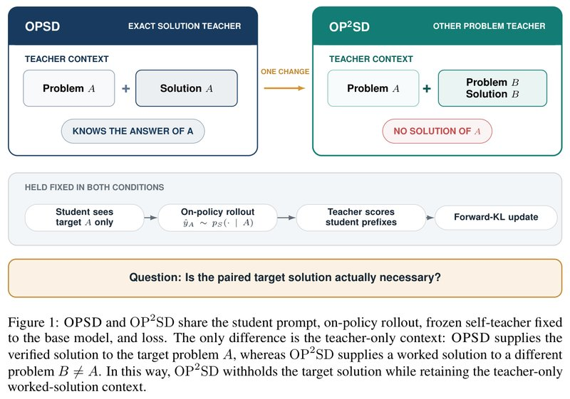
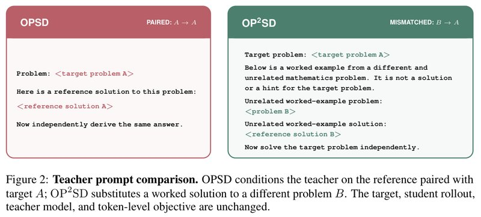
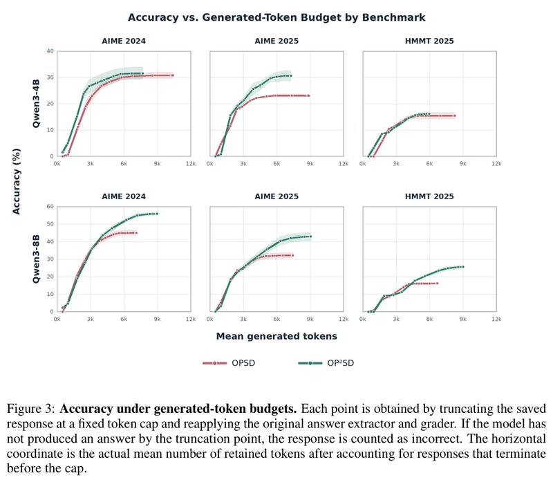

# Privileged Solutions or Context-Induced Teacher Behavior? Dissecting On-Policy Self-Distillation（特权解答，还是上下文引起的老师行为？拆解在线自蒸馏）

中文 | [English](./OP2SD-Dissecting-On-Policy-Self-Distillation_en.md)

- **原文链接**: [Privileged Solutions or Context-Induced Teacher Behavior? Dissecting On-Policy Self-Distillation](https://arxiv.org/abs/2608.09228v1)
- **论文**: [arXiv:2608.09228](https://arxiv.org/abs/2608.09228)
- **官方资料**: [MBZUAI-reasoninglab/OP2SD](https://github.com/MBZUAI-reasoninglab/OP2SD)
- **发布日期**: 2026-08-10
- **范围**: 按 arXiv v1（2026-08-10 提交，目前只有这一版）写的通俗解读，不是全文翻译。arXiv 上的作者备注是 "Working progress"，即仍在进行中的工作。作者是 Yuki Ichihara、Naoto Iwase、Mohammad Atif Quamar、Junpei Komiyama，来自穆罕默德·本·扎耶德人工智能大学（MBZUAI）、名古屋大学和 RIKEN AIP。

## 一句话版本

OPSD（On-Policy Self-Distillation，在线自蒸馏）让同一个模型扮演两个角色：学生只看题目，自己写解答；老师额外看到这道题的参考解答，沿着学生写的回答逐个 token 给出"换我会怎么写"的概率分布，学生朝老师靠拢。通行的解释是，老师看到了本题的答案和推导这类"特权信息"，所以教得好。这篇论文问：老师帮上忙，靠的是"这道题的答案"，还是"手边那份解题范例"？为了拆开这两者，作者把老师看的本题解答换成另一道题和它的解答，其余一概不变，叫作 OP²SD（On-Policy Self-Distillation from Other Problems，用别的题做在线自蒸馏）。

主要发现：在 Qwen3 的 1.7B、4B、8B 三个模型和 AIME 2024、AIME 2025、HMMT 2025 三套数学竞赛题上，两种方法都比原模型好；按 Avg@12（每道题采样 12 次的平均正确率）算，9 组对比里 OP²SD 有 8 组得分最高。8B 上领先最多，三套题都比 OPSD 高约 10 个百分点（下文简称"分"），例如 AIME 2024 上原模型 28.47%、OPSD 45.00%、OP²SD 55.83%。

作者接着逐项排查（多在 Qwen3-4B 上做，每个设置只训练一次）：范例不必多样，一道固定的题就够；不必和目标题同属一个数学分支；改错一步也照样有效（初步结果）。但 "1+1=2" 这样过于简单的例子会把模型教崩，物理题的解答会让成绩低于原模型。作者据此认为，OPSD 的提升主要来自一份像样的数学解题范例改变了老师的打分方式，老师知不知道本题答案没那么关键。



*图 1：上方两个框是两种方法里老师看到的上下文。左边 OPSD 的老师看题目 A 和 A 的验证过的解答，所以知道 A 的答案；右边 OP²SD 的老师看题目 A 和另一道题 B 的题目与解答，没有 A 的解答；两框之间的箭头标着 ONE CHANGE（只改这一处）。中间灰条是两种方法共用、保持不变的部分：学生只看题目 A，自己写出回答，老师沿着学生写的前缀逐位置打分，再按 forward KL 更新学生。老师都是固定为原模型的冻结副本，损失函数也一样。这样 OP²SD 扣下了目标题的解答，又保留了"老师手边有一份完整解题"这个条件。最下方是论文要回答的问题：和目标题配对的解答，真的必要吗？*

---

## 1. 先认识几个词

| 词 | 大白话 |
| --- | --- |
| 蒸馏（distillation） | 让学生模型模仿老师模型。常用的是逐 token 模仿：老师在每个位置给出"下一个 token 是什么"的概率分布，学生把自己的分布往老师那边调 |
| 在线（on-policy） | 学生先自己写一份回答，老师再沿着这份回答逐个位置打分。学生练的是自己真实会犯的错，而不是背老师写好的范文 |
| 自蒸馏 | 老师和学生出自同一个模型，只是提示词里看到的内容不同，不需要另一个更大的老师模型 |
| 冻结的老师 | 训练中参数不更新的老师。OPSD 和本文的老师都是训练前的原模型 |
| 特权信息（privileged information） | 训练时只有老师看得到、学生看不到的信息，在 OPSD 里就是本题的参考解答。作者把其中只关于这道题的部分（答案和推导）叫"针对本题的特权信息"（target-specific privilege） |
| 上下文引起的老师行为（context-induced teacher behavior） | 老师的提示词里多了一份完整解题，哪怕和本题无关，它的推理结构、记号和写法也可能改变老师对下一个 token 的判断 |
| 范例（worked example） | 一道题加上它的完整解答。本文里指放进老师提示词的"别的题和它的解答" |
| KL 散度、forward KL | KL 散度衡量两个概率分布差多远，越小越接近。它不对称，本文用的 forward KL 主要惩罚"老师认可的 token，学生给的概率不够" |
| 思考模式、非思考模式 | Qwen3 的两种用法：思考模式先写一大段草稿式的推理再作答，非思考模式直接作答 |
| Avg@12、Pass@12、Vote@12 | 每道题采样 12 次后算的三个指标，分别是平均正确率、至少答对一次的题目比例、投票答对的题目比例，详见 4.1 节 |
| 答案格式有效率 | 能按规定格式给出最终答案的回答占比 |
| LoRA | 一种省资源的微调方法：原参数不动，只训练额外加上的一小组参数 |
| 随机种子 | 控制随机采样的编号。种子不同，同一个模型采出的回答也不同 |
| 填充符（padding） | 一批长短不一的序列要补成一样长，补进去的占位 token 叫填充符，计算注意力时会被屏蔽 |

## 2. 它想解决什么问题

普通的在线蒸馏通常要用另一个更大的模型当老师。OPSD 省掉了这个大老师，老师和学生是同一个模型，只是提示词不同：

- 学生只看到题目，自己写解答；
- 老师是冻结不动的原模型，它额外看到这道题的参考解答，然后对学生写的每个位置给出概率分布；
- 训练让学生的分布靠近老师的分布。

打个比方（类比是我加的，不是论文原文）：你做完一道题，另一个"翻过答案的你"逐行批注"这一步我会这么写"。据论文引言的介绍，OPSD 原论文在 Qwen3 的数学题上做到了和 GRPO（大模型上常用的一种强化学习方法）持平或更好，训练时采样的 token 还少得多。

它为什么管用？通行的解释是"特权信息"：老师看到了学生看不到的本题答案和推导，所以能给出更准的指导。

作者指出，往老师的提示词里放一份本题解答，其实同时改变了两件事：

1. **老师知道了本题的答案和推导。** 这是大家以为起作用的部分，作者叫它"针对本题的特权信息"。
2. **老师的上下文里多了一份完整的解题过程。** 哪怕这份解题和当前题目无关，它的推理结构、记号、写作风格，以及"写到哪里该收尾"的节奏，都可能改变老师对下一个 token 的判断。作者叫它"上下文引起的老师行为"。

以往的实验只能看到 OPSD 比原模型好，可这两件事是一起变的，分不清功劳归谁。

换成批改作业的场景（类比是我加的，不是论文原文）：老师批改前看了一份解答，批得更好了。可能是因为他知道了这道题的答案，也可能只是因为刚看过一份写得规范的解答，批改的"口味"被调到了规范解题的状态。

这篇论文要把这两件事拆开，回答的问题是：**OPSD 的提升需要老师知道本题的解答吗？还是一份只给老师看的、别的题的完整解题，也能让老师给出有用的指导？**

## 3. 作者怎么查的：给老师看"别的题"的解答

OP²SD 只改一处：对于目标题 A，老师看到的不再是 A 的解答，而是另一道题 B 和 B 的解答，提示词里还明确写着"这是一道无关的题，不是目标题的解答，也不是提示"。

学生的提示词、学生写回答的方式、老师模型、损失函数和优化设置全部不变（见图 1）。如果 OP²SD 也能涨分，就说明"老师知道本题答案"不是必需的。

两种老师提示词如下（论文原文是英文，见图 2，这里直译，尖括号处填入具体内容）。OPSD 的老师看到：

```text
题目：<目标题 A>
这是这道题的参考解答：
<解答 A>
现在请独立推导出同样的答案。
```

OP²SD 的老师看到：

```text
目标题：<目标题 A>
下面是一道不同且无关的数学题的解题示例，它不是目标题的解答，也不是提示。
无关示例题：
<题 B>
无关示例解答：
<解答 B>
现在请独立解答目标题。
```



*图 2：两种老师提示词的英文原文，中文直译见上方。左边红框是 OPSD，右上角标着 PAIRED: A → A，意思是解答和目标题配对；右边绿框是 OP²SD，标着 MISMATCHED: B → A，意思是解答来自另一道题。目标题、学生的回答、老师模型和逐 token 的训练目标都不变。*

**选读：两种方法共用的训练目标。** 不看也不影响理解。论文式 (4) 是：

```math
\mathcal{L}_m(\theta)=\mathbb{E}_{(x_i,y_i^\star)\sim\mathcal{D}}\;\mathbb{E}_{\hat y_i\sim p_S(\cdot\mid x_i)}\left[\frac{1}{|\hat y_i|}\sum_{t=1}^{|\hat y_i|}D\Big(p_T^{m}(\cdot\mid x_i,c_i^{m},\hat y_{i,< t})\,\Big\|\,p_S(\cdot\mid x_i,\hat y_{i,< t})\Big)\right]
```

- $`x_i`$ 是目标题，$`\hat y_i`$ 是学生自己写的回答，$`\hat y_{i,<t}`$ 是这份回答的前 $`t-1`$ 个 token；
- $`p_S`$ 是正在训练的学生，$`p_T^{m}`$ 是充当老师的冻结原模型；
- $`D`$ 是逐 token 的 forward KL，两种方法用的是同一种带截断（clip）的版本；老师的分布当作固定目标，梯度只经过学生；
- 两种方法唯一的区别是老师额外看到的上下文 $`c_i^{m}`$：OPSD 里 $`c_i^{\text{target}}=y_i^\star`$（本题解答），OP²SD 里 $`c_i^{\text{other}}=(x_j,y_j^\star)`$，$`j\neq i`$（另一道题和它的解答）。

数字例子（我编的示意，不是论文里的）：某个位置上，学生认为下一个 token 是 "So" 的概率为 0.6、"Wait" 为 0.4；老师认为 "So" 为 0.9、"Wait" 为 0.1。这个位置的 forward KL 是 $`0.9\ln\frac{0.9}{0.6}+0.1\ln\frac{0.1}{0.4}\approx 0.365-0.139=0.23`$。训练会把学生在这里选 "So" 的概率往上推。整份回答的每个位置都这样算一遍再取平均。

## 4. 实验结果

### 4.1 实验怎么设计的

- **模型**：Qwen3-1.7B、4B、8B。三个尺寸里，学生、老师和评测用的模式不完全一样：
  - 1.7B 沿用 OPSD 原论文的设置：学生用非思考模式写回答，老师用思考模式打分，评测时开思考模式。
  - 4B 和 8B：学生、老师、评测都用非思考模式。
  - 因此 1.7B 的分数比 4B 还高，不同尺寸之间的分数不能直接比。
- **训练数据**：沿用 OPSD 的 OpenThoughts Math 题集（`siyanzhao/Openthoughts_math_30k_opsd`）。OP²SD 给老师看的"别的题"来自同一题集里来源标为 `amc_aime` 和 `aops_forum` 的条目（共 2,768 道，已排除测试用的竞赛题），每道都带题目和参考解答。
- **训练配置**：LoRA 微调（r=64），学习率 5×10⁻⁶，学生采样温度 1.1，训练时每个回答最多 1,024 个 token，4 张 H100。1.7B 的主结果取自训练第 100 步的检查点。
- **测试集**：AIME 2024、AIME 2025、HMMT 2025（2 月场）三套数学竞赛题，各 30 道。
- **评测方法**：每道题用 4 个随机种子，每个种子生成 12 个回答，看三个指标：
  - **Avg@12**：单次作答的平均正确率，论文的主指标；
  - **Pass@12**：12 次里至少对 1 次的题目比例，衡量"能不能做出来"；
  - **Vote@12**：12 个答案投票，票数最多的答案正确的题目比例。
- **每个设置都只训练了一次**：表里的 "±" 只反映采样的随机波动，不包括"重新训练一次"带来的波动。

### 4.2 换成别的题的解答，效果不降反升

论文表 1（Avg@12，%；各项的采样误差约 ±0.5～±0.9）：

| 模型 | 测试集 | 原模型 | OPSD | OP²SD | OP²SD − OPSD |
| --- | --- | --- | --- | --- | --- |
| Qwen3-1.7B | AIME 2024 | 49.86 | **55.42** | 55.35 | −0.1 |
| Qwen3-1.7B | AIME 2025 | 37.36 | 40.35 | **40.69** | +0.3 |
| Qwen3-1.7B | HMMT 2025 | 23.61 | 25.76 | **27.57** | +1.8 |
| Qwen3-4B | AIME 2024 | 23.19 | 30.76 | **31.53** | +0.8 |
| Qwen3-4B | AIME 2025 | 21.11 | 23.06 | **30.62** | +7.6 |
| Qwen3-4B | HMMT 2025 | 11.67 | 15.42 | **16.11** | +0.7 |
| Qwen3-8B | AIME 2024 | 28.47 | 45.00 | **55.83** | +10.8 |
| Qwen3-8B | AIME 2025 | 20.97 | 32.15 | **42.85** | +10.7 |
| Qwen3-8B | HMMT 2025 | 11.81 | 16.18 | **25.56** | +9.4 |

怎么读这张表：

- **两种方法都比原模型好**：9 组全部如此。
- **OP²SD 在 9 组里有 8 组得分最高**：唯一的例外是 1.7B 的 AIME 2024，它比 OPSD 低 0.07，在误差范围内。
- **8B 上领先最明显**：三套题分别领先 OPSD 约 10.8、10.7、9.4 分。4B 上除 AIME 2025（+7.6）外，领先都不到 1 分；1.7B 上两者基本持平。

老师根本不知道本题答案，学生却学得一样好甚至更好。至少在这些实验里，"老师知道本题答案"不是 OPSD 提升的必要条件。

另一个细节：1.7B 上 OP²SD 的 Pass@12 在三套题上都低于原模型（例如 AIME 2025 是 63.33 对 70.00）。作者的解释是，它主要提高了"本来偶尔能做对的题"的命中率，并没有扩大"12 次之内能做出来的题"的范围（4.9 节有逐题分析）。

### 4.3 涨分不只是因为写得更长

一个自然的怀疑是：OP²SD 也许只是让模型写得更长，多想几步就多对几题。作者拿 4B 和 8B 已经生成好的回答做了截断实验：把每个回答在 500～38,912 个 token 之间的不同长度处截断，再用原来的评分器判对错，截断时还没给出最终答案的一律算错（图 3）。



*图 3：上排是 Qwen3-4B，下排是 Qwen3-8B，三列分别是 AIME 2024、AIME 2025、HMMT 2025；红线是 OPSD，绿线是 OP²SD。每个点的做法是：把保存下来的回答截断到某个 token 上限，再用原来的答案提取器和评分器重新判分，截断时还没给出答案的算答错。横轴是截断后实际保留的平均 token 数（已考虑在上限之前就自然结束的回答），纵轴是准确率（%）。曲线周围的浅色带，图注没有说明含义。差距最清楚的是 4B 的 AIME 2025：OP²SD 约在 7k token 处到达约 31%，OPSD 约 23% 就走平了，一直延伸到约 9k token；4B 的 HMMT 2025 上两条线几乎重合。8B 的三张图里，两条线在前 3k～4k token 基本重合，之后红线走平，绿线继续上升（读图估计）。*

- **4B**：几乎在所有长度上，OP²SD（绿线）都高于 OPSD（红线），而且它最终的平均长度更短。4B 的提升不是靠写长。
- **8B**：长度较短时两者差不多；之后 OPSD 到顶不再上涨，OP²SD 还在继续涨。以 AIME 2024 为例，OPSD 停在约 45%，OP²SD 涨到约 56%（读图估计，和表 1 的 45.00、55.83 一致）。OP²SD 最终写得更长，但多出来的长度换来了明显更高的准确率。

作者的结论是：OP²SD 并不是在所有尺寸上都让推理变短，而是在预算足够大时，同样长度下准确率更高。

### 4.4 排除思考模式的干扰后，老师手边得有一份完整解题

既然本题答案不是关键，作者接着逐个排除其他可能（4.4～4.8 节）。这几节的实验除特别说明外都用 Qwen3-4B，学生、老师都是非思考模式。

第一步是排除一个干扰。1.7B 沿用的原始设置里，学生不思考、老师思考。这样一来，涨分也可能来自"学生在模仿思考模式下的老师"，和解答没关系。作者设了两个对照：

- **Target-only（只给题）**：老师和学生一样，只看到题目，没有任何解答。
- **Answer-only（只给答案）**：老师额外知道本题的最终答案，但看不到推导过程。

在 1.7B 上，这两种老师都让模型涨分了，而且"只给题"在 AIME 2025 和 HMMT 2025 上甚至比 OPSD 还高（41.81 对 40.35，26.67 对 25.76）。可见 1.7B 的提升有相当一部分和解答无关，可能来自思考模式的老师，也可能来自在线自蒸馏本身（论文附录 E，表 11）。反过来，附录 H 让 1.7B 的学生和老师都用思考模式训练，OPSD 的提升就没了：AIME 2024 上是 49.24，比原模型还低 0.62，答案格式有效率也降到 85.90%。

所以要看清解答的作用，得换到学生、老师模式一致的 4B 上，结果完全不同。论文表 2（Qwen3-4B，Avg@12，%；OPSD 和 OP²SD 两行取自表 1）：

| 老师看到什么 | AIME 2024 | AIME 2025 | HMMT 2025 |
| --- | --- | --- | --- |
| 只给题（Target-only） | 1.18 | 0.49 | 0.76 |
| 只给答案（Answer-only） | 18.68 | 17.85 | 9.24 |
| 原模型（不训练） | 23.19 | 21.11 | 11.67 |
| OPSD（给本题完整解答） | 30.76 | 23.06 | 15.42 |
| OP²SD（给别的题完整解答） | **31.53** | **30.62** | **16.11** |

怎么读这张表：

- **"只给题"把模型教崩了**，正确率掉到 1% 左右。
- **"只给答案"救回了一部分**，但仍比原模型低 2.4～4.5 分。
- **只有老师手边有一份完整的数学解题过程时，学生才涨分**，而且这份解题不必是本题的。

### 4.5 范例不必多样，一道固定的题就够

标准 OP²SD 每道目标题都配一道不同的范例题。会不会是"见多识广"在起作用？作者把范例换成整个训练过程只用一道固定的题。这道代数题来自 Omni-MATH 题库：$`a`$、$`b`$、$`c`$ 是正整数，满足 $`\frac{a}{77}+\frac{b}{91}+\frac{c}{143}=1`$，求 $`a+b+c`$ 的最小值。答案是 79，取 $`a=68`$、$`b=10`$、$`c=1`$。

在此基础上，作者又改写了这道题的解答，再加上一个 "1+1=2" 的对照，一共四种固定范例。论文表 3（Qwen3-4B，Avg@12，%）：

| 老师看到的范例 | 解答长度（token） | AIME 2024 | AIME 2025 | HMMT 2025 | 学生平均回答长度（token） |
| --- | --- | --- | --- | --- | --- |
| 每道题换一个范例（标准 OP²SD） | 不固定 | 31.53 | 30.62 | 16.11 | 6,979 |
| 固定这道题，简洁正确的解答 | 204 | 35.83 | 31.94 | 17.71 | 6,428 |
| 固定这道题，解答里改错一步 | 204 | **36.04** | **34.86** | **17.99** | 6,442 |
| 固定这道题，啰嗦但正确的解答 | 742 | 33.89 | 28.40 | 15.76 | 5,773 |
| 固定一道 "1+1=2" | 18 | 5.21 | 5.28 | 2.29 | 19,029 |

怎么读这张表：

- **固定一道题，反而略好于每次换题。** 多样性不是必需的。作者在 1.7B 上重复了这个实验（附录 K，表 19），固定范例的成绩是 55.56、43.40、27.78，同样不低于每次换题的 OP²SD，也不低于 OPSD。
- **解答改错一步，照样有效。** 改错版把"$`b+3c`$ 至少是 13"偷换成"至少是 26"，最后得出错误答案 81。用它当范例，成绩和正确版相当甚至略高。看来范例不必完全正确。不过这个设置只训练了一次，作者自己也称之为初步实验。
- **啰嗦的解答效果变差。** 把同样正确的推导扩写到 742 个 token，三套题分别比简洁版低 1.94、3.54、1.95 分，学生的回答还缩短了约 10%。简洁、紧凑的范例似乎是更好的老师。作者强调，这只是相关性，没有找到背后的因果机制。
- **"1+1=2" 把模型教崩了。** 正确率跌到 2%～5%，学生的平均回答长度涨到 19,029 个 token，是其他设置的 3 倍左右。随便给一个"正确的数学例子"不够，得是一份有分量的数学解题过程。

### 4.6 范例不必和目标题同属一个数学分支

作者从 Omni-MATH 里挑出 1,280 道代数题做训练，另留 30 道代数题做测试。老师看的范例分两组：一组是别的代数题，另一组是几何题。两组范例的来源、难度、长度都对齐过。论文表 4（Qwen3-4B，%）：

| 老师看到的范例 | Avg@12 | Pass@12 |
| --- | --- | --- |
| 另一道代数题和解答 | 57.43 | 79.17 |
| 一道几何题和解答 | 59.10 | 80.00 |

用几何题的范例教代数题，成绩还高 1.67 分。不过这个优势几乎全来自一道题：它问的是圆和抛物线的交点，虽然标成代数，其实接近解析几何。几何组在这题上 48 次对了 30 次，代数组一次没对。去掉这道题后，代数组 59.41%，几何组 58.98%，顺序反过来了。1.7B 上的同类实验，代数组只领先 0.63 分。结论是：没有一致的证据表明范例要和目标题同属一个分支。

顺带一提，在这个 4B 实验里，看本题解答的 OPSD 只有 55.69，比不训练的原模型（56.60）还低（附录表 10）。

### 4.7 范例得是数学：换成物理题的解答就不行了

前面几步把"本题对应""多样""同一分支""完全正确"一个个放宽，涨分都还在。那是不是随便塞点解题文字都行？作者把范例池整个换成 2,768 道物理题和解答（来自 CAMEL Physics 数据集，数量和数学范例池相同），目标题仍是原来的数学题。论文表 5（Qwen3-4B，Avg@12，%）：

| 设置 | AIME 2024 | AIME 2025 | HMMT 2025 |
| --- | --- | --- | --- |
| 原模型 | 23.19 | 21.11 | 11.67 |
| OP²SD（数学范例） | **31.53** | **30.62** | **16.11** |
| OP²SD（物理范例） | 18.68 | 20.21 | 8.68 |

换成物理范例后，三套题都跌到原模型以下。附录表 18 还显示，物理组只有大约一半的回答能按规定格式给出最终答案（AIME 2024 上是 46.04%，原模型是 97.57%）。论文引言还提到，很多回答陷入重复、停不下来。

作者对这个结果很谨慎：物理范例和数学范例在来源、学科、记号、单位、解题风格、长度、提示词措辞上都不一样，CAMEL 的物理解答还是合成数据，没有逐条核验过。所以它只能说明"随便一个其他学科的范例不行"，不能证明"数学内容本身"就是原因。

### 4.8 排查结果一览：起作用的是一份像样的数学解题

下表里 OPSD、OP²SD 两行汇总三个模型的主实验，其余各行都是 Qwen3-4B。

| 老师看到的上下文 | 相对原模型的效果 |
| --- | --- |
| 本题完整解答（OPSD） | 涨，主实验 9 组全涨 |
| 别的题的完整解答（OP²SD） | 涨，9 组里 8 组高于 OPSD，8B 上高约 10 分 |
| 一道固定题的简洁解答 | 涨，和 OP²SD 相当或略好 |
| 一道固定题、改错一步的解答 | 涨，和简洁正确版相当或略好（初步实验） |
| 一道固定题、啰嗦的解答 | 涨，但比简洁版少约 2～3.5 分 |
| 用几何题范例教代数题 | 和代数题范例效果相当 |
| 只给本题最终答案（4B） | 跌 |
| 只给题目（4B） | 崩，跌到 1% 左右 |
| "1+1=2" | 崩，跌到 2%～5% |
| 物理题解答 | 跌，约一半回答格式无效 |

作者的总结：涨分的主要来源不是"老师知道本题答案"，而是**一份管用的数学解题范例改变了老师逐 token 打分的方式**。至于具体改变了什么、为什么有效，论文没有给出答案。

### 4.9 涨分主要来自"本来偶尔能做对"的题

4.9～4.12 节的几项结果来自论文附录。

作者把三套题的 90 道题合在一起，按"原模型 48 次作答里对了几次"分组，再看每组平均每题多对了几次。附录表 14（Qwen3-1.7B，单位是每道题在 48 次作答里多对的次数，不是百分点）：

| 原模型 48 次里对了几次 | 题数 | OPSD | OP²SD | 只给题 |
| --- | --- | --- | --- | --- |
| 0 | 22 | +0.14 | +0.14 | +0.14 |
| 1～4 | 13 | +0.54 | +0.85 | +0.46 |
| 5～12 | 12 | +1.25 | +0.92 | +0.92 |
| 13～24 | 11 | +5.00 | +5.09 | +4.64 |
| 25～36 | 12 | +4.50 | +7.08 | +7.58 |
| 37～47 | 10 | +2.50 | +2.50 | +1.70 |
| 48 | 10 | −0.50 | −0.70 | −0.40 |
| 全部 | 90 | +1.71 | +2.04 | +1.94 |

怎么读这张表：

- **提升集中在原模型"有时对、有时错"的题上**：48 次里对 13～36 次的两组，平均每题多对 4.5～7.6 次。
- **原模型一次都没做对的题几乎没变**：这 22 道题上，每种方法总共只多对了 3 次。
- **作者的解读**：这类训练主要让模型更稳定地做对"本来就有可能做对"的题，而不是找到原模型采样不出来的解法。这和 4.2 节里 1.7B 的 Pass@12 没涨是一致的。
- **不同方法的逐题表现高度一致**：OPSD 和 OP²SD 每道题正确次数的相关系数是 0.990，"只给题"和 OP²SD 是 0.989（附录表 13）。换掉或拿掉本题解答，几乎没改变"哪些题容易、哪些题难"。作者提醒，这种高相关有一部分来自题目本身的难度，不能据此说两种方法学到的是同一种推理。
- **4B 上的情况不太一样**（附录表 15）：原模型 48 次全错的题有 45 道，OP²SD 在这些题上平均每题多对 3.22 次，OPSD 多对 1.13 次。论文没有展开讨论这一点。

### 4.10 把填充符挪到左边，OP²SD 仍然领先

主实验沿用 OPSD 原版代码的做法：同一批数据里，每条提示词在右侧补填充符，补到这批里最长的提示词那么长，然后再接上学生的回答。于是较短的提示词和回答之间会夹一段填充符；学生和老师的提示词是分别补齐的，夹的长度也不一样。填充符虽然被屏蔽、不参与注意力计算，但会改变回答在序列里的位置编号。

作者把训练中计算损失这一步改成左侧填充（填充符放到最前面，提示词和回答紧挨着），在与表 1 相同的训练步数上又比了一次。附录表 9（Qwen3-4B，Avg@12，%）：

| 测试集 | 原模型 | OPSD：右填充 → 左填充 | OP²SD：右填充 → 左填充 |
| --- | --- | --- | --- |
| AIME 2024 | 23.19 | 30.76 → 27.78 | 31.53 → 41.11 |
| AIME 2025 | 21.11 | 23.06 → 19.44 | 30.62 → 33.89 |
| HMMT 2025 | 11.67 | 15.42 → 12.85 | 16.11 → 17.36 |

改成左填充后，OP²SD 依然明显领先，AIME 2024 上还涨到 41.11；OPSD 的提升反而缩小，在 AIME 2025 上掉到了原模型以下。作者用这一点进一步支持"不需要本题解答"的结论。换个角度看（这是我的看法），只改填充方式，OP²SD 在 AIME 2024 上就变动了近 10 分，说明这些结果对实现细节相当敏感（见第 6 节）。

### 4.11 训练久了会退化，老师不看本题解答也一样

1.7B 的 OP²SD 训练到第 400 步，和第 100 步相比（附录表 12，AIME 2024）：Avg@12 从 55.35 降到 51.39，Vote@12 从 70.00 降到 64.17，不过 Avg@12 仍比原模型（49.86）高 1.53。Pass@12 反而从 75.83 升到 79.17，答案格式有效率保持在 99% 以上。

此前已有工作报告过：在线蒸馏训练久了会退化，老师看到完整本题解答时尤其明显（Kaur 等，arXiv 2607.05184）。OP²SD 的老师看不到本题解答，也出现了类似的退化，说明这种退化不依赖本题解答。至于为什么会退化，论文没有回答。

### 4.12 换到思考模式评测，提升就不稳了

把在非思考模式下训练好的 4B 模型直接开思考模式评测，不再额外训练。附录表 20（Qwen3-4B，Avg@12，%）：

| 测试集 | 原模型 | OPSD | OP²SD |
| --- | --- | --- | --- |
| AIME 2024 | **72.85** | 70.90 | **72.85** |
| AIME 2025 | **67.36** | 64.03 | 64.17 |
| HMMT 2025 | 43.47 | 44.44 | **45.69** |

两种方法都没有全面超过原模型，AIME 2025 上都低了 3 分多。作者的解读是：老师打分时用的模式，应该和模型最终使用时的模式一致。

## 5. 作者自己承认的局限

- **只做了数学。** 训练和评测的目标题全是数学题，模型只有 Qwen3 的 1.7B、4B、8B。
- **每个设置只训练了一次。** 4 个随机种子只反映采样的波动，反映不了"重新训练一次"会差多少。固定范例、改错范例、啰嗦范例这几组都是各自单独训练的，这一点对它们尤其要紧。
- **退化原因没查清。** OP²SD 训练久了也会变差。作者认为要查清原因，需要多次重复训练，并在具体 token 上做受控干预。
- **只做了诊断。** 作者把贡献定位为指出常见解释里的一个混淆因素，设计一个把两者拆开的对照实验，并展示拆开后相当一部分提升依然存在。至于范例到底怎样改变了老师，论文没有回答。

## 6. 读的时候值得留意的地方

以下是我读原文时注意到、论文没有重点讨论的点，供参考。

### 证据有多强

- **分差可能还在训练波动之内。** 每个设置只训练了一次，表里的 "±" 只是采样误差。4.10 节显示，只改填充方式，OP²SD 在 AIME 2024 上就从 31.53 变成 41.11。所以 1.7B 和 4B 上两分以内的差距，不宜当成"OP²SD 比 OPSD 好"的证据。8B 上约 10 分的差距更有分量，但同样只有一次训练。
- **4B、8B 上的 OPSD 不是原论文的配方。** OPSD 原论文比较过思考模式的四种组合，后面的实验都用"学生不思考、老师思考"。本文只有 1.7B 沿用了这个组合，4B、8B 改成学生和老师都不思考，KL 截断阈值（按 OPSD 原论文的定义，算 KL 时每个候选 token 的贡献最多计到这个值）也和 1.7B 差了几个数量级（1.7B 是 0.05，4B 是 10⁻⁶，8B 是 10⁻⁷）。两种方法共用同一套配置，比较本身是公平的，但论文没说这套配置是怎么选出来的。8B 上约 10 分的领先，有多少来自方法本身、多少来自配置碰巧更适合 OP²SD，目前分不清。
- **4B 上"只给题"为什么会崩，论文没解释。** 这个设置里老师和学生是同一个模型，看到的都只有题目，按理说两边的分布很接近、能学的东西很少，结果却把模型教到 1% 左右。如果这种崩溃有一部分来自实现细节（比如老师提示词的模板，或 4.10 节说的填充位置），那么拿它来说明"老师必须有一份完整解题"就要打折扣。而支撑这个结论的，主要就是 4B 上这几组各训练一次的对照。
- **训练只覆盖回答的开头。** 训练时学生的回答最多 1,024 个 token，而评测时 4B 的回答大多在 5,800～7,000 个 token（表 3）。也就是说，老师只对回答的开头部分打分，效果却体现在长得多的完整回答上。这和"范例改变了老师的写法偏好"的解释不冲突，但论文没有分析学生具体学到了什么。

### 适用范围

- **4B、8B 的提升都是在"不思考、直接答"的用法下量出来的。** Qwen3-4B 原模型开思考模式在 AIME 2024 上是 72.85，而 4B 在非思考设置下，AIME 2024 上最高的也只有 41.11（4.10 节左填充的 OP²SD）。换成思考模式评测后，两种方法都没有全面超过原模型（4.12 节）。1.7B 不在此列，它评测时开了思考模式。

### 对实践的意义

- **目标题不需要答案。** OP²SD 训练时用不到目标题的答案：学生只看题，老师看题加一份别的题的范例，损失只是两者分布的差距。固定范例的实验更进一步：一份范例加一批没有答案的数学题，4B 和 1.7B 上都做到了不输 OPSD。论文没有把它当成新方法来推，这个结论也只在数学、Qwen3、单次训练上验证过，但在缺少标注的场景里值得一试。
- **老师提示词里的范例本身就是要调的东西。** 范例是否简洁、是否是有分量的同领域解题，都会明显影响结果；啰嗦的、过于简单的、跨学科的范例都会变差。
- **以后分析这类方法，值得加上"只给题""只给答案""换成别的题的解答"这几组对照。** 否则容易把功劳错算到"特权信息"头上。
- **训练和使用时的思考模式要一致，也别训太久。** 模式不一致时，提升可能带不过去（4.12 节）；训练久了，单次作答准确率和投票准确率可能下降（4.11 节）。

## 7. 和相关工作的关系

下面按论文第 2.2 节和第 5 节的介绍，列出论文提到的几类相关工作。

### 本文拆解的方法

- **OPSD（Zhao 等，arXiv 2601.18734）。** 老师是冻结的原模型，额外看本题验证过的解答，在学生自己写的回答上逐 token 打分。本文的训练数据、1.7B 的设置和代码实现都沿用它。

### 在线蒸馏的基础

- **MiniLLM（Gu 等，ICLR 2024，arXiv 2306.08543）。** 在学生自己采样的回答上优化 reverse KL，解决"老师事先写好的回答覆盖不到学生推理时会走到的前缀"这个问题。
- **GKD（Agarwal 等，ICLR 2024，arXiv 2306.13649）。** 同样在学生生成的序列上向老师要分布，可以换用不同的散度，也可以把学生的回答和固定的离线数据混着用。

### 特权信息与带上下文的自教师

- **上下文蒸馏（Snell 等，2022，arXiv 2209.15189）。** 训练模型在去掉指令、示例或草稿之后，仍保留这些上下文引出的行为。
- **SDFT（Shenfeld 等，arXiv 2601.19897）。** 把上下文蒸馏做成在线的：老师是看了一份示范的模型自己，用来持续学习新技能和新知识。
- **OPCD（Ye 等，arXiv 2602.12275）。** 也蒸馏一个看了上下文的老师，但上下文来自提炼出的经验或优化过的指令。它报告说，直接拿以前题目的原始解题过程代替提炼出的经验，可能降低数学验证集上的准确率。
- **特权信息蒸馏（Penaloza 等，arXiv 2602.04942）。** 在多轮智能体环境里研究只迁移动作的特权信息蒸馏，提出联合训练有特权的老师和学生的目标，以及一种带 reverse KL 正则的在线强化学习做法，作者也把后者叫 OPSD。
- **SDPO（Hübotter 等，arXiv 2601.20802）。** 论文第 2.2 节把它列在"把提升归功于老师掌握本题特权信息"的已有解释里。

### OPSD 的后续分析与变体

- **Purified OPSD（Shen 等，arXiv 2607.02234）。** 把老师的分布拆成"参考解答引起的部分"和"只依赖题目、推理时也用得上的部分"，再用一个只看参考解答的老师压掉前者。
- **ROSD（Zhao 等，arXiv 2605.28014）。** 认为整体模仿看了参考解答的老师，可能让学生模仿整条解题路线，而不是纠正自己的具体错误，于是只在找到的错误附近做蒸馏。
- **PW-OPSD（Liu 等，arXiv 2605.21606）。** 同样质疑对每个 token 一视同仁的做法，按估计出的老师可靠程度给不同位置的 token 不同权重。
- **Kaur 等（ICML 2026 研讨会论文，arXiv 2607.05184）。** 报告带特权上下文的在线蒸馏会让思考模型在长预算下的推理变差，老师看到完整参考解答时尤其明显（见 4.11 节）。

按论文的说法，Purified OPSD、ROSD、PW-OPSD 都在修改或过滤"和目标题配对的参考解答"带来的信号。本文不改蒸馏规则，只改一处：给老师看的解答是不是和目标题配对。

## 8. 总结

这篇论文用一个简单的对照，拆开了 OPSD 里参考解答的两种作用：把老师看的本题解答换成别的题的解答，其余一概不变。**结果说明，OPSD 的提升主要不是因为老师知道了本题答案，而是一份管用的数学解题范例改变了老师逐 token 打分的方式。** 打个比方（类比是我加的，不是论文原文）：老师批改前读了一份写得好的数学解答，哪怕是另一道题的，批改的"手感"也被调对了。学生跟着这种手感学，进步并不比老师偷看本题答案时少。

证据方面，换成别的题的解答后，Qwen3 三个尺寸、三套竞赛题的 9 组对比里 OP²SD 有 8 组得分最高，8B 上还比 OPSD 高约 10 分。对范例的要求不高：不必多样，不必同属一个数学分支，改错一步也行；但得是有分量的数学解题，"1+1=2" 和物理题的解答都不行，写得啰嗦也会变差。这些结论只在数学题和 Qwen3 上验证过，每个设置只训练了一次。范例具体怎样改变了老师，论文没有回答，留给后续工作。

---

## 原文位置对照

| 本文内容 | 论文位置 |
| --- | --- |
| 问题和动机，两种作用的区分 | 第 1 节，第 2.2 节 |
| OPSD 的做法 | 第 2.1 节，式 (1)(2) |
| OP²SD 的做法、老师提示词 | 第 3.1 节，式 (3)，图 1，图 2 |
| 共用的训练目标 | 第 3.2 节，式 (4) |
| 实验设置、指标定义 | 第 4 节开头，附录 A，附录 B 表 6～8 |
| 主结果 | 第 4.1 节，表 1 |
| 长度预算 | 第 4.1.1 节，图 3 |
| 只给题、只给答案的对照 | 第 4.1 节末尾，表 2；附录 E 表 11；附录 H 表 17 |
| 固定范例、改错、啰嗦、"1+1=2" | 第 4.2 节，表 3；附录 J；附录 K 表 19 |
| 代数和几何范例 | 第 4.2 节，表 4；附录 D 表 10 |
| 物理范例 | 第 1 节，第 4.2 节，表 5；附录 I 表 18 |
| 逐题分析 | 附录 G，表 13～15 |
| 填充位置 | 第 2.1 节末尾，附录 C 表 9 |
| 训练更久 | 附录 F 表 12 |
| 思考模式评测 | 附录 L 表 20 |
| 相关工作 | 第 2.2 节，第 5 节 |
| 局限 | 第 6 节 |
| 总的结论 | 第 7 节 |
