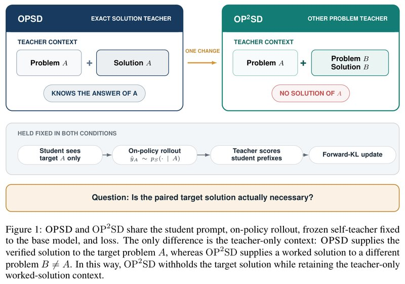
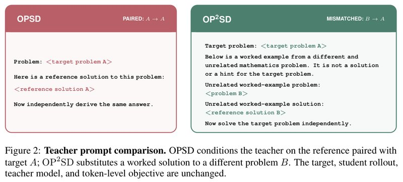
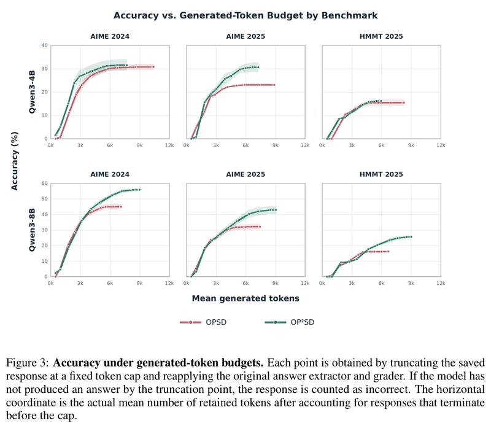

# Privileged Solutions or Context-Induced Teacher Behavior? Dissecting On-Policy Self-Distillation

[中文](./OP2SD-Dissecting-On-Policy-Self-Distillation.md) | English

- **Source**: [Privileged Solutions or Context-Induced Teacher Behavior? Dissecting On-Policy Self-Distillation](https://arxiv.org/abs/2608.09228v1)
- **Paper**: [arXiv:2608.09228](https://arxiv.org/abs/2608.09228)
- **Official resources**: [MBZUAI-reasoninglab/OP2SD](https://github.com/MBZUAI-reasoninglab/OP2SD)
- **Published**: 2026-08-10
- **Scope**: A plain-language explainer based on arXiv v1 (submitted 2026-08-10, the only version so far), not a full translation. The author comment on arXiv is "Working progress", meaning the work is still in progress. The authors are Yuki Ichihara, Naoto Iwase, Mohammad Atif Quamar and Junpei Komiyama, from Mohamed bin Zayed University of Artificial Intelligence (MBZUAI), Nagoya University and RIKEN AIP.

## In One Sentence

OPSD (On-Policy Self-Distillation) has one model play two roles: the student sees only the problem and writes its own solution; the teacher also sees a reference solution for that problem, goes along the student's response and gives, per token, a probability distribution for "what I would write here", and the student moves toward the teacher. The usual explanation is that the teacher teaches well because it sees "privileged information" such as this problem's answer and derivation. This paper asks: when the teacher helps, is it because of "the answer to this problem" or "the worked example at hand"? To separate the two, the authors replace the problem's own solution in the teacher's view with a different problem and its solution, keep everything else the same, and call the result OP²SD (On-Policy Self-Distillation from Other Problems).

Main findings: on three Qwen3 models (1.7B, 4B and 8B) and three sets of math competition problems (AIME 2024, AIME 2025 and HMMT 2025), both methods beat the original model; by Avg@12 (average accuracy over 12 samples per problem), OP²SD scores highest in 8 of the 9 comparisons. Its lead is largest on 8B, about 10 percentage points above OPSD on all three sets (called "points" below); for example, on AIME 2024 the original model gets 28.47%, OPSD 45.00% and OP²SD 55.83%.

The authors then check one factor at a time (mostly on Qwen3-4B, training each setting only once): the examples need not be diverse, and one fixed problem is enough; they need not come from the same branch of math as the target problem; and an example with one step changed to be wrong still works (a preliminary result). But an overly simple example such as "1+1=2" makes the model collapse, and solutions to physics problems push scores below the original model. From this the authors conclude that OPSD's gains come mainly from a decent worked math solution changing how the teacher scores tokens, and that whether the teacher knows this problem's answer matters less.



*Figure 1: The two boxes at the top are the contexts the teacher sees in each method. On the left, the OPSD teacher sees problem A and a verified solution to A, so it knows A's answer; on the right, the OP²SD teacher sees problem A plus the statement and solution of another problem B, with no solution to A; the arrow between the boxes is labeled ONE CHANGE (only this one thing changes). The gray bar in the middle is the part both methods share and keep fixed: the student sees only problem A and writes its own response, the teacher scores each position along the prefix the student wrote, and the student is then updated with forward KL. In both methods the teacher is a frozen copy of the original model, and the loss function is the same. This way OP²SD withholds the target problem's solution but keeps the condition that "the teacher has a complete worked solution at hand". At the bottom is the question the paper sets out to answer: is a solution paired with the target problem really necessary?*

---

## 1. Key Terms

| Term | In plain words |
| --- | --- |
| Distillation | A student model learns to imitate a teacher model. The common form is per-token imitation: at each position the teacher gives a probability distribution over "what the next token is", and the student shifts its own distribution toward the teacher's |
| On-policy | The student first writes its own response, and the teacher then scores it position by position along that response. The student practices on the mistakes it really makes, instead of memorizing a model answer the teacher wrote |
| Self-distillation | The teacher and the student come from the same model and differ only in what they see in the prompt, so no separate, larger teacher model is needed |
| Frozen teacher | A teacher whose parameters are not updated during training. In OPSD and in this paper, the teacher is the original model from before training |
| Privileged information | Information that only the teacher can see during training and the student cannot; in OPSD it is the reference solution to the problem. The authors call the part of it that is only about this problem (the answer and derivation) "target-specific privilege" |
| Context-induced teacher behavior | When the teacher's prompt holds an extra complete solution, even one unrelated to this problem, its reasoning structure, notation and writing style may change the teacher's judgment of the next token |
| Worked example | A problem plus its complete solution. In this paper it means the "other problem and its solution" placed in the teacher's prompt |
| KL divergence, forward KL | KL divergence measures how far apart two probability distributions are; the smaller it is, the closer they are. It is asymmetric, and the forward KL used in this paper mainly penalizes "tokens the teacher endorses but the student gives too little probability" |
| Thinking mode, non-thinking mode | Two ways to use Qwen3: in thinking mode the model first writes a long, draft-like stretch of reasoning and then answers; in non-thinking mode it answers directly |
| Avg@12, Pass@12, Vote@12 | Three metrics computed after sampling 12 times per problem: the average accuracy, the share of problems answered correctly at least once, and the share of problems answered correctly by majority vote; see Section 4.1 |
| Valid answer-format rate | The share of responses that give a final answer in the required format |
| LoRA | A resource-saving fine-tuning method: the original parameters stay fixed, and only a small set of added parameters is trained |
| Random seed | A number that controls random sampling. With a different seed, the same model samples different responses |
| Padding | Sequences of different lengths in a batch have to be filled out to the same length; the placeholder tokens added are called padding, and they are masked out when attention is computed |

## 2. What Problem It Tackles

Ordinary on-policy distillation usually needs another, larger model as the teacher. OPSD does without this large teacher: the teacher and the student are the same model, only with different prompts:

- The student sees only the problem and writes its own solution;
- The teacher is the frozen original model; it also sees the reference solution to this problem and then gives a probability distribution at each position of what the student wrote;
- Training moves the student's distribution toward the teacher's.

An analogy (mine, not the paper's): you finish a problem, and another "you" who has looked at the answer annotates it line by line with "this is how I would write this step". According to the paper's introduction, the original OPSD paper matched or beat GRPO (a reinforcement learning method commonly used on large models) on Qwen3 math problems, while sampling far fewer tokens during training.

Why does it work? The usual explanation is "privileged information": the teacher sees this problem's answer and derivation, which the student cannot see, so it can give more accurate guidance.

The authors point out that putting this problem's solution in the teacher's prompt actually changes two things at once:

1. **The teacher learns this problem's answer and derivation.** This is the part everyone assumes does the work; the authors call it "target-specific privilege".
2. **The teacher's context gains a complete worked solution.** Even if this solution has nothing to do with the current problem, its reasoning structure, notation, writing style and its sense of "where to wrap up" may all change the teacher's judgment of the next token. The authors call this "context-induced teacher behavior".

Earlier experiments could only show that OPSD beats the original model, but because these two things change together, there was no telling which one deserves the credit.

Take homework grading as an example (the analogy is mine, not the paper's): a teacher reads a solution before grading and then grades better. That may be because he now knows this problem's answer, or simply because he has just read a properly written solution, so his grading "taste" was tuned to the standard of a properly written solution.

This paper sets out to separate the two, and the question it answers is: **Do OPSD's gains require the teacher to know this problem's solution? Or can a complete solution to some other problem, shown only to the teacher, also let the teacher give useful guidance?**

## 3. How the Authors Tested It: Showing the Teacher the Solution to "Another Problem"

OP²SD changes one thing only: for target problem A, the teacher no longer sees A's solution but another problem B and B's solution, and the prompt also states plainly that "this is an unrelated problem, not a solution to the target problem and not a hint".

The student's prompt, the way the student writes its response, the teacher model, the loss function and the optimization settings all stay the same (see Figure 1). If OP²SD also raises scores, then "the teacher knows this problem's answer" is not required.

The two teacher prompts are below (the paper's original is in English, see Figure 2; it is reproduced here, and the angle brackets mark where the actual content goes). The OPSD teacher sees:

```text
Problem: <target problem A>
Here is a reference solution to this problem:
<reference solution A>
Now independently derive the same answer.
```

The OP²SD teacher sees:

```text
Target problem: <target problem A>
Below is a worked example from a different and unrelated mathematics problem. It is not a solution or a hint for the target problem.
Unrelated worked-example problem:
<problem B>
Unrelated worked-example solution:
<reference solution B>
Now solve the target problem independently.
```



*Figure 2: The English originals of the two teacher prompts, as reproduced above. The red box on the left is OPSD, labeled PAIRED: A → A in the top right corner, meaning the solution is paired with the target problem; the green box on the right is OP²SD, labeled MISMATCHED: B → A, meaning the solution comes from another problem. The target problem, the student's response, the teacher model and the per-token training objective are all unchanged.*

**Optional: the training objective both methods share.** You can skip it without losing the thread. The paper's Eq. (4) is:

```math
\mathcal{L}_m(\theta)=\mathbb{E}_{(x_i,y_i^\star)\sim\mathcal{D}}\;\mathbb{E}_{\hat y_i\sim p_S(\cdot\mid x_i)}\left[\frac{1}{|\hat y_i|}\sum_{t=1}^{|\hat y_i|}D\Big(p_T^{m}(\cdot\mid x_i,c_i^{m},\hat y_{i,<t})\,\Big\|\,p_S(\cdot\mid x_i,\hat y_{i,<t})\Big)\right]
```

- $`x_i`$ is the target problem, $`\hat y_i`$ is the response the student wrote itself, and $`\hat y_{i,<t}`$ is the first $`t-1`$ tokens of that response;
- $`p_S`$ is the student being trained, and $`p_T^{m}`$ is the frozen original model acting as the teacher;
- $`D`$ is the per-token forward KL, and both methods use the same version with clipping; the teacher's distribution is treated as a fixed target, and gradients flow only through the student;
- The only difference between the two methods is the extra context $`c_i^{m}`$ the teacher sees: in OPSD it is $`c_i^{\text{target}}=y_i^\star`$ (this problem's solution), and in OP²SD it is $`c_i^{\text{other}}=(x_j,y_j^\star)`$, $`j\neq i`$ (another problem and its solution).

A numeric example (an illustration I made up, not from the paper): at some position, the student gives the next token "So" a probability of 0.6 and "Wait" 0.4; the teacher gives "So" 0.9 and "Wait" 0.1. The forward KL at this position is $`0.9\ln\frac{0.9}{0.6}+0.1\ln\frac{0.1}{0.4}\approx 0.365-0.139=0.23`$. Training pushes up the student's probability of choosing "So" here. The same calculation is done at every position of the whole response, and the results are averaged.

## 4. Experimental Results

### 4.1 How the experiments were set up

- **Models**: Qwen3-1.7B, 4B and 8B. Across the three sizes, the modes used by the student, the teacher and the evaluation are not all the same:
  - 1.7B follows the setup of the original OPSD paper: the student writes responses in non-thinking mode, the teacher scores in thinking mode, and evaluation runs with thinking mode on.
  - 4B and 8B: the student, the teacher and the evaluation all use non-thinking mode.
  - That is why 1.7B scores higher than even 4B, and scores cannot be compared directly across sizes.
- **Training data**: the OpenThoughts Math problem set used by OPSD (`siyanzhao/Openthoughts_math_30k_opsd`). The "other problems" OP²SD shows the teacher come from entries in the same set whose source is labeled `amc_aime` or `aops_forum` (2,768 problems in total, with the competition problems used for testing excluded), each with a problem statement and a reference solution.
- **Training setup**: LoRA fine-tuning (r=64), learning rate 5×10⁻⁶, student sampling temperature 1.1, at most 1,024 tokens per response during training, 4 H100s. The main 1.7B results come from the checkpoint at training step 100.
- **Test sets**: three sets of math competition problems, AIME 2024, AIME 2025 and HMMT 2025 (the February round), with 30 problems each.
- **Evaluation**: each problem uses 4 random seeds, each seed generates 12 responses, and three metrics are reported:
  - **Avg@12**: the average accuracy of a single attempt, the paper's main metric;
  - **Pass@12**: the share of problems solved in at least 1 of the 12 attempts, which measures "whether it can solve it at all";
  - **Vote@12**: the share of problems for which, after a vote over the 12 answers, the answer with the most votes is correct.
- **Each setting was trained only once**: the "±" in the tables reflects only random variation from sampling, not the variation that "training again" would bring.

### 4.2 Switching to another problem's solution raises scores instead of lowering them

Table 1 of the paper (Avg@12, %; the sampling error of each entry is about ±0.5 to ±0.9):

| Model | Test set | Original model | OPSD | OP²SD | OP²SD − OPSD |
| --- | --- | --- | --- | --- | --- |
| Qwen3-1.7B | AIME 2024 | 49.86 | **55.42** | 55.35 | −0.1 |
| Qwen3-1.7B | AIME 2025 | 37.36 | 40.35 | **40.69** | +0.3 |
| Qwen3-1.7B | HMMT 2025 | 23.61 | 25.76 | **27.57** | +1.8 |
| Qwen3-4B | AIME 2024 | 23.19 | 30.76 | **31.53** | +0.8 |
| Qwen3-4B | AIME 2025 | 21.11 | 23.06 | **30.62** | +7.6 |
| Qwen3-4B | HMMT 2025 | 11.67 | 15.42 | **16.11** | +0.7 |
| Qwen3-8B | AIME 2024 | 28.47 | 45.00 | **55.83** | +10.8 |
| Qwen3-8B | AIME 2025 | 20.97 | 32.15 | **42.85** | +10.7 |
| Qwen3-8B | HMMT 2025 | 11.81 | 16.18 | **25.56** | +9.4 |

How to read this table:

- **Both methods beat the original model**: this holds in all 9 comparisons.
- **OP²SD scores highest in 8 of the 9 comparisons**: the only exception is 1.7B on AIME 2024, where it is 0.07 below OPSD, within the error range.
- **The lead is clearest on 8B**: on the three sets it leads OPSD by about 10.8, 10.7 and 9.4 points. On 4B, apart from AIME 2025 (+7.6), every lead is under 1 point; on 1.7B the two are about even.

The teacher does not know this problem's answer at all, yet the student learns just as well or even better. At least in these experiments, "the teacher knows this problem's answer" is not a necessary condition for OPSD's gains.

Another detail: on 1.7B, OP²SD's Pass@12 is below the original model's on all three sets (for example 63.33 vs. 70.00 on AIME 2025). The authors explain that it mainly raises the hit rate on "problems it could already solve now and then", without widening the range of "problems it can solve within 12 tries" (Section 4.9 has a per-problem analysis).

### 4.3 The gains are not just from writing longer

A natural suspicion: perhaps OP²SD only makes the model write longer, and thinking a few more steps gets a few more problems right. The authors ran a truncation experiment on responses that 4B and 8B had already generated: each response was cut off at various lengths between 500 and 38,912 tokens and then graded with the original grader, and any response that had not given a final answer by the cutoff counted as wrong (Figure 3).



*Figure 3: The top row is Qwen3-4B and the bottom row Qwen3-8B; the three columns are AIME 2024, AIME 2025 and HMMT 2025; the red line is OPSD and the green line OP²SD. Each point is made by truncating the saved responses to a token limit and regrading them with the original answer extractor and grader; a response that had not given an answer by the cutoff counts as wrong. The x-axis is the average number of tokens actually kept after truncation (accounting for responses that ended on their own before the limit), and the y-axis is accuracy (%). The figure caption does not say what the light bands around the curves mean. The gap is clearest on 4B's AIME 2025: OP²SD reaches about 31% at about 7k tokens, while OPSD levels off at about 23% and extends to about 9k tokens; on 4B's HMMT 2025 the two lines nearly overlap. In the three 8B plots, the two lines mostly overlap over the first 3k to 4k tokens, after which the red line levels off and the green line keeps rising (read off the plot).*

- **4B**: at almost every length, OP²SD (green line) is above OPSD (red line), and its final average length is shorter. The 4B gains do not come from writing longer.
- **8B**: at shorter lengths the two are about the same; after that OPSD tops out and stops rising, while OP²SD keeps rising. Taking AIME 2024 as an example, OPSD stops at about 45% and OP²SD climbs to about 56% (read off the plot, consistent with 45.00 and 55.83 in Table 1). OP²SD ends up writing longer, but the extra length buys clearly higher accuracy.

The authors' conclusion: OP²SD does not shorten reasoning at every size; instead, when the budget is large enough, it reaches higher accuracy at the same length.

### 4.4 With the thinking-mode confound removed, the teacher needs a complete worked solution at hand

Since this problem's answer is not the key, the authors go on to rule out the other possibilities one by one (Sections 4.4 to 4.8). Unless stated otherwise, the experiments in these sections use Qwen3-4B, with both the student and the teacher in non-thinking mode.

The first step is to rule out a confound. In the original setup that 1.7B follows, the student does not think and the teacher does. So the gains could also come from "the student imitating a teacher in thinking mode", with nothing to do with the solution. The authors set up two controls:

- **Target-only**: like the student, the teacher sees only the problem, with no solution at all.
- **Answer-only**: the teacher also knows this problem's final answer but cannot see the derivation.

On 1.7B, both of these teachers raised the model's scores, and "Target-only" even beat OPSD on AIME 2025 and HMMT 2025 (41.81 vs. 40.35, 26.67 vs. 25.76). So a good part of the 1.7B gains has nothing to do with the solution; it may come from the thinking-mode teacher, or from on-policy self-distillation itself (paper Appendix E, Table 11). Conversely, when Appendix H trains both the 1.7B student and teacher in thinking mode, OPSD's gain disappears: it scores 49.24 on AIME 2024, 0.62 below the original model, and the valid answer-format rate also drops to 85.90%.

So to see what the solution does, one has to switch to 4B, where the student and the teacher use the same mode, and there the results are completely different. Table 2 of the paper (Qwen3-4B, Avg@12, %; the OPSD and OP²SD rows are taken from Table 1):

| What the teacher sees | AIME 2024 | AIME 2025 | HMMT 2025 |
| --- | --- | --- | --- |
| Target-only (problem only) | 1.18 | 0.49 | 0.76 |
| Answer-only (final answer only) | 18.68 | 17.85 | 9.24 |
| Original model (no training) | 23.19 | 21.11 | 11.67 |
| OPSD (this problem's complete solution) | 30.76 | 23.06 | 15.42 |
| OP²SD (another problem's complete solution) | **31.53** | **30.62** | **16.11** |

How to read this table:

- **"Target-only" makes the model collapse**, with accuracy falling to around 1%.
- **"Answer-only" recovers part of it**, but is still 2.4 to 4.5 points below the original model.
- **The student gains only when the teacher has a complete worked math solution at hand**, and that solution need not be for this problem.

### 4.5 The examples need not be diverse; one fixed problem is enough

Standard OP²SD pairs each target problem with a different example problem. Could "having seen many kinds of problems" be what works? The authors replaced the examples with a single fixed problem used throughout training. This algebra problem comes from the Omni-MATH problem bank: $`a`$, $`b`$, $`c`$ are positive integers satisfying $`\frac{a}{77}+\frac{b}{91}+\frac{c}{143}=1`$; find the minimum of $`a+b+c`$. The answer is 79, with $`a=68`$, $`b=10`$, $`c=1`$.

Building on this, the authors also rewrote this problem's solution and added a "1+1=2" control, for four fixed examples in total. Table 3 of the paper (Qwen3-4B, Avg@12, %):

| Example the teacher sees | Solution length (tokens) | AIME 2024 | AIME 2025 | HMMT 2025 | Student's average response length (tokens) |
| --- | --- | --- | --- | --- | --- |
| A different example per problem (standard OP²SD) | Varies | 31.53 | 30.62 | 16.11 | 6,979 |
| This fixed problem, concise correct solution | 204 | 35.83 | 31.94 | 17.71 | 6,428 |
| This fixed problem, solution with one step made wrong | 204 | **36.04** | **34.86** | **17.99** | 6,442 |
| This fixed problem, verbose but correct solution | 742 | 33.89 | 28.40 | 15.76 | 5,773 |
| A fixed "1+1=2" | 18 | 5.21 | 5.28 | 2.29 | 19,029 |

How to read this table:

- **One fixed problem does slightly better than a new problem each time.** Diversity is not required. The authors repeated this experiment on 1.7B (Appendix K, Table 19), where the fixed example scored 55.56, 43.40 and 27.78, again no lower than OP²SD with a new problem each time, and no lower than OPSD.
- **A solution with one step made wrong still works.** The corrupted version quietly swaps "$`b+3c`$ is at least 13" for "is at least 26" and ends with the wrong answer 81. Used as the example, it scores about the same as the correct version or even slightly higher. So the example apparently need not be fully correct. However, this setting was trained only once, and the authors themselves call it a preliminary experiment.
- **A verbose solution works worse.** Expanding the same correct derivation to 742 tokens lowers the scores on the three sets by 1.94, 3.54 and 1.95 points compared with the concise version, and the student's responses also get about 10% shorter. A concise, compact example seems to make a better teacher. The authors stress that this is only a correlation; they did not find a causal mechanism behind it.
- **"1+1=2" makes the model collapse.** Accuracy falls to 2% to 5%, and the student's average response length grows to 19,029 tokens, about 3× that of the other settings. Just any "correct math example" is not enough; it has to be a substantial worked math solution.

### 4.6 The example need not come from the same branch of math as the target problem

The authors picked 1,280 algebra problems from Omni-MATH for training and kept another 30 algebra problems for testing. The examples the teacher sees come in two groups: one is other algebra problems, the other geometry problems. The two groups of examples were matched on source, difficulty and length. Table 4 of the paper (Qwen3-4B, %):

| Example the teacher sees | Avg@12 | Pass@12 |
| --- | --- | --- |
| Another algebra problem and its solution | 57.43 | 79.17 |
| A geometry problem and its solution | 59.10 | 80.00 |

Teaching algebra problems with geometry examples even scores 1.67 points higher. But this advantage comes almost entirely from one problem: it asks for the intersection of a circle and a parabola, and although it is labeled algebra, it is close to analytic geometry. The geometry group got this problem right 30 times out of 48, and the algebra group not once. With this problem removed, the algebra group scores 59.41% and the geometry group 58.98%, so the order flips. In the same kind of experiment on 1.7B, the algebra group leads by only 0.63 points. The conclusion: there is no consistent evidence that the example has to come from the same branch as the target problem.

Incidentally, in this 4B experiment, OPSD, which sees this problem's solution, scores only 55.69, which is below even the untrained original model at 56.60 (Appendix Table 10).

### 4.7 The example has to be math: physics solutions do not work

The previous steps relaxed "matches this problem", "diverse", "same branch" and "fully correct" one at a time, and the gains held each time. So would any solution text stuffed into the prompt do? The authors replaced the whole example pool with 2,768 physics problems and solutions (from the CAMEL Physics dataset, the same number as the math example pool), while the target problems stayed the original math problems. Table 5 of the paper (Qwen3-4B, Avg@12, %):

| Setting | AIME 2024 | AIME 2025 | HMMT 2025 |
| --- | --- | --- | --- |
| Original model | 23.19 | 21.11 | 11.67 |
| OP²SD (math examples) | **31.53** | **30.62** | **16.11** |
| OP²SD (physics examples) | 18.68 | 20.21 | 8.68 |

With physics examples, all three sets fall below the original model. Appendix Table 18 also shows that only about half of the physics group's responses give a final answer in the required format (46.04% on AIME 2024, against 97.57% for the original model). The paper's introduction also mentions that many responses get stuck repeating themselves and cannot stop.

The authors are cautious about this result: the physics and math examples differ in source, subject, notation, units, solution style, length and prompt wording, and CAMEL's physics solutions are synthetic data that were never checked one by one. So the result only shows that "just any example from another subject does not work"; it cannot prove that "the math content itself" is the cause.

### 4.8 Summary of the checks: what works is a decent worked math solution

In the table below, the OPSD and OP²SD rows summarize the main experiments on all three models; all other rows are Qwen3-4B.

| Context the teacher sees | Effect relative to the original model |
| --- | --- |
| This problem's complete solution (OPSD) | Up, in all 9 main comparisons |
| Another problem's complete solution (OP²SD) | Up; above OPSD in 8 of 9 comparisons, about 10 points higher on 8B |
| A concise solution to one fixed problem | Up; on par with or slightly better than OP²SD |
| One fixed problem, solution with one step made wrong | Up; on par with or slightly better than the concise correct version (preliminary experiment) |
| One fixed problem, verbose solution | Up, but about 2 to 3.5 points below the concise version |
| Geometry examples for algebra problems | About as good as algebra examples |
| Only this problem's final answer (4B) | Down |
| Only the problem (4B) | Collapses, down to around 1% |
| "1+1=2" | Collapses, down to 2% to 5% |
| Physics solutions | Down; about half the responses have an invalid format |

The authors' summary: the main source of the gains is not "the teacher knows this problem's answer" but **a useful worked math example changing how the teacher scores each token**. As for what exactly changes and why it works, the paper gives no answer.

### 4.9 The gains come mainly from problems the model "could already solve now and then"

The results in Sections 4.9 to 4.12 come from the paper's appendix.

The authors pooled the 90 problems from the three sets, grouped them by "how many of the original model's 48 attempts were correct", and then looked at how many more correct attempts each group gained per problem on average. Appendix Table 14 (Qwen3-1.7B; the unit is the number of extra correct attempts per problem out of 48, not percentage points):

| Original model's correct attempts out of 48 | Problems | OPSD | OP²SD | Target-only |
| --- | --- | --- | --- | --- |
| 0 | 22 | +0.14 | +0.14 | +0.14 |
| 1 to 4 | 13 | +0.54 | +0.85 | +0.46 |
| 5 to 12 | 12 | +1.25 | +0.92 | +0.92 |
| 13 to 24 | 11 | +5.00 | +5.09 | +4.64 |
| 25 to 36 | 12 | +4.50 | +7.08 | +7.58 |
| 37 to 47 | 10 | +2.50 | +2.50 | +1.70 |
| 48 | 10 | −0.50 | −0.70 | −0.40 |
| All | 90 | +1.71 | +2.04 | +1.94 |

How to read this table:

- **The gains concentrate on problems the original model "sometimes gets right and sometimes wrong"**: in the two groups with 13 to 36 correct out of 48, each problem gains 4.5 to 7.6 more correct attempts on average.
- **Problems the original model never got right barely change**: on these 22 problems, each method gained only 3 correct attempts in total.
- **The authors' reading**: this kind of training mainly makes the model more reliably solve problems it "already had a chance of solving", rather than finding solutions the original model could not sample. This matches the finding in Section 4.2 that 1.7B's Pass@12 did not rise.
- **Different methods behave very similarly problem by problem**: the correlation between OPSD's and OP²SD's per-problem correct counts is 0.990, and between "Target-only" and OP²SD it is 0.989 (Appendix Table 13). Swapping out or removing this problem's solution barely changes "which problems are easy and which are hard". The authors caution that part of this high correlation comes from the problems' own difficulty, so it cannot be taken to mean that the two methods learn the same kind of reasoning.
- **The picture on 4B is somewhat different** (Appendix Table 15): the original model got 45 problems wrong in all 48 attempts, and on these OP²SD gains 3.22 correct attempts per problem on average, against 1.13 for OPSD. The paper does not discuss this further.

### 4.10 With padding moved to the left, OP²SD still leads

The main experiments follow the original OPSD code: within a batch, each prompt is padded on the right to the length of the longest prompt in the batch, and the student's response is appended after that. So a stretch of padding sits between a shorter prompt and its response; the student's and the teacher's prompts are padded separately, so the stretches also differ in length. Padding is masked and takes no part in attention, but it changes the position indices of the response in the sequence.

The authors switched the loss-computation step of training to left padding (padding goes at the very front, and the prompt and the response sit right next to each other), and compared again at the same number of training steps as in Table 1. Appendix Table 9 (Qwen3-4B, Avg@12, %):

| Test set | Original model | OPSD: right padding → left padding | OP²SD: right padding → left padding |
| --- | --- | --- | --- |
| AIME 2024 | 23.19 | 30.76 → 27.78 | 31.53 → 41.11 |
| AIME 2025 | 21.11 | 23.06 → 19.44 | 30.62 → 33.89 |
| HMMT 2025 | 11.67 | 15.42 → 12.85 | 16.11 → 17.36 |

With left padding, OP²SD still leads clearly and even rises to 41.11 on AIME 2024; OPSD's gains shrink instead, and on AIME 2025 it drops below the original model. The authors use this as further support for the conclusion that "this problem's solution is not needed". Seen from another angle (this is my view), changing only the padding moves OP²SD by nearly 10 points on AIME 2024, which shows that these results are quite sensitive to implementation details (see Section 6).

### 4.11 Long training degrades the model, even when the teacher does not see this problem's solution

1.7B OP²SD trained to step 400, compared with step 100 (Appendix Table 12, AIME 2024): Avg@12 falls from 55.35 to 51.39 and Vote@12 from 70.00 to 64.17, though Avg@12 is still 1.53 above the original model (49.86). Pass@12, on the other hand, rises from 75.83 to 79.17, and the valid answer-format rate stays above 99%.

Earlier work has reported that on-policy distillation degrades with long training, especially when the teacher sees the complete solution to the problem (Kaur et al., arXiv 2607.05184). OP²SD's teacher cannot see this problem's solution, yet a similar degradation appears, which shows that the degradation does not depend on this problem's solution. As for why it degrades, the paper does not say.

### 4.12 Evaluated in thinking mode, the gains become unreliable

The 4B models trained in non-thinking mode are evaluated directly with thinking mode on, without any extra training. Appendix Table 20 (Qwen3-4B, Avg@12, %):

| Test set | Original model | OPSD | OP²SD |
| --- | --- | --- | --- |
| AIME 2024 | **72.85** | 70.90 | **72.85** |
| AIME 2025 | **67.36** | 64.03 | 64.17 |
| HMMT 2025 | 43.47 | 44.44 | **45.69** |

Neither method beats the original model across the board, and both are more than 3 points lower on AIME 2025. The authors' reading: the mode the teacher scores in should match the mode in which the model is finally used.

## 5. Limitations the Authors Acknowledge

- **Only math was tested.** The target problems in training and evaluation are all math problems, and the only models are Qwen3 1.7B, 4B and 8B.
- **Each setting was trained only once.** The 4 random seeds reflect only sampling variation, not how much "training again" would change the result. The fixed-example, corrupted-example and verbose-example groups were each trained separately, so this matters especially for them.
- **The cause of the degradation is not pinned down.** OP²SD also gets worse with long training. The authors think that finding the cause would take repeated training runs and controlled interventions on specific tokens.
- **It is only a diagnosis.** The authors frame their contribution as pointing out a confounding factor in the common explanation, designing a controlled experiment that separates the two, and showing that a large part of the gains remains once they are separated. How exactly the example changes the teacher, the paper does not answer.

## 6. Points Worth Noticing While Reading

Below are points I noticed while reading the paper that it does not discuss at length, offered for reference.

### How strong the evidence is

- **The score gaps may still be within training variation.** Each setting was trained only once, and the "±" in the tables is only sampling error. Section 4.10 shows that changing only the padding takes OP²SD from 31.53 to 41.11 on AIME 2024. So gaps of under two points on 1.7B and 4B should not be taken as evidence that "OP²SD beats OPSD". The gap of about 10 points on 8B carries more weight, but it too comes from a single training run.
- **OPSD on 4B and 8B is not the original paper's recipe.** The original OPSD paper compared four combinations of thinking modes, and its later experiments all use "the student does not think, the teacher thinks". In this paper only 1.7B keeps that combination; 4B and 8B switch to neither the student nor the teacher thinking, and the KL clipping threshold (as defined in the original OPSD paper, the cap on each candidate token's contribution when KL is computed) also differs from 1.7B's by several orders of magnitude (0.05 for 1.7B, 10⁻⁶ for 4B, 10⁻⁷ for 8B). Both methods share the same configuration, so the comparison itself is fair, but the paper does not say how this configuration was chosen. How much of the roughly 10-point lead on 8B comes from the method itself, and how much from a configuration that happens to suit OP²SD better, cannot be told apart for now.
- **The paper does not explain why "Target-only" collapses on 4B.** In this setting the teacher and the student are the same model and both see only the problem, so the two distributions should be very close and there should be little to learn, yet training drives the model down to around 1%. If part of this collapse comes from implementation details (such as the teacher prompt template, or the padding position discussed in Section 4.10), then using it to argue that "the teacher must have a complete worked solution" deserves a discount. And the main support for that conclusion is exactly these 4B controls, each trained once.
- **Training covers only the start of a response.** During training, the student's response is at most 1,024 tokens, while at evaluation 4B's responses are mostly 5,800 to 7,000 tokens long (Table 3). In other words, the teacher scores only the opening part of a response, yet the effect shows up in much longer complete responses. This does not conflict with the explanation that "the example changes the teacher's writing preferences", but the paper does not analyze what exactly the student learns.

### Where it applies

- **The 4B and 8B gains were all measured in the "no thinking, answer directly" usage.** The original Qwen3-4B with thinking mode on scores 72.85 on AIME 2024, while the best 4B result on AIME 2024 in the non-thinking setting is only 41.11 (the left-padded OP²SD in Section 4.10). When evaluated in thinking mode, neither method beats the original model across the board (Section 4.12). 1.7B is an exception, since it was evaluated with thinking mode on.

### What it means in practice

- **The target problems need no answers.** OP²SD's training never uses the target problems' answers: the student sees only the problem, the teacher sees the problem plus a worked example from another problem, and the loss is just the gap between the two distributions. The fixed-example experiment goes further: one worked example plus a batch of math problems without answers matched or beat OPSD on both 4B and 1.7B. The paper does not promote this as a new method, and the conclusion has been checked only on math, on Qwen3 and with single training runs, but it is worth trying where labels are scarce.
- **The example in the teacher prompt is itself something to tune.** Whether the example is concise, and whether it is a substantial solution from the same field, both clearly affect the results; verbose, overly simple and cross-subject examples all do worse.
- **When analyzing this kind of method in the future, it is worth adding the "Target-only", "Answer-only" and "another problem's solution" controls.** Otherwise it is easy to give the credit to "privileged information" by mistake.
- **Keep the thinking mode the same in training and in use, and do not train too long.** When the modes differ, the gains may not carry over (Section 4.12); with long training, single-attempt accuracy and voting accuracy may drop (Section 4.11).

## 7. Relation to Related Work

Below, following the paper's Sections 2.2 and 5, are the kinds of related work the paper mentions.

### The method this paper dissects

- **OPSD (Zhao et al., arXiv 2601.18734).** The teacher is the frozen original model, which also sees a verified solution to this problem and scores the student's own response per token. This paper reuses its training data, its 1.7B setup and its code.

### Foundations of on-policy distillation

- **MiniLLM (Gu et al., ICLR 2024, arXiv 2306.08543).** Optimizes reverse KL on responses the student samples itself, which addresses the problem that "responses the teacher wrote in advance do not cover the prefixes the student will reach at inference time".
- **GKD (Agarwal et al., ICLR 2024, arXiv 2306.13649).** Also asks the teacher for distributions on sequences the student generates; it can swap in different divergences, and can mix the student's responses with fixed offline data.

### Privileged information and self-teachers with context

- **Context distillation (Snell et al., 2022, arXiv 2209.15189).** Trains a model to keep the behavior that instructions, examples or scratchpads induce, even after that context is removed.
- **SDFT (Shenfeld et al., arXiv 2601.19897).** Makes context distillation on-policy: the teacher is the model itself after seeing a demonstration, used for continual learning of new skills and new knowledge.
- **OPCD (Ye et al., arXiv 2602.12275).** Also distills a teacher that has seen some context, but the context comes from extracted experience or optimized instructions. It reports that directly using the raw solution traces of earlier problems in place of the extracted experience can lower accuracy on a math validation set.
- **Privileged information distillation (Penaloza et al., arXiv 2602.04942).** Studies privileged information distillation that transfers only actions, in multi-turn agent environments; it proposes an objective that jointly trains the privileged teacher and the student, plus an on-policy reinforcement learning approach with reverse KL regularization, which its authors also call OPSD.
- **SDPO (Hübotter et al., arXiv 2601.20802).** Section 2.2 of the paper lists it among the existing explanations that "credit the gains to the teacher having privileged information about this problem".

### Follow-up analyses and variants of OPSD

- **Purified OPSD (Shen et al., arXiv 2607.02234).** Splits the teacher's distribution into "the part induced by the reference solution" and "the part that depends only on the problem and is also available at inference time", then uses a teacher that sees only the reference solution to suppress the former.
- **ROSD (Zhao et al., arXiv 2605.28014).** Argues that imitating a teacher who has seen the reference solution as a whole may make the student copy the entire solution path instead of correcting its own specific mistakes, so it distills only near the errors it finds.
- **PW-OPSD (Liu et al., arXiv 2605.21606).** Also questions treating every token the same, and weights tokens at different positions by how reliable the teacher is estimated to be.
- **Kaur et al. (ICML 2026 workshop paper, arXiv 2607.05184).** Reports that on-policy distillation with privileged context makes thinking models reason worse under long budgets, especially when the teacher sees the complete reference solution (see Section 4.11).

As the paper puts it, Purified OPSD, ROSD and PW-OPSD all modify or filter the signal that comes from "the reference solution paired with the target problem". This paper leaves the distillation rule alone and changes one thing only: whether the solution shown to the teacher is paired with the target problem.

## 8. Summary

With one simple control, this paper separates the two roles of the reference solution in OPSD: it replaces the problem's own solution in the teacher's view with another problem's solution and keeps everything else the same. **The results show that OPSD's gains come mainly not from the teacher knowing this problem's answer, but from a useful worked math example changing how the teacher scores each token.** An analogy (mine, not the paper's): a teacher reads a well-written math solution before grading, and even though it belongs to a different problem, it tunes the teacher's grading "feel" the right way. A student learning from that feel improves no less than when the teacher peeks at this problem's answer.

As for the evidence: with another problem's solution swapped in, OP²SD scores highest in 8 of the 9 comparisons across three Qwen3 sizes and three competition sets, and on 8B it is about 10 points above OPSD. The bar for the example is low: it need not be diverse, need not come from the same branch of math, and can even have one step wrong; but it has to be a substantial worked math solution, since "1+1=2" and physics solutions both fail, and a verbose one also does worse. These conclusions have been checked only on math problems and Qwen3, and each setting was trained only once. How exactly the example changes the teacher, the paper does not answer; it leaves that to future work.

---

## Where Things Are in the Paper

| In this note | In the paper |
| --- | --- |
| Problem and motivation, the distinction between the two roles | Section 1, Section 2.2 |
| How OPSD works | Section 2.1, Eqs. (1)(2) |
| How OP²SD works, teacher prompts | Section 3.1, Eq. (3), Figure 1, Figure 2 |
| The shared training objective | Section 3.2, Eq. (4) |
| Experimental setup, metric definitions | Start of Section 4, Appendix A, Appendix B Tables 6 to 8 |
| Main results | Section 4.1, Table 1 |
| Length budgets | Section 4.1.1, Figure 3 |
| Target-only and Answer-only controls | End of Section 4.1, Table 2; Appendix E Table 11; Appendix H Table 17 |
| Fixed example, one wrong step, verbose, "1+1=2" | Section 4.2, Table 3; Appendix J; Appendix K Table 19 |
| Algebra and geometry examples | Section 4.2, Table 4; Appendix D Table 10 |
| Physics examples | Section 1, Section 4.2, Table 5; Appendix I Table 18 |
| Per-problem analysis | Appendix G, Tables 13 to 15 |
| Padding position | End of Section 2.1, Appendix C Table 9 |
| Longer training | Appendix F Table 12 |
| Thinking-mode evaluation | Appendix L Table 20 |
| Related work | Section 2.2, Section 5 |
| Limitations | Section 6 |
| Overall conclusion | Section 7 |
