# 同策略蒸馏（On-Policy Distillation）

中文 | [English](./On-Policy-Distillation_en.md)

- **原文链接：[On-Policy Distillation — Thinking Machines Lab](https://thinkingmachines.ai/blog/on-policy-distillation/)**
- **发布日期：2025-10-27**

**[Kevin Lu](https://kevinlu.ai/) 与 Thinking Machines 的其他成员合作撰写。**

**版本与翻译说明：依据 2026-11-06 保存的网页完整翻译，保留原文章节顺序、标题层级、16 个编号图表、4 张表格和 46 条旁注。原文包含 2026 年 6 月的更新，见脚注 19；文中“目前”等措辞沿用原文的时间语境。原图保留不重绘，图内文字另附中文译文，旁注改为文末脚注。正文中的“我们”指原作者。**

**版权说明：原文及原图版权归原作者及相应权利人所有。本文件为非官方中文译文；仓库的通用许可不改变这些原始材料的权利归属。**

**目录：**

- [引言](#同策略蒸馏on-policy-distillation)
- [同策略蒸馏——兼得两者之长](#同策略蒸馏兼得两者之长)
- [实现](#实现)
  - [损失函数：反向 KL](#损失函数反向-kl)
  - [示例说明](#示例说明)
  - [伪代码](#伪代码)
- [用蒸馏训练推理能力](#用蒸馏训练推理能力)
  - [异策略蒸馏](#异策略蒸馏)
  - [强化学习](#强化学习)
  - [同策略蒸馏](#同策略蒸馏)
- [用蒸馏实现个性化](#用蒸馏实现个性化)
  - [训练一个内部助手](#训练一个内部助手)
  - [学习新知识会损害已经学会的行为](#学习新知识会损害已经学会的行为)
  - [同策略蒸馏能够恢复后训练行为](#同策略蒸馏能够恢复后训练行为)
- [讨论](#讨论)
  - [密集监督大幅提高计算效率](#密集监督大幅提高计算效率)
  - [蒸馏能够有效复用训练数据，提高数据效率](#蒸馏能够有效复用训练数据提高数据效率)
  - [RL 在语义策略空间中搜索](#rl-在语义策略空间中搜索)
  - [把同策略学习作为持续学习的工具](#把同策略学习作为持续学习的工具)
- [结论](#结论)
- [引用](#引用)

大语言模型能够在特定领域达到专家级表现，这是多种能力叠加的结果：理解输入、检索知识、选择方案，以及可靠地执行。这需要一整套训练方法，我们可以将其大致分为三个阶段：

- **预训练（Pre-training）** 教授语言使用、通用推理和世界知识等一般能力。
- **中期训练（Mid-training）** 传授领域知识，例如代码、医学数据库或公司内部文档中的知识。
- **后训练（Post-training）** 激发特定行为，例如遵循指令、推理解答数学题或进行对话。

经过更充分训练的小模型，在其受训的专长领域中，往往能超过更大的通用模型。使用小模型有许多好处：可以出于隐私或安全考虑在本地部署，更容易持续训练和更新，并节省推理成本。要发挥这些优势，就需要为训练的后期阶段选择合适的方法。

对“学生”模型进行后训练的方法可以分为两类：

- **同策略训练（On-policy training）** 从学生模型自身采样生成轨迹，并为这些轨迹赋予某种奖励。
- **异策略训练（Off-policy training）** 依赖某个外部来源提供的目标输出，让学生学习模仿。

例如，我们可能希望训练一个小型模型来解答这样的数学问题：


***图 1：数学题提示（原图无独立图注）。***

**图内文字译文：prompt → 提示；题目是“** $`5+(2\times3)`$ **等于多少？”**

我们可以通过强化学习开展同策略训练，根据学生生成的每条轨迹是否解出了问题来评分。评分可以由人完成，也可以由一个能稳定得出正确答案的“教师”模型完成。

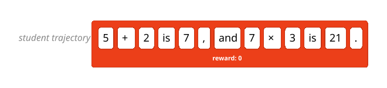

***图 2：强化学习中的学生轨迹与奖励（原图无独立图注）。***

**图内文字译文：student trajectory → 学生轨迹；“** $`5+2=7`$ **，而** $`7\times3=21`$ **。”reward: 0 → 奖励：0。这里照译原图中的错误解答。**

同策略训练的优势在于，学生在自己生成的样本上训练，能以更直接的方式学会避免错误。但强化学习（RL）有一个重大缺点：它提供的反馈非常稀疏，无论使用了多少个 token， **[每个训练回合传授的信息量都是固定的比特数](https://thinkingmachines.ai/blog/lora/#how-much-capacity-is-needed-by-supervised-and-reinforcement-learning)** 。在上面的例子中，学生知道了“21”是错误答案，并通过更新来降低再次生成那条轨迹的可能性。但它并不知道错误究竟出在哪里：是弄错了运算顺序，还是算术计算本身出错了？反馈的这种稀疏性，使 RL 在许多应用中效率不高。

异策略训练通常通过监督微调（SFT）完成：在一组经过筛选、面向特定任务的带标签样本上训练。这些带标签样本可以来自一个已被证明在当前任务上表现良好的教师模型。

我们可以使用一种称为 **蒸馏** 的机制：训练学生，使其匹配教师模型的输出分布。训练使用的是教师的 **轨迹** ，也就是包含中间思考步骤在内的完整生成 token 序列。我们可以在每一步使用教师完整的下一 token 分布（通常称为“logit 蒸馏”），也可以只采样具体的序列。实际中，对序列进行采样能为教师分布提供无偏估计，并得到相同的目标。学生会朝着序列中每个 token 的方向更新；它原本越不可能生成某个 token，对应的更新就越强，下图用更深的颜色表示这一点：

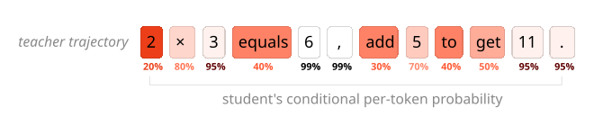

***图 3：异策略蒸馏中的教师轨迹及学生概率（原图无独立图注）。***

**图内文字译文：teacher trajectory → 教师轨迹；“** $`2\times3=6`$ **，再加 5 得到 11。”student's conditional per-token probability → 学生对每个 token 给出的条件概率。**

**原图从左到右的逐 token 概率依次为：** $`20\%,80\%,95\%,40\%,99\%,99\%,30\%,70\%,40\%,50\%,95\%,95\%`$。

从大模型教师进行蒸馏，已被证明能有效地训练小模型 **[遵循指令](https://crfm.stanford.edu/2023/03/13/alpaca.html)** 、[^1] **[进行数学与科学推理](https://arxiv.org/abs/2506.04178)** 、[^2]从医疗记录中 **[提取临床信息](https://arxiv.org/html/2501.00031v1)** ，[^3]以及 **[开展多轮聊天对话](https://arxiv.org/abs/2305.14233)** 。[^4]这些应用以及其他应用所使用的蒸馏数据集，通常会被开源并公开发布。

异策略训练的缺点是，学生学习的是教师经常遇到的上下文，而不是学生自己经常会遇到的上下文。这会造成误差累积：如果学生在较早的阶段犯了一个教师从不犯的错误，它就会偏离训练时见过的状态，而且越走越远。当我们关注学生在长序列上的表现时，这个问题尤其突出。为了避免这种偏离，学生必须学会从自己的错误中恢复。

异策略蒸馏中还观察到另一个问题：学生可能学会模仿教师的风格和自信程度，却 **[不一定学到教师在事实上的准确性](https://arxiv.org/abs/2305.15717)** 。[^5]

如果你正在学国际象棋，同策略 RL 就像在没有教练指导的情况下自己下棋。赢棋或输棋的反馈与你自己的走法直接相关，但每局只收到一次，而且它不会告诉你哪些走法对结果的影响最大。异策略蒸馏则像观看特级大师下棋：你看到了极其高明的走法，但这些走法出现时的棋盘局面，新手自己很少会遇到。

我们希望把 RL 中同策略训练与自身行为密切相关的优势，和蒸馏的密集奖励信号结合起来。对于学棋来说，这相当于有一位老师，为 *你自己* 的每一步棋打分，从“严重失误”到“妙手”。对于大语言模型的后训练来说，这就是同策略蒸馏。

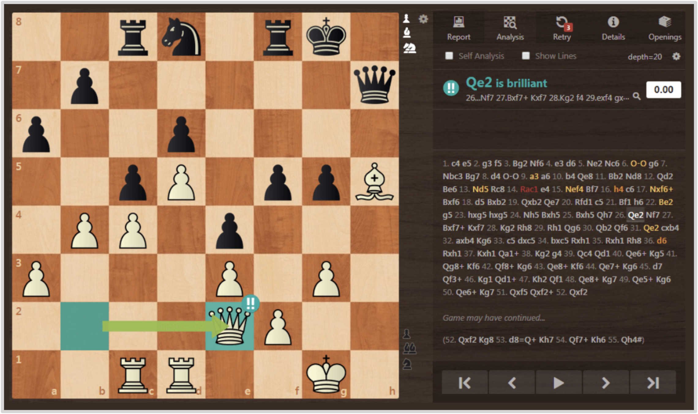

***图 4：截图来自 [chess.com](https://www.chess.com/)。分析引擎为每一步棋用颜色评分，将走法标记为严重失误（红色）、失误（橙色）、不够精确（黄色）或妙手（蓝色）。***

**图内文字对照：Brilliant → 妙手；Report → 报告；Analysis → 分析；Retry → 重试；Details → 详情；Openings → 开局；Self Analysis → 自行分析；Show Lines → 显示变化线路。Qe2 is brilliant → Qe2 是妙手；depth=20 → 搜索深度为 20；Game may have continued... → 对局可能还会继续……。棋谱记号和棋盘坐标保留原样。**

## 同策略蒸馏——兼得两者之长

同策略蒸馏的核心思想是：从 *学生* 模型采样轨迹，再用一个表现出色的教师，为每条轨迹中的 *每一个 token* 评分。回到上面的数学例子，同策略蒸馏会为解题过程中的每一步打分，惩罚那些导致学生得出错误答案的错误，同时强化执行正确的步骤。

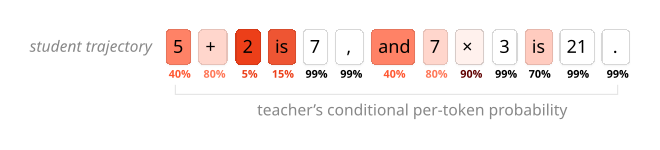

***图 5：同策略蒸馏中的学生轨迹及教师概率（原图无独立图注）。***

**图内文字译文：student trajectory → 学生轨迹；“** $`5+2=7`$ **，而** $`7\times3=21`$ **。”teacher’s conditional per-token probability → 教师对每个 token 给出的条件概率。这里照译原图中的错误解答。**

**原图从左到右的逐 token 概率依次为：** $`40\%,80\%,5\%,15\%,99\%,99\%,40\%,80\%,90\%,99\%,70\%,99\%,99\%`$。

本文探索同策略蒸馏在多种任务中的应用，例如训练数学推理模型，以及训练兼具领域知识和指令遵循能力的助手模型。我们将同策略蒸馏应用于已经通过预训练和中期训练打下能力基础的模型。我们发现，这是一种成本低而效果强的后训练方法，将同策略训练的优势与密集奖励信号结合在一起。

| 方法 | 采样方式 | 奖励信号 |
| --- | --- | --- |
| 监督微调 | 异策略 | 密集 |
| 强化学习 | 同策略 | 稀疏 |
| 同策略蒸馏 | 同策略 | 密集 |

我们的同策略蒸馏工作受到 **[DAGGER](https://arxiv.org/abs/1011.0686)** 的启发。[^6]这是一种迭代式 SFT 算法，其中包含教师对学生所访问状态的评估。它也与 **[过程奖励建模](https://arxiv.org/abs/2305.20050)** 相似，[^7]后者是一种为学生模型思维链中的每一步打分的 RL 方法。我们在 **[Agarwal 等人](https://arxiv.org/abs/2306.13649)** 、[^8] **[Gu 等人](https://arxiv.org/abs/2306.08543)** [^9]以及 **[Qwen3 团队](https://arxiv.org/abs/2505.09388)** [^10]已有的同策略蒸馏工作上进一步探索。借助 **[Tinker 训练 API](https://thinkingmachines.ai/tinker/)** ，我们复现了 Qwen3 的结果：同策略蒸馏只需 RL 的一小部分成本，就能在推理基准上取得相当的表现。

## 实现

你可以按照 **[Tinker cookbook](https://github.com/thinking-machines-lab/tinker-cookbook/tree/main/tinker_cookbook/recipes/distillation)** 逐步了解实现过程。

### 损失函数：反向 KL

同策略蒸馏可以使用多种损失函数来为学生的轨迹评分。[^11]为简单起见，我们选择逐 token 的反向 KL：在给定相同的前序轨迹时，学生（$`\pi_\theta`$）与教师（$`\pi_\text{teacher}`$）对每个 token 给出的分布之间的散度：

```math
\text{KL}\Bigl(\pi_\theta \lvert\rvert \pi_\text{teacher}\Bigr) = \mathbb{E}_{x \sim {\pi_\theta}} \Bigl[ \log \pi_\theta(x_{t+1} | x_{1..t}) - \log \pi_\text{teacher}(x_{t+1} | x_{1..t}) \Bigr]
```

我们的奖励函数以最小化反向 KL 为目标，推动学生在自己所处的每一种状态下都逼近教师的行为。当学生与教师的行为完全相同时，反向 KL 为零。为简单起见，我们使用零折扣因子：在任何给定的时间步，[^12]学生只优化紧接着的下一个 token，而不考虑未来的 token。

反向 KL 与 RL 天然契合，因为 RL 通常会优化由奖励模型诱导出的某种序列级反向 KL。不过，与实践中的大多数奖励模型不同，反向 KL 在以下意义上是“无法被钻空子的”：较低的 KL 总是对应着从教师模型的角度看，期望行为出现的较高概率。反向 KL 还有两个有用的性质：它具有“寻模态（mode seeking）”的特点，[^13]也就是学习一种特定的行为（教师的行为），而不是把分布分散到几个次优选项上；此外，它还能减轻 **[暴露偏差](https://arxiv.org/abs/1506.03099)** 。[^14]

这种方法可以显著节省计算。由于不需要等一条轨迹采样完成就能计算奖励，我们可以使用较短的轨迹或部分轨迹进行训练。查询教师的对数概率也只需要较大模型做一次前向传播，而轨迹则由更小、更便宜的学生生成。

我们也不需要单独的奖励模型或标注模型。将基于蒸馏的逐 token 奖励与序列级环境奖励结合起来，可能会带来好处；这是一个值得未来研究的有趣方向。

### 示例说明

下面是一个真实例子：教师为学生的一条错误轨迹评分。这个例子来自 **[SimpleBench](https://simple-bench.com/)** ，需要模型抓住一个关键点——题目给出的现实前提很重要：正确答案是“B. 0”，因为冰块会在煎锅里融化。学生模型 **[Qwen3-4B-Instruct-2507](https://huggingface.co/Qwen/Qwen3-4B-Instruct-2507)** 错误地把它当成了一道纯数学题，完全没有考虑物理情境。

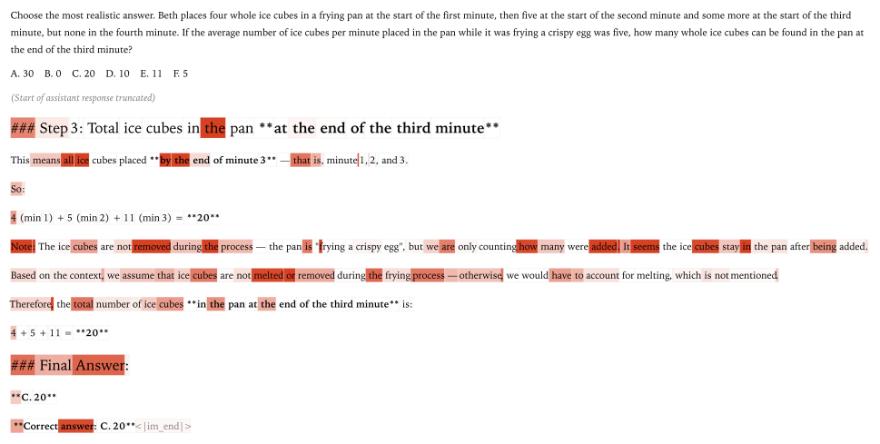

***图 6：一条由教师模型评分的示例轨迹。红色越深的 token，对应的反向 KL 越高。***

**图内题目与回答的完整译文如下。图中 token 的划分和颜色保留在原图中；下列内容是学生的错误回答，不是译者认可的结论。**

> **选择最符合实际的答案。Beth 在第 1 分钟开始时往煎锅里放入 4 块完整的冰块，第 2 分钟开始时放入 5 块，第 3 分钟开始时又放了一些，但第 4 分钟没有放。如果煎锅在煎脆皮鸡蛋的过程中，平均每分钟被放入 5 块冰块，那么第 3 分钟结束时，锅里能找到多少块完整的冰块？**
>
> **A. 30　B. 0　C. 20　D. 10　E. 11　F. 5**
>
> **（助手回答的开头已省略。）**
>
> **第 3 步：第 3 分钟结束时锅里的冰块总数。**
>
> **这指的是截至第 3 分钟结束时放进去的所有冰块，也就是第 1、2、3 分钟放进去的冰块。**
>
> **所以：**
>
> $`4\ (\text{第 1 分钟})+5\ (\text{第 2 分钟})+11\ (\text{第 3 分钟})=20`$。
>
> **注意：这些冰块在过程中没有被取走。锅里在“煎脆皮鸡蛋”，但我们只是在数放入了多少块冰块。看起来，冰块放进去之后一直留在锅里。**
>
> **根据上下文，我们假定冰块在煎制过程中既没有融化，也没有被取走；否则就必须考虑融化，而题目并没有提到这一点。**
>
> **因此，第 3 分钟结束时锅里的冰块总数是：**
>
> $`4+5+11=20`$。
>
> **最终答案：**
>
> **C. 20**
>
> **正确答案：C. 20** `<|im_end|>`

颜色越深，表示该 token 受到教师模型 **[Qwen3-235B-A22B-Instruct-2507](https://huggingface.co/Qwen/Qwen3-235B-A22B-Instruct-2507)** 的惩罚越大；这个教师能正确解答该问题。我们看到，教师惩罚了那些会开启错误方向短语的 token，直观上对应于引导推理的重要 **[“分岔 token”](https://arxiv.org/abs/2506.01939)** 。[^15]最终答案虽然错误，却没有受到惩罚：在给定前面整个序列的条件下，它是完全可以预料到的。

### 伪代码

我们在 **[Tinker 的 RL 脚本](https://github.com/thinking-machines-lab/tinker-cookbook/blob/main/tinker_cookbook/rl/train.py)** 之上实现同策略蒸馏；该脚本已经实现了采样、奖励计算和策略梯度式训练。[^16]

1. *初始化教师客户端。* Tinker API 让我们能够轻松为不同模型创建不同的客户端，而不必操心模型引擎的利用率。我们使用采样客户端，因为不需要通过教师模型对 logprobs 反向传播。
1. *采样轨迹。* 我们像 RL 中一样从学生采样生成轨迹。采样期间，RL 已经计算了学生的对数概率 $`\log \pi_\theta(x)`$，以供 **[重要性采样](https://tinker-docs.thinkingmachines.ai/losses#policy-gradient-importance_sampling)** 损失使用。
1. *计算奖励。* 我们对采样出的轨迹调用教师客户端的 `compute_logprobs`，获得教师对学生采样出的 token $`x`$ 给出的对数概率 $`\log \pi_\text{teacher}(x)`$。[^17]然后用它来计算反向 KL。
1. *用 RL 训练。* 我们将逐 token 的优势设为反向 KL 的负值，并调用 RL 的重要性采样损失函数，对学生模型执行训练更新。

```python
# 初始化教师客户端 (main):
teacher_client = service_client.create_sampling_client(
    base_model=teacher_config.base_model,
    model_path=teacher_config.load_checkpoint_path,
)

# 采样轨迹 (main):
trajectories = do_group_rollout(student_client, env_group_builder)
sampled_logprobs = trajectories.loss_fn_inputs["logprobs"]

# 计算奖励 (compute_teacher_reverse_kl):
teacher_logprobs = teacher_client.compute_logprobs(trajectories)
reverse_kl = sampled_logprobs - teacher_logprobs
trajectories["advantages"] = -reverse_kl

# 用 RL 训练 (train_step):
training_client.forward_backward(trajectories, loss_fn="importance_sampling")
```

在下面的实验中，我们通常将同策略蒸馏用于已经针对特定领域知识做过中期训练的模型。这种训练提高了学生生成落在教师分布内的 token 的概率，不过距离复现教师的表现通常还很远。[^18]很多时候，正如后面的个性化示例所展示的那样，学生由于缺乏任何相关领域知识，最初生成相关 token 的概率为零。

我们用同策略蒸馏开展后训练，并将其与其他方法进行比较；对于训练专家模型而言，这是最后一个至关重要的阶段。

## 用蒸馏训练推理能力

我们使用 **[Qwen3-32B](https://huggingface.co/Qwen/Qwen3-32B)** 作为教师模型，通过蒸馏训练 **[Qwen3-8B-Base](https://huggingface.co/Qwen/Qwen3-8B-Base)** 的数学推理能力。教师（Qwen3-32B）和学生（Qwen3-8B-Base）目前都是 Tinker **[支持的模型](https://tinker-docs.thinkingmachines.ai/model-lineup)** ，因此你可以通过 Tinker cookbook 复现实验。[^19]

### 异策略蒸馏

如前所述，我们的所有实验都从异策略蒸馏形式的中期训练开始，也就是在教师生成的样本数据集上进行监督微调。数学推理使用的数据集是 **[OpenThoughts-3](https://huggingface.co/datasets/open-thoughts/OpenThoughts3-1.2M)** ，其中包含由 **[QwQ-32B](https://huggingface.co/Qwen/QwQ-32B)** （一个与 Qwen3-32B 相似的推理模型）生成的推理提示和回答。

在 40 万条提示上对学生（Qwen3-8B-Base）进行全参数微调，可以在数学题基准 AIME’24 上达到 60% 的得分。我们也可以使用 LoRA 训练，[^20]不过在大规模数据集上训练时，它的表现落后于全参数微调。在所有情形下，我们都看到性能按照对数线性关系提升：最初的收益成本很低，后续的收益则代价高昂。

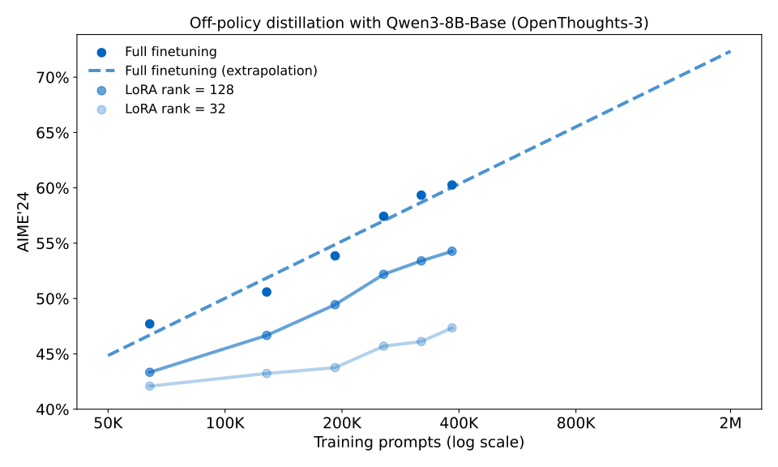

***图 7：异策略蒸馏（SFT）过程中的 AIME’24 得分。在最初的 5 万至 10 万条提示之后，性能遵循一条可预测的对数线性缩放曲线。正如 [《LoRA Without Regret》](https://thinkingmachines.ai/blog/lora/) 所预测的，在使用大批量进行大规模 SFT 时，我们观察到 LoRA 的表现更差。***

**图内文字对照：标题为“使用 Qwen3-8B-Base 进行异策略蒸馏（OpenThoughts-3）”；横轴 Training prompts (log scale) → 训练提示数量（对数刻度），K 表示千、M 表示百万；纵轴为 AIME’24。图例 Full finetuning → 全参数微调，Full finetuning (extrapolation) → 全参数微调（外推），LoRA rank = 128 / 32 → LoRA 秩为 128 / 32。**

我们可以把在 40 万条提示上微调后的模型作为一个检查点，再尝试各种后训练方法来提升性能。这样就能比较：把 AIME’24 基准得分从 60% 提高到 70%，需要付出多少代价。

默认方法是在更多提示上微调，继续异策略蒸馏的过程。沿着对数线性趋势外推，我们估计模型在约 200 万条提示上训练后，AIME’24 得分能够达到 70%。这种外推要求缩放规律持续成立、没有停滞，而这并非理所当然。不过，确实有通过大规模异策略蒸馏将 8B 模型的表现提升到 70% 以上的例子，例如 **[OpenThoughts-3](https://huggingface.co/datasets/open-thoughts/OpenThoughts3-1.2M)** 和 **[DeepSeek-R1-0528-Qwen3-8B](https://huggingface.co/deepseek-ai/DeepSeek-R1-0528-Qwen3-8B)** 。[^21]我们可以把这种外推视为对异策略蒸馏成本效益的一种乐观估计。

### 强化学习

**[Qwen3 技术报告](https://arxiv.org/pdf/2505.09388)** 在类似的 SFT 初始化基础上，用 17,920 GPU 小时的 RL 训练，在该基准上达到 67.6%。这很难与蒸馏成本直接比较，但如果对 SFT 训练系统做一些合理假设，这一成本与在 200 万条异策略蒸馏提示上训练的成本相近。

| 方法 | AIME’24 | GPQA-Diamond | GPU 小时 |
| --- | --- | --- | --- |
| 异策略蒸馏 | 55.0% | 55.6% | 未报告 |
| + 强化学习 | 67.6% | 61.3% | 17,920 |
| + 同策略蒸馏 | 74.4% | 63.3% | 1,800 |

***图 8：来自 [《Qwen3 技术报告》](https://arxiv.org/abs/2505.09388)的表 21。***

Qwen 团队还报告，同策略蒸馏只用了 RL 十分之一的成本，就在 AIME’24 上取得了更高的 74.4 分，这也启发了我们的工作。下面，我们尝试在自己的基础配置中复现这一结果。

### 同策略蒸馏

作为异策略蒸馏或 RL 的替代方案，我们按前面介绍的方法运行同策略蒸馏。[^22]从 40 万条提示的 SFT 检查点出发，同策略蒸馏在约 150 步内将 AIME’24 得分提高到 70%。[^23]

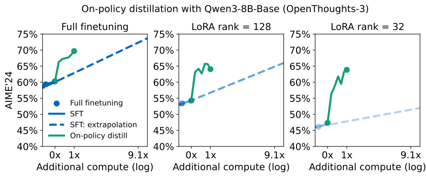

***图 9：同策略蒸馏过程中的 AIME’24 得分。我们用训练 FLOPs 衡量额外计算量（见下文）。同策略蒸馏的计算效率显著高于 SFT，对 LoRA 模型尤其如此。在秩为 32 时，LoRA 在 SFT 后比全参数微调低 13 个百分点，但在同策略蒸馏后只低 6 个百分点。***

**图内文字对照：标题为“使用 Qwen3-8B-Base 进行同策略蒸馏（OpenThoughts-3）”；三个子图分别是全参数微调、LoRA 秩为 128、LoRA 秩为 32。横轴 Additional compute (log) → 额外计算量（对数刻度）；纵轴为 AIME’24。图例 SFT → 监督微调，SFT: extrapolation → SFT 外推，On-policy distill → 同策略蒸馏。横轴标注 0x、1x 和 9.1x 保留原样。**

比较不同方法的计算成本并不容易，因为训练、采样和对数概率计算三者的成本比例，会随实现方式而显著变化。下面我们以 FLOPs 衡量成本，这会让那些能够在 GPU 上有效并行化的方法处于不利地位。尤其是，它会高估计算对数概率的实际成本。

| 方法 | AIME’24 | 教师 FLOPs | 学生 FLOPs | 相对于 SFT-2M 的计算效率（CE） |
| --- | --- | --- | --- | --- |
| *初始化：SFT-400K* | 60% | $`8.5 \times 10^{20}`$ | $`3.8 \times 10^{20}`$ | – |
| SFT-2M（外推） | 约 70%（外推） | $`3.4 \times 10^{21}`$ | $`1.5 \times 10^{21}`$ | 1× |
| 强化学习 | 68% | - | - | ≈1× |
| 同策略蒸馏 | 70% | $`8.4 \times 10^{19}`$ | $`8.2 \times 10^{19}`$ | 9–30× |

当 SFT 数据集已经现成可用——例如本例中的 OpenThoughts-3——或其成本由多次训练分摊时，我们发现成本可降低到基线的约九分之一。[^24]在这种情况下，异策略训练不计入教师 FLOPs 的成本，但同策略训练需要计入，因为我们必须运行教师模型，才能计算学生轨迹的对数概率。由于这项计算可以在 GPU 之间低成本地并行进行，以 GPU 小时衡量时，计算效率的提升更接近 18 倍。

不过，我们常常希望在一个没有现成异策略蒸馏数据集的新任务上训练小模型。如果把异策略蒸馏中教师模型的全部成本都算进去，也就是包括从教师模型采样的额外成本，那么总成本约为基线的 $`1/30`$。[^25]

## 用蒸馏实现个性化

除了在常见任务上将小模型训练到较高水平，蒸馏的另一个用途是个性化。例如，让模型遵循特定的对话语气和输出格式，或具备工具使用、成本预算等能力。我们往往希望把这些行为与新的领域知识一起训练进去。

同时训练这两者通常很困难，轻量级微调也往往不足以实现这一目标，[^26]因此需要规模更大的中期训练。在新知识之上学会后训练行为，需要一套复杂的后训练流程，通常包括专有数据和奖励模型。前沿实验室能够采用这种方法，但其他实践者要复现它，可能会遇到很大困难，或者面临难以承受的成本。

本节将展示，同策略蒸馏可以有效地用于后训练，以塑造专门的行为。这种方法也适用于持续学习或“测试时训练”：在模型部署后更新模型，同时不损害原有性能。我们以一个在公司内部文档上做过中期训练的模型为应用示例。

### 训练一个内部助手

定制模型的一个常见目标是充当助手：既拥有某个领域的专业知识，又表现出可靠的助手行为。我们可能需要分别训练这两方面，尤其是当专业知识无法仅从预训练数据中学到，或者学习这些知识会干扰模型行为时。

我们的例子是一个公司内部助手，它需要满足两个要求：

1. 模型对该领域（公司文档） **掌握充分的知识** 。预训练模型没有见过这家公司的任何内部文档，因此无论模型规模多大，都只能猜测。我们将通过一项内部知识回忆评测（“内部问答”，internal QA）来衡量这一点。
1. 模型表现出较强的 **后训练** 行为，也就是指令遵循能力。我们将使用常见的 **[IF-eval](https://arxiv.org/abs/2311.07911)** 来衡量这一点。[^27]

### 学习新知识会损害已经学会的行为

我们从 Qwen3-8B 开始，而不是从基础模型开始。Qwen3-8B 已经做过后训练，掌握了对助手有用的技能，例如遵循指令，以及通过 RL 学到的推理能力。此前的研究表明，这类强化学习只会训练原模型中的小型子网络，[^28]因此，当网络随后在大量数据上继续训练时，这些能力可能很脆弱。我们研究这种现象发生的程度，以及如何恢复所需的行为。

为了减少这种灾难性遗忘，中期训练中的一种常见做法，是混入来自原模型预训练分布的“背景数据”。[^29]但在这里，我们无法获得 Qwen3 的预训练分布。因此，我们考虑一个更强、也更昂贵的基线：取出 **[Tulu3](https://huggingface.co/datasets/allenai/tulu-3-sft-mixture)** [^30]中的提示——这是一个广泛覆盖对话和指令遵循的数据集——再用 Qwen3-8B 重新采样回答，作为聊天背景数据。

由 Qwen3-8B 采样的这些“同策略”背景数据，起到了前向 KL 正则项的作用，在整个中期训练过程中强化模型原有的行为。我们发现，在中期训练中保持聊天能力方面，用 Qwen3-8B 采样优于用 Qwen3-32B 采样，这凸显了结果对数据来源的敏感性；Chen 等人也发现了类似的同策略 SFT 结果。[^31]我们推测，这种方法甚至可能比直接获得原始预训练数据分布更有效，代价是需要采样一个大规模数据集。

接着，我们用不同比例的内部文档和聊天数据混合，对 Qwen3-8B 进行微调。提高文档数据的占比，会直接改善模型的知识表现。不过，虽然混入至少 30% 的聊天数据有助于保留大部分指令遵循能力，但没有任何一种配比能够维持原来的 IF-eval 表现。[^32]

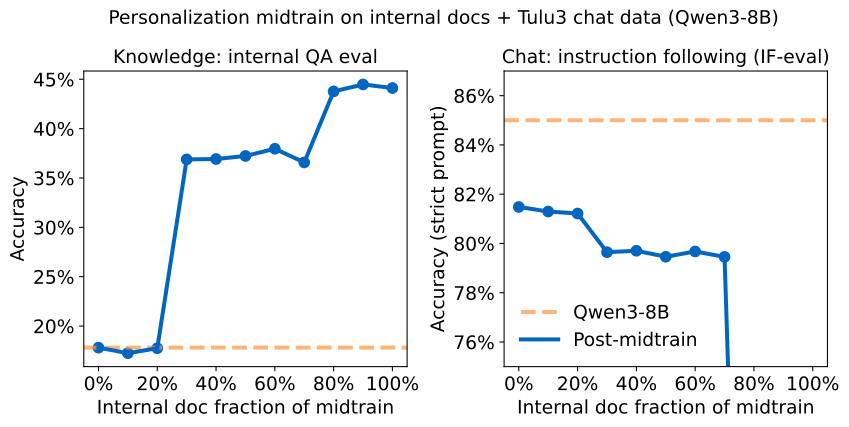

***图 10：在中期训练中扫描内部文档与背景聊天数据的混合比例。虽然混入少量聊天数据有助于避免灾难性的性能退化，但没有任何一种权重能够维持原来的 IF-eval 表现。***

**图内文字对照：标题为“在内部文档 + Tulu3 聊天数据上进行个性化中期训练（Qwen3-8B）”；左图 Knowledge: internal QA eval → 知识：内部问答评测；右图 Chat: instruction following (IF-eval) → 聊天：指令遵循（IF-eval）。横轴 Internal doc fraction of midtrain → 中期训练中内部文档的比例；纵轴 Accuracy → 准确率，Accuracy (strict prompt) → 准确率（严格提示级标准）。图例 Post-midtrain → 中期训练后，Qwen3-8B 为原模型基线。**

对于任意一种混合比例，我们都观察到 IF-eval 表现会在微调过程中下降。这限制了我们通过延长训练来进一步增强模型专门能力的空间。[^33]

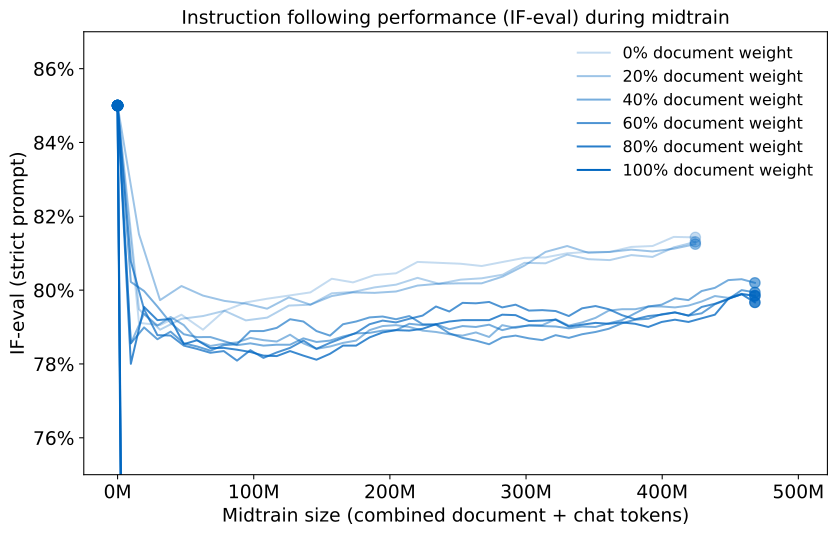

***图 11：在所有数据混合比例下，IF-eval 都会在中期训练期间下降。当我们使用线性学习率调度时（如图所示），随着学习率衰减，性能下降最终趋于平缓，并开始缓慢恢复。然而，性能始终没有完全恢复。***

**图内文字对照：标题为“中期训练期间的指令遵循表现（IF-eval）”；横轴 Midtrain size (combined document + chat tokens) → 中期训练规模（文档和聊天 token 合计），M 表示百万；纵轴 IF-eval (strict prompt) → IF-eval（严格提示级标准）。图例分别表示文档权重为 0%、20%、40%、60%、80%、100%。**

另一种常见方法是用 LoRA 约束参数更新，从而降低灾难性遗忘的可能性。然而，这种方法仍不足以保持 IF-eval 表现，而且 LoRA 学到的知识更少。[^34]

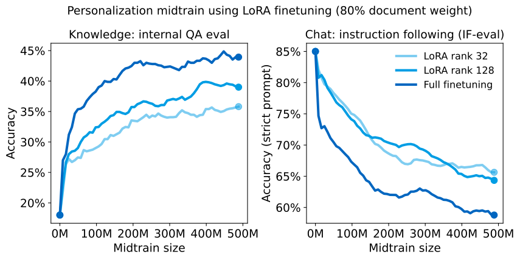

***图 12：在已经完成后训练的 Qwen3-8B 之上，用 LoRA 进行我们的个性化中期训练时，它学到的知识更少，却仍然会忘记原有的后训练行为。***

**图内文字对照：标题为“使用 LoRA 微调进行个性化中期训练（文档权重 80%）”；左图为知识：内部问答评测，右图为聊天：指令遵循（IF-eval）。横轴 Midtrain size → 中期训练规模，M 表示百万；纵轴分别为准确率和准确率（严格提示级标准）。图例为 LoRA 秩 32、LoRA 秩 128 和全参数微调。**

### 同策略蒸馏能够恢复后训练行为

接下来，我们希望在用内部文档微调后，恢复模型的指令遵循行为。这种行为最初是通过 RL 训练出来的；RL 代价高昂，而且正如前面所见，其学到的行为很脆弱。我们改用模型较早的版本 Qwen3-8B 作为教师，在 **[Tulu3](https://huggingface.co/datasets/allenai/tulu-3-sft-mixture)** 提示上进行同策略蒸馏。请注意，这一训练阶段与内部文档数据无关，唯一目的就是恢复指令遵循能力。

把模型较早的版本用作教师，来“重新唤起”微调中丢失的能力，使同策略蒸馏在持续学习中很有前景。我们可以交替进行两个阶段：在新数据上微调，以及通过蒸馏恢复行为，让模型能够不断学习，并随着时间推移保持知识更新。Cobbe 等人此前已经探索过这种分阶段交替的方法。[^35]

在按 70:30 的比例混合内部文档数据与聊天数据进行微调之后，同策略蒸馏在没有丢失任何知识的情况下，几乎完全恢复了 IF-eval 表现；我们还观察到，聊天能力与模型在内部问答评测中的“知识”表现之间存在一定的正向迁移。

| 模型 | 内部问答评测（知识） | IF-eval（聊天） |
| --- | --- | --- |
| *Qwen3-8B* | 18% | 85% |
| *+ 中期训练（100%）* | 43% | 45% |
| + 中期训练（70%） | 36% | 79% |
| + 中期训练（70%）+ 蒸馏 | 41% | 83% |

***图 13：中期训练后的领域专门能力（内部问答评测）和聊天能力（IF-eval）。虽然中期训练会让 Qwen3-8B 忘记已经通过后训练学会的行为，但同策略蒸馏可以低成本地恢复这些行为，同时保留中期训练学到的额外知识。***

本质上，我们把语言模型自身当成了奖励模型，为高概率行为提供奖励。[^36]这与逆强化学习有关：在某个假定存在的底层偏好模型中，高概率行为对应着更有利的奖励。[^37]从这个意义上说，任何经过指令微调的开放权重模型，都可以用作奖励模型；我们只需要能够调用 `compute_logprobs` 函数。

把蒸馏作为整合行为与知识的工具，也已在混合推理模型（ **[Qwen3](https://arxiv.org/abs/2505.09388)** ）和专家蒸馏中得到探索。[^38]正如我们与 **[Chen 等人](https://arxiv.org/abs/2510.18874)** 的结果所提示的那样，同策略学习可能成为增强类似的、基于蒸馏的“模型合并”方案的重要工具。

## 讨论

### 密集监督大幅提高计算效率

强化学习和同策略蒸馏都通过反向 KL 来学习，对基础策略已有的动作空间进行剪枝。区别在于奖励的密集程度。在 **[《LoRA Without Regret》](https://thinkingmachines.ai/blog/lora/)** 中，我们提出了一个信息论视角：强化学习每个回合只传授 $`O(1)`$ 比特的信息。相比之下，蒸馏每个回合传授 $`O(N)`$ 比特，其中 $`N`$ 是 token 数量。我们能否量化更密集奖励带来的训练效率提升？

我们做了一个实验，直接比较两者：

1. 从 Qwen3-8B-Base 开始，不进行额外的 SFT。
1. 按照 **[《LoRA Without Regret》](https://thinkingmachines.ai/blog/lora/)** 中的流程，在 DeepMath 上进行 RL。我们使用秩为 128 的 LoRA。得到的模型作为蒸馏的教师。
1. 将通过 RL 训练的模型（第 2 步）通过同策略蒸馏传回基础模型（第 1 步）。

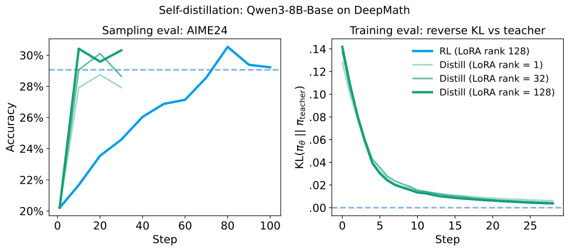

***图 14：从相同的初始化出发，同策略蒸馏只需约七分之一至十分之一的梯度步数，就能学会经 RL 训练得到的策略，对应约 50–100 倍的计算效率。***

**图内文字对照：标题为“自蒸馏：Qwen3-8B-Base 在 DeepMath 上”；左图 Sampling eval: AIME24 → 采样评测：AIME24，纵轴 Accuracy → 准确率；右图 Training eval: reverse KL vs teacher → 训练评测：相对于教师的反向 KL，纵轴为** $`\mathrm{KL}(\pi_\theta\Vert\pi_\mathrm{teacher})`$ **。横轴 Step → 训练步数。图例分别为 RL（LoRA 秩 128）和蒸馏（LoRA 秩 1、32、128）。**

我们看到，在模型架构匹配（LoRA 秩为 128）时，蒸馏达到教师性能水平所需的训练步数，大约只有 RL 的七分之一至十分之一。在不到 10 次梯度更新后，反向 KL 就降到接近零，AIME 得分也得以恢复；而 RL 需要 70 步才能达到这一水平。

综合来看，计算效率可提高约 50–100 倍：

- RL 需要在接近评测时的上下文长度下训练，以便策略学会遵守上下文长度限制、不受到格式惩罚；而蒸馏在更短的上下文长度下也能有效学习，因为在已经结束采样的轨迹和仍在继续生成的轨迹之间，奖励不会突然发生跳变。
- 当 SFT 初始化足够强时，[^39]同策略蒸馏用小得多的批量也能有效训练，因为每个回合提供的信息比特数显著更多，从而降低了梯度噪声。

虽然通常很难使用过程监督来训练强化学习模型，但这些结果表明，从总体方向上看，过程监督和密集奖励有潜力将学习效率提高一个数量级。这与 Lightman 等人早期的 RL 研究结果一致。

### 蒸馏能够有效复用训练数据，提高数据效率

对于实践者来说，收集大规模训练提示数据集可能既困难又耗时。因此，我们希望在训练中多次复用提示。在 RL 中，在同一条提示上训练多个轮次，往往会让模型仅仅记住最终答案，尤其是大模型。[^40]相比之下，同策略蒸馏通过最小化反向 KL，学习逼近教师的完整分布，而不是记住某一个答案。这使我们可以从同一条提示生成许多样本用于训练。

我们重复前面用数学数据训练 Qwen3-8B-Base 的实验，但这一次只使用从数据集中随机选出的一条提示。[^41]

我们在这条提示上连续训练 20 步，每一步包含一批 256 条轨迹，总共得到 5120 条经过评分的序列。我们连续多个训练步都使用同一条提示，这通常会导致过拟合。虽然计算效率自然会低一些，但即使只用一条提示训练，我们仍大致达到了教师模型的性能。

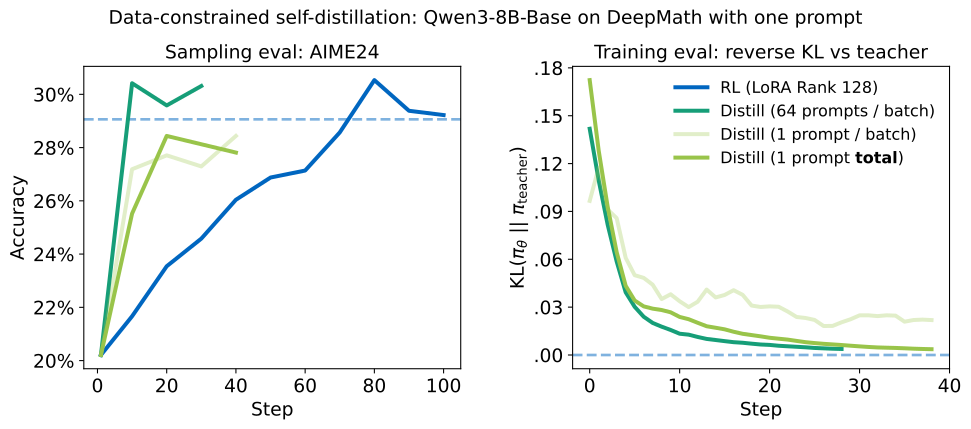

***图 15：在这个例子中，对一个训练样本进行多轮训练，就足以蒸馏出教师在 AIME’24 上的表现。我们的默认配置（也用于个性化实验）在同策略蒸馏中每批使用 64 条提示，每条提示采样 4 次。图中所有方法每批都使用 256 个样本。注意，右图展示的是训练 KL，因此“总共只有 1 条提示”优于“每批 1 条提示”是自然的。***

**图内文字对照：标题为“数据受限的自蒸馏：Qwen3-8B-Base 在 DeepMath 上仅使用一条提示”；左图为采样评测：AIME24，纵轴为准确率；右图为训练评测：相对于教师的反向 KL，纵轴为** $`\mathrm{KL}(\pi_\theta\Vert\pi_\mathrm{teacher})`$ **。横轴为训练步数。图例分别为 RL（LoRA 秩 128）、蒸馏（每批 64 条提示）、蒸馏（每批 1 条提示）、蒸馏（总共 1 条提示）。**

### RL 在语义策略空间中搜索

我们已经看到，同策略蒸馏能用少得多的训练步数复现 RL 带来的学习效果。对这一结果的一种解释是，与预训练不同，RL 并没有把大量计算花在梯度更新本身。我们应当把 RL 理解为将大部分计算花在 *搜索* 上——展开策略生成轨迹，并进行功劳分配——而不是花在更新上。[^42]

通过随机梯度下降进行预训练，是在探索高维参数空间。预训练需要海量信息，而且非常难以蒸馏，部分原因在于每个网络的参数空间都带有一定的独特性。[^43]预训练所需的梯度更新，计算成本极高，也非常耗时。

相比之下，我们应当把 RL 理解为在语义策略空间中探索。[^44]在每一步，RL 都会对过去发现的某个策略尝试做一点小修改。它并不是在参数空间中探索，而是靠运气“碰上”新策略：它是在已有权重所定义的分布中随机采样。

一旦找到了好的策略，蒸馏就提供了学习它的捷径：同策略蒸馏不需要建模 RL 训练历程中的中间策略，只需要学习最终得到的策略。如果我们只关心最终策略——生产应用中往往如此——就不必花费计算去建模所有中间策略。

可以这样类比：在科学研究中，我们花费大量时间和资源寻找答案、探索新想法。一旦有了发现，通过自然语言把结果表达出来、教给别人，就简单得多。与之相对的是运动等直觉性的身体技能。它们很难教给别人，因为这些知识以一种内在语言（例如肌肉记忆）的形式存在，只有我们自己能轻易理解。运动技能只能靠反复练习来学习。

### 把同策略学习作为持续学习的工具

在用蒸馏实现个性化一节中，我们探索了同策略蒸馏将专门训练过的行为重新引入模型的能力。这可以推广到更广泛的持续学习任务：获得新知识，同时不损害原有能力。

已有工作发现，同策略学习（RL）比异策略学习遗忘得更少。[^45]但是，RL 只塑造行为，无法很好地传授新知识，因此仅靠 RL 不足以实现持续学习。

在前面的章节中，我们看到 SFT（包括异策略蒸馏）会损害行为，因此无法很好地支撑持续学习。我们进一步研究这一点，并用一个直接的例子展示它。与前面类似，我们取出 Tulu3 提示，用 Qwen3-32B 在 `temperature = 1.0` 下采样，不做任何其他修改，构建一个数据集。因此，这个数据集相对于 Qwen3-32B 的 KL 为零。[^46]

如果在这个由模型自身样本组成的数据集上进行 SFT，会发生什么？我们看到，只要使用任何实际可用、且大于零的学习率，指令遵循评测的表现就会下降！

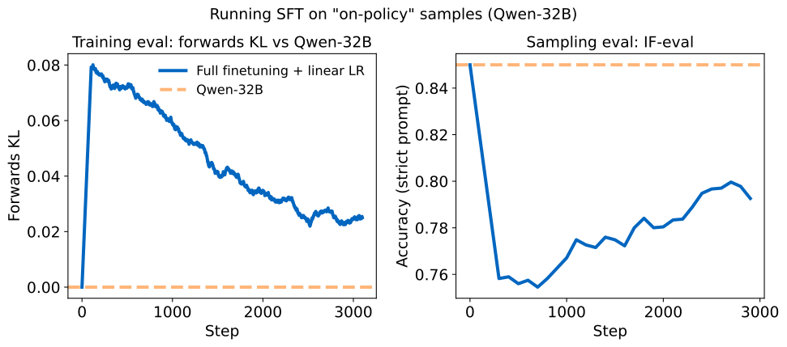

***图 16：在 Qwen3-32B 自身的样本上运行 SFT，会导致性能下降。我们使用与个性化一节相同的学习率；该学习率是出于实际性能考虑，通过扫描选择的。线性学习率调度可以防止前向 KL 和 IF-eval 无止境地恶化，但在学习率衰减到零之前，性能并不会恢复。***

**图内文字对照：标题为“在‘同策略’样本上运行 SFT（Qwen-32B）”；左图 Training eval: forwards KL vs Qwen-32B → 训练评测：相对于 Qwen-32B 的前向 KL，纵轴 Forwards KL → 前向 KL；右图 Sampling eval: IF-eval → 采样评测：IF-eval，纵轴为准确率（严格提示级标准）。横轴为训练步数。图例 Full finetuning + linear LR → 全参数微调 + 线性学习率，另一条为 Qwen-32B 基线。图内模型名原本写作 Qwen-32B，正文写作 Qwen3-32B，这里分别照录。**

对此，一种可能的解释是：虽然 KL 散度在期望上为 0，但实际中每个有限批次都会呈现略有不同的分布。在这些有限批次上训练，会产生非零的梯度更新，进而让更新后模型的策略偏离其初始状态的策略。随着时间推移，这一过程把在自身样本上的训练变成了异策略训练，也就带来了异策略训练中同样的误差累积，以及长序列上的偏离。

同策略蒸馏始终保持同策略；又由于教师保持固定，学生会收敛到教师所期望的行为，而不会像 SFT 那样在自蒸馏设置中退化。因此，同策略蒸馏是一个很有前景的持续学习工具。

## 结论

我们探索了同策略蒸馏在多种应用中的作用，例如训练小型数学推理模型，或训练能够持续学习的助手。我们将同策略蒸馏与另外两种后训练方法——异策略蒸馏和同策略 RL——进行了比较。我们发现，同策略蒸馏兼得两者之长：既有同策略训练可靠的表现，又有密集奖励信号带来的成本效率。

后训练是达到前沿模型能力的关键环节。通过将学生的同策略采样与教师的密集监督结合起来，同策略蒸馏这套方法只需前沿高计算量 RL 训练的一小部分成本，就能达到这些能力。

我们的实现可以在 **[Tinker cookbook](https://github.com/thinking-machines-lab/tinker-cookbook/tree/main/tinker_cookbook/recipes/distillation)** 中找到。我们的工作探索了同策略蒸馏简单、直接的实现方式，以清楚展示它的优势。我们希望继续研究蒸馏的新应用、改善教师监督的新方法，以及提升数据效率和持续学习能力的途径。

在 Thinking Machines，我们的使命是通过兼具前沿性能、适应性和个性化能力的 AI 模型，赋予人们更强的能力。同策略蒸馏是实现这一目标的有力工具。

## 引用

**请按以下方式引用本工作：**

**Lu, Kevin and Thinking Machines Lab, "On-Policy Distillation", Thinking Machines Lab: Connectionism, Oct 2025.**

**或者使用以下 BibTeX 引用：**

```bibtex
@article{lu2025onpolicydistillation,
  author = {Kevin Lu and Thinking Machines Lab},
  title = {On-Policy Distillation},
  journal = {Thinking Machines Lab: Connectionism},
  year = {2025},
  note = {https://thinkingmachines.ai/blog/on-policy-distillation},
  doi = {10.64434/tml.20251026},
}
```

**以下为原文旁注，按原顺序转为脚注。**

[^1]: **[《Alpaca：一个强大、可复现的指令遵循模型》](https://crfm.stanford.edu/2023/03/13/alpaca.html)（Taori 等，2021）。**

[^2]: **[《OpenThoughts：推理模型的数据配方》](https://arxiv.org/abs/2506.04178)（Guha 等，2025）。**

[^3]: **[《蒸馏大语言模型以高效提取临床信息》](https://arxiv.org/abs/2501.00031)（Vedula 等，2025）。**

[^4]: **[《通过扩大高质量指令对话的规模来增强聊天语言模型》](https://arxiv.org/abs/2305.14233)（Ding 等，2023）。**

[^5]: **[《模仿专有大语言模型的虚假承诺》](https://arxiv.org/abs/2305.15717)（Gudibande 等，2023）。**

[^6]: **[《将模仿学习和结构化预测归约为无遗憾在线学习》](https://arxiv.org/abs/1011.0686)（Ross 等，2010）。**

[^7]: **[《让我们逐步验证》](https://arxiv.org/abs/2305.20050)（Lightman 等，2023）。**

[^8]: **[《语言模型的同策略蒸馏：从自己生成的错误中学习》](https://arxiv.org/abs/2306.13649)（Agarwal 等，2023）。**

[^9]: **[《MiniLLM：大语言模型的知识蒸馏》](https://arxiv.org/abs/2306.08543)（Gu 等，2023）。**

[^10]: **[《Qwen3 技术报告》](https://arxiv.org/abs/2505.09388)（Qwen 团队，2025）。**

[^11]: **关于不同损失函数选择的分析，请参见 Agarwal 等人的工作。**

[^12]: **虽然使用大于零的折扣因子在数学上更为正确，但我们在实践中没有发现它能改善性能，因此为简单起见选择零。**

[^13]: **关于寻模态行为的更多讨论，请参见 [Eric Jang 的博文](https://blog.evjang.com/2016/08/variational-bayes.html)。**

[^14]: **[《用于循环神经网络序列预测的计划采样》](https://arxiv.org/abs/1506.03099)（Bengio 等，2015）。更多讨论请参见 Gu 等人的工作。**

[^15]: **[《超越 80/20 法则：少数高熵 token 驱动大语言模型推理中的有效强化学习》](https://arxiv.org/abs/2506.01939)（Wang 等，2025）。**

[^16]: **实际上，在使用 KL 正则化的 RL 实现之上，我们的实现只需改一行：把正则化所用的模型换掉即可。**

[^17]: **本文所有实验都没有考虑 logit（top-k）蒸馏；它有可能进一步提高计算效率。**

[^18]: **使用前向 KL 的 SFT，会为新 token 扩展[支撑集](https://en.wikipedia.org/wiki/Support_%28mathematics%29)。随后，反向 KL 方法就能在初始化策略的支撑集内进行寻模态。**

[^19]: **更新（2026 年 6 月）：这里使用的教师（Qwen3-32B）和学生（Qwen3-8B-Base）后来已[从 Tinker 支持的模型列表中退役](https://tinker-docs.thinkingmachines.ai/tinker/model-deprecations/)。[Tinker cookbook 中的蒸馏配方](https://github.com/thinking-machines-lab/tinker-cookbook/tree/main/tinker_cookbook/recipes/distillation)已更新为使用 [Qwen3.5-9B-Base](https://huggingface.co/Qwen/Qwen3.5-9B-Base) 作为学生、[Qwen3.5-9B](https://huggingface.co/Qwen/Qwen3.5-9B) 作为教师，因此这些实验仍可复现。**

[^20]: **[《LoRA：大语言模型的低秩适配》](https://arxiv.org/abs/2106.09685)（Hu 等，2021）。**

[^21]: **DeepSeek-R1-0528-Qwen3-8B 在该基准上达到 86%，但没有说明训练提示的数量。更早的模型（Qwen2.5-7B、Qwen2.5-14B）在 80 万条来自 DeepSeek-R1 的蒸馏提示上训练后，分别[达到 55.5% 和 69.7%](https://arxiv.org/abs/2501.12948)。**

[^22]: **我们实际上使用 Qwen3-8B 作为教师，因为它的表现略好。不过，为了比较计算量，我们仍可以按 32B 模型的 FLOPs 来计量。**

[^23]: **150 步对应约 7.7 万条提示；训练时每条提示使用 4 个样本。**

[^24]: $`\mathrm{CE}=\frac{\mathrm{Student}_{\mathrm{OPD}}+\mathrm{Teacher}_{\mathrm{OPD}}}{\mathrm{Student}_{\mathrm{SFT}}}`$。 **译注：原文用绿色方块标记同策略蒸馏的学生和教师成本，用蓝色方块标记 SFT 的学生成本；此处改用下标表达相同对应关系，并照录原式的分子、分母方向，不将其倒置为正文所述的成本降低倍数。**

[^25]: $`\mathrm{CE}=\frac{\mathrm{Student}_{\mathrm{OPD}}+\mathrm{Teacher}_{\mathrm{OPD}}}{\mathrm{Student}_{\mathrm{SFT}}+\mathrm{Teacher}_{\mathrm{SFT}}}`$。 **译注：原文的绿色方块和蓝色方块分别对应同策略蒸馏与 SFT；这里同样用下标区分，并保留原式方向。**

[^26]: **[《不熟悉的微调样本决定语言模型如何产生幻觉》](https://arxiv.org/abs/2403.05612)（Kang 等，2024）。**

[^27]: **[《大语言模型的指令遵循评测》](https://arxiv.org/abs/2311.07911)（Zhou 等，2023）。**

[^28]: **[《强化学习微调的是大语言模型中的小型子网络》](https://arxiv.org/abs/2505.11711)（Mukherjee 等，2025）。**

[^29]: **[《中期训练连接预训练与后训练分布》](https://arxiv.org/abs/2510.14865)（Liu 等，2025）。**

[^30]: **[《Tulu 3：推进开放语言模型后训练的前沿》](https://arxiv.org/abs/2411.15124)（Ivison 等，2024）。**

[^31]: **[《在实践中保留：同策略数据在缓解遗忘中的作用》](https://arxiv.org/abs/2510.18874)（Chen 等，2025）。**

[^32]: **即使 SFT 数据集由 100% 的聊天数据构成，这一点也成立。我们会在持续学习的讨论中进一步解释。**

[^33]: **从直觉上看，我们可能期待：一个过参数化模型在某个数据集上训练时，只更新它在该数据集上下文中的行为，而不影响其他上下文中的行为。但实践中并非如此：在原始文档数据上训练，甚至会让问答上下文中的表现下降。**

[^34]: **[《LoRA 学得更少，也忘得更少》](https://arxiv.org/abs/2405.09673)（Biderman 等，2024）。**

[^35]: **[《分阶段策略梯度》](https://arxiv.org/abs/2009.04416)（Cobbe 等，2020）。**

[^36]: **[《直接偏好优化：你的语言模型其实就是奖励模型》](https://arxiv.org/abs/2305.18290)（Rafailov 等，2023）。**

[^37]: **[《逆强化学习算法》](https://ai.stanford.edu/~ang/papers/icml00-irl.pdf)（Ng 和 Russell，2000）。**

[^38]: **[《DeepSeek-V3.2-Exp：通过 DeepSeek 稀疏注意力提高长上下文效率》](https://github.com/deepseek-ai/DeepSeek-V3.2-Exp/blob/main/DeepSeek_V3_2.pdf)（DeepSeek-AI 团队，2025）。**

[^39]: **也就是说，教师策略位于学生策略的支撑集之内。如果不满足这一条件，例如“用蒸馏训练推理能力”一节中的情况，我们就需要大得多的批量。**

[^40]: **不过，[《仅用一个训练样本对大语言模型进行推理强化学习》](https://arxiv.org/abs/2504.20571)（Wang 等，2025）在某些设置中报告了正面的结果。**

[^41]: **提示：“计算极限：** $`\lim_{x \to \infty} \sqrt{x} \left( \sqrt[3]{x+1} - \sqrt[3]{x-1} \right)`$ **”。**

[^42]: **引自 Rich Sutton 的[《苦涩的教训》](http://www.incompleteideas.net/IncIdeas/BitterLesson.html)：“最终带来突破性进展的，是另一种相反的方法：通过搜索和学习来扩大计算规模。”**

[^43]: **[《彩票假说：寻找稀疏、可训练的神经网络》](https://arxiv.org/abs/1803.03635)（Frankle 和 Carbin，2018）。**

[^44]: **请注意，对策略的探索和对结果的探索有微妙区别：RL 要求基础模型一开始就有非零的成功率，因此它其实已经“找到过结果”；但在 RL 过程中，策略可以不断改进，让成功结果更容易出现。**

[^45]: **[《RL 的剃刀：为什么在线强化学习遗忘得更少》](https://arxiv.org/abs/2509.04259)（Shenfeld 等，2025）。**

[^46]: **我们在此前的博文[《克服大语言模型推理中的非确定性》](https://thinkingmachines.ai/blog/defeating-nondeterminism-in-llm-inference/)中，也讨论了“真正同策略”、** $`\mathrm{KL}=0`$ **的数据的重要性。**
