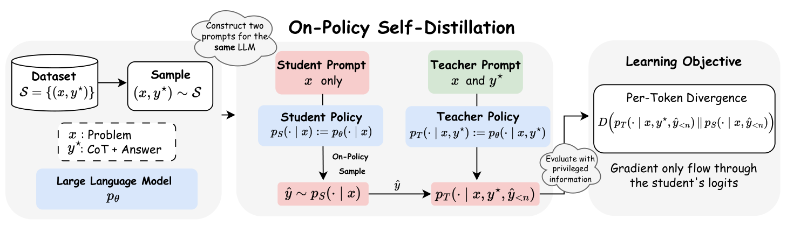
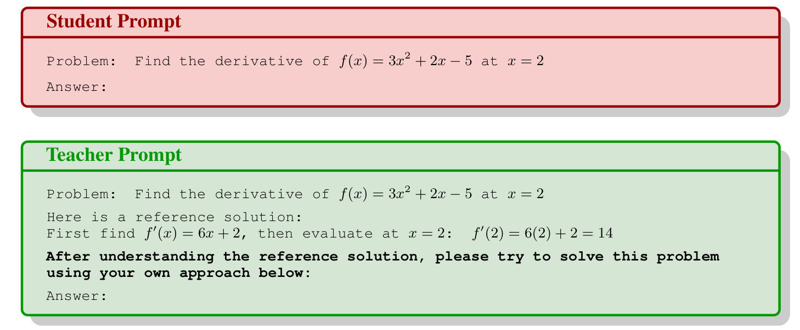
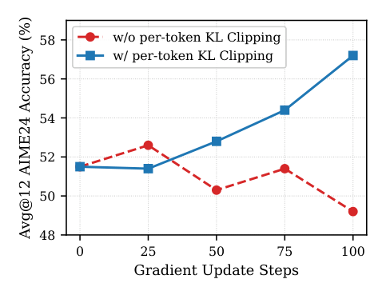
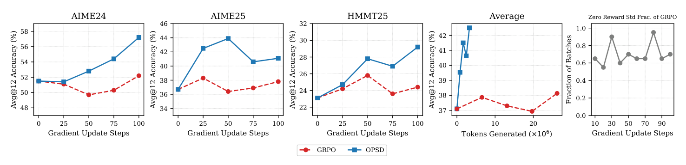
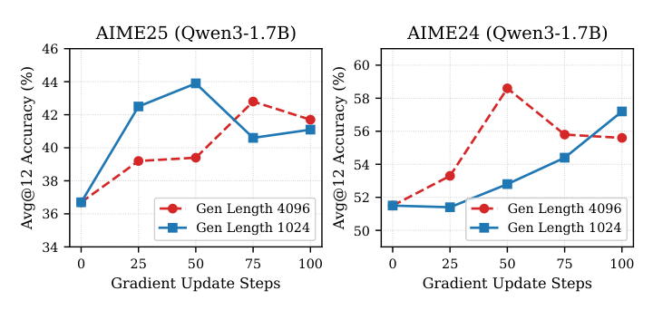

# 模型自己当自己的老师（OPSD）

中文 | [English](./On-Policy-Self-Distillation_en.md)

- **原文链接**: [Self-Distilled Reasoner: On-Policy Self-Distillation for Large Language Models](https://arxiv.org/abs/2601.18734v3)
- **论文**: [arXiv:2601.18734](https://arxiv.org/abs/2601.18734)
- **官方资料**: [siyan-zhao/OPSD](https://github.com/siyan-zhao/OPSD)
- **发布日期**: 2026-01-26
- **范围**: 按 arXiv v3（2026-03-20）写的通俗解读，不是全文翻译。作者来自 UCLA、港大和 Meta Superintelligence Labs。图片取自论文原图，表格数字取自论文；图注中标为"约"的数值是从曲线上读的近似值。

## 一句话版本

让同一个模型扮演两个角色：一个只看题目的"学生"，一个看过标准答案的"老师"。学生自己写解题过程，老师逐个字（token）打分，告诉学生"这一步我会怎么写"，学生朝老师的方向改。不需要额外的大模型当老师，也不需要像强化学习那样一道题采样很多遍。

在 Qwen3 的 1.7B、4B、8B 三个尺寸上做数学竞赛题，效果和 GRPO（一种主流强化学习方法）持平或略好，但生成的 token 数少得多。

## 1. 它想解决什么问题

现在想让大模型数学推理变强，常见有三条路，每条都有毛病：

| 方法 | 怎么做 | 毛病 |
| --- | --- | --- |
| SFT（监督微调） | 拿标准解题过程让模型照着抄 | 训练时看的是别人的过程，考试时要自己写，两者对不上（暴露偏差），泛化差 |
| GRPO 等强化学习 | 一道题让模型做 8 遍，对了给 1 分错了给 0 分 | 很贵；只在最后告诉你对错，不说错在哪一步；8 遍全对或全错时分数没差别，等于白练 |
| 在线蒸馏（On-Policy Distillation） | 学生自己写，一个更强的大模型逐字指导 | 效果好，但得另外养一个更大的老师模型 |

作者的问题是：现在的模型已经挺会推理了，能不能**自己教自己**？

## 2. 核心想法：看了答案的自己，来教没看答案的自己

灵感来自人怎么学习。做错一道题后，你翻开答案，看懂每一步为什么这么走，再回头发现自己是在哪一步跑偏的。作者的判断是：**理解一份现成的正确答案，比从零想出答案容易**（类似"检验比生成容易"）。所以同一个模型，看过答案后就能当一个合格的"批改老师"。

具体做法（对应论文图 1、图 2）：

*图 1（论文原图）：从数据集取出题目 x 和参考解法 y\*，给同一个模型构造两份 prompt。学生只看 x，自己采样出解答 ŷ；老师看 x 和 y\*，对 ŷ 的每个位置给出下一个 token 的分布。训练目标是逐 token 的分布差距，梯度只经过学生一侧。*

1. **学生 prompt**：只有题目，例如"求 f(x)=3x²+2x−5 在 x=2 处的导数"。
2. **老师 prompt**：题目 + 参考解法（"先求 f′(x)=6x+2，再代入得 14"）+ 一句引导"理解参考解法后，请用你自己的方式解这道题"。
3. 学生按自己的理解写一份完整解答。
4. 把学生写的这份解答，原样喂给"老师"那个 prompt，做一次前向计算。老师**不自己写**，只是在每个位置给出"如果是我，下一个字最可能是什么"的概率分布。
5. 训练目标：让学生在每个位置的概率分布，尽量接近老师的分布。梯度只更新学生那一侧。

*图 2（论文原图）：上面红框是学生 prompt，下面绿框是老师 prompt。老师多了参考解法和加粗的那句引导语。*

老师和学生是**同一套参数**，区别只在 prompt 里有没有答案。所以叫"自蒸馏"（Self-Distillation）；又因为练的是学生自己写出来的东西，所以叫"在线"（On-Policy）。

## 3. 和其他方法比，好在哪

论文表 1 的对比，换成大白话：

| 对比项 | SFT | GRPO | 在线蒸馏 | OPSD |
| --- | --- | --- | --- | --- |
| 练的是自己写的内容（不是抄别人的） | 否 | 是 | 是 | 是 |
| 每个字都有反馈（不只是最后对错） | 是 | 否 | 是 | 是 |
| 采样成本低 | 是 | 否 | 是 | 是 |
| 不需要外部老师模型 | 是 | 是 | 否 | 是 |

OPSD 是唯一四项都占的。

再说一个关键区别：GRPO 和 STaR（另一种自训练方法）都是"整道题对了才奖励"，题做错了就没有学习信号。OPSD 即使学生最后答案错了，也能逐字告诉它"这里老师会换个写法"，信号不会消失（论文附录 D 有推导）。

## 4. 几个让它真正能跑起来的细节

### 4.1 给"口头禅"降权：逐 token 截断（clipping）

作者发现，老师和学生分歧最大的地方，往往不是数学内容，而是 "wait""hmm""so""maybe" 这类语气词、连接词。论文表 5 统计了 10 道题上三类 token 的平均逐 token KL（数值越大，说明老师和学生在这类词上分歧越大，学生能学到的信号也越多）：

| 学生模式 | 老师模式 | 1.7B 风格词 | 1.7B 数学词 | 1.7B 其他 | 4B 风格词 | 4B 数学词 | 4B 其他 | 8B 风格词 | 8B 数学词 | 8B 其他 |
| --- | --- | --- | --- | --- | --- | --- | --- | --- | --- | --- |
| 关思考 | 关思考 | 0.68 | 0.12 | 0.11 | 0.61 | 0.06 | 0.10 | 0.56 | 0.05 | 0.11 |
| 开思考 | 关思考 | 0.51 | 0.10 | 0.17 | 0.41 | 0.05 | 0.18 | 0.33 | 0.05 | 0.15 |
| 开思考 | 开思考 | 0.51 | 0.09 | 0.08 | 0.50 | 0.04 | 0.09 | 0.42 | 0.04 | 0.08 |
| **关思考** | **开思考** | **0.85** | **0.14** | 0.25 | **0.92** | **0.10** | 0.29 | **0.79** | **0.06** | 0.25 |

*表 5（论文附录 B）："风格词"指 maybe、wait、so、therefore 等，"数学词"指 equation、factor、sum、root 等，完整词表见论文附录 C。*

每一行里，风格词的 KL 都是数学词的约 5～13 倍。不处理的话，模型会把力气花在学说话风格上。

解决办法：每个位置、每个候选词贡献的差异，设一个上限 τ，超过就截掉。

*图 4（论文原图，Qwen3-1.7B，AIME24）：红色虚线是不截断，蓝色实线是截断。不截断时成绩在 25 步后开始掉，第 100 步跌到约 49，低于训练前的 51.5；截断后一路涨到约 57。*

### 4.2 老师固定为训练开始时的模型

训练过程中学生在变，但老师一直用初始版本，不跟着更新。作者说这样更稳定，也相当于一种约束，防止模型跑得离原来太远。

### 4.3 学生"直接答"，老师"边想边答"

Qwen3 有思考模式（thinking mode）开/关两种。作者试了四种组合，发现**学生关思考、老师开思考**时，数学词上的信号最强（上面表 5 的加粗行，三个尺寸都是这一行的数学词 KL 最高），最终效果也最好，后面实验都用这个组合。

### 4.4 用正向 KL 衡量差距

衡量"学生和老师差多少"有几种公式。在 Qwen3-1.7B、AIME25 上（论文表 3，Avg@12，%）：

| 差距度量 | 训练前 | 第 50 步 | 第 100 步 |
| --- | --- | --- | --- |
| 正向 KL | 36.7 | **43.9** | 41.1 |
| 反向 KL | 36.7 | 37.5 | 35.0 |
| JSD | 36.7 | 36.9 | 39.0 |

正向 KL 明显最好，所以全文都用它。注意第 100 步比第 50 步有回落。

### 4.5 全词表比对 vs 只比对采样到的那个词

- 全词表：每个位置把老师和学生对所有候选词的概率都比一遍，信息多，但显存占用高。
- 只比采样词：只看学生实际写出的那个词，老师和学生各给多少概率，用差值当奖励，按强化学习的方式更新。省显存。

在 Qwen3-4B 上、学生生成长度 2048 时（论文表 4，pass@8，%）：

| 做法 | AIME25 | HMMT25 |
| --- | --- | --- |
| 全词表比对 | **84.1** | **60.0** |
| 只比采样词 | 82.1 | 57.3 |

全词表更好，代价是显存。

## 5. 实验结果

**设置**：Qwen3-1.7B / 4B / 8B（instruct 版），训练数据是 OpenThoughts 的数学子集（最多 3 万道题，带解题过程），测试集是 AIME 2024、AIME 2025、HMMT 2025 三个数学竞赛。每题采样 12 次取平均正确率（Avg@12）。全部用 LoRA 训练，8 张 A100 或 H100。

**训练成本对比**（论文表 6）：

| 配置 | GRPO | OPSD |
| --- | --- | --- |
| 每道题采样几次 | 8 | 1 |
| 每次最多生成多少 token | 16,000 | 1,024 |
| 训练步数 | 500 | 100 |

**主结果**（论文表 2，Avg@12，%）：

| 模型 | 方法 | AIME24 | AIME25 | HMMT25 | 平均 |
| --- | --- | --- | --- | --- | --- |
| Qwen3-8B | 原模型 | 75.8 | 65.6 | 43.9 | 61.8 |
| | +SFT | 72.3 | 64.2 | 42.9 | 59.8 |
| | +GRPO | 76.4 | 68.9 | **46.7** | 64.0 |
| | +OPSD | **77.8** | **70.8** | 45.8 | **64.8** |
| Qwen3-4B | 原模型 | 74.9 | 66.4 | 42.2 | 61.2 |
| | +SFT | 70.2 | 62.3 | 43.4 | 58.6 |
| | +GRPO | 75.6 | 68.1 | 44.4 | 62.7 |
| | +OPSD | **76.4** | **68.3** | **46.1** | **63.6** |
| Qwen3-1.7B | 原模型 | 51.5 | 36.7 | 23.1 | 37.1 |
| | +SFT | 48.4 | 36.3 | 22.7 | 35.8 |
| | +GRPO | 51.1 | 38.3 | 23.7 | 37.7 |
| | +OPSD | **57.2** | **43.9** | **29.2** | **43.4** |

怎么读这张表：

- **OPSD 平均分在三个尺寸上都是最高**。1.7B 提升最大（37.1 → 43.4，+6.3），4B 和 8B 比 GRPO 高约 1 分。8B 的 HMMT25 上 GRPO 略好。
- **SFT 反而让成绩下降**。作者解释：数据集里的标准解法写得很简洁，模型照着学之后，考试时思考也变短了。OPSD 用的是同一份数据，但不是让模型抄，而是让"看过答案的自己"去评判，所以没这个问题。
- **GRPO 为什么不够好**：图 3 显示，训练不到 100 步，GRPO 就有一半以上的批次出现"8 次全对或全错"，奖励没有差别，梯度为零，算力白花。

**省 token**：同样训练步数下，OPSD 生成的 token 远少于 GRPO，但成绩更高（图 3）。

*图 3（论文原图，Qwen3-1.7B）：前三张是三个测试集的成绩随训练步数的变化，蓝色 OPSD、红色 GRPO。第四张横轴换成累计生成的 token 数：OPSD 用约 300 万 token 把平均分推到 42 以上，GRPO 用了约 2600 万 token 还在 38 左右。最右一张是 GRPO 中"一组 8 个回答奖励完全相同"的批次占比，基本在 55%～95% 之间，这些批次没有梯度。*

**生成长度不是越长越好**：学生每次写 1024 还是 4096 个 token，结果没有稳定差别。作者的解释是前面的 token 才是推理的岔路口，最关键；写得越长，后面的内容老师越容易猜到，提供的信号越少。

*图 5（论文原图，Qwen3-1.7B）：蓝色 1024 token，红色 4096 token。AIME25 上 1024 更早到达高点；AIME24 上 4096 在第 50 步冲到约 58.6，但之后回落。两个测试集上谁更好不一致，所以作者说加长没有带来稳定提升。*

## 6. 作者承认的局限

- 只试到 8B，更大的模型上是否还有效不知道。
- 没有利用"学生最终答案对不对"这个信号，只做了分布对齐。把对错验证加进来可能更好。
- **题目太难就不灵了**：如果题目超出模型的理解能力，就算给它看答案它也看不懂，当不了合格的老师。作者建议用课程学习，让题目难度跟着模型能力逐步提高。
- 截断阈值 τ 没调参，调了可能还能更好。

## 7. 读的时候值得留意的地方

以下是读原文时注意到、论文没有重点讨论的点，供参考：

- **挑的是最好的检查点**：OPSD 每 20 步测一次，报 100 步内最好的成绩；GRPO 报 500 步内的峰值。两边都按测试集选最优，而且没给多次运行的方差。4B、8B 上约 1 分的差距，不一定超出随机波动。
- **大模型上优势变小**：1.7B 提升 6 分，4B、8B 只比 GRPO 高约 1 分。规模再大时优势是否还在，论文没有数据。
- **消融实验大多只在 1.7B 上做**：差距度量、生成长度、截断的消融都基于 Qwen3-1.7B；全词表 vs 采样词的对比在 4B 上，且用的是 pass@8 而不是主表的 Avg@12。
- **训练后期会回落**：正向 KL 在第 50 步是 43.9，第 100 步降到 41.1。说明这种方法收敛很快，但练久了可能会退步，需要早停。
- **GRPO 的设置对它不利**：作者说 GRPO 在这份数据上大部分批次奖励无差别。这说明对 Qwen3 而言这份数据要么太简单要么太难，换一份难度更合适的数据，GRPO 的表现可能不同。

## 8. 总结

OPSD 的思路很朴素：**用同一个模型，一个看答案、一个不看答案，让看了答案的那个逐字指导没看的那个**。它同时拿到了几样好处：练的是模型自己写的内容，每个 token 都有反馈，每道题只需采样一次，不需要额外的老师模型。

在数学竞赛题上，它用远少于 GRPO 的生成量，达到了持平或略好的效果，在小模型上提升尤其明显。前提是模型本身要有足够的能力看懂参考答案，所以它更适合"题目在模型能力边缘"的场景。

同期还有两篇思路相近的工作：[SDPO](https://arxiv.org/abs/2601.20802) 把环境反馈当作"答案"给老师看；[SDFT](https://arxiv.org/abs/2601.19897) 把同样的自蒸馏用在持续学习上。
