# Self-Distilled Reasoner: On-Policy Self-Distillation for Large Language Models

[中文](./On-Policy-Self-Distillation.md) | English

- **Source**: [Self-Distilled Reasoner: On-Policy Self-Distillation for Large Language Models](https://arxiv.org/abs/2601.18734v3)
- **Paper**: [arXiv:2601.18734](https://arxiv.org/abs/2601.18734)
- **Official resources**: [siyan-zhao/OPSD](https://github.com/siyan-zhao/OPSD)
- **Published**: 2026-01-26
- **Scope**: A plain-language explainer based on arXiv v3 (revised 2026-03-20), not a full translation. The authors are Siyan Zhao and colleagues, 7 in all, from UCLA, The University of Hong Kong (HKU) and Meta Superintelligence Labs (co-advised by Feiyu Chen and Aditya Grover; the first author did the work at UCLA and during a part-time internship at Meta).

## In One Sentence

When post-training a large model for math reasoning, the three common routes each have a flaw. Reinforcement learning (RL, such as GRPO) has to sample several responses per problem, and a whole response earns a single right-or-wrong score. SFT copies reference solutions, so at test time one slip sends the model further and further off track. On-policy distillation gives a dense signal that fits the student, but it needs a separate, stronger teacher model. This paper proposes OPSD (On-Policy Self-Distillation): one model plays two roles. The "teacher" sees an extra reference solution in its prompt, and the "student" sees only the problem. The student writes its own solution. The teacher writes nothing: at every position the student wrote, it only gives its distribution for "which next token I would pick", and the student moves toward it. The authors' starting point is that understanding a ready-made answer is easier than working it out from scratch.

Results: with only 100 training steps and only 1 sampled response per problem, at most 1024 tokens long, Qwen3-1.7B raises its average score on three competition math test sets (AIME24, AIME25, HMMT25) from 37.1 to 43.4, a gain of 6.3 percentage points (called "points" below). GRPO on the same data samples 8 responses per problem, up to 16k tokens each, and trains for 500 steps, yet only reaches 37.7. In the first 100 steps, GRPO generates about 8× as many tokens as OPSD. At 4B and 8B, OPSD beats GRPO by only 0.9 and 0.8 points, and SFT lowers the average score at all three sizes.

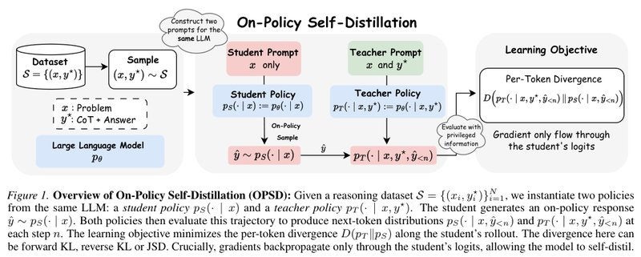

*Figure 1: On the left is the data: each example has a problem $`x`$ and a reference solution $`y^\star`$ (reasoning plus answer). In the middle are two prompts for the same model: the red student prompt has only $`x`$, and the green teacher prompt has $`x`$ and $`y^\star`$. The student first samples a response $`\hat y`$; then the teacher, "holding the answer", gives the next-token distribution at every position of that response. On the right, the training objective is the gap $`D(p_T\Vert p_S)`$ between the two distributions at each position, which can be forward KL, reverse KL or JSD. Gradients flow back only through the student side, so the model can distill itself.*

---

## 1. Key Terms

| Term | In plain words |
| --- | --- |
| On-policy and off-policy | If the responses used for training are freshly written by the model itself, that is on-policy; if someone else wrote them in advance (such as the reference solutions in a dataset), that is off-policy. Below, "on-policy" and "off-policy" carry exactly these two meanings |
| SFT (supervised fine-tuning) | Have the model imitate a reference solution word for word |
| Distillation, on-policy distillation | Distillation pulls the student model's output distribution toward the teacher model's distribution. In on-policy distillation, the student writes its own response, and the teacher gives a distribution at each token of that response |
| Privileged information | Extra information that the teacher can see during training but the student cannot. In this paper, it is the reference solution |
| Reference solution | The worked solution and answer that come with each problem in the dataset. In the data this paper uses, these solutions were written by stronger models |
| RL, RLVR | Reinforcement learning has the model answer on its own and adjusts it by the score. In RLVR (reinforcement learning with verifiable rewards), the score comes from rules that can be checked automatically; for a math problem, the final answer is compared, scoring 1 point if right and 0 if wrong |
| GRPO | An RLVR algorithm widely used on large models: sample a group of responses per problem (8 in this paper); a response better than the group average is rewarded as a whole, and a worse one is penalized as a whole |
| Exposure bias | In training, the model always continues from a "standard opening", but at test time it must continue from an opening it wrote itself. Once the opening goes astray, the model is in a situation it never practiced, and errors snowball |
| KL divergence | A number that measures how far apart two distributions are; smaller means closer. It is asymmetric: forward KL mainly penalizes "tokens the teacher thinks are likely but the student does not cover", and reverse KL mainly penalizes "the student putting probability on tokens the teacher thinks are impossible" |
| JSD | Another measure of the gap between distributions; it sits between the two KLs and has an upper bound |
| Thinking mode (TM-on, TM-off) | Two generation modes that Qwen3 can switch between. With it on (TM-on), the model first writes a long chain of reasoning with self-reflection; with it off (TM-off), it answers directly |
| Style tokens, math tokens | The paper sorts tokens using keyword lists. Style tokens are reasoning connectives and verbal tics such as `wait`, `hmm`, `so` and `but`; math tokens are digits, operators and math words such as `equation` and `prime` |
| Pointwise clipping | Put a cap on the KL contribution of each vocabulary token at each position; anything above the cap counts as the cap |
| Avg@12, pass@8 | Avg@12: sample each problem 12 times and take the average accuracy. pass@8: sample each problem 8 times and take the share of problems answered correctly at least once |
| LoRA | Train only a small set of extra parameters (an adapter) inserted into the model, leaving the original parameters untouched. Turning off the adapter gives back the model from before training |

## 2. What Problem It Tackles

Post-training large models for reasoning currently relies on three main kinds of methods: reinforcement learning with verifiable rewards (RLVR, such as GRPO), SFT on high-quality reasoning data, and knowledge distillation from a stronger teacher model. The Qwen3 and MiMo-V2-Flash technical reports and the Thinking Machines blog post on on-policy distillation, all cited by the paper, show that distilling from a strong teacher can beat RL in both results and training efficiency. But each route has its own flaws:

| Route | How it works | Problems |
| --- | --- | --- |
| RLVR (such as GRPO) | The model solves problems itself, scoring 1 point if right and 0 if wrong; it samples a group of responses per problem and compares them | Sampling a group of responses per problem is expensive, and estimating value from the group average has high variance; when a group is all right or all wrong, the gradient vanishes; every token in a response gets the same score, so there is no per-token feedback |
| SFT | Learns the reference solution word for word | Suffers from exposure bias and generalizes less well (the paper cites the finding "SFT memorizes, RL generalizes" from Chu et al., 2025) |
| Classic knowledge distillation | The student matches the teacher's distribution on fixed data (Hinton et al., 2015) | Every token gets a signal, but the data is off-policy |
| On-policy distillation (GKD, Thinking Machines) | The student writes, and the teacher gives a per-token distribution | The distribution is realistic, the signal is dense, and sample efficiency is high; but a separate (usually larger) teacher model has to be kept, and the reference solutions already in the dataset go unused |
| Process reward model (PRM) | Train a model that scores each step, to give RL step-by-step feedback | The labels needed to train it are expensive, so it is hard to scale |

In this paper's setup, GRPO's problems are concrete. Each problem is attempted 8 times, each attempt up to 16k tokens long, which is expensive. A problem gets only one right-or-wrong score, so the model does not know which step went wrong. When all 8 attempts are right or all are wrong, the scores do not differ, and that work is wasted. On the OpenThoughts data, the paper finds that more than half of the batches are in this "zero-variance" case (see Section 6.3).

An analogy (mine, not the paper's): SFT is like only reading model essays, always continuing from someone else's perfect opening during training. RL is like only seeing the total score, without knowing which step lost points. On-policy distillation is like hiring a tutor: you solve the problem yourself, and the tutor beside you comments word by word on "what I would write at this spot", but the tutor has to be hired separately. What OPSD wants is to bring in no outside help and let the model be its own tutor.

The question the paper sets out to answer is: **can a model act as its own teacher through self-distillation?**

The inspiration comes from how people learn: after getting a problem wrong, you look at the reference solution, understand each step, and find where your own thinking went wrong. Prior work shows that for large models, "judging" is often easier than "generating" (the paper cites Sun et al., 2024; Naor, 1996). The authors further hypothesize that understanding and explaining a given correct answer (the paper calls this rationalization) is likewise easier than generating one from scratch. The paper's analogy: it is like a student who looks at the answer key and then goes back to work out why the answer is right.

The authors' intuition is that a strong enough model can understand privileged reasoning supplied from outside and then use it to teach its weaker self. Accordingly, OPSD aims to achieve four things at once: (1) be on-policy, learning on responses the student writes itself; (2) give feedback on every token; (3) use the reference solutions in the dataset; (4) need no separate teacher model. In other words, the authors are looking for a training signal that is dense, on-policy, and free of any external teacher or reward model (Section 3.1 of the paper). Table 1 of the paper compares it with several kinds of methods:

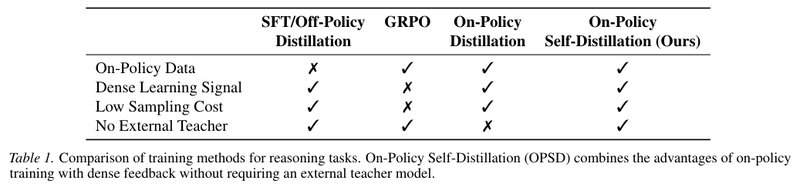

*Table 1: The four rows are, in order: whether it uses the model's own responses, whether the learning signal is dense, whether sampling is cheap, and whether it needs an external teacher. Only OPSD ticks all four: SFT and off-policy distillation are not on-policy; GRPO has a sparse signal and expensive sampling; on-policy distillation needs an external teacher. Note that "no external teacher" means no teacher model is needed during training; the reference solutions OPSD uses come from the dataset, and when introducing the SFT baseline the paper also mentions that this reasoning was generated by stronger models.*

The paper's own summary lists four contributions: it proposes OPSD; it proposes per-token pointwise clipping, motivated by style tokens drowning out the training signal of math tokens; it evaluates on three competition-level math test sets, matching GRPO with much higher token efficiency and also beating SFT; and it analyzes the effects of the divergence measure, the student's generation length and the generation styles of teacher and student.

## 3. Core Method: A Self That Has Seen the Answer Scores the Student's Draft Token by Token

The same model $`p_\theta`$, given two different contexts, becomes two roles (Section 3.2 of the paper):

- **Student**: sees only the problem $`x`$, the same condition as at test time, written $`p_S(\cdot\mid x)=p_\theta(\cdot\mid x)`$.
- **Teacher**: sees the problem $`x`$ and the reference solution $`y^\star`$, written $`p_T(\cdot\mid x,y^\star)=p_\theta(\cdot\mid x,y^\star)`$. The paper says the privileged information can be the reference answer or a reference reasoning trace; the experiments use solutions that include the reasoning.

The two share the same parameters and differ only in context. To let the teacher evaluate the student's response naturally, the teacher prompt also adds a sentence asking it, after reading the reference solution, to solve the problem again "in its own way" (Figure 2). But the teacher does not actually write anything. It only uses this prompt to complete the "understand the answer" step "implicitly", within a single forward pass.

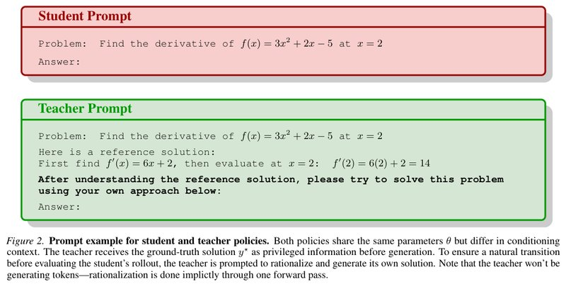

*Figure 2: Example student and teacher prompts. The example problem is to find the derivative of $`f(x)=3x^2+2x-5`$ at $`x=2`$. The student prompt (red) has only the problem and "Answer:"; the teacher prompt (green) adds the reference solution (first find $`f'(x)=6x+2`$, then compute $`f'(2)=14`$) and a bolded instruction: "After understanding the reference solution, please solve this problem in your own way". The paper says this sentence is added to give a natural transition before the student's response is evaluated. During training, the tokens the student wrote are appended directly after "Answer:" in the teacher prompt, and the distributions the teacher gives at these positions are the supervision signal. The prompt wording actually used in the official code differs from this figure; see Section 9.*

Each training step goes like this:

1. Take a batch of problems and reference solutions $`(x,y^\star)`$ from the dataset.
2. Build two prompts for the same model. The student's has only the problem; the teacher's has the problem, the reference solution and that instruction sentence.
3. The student writes its own solution, only 1 per problem, and only the first 1024 tokens.
4. Append what the student wrote, unchanged, to both prompts and run one forward pass on each. The teacher writes nothing itself, but at every position the student wrote, it gives a full distribution for "which next token I would pick"; the student also has its own distribution at the same positions.
5. The training objective pulls the student's distribution at each position toward the teacher's (the main experiments use forward KL with pointwise clipping; see Section 5). Gradients flow back only through the student side; the teacher stays the model from the start of training and does not change along with it.

Each position compares the distribution over the whole vocabulary, not just the token the student actually wrote. In the paper's words, the teacher that knows the answer shows the student the whole distribution of possibilities for the next token, guiding it toward reasoning paths that reach the correct answer. At every position it wrote, the student asks once, "how would the me that has seen the answer write the next word?", then pulls its own distribution that way. The prefix is written by the student itself, so the situations it meets in training are the ones it will meet at test time; that is what on-policy means.

**An example** (an illustration I made up, not from the paper): take the derivative problem from Figure 2 again.

- The student, which has not seen the answer, writes "First take the derivative, $`f'(x)=6x`$" and then thinks the most likely next token is a comma, as if the expression were finished.
- The teacher, which has seen the reference solution, thinks at the same position that "+" is more likely, followed by "2".
- Training makes the student shift some probability toward "+" at this position. On the earlier parts the student got right, teacher and student see things about the same way, so almost nothing needs to change.
- Whether this position gets a signal has nothing to do with whether the student's final answer is right; the student does not even need to reach a final answer.

Compared with several common approaches (I put this table together from the paper's content):

| | GRPO | On-policy distillation (GKD and others) | OPSD |
| --- | --- | --- | --- |
| Responses used for training | Sampled by the student | Sampled by the student | Sampled by the student |
| Feedback granularity | One 0/1 reward per whole response | Per-token | Per-token |
| Needs an external teacher? | No | Yes, another (usually larger) model | No |
| How the reference solution is used | Only the final answer, to judge right or wrong | Not used | The whole solution, as the teacher's privileged information |
| Must the student finish its answer? | Yes (the answer has to be checked) | No | No (a 1024-token prefix is enough) |

**Optional: the formula for the training objective and a worked example.** You can skip it without losing the thread. Equations (1), (6) and (8) of the paper combine into:

```math
\mathcal L_{\text{OPSD}}(\theta)=\mathbb E_{(x,y^\star)\sim\mathcal S}\;\mathbb E_{\hat y\sim p_S(\cdot\mid x)}\Big[\frac{1}{|\hat y|}\sum_{n=1}^{|\hat y|} D\big(p_T(\cdot\mid x,y^\star,\hat y_{< n})\,\big\Vert\,p_S(\cdot\mid x,\hat y_{< n})\big)\Big]
```

- $`\mathcal S=\{(x_i,y_i^\star)\}_{i=1}^N`$ is the dataset. $`x`$ is the problem, $`y^\star`$ is the reference solution, and $`\hat y`$ is the response the student sampled, of length $`|\hat y|`$, at most 1024 tokens during training; $`\hat y_{<n}`$ is the first $`n-1`$ tokens the student wrote.
- $`p_S(\cdot\mid x,\hat y_{<n})=p_\theta(\cdot\mid x,\hat y_{<n})`$ is the student's next-token distribution at position $`n`$, and $`p_T(\cdot\mid x,y^\star,\hat y_{<n})`$ is the teacher's distribution at the same position. In the experiments, the teacher uses the initial parameters $`\theta_0`$, not the current $`\theta`$.
- $`D`$ is the gap between the two distributions at each position. The paper says it can be any divergence measure between distributions, such as the generalized JSD of Equation (7) (Section 5, item (4)). The main experiments use forward KL $`\mathrm{KL}(p_T\Vert p_S)=\sum_v p_T(v)\log\frac{p_T(v)}{p_S(v)}`$, with pointwise clipping on top (Section 5, item (3)).
- Equation (1) in the introduction sums directly over positions; in the method section, Equation (6) first defines "the per-token gap averaged along the response", and Equation (8) then takes the expectation over the data and the student's samples. The two differ only by a factor of $`1/|\hat y|`$ (see "Small issues in the manuscript" in Section 8).
- When taking gradients, two things are treated as constants and get no gradient. One is the teacher's distribution. The other is the sampled $`\hat y`$, which is treated as fixed data, so the sampling process is not differentiated (GKD does the same). So for forward KL, the gradient at each position with respect to the student's logits (the raw scores before softmax) is simply $`p_S-p_T`$.

Worked example (an illustration I made up, not from the paper): continuing the example above, suppose this position has only 3 candidate tokens: A is "+", B is a comma, and C is anything else. The teacher is quite sure it should write A, $`p_T=[0.9,0.05,0.05]`$; the student has $`p_S=[0.4,0.4,0.2]`$.

- Term by term: $`0.9\ln\frac{0.9}{0.4}=0.7298`$, $`0.05\ln\frac{0.05}{0.4}=-0.1040`$, $`0.05\ln\frac{0.05}{0.2}=-0.0693`$, for a total KL = 0.5566. If the student is already close to the teacher ($`p_S=[0.85,0.10,0.05]`$), the KL is only 0.0168.
- The gradient with respect to the logits is $`p_S-p_T=[-0.5,\,0.35,\,0.15]`$: gradient descent raises A's logit and pushes the other two down. The bigger the gap, the bigger the penalty, and the direction is toward the teacher.

**Optional: two forms of ordinary distillation, and what OPSD changes.** You can skip it without losing the thread. Section 2.1 of the paper first writes out supervised distillation (Equation (2)) and on-policy distillation (Equation (3)). In these two equations the teacher $`p_T`$ is an external model that does not see $`y^\star`$:

```math
\mathcal L_{\text{Supervised}}(\theta)=\mathbb E_{(x,y)\sim\mathcal S}\big[D(p_T\Vert p_S)(y\mid x)\big],\qquad
D(p_T\Vert p_S)(y\mid x)=\frac{1}{|y|}\sum_{n=1}^{|y|}D\big(p_T(\cdot\mid y_{< n},x)\,\Vert\,p_S(\cdot\mid y_{< n},x)\big)
```

```math
\mathcal L_{\text{On-Policy}}(\theta)=\mathbb E_{x\sim\mathcal S}\Big[\mathbb E_{\hat y\sim p_S(\cdot\mid x)}\big[D(p_T\Vert p_S)(\hat y\mid x)\big]\Big]
```

- The only difference between the two is where the prefix comes from: the $`y`$ in Equation (2) comes from a fixed dataset (off-policy), and the $`\hat y`$ in Equation (3) is sampled by the student itself (on-policy), matching GKD's definition. It is like the difference between only reading model essays and writing your own while the teacher marks up your draft.
- OPSD changes two things relative to Equation (3): the teacher becomes "itself, holding $`y^\star`$"; and the $`y^\star`$ in the dataset is no longer used as a training sequence but goes into the teacher's context.
- Worked example (an illustration I made up, not from the paper): suppose the student gives each token of the reference solution a probability of only 0.3 on average; then the probability that it writes a given 10-token reference prefix itself is about $`0.3^{10}\approx5.9\times10^{-6}`$. So the prefixes that training under Equation (2) uses are ones the student will almost never meet at test time. Once it goes astray, it is in a situation training did not cover, and errors pile up step by step: that is exposure bias. The prefixes in Equation (3) come from the student's own distribution, so this mismatch does not arise.

## 4. Another Angle: Reinforcement Learning That Scores Every Token

Section 3.2 of the paper also gives another implementation of OPSD, and uses it to connect OPSD with RL and with STaR.

**(1) Look only at the token the student wrote.** Following Thinking Machines' on-policy distillation, take only the token the student actually sampled, compute the difference between the log probabilities the teacher and the student give it, and use that difference as the advantage at this position (read it as "how much better this step is than usual"); then optimize with policy gradient (Equation (9)). Policy gradient is the standard RL approach: if the advantage is positive, raise the probability of the sampled token; if it is negative, push it down. The advantage is treated as a constant when computing gradients. The paper calls this "a reverse KL signal on sampled actions". Compared with the full-vocabulary objective, it acts only on the sampled tokens and uses the teacher's log probabilities to give a per-token guidance signal, but it does not explicitly match the full distribution at each step. In the experiments it does slightly worse than the full-vocabulary version (Section 6.8).

**(2) Seen this way, it is RL with "a reward on every token".** Appendix D reads Equation (9) as a policy gradient with dense per-token rewards: the reward at each position is how much more the teacher prefers the token the student wrote than the student does. GRPO, by contrast, gives a response only one right-or-wrong score; after normalization within the group, every token in that response gets the same value, and when the group is all right or all wrong there is no gradient.

**(3) Compared with STaR.** STaR also uses one model to generate reasoning, does rejection sampling, and then runs SFT on the responses that got the answer right. It can be seen as policy gradient with a 0/1 reward on the whole response: all tokens get the same score, and the signal disappears when every sample is wrong. OPSD gives feedback at every token position regardless of whether the final answer is right, so it can train even when the student writes only 1024 tokens and has not yet reached an answer.

**Optional: the sampled-token objective (Equation (9)).** You can skip it without losing the thread.

```math
A_n(x,\hat y)=\log p_T(\hat y_n\mid x,y^\star,\hat y_{< n})-\log p_S(\hat y_n\mid x,\hat y_{< n}),\qquad
\mathcal L(\theta)=-\mathbb E_{(x,y^\star)\sim\mathcal S}\Big[\mathbb E_{\hat y\sim p_S(\cdot\mid x)}\Big[\frac{1}{|\hat y|}\sum_{n=1}^{|\hat y|}A_n(x,\hat y)\,\log p_S(\hat y_n\mid x,\hat y_{< n})\Big]\Big]
```

- $`\hat y_n`$ is the token the student actually sampled at position $`n`$; $`A_n`$ is how much more the teacher prefers this token than the student does (the difference in log probabilities), treated as a constant when computing gradients.
- Because $`A_n`$ carries no gradient, $`\nabla_\theta\mathcal L=-\mathbb E\big[\frac1{|\hat y|}\sum_n A_n\nabla_\theta\log p_S(\hat y_n\mid\cdot)\big]`$, which is the standard REINFORCE form (the most basic policy gradient), except that each token has its own reward. Taking the expectation over $`\hat y_n\sim p_S`$ at position $`n`$ gives $`\mathbb E_{p_S}[A_n]=-\mathrm{KL}(p_S\Vert p_T)`$, so what it optimizes is the per-token reverse KL, estimated at each position from only the one sampled token.
- Intuition: the student writes some word. If the teacher says "I want to write this word more than you do" ($`A_n>0`$), its probability goes up; if the teacher says "I would hardly write it this way" ($`A_n<0`$), it goes down. The full-vocabulary version instead states directly how much probability every candidate word should get.
- Worked example (reusing $`p_T=[0.9,0.05,0.05]`$ and $`p_S=[0.4,0.4,0.2]`$ from Section 3): if A is sampled, $`A_n=\ln0.9-\ln0.4=+0.811`$, which raises A's probability; if B is sampled, $`A_n=\ln0.05-\ln0.4=-2.079`$, which pushes B down; if C is sampled, $`A_n=\ln0.05-\ln0.2=-1.386`$. The expectation is $`0.4\times0.811+0.4\times(-2.079)+0.2\times(-1.386)=-0.785`$, exactly equal to $`-\mathrm{KL}(p_S\Vert p_T)=-0.7847`$.
- One sample carries information about only one token, so the variance is higher than in the full-vocabulary version, but there is no need to store logits over the whole vocabulary, which saves GPU memory.

**Optional: how GRPO scores responses (Equations (4) and (5)).** You can skip it without losing the thread.

```math
A_i=\frac{r_i-\mathrm{mean}(\{r_j\}_{j=1}^G)}{\mathrm{std}(\{r_j\}_{j=1}^G)}
```

- $`G`$ is the number of responses sampled per problem (GRPO in this paper uses $`G=8`$); $`r_i\in\{0,1\}`$ says whether response $`i`$ is correct; $`A_i`$ is the advantage of response $`i`$, and every token in that response shares this one value.
- The group average $`\mathrm{mean}(\{r_j\})`$ is a $`G`$-sample Monte Carlo estimate of the value function $`V(x)`$ ("how many points this problem earns on average"), and the 0/1 reward $`r_i`$ plays the role of the state-action value $`Q(x,o_i)`$; their difference is then divided by the within-group standard deviation to normalize it. The reward is given only for the whole response, so the tokens within one response get the same advantage. Intuitively, the model attempts the same problem 8 times; the attempts better than average are rewarded as a whole and the worse ones are penalized as a whole, with no distinction between the steps in them that were written well or badly.
- Worked example (an illustration I made up, not from the paper): 3 of 8 responses are correct, so mean = 0.375 and std = $`\sqrt{0.375\times0.625}=0.4841`$ (computed here as the population standard deviation). Correct responses get $`A=(1-0.375)/0.4841=+1.291`$ and wrong ones get $`A=(0-0.375)/0.4841=-0.775`$; a correct response gets +1.291 as a whole even if one of its intermediate steps is wrong. When all 8 are right or all are wrong, the numerator is 0 and $`A=0`$ (implementations add a small $`\varepsilon`$ to the denominator to avoid dividing by zero), so this batch of problems yields no gradient. The rightmost panel of Figure 3 shows that in the first 100 steps, 55% to 95% of GRPO's batches are in this state.

```math
\mathcal L_{\text{GRPO}}(\theta)=\mathbb E_{\substack{x\sim\mathcal S\\ o_1,\dots,o_G\sim\pi_\theta(\cdot\mid x)}}\Big[\frac1G\sum_{i=1}^G\frac{1}{|o_i|}\sum_{n=1}^{|o_i|}\min\big(\rho_i^n A_i,\ \mathrm{clip}(\rho_i^n,1-\varepsilon,1+\varepsilon)A_i\big)-\beta D_{\mathrm{KL}}\big[\pi_\theta(\cdot\mid x)\Vert\pi_{\text{ref}}(\cdot\mid x)\big]\Big],\qquad
\rho_i^n=\frac{\pi_\theta(o_i^n\mid x,o_i^{< n})}{\pi_{\theta_{\text{old}}}(o_i^n\mid x,o_i^{< n})}
```

- $`\rho_i^n`$ is the importance ratio, and $`\pi_{\theta_{\text{old}}}`$ is the model before this update; $`\varepsilon`$ is the clipping range for the ratio; $`\beta`$ is the coefficient of the reverse KL penalty toward the reference model $`\pi_{\text{ref}}`$ (set to 0 for GRPO in this paper; see Table 6 in Section 9). This expression is an objective to be maximized.
- It reuses PPO's clipped objective: once the ratio has moved past $`1\pm\varepsilon`$ in the direction of the advantage, taking the min yields a constant and the gradient is 0, which limits how far a single update can go. Intuitively, each update lets the model take only a small step, so that no single batch of samples can pull it off course.
- Worked example (the paper does not give a value for $`\varepsilon`$, so the common value 0.2 is used here): with $`A_i=+1.291`$ and $`\rho=1.1`$, $`\min(1.420,\,1.420)=1.420`$, which is not clipped, so there is a gradient; with $`A_i=+1.291`$ and $`\rho=1.3`$, $`\min(1.678,\,1.549)=1.549`$, which is the clipped value, so the gradient is 0; with $`A_i=-0.775`$ and $`\rho=0.7`$, $`\min(-0.542,\,-0.620)=-0.620`$, which is the clipped value, so the gradient is 0. In other words, tokens whose probability has already been adjusted enough are not pushed further.

**Optional: both STaR and OPSD can be written as policy gradients (Appendix D, Equations (10) and (11)).** You can skip it without losing the thread.

```math
J_{\text{STaR}}(\theta)=\sum_{i=1}^N\mathbb E_{(r,y)\sim p_\theta(\cdot\mid x_i)}\big[\mathbf{1}(y=y_i^\star)\big],\qquad
\nabla_\theta J_{\text{STaR}}=\sum_{i=1}^N\mathbb E_{(r,y)\sim p_\theta(\cdot\mid x_i)}\big[\mathbf{1}(y=y_i^\star)\,\nabla_\theta\log p_\theta(r,y\mid x_i)\big]
```

```math
r_n(x,\hat y)\triangleq\log p_T(\hat y_n\mid x,y^\star,\hat y_{< n})-\log p_S(\hat y_n\mid x,\hat y_{< n}),\qquad
J_{\text{OPSD}}(\theta)=\mathbb E_{(x,y^\star)\sim\mathcal S}\Big[\mathbb E_{\hat y\sim p_S(\cdot\mid x)}\Big[\frac1{|\hat y|}\sum_{n=1}^{|\hat y|}r_n(x,\hat y)\Big]\Big]
```

- $`r`$ is the reasoning and $`y`$ is the final answer, with $`p_\theta(r,y\mid x)=p_\theta(r\mid x)\,p_\theta(y\mid x,r)`$; $`\mathbf{1}(y=y^\star)`$ is 1 for a correct answer and 0 otherwise; $`r_n`$ is OPSD's per-token reward, which is exactly the $`A_n`$ in Equation (9).
- Applying the log-derivative trick to $`J_{\text{STaR}}`$ gives its gradient. The indicator function zeroes the gradient of every reasoning trace that ends in a wrong answer, which is exactly STaR's "filtering" step; taking $`\nabla\log p_\theta`$ on the remaining samples is SFT on the correct responses. On the OPSD side, once $`r_n`$ is treated as a constant, the gradient of Equation (9) is a policy gradient weighted by $`r_n`$ at each position (strictly speaking this step is an approximation; see "Small issues in the manuscript" in Section 8).
- Intuition: STaR scores by the whole problem, learning a correct response as a whole and throwing a wrong one away as a whole; OPSD scores each token separately, so the correct steps in a wrong response can still earn credit, and the wrong steps get singled out.
- Worked example (an illustration I made up, not from the paper): a 1000-token reasoning trace ends in a wrong final answer. STaR gives all 1000 tokens a reward of 0, so this sample produces no gradient at all; if every response sampled for a problem is wrong, nothing is learned from that problem. OPSD instead has one $`r_n`$ at each of the 1000 positions. Say the first 600 tokens agree with the reference solution, so $`r_n`$ is close to 0 or positive; from token 601 on, the computation goes wrong, the teacher would not write it this way, $`r_n`$ is clearly negative, and the gradient concentrates on the positions where the error is.

## 5. The Details That Make It Actually Work

**(1) The teacher is fixed to the model at the start of training.** The teacher is not updated during training. The authors find this makes training more stable; it also acts as a kind of implicit regularization that keeps the model from drifting too far from the initial model (Section 4.1 of the paper). The official code trains with LoRA, so the teacher is "the same model with the LoRA adapter turned off", and no second copy of the weights has to be loaded.

**(2) Thinking mode off for the student, on for the teacher.** The student generates with Qwen3's TM-off, and the teacher scores with the TM-on prompt format. The reason is that this combination has the largest KL on math tokens (Section 6.5, Table 5).

**(3) Pointwise clipping.** The authors observe that at each position, the KL is spread very unevenly across the vocabulary: a small set of style tokens has much higher KL than the tokens that carry mathematical meaning, so the training signal ends up dominated by style patterns. With the teacher's thinking mode on and the student's off, the two disagree most on verbal tics like "wait" and "hmm"; computed from Table 5, this is 5 to 13× the KL on math tokens, and it drowns out the signal that actually concerns math. The fix: at each position, compute each vocabulary entry's share of the KL, cap each share at $`\tau`$ (take the smaller of the two), and then sum. Clipping happens at the level of "each vocabulary entry", not on the total KL at each position. The paper did not tune $`\tau`$, and neither the main text nor the appendix gives its value; the official scripts use 0.05 for 1.7B and 4B and 0.06 for 8B. Without clipping, 1.7B's AIME24 score actually falls below its starting value after 100 steps (Section 6.6, Figure 4).

**Optional: the clipping formula, plus a small derivation I added.** You can skip it without losing the thread.

```math
\ell^{(f)}_{n,v}=p_T(v\mid\cdot)\,f\!\left(\frac{p_S(v\mid\cdot)}{p_T(v\mid\cdot)}\right),\qquad
D^{(f)}_{\text{clip}}(p_T\Vert p_S)=\frac{1}{|\hat y|}\sum_{n=1}^{|\hat y|}\sum_{v\in\mathcal V}\min\big(\ell^{(f)}_{n,v},\,\tau\big)
```

- $`f`$ is a convex function with $`f(1)=0`$. Forward KL corresponds to $`f(t)=-\log t`$, in which case $`\ell_{n,v}=p_T(v)\log\frac{p_T(v)}{p_S(v)}`$, the same as the element-wise result of `F.kl_div(..., reduction="none")` in the code; the code applies `clamp(max=τ)` to it and then sums, which matches the formula.
- $`\tau`$ is the clipping threshold. It acts on "each vocabulary entry at each position", not on the sum at each position.

The derivation below is my addition; the paper gives only the definition:

1. Clipping is only from above. Terms with $`p_S(v)>p_T(v)`$ are negative to begin with and are unaffected, so the clipped sum can be negative. The official README also mentions that the loss can be negative.
2. A term exceeds $`\tau`$ when $`p_S(v)<p_T(v)\,e^{-\tau/p_T(v)}`$. With $`\tau=0.05`$: $`p_T=0.99`$ corresponds to $`p_S<0.941`$; $`p_T=0.5`$ to $`p_S<0.452`$; $`p_T=0.2`$ to $`p_S<0.156`$. For a token the teacher is very sure about, the student only has to be about 5% lower to get clipped, so the threshold is quite low.
3. Clipped terms have a gradient of 0. At one position, call the set of clipped vocabulary entries $`C`$ and the rest $`U`$, let $`P_U=\sum_{v\in U}p_T(v)`$, and let $`q`$ be the teacher distribution renormalized after the tokens in $`C`$ are removed ($`q(v)=p_T(v)/P_U`$ for $`v\in U`$, and 0 otherwise). One can derive:

```math
\sum_{v\in U}p_T(v)\log\frac{p_T(v)}{p_S(v)}=P_U\,\mathrm{KL}(q\Vert p_S)+P_U\log P_U
```

So while $`C`$ stays the same, the gradient equals $`P_U\cdot\nabla\mathrm{KL}(q\Vert p_S)`$: the student is pulled toward a teacher distribution "with the most-disputed tokens deleted", and the probabilities of those tokens get pushed down further instead of just being ignored.

The design intent is "don't let words like wait and hmm dominate training". By the derivation above, the actual effect is stronger: for tokens where student and teacher disagree by more than the threshold, the update direction is reversed. For the verbal tics a thinking-mode teacher favors, this amounts to making the non-thinking student say them less; but the same thing also happens to any token whose disagreement exceeds the threshold, math tokens included.

Worked example (reusing the example from Section 3, with $`\tau=0.05`$):

- The terms become $`[0.05,-0.1040,-0.0693]`$, summing to $`-0.1233`$, which is negative.
- $`U`$ is the last two tokens, $`P_U=0.1`$ and $`q=[0,0.5,0.5]`$; the gradient $`=0.1\times(p_S-q)=[0.04,-0.01,-0.03]`$ (I checked it with finite differences). For token A, the direction is the opposite of the unclipped $`[-0.5,0.35,0.15]`$: the "+" that the teacher most wants to write actually has its probability pushed down.
- Running gradient descent to convergence in this small example gives $`p_S\to[0.003,0.498,0.498]`$. A pair with a smaller disagreement, $`p_T=[0.95,0.03,0.02]`$ and $`p_S=[0.90,0.06,0.04]`$, also gets clipped (the first term is 0.0514 > 0.05) and converges to $`[0.007,0.597,0.397]`$.
- Real training runs only 100 steps at a learning rate of 5e-6 and trains only LoRA, so it is far from convergence; how much this effect matters for the actual results would need experiments to confirm. The paper does not discuss this point.

**(4) Forward KL as the divergence.** Table 3 compares forward KL, reverse KL and JSD on Qwen3-1.7B and AIME25; forward KL gives the largest gain, and all later experiments use it (Section 6.4).

**Optional: the definition of JSD and its two endpoints (Equation (7)).** You can skip it without losing the thread.

```math
\mathrm{JSD}_\beta(p_T\Vert p_S)=\beta D_{\mathrm{KL}}(p_T\Vert m)+(1-\beta)D_{\mathrm{KL}}(p_S\Vert m),\qquad m=\beta p_T+(1-\beta)p_S
```

- $`\beta\in[0,1]`$ is the interpolation weight, and $`m`$ is the mixture of the teacher's and the student's distributions.
- Plugging in the endpoints shows that at $`\beta=0`$, $`m=p_S`$ and both terms are 0; at $`\beta=1`$, $`m=p_T`$, and the result is again 0. That is, computed literally from Equation (7), the gap at both endpoints is always 0. The GKD paper gives the relation $`\lim_{\beta\to0}\mathrm{JSD}_\beta/\beta=\mathrm{KL}(p_T\Vert p_S)`$. The official code follows the GKD implementation in the TRL library, special-casing $`\beta=0`$ as forward KL $`\mathrm{KL}(p_T\Vert p_S)`$ and $`\beta=1`$ as reverse KL $`\mathrm{KL}(p_S\Vert p_T)`$; the main experiment scripts use `--beta 0`, that is, forward KL, consistent with the choice in Section 4.3.1 of the paper.
- Intuition: forward KL penalizes the student for "missing" tokens the teacher considers possible (it has to cover every possibility); reverse KL penalizes the student for putting probability where the teacher considers it impossible (it latches onto one possibility); JSD sits between the two and is bounded above (at most $`\ln2\approx0.693`$ when $`\beta=0.5`$).
- Worked example (reusing the example from Section 3): forward KL = 0.5566; reverse KL = 0.7847; for $`\mathrm{JSD}_{0.5}`$, the mixture is $`m=[0.65,0.225,0.125]`$ and the result is 0.1509. For the same pair of distributions, the JSD value is only about 1/4 of the forward KL (Section 6.4 uses this point).

**(5) Each position looks at the whole vocabulary.** The main experiments use full-vocabulary logit distillation. The sampled-token-only form from Section 4 saves GPU memory but does slightly worse (Section 6.8).

**(6) The student writes only 1024 tokens.** Lengthening this to 4096 gives no consistent improvement (Section 6.7). Working from the cumulative token counts in Figure 3, I estimate that nearly all student responses fill the full 1024 tokens and get cut off (Section 6.3), which means most responses stop before they are finished. OPSD's signal does not depend on the final answer, so it can still learn.

Putting all this together, one training step looks like this (Algorithm 1 in the paper has only 7 lines; the version below fills in implementation details and default settings from the official code):

```text
Input: dataset S = {(x_i, y*_i)} (about 30K OpenThoughts math problems with reference solutions)
       initial model p_θ0 (frozen) and LoRA parameters φ (rank 64, alpha 128)
       clipping threshold τ (0.05 for 1.7B and 4B, 0.06 for 8B), temperature T = 1.1
Output: the trained student p_θ0 + φ

1:  for step = 1 … 100 do                                    // usually reaches its best within 100 steps
2:      B ← take 32 problems from S                            // effective batch size 32
3:      for (x, y*) in B do
4:          s_prompt ← chat_template(x, enable_thinking=False)              // student: problem only, thinking mode off
5:          t_prompt ← chat_template(x + y* + instruction, enable_thinking=True)  // teacher: problem + reference solution, thinking mode on
6:          ŷ ← sample(p_θ0+φ, s_prompt; ≤1024 token, T=1.1, top_p=0.95, top_k=20)  // only 1 response per problem
7:          z_S ← logits(p_θ0+φ, s_prompt ⊕ ŷ)                  // student forward pass, gradients kept
8:          with no_grad and LoRA disabled:
9:              z_T ← logits(p_θ0, t_prompt ⊕ ŷ)               // fixed teacher = initial model, a single forward pass only
10:         for n = 1 … |ŷ| do                                 // computed only at the positions of ŷ
11:             p_S ← softmax(z_S[n] / T);  p_T ← softmax(z_T[n] / T)
12:             ℓ[n, v] ← p_T[v] · (log p_T[v] − log p_S[v])   for all v ∈ V  // per-term contribution to forward KL
13:             ℓ[n, v] ← min(ℓ[n, v], τ)                                    // pointwise clipping
14:     L ← Σ_{n,v} ℓ[n, v] / (total number of tokens in all responses in B)
15:     update φ with AdamW (learning rate 5e-6)               // gradients pass only through the student side
```

## 6. Experimental Results

### 6.1 How the experiments were set up

The paper sets out to answer four questions. How does OPSD compare with SFT and GRPO in reasoning scores and sample efficiency? How does pointwise clipping help stabilize training? How do generation style and generation length affect the scores? Is full-vocabulary logit distillation better than the policy gradient that looks only at sampled tokens?

- **Models**: three sizes of Qwen3 ([technical report](https://arxiv.org/abs/2505.09388)), Qwen3-1.7B, Qwen3-4B and Qwen3-8B. These are the instruction-tuned versions, that is, the Qwen3 chat models whose thinking mode can be switched on and off.
- **Training data**: the math reasoning subset of [OpenThoughts](https://arxiv.org/abs/2506.04178), with up to 30K sampled problems and solutions that include reasoning. The Hugging Face dataset loaded by the official code is `siyanzhao/Openthoughts_math_30k_opsd`.
- **Test sets**: competition-level math problems from AIME 2024, AIME 2025 and HMMT 2025. The paper does not give the number of problems; these three sets usually have 30 problems each.
- **Baselines** (all trained on the same data): SFT, standard supervised fine-tuning on expert-written solutions, which can be seen as off-policy distillation from "the stronger models that generated this reasoning"; GRPO, trained with a 0/1 reward checked against the reference answer, with a maximum generation length of 16k.
- **Metric**: Avg@12. Evaluation runs with thinking mode on, temperature 1.0, and at most 38,912 generated tokens (Table 8 in Section 9).
- **Implementation**: the teacher is fixed to the initial model; full-vocabulary logit distillation is used; all experiments are run with LoRA on A100 or H100 GPUs. The full training and evaluation configurations are in Tables 6 to 8 in Section 9.

### 6.2 Main results: 1.7B gains the most, and at 4B and 8B it is about even with GRPO

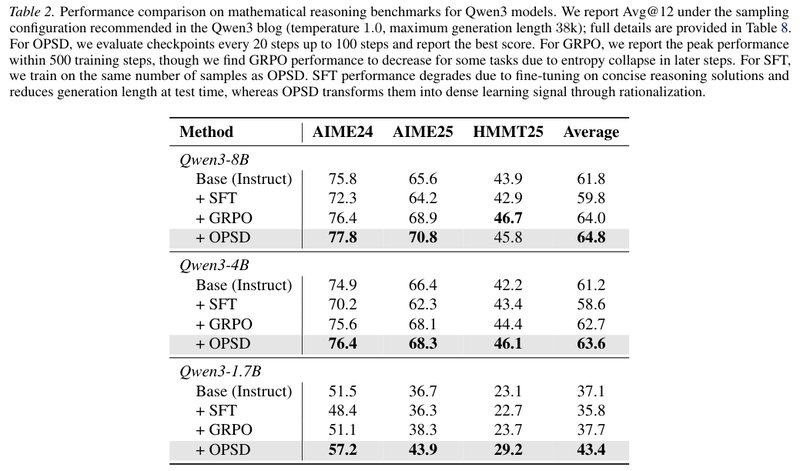

*Table 2: Avg@12 (%) for three sizes of Qwen3 on the three competition math test sets; bold marks the best value for each size. Evaluation uses what the paper describes as the sampling configuration recommended by the Qwen3 blog (temperature 1.0, maximum generation length 38k; the full configuration is in Table 8 in Section 9). The table note says OPSD evaluates a checkpoint every 20 steps up to step 100 and reports the best score (the points actually recorded are every 25 steps; see Section 8); GRPO reports the peak within 500 training steps, and the authors find that late in training GRPO loses points on some tasks because of entropy collapse (the model's outputs become too deterministic and stop being diverse); SFT is trained on the same number of samples as OPSD. The table note's explanation: after SFT fine-tunes on concise reasoning solutions, its generations at test time get shorter and its scores drop; OPSD instead turns these solutions into a dense learning signal by "understanding the answer". The numbers are also listed in the table below.*

Table 2 of the paper (Avg@12, %):

| Model | Method | AIME24 | AIME25 | HMMT25 | Average |
| --- | --- | --- | --- | --- | --- |
| Qwen3-8B | Original model | 75.8 | 65.6 | 43.9 | 61.8 |
| | + SFT | 72.3 | 64.2 | 42.9 | 59.8 |
| | + GRPO | 76.4 | 68.9 | **46.7** | 64.0 |
| | + OPSD | **77.8** | **70.8** | 45.8 | **64.8** |
| Qwen3-4B | Original model | 74.9 | 66.4 | 42.2 | 61.2 |
| | + SFT | 70.2 | 62.3 | 43.4 | 58.6 |
| | + GRPO | 75.6 | 68.1 | 44.4 | 62.7 |
| | + OPSD | **76.4** | **68.3** | **46.1** | **63.6** |
| Qwen3-1.7B | Original model | 51.5 | 36.7 | 23.1 | 37.1 |
| | + SFT | 48.4 | 36.3 | 22.7 | 35.8 |
| | + GRPO | 51.1 | 38.3 | 23.7 | 37.7 |
| | + OPSD | **57.2** | **43.9** | **29.2** | **43.4** |

How to read this table:

- **Change in average score versus the original model**: at 1.7B, OPSD +6.3, GRPO +0.6, SFT −1.3; at 4B, OPSD +2.4, GRPO +1.5, SFT −2.6; at 8B, OPSD +3.0, GRPO +2.2, SFT −2.0.
- **OPSD's lead over GRPO shrinks as the model gets bigger**: 5.7 → 0.9 → 0.8. By my estimate, a gap of 0.8 to 0.9 points is within evaluation noise (Section 8).
- **Single entries have exceptions**: on HMMT25 at 8B, GRPO is best (46.7 vs 45.8). SFT beats the original model in only one entry, HMMT25 at 4B (43.4 vs 42.2).
- **Each OPSD row uses the best checkpoint picked separately for each test set**, so no single checkpoint reaches 1.7B's average score of 43.4 (see Section 6.9 and Section 8).

The paper concludes that OPSD is consistently better than SFT at every size, also beats the original model at every size, and matches or beats GRPO in every setting. OPSD uses only one response per problem, samples only 1024 tokens per response, and converges within 100 steps; GRPO needs 8 responses of 16k tokens per problem, and may also lose points late in training from entropy collapse. On this OpenThoughts dataset, most of GRPO's groups have a reward standard deviation of 0 and give no learning signal, so the sampling budget is wasted. The authors also observe that SFT on the same data loses points on every task and at every size, and attribute this to the concise reasoning style of the reference solutions, which shortens the model's reasoning at test time.

The authors attribute OPSD's token efficiency to the dense per-token supervision that the teacher's distribution provides, and hypothesize that earlier tokens contribute more to distillation, because they may be the more critical branching points in the reasoning.

### 6.3 Token efficiency: in the first 100 steps, it generates only about one eighth as many tokens as GRPO

Training cost compared (Table 6 and Figure 3 of the paper, plus the official training scripts):

| Item | GRPO | OPSD |
| --- | --- | --- |
| Responses sampled per problem | 8 | 1 |
| Maximum generation length (tokens) | 16,000 | 1,024 |
| Training steps | 500 | 100 |
| Problems per step (effective batch size 32 for both) | 4 problems × 8 responses | 32 problems × 1 response |
| Cumulative tokens generated in the first 100 steps (1.7B, Figure 3) | About 26.2×10⁶ | About 3.3×10⁶ |
| Learning rate | 5e-6 | 5e-6 |

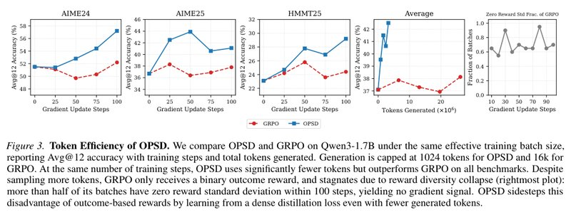

*Figure 3: OPSD (blue) versus GRPO (red dashed line) on Qwen3-1.7B, with the same effective batch size. The first three panels show Avg@12 on AIME24, AIME25 and HMMT25 as training steps increase; at all 12 points, at steps 25, 50, 75 and 100, OPSD is no lower than GRPO. The fourth panel switches the x-axis to cumulative generated tokens: OPSD uses about 3.3×10⁶ tokens to raise the average score from 37.1 to 42.5, while GRPO uses about 26.2×10⁶ tokens and its average score only reaches 38.1. The rightmost panel shows, at each of GRPO's recorded points, the share of batches whose within-group reward standard deviation is 0; it lies between 0.55 and 0.95. OPSD's generation cap is 1024 tokens, and GRPO's is 16k. The caption's account: GRPO samples far more tokens but gets only a 0/1 outcome reward, and it stalls as reward diversity collapses, so within 100 steps more than half of its batches have no gradient; OPSD sidesteps this problem with its dense distillation loss. The values are read off the plot.*

Section 4.2 of the paper puts it this way: within 100 training steps, OPSD learns more efficiently per token than GRPO. In these 100 steps, whenever the outcome rewards within a sampled group are identical, GRPO gets no gradient and its scores stall. On this basis, the authors argue that OPSD may extract learning signal from the same reasoning dataset more efficiently than both GRPO and SFT, and that it also cuts training time by a wide margin.

I checked the cumulative token counts in Figure 3 (this is my own calculation). OPSD's 100 steps come to about 3.3×10⁶, which matches 100 steps × 32 responses × 1024 tokens = 3.28×10⁶ and shows that nearly all student responses fill the full 1024 tokens and get cut off; GRPO's come to about 26.2×10⁶, or about 8.2k tokens per response on average, so the two differ by about 7.9×. At steps 25/50/75/100, the cumulative token counts are about 0.8/1.6/2.5/3.3×10⁶ for OPSD and about 6.6/13.1/19.7/26.2×10⁶ for GRPO (read off the plot). This comparison has only the 1.7B curves, and GRPO's configuration is also on the weak side (Section 8).

### 6.4 How to measure the gap: forward KL is clearly best

The ablations in Section 4.3 of the paper study these design choices: the divergence measure, the generation styles of teacher and student, pointwise clipping, the student's generation length, and full-vocabulary distillation versus looking only at sampled tokens. Sections 6.4 to 6.8 cover them one by one.

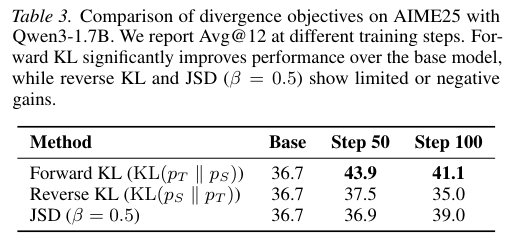

*Table 3: Avg@12 (%) of Qwen3-1.7B on AIME25 at different training steps, comparing three divergence measures, all with the same pointwise clipping. Forward KL rises from 36.7 to 43.9 at step 50 and is 41.1 at step 100, still above the original model; reverse KL is 37.5 at step 50 and falls to 35.0 at step 100, below the original model's 36.7; JSD (β=0.5) climbs slowly from 36.9 to 39.0 and may not have peaked by step 100. This conclusion comes from only one model, one test set and two checkpoints.*

Section 4.3.1 of the paper lists the divergence measure as a key design choice of OPSD: which measure to use for the per-token distribution matching between teacher and student. Forward KL consistently gives the largest gain, while reverse KL and JSD give limited gains, or even negative ones, so all later experiments use forward KL.

One possible reason (my speculation; the paper does not discuss it): forward KL requires the student to cover every token the teacher considers possible, while reverse KL only requires the student not to put probability where the teacher considers it impossible. Also, the JSD value itself is much smaller (see the worked example in Section 5, item (4)), so under the same learning rate and clipping threshold it updates more slowly.

### 6.5 Generation style: with the student's thinking off and the teacher's on, the gap on math tokens is largest

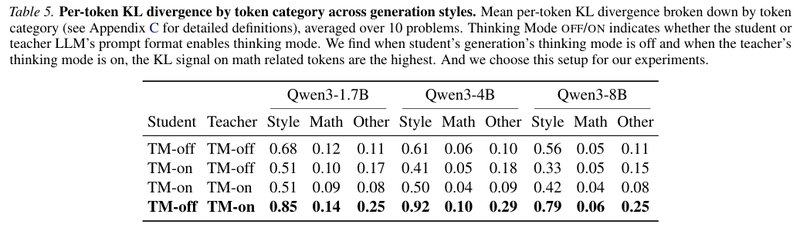

*Table 5: Average per-token KL of three token categories under four combinations of teacher and student generation modes, averaged over 10 problems. "Thinking Mode OFF/ON" says whether the student's or the teacher's prompt format has thinking mode on. At all three sizes, student TM-off with teacher TM-on (the last row, in bold) has the largest KL on math tokens (0.14, 0.10 and 0.06 for 1.7B, 4B and 8B), and this is the combination the paper picks. In all 12 "mode combination × model" cells, the KL of style tokens is 5 to 13× that of math tokens; for the chosen combination it is about 6.1, 9.2 and 13.2× at 1.7B, 4B and 8B.*

Section 4.3.2 of the paper says that generation style determines both which tokens the student learns on and what style of supervision the teacher gives. To find the combination with the most effective learning signal, the authors analyze the forward KL $`\mathrm{KL}(p_T\Vert p_S)`$ under the four combinations, splitting tokens into three categories: math (digits, operators and math keywords), style (reasoning connectives) and other.

The authors' reading: at all three sizes, a TM-off student paired with a TM-on teacher has the largest KL on math tokens, which indicates stronger supervision on math-related tokens. The KL in the table is the expected value over the whole vocabulary at each position. This expectation is highly skewed, with style tokens contributing disproportionately large values, which is why pointwise clipping is used to hold down these few exceptionally large values. The authors say this configuration also gives the best downstream scores, so they adopt it.

Things to note when reading this table:

- The chosen combination is largest not only in the math column but also in the style and other columns; overall, it is simply the combination where teacher and student differ most.
- The statistics use only 10 problems.
- Token categories come from keyword lists (Appendix C). Style words include `maybe`, `let`, `okay`, `hmm`, `wait`, `because`, `so`, `but`, `however`, `alternatively`, `actually`, `now`, `then`, `try`, `check`, `think` and others; math words include `exponent`, `power`, `log`, `equal`, `factor`, `prime`, `equation`, `integer`, `coefficient`, `sum`, `fraction`, `root`, `square`, `maximum`, `minimum`, `bound` and others.
- The paper does not give the downstream accuracy of the other three combinations.

### 6.6 Pointwise clipping: without it, the score actually drops after 100 steps

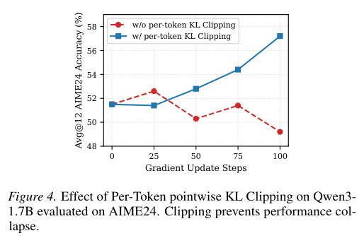

*Figure 4: Avg@12 of Qwen3-1.7B on AIME24; the red dashed line is without pointwise clipping and the blue line is with it. Without clipping, the score first rises from 51.5 to about 52.6 (step 25), then fluctuates between about 50.3 and 51.4, and falls to about 49.2 at step 100, below the starting value; with clipping, it rises monotonically from step 25 on, to 57.2. There is only one model, one test set and one run. The values are read off the plot.*

Section 4.3.3 of the paper: as Table 5 shows, the KL of style tokens can be higher than that of math tokens and so dominate the training signal; the authors use pointwise clipping to mitigate this. Figure 4 shows that clipping stabilizes training and prevents the scores from dropping. Since OPSD converges quickly, in about a hundred steps, this matters all the more.

### 6.7 Generation length: writing up to 4096 is no better

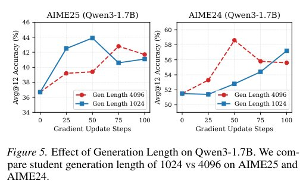

*Figure 5: Avg@12 of Qwen3-1.7B on AIME25 (left) and AIME24 (right), with student generation lengths of 1024 (blue) and 4096 (red dashed line). On AIME24, 4096 reaches about 58.6 at step 50, higher than 1024's best score of 57.2, and then falls back to about 55.6; on AIME25 its best is about 42.8, below 1024's 43.9. Each setting wins on one test set, while 4096's generation cap is 4× that of 1024; the paper uses 1024 by default. The values are read off the plot.*

Section 4.3.4 of the paper: the objective is per-token, so the number of tokens generated per sample directly determines how much supervision the student gets. Longer sequences expose the student to more of the teacher's feedback, but they cost more compute and may also bring in noisy, uninformative continuations. The authors compare two settings, 1024 and 4096, on Qwen3-1.7B (with full-vocabulary logit distillation), and the longer length does not bring a consistent improvement on the two test sets. The authors' explanation is that early tokens matter more for learning: the longer the student writes, the more predictable the later tokens become for the teacher once the student prefix is long enough, so they are penalized less. Work from Thinking Machines has also mentioned this phenomenon. The paper does not verify this explanation with per-position KL statistics.

### 6.8 The full vocabulary beats sampled tokens only by 2 to 3 points, at the cost of more GPU memory

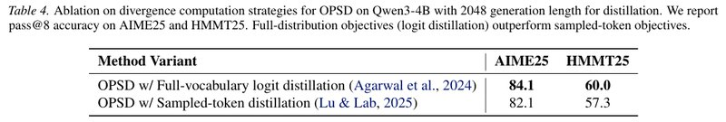

*Table 4: Qwen3-4B with a generation length of 2048 during distillation, pass@8 (%) on AIME25 and HMMT25. Full-vocabulary logit distillation scores 84.1 and 60.0, and the sampled-token-only form scores 82.1 and 57.3, so the former is higher by 2.0 and 2.7 points. Note that the metric here is pass@8, unlike the Avg@12 in the other tables, and there is only one setting.*

Section 4.3.5 of the paper: the objective in Equation (6) has two implementations in practice. One is full-vocabulary logit distillation (as in GKD): at each position, compute $`D(p_T\Vert p_S)`$ over the whole vocabulary with the full softmax, which gives an exact per-token f-divergence between the two models (KL and JSD both belong to this class of distribution gaps). The other is an advantage-based policy gradient that looks only at sampled tokens (as in Thinking Machines' on-policy distillation, that is, Section 4, item (1)): compute the teacher's and the student's log probabilities only on the token $`\hat y_n`$ the student actually sampled, treat this reverse KL term as a scalar advantage, and put it into a loss in policy-gradient form. The former directly matches the full token distribution; the latter optimizes an on-policy RL objective guided by the teacher's log probabilities, not a gap between full distributions. The authors conclude that the full-vocabulary objective is consistently better, which shows that showing the student the teacher's full distribution gives richer supervision than per-token guidance alone. The cost is that full-vocabulary computation has to store vocabulary-sized logits at every position, so peak GPU memory is higher; this is a trade-off between scores and efficiency.

Roughly how much GPU memory (my estimate): Qwen3's vocabulary has about 152,000 entries, so storing full-vocabulary logits at every position of a 1024-token response comes to about 1.56×10⁸ numbers, about 0.62 GB in fp32, with one copy each for the student and the teacher. Also, the official README states that the sampled-token-only version does not currently implement clipping. If the comparison in Table 4 was set up the same way, the two sides used different stabilization measures, and the paper does not say so.

### 6.9 Figures 3 to 5 and Table 3 come from the same training run: a summary of curve readings

Below are the values of each curve at each recorded point (Avg@12, %, read off the plot). Step 0 matches the original model in Table 2; the OPSD curves are the same set of numbers as the forward KL row of Table 3, the "with clipping" curve of Figure 4 and the "1024" curve of Figure 5.

| Curve | Step 0 | Step 25 | Step 50 | Step 75 | Step 100 |
| --- | --- | --- | --- | --- | --- |
| AIME24 · OPSD | 51.5 | 51.4 | 52.8 | 54.4 | 57.2 |
| AIME24 · GRPO | 51.5 | 51.1 | 49.7 | 50.3 | 52.2 |
| AIME25 · OPSD | 36.7 | 42.5 | 43.9 | 40.6 | 41.1 |
| AIME25 · GRPO | 36.7 | 38.3 | 36.4 | 36.9 | 37.8 |
| HMMT25 · OPSD | 23.1 | 24.7 | 27.8 | 26.9 | 29.2 |
| HMMT25 · GRPO | 23.1 | 24.2 | 25.8 | 23.6 | 24.4 |
| Average of the three · OPSD | 37.1 | 39.5 | 41.5 | 40.6 | 42.5 |
| Average of the three · GRPO | 37.1 | 37.9 | 37.3 | 36.9 | 38.1 |
| AIME24 · OPSD without clipping (Figure 4) | 51.5 | 52.6 | 50.3 | 51.4 | 49.2 |
| AIME25 · OPSD generating 4096 (Figure 5) | 36.7 | 39.2 | 39.4 | 42.8 | 41.7 |
| AIME24 · OPSD generating 4096 (Figure 5) | 51.5 | 53.3 | 58.6 | 55.8 | 55.6 |

How to read this table:

- The average score in the fourth panel of Figure 3 equals the mean of the first three panels at the same step, matching point by point (I checked).
- The three scores for OPSD at 1.7B in Table 2, 57.2 (step 100), 43.9 (step 50) and 29.2 (step 100), are the best values on each of the three test sets separately, averaging 43.4. No single checkpoint has an average over the three that reaches 43.4; the best is 42.5, at step 100.
- OPSD's AIME25 curve declines after step 50 (43.9 → 41.1).

## 7. Limitations the Authors Acknowledge

The paper puts its limitations and future directions in Appendix A, which is short; Appendix B and Section 4.3.5 add two more notes, and the official README admits one more:

- **Tested only up to 8B.** Because of compute limits, the experiments go only up to 8B parameters; whether the trend continues on larger models is, the authors say, still an open question.
- **Answer-correctness verification goes unused.** The current framework does not explicitly use the signal of "whether the generated answer is right". The authors think adding it could provide an extra learning objective beyond distribution matching.
- **Problems that are too hard cannot be taught.** When a problem is beyond the model's understanding, the teacher cannot give meaningful supervision even after seeing the reference solution. The authors suggest curriculum learning: raise the difficulty step by step as the model gets stronger, so that problems always sit at the edge of the model's ability. The paper does not run this experiment.
- **The clipping threshold was never tuned.** Appendix B says $`\tau`$ was not tuned; tuning it might let larger models gain a bit more within the same 100 steps.
- **Full-vocabulary distillation uses more GPU memory.** Section 4.3.5 of the paper acknowledges that full-vocabulary computation has to store vocabulary-sized logits at every position, so peak GPU memory is higher, a trade-off between scores and efficiency.
- **Only one random seed was run.** The paper does not say this; the official README admits it. The README also cites an independent evaluation by the third-party repository OP²SD with 4 decoding random seeds (link in Section 9).

## 8. Points Worth Noticing While Reading

Below are points I noticed while reading the paper that it does not discuss at length, offered for reference.

### How strong the evidence is

- **At 4B and 8B, the gap with GRPO does not settle which is better.** At 4B and 8B, OPSD beats GRPO by only 0.9 and 0.8 points. I made a rough estimate from the randomness of evaluation sampling: Avg@12 is the average accuracy over 12 samples per problem, so if a problem's true accuracy is $`p`$, the variance of its score is $`p(1-p)/12`$. Taking 30 problems per test set, in the worst case where every problem has $`p=0.5`$, the standard error for a single test set is about 2.6 points; if only a third of the problems have $`p\approx0.5`$ and the rest are reliably right or reliably wrong, it is about 1.5 points. The standard error of the average over the three is about 0.9 to 1.5 points, and the standard error of the difference between two methods' averages is about 1.2 to 2.2 points. This counts only the randomness of evaluation sampling, not that of training (the experiments ran only one random seed). The gaps of 0.8 to 0.9 points at 4B and 8B are within one standard error; the 5.7-point gap at 1.7B is clearly beyond this magnitude.
- **Checkpoints are picked per test set.** OPSD picks the best checkpoint separately for each test set, so no single checkpoint reaches 1.7B's average score of 43.4; the best is 42.5, at step 100 (Section 6.9). GRPO reports its peak within 500 steps. OPSD's AIME25 curve declines after step 50, so deciding when to stop in practice needs a validation set that does not look at the test sets, which the paper does not discuss.
- **The GRPO baseline's configuration is on the weak side.** Each step has only 4 problems × 8 responses, and most groups have no gradient. The paper cites DAPO but does not use common improvements such as its dynamic sampling (dropping zero-variance groups and sampling more), so part of "GRPO stalls" comes from the configuration. The token-efficiency comparison also has only the 1.7B curves (Section 6.3). In addition, the GRPO numbers in Table 2 do not match the GRPO curves in Figure 3 (see "Small issues in the manuscript" below).
- **The SFT baseline trained for only 100 steps.** OPSD beats SFT in all 9 cells of Table 2; but SFT trained for only 100 steps on 3200 samples (effective batch size 32), and the authors attribute its drop to the reference solutions being too concise.
- **Several ablations have only one setting each.** The effect of pointwise clipping is clear (57.2 vs 49.2 at step 100), but there is only one model, one test set and one run, and the threshold was never tuned (Section 6.6). Forward KL beating reverse KL and JSD comes only from 1.7B, AIME25 and two checkpoints (Section 6.4). The full vocabulary beating sampled tokens rests only on 4B and one setting, the metric is pass@8, and the sampled-token version may not have used clipping (Section 6.8).
- **The evidence for the choice of generation style is thin.** Table 5 has only 10 problems, and the chosen combination has the largest KL on all three token categories; no data is given for "best downstream". In the code, the teacher's instruction explicitly asks it to "explore different approaches, and don't be afraid to backtrack or reconsider", and the teacher also has thinking mode on, so part of the high KL on style tokens may come from the prompt design (this is my speculation).
- **Two hypotheses are not tested directly.** "Early tokens matter more for learning" is only an explanation of Figure 5, with no per-position KL statistics and no control experiment that trains only on prefixes. Giving early positions more weight, or sampling only shorter prefixes per problem under the same budget to cover more problems, could test it along the way. "Understanding an answer is easier than generating one yourself" is the method's motivation; it is reasonable as a motivation, but the paper does not test it directly.

### The method itself

- **Pointwise clipping is more than "down-weighting".** By the derivation in the optional part of Section 5, item (3), clipped terms have a gradient of 0, and the remaining terms push the probabilities of these tokens down further. With $`\tau=0.05`$, for a token the teacher gives 99% probability, the student only has to fall below about 94% to get clipped. This is not quite the same thing as "lowering the weight of style tokens": math tokens with large disagreements are affected too. Changes worth trying (my ideas): clip on the total KL at each position instead, or scale down terms above the threshold proportionally instead of zeroing their gradient; down-weight directly by token category, or compute the KL only over the teacher's top k candidates (the code already has a `top_k_loss` option); tune $`\tau`$ systematically.
- **With a fixed teacher, the effective training window is short.** The teacher is the initial model, so how much the student can learn is capped by "how much the initial model can explain while looking at the answer". The results all peak within 100 steps, and some curves decline afterward (AIME25: 43.9 at step 50, 41.1 at step 100). The paper does not report whether training can continue, or what happens with a teacher that updates during training. The code has an EMA teacher option (the teacher's parameters are a moving average of the student's); one could also periodically replace the teacher with the current student, to see whether this extends the effective training window.

### Where it applies

- **Training and evaluation conditions differ.** In training, the student has thinking mode off and writes only the first 1024 tokens; in evaluation, thinking mode is on and it writes up to 38,912 tokens. The paper says the student sees only the problem, "the same condition as at inference", which holds for the input, but the generation mode and the length both differ. The measured gains transfer from short non-thinking responses to long thinking-mode reasoning. The paper does not discuss why this transfer works or whether it holds for other models.
- **"No external teacher needed" deserves a discount.** The reference solutions are themselves reasoning generated by stronger models (the paper admits this when introducing the SFT baseline). What OPSD saves is the teacher model during training, not the dependence on data from strong models. The paper does not measure how much the results would drop if the dataset had only final answers and no reasoning, or if the reasoning were of poorer quality.
- **Only Qwen3 and math were tested.** There is no comparison with "on-policy distillation from a larger teacher" (for example, 8B teaching 1.7B), context distillation, STaR-style self-training, or a combination of GRPO and SFT; there are no tasks such as code or science QA; and there is no test of how well general abilities are retained. The concurrent [SDFT](https://arxiv.org/abs/2601.19897) applies on-policy self-distillation to continual learning. OPSD's fixed teacher itself acts as a regularizer that "keeps the model close to the initial model", so its effect on general abilities is worth testing.

### Experiments worth doing next (my ideas)

- **Combine with RLVR.** GRPO has no gradient when a group is all right or all wrong, and OPSD's per-token signal fills exactly that gap; for example, use the OPSD loss only on zero-variance groups and GRPO as usual on the rest. One could also treat the OPSD loss as a dense per-token advantage on top of GRPO's or DAPO's whole-response reward, or warm up quickly with OPSD first and then move on to RL. Appendix A also mentions using answer-correctness verification.
- **Filter problems by difficulty.** Use "the log probability the teacher gives the final answer while looking at the reference solution" to estimate whether it can understand a problem, filter out the problems it cannot understand, and then raise the difficulty step by step as training goes on. This is the direction Appendix A suggests.
- **Change the source of privileged information.** The concurrent [SDPO](https://arxiv.org/abs/2601.20802) uses environment feedback as privileged information. Tasks such as code and tool calling often have no ready-made reference solution, but they do have execution results and error messages, so the same framework could be applied.
- **A hybrid teacher.** Use a larger external model plus the reference solution as the teacher, and see whether the two advantages, "a stronger model" and "having seen the answer", add up.

### Small issues in the manuscript (none affect the main conclusions)

- **The normalization is written inconsistently.** Equation (1) sums directly over positions; Equations (6) and (8) and Algorithm 1 add a factor of $`1/|\hat y|`$; the code averages over the total number of valid tokens in the batch. Student responses are nearly all 1024 tokens long (Section 6.3), so the practical difference is small, but the three places write it differently.
- **The two endpoints of JSD.** By the literal definition in Equation (7), the gap is always 0 at $`\beta=0`$ and $`\beta=1`$; the code follows the GKD and TRL convention of treating $`\beta=0`$ as forward KL and $`\beta=1`$ as reverse KL. As $`\beta\to0`$, $`\mathrm{JSD}_\beta/\beta\to\mathrm{KL}(p_T\Vert p_S)`$, so the direction agrees, but the main text does not explain how the forward KL of the main experiments relates to Equation (7); the example divergence in Algorithm 1 is written as $`\mathrm{JSD}_\beta`$, while the main experiments actually use forward KL.
- **Appendix D presents an approximation as the exact gradient.** If you take the exact gradient of $`J_{\text{OPSD}}`$ (the sampling distribution also depends on $`\theta`$), the weight at position $`m`$ should be the sum of all rewards from $`m`$ onward, $`\sum_{n\ge m}r_n`$ (the reward-to-go). Equation (9) uses only the current position's $`r_m`$, which amounts to an approximation with a discount of 0, that is, a per-token reverse KL that "treats the prefix distribution as a constant". This is common practice in on-policy distillation (the Thinking Machines blog explicitly uses a discount factor of 0, optimizing only the immediate next token), but the paper writes it as the gradient of $`J_{\text{OPSD}}`$. Not backpropagating through the $`-\log p_S`$ inside $`r_n`$ does not change the expectation, because $`\mathbb E[\nabla\log p_S]=0`$.
- **"Evaluated every 20 steps" does not match.** The note to Table 2 says OPSD evaluates a checkpoint every 20 steps; but the recorded points in Figures 3 to 5, the official evaluation scripts and the save interval (`save_steps` is 25) are all every 25 steps, and the best AIME25 value, 43.9, appears at step 50, which is not on an "every 20 steps" grid.
- **GRPO in Table 2 does not match GRPO in Figure 3.** Table 2 says it reports the peak within 500 steps, which for 1.7B is 51.1 on AIME24 and 23.7 on HMMT25; but in Figure 3, GRPO already reaches 52.2 (AIME24, step 100) and 25.8 (HMMT25, step 50) within the first 100 steps. A peak should not be lower than a value already reached in the first 100 steps. It may be a different run or a different rule for picking points; the paper does not say.
- **The style-token ratio is stated inconsistently.** In Table 5, the ratio of style to math is 5.1 to 13.2; the official README says 6 to 15×.
- **"SFT loses points on every task and at every size" has an exception.** Of the 9 cells, 8 go down; HMMT25 at 4B is the exception (43.4 vs 42.2).
- **"Matches or beats GRPO in every setting" has to be read by average score.** Looking at single entries, GRPO is higher on HMMT25 at 8B (46.7 vs 45.8).
- **"The sampling configuration recommended by the Qwen3 blog" differs from the recommended values.** The Qwen3 model card recommends temperature 0.6, top-p 0.95, top-k 20 and a maximum length of 38,912 for thinking mode; the paper's evaluation uses temperature 1.0 and no top-k cutoff. All methods use the same configuration, so the relative comparison is unaffected, but the absolute scores cannot be compared directly with Qwen3's official report.
- **The top-p in Table 8 disagrees with the code.** Table 8 gives 0.95; in the official evaluation script, the default of `--top_p` is None, `run_eval.sh` does not pass this argument, and the README also says top-p=none.
- **Wrong cross-references.** Appendix C says the token classification analysis is in Section 4.3.1 of the paper, but it is actually in Section 4.3.2; research question (3) points both generation style and generation length to Section 4.3.4, but generation style is actually in Section 4.3.2.

## 9. If You Want to Run It Yourself

- **Code and data.** The official code is at <https://github.com/siyan-zhao/OPSD> (training scripts `scripts/run_opsd_{1b,4b,8b}.sh`, evaluation script `eval/run_eval.sh`, baseline scripts `scripts/run_grpo.sh` and `scripts/run_sft.sh`), and the training data is at <https://huggingface.co/datasets/siyanzhao/Openthoughts_math_30k_opsd>. The official implementation is built on the GOLD Trainer of the TRL library (<https://huggingface.co/docs/trl/gold_trainer>); for TRL's implementation of GKD, see <https://huggingface.co/docs/trl/gkd_trainer>; the sampled-token-only objective comes from the Thinking Machines blog post <https://thinkingmachines.ai/blog/on-policy-distillation/>. The third-party [OP²SD](https://arxiv.org/abs/2608.09228) (code <https://github.com/MBZUAI-reasoninglab/OP2SD>) evaluated OPSD independently with 4 decoding random seeds.
- **Use the new version of the code.** According to the official README, an update on 2026-03-18 fixed bugs in the chat template and ZeRO-2 and reran the experiments; Qwen3-1.7B's results improved the most, and pointwise clipping was added at the same time. The numbers in v3 of the paper are based on the fixed code, and the numbers in earlier versions of the paper differ from v3; if you reproduce with the old code, your results will not match.
- **The fixed teacher depends on LoRA.** `--fixed_teacher` must be used together with `--use_peft`; the teacher is then the same model with the LoRA adapter turned off. Without PEFT, the teacher is updated along with the student at every step, and the README warns that this may make training unstable.
- **The actual wording of the two prompts** differs from the example wording in Figure 2:

```text
[Student, enable_thinking=False]
Problem: {problem}

Please reason step by step, and put your final answer within \boxed{}.

[Teacher, enable_thinking=True]
Problem: {problem}

Here is a reference solution to this problem:
=== Reference Solution Begin ===
{solution}
=== Reference Solution End ===

After reading the reference solution above, make sure you truly understand the reasoning
behind each step — do not copy or paraphrase it. Now, using your own words and independent
reasoning, derive the same final answer ... explore different approaches, and don't be afraid
to backtrack or reconsider ...

Please reason step by step, and put your final answer within \boxed{}.
```

- **How the loss is implemented.** `--beta 0` selects forward KL; the student's and the teacher's logits are both divided by the sampling temperature 1.1 before the softmax; each element is clipped at `--jsd_token_clip` (0.05 for 1.7B and 4B, 0.06 for 8B); the sum is then divided by the total number of valid tokens in the batch. After clipping, the loss can be negative, which is normal.
- **How the student samples.** It uses vLLM's colocate mode (the inference engine and training share the same set of GPUs), with temperature 1.1, top-p 0.95, top-k 20, at most 1024 tokens and 1 response per problem; `--lmbda 1` means all training data comes from the student's on-policy samples.
- **Other hyperparameters.** Learning rate 5e-6, an effective batch size of 32 problems, and `--max_grad_norm 0.1` (gradient clipping tighter than the common setting).
- **The sampled-token-only version** (`--use_tinker_loss`) saves more GPU memory, but the README states that this version does not currently implement clipping and may be unstable.
- **Evaluation costs more than training.** Evaluation runs with thinking mode on, temperature 1.0, at most 38,912 tokens and 12 samples per problem; a checkpoint is saved every 25 steps, and each one is evaluated separately. The README says evaluating one checkpoint takes about 30 to 50 minutes on 4×H100, longer than the training itself: training 1.7B on 4×H100 takes about 15 minutes.
- **Pick checkpoints with a separate validation set.** The paper picks the best checkpoint by the test sets. When reproducing it or using it in practice, prepare a separate validation set and run several random seeds.
- **Hardware.** All of the paper's experiments use 8 A100 or H100 GPUs, with gradient checkpointing (trading recomputation for memory) and Flash Attention 2 turned on, the AdamW optimizer and bf16 precision. The official 1.7B script uses 4 GPUs (4 problems per GPU × gradient accumulation of 2), and the 4B and 8B scripts use 8 GPUs. Training stays within 100 steps, with a checkpoint saved every 25 steps.

The full configurations are in Tables 6 to 8 of the paper:

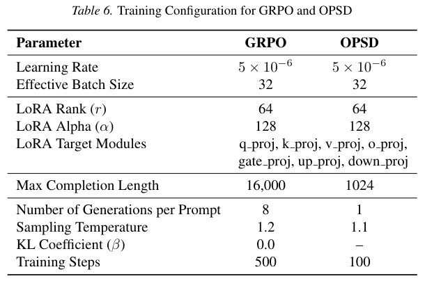

*Table 6: Training configurations of GRPO and OPSD. The two share the same learning rate (5×10⁻⁶), effective batch size (32) and LoRA settings (rank 64, alpha 128, applied to all projection layers in attention and the MLP). They differ in that OPSD samples 1 response per problem, at most 1024 tokens long, at temperature 1.1, and trains for 100 steps, while GRPO samples 8 responses per problem, at most 16,000 tokens long, at temperature 1.2, trains for 500 steps, and adds no KL penalty (β=0). OPSD's β column shows a dash; that is not the same parameter as `--beta 0` in the code (the interpolation coefficient of JSD, used to select forward KL).*

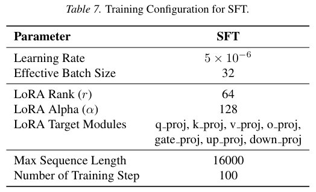

*Table 7: Training configuration of SFT. SFT likewise trains for 100 steps with an effective batch size of 32, a maximum sequence length of 16,000, and the same LoRA settings as the other two methods.*

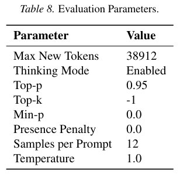

*Table 8: Evaluation parameters. At most 38,912 generated tokens, thinking mode on, top-p 0.95, top-k of −1 (no cutoff), min-p of 0, presence penalty of 0, 12 samples per problem, temperature 1.0. For how this top-p differs from the official evaluation script, see Section 8.*

## 10. Relation to Related Work

Section 5 of the paper places OPSD within several lines of research. The table below lists the works this paper mentions; the "How it differs from this paper" column is my own summary:

| Method | How it works | How it differs from this paper |
| --- | --- | --- |
| [Knowledge distillation](https://arxiv.org/abs/1503.02531) (Hinton et al., 2015) | The student imitates the teacher's soft probability distribution on fixed data | Off-policy; OPSD works on the student's own responses |
| [Context distillation](https://arxiv.org/abs/2209.15189) (Snell et al., 2022) | With a single model, the teacher generates responses with a privileged context, and the student, without that context, runs SFT on these responses | Off-policy, and the learning target is a discrete token sequence; OPSD matches full distributions on the student's own responses |
| [STaR](https://arxiv.org/abs/2203.14465) (Zelikman et al., 2022), ReST (Gulcehre et al., 2023) | Generate reasoning (STaR can use the answer as a hint to "understand the answer"), filter by answer correctness or reward, fine-tune on the successful responses, and iterate | Hard distillation at the whole-response level, with no signal when everything is wrong; OPSD is per-token soft distillation |
| [GKD](https://arxiv.org/abs/2306.13649) (Agarwal et al., 2024) | The student samples, and an external teacher does full-vocabulary on-policy distillation with the generalized JSD | OPSD keeps its form of objective and replaces the teacher with itself holding the reference solution |
| On-policy distillation (Lu and Thinking Machines Lab, 2025, [DOI:10.64434/tml.20251026](https://doi.org/10.64434/tml.20251026)) | An external teacher; on the sampled tokens, the reverse KL is used as a per-token advantage and optimized with policy gradient | OPSD's alternative objective (Equation (9)) takes exactly this form; in Table 4 it does worse than the full-vocabulary version |
| In-context editing (Qi et al., 2025) | Uses soft distillation on the student's samples to internalize knowledge induced by the context | Also on-policy soft distillation, but used for knowledge editing, not reasoning |
| [SDPO](https://arxiv.org/abs/2601.20802) (Hübotter et al., 2026, concurrent) | Uses environment feedback as privileged information, doing RL in the form of self-distillation | A different source of privileged information: environment feedback, not reference solutions from a dataset |
| [SDFT](https://arxiv.org/abs/2601.19897) (Shenfeld et al., 2026, concurrent) | Applies on-policy self-distillation to continual learning | A different task: continual learning, not improving reasoning |
| [GRPO](https://arxiv.org/abs/2402.03300) (Shao et al., 2024, from DeepSeekMath) | Samples a group of responses per problem and does policy gradient with 0/1 rewards normalized within the group | This paper's main RL baseline; one score per whole response, a sparse signal and a high sampling cost |
| [DAPO](https://arxiv.org/abs/2503.14476) (Yu et al., 2025) | Adds improvements such as dynamic sampling on top of GRPO | The paper cites it, but the GRPO baseline does not use dynamic sampling (Section 8) |
| [DAgger](https://arxiv.org/abs/1011.0686) (Ross et al., 2011) | Imitation learning: the teacher gives corrections in the states the student reaches on its own | The paper says on-policy distillation descends from this kind of imitation learning: the student receives the teacher's guidance on its own outputs and improves step by step |

What is new in each part (this table is my own assessment):

| Part | Type | My assessment |
| --- | --- | --- |
| The same model, given the reference solution, acts as the teacher and does full-vocabulary soft distillation on the student's own responses, for reasoning | An effective combination | It combines context distillation ("itself with a privileged context as the teacher") with GKD's on-policy soft distillation; in-context editing did something similar for knowledge editing, and the concurrent SDPO and SDFT are also exploring similar algorithms. This paper's contribution is to apply it to "the reference solutions in reasoning datasets" and to compare it systematically with GRPO and SFT on cost and results |
| Pointwise clipping | Incremental (an engineering trick) | The implementation is only one line, and Figure 4 shows it is key to stability; but the threshold was not tuned, the main text does not give its value, and its side effects are not analyzed (Section 5, item (3)) |
| Thinking mode off for the student, on for the teacher | Incremental (an empirical configuration) | It rests on KL statistics from 10 problems, and no data is given for "best downstream" |
| Interpreting OPSD as a policy gradient with dense rewards, and comparing it with STaR | Explanatory analysis | Helps explain why the signal is denser; the derivation is a per-token approximation (Section 8) |

## 11. Summary

The idea of OPSD is simple: **take one model, let one copy see the reference solution and the other not, and have the copy that saw the answer score, token by token, the draft written by the copy that did not.** At very low cost, this turns the ready-made reference solutions in reasoning datasets into on-policy per-token supervision: no reward model, no external teacher, and only 1 response of 1024 tokens per problem. The teacher only runs forward passes, implemented by "turning off the LoRA adapter", so no second copy of the weights has to be loaded. GRPO uses only the final answer to judge right or wrong, and SFT treats the solution as an off-policy imitation target. OPSD instead uses the teacher's context to turn the whole solution into distribution supervision at every position of the student's response; the signal does not depend on whether the answer is right, so the student can learn even before it finishes writing.

On the evidence side: on Qwen3-1.7B, in 100 steps it raises the average score on the three competition math test sets from 37.1 to 43.4 (GRPO reaches 37.7), and in the first 100 steps it generates about one eighth as many tokens as GRPO; on this dataset, 55% to 95% of GRPO's batches have no gradient, a problem OPSD does not have. The numbers inside the paper are self-consistent: all 12 rows of the average column in Table 2 equal the mean of the three entries, and Figures 3 to 5 and Table 3 come from the same training run, with readings that agree throughout. Among the formulas I checked, Equations (2) to (5), the clipping formula, the expectation of Equation (9) and STaR's gradient in Appendix D are all correct; the problems lie in how a few things are written (Section 8). The code, evaluation scripts and dataset are all public, and the README is candid about the single-random-seed limitation and the bugs that were fixed. The limitations are also clear: at 4B and 8B it beats GRPO by less than 1 point, within evaluation noise; the scores in the tables come from the best checkpoint picked per test set, with only one random seed run; the GRPO baseline's configuration is on the weak side; several key ablations each have only one setting; and when a problem is so hard that the teacher cannot understand it even after seeing the answer, the method cannot teach it. Taken together with the concurrent SDPO and SDFT, "letting a model with privileged context be its own teacher" has become another kind of option besides RLVR and external distillation. The current evidence is concentrated on Qwen3 models up to 8B and on math problems; whether the advantage holds on larger models and more tasks still needs independent verification.

---

## Where Things Are in the Paper

| In this note | In the paper |
| --- | --- |
| Problem and motivation | Section 1, Section 3.1, Table 1 |
| Background: knowledge distillation, on-policy distillation, GRPO | Sections 2.1 and 2.2, Equations (2) to (5) |
| Method: the two roles, the prompts, the training objective, JSD | Section 3.2, Equations (1) and (6) to (8), Figures 1 and 2, Algorithm 1 |
| Definition of pointwise clipping | Section 3.2 (the unnumbered clipping formula) |
| The sampled-token-only form, and the relation to STaR | Equation (9) in Section 3.2, Equations (10) and (11) in Appendix D |
| Experimental setup | Section 4.1, Appendix B |
| Main results, token efficiency | Section 4.2, Table 2, Figure 3 |
| Choice of divergence measure | Section 4.3.1, Table 3 |
| Generation style | Section 4.3.2, Table 5 (placed in Appendix B), Appendix C |
| Effect of pointwise clipping | Section 4.3.3, Figure 4 |
| Generation length | Section 4.3.4, Figure 5 |
| Full vocabulary versus sampled tokens only | Section 4.3.5, Table 4 |
| Related work | Section 5 |
| Conclusion | Section 6 |
| Limitations the authors acknowledge | Appendix A; Appendix B ($`\tau`$ not tuned); Section 4.3.5 (GPU memory) |
| Training and evaluation configurations | Appendix B, Tables 6 to 8 |
