# 重新思考大语言模型的同策略蒸馏 II：一个训练样本

中文 | [English](./One-Shot-On-Policy-Distillation_en.md)

- **原文链接**: [Rethinking On-Policy Distillation of Large Language Models II: One Training Example](https://arxiv.org/abs/2609.04172v1)
- **论文**: [arXiv:2609.04172](https://arxiv.org/abs/2609.04172)
- **官方资料**: [Thinking-Space/One-Shot-OPD](https://github.com/Thinking-Space/One-Shot-OPD)
- **发布日期**: 2026-09-03
- **译注**: “主要结论”是为本笔记写的摘要，不属于原文，数字均取自论文；“全文翻译”是 arXiv v1 版的非官方全文中译，含正文、附录、全部图表和参考文献。原文以 [CC BY 4.0](https://creativecommons.org/licenses/by/4.0/) 许可发布，本译文沿用同一许可，格式上的改动列在“全文翻译”一节的开头。英文版的“主要结论”译自中文摘要，其余是原文转成的 Markdown。

## 主要结论

- **问题**：同策略蒸馏（on-policy distillation，OPD）让学生模型在自己采样出的 rollout 上训练，教师模型则在它经过的每一个前缀上给出完整的下一个 token 分布。已有研究几乎只从算法一侧解释 OPD 为什么有效，训练数据起什么作用、数据与算法如何相互作用，一直没人研究过。
- **方法**：把数据量压到极限——只用一条查询训练（one-shot OPD），以此把“数据供给”与“算法吸收”两件事拆开。论文在数学推理、代码生成、指令遵循、智能体工具调用四个领域，以及 Qwen、Llama、OLMo 三个模型家族上做了受控实验，并提出两个诊断量：**状态覆盖率**（一组查询的 rollout 能触达全量数据 OPD 所访问状态空间的多大比例）和**吸收率**（一次更新能消化掉剩余师生差距的多大比例）。
- **一条查询就能撑起大部分收益**：数学推理上，one-shot OPD 在第 300 步达到 68.5 分，全量数据 OPD 为 69.8 分，回收了 69% 的师生差距、87% 的全量数据收益；训练到第 1000 步时为 68.4 比 72.1，仍回收 72% 的全量数据收益。换到 Llama、OLMo 家族同样成立（三组学生从 77.1、28.2、70.8 升到 85.5、40.2、82.4），在代码生成、指令遵循、智能体工具调用上分别回收 73%、66%、64% 的师生差距。
- **难度、长度、温度都不影响这个现象**：训练前通过率分别为 8/8、4/8、0/8 的三道题效果相当——哪怕那道难题训练 300 步一次都没做对，收益也和总能做对的简单题差不多；收紧回答长度上限、降低采样温度同样保留收益。
- **数据侧：OPD 消耗的是状态，不是查询**。64 条 rollout 一个批次，一条查询每步就能产生数万个带教师监督的状态。按语义簇度量，一条查询在第 300 步已覆盖全量数据状态空间的 71.5%，其中第 100 步就到了 65.9%，之后 200 步只再添 5.6 个百分点。
- **多样性才是关键，16 条就够**：在语义簇中各取一条代表，查询数从 1 增到 16 时，状态覆盖率从 71.5% 升到 98.9%，验证集准确率同步追平全量数据 OPD。固定查询数为 16、只改多样性的对照说明这确实来自多样性：取自 16 个语义簇的 70.9 分、覆盖率 98.9%，全取自同一个簇的只有 69.9 分、覆盖率在第 100 步就卡在 76.8% 附近。另一个对照显示，固定查询集后改变出现顺序几乎没有影响。
- **算法侧：吸收越来越慢，与数据量无关**。四种设定（1、4、16、全量查询）到第 300 步都消化掉了第 30 步师生距离的 78%–84%，而吸收率在第 50 步到第 200 步之间都降到原来的 四分之一到六分之一（分别为 5.6、5.2、4.2、6.4 倍）。也就是说，**一次运行要花几百步而不是几十步，是 OPD 算法本身的性质，不是训练集决定的**；学习率只是按比例拉伸步数轴，不改变减速的形状。把训练状态完全固定（异策略复用最初采样的 64 条轨迹）后，准确率仍然要爬约 200 步，所以“跑得久”也不是靠源源不断的新状态撑起来的。论文由此给出一句话结论：**OPD 数据过饱、算法饥饿**。
- **多教师 OPD 同样成立**：一个学生同时训练数学、代码、指令遵循三个领域，每条查询路由到本领域教师。全量数据 MOPD 把平均验证准确率从 43.5 提到 52.8（回收 79% 师生差距），与三次单独的全量数据 OPD（53.8）只差 1.0 分；每个领域各取 16 条语义多样的查询即可达到 52.9，相当于全量数据 MOPD 收益的 101%（分领域看是数学 93%、代码 136%、指令遵循 109%）。
- **输入甚至可以不包含任务内容**：空用户轮加一个 `<think>` 的模板、带一句领域系统提示的同款模板，以及完全来自通用对话的 WildChat 查询（192,824 条，启发式判定只有 0.17% 与数学相关、2.63% 与代码相关），三者的曲线都贴着真实训练集的基线（三基准平均分 59.1→69.8），且只花了基线三分之一到二分之一的 rollout token 就达到同一水平；代码生成上四种条件的终点相差不到 1.7 分，而 500 步里基线花掉 277M rollout token，纯模板只花 18M。但要求并非为空：让模型立刻闭合思考块的 `<think>\n</think>\n` 会塌缩成没法训练的简短元回复。论文据此认为输入的作用主要是“把学生带进可供教师监督的推理状态”。
- **与 one-shot RLVR 的对照**：同一条查询上训练 1000 步，OPD 回收 72% 的师生差距，验证集涨幅是 RLVR 的两倍多，按 rollout token 对齐后结论不变。原因是 RLVR 的信号随着训练题被解出而枯竭——GRPO 的组内结果趋于一致就没有优势可言；OPD 的逐 token 信号在题目解出之后依然存在，只是逐渐变小。代价是 OPD 的上限被教师分布锁住，而 RLVR 没有这个约束。
- **局限**：状态覆盖率是以全量数据 rollout 建起来的参照空间为基准的语义级代理指标，衡量的是“覆盖了那个空间的多少”，而非绝对覆盖，并且对每个簇一视同仁，不管它被访问多少次、还剩多少教师信号；吸收率为何下降仍是开放问题；MOPD 实验只有三个领域、每个领域一个教师。

## 全文翻译

**格式改动**：原文的各级标题都降了一级，放在本节之下；图 1–11、13–20 取自 arXiv 源文件中的矢量图，渲染为 PNG；图 12 的两个模板框改为代码块；Takeaways 与 Hypothesis 提示框改为引用块；原文的三条脚注，两条改为所在段落后面的斜体说明，一条并入所在列表项的括注；跨多行的表头与合并单元格改为普通 Markdown 表格；公式编号写在正文里，不随公式显示；文内引用统一写成 (作者 et al., 年份)，交叉引用改为纯文本；参考文献按原文顺序排列，并补上 arXiv 与数据集链接。中文版把图表标题、表格内容和表 2 的三道数学题也译成中文；模型名、数据集名、基准名、参考文献，以及 `<think>`、`<|User|>` 这类模板 token 保留英文。

Zixuan Fu$`^{*1}`$, Bingxiang He$`^{*\dagger\ddagger1}`$, Yuxin Zuo$`^{*\dagger1}`$, Haohuan Huang$`^{*1,2}`$, Jinqian Zhang$`^{1}`$, Ruhang Xiao$`^{3}`$, Cheng Qian$`^{4}`$, Qinyu Luo$`^{5}`$, Huan-ang Gao$`^{1}`$, Yudong Wang$`^{1}`$, Zhiyuan Liu$`^{1}`$, Ning Ding$`^{\ddagger1}`$, Chaojun Xiao$`^{\ddagger1}`$

$`^{1}`$Tsinghua University, $`^{2}`$University of Chinese Academy of Sciences, $`^{3}`$Northeastern University, $`^{4}`$University of Illinois Urbana-Champaign, $`^{5}`$Johns Hopkins University

\* 同等贡献。† 项目负责人。‡ 通讯作者。代码：<https://github.com/Thinking-Space/One-Shot-OPD>，联系方式：`hebx24@mails.tsinghua.edu.cn`、`{dingning,xcj}@tsinghua.edu.cn`。

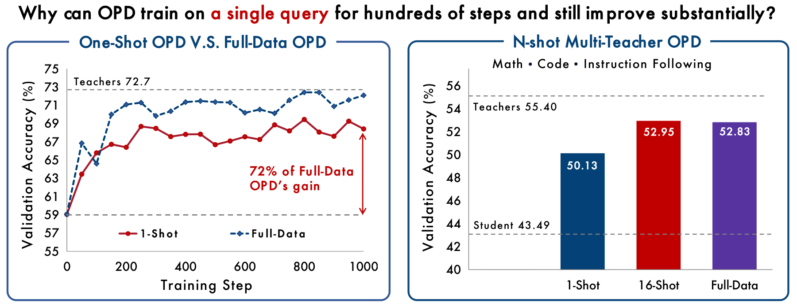

*图 1：在数学推理上，一条查询就回收了全量数据 OPD 的大部分收益（左），而且这一效应跨领域、跨模型家族都成立。在多教师 OPD 下，每个领域 16 条查询即可追平全量数据训练（右）。*

### 摘要

同策略蒸馏（OPD）把学生自己生成的 rollout 与教师给出的稠密 token 级监督结合在一起。已有工作主要研究它的算法行为，训练数据起什么作用仍不清楚。我们在数据量最小的极限上考察这一作用：只用一条查询训练。One-shot OPD 能持续改进数百步，并在各个任务领域和模型家族上回收全量数据 OPD 的大部分收益。我们用训练中访问到的状态，以及学生向教师对齐的速度，来解释这个结果。我们度量**状态覆盖率**，即一组查询的 rollout 能触达全量数据 OPD 所访问状态的比例。单独一条查询就已触达 71.5%，其中大部分出现在前 100 步内。加入语义上不同的查询会让覆盖率和验证集准确率一同上升，直到 16 条查询达到 98.9% 并追平全量数据训练。然而，无论 OPD 是在一条查询上还是在整个数据集上训练，对齐都以相近的速度放缓，而且即便状态集合是固定的，也要几百步才能吸收完。因此，**OPD 数据过饱，算法饥饿**。它的 rollout 很快就暴露出大量监督信号，而学生吸收这些监督的速度却越来越慢。状态覆盖率的结论可以推广到多教师 OPD：每个领域 16 条语义多样的查询即可追平全量数据 MOPD。作为进一步的压力测试，轻内容模板和域外的 WildChat 查询也接近真实查询的基线。可见，任务内容与它所诱导的状态覆盖率是可以分开的。我们希望这些发现能把后续工作引向 OPD 的单步效率，并促使人们重新审视它近来在前沿后训练中取得成功所依赖的数据与机制。

### 1 引言

同策略蒸馏（OPD）在前沿大语言模型的后训练中正变得越来越常见。Qwen3 (Yang et al., 2025)、MiMo (Xiao et al., 2026)、GLM-5 (Zeng et al., 2026)、DeepSeek-V4 (Xu et al., 2026) 和 Kimi K3 (Team et al., 2026) 都在监督微调（SFT）和强化学习（RL）之外使用了 OPD。OPD 的独特之处，在于它把同策略的状态访问与稠密的蒸馏监督结合了起来 (Gu et al., 2024; Agarwal et al., 2024)。学生采样出自己的 rollout，而教师在它访问过的每一个前缀上给出完整的下一个 token 分布，由此产生稠密的、token 级的监督，而不是带可验证奖励的强化学习（RLVR）通常使用的单一的结果级奖励。

越来越多的工作系统地考察了 OPD 的训练动态与机制，以解释这一方法如何起作用、为何起作用，但这些工作基本都站在算法的视角 (Li et al., 2026; Fu et al., 2026; Cai et al., 2026; Zhu et al., 2026)。然而，此前没有任何工作研究过训练数据如何塑造 OPD，也没有研究过数据与算法如何相互作用。要完整地理解 OPD，就必须填上这块空白。在 RLVR 中，Wang et al. (2026a) 提出了 one-shot RLVR，用一个极端的受控实验来分离出训练数据的作用。我们把同样的实验视角带到 OPD 上，只用一条查询来训练，并把这种设定称为 one-shot OPD。令我们惊讶的是，如图 1 所示，one-shot OPD 产生了一条与 one-shot RLVR 惊人相似的学习曲线：尽管反复训练的只是一条查询，模型仍然持续改进数百步，并最终取得可观的收益。因此，我们把这项工作用来回答一个问题：

*为什么只用一个样本训练的 OPD，能够**学这么久**，还能**提升这么多**？*

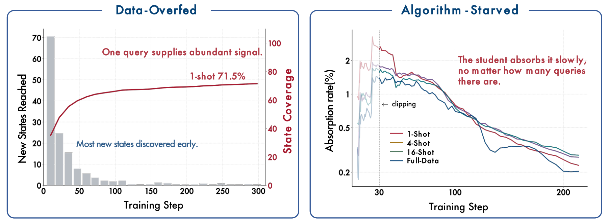

*图 2：**OPD 数据过饱，算法饥饿**。**数据侧**：一条查询就已覆盖全量数据 OPD 所访问状态的大部分。**算法侧**：无论训练用了多少条查询，学生每次吸收掉的剩余师生差距的比例都越来越小。*

这个问题暴露出 OPD 效率的两个侧面，而标准训练把它们纠缠在了一起：***学这么久***关乎*算法*吸收监督的速度，而***提升这么多***关乎为什么少量*数据*就能提供足够的监督。把数据供给压到最小，one-shot OPD 就把两者拆了开来，而这一现象本身也相当稳健：收益在四个任务领域和三个模型家族上都成立，即使在学生从未解出的查询上也依然存在（第 3 节）。我们的答案是：**OPD 数据过饱，算法饥饿**。从*数据视角*看，一条查询是通过它的 rollout 所触达的*状态*来作用于学生的，每个状态都是一个前缀 $`s=(x,y_{<i})`$，教师在该处提供 token 级监督，所以一组查询的价值就在于它覆盖了那个空间的哪一部分。我们用*状态覆盖率*来量化这一点：把全量数据 OPD 访问过的状态归入语义簇，再报告某个设定的 rollout 触达了其中多大比例。一条查询本身就已提供了足够的状态，覆盖了全量数据 OPD 所访问状态的 71.5%，而 16 条语义多样的查询覆盖 98.9%，并追平全量数据训练（第 4 节）。这就是为什么这么少的数据能让学生提升这么多。从*算法视角*看，随训练推进而下降的是*吸收率*，即一次更新所消化掉的剩余师生差距的比例，而它在一条查询上与在全部 17k 条查询上的下降方式大体相同（第 5 节），所以一次运行的节奏是 OPD 的性质，而不是训练集的性质。换句话说，一条查询所提供的监督大部分仍未被利用，瓶颈在于一个同策略的学生能以多快的速度吸收它。

同样的机制也能指导 one-shot 之外的数据设计。在多教师 OPD（MOPD）(Xiao et al., 2026; Xu et al., 2026) 中，一个学生在多个领域上训练，每条查询被路由到它所属领域的教师，我们发现每个领域 16 条语义多样的查询就足以追平全量数据训练（第 6 节）。把数据这一侧推到极端，我们进一步表明，即使训练输入根本没有提出任何问题，也仍然可以有效：域外的 WildChat 提示词，甚至不含内容的模板，驱动 OPD 的效果都几乎与完整训练集相当（第 7.1 节）。因此，一个输入之所以有用，很大程度上是因为它让学生开始推理。此外，我们在同一条查询上与 one-shot RLVR 做了受控对比，把算法上的差异摆在明处：一旦几乎每条 rollout 都能解出该查询，结果奖励就被耗尽，而 OPD 的 token 级信号在整个训练过程中持续存在，1000 步内 OPD 在验证集上的涨幅是 RLVR 的两倍多（第 7.2 节）。

简而言之，OPD 得到的监督比它的算法能吸收的更多。因此，数据筛选要解决的问题不再是收集多少道题，而是一个输入会诱导出哪些状态。我们希望这种针对训练数据的状态级视角，能为后续工作提供指引：按查询所诱导的状态来选择查询，以及提高学生吸收它们的速度。

### 2 预备知识

#### 2.1 记号

记 $`x\sim\mathcal{D}`$ 为一个*训练输入*，$`y=(y_1,\ldots,y_L)`$ 为一个回答，$`y_{<i}=(y_1,\ldots,y_{i-1})`$ 为截至 token 位置 $`i`$ 的前缀。我们考虑两个大语言模型：学生 $`\pi_{\theta}`$ 和教师 $`\pi_T`$，二者各自在共享词表上定义了一个下一个 token 的分布。一条*轨迹*是一个二元组 $`(x,y)`$，其中 $`y`$ 是在给定 $`x`$ 的条件下从某个策略自回归采样得到的。我们用 $`i`$ 索引 token 位置，用 $`t`$ 索引优化步数，并把第 $`t`$ 步的学生参数记作 $`\theta_t`$。一个*状态*是自回归上下文 $`s_i=(x,y_{<i})`$，也就是 OPD 目标函数所定义在其上的对象。

#### 2.2 同策略蒸馏

同策略蒸馏（OPD）从学生采样轨迹，并在学生实际访问到的前缀上把学生对齐到教师 (Agarwal et al., 2024)。OPD 也可以看作稠密 KL 约束强化学习的一个特例，其中教师分布诱导出一个 token 级奖励，而 KL 正则项有一个固定的相对权重 (Yang et al., 2026)。

在全分布形式下，OPD 最小化访问到的状态上的逐 token KL 散度（式 1）：

```math
\mathcal{L}_{\mathrm{OPD}}(\theta)
=
\mathbb{E}_{x\sim\mathcal{D},\,y\sim\pi_\theta}
\left[
    \sum_{i=1}^{L}
    \operatorname{KL}\!\left(
        \pi_\theta(\cdot\mid s_i)
        \,\Vert\,
        \pi_T(\cdot\mid s_i)
    \right)
\right]
```

实践中，我们用一个逐 token 的优势来估计它（式 2）：

```math
A_i^{\mathrm{OPD}} = \log \pi_T(y_i \mid s) - \log \pi_\theta(y_i \mid s)
```

其中 $`s = (x, y_{<i})`$。由这一形式可以得出两条性质：(i) 该信号是*局部的*，它只取决于状态 $`s`$ 处的预测问题，与轨迹的结果无关；(ii) 它是*稠密的*，教师在每一个访问到的状态上都给出一个分布级信号，而不是在终点给出一个标量奖励。

式 2 只在学生实际输出的那个 token 上评估修正量。对同一散度的第二种估计方式，是在每个访问到的状态上保留学生概率最高的 $`k`$ 个 token，并按学生赋予的概率对它们加权（式 3）：

```math
A_i^{\text{top-}k}
=
\sum_{v \in \mathcal{V}_i}
\tilde{\pi}_\theta(v \mid s)
\left[
    \log \pi_T(v \mid s) - \log \pi_\theta(v \mid s)
\right]
```

其中 $`\mathcal{V}_i = \operatorname{TopK}(\pi_\theta(\cdot \mid s), k)`$，而 $`\tilde{\pi}_\theta`$ 是 $`\pi_\theta`$ 在该集合上重新归一化后的结果。它把散度截断成 $`k`$ 项，而不是用一个采样得到的 token 去估计，以分布的尾部换取更低的方差。每次运行使用哪一种形式，见第 3.1 节。下面的对齐指标是由两个策略记录下来的分布算出的诊断量，因此在两种形式下都可以得到。

#### 2.3 动态指标

**差距回收率。** 由于各领域、各模型对之间的评测标准和初始师生性能差距各不相同，原始的分数提升并不能直接比较。因此我们把提升表示为相对初始师生差距的比值。记 $`M_0`$、$`M_T`$、$`M_t`$ 分别为初始学生、教师和第 $`t`$ 步学生的评测分数，则第 $`t`$ 步的差距回收率为 $`\frac{M_t-M_0}{M_T-M_0}\times100\%`$。取值为 $`0\%`$、$`100\%`$ 或高于 $`100\%`$，分别表示未向教师靠近、追平教师、超过教师。

**全量数据回收率。** 当参照对象是全量数据 OPD 而不是教师时，我们改用全量数据 OPD 的增益来归一化。记 $`M_F`$ 为同一优化步下全量数据 OPD 的分数，则全量数据回收率为 $`\frac{M_t-M_0}{M_F-M_0}\times100\%`$。取值接近 $`100\%`$ 表示一个精简的查询集几乎达到了全量数据 OPD 的增益，高于 $`100\%`$ 则表示超过了它。

**Top-$`k`$ token 重叠率。** 这个指标衡量两个策略的高概率 token 集合之间的一致程度。记 $`S_t^\theta(s)=\operatorname{TopK}(\pi_{\theta_t}(\cdot\mid s),k)`$，$`S^T(s)=\operatorname{TopK}(\pi_T(\cdot\mid s),k)`$，则第 $`t`$ 步的重叠率为（式 4）：

```math
O_t^{(k)}
=
\frac{1}{|\mathcal{T}_t|}
\sum_{i\in\mathcal{T}_t}
\frac{|S_t^\theta(s_i)\cap S^T(s_i)|}{k}
```

其中 $`\mathcal{T}_t`$ 索引第 $`t`$ 步所收集批次中 rollout 的非 padding 回答位置 (Li et al., 2026)。

**重叠 token 优势。** 在这一致的部分内部，我们在共享 token $`S_t^\theta(s_i)\cap S^T(s_i)`$ 上对师生对数概率之差取平均，并按学生赋予每个共享 token 的概率加权。结果反映的是两个策略在它们都已排在前列的 token 上还相差多远。由于这种加权方式，也由于它是在 top-$`k`$ 条目而不是采样 token 上取平均，它的量级比第 5.1 节的师生距离小得多，两者的水平不可比较。

### 3 One-Shot 现象

本节给出 One-Shot OPD 的实验设置与结果。我们考察的是：*一条查询能回收全量数据 OPD 多少收益，以及这一收益有多稳健*。

> **要点：一条查询就足以带来稳健的 OPD 收益。** 一条查询就能在各个任务领域和模型家族上回收大部分师生差距。该收益对查询难度、回答长度和采样温度都不敏感，而且一条学生从未解出的查询，与一条它总能解出的查询同样有效。

#### 3.1 实验设置

为了做受控分析并检验普适性，我们在数学、代码生成、指令遵循和智能体工具调用上建立 one-shot OPD。

**模型。** 每个领域我们都用同一家族中经过后训练的教师与学生配对。表 1 列出了完整标识符和全文使用的简称。数学、代码生成和指令遵循共用学生 R1-Distill-1.5B (Guo et al., 2025)，其教师分别为 JustRL-1.5B (He et al., 2025b)、Nemotron-1.5B (Zeng et al., 2025)，以及一个由我们从同一学生后训练得到的指令遵循变体（附录 A.1）。智能体工具调用的学生是 Qwen-Coder-1.5B (Hui et al., 2024)，教师是 Hammer-1.5B (Lin et al., 2024)。为检验这一现象是否只在基于 Qwen 的配对上出现，我们又加入了另外两个家族的数学推理配对：Llama-3B-It (Grattafiori et al., 2024) 与 GT-Llama-3B-Math (Zhang et al., 2025)，以及 OLMo-7B-It-DPO 与 OLMo-7B-It (Olmo et al., 2025)。

| 设定 | 学生 | 教师 |
| --- | --- | --- |
| 数学推理 | DeepSeek-R1-Distill-Qwen-1.5B（R1-Distill-1.5B） | JustRL-DeepSeek-1.5B（JustRL-1.5B） |
| | Llama-3.2-3B-Instruct（Llama-3B-It） | GT-Llama-3.2-3B-Instruct-MATH（GT-Llama-3B-Math） |
| | OLMo-3-7B-Instruct-DPO（OLMo-7B-It-DPO） | OLMo-3-7B-Instruct（OLMo-7B-It） |
| 代码生成 | DeepSeek-R1-Distill-Qwen-1.5B（R1-Distill-1.5B） | Nemotron-Research-Reasoning-Qwen-1.5B-v2-RLVE（Nemotron-1.5B） |
| 指令遵循 | DeepSeek-R1-Distill-Qwen-1.5B（R1-Distill-1.5B） | UltraData-IF-1.5B |
| 智能体工具调用 | Qwen2.5-Coder-1.5B-Instruct（Qwen-Coder-1.5B） | Hammer2.1-1.5b（Hammer-1.5B） |

*表 1：我们实验中使用的师生配对。*

**数据集。** 各领域的训练集分别是：数学推理用 DAPO-Math-17K (Yu et al., 2026)，代码生成用 Open-R1 Codeforces (Penedo et al., 2025)，指令遵循用 UltraData-SFT-2605 (OpenBMB, 2026) 的一个采样子集，智能体工具调用用 xLAM-function-calling-60K (Liu et al., 2024)。对数学上的 One-shot OPD，我们按训练前学生在 8 条 rollout 上的通过率打分，挑出初始难度为易、中、难的三条查询（分别为 $`8/8`$、$`4/8`$ 和 $`0/8`$）。在其余各领域，one-shot 查询都是从相应训练集中随机采样的。数据集的预处理和选出的 one-shot 查询详见附录 A.1。

**训练。** 我们在 `veRL` (Sheng et al., 2025) 中实现 OPD。本节的数学推理实验优化式 3 的 top-$`k`$ 优势，取 $`k=16`$；代码、指令遵循和智能体实验优化式 2 的采样 token 优势。每次更新使用一个 $`64`$ 条 rollout 的批次。我们使用 AdamW，学习率 $`10^{-6}`$，rollout 温度 $`1.0`$，梯度裁剪范数 $`1.0`$；其余超参数见表 3。

**评测。** 数学上我们在 MATH-500 (Hendrycks et al., 2021)、AMC 2023 (Li et al., 2024) 和 AIME 2025 (Balunovic et al., 2025) 上评测，每题采样 16 个回答，报告 avg@16 准确率。代码生成上，LiveCodeBench v6（LCB v6）(Jain et al., 2025) 每题采样 3 个解，用官方的基于执行的评测器报告 avg@3。指令遵循上，Multi-IF (He et al., 2024) 评测三轮对话，报告在其八种语言上平均的末轮得分。智能体工具调用上，BFCL v3 (Patil et al., 2025) 在所评测的子集上报告 avg@8。回答长度上限分别为：数学 $`31{,}744`$ 个 token，LCB v6 $`65{,}536`$ 个，Multi-IF 每轮 $`16{,}384`$ 个，BFCL v3 $`4{,}096`$ 个。除非另有说明，数学的图都报告在 MATH-500、AMC 2023 和 AIME 2025 上宏平均的验证集准确率，虚线标出教师。

#### 3.2 实验结果

**数学上，one-shot OPD 回收了全量数据 OPD 的大部分收益。**

图 3 显示，只在一条查询上训练也能提升 MATH-500、AIME 2025 和 AMC 2023 上的准确率，在三个基准上都接近全量数据 OPD。在三者上取平均，one-shot OPD 达到 $`68.5`$，全量数据 OPD 为 $`69.8`$，在第 300 步回收了 $`69\%`$ 的师生差距和 $`87\%`$ 的全量数据 OPD 收益。第 $`300`$ 步之后，两条曲线一直保持在大约 $`3`$ 分的带宽内，回收比例直到第 $`1000`$ 步都在 $`62\%`$ 到 $`89\%`$ 之间，在那里 one-shot OPD 达到 $`68.4`$，全量数据 OPD 为 $`72.1`$，回收了 $`72\%`$ 的全量数据 OPD 收益（图 1）。两种设定下的训练动态遵循同样的对齐过程：top-16 重叠率升到全量数据的水平，重叠 token 优势趋近于零，绝对熵差也几乎闭合。可见，即便所有 rollout 都来自同一条查询，OPD 仍然在提升准确率的同时，让学生分布在访问到的状态上逐步向教师对齐。

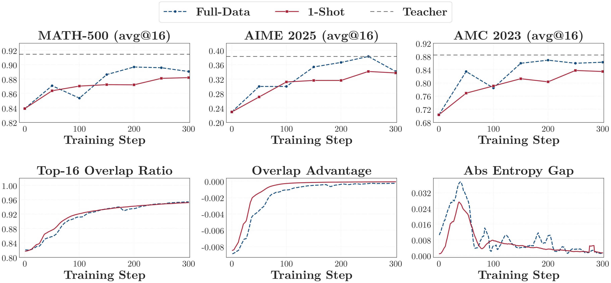

*图 3：数学推理上 one-shot OPD 的验证集准确率与训练动态。*

**One-shot 效应跨家族、跨任务领域都稳健。**

图 4 显示，one-shot OPD 在全部三个师生家族上都提升了数学推理能力。在最后一个检查点，R1-Distill-1.5B、Llama-3B-It 和 OLMo-7B-It-DPO 的平均分分别从各自学生基线的 $`77.1`$、$`28.2`$ 和 $`70.8`$ 升到 $`85.5`$、$`40.2`$ 和 $`82.4`$。图 5 进一步显示该效应不止于数学推理：在代码生成、指令遵循和智能体工具调用上，one-shot OPD 分别回收了 $`73\%`$、$`66\%`$ 和 $`64\%`$ 的相应师生差距。综合来看，这些结果表明 one-shot 效应在模型家族和任务领域两个维度上都是稳健的。

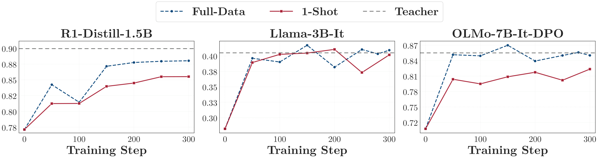

*图 4：one-shot OPD 在 3 个师生家族上的验证集准确率，数学推理上取 MATH-500 与 AMC 2023 的平均。AIME 2025 被排除在外，因为 Llama 配对在它上面的分数接近零。*

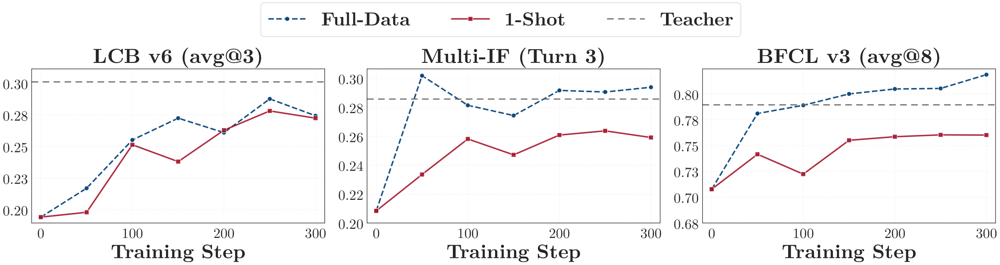

*图 5：one-shot OPD 在三个任务领域上的验证集准确率。*

**One-shot 效应对查询与 rollout 的性质也很稳健。**

接下来我们考察，在不同的查询难度、回答长度预算和 rollout 采样温度下，one-shot OPD 是否依然有效。如图 6 所示，one-shot OPD 在易、中、难三种查询上都有效，尽管三种设定下正确 rollout 的比例变化很不一样（附录 A.1）：简单查询几乎每一步都能解出，中等查询在训练中变得基本可解，而困难查询则从未被解出。收紧回答长度上限、降低 rollout 温度，都保留了 one-shot 收益。综合来看，这些结果表明 one-shot OPD 对查询难度、回答长度预算和 rollout 采样温度都是稳健的。

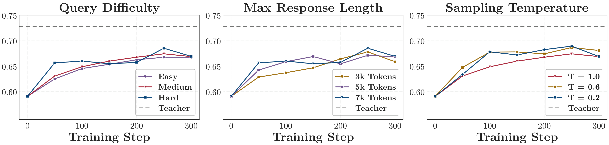

*图 6：one-shot OPD 在不同查询难度、困难查询上不同回答长度上限、以及中等查询上不同采样温度下的验证集准确率。*

### 4 数据视角：充裕的状态

第 3 节表明 One-Shot OPD 稳健地回收了全量数据 OPD 的大部分收益。本节要问的是：*为什么只在一条查询上训练就能带来这么大的收益，以及同一套解释是否也能覆盖 n-shot OPD 追平全量数据 OPD 的情形*。

*脚注：本节与第 5 节分析的实验优化的是式 2 的采样 token 优势，而不是第 3 节数学实验所用的 top-$`k`$ 优势，所以它们的绝对准确率与那里报告的略有差别。下面的每一处比较，都在采用同一形式的实验之间进行。*

> **要点**
>
> - **一条查询就已触达全量数据状态空间的很大一部分。** OPD 消耗的主要是状态而不是查询。实践中，从一条查询反复采样 rollout 可以触达 $`71.5\%`$ 的状态覆盖率，其中大部分出现在前 $`100`$ 步内。
> - **数量少但多样的查询就能触达足够的状态，并与全量数据的表现相当。** 加入语义上不同的查询会同时提升状态覆盖率和验证集准确率，而 16 条查询就已追平全量数据 OPD。多一个样本的价值，在于它是否覆盖了先前样本遗漏的状态。

#### 4.1 One-Shot OPD 的状态覆盖率

**设置。** OPD 训练的是状态，而不是查询。一条查询 $`x`$ 和一个采样得到的回答 $`y`$，在每个 token 位置 $`i`$ 上都产生一个状态 $`s=(x,y_{<i})`$，每个状态都配有一个来自教师的目标分布。在每次更新 $`64`$ 条 rollout 的情况下，哪怕只有一条查询，也能产生数以万计的带监督状态，所以查询的条数可能严重低估了 OPD 可用的监督量。

> **假设**
>
> 如果一条查询的 rollout 覆盖了全量数据 OPD 所访问状态空间的很大一部分，那么它就能提供足够的监督，来回收全量数据 OPD 的大部分收益。

为检验这一假设，我们度量访问到的状态的*广度*而非其原始数量，因为每生成一个 token 都会产生一个不同的前缀。我们把这一度量称为*状态覆盖率*：把状态表示在一个共享的表示空间中，将该空间划分为若干簇，再报告某个设定的 rollout 触达了其中多大比例。

- **表示。** 我们用每个状态的*教师签名* $`h_T(s)`$ 来表示它，即教师在该状态最后一个 token 处的最后一层隐藏向量。
- **参照空间。** 我们把全量数据 OPD 在 DAPO-Math-17K 上整个运行过程中访问到的状态汇集起来，从每条 rollout 中等间隔采样 $`8`$ 个位置。其中有一部分 rollout 被留出，不参与定义这些簇，而是作为一个独立的设定来度量，称为*全量数据（留出）*（收集到的 rollout 每五条取三条构成参照池，另两条构成留出设定，所以它反映的是在同样预算下、全量数据 OPD 在一批新样本上能触达什么）。
- **簇。** 做完 PCA 后，用 $`K`$-means 把参照签名划分为 $`K=200`$ 个簇。每个状态落入最近的那个簇，记作 $`c(s)`$。

于是，一组状态 $`S`$ 的*状态覆盖率*就是它触达的簇占 $`K`$ 个簇的比例（式 5）：

```math
\mathrm{Cov}(S)
=
\frac{1}{K}
\left|
\left\{\,c(s)\;:\;s\in S\,\right\}
\right|
```

覆盖率记录的是一个设定触达了哪些簇，而不是它访问这些簇的频次。我们只拟合一次簇，并在同样的 $`300`$ 步上度量每个设定。全量数据（留出）在这一预算下达到 $`100\%`$，所以这一刻度的顶端是全量数据 OPD 能达到的水平，而不是构造方式本身保证的上限。附录 B.1 给出了构造方式与采样时间表，并表明下面的比较在 $`K`$、参照集和状态位置的不同选择下都是稳定的。

**One-shot OPD 触达了 $`71.5\%`$ 的状态空间。**

图 7 显示，one-shot OPD 到第 $`300`$ 步触达了 $`71.5\%`$ 的状态覆盖率。其中大部分出现得很早：该运行到第 $`100`$ 步就达到 $`65.9\%`$，之后的 $`200`$ 步只再增加 $`5.6`$ 个百分点。可见，从同一条查询反复采样 rollout 确实还在不断发现新的簇，但速率急剧递减。同一次运行把验证集准确率从 $`59.1`$ 提到 $`66.9`$，作为对照，全量数据 OPD 在第 $`300`$ 步为 $`70.8`$。这些结果在数据一侧呈现出同一个模式：一条查询就已覆盖全量数据 OPD 所触达状态簇的大部分，并带来可观的验证集收益。因此，one-shot OPD 虽然查询数量少，它所产生的监督却很广。

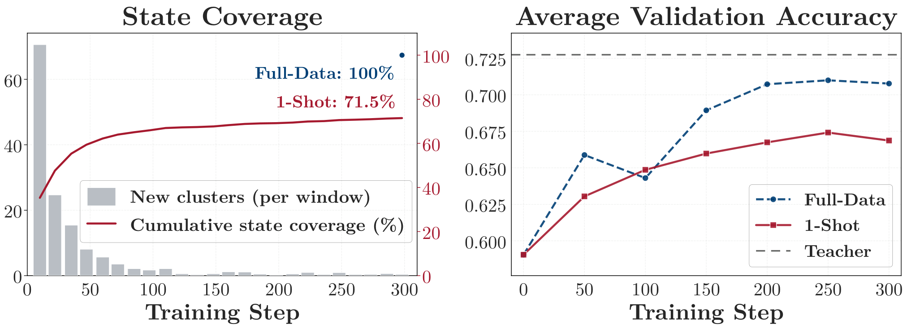

*图 7：中等查询上 one-shot OPD 的状态覆盖率与验证集准确率，与全量数据 OPD 对比。覆盖率是相对全量数据 OPD 所触达的状态空间度量的，所以后者就是 $`1.0`$ 这条水平，而不是单独的一条曲线。*

#### 4.2 多样性扩大状态覆盖率

上面的分析表明，一条查询就已触达全量数据状态空间的大部分，但它留下了因果上的问题：一次训练得好的运行，也可能只是在过程中访问了更多状态，而那些多出来的状态根本没起作用。因此我们直接对状态覆盖率做消融：在其余设置保持不变的前提下，改变训练数据所触达的不同状态的数量。

**设置。** 我们从两个方向提升数据多样性，每个方向各有自己的对照。**(i) 回答多样性（异策略）。** 我们在 one-shot 查询上从初始学生一次性采样 $`64`$ 条轨迹，并把这个池子固定下来，这同时也排除了同策略训练的一个混杂因素——那里的状态会随着学生的变化而不断改变。嵌套的子集分别保留 $`1`$、$`4`$、$`16`$ 或全部 $`64`$ 条轨迹，被保留的轨迹重复使用以填满每个 $`64`$ 条的批次。各条件共享同一条查询、同样的批大小和同样的优化预算，所以唯一变化的量就是不同轨迹的条数，也就是状态的数量。**(ii) 查询多样性（同策略）。** 这些运行改变的则是查询集，并全部采用数学的配置。从 one-shot OPD 所用的中等查询出发，我们用 BGE-M3 (Chen et al., 2024a) 对 DAPO-Math-17K 聚类，每个语义簇取一条代表，由此构造 4-shot 和 16-shot 的查询集，使得阶梯上每新增一条查询，都与已在其中的查询在语义上不同，再把这些集合与全量数据 OPD 比较。我们为每次运行报告验证集准确率，并为同策略的运行报告状态覆盖率，那里的 rollout 就是学生在训练中实际生成的。异策略的分数是第 $`300`$ 到 $`500`$ 步五个评测检查点的平均。在覆盖率一侧，全量数据那一根柱子是设定 $`100\%`$ 上限的留出划分。

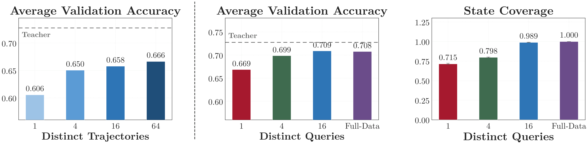

*图 8：随着训练数据变得更多样，验证集准确率与状态覆盖率的变化：回答一侧通过在不同轨迹上做异策略训练，查询一侧通过在不同查询上做同策略训练。*

**数据多样性就是状态多样性，少量查询即可追平全量数据 OPD。**

图 8 显示，异策略的验证集准确率随不同轨迹条数单调上升。其余一切都固定，所以多出来的轨迹唯一添加的东西就是状态。同策略的运行从查询一侧得到了同样的结论。语义上不同的查询会不断提升验证集准确率，直到 16 条追平全量数据 OPD，而它们在状态覆盖率上也恰在同一点追平，覆盖率从一条查询的 $`71.5\%`$ 升到 16 条的 $`98.9\%`$。阶梯上的每条查询都来自一个新的语义簇，因此它同时提升了多样性和数量，附录 B.2 的两个对照把两者分开：把数量固定为 16，这些查询取自 16 个语义簇而不是同一个簇时，状态覆盖率和验证集准确率都大幅上升；而在一个固定的查询集上，学生按什么顺序训练则无关紧要。因此，多一条查询值不值，取决于它是否触达了新的状态，而少数几条多样的查询就已触达了全量数据 OPD 所触达的几乎全部状态。

### 5 算法视角：缓慢的对齐

第 4 节从数据一侧分析了 one-shot 的收益：一条查询对学生的价值，取决于它的 rollout 所触达的状态。转到算法一侧，本节要问的是：*为什么一条查询能在这么多步里持续产生收益*。

> **要点**
>
> - **对齐随时间放缓，而且这一趋势对查询数量不敏感。** 学生在整个运行过程中持续缩小师生差距，但推进的速率稳步下降，这正是一次运行需要几百步而不是几十步的原因。增加查询的数量既不会加快也不会减慢这个过程。
> - **即便状态集合是固定的，也要几百步才能学完。** 一次自始至终都在同一批状态上训练的运行，仍然会在几百步里持续改进，所以要让一次运行持续这么久，并不需要源源不断地供给新状态。

#### 5.1 对齐指标

OPD 把学生对齐到教师。有两个量描述任一时刻的对齐状态：还剩多少师生分歧，以及它下降得有多快。我们在学生实际访问到的状态上度量这两者。

**距离。** 教师与学生在每个访问到的位置上都存在分歧，其大小由式 2 的逐 token 优势给出。我们把*距离* $`d_t`$ 定义为这一分歧在学生于第 $`t`$ 步访问到的位置 $`\mathcal{T}_t`$ 上的平均幅度（式 6）：

```math
d_t
=
\frac{1}{|\mathcal{T}_t|}
\sum_{i\in\mathcal{T}_t}
\left|
    \log\pi_T(y_i\mid s_i)-\log\pi_{\theta_t}(y_i\mid s_i)
\right|
```

这里 $`s_i=(x,y_{<i})`$ 是 token 位置 $`i`$ 处的状态，如第 2 节所定义。对幅度取平均可以避免正负逐 token 差值相互抵消，因此只有当两个策略在学生访问到的位置上趋于一致时，$`d_t`$ 才会降到零。

**吸收率。** *吸收率* $`v_t`$ 则是一次更新所吸收掉的那段距离的比例（式 7）：

```math
v_t = \frac{d_t-d_{t+1}}{d_t}
```

两个指标我们都从第 30 步开始追踪，那时梯度裁剪已不再起约束作用。由于每次运行都在它自己访问到的状态上度量距离，到那时各次运行已经稳定在不同的水平上。因此我们把每次运行与它自己在第 30 步的取值相比，并把这个比值称为*剩余距离* $`d_t/d_{30}`$。

*脚注：训练后期，仅凭相邻两步之差噪声太大，无法读出趋势，所以 $`v_t`$ 是在几何窗口 $`[t/1.4,\,1.4t]`$ 上估计的，这也是它没有一直画到第 $`300`$ 步的原因。附录 C.1 给出了估计方式以及支撑这两条约定的证据。*

#### 5.2 不同数据量下对齐放缓的方式相近

我们追踪在 1、4、16 和全部 DAPO-Math-17k 查询上训练的 OPD 的 $`d_t`$ 与 $`v_t`$，都跑同样的 $`300`$ 步，并采用第 3.1 节的数学配置。

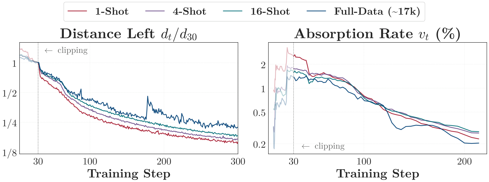

*图 9：在 1、4、16 和全部 DAPO-Math-17k 查询上训练的 OPD 的师生对齐情况。距离（左）与吸收率（右）的纵轴都是对数坐标，横轴为线性步数。*

**学生对齐得越来越慢。**

距离在整个运行过程中都在下降，所以学生从未卡住。放缓的是吸收率，它在图 9 右图中贯穿整个运行持续下降：在左图的对数距离坐标上，恒定的速率会画出一条直线，而四条曲线反而都向下弯得越来越平。因此，每次更新吸收掉的剩余量都比上一次更少，这正是一次运行需要几百步而不是几十步的原因。

**在各种训练集规模下，吸收率的下降方式大体相同。**

这四次运行的表现是一致的：每一次到第 $`300`$ 步都消除了自己第 $`30`$ 步距离的 $`78\%`$ 到 $`84\%`$，而且四次在训练中放缓的倍数也相近（附录 C.1 给出各次运行的具体数值，以及这些读数所依据的约定）。因此，一条查询既不会让对齐变慢也不会让它变快：这个节奏是 OPD 的性质，而不是训练集的性质。学习率会改变这需要多少步，但不改变距离下降的方式（附录 C.2）。

#### 5.3 固定状态上的消融

同策略训练会随着学生的变化不断产生新状态，于是对“几百步”的一种解读是：一次运行能持续多久，取决于这种供给能持续多久。把训练状态固定下来，就能直接检验这种解读：如果一批固定的状态会很快被耗尽，那么异策略的运行应该很早就结束。

**设置。** 我们比较两次 one-shot 运行，二者唯一的差别在于训练状态从哪里来。始终同策略的那次在每一步都从当前学生采样新的 rollout。始终异策略的那次则在每次更新中复用第 4.2 节那 $`64`$ 条、一次性从初始学生采样得到的轨迹，因此它的训练状态固定不变，而学生在变。

**固定状态并没有让运行变短。**

图 10 显示，异策略的运行在大约 $`200`$ 步里稳步提升准确率，之后停住，所以它的收益是在几百步里累积起来的，而不是在最初几次更新里。对齐指标的移动同样缓慢：异策略运行的 top-$`16`$ token 重叠率上升、重叠 token 优势趋近于零，都要花上几百步。可见，去掉这种供给并没有让运行变短。这说明，一批固定的状态本身就足以让一次 OPD 运行持续几百步，所以一次运行的长度并不能用新状态还能持续到来多久来解释。

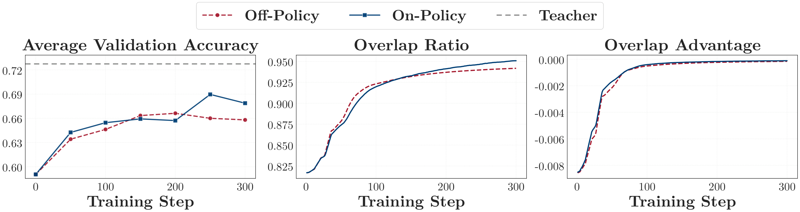

*图 10：同策略与异策略 one-shot 运行的验证集准确率与对齐指标。*

### 6 One-Shot 可推广到多教师 OPD

第 4.2 节表明，在单个领域内，一个规模很小但语义多样的查询集就能追平全量数据 OPD。现代的后训练流水线常常使用*多教师同策略蒸馏*（MOPD）(Xiao et al., 2026; Xu et al., 2026)：一个学生在一次运行中同时在多个领域上训练，每条查询被路由到它所属领域的教师。本节要问的是：*同样的查询多样性结论是否能迁移过来——每个领域一个小而多样的查询集，能否追平全量数据 MOPD*？

> **要点：** 每个领域内 16 条语义多样的查询，就足以追平全量数据 MOPD，而后者达到的平均验证集准确率与分别做全量数据 OPD 几乎相同。

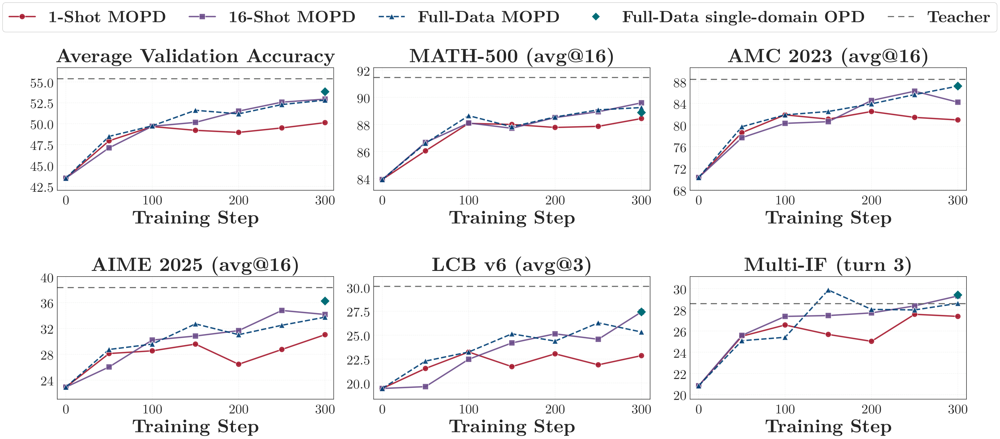

*图 11：one-shot、16-shot 与全量数据 MOPD 的验证集准确率。*

**设置。** 我们用 MOPD 在数学推理、代码生成和指令遵循上训练一个 R1-Distill-1.5B 学生。各领域的教师取自第 3.1 节：数学用 JustRL-1.5B，代码用 Nemotron-1.5B，指令遵循用 UltraData-IF-1.5B。我们排除了智能体工具调用，因为它用的是另一个学生 Qwen-Coder-1.5B。三种设定分别是 one-shot、16-shot 和全量数据 MOPD。与第 4.2 节一样，16-shot 设定在每个领域内分别拟合 16 个 BGE-M3 (Chen et al., 2024a) 语义簇，并从每个簇中选一条代表。所有设定都跑 $`300`$ 步，超参数见表 8。

**全量数据 MOPD 与分别做全量数据 OPD 相当。**

在第 $`300`$ 步，全量数据 MOPD 把平均验证集准确率从 $`43.5`$ 提升到 $`52.8`$，回收了 $`79\%`$ 的师生差距。与之对应的三次全量数据 OPD 达到 $`53.8`$。这 $`1.0`$ 分的差距说明，把三个领域放在一次运行中训练时 MOPD 依然有效，并把全量数据 MOPD 确立为下面查询多样性比较的参照。

**每个领域 16 条多样的查询即可追平全量数据 MOPD。**

把每个领域的查询数从 1 增加到 16，会把第 $`300`$ 步的平均验证集准确率从 $`50.1`$ 提升到 $`52.9`$。全量数据 MOPD 达到 $`52.8`$，所以 16-shot MOPD 回收了全量数据 MOPD 收益的 $`101\%`$。这一结果并非由某一个领域带动：分别计算的话，相应比例是数学 $`93\%`$、代码生成 $`136\%`$、指令遵循 $`109\%`$。由于 16-shot 与全量数据 MOPD 使用同样的 rollout 与优化预算，在这一设定下，把每个领域的查询集扩大到 16 条多样查询以上，不会再带来额外的平均收益。

综合来看，这些结果与 MOPD 的状态空间解释是一致的：语义多样的查询能在每个领域内诱导出互补的状态，使每个领域 16 条查询就足以追平全量数据 MOPD。

### 7 讨论

上述机制把注意力从提示词本身，转向了它们所诱导的那片推理状态区域。当学生的 rollout 触达教师能够提供有用监督的区域时，一个输入就是有用的。而提出一道题，只是抵达那些区域的方式之一。这一视角引出两个更宽的问题：输入本身必须包含多少任务内容，以及为什么同样的 one-shot 设定在 OPD 与 RLVR 下表现不同。我们先通过轻内容输入和域外输入来讨论这些问题，再给出与 one-shot RLVR 的受控对比。

#### 7.1 把输入当作状态生成器

状态生成器这一视角暗示，只要输入仍能诱导出教师可以监督的轨迹，任务内容也许就不是必需的。我们用三种输入对这个预测做压力测试：一个以 `<think>` 结尾的空用户轮、同一个模板再加一句简单的领域系统提示，以及来自 WildChat (Zhao et al., 2024) 的通用领域查询（图 12）。WildChat 集合包含 $`192{,}824`$ 条以英文为主的查询，来自日常对话、创意写作、角色扮演和改写。保守的启发式规则只把其中 $`0.17\%`$ 判定为与数学相关、$`2.63\%`$ 判定为与代码相关。

```text
(a) 基础模板
<|begin_of_sentence|><|User|><think>\n

(b) 系统模板 —— 代码
<|begin_of_sentence|>解决竞技编程问题。从 stdin 读取，向 stdout 写出。<|User|><think>\n
```

*图 12：用作 OPD 训练输入的两个轻内容模板。*

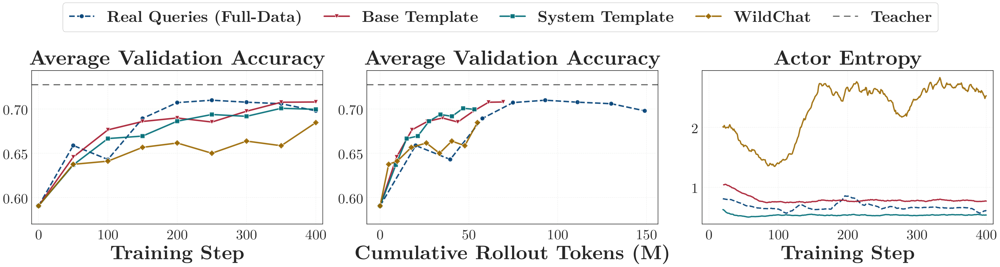

*图 13：在真实训练集、轻内容模板或通用领域 WildChat 查询上训练的数学 OPD 的验证集准确率与 actor 熵。*

**轻内容与域外输入同样可以诱导出有用的状态。**

三种条件都紧贴真实查询的基线，后者把三基准平均分从 $`59.1`$ 提到 $`69.8`$，而三者都只用了基线三分之一到二分之一的 rollout token 就达到了那个水平（图 13）。代码生成给出同样的图景（附录 E.1）。不过，这一要求并非为空：一个会立刻闭合思考块的脚手架 `<think>\n</think>\n`，会塌缩成简短的元层面回复，没法用来训练。这些结果并不意味着任务内容普遍可有可无，它们表明的是：内容并不是 OPD 中有用信号的唯一来源。输入同时也起着状态生成器的作用，即便是轻内容或域外的输入，有时也能把学生带到那些可以支撑有用教师监督的状态上。在这些实验中，明确的领域内容对最终性能的影响约为一分。这为 OPD 的数据效率提供了一个互补的视角：数据质量不仅取决于收集了哪些题目，也取决于它们诱导出的状态区域，以及那里可以拿到的教师目标。

#### 7.2 与 One-Shot RLVR 的关系

One-shot OPD 与 one-shot RLVR (Wang et al., 2026a) 有同一个表面现象：一条查询就能支撑模型在数百次更新（OPD）乃至上千次更新（RLVR）里持续改进。但学习的来源不同。OPD 在每个访问到的状态上都收到一个教师目标，而 RLVR 为每条轨迹收到一个可验证的结果。我们在同一条中等查询上比较两者，以分离出这一差别（图 14）。

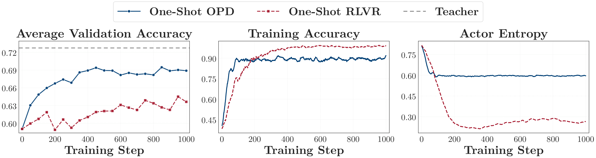

*图 14：同一条查询上 one-shot OPD 与 one-shot RLVR 的验证集准确率与训练动态。两者每步都取一个 $`64`$ 条查询的批次。RLVR 每条查询采 $`8`$ 条 rollout，并在 GRPO 下按结果打分。OPD 每条采 $`1`$ 条，并把每个采样到的 token 与教师对照打分。训练准确率是解出训练查询的 rollout 的比例。*

**不同目标函数下，有用的输入也不同。**

RLVR 依据轨迹的结果来更新。因此它的训练输入必须定义一个任务，使采样出的结果可以被验证。这些结果还必须有足够的变化，才能产生有用的优势。OPD 则依据每个访问到的状态上的师生差距来更新。只要一个提示词能导出暴露这种差距的轨迹，它就能收到有用的信号。因此，一个 OPD 输入的价值并不直接与可验证性或难度挂钩。我们的结果进一步表明，在我们研究的设定中，即使领域对齐很弱也可以奏效。所诱导状态区域的覆盖率仍然重要（第 4 节），但获得这种覆盖率，比获得结果可验证的任务要宽松得多。

**从同一条查询中，OPD 榨出了更多信号。**

两种算法在每一步都从训练查询获得新的 rollout。在 $`1000`$ 步内，OPD 闭合了它与教师之间 $`72\%`$ 的差距，验证集准确率的涨幅是 RLVR 的两倍多。即便把两种方法按 rollout token 而不是训练步数对齐，这一优势依然存在（图 14）。

随着模型学会解出训练查询，RLVR 的信号会减弱。它的组很快就变得几乎一致，于是在 GRPO 下不再有优势可言。OPD 并不依赖轨迹结果的变化，在查询被解出之后，它仍能从局部的师生差距中继续学习，尽管这些差距会逐渐缩小。因此，one-shot RLVR 受限于它的查询所能提供的结果变化，而 one-shot OPD 受限的则是它吸收稠密教师监督的速度，如第 4 节和第 5 节所示。两种目标函数也意味着不同的上限：RLVR 不被某个教师的分布所束缚，而 OPD 被训练去匹配一个分布。

### 8 相关工作

**同策略蒸馏。** 同策略蒸馏（OPD）在学生自己的 rollout 上、用教师监督来训练学生 (Song and Zheng, 2026)。MiniLLM (Gu et al., 2024) 用策略梯度在反向 KL 下优化这一目标，GKD (Agarwal et al., 2024) 把它推广到各种散度以及同策略与异策略的混合。Yang et al. (2026) 把 OPD 表述为稠密 KL 约束的强化学习，其中逐 token 的对数比起到隐式奖励的作用。OPD 如今出现在各种前沿后训练技术栈中 (Yang et al., 2025; Zeng et al., 2026; Xiao et al., 2026; Xu et al., 2026; Blakeman et al., 2026)，其中若干采用了我们在第 6 节研究的多教师形式，把每条查询路由到某个领域专家。越来越多的工作在解释 OPD 为何有效，而且全都站在算法一侧。一条线索研究它的目标函数与更新的几何结构：稠密的逐 token 目标取代了结果奖励 RL 的单一序列级标量，这在参数空间中把更新导向一个早早锁定的低秩子空间 (Cai et al., 2026; Shen et al., 2026)，并且可以重写为 token 级的策略梯度 (Ko et al., 2026)，这与那些区分 SFT 的稠密更新和 RL 的局部子网络的分析相呼应 (Mukherjee et al., 2026; Zhu et al., 2025)。第二条线索梳理 OPD 何时成功、何时失败：师生之间共享的思考模式，以及教师过强时的局限 (Li et al., 2026)；哪些 token 实际上是可学的 (Armandpour et al., 2026; Wang et al., 2026b)；以及反复出现的失效模式与简单的修补办法 (Zhu et al., 2026; Fu et al., 2026)。这些工作都把训练集视为既定的。我们则转而追问 OPD 需要多少训练输入，并发现起约束作用的资源不是数据，而是学生吸收它的速度。

**数据高效的推理后训练。** 另一条平行的线索研究用多少数据就能激发出强推理能力。在稀疏结果奖励的 RL 下，Wang et al. (2026a) 表明一个样本就能让模型持续改进一千多步，这正是我们移植到 OPD 稠密信号设定中的先例。LIMR (Li et al., 2025) 通过给每个样本的学习影响排序，把 RLVR 训练集削减数倍。在监督微调方面，LIMA (Zhou et al., 2023)、LIMO (Ye et al., 2025) 和 s1 (Muennighoff et al., 2025) 用千量级的精选样本就激发出有竞争力的对齐或推理能力。在 OPD 内部，把监督安排在推理前缀上可以把训练成本降低数倍 (Zhang et al., 2026)。更广义的后训练工作则按影响力或质量来挑选高价值子集 (Xia et al., 2024; Chen et al., 2024b; He et al., 2025a; He et al., 2025c)。这些工作与我们共享数据效率这一主题，但它们的监督仍然依赖精选的题目：在 RL 的情形下以稀疏的结果标量给出，在 SFT 的情形下以参考解给出。OPD 则在每个访问到的前缀上提供稠密的逐 token 目标，并且在学生从未解出的查询上依然有效（第 3 节），那里即便 rollout 是错的，教师信号仍然富含信息 (Armandpour et al., 2026)，于是限制因素就从“有没有可用的信号”——稀疏奖励下长期存在的难题——转移到了“一个同策略的学生能以多快的速度吸收一个本已充裕的信号”（第 5.2 节）。

**合成的与无监督的后训练数据。** 越来越多的工作在降低后训练对精选的、人工撰写的数据的依赖。一个方向是合成输入：Self-Instruct (Wang et al., 2023) 和 Evol-Instruct (Xu et al., 2024) 从语言模型中自举出指令，Magpie (Xu et al., 2025) 仅凭一个对话模板前缀就引出完整的指令–回答对。第二个方向是从 RL 中去掉真值标签 (He et al., 2026)，用模型置信度或熵这类自生成信号 (Zhao et al., 2026b; Agarwal et al., 2026)、多条 rollout 之间的多数一致 (Zuo et al., 2026) 来替代可验证奖励，或者从无标注语料中获取奖励 (Dong et al., 2025)。第三个方向干脆去掉外部题目，让模型自己提出任务 (Zhao et al., 2026a; Zweiger et al., 2026)。这些线索放松的是奖励或题目来源上的监督。我们的模板与 WildChat OPD 结果（第 7.1 节）把查询这一侧推得更远：由于教师在每个访问到的前缀上提供稠密监督，查询的作用就被削减为把学生置于一个有用的推理状态，所以一段域外的聊天记录、甚至一个不含内容的模板，驱动 OPD 的效果都几乎与一道精选题目相当。

### 9 结论、局限与未来工作

**结论。** 受 one-shot RLVR (Wang et al., 2026a) 的启发，我们追问一条查询对 OPD 是否也够用，答案是够用：one-shot OPD 让学生持续改进数百步，并在各模型家族、各任务领域上回收了全量数据 OPD 的大部分收益。数据与算法两侧给出同一个答案：OPD 数据过饱，算法饥饿。一条查询是通过它的 rollout 所触达的状态来作用于学生的，而一条查询就已覆盖了全量数据 OPD 所访问状态空间的大部分；16 条语义多样的查询则在单领域 OPD 和 MOPD 中都追平了全量数据训练。限制一次运行的是吸收率：一次更新所吸收掉的剩余师生差距的比例持续下降，而且在一条查询上与在全部 17k 条查询上的下降速度相同，所以决定一次运行要花多久的是优化器，而不是训练集。一个输入只需要让学生开始推理，这就把数据设计从收集题目，变成了挑选教师。

**局限。** 状态覆盖率是一个语义级的代理指标，它是相对一个由全量数据 rollout 构建起来的参照空间度量的，因此它反映的是一组查询触达了那个空间的多少，而不是它自身绝对覆盖了什么；而且它对每个簇一视同仁，不论该簇被访问得多频繁，也不论它还携带多少教师信号。是什么决定了吸收率，仍是一个开放问题。我们的 MOPD 实验用的是三个领域、每个领域一个教师，随着教师数量增加，多样性这一结论还能推广到什么程度，仍有待回答。

**未来工作。** 由此引出三个方向。

- 按状态覆盖率来选择数据：问题不再是收集多少条查询，而是它们会诱导出哪些状态，所以一旦能够直接从查询本身估计状态覆盖率、而不必拿一次全量数据运行来做参照，它就能成为一个选择标准。
- 让训练在单步上更高效：比如在逐 token 差距的信赖域约束下把一个批次重复使用若干轮，或者按每个 token 还携带多少教师信号来给它们加权。
- 把这一设定做大：扩展到教师和领域更多的 MOPD，以及更大的学生、智能体工具调用和长上下文——在这些场景中，训练数据的收集成本最高。

### 参考文献

- R. Agarwal, N. Vieillard, Y. Zhou, P. Stanczyk, S. Ramos Garea, M. Geist, and O. Bachem (2024). On-policy distillation of language models: Learning from self-generated mistakes. International Conference on Learning Representations, vol. 2024, pp. 21246–21263.
- S. Agarwal, Z. Zhang, L. Yuan, J. Han, and H. Peng (2026). The unreasonable effectiveness of entropy minimization in llm reasoning. Advances in Neural Information Processing Systems, vol. 38, pp. 107150–107180.
- M. Armandpour, F. Ilhan, D. Harrison, A. Jaiswal, D. N. Hoang, F. Faghri, Y. Zhang, M. Cho, and M. Farajtabar (2026). Unmasking On-Policy Distillation: Where It Helps, Where It Hurts, and Why. arXiv:2605.10889, <https://arxiv.org/abs/2605.10889>.
- M. Balunovic, J. Dekoninck, I. Petrov, N. Jovanović, and M. Vechev (2025). Matharena: Evaluating llms on uncontaminated math competitions. Advances in Neural Information Processing Systems, vol. 38.
- A. Blakeman, A. Thomas, A. Jhunjhunwala, A. Gupta, A. Khattar, A. Rajfer, A. Renduchintala, A. Asif, A. Vavre, A. F. Miranda, et al. (2026). Nemotron 3 Ultra: Open, Efficient Mixture-of-Experts Hybrid Mamba-Transformer Model for Agentic Reasoning. arXiv:2606.15007, <https://arxiv.org/abs/2606.15007>.
- Y. Cai, D. Cao, L. Lin, C. Luo, X. Xu, K. Yang, W. Liu, S. Yang, T. Zhao, G. Sun, et al. (2026). Learning to Foresee: Unveiling the Unlocking Efficiency of On-Policy Distillation. arXiv:2605.11739, <https://arxiv.org/abs/2605.11739>.
- J. Chen, S. Xiao, P. Zhang, K. Luo, D. Lian, and Z. Liu (2024a). Bge m3-embedding: Multi-lingual, multi-functionality, multi-granularity text embeddings through self-knowledge distillation. arXiv:2402.03216, <https://arxiv.org/abs/2402.03216>.
- L. Chen, S. Li, J. Yan, H. Wang, K. Gunaratna, V. Yadav, Z. Tang, V. Srinivasan, T. Zhou, H. Huang, et al. (2024b). Alpagasus: Training a better alpaca with fewer data. International Conference on Learning Representations, vol. 2024, pp. 34767–34797.
- Q. Dong, L. Dong, Y. Tang, T. Ye, Y. Sun, Z. Sui, and F. Wei (2025). Reinforcement Pre-Training. arXiv:2506.08007, <https://arxiv.org/abs/2506.08007>.
- Y. Fu, H. Huang, K. Jiang, J. Liu, Z. Jiang, Y. Zhu, and D. Zhao (2026). Revisiting On-Policy Distillation: Empirical Failure Modes and Simple Fixes. arXiv:2603.25562, <https://arxiv.org/abs/2603.25562>.
- A. Grattafiori, A. Dubey, A. Jauhri, A. Pandey, A. Kadian, A. Al-Dahle, A. Letman, A. Mathur, A. Schelten, A. Vaughan, et al. (2024). The llama 3 herd of models. arXiv:2407.21783, <https://arxiv.org/abs/2407.21783>.
- Y. Gu, L. Dong, F. Wei, and M. Huang (2024). Minillm: Knowledge distillation of large language models. International Conference on Learning Representations, vol. 2024, pp. 32694–32717.
- D. Guo, D. Yang, H. Zhang, J. Song, P. Wang, Q. Zhu, R. Xu, R. Zhang, S. Ma, X. Bi, et al. (2025). Deepseek-r1: Incentivizing reasoning capability in llms via reinforcement learning. arXiv:2501.12948, <https://arxiv.org/abs/2501.12948>.
- B. He, N. Ding, C. Qian, J. Deng, G. Cui, L. Yuan, H. Hong, H. Gao, L. Huang, H. Xue, et al. (2025a). The right time matters: Data arrangement affects zero-shot generalization in instruction tuning. Findings of the Association for Computational Linguistics: ACL 2025, pp. 222–243.
- B. He, Z. Qu, Z. Liu, Y. Chen, Y. Zuo, C. Qian, K. Zhang, W. Chen, C. Xiao, G. Cui, et al. (2025b). Justrl: Scaling a 1.5 b llm with a simple rl recipe. arXiv:2512.16649, <https://arxiv.org/abs/2512.16649>.
- B. He, W. Zhang, J. Song, C. Qian, Z. Fu, B. Sun, N. Ding, H. Hong, L. Huang, H. Xue, et al. (2025c). Air: A systematic analysis of annotations, instructions, and response pairs in preference dataset. arXiv:2504.03612, <https://arxiv.org/abs/2504.03612>.
- B. He, Y. Zuo, Z. Liu, S. Zhao, Z. Fu, J. Yang, C. Qian, K. Zhang, Y. Fan, G. Cui, et al. (2026). How Far Can Unsupervised RLVR Scale LLM Training?. International Conference on Learning Representations, vol. 2026, pp. 14823–14865.
- Y. He, D. Jin, C. Wang, C. Bi, K. Mandyam, H. Zhang, C. Zhu, N. Li, T. Xu, H. Lv, et al. (2024). Multi-if: Benchmarking llms on multi-turn and multilingual instructions following. arXiv:2410.15553, <https://arxiv.org/abs/2410.15553>.
- D. Hendrycks, C. Burns, S. Kadavath, A. Arora, S. Basart, E. Tang, D. Song, and J. Steinhardt (2021). Measuring Mathematical Problem Solving With the MATH Dataset. NeurIPS.
- B. Hui, J. Yang, Z. Cui, J. Yang, D. Liu, L. Zhang, T. Liu, J. Zhang, B. Yu, K. Lu, et al. (2024). Qwen2. 5-coder technical report. arXiv:2409.12186, <https://arxiv.org/abs/2409.12186>.
- N. Jain, K. Han, A. Gu, W. Li, F. Yan, T. Zhang, S. Wang, A. Solar-Lezama, K. Sen, and I. Stoica (2025). Livecodebench: Holistic and contamination free evaluation of large language models for code. International Conference on Learning Representations, vol. 2025, pp. 58791–58831.
- J. Ko, S. Abdali, Y. J. Kim, T. Chen, and P. Cameron (2026). Scaling Reasoning Efficiently via Relaxed On-Policy Distillation. arXiv:2603.11137, <https://arxiv.org/abs/2603.11137>.
- J. Li, E. Beeching, L. Tunstall, B. Lipkin, R. Soletskyi, S. Huang, K. Rasul, L. Yu, A. Q. Jiang, Z. Shen, et al. (2024). Numinamath: The largest public dataset in ai4maths with 860k pairs of competition math problems and solutions. Hugging Face repository, vol. 13, pp. 9.
- R. Li, J. Fu, B. Zhang, T. Huang, Z. Sun, C. Lyu, G. Liu, Z. Jin, and G. Li (2023). TACO: Topics in Algorithmic COde generation dataset. arXiv:2312.14852, <https://arxiv.org/abs/2312.14852>.
- X. Li, H. Zou, and P. Liu (2025). Limr: Less is more for rl scaling. arXiv:2502.11886, <https://arxiv.org/abs/2502.11886>.
- Y. Li, Y. Zuo, B. He, J. Zhang, C. Xiao, C. Qian, T. Yu, H. Gao, W. Yang, Z. Liu, et al. (2026). Rethinking on-policy distillation of large language models: Phenomenology, mechanism, and recipe. arXiv:2604.13016, <https://arxiv.org/abs/2604.13016>.
- Q. Lin, M. Wen, Q. Peng, G. Nie, J. Liao, J. Wang, X. Mo, J. Zhou, C. Cheng, Y. Zhao, et al. (2024). Hammer: Robust function-calling for on-device language models via function masking. arXiv:2410.04587, <https://arxiv.org/abs/2410.04587>.
- Z. Liu, T. Hoang, J. Zhang, M. Zhu, T. Lan, S. Kokane, J. Tan, W. Yao, Z. Liu, Y. Feng, et al. (2024). Apigen: Automated pipeline for generating verifiable and diverse function-calling datasets. Advances in Neural Information Processing Systems, vol. 37, pp. 54463–54482.
- M. Luo, S. Tan, R. Huang, A. Patel, A. Ariyak, Q. Wu, X. Shi, R. Xin, C. Cai, M. Weber, et al. (2025). Deepcoder: A fully open-source 14b coder at o3-mini level. Notion Blog, vol. 1.
- N. Muennighoff, Z. Yang, W. Shi, X. L. Li, L. Fei-Fei, H. Hajishirzi, L. Zettlemoyer, P. Liang, E. Candès, and T. B. Hashimoto (2025). s1: Simple test-time scaling. Proceedings of the 2025 Conference on Empirical Methods in Natural Language Processing, pp. 20286–20332.
- S. Mukherjee, L. Yuan, D. Hakkani-Tur, and H. Peng (2026). Reinforcement learning finetunes small subnetworks in large language models. Advances in Neural Information Processing Systems, vol. 38, pp. 132119–132138.
- T. Olmo, A. Ettinger, A. Bertsch, B. Kuehl, D. Graham, D. Heineman, D. Groeneveld, F. Brahman, F. Timbers, H. Ivison, et al. (2025). Olmo 3. arXiv:2512.13961, <https://arxiv.org/abs/2512.13961>.
- OpenBMB (2026). UltraData-SFT-2605, <https://huggingface.co/datasets/openbmb/UltraData-SFT-2605>.
- S. G. Patil, H. Mao, F. Yan, C. C. Ji, V. Suresh, I. Stoica, and J. E. Gonzalez (2025). The berkeley function calling leaderboard (bfcl): From tool use to agentic evaluation of large language models. Forty-second International Conference on Machine Learning.
- G. Penedo, A. Lozhkov, H. Kydlíček, L. Ben Allal, E. Beeching, A. P. Lajarín, Q. Gallouédec, N. Habib, L. Tunstall, and L. von Werra (2025). CodeForces. Hugging Face repository, <https://huggingface.co/datasets/open-r1/codeforces>.
- V. Pyatkin, S. Malik, V. Graf, H. Ivison, S. Huang, P. Dasigi, N. Lambert, and H. Hajishirzi (2026). Generalizing verifiable instruction following. Advances in Neural Information Processing Systems, vol. 38.
- Z. Shen, Y. Li, Q. Yin, C. T. Leong, Z. Wang, Y. Chen, R. Han, S. Lee, and Y. R. Fung (2026). On the Geometry of On-Policy Distillation. arXiv:2606.07082, <https://arxiv.org/abs/2606.07082>.
- G. Sheng, C. Zhang, Z. Ye, X. Wu, W. Zhang, R. Zhang, Y. Peng, H. Lin, and C. Wu (2025). Hybridflow: A flexible and efficient rlhf framework. Proceedings of the Twentieth European Conference on Computer Systems, pp. 1279–1297.
- M. Song and M. Zheng (2026). A survey of on-policy distillation for large language models. arXiv:2604.00626, <https://arxiv.org/abs/2604.00626>.
- K. Team, T. Bai, Y. Bai, Y. Bao, J. Cai, X. Cai, P. Cao, Y. Cao, Z. Chai, Y. Charles, et al. (2026). Kimi k3: Open frontier intelligence. arXiv:2607.24653, <https://arxiv.org/abs/2607.24653>.
- Y. Wang, Q. Yang, Z. Zeng, L. Ren, L. Liu, B. Peng, H. Cheng, X. He, K. Wang, J. Gao, et al. (2026a). Reinforcement learning for reasoning in large language models with one training example. Advances in Neural Information Processing Systems, vol. 38, pp. 122721–122764.
- Y. Wang, Y. Kordi, S. Mishra, A. Liu, N. A. Smith, D. Khashabi, and H. Hajishirzi (2023). Self-instruct: Aligning language models with self-generated instructions. Proceedings of the 61st annual meeting of the association for computational linguistics (volume 1: long papers), pp. 13484–13508.
- Y. Wang, S. Lu, Y. Gu, P. Wang, Y. Yang, Z. Yan, C. Xie, J. Wu, and H. Yang (2026b). Not All Disagreement Is Learnable: Token Teachability in On-Policy Distillation. arXiv:2605.26844, <https://arxiv.org/abs/2605.26844>.
- M. Xia, S. Malladi, S. Gururangan, S. Arora, and D. Chen (2024). Less: Selecting influential data for targeted instruction tuning. arXiv:2402.04333, <https://arxiv.org/abs/2402.04333>.
- B. Xiao, B. Xia, B. Yang, B. Gao, B. Shen, C. Zhang, C. He, C. Lou, F. Luo, G. Wang, et al. (2026). Mimo-v2-flash technical report. arXiv:2601.02780, <https://arxiv.org/abs/2601.02780>.
- A. Xu, B. Lin, B. Xue, B. Wang, B. Xu, B. Wu, B. Zhang, C. Lin, C. Dong, C. Ling, et al. (2026). DeepSeek-V4: Towards Highly Efficient Million-Token Context Intelligence. arXiv:2606.19348, <https://arxiv.org/abs/2606.19348>.
- C. Xu, Q. Sun, K. Zheng, X. Geng, P. Zhao, J. Feng, C. Tao, Q. Lin, and D. Jiang (2024). WizardLM: Empowering large pre-trained language models to follow complex instructions. International Conference on Learning Representations, vol. 2024, pp. 30745–30766.
- Z. Xu, F. Jiang, L. Niu, Y. Deng, R. Poovendran, Y. Choi, and B. Y. Lin (2025). Magpie: Alignment data synthesis from scratch by prompting aligned llms with nothing. International Conference on Learning Representations, vol. 2025, pp. 76346–76382.
- A. Yang, A. Li, B. Yang, B. Zhang, B. Hui, B. Zheng, B. Yu, C. Gao, C. Huang, C. Lv, et al. (2025). Qwen3 technical report. arXiv:2505.09388, <https://arxiv.org/abs/2505.09388>.
- W. Yang, W. Liu, R. Xie, K. Yang, S. Yang, and Y. Lin (2026). Learning beyond Teacher: Generalized On-Policy Distillation with Reward Extrapolation. arXiv:2602.12125, <https://arxiv.org/abs/2602.12125>.
- Y. Ye, Z. Huang, Y. Xiao, E. Chern, S. Xia, and P. Liu (2025). Limo: Less is more for reasoning. arXiv:2502.03387, <https://arxiv.org/abs/2502.03387>.
- Q. Yu, Z. Zhang, R. Zhu, Y. Yuan, X. Zuo, Y. Yue, W. Dai, T. Fan, G. Liu, L. Liu, et al. (2026). Dapo: An open-source llm reinforcement learning system at scale. Advances in Neural Information Processing Systems, vol. 38, pp. 113222–113244.
- A. Zeng, X. Lv, Z. Hou, Z. Du, Q. Zheng, B. Chen, D. Yin, C. Ge, C. Huang, C. Xie, et al. (2026). Glm-5: from vibe coding to agentic engineering. arXiv:2602.15763, <https://arxiv.org/abs/2602.15763>.
- Z. Zeng, H. Ivison, Y. Wang, L. Yuan, S. S. Li, Z. Ye, S. Li, J. He, R. Zhou, T. Chen, et al. (2025). Rlve: Scaling up reinforcement learning for language models with adaptive verifiable environments. arXiv:2511.07317, <https://arxiv.org/abs/2511.07317>.
- D. Zhang, Z. Yang, S. Janghorbani, J. Han, A. Ressler II, Q. Qian, G. D. Lyng, S. S. Batra, and R. E. Tillman (2026). Fast and effective on-policy distillation from reasoning prefixes. Findings of the Association for Computational Linguistics: ACL 2026, pp. 25553–25569.
- Z. Zhang, J. Zhu, X. Ge, Z. Zhao, Z. Zhou, X. Li, X. Feng, J. Yao, and B. Han (2025). Co-reward: Self-supervised reinforcement learning for large language model reasoning via contrastive agreement. arXiv e-prints.
- A. Zhao, Y. Wu, T. Wu, Q. Xu, Y. Yue, M. Lin, S. Wang, Q. Wu, Z. Zheng, and G. Huang (2026a). Absolute zero: Reinforced self-play reasoning with zero data. Advances in Neural Information Processing Systems, vol. 38, pp. 105816–105879.
- W. Zhao, X. Ren, J. Hessel, C. Cardie, Y. Choi, and Y. Deng (2024). Wildchat: 1m chatgpt interaction logs in the wild. International Conference on Learning Representations, vol. 2024, pp. 34590–34605.
- X. Zhao, Z. Kang, A. Feng, S. Levine, and D. Song (2026b). Learning to reason without external rewards. International Conference on Learning Representations, vol. 2026, pp. 2548–2581.
- C. Zhou, P. Liu, P. Xu, S. Iyer, J. Sun, Y. Mao, X. Ma, A. Efrat, P. Yu, L. Yu, et al. (2023). Lima: Less is more for alignment. Advances in Neural Information Processing Systems, vol. 36, pp. 55006–55021.
- H. Zhu, Z. Zhang, H. Huang, D. Su, Z. Liu, J. Zhao, I. Fedorov, H. Pirsiavash, Z. Sha, J. Lee, et al. (2025). The path not taken: Rlvr provably learns off the principals. arXiv:2511.08567, <https://arxiv.org/abs/2511.08567>.
- S. Zhu, X. Ye, H. Lu, W. Shi, and G. Liu (2026). The many faces of on-policy distillation: Pitfalls, mechanisms, and fixes. arXiv:2605.11182, <https://arxiv.org/abs/2605.11182>.
- Y. Zuo, K. Zhang, L. Sheng, S. Qu, G. Cui, X. Zhu, H. Li, X. Long, E. Hua, B. Qi, et al. (2026). Ttrl: Test-time reinforcement learning. Advances in Neural Information Processing Systems, vol. 38, pp. 131459–131483.
- A. Zweiger, J. Pari, H. Guo, Y. Kim, and P. Agrawal (2026). Self-adapting language models. Advances in Neural Information Processing Systems, vol. 38, pp. 74084–74115.

### 附录 A 第 3 节的细节

#### A.1 实验设置与训练查询

**指令遵循的设置。** 与其他主要领域的教师不同，指令遵循的教师是专门为我们的实验训练的。我们从 DeepSeek-R1-Distill-Qwen-1.5B 出发，在带有可程序化检查约束的合成指令遵循任务上对模型做后训练。我们使用 GRPO，奖励是基于规则的结果奖励，表示回答是否满足目标轮次的约束。训练时每个提示词在温度 $`0.9`$ 下采样四个补全，提示词最大长度 $`4{,}096`$ 个 token，回答最大长度 $`16{,}384`$ 个 token，用 AdamW 优化，学习率 $`1\times10^{-6}`$，训练批大小 $`16`$，clip ratio $`0.2`$。我们把第 600 步的检查点用作指令遵循的教师，它把 IFBench (Pyatkin et al., 2026) 从 $`14.33`$ 提升到 $`20.65`$，把 Multi-IF 的末轮准确率从 $`20.84`$ 提升到 $`28.58`$。

在这个领域中，“全量数据”指的是从 UltraData-SFT-2605 (OpenBMB, 2026) 采样出的那个子集，而不是完整数据集，one-shot 查询也是从该子集中随机抽取的。

**用于 one-shot OPD 的数学查询（表 2、图 15）。** 我们对 DAPO-Math-17K 的前 64 条查询，各自从未训练的学生采样 8 条 rollout，并按由此得到的通过率赋予难度，从而选出 `t59`（$`8/8`$）、`t22`（$`4/8`$）和 `t56`（$`0/8`$）作为简单、中等和困难的查询。训练过程中各自被解出的频率与这一赋值相符：简单查询全程保持在 $`1.0`$ 附近，中等查询从 $`0.36`$ 升到约 $`0.89`$，困难查询在 $`300`$ 步内从未被解出，然而三者在图 6 中带来的基准收益相当。

| 难度 | ID | 查询 |
| --- | --- | --- |
| 简单 | `t59` | 在三角形 $`ABC`$ 中，设 $`D`$ 是从 $`A`$ 作的高的垂足。已知 $`AD=4`$、$`BD=3`$、$`CD=2`$，并把 $`AB`$ 越过 $`B`$ 延长到点 $`E`$，使得 $`BE=5`$。求 $`CE^2`$ 的值。 |
| 中等 | `t22` | 设 $`S`$ 是所有满足 $`a+b+c`$ 为偶数的非负整数三元组 $`(a,b,c)`$ 构成的集合。求 $`\sum_{(a,b,c)\in S} \frac{1}{2^a3^b5^c}`$ 的值。该和可以表示为 $`\frac{m}{n}`$，其中 $`m`$ 和 $`n`$ 是互质的正整数。计算 $`m+n`$。 |
| 困难 | `t56` | Byan 正和他的三个朋友玩一个叫“raven, raven, falcon”的游戏。他的朋友们围坐成一圈，Byan 顺时针绕着他们走，每经过一个朋友就拍一下对方的头，并说“raven”或“falcon”，两者各以 $`\frac{1}{2}`$ 的概率出现。当 Byan 说出两次“falcon”时游戏结束。他的某一个朋友被叫到两次“falcon”的概率可以表示为 $`\frac{m}{n}`$，其中 $`m`$ 和 $`n`$ 是互质的正整数。求 $`100m+n`$。 |

*表 2：查询难度实验中使用的数学查询，按学生在 OPD 训练前的通过率标注难度。*

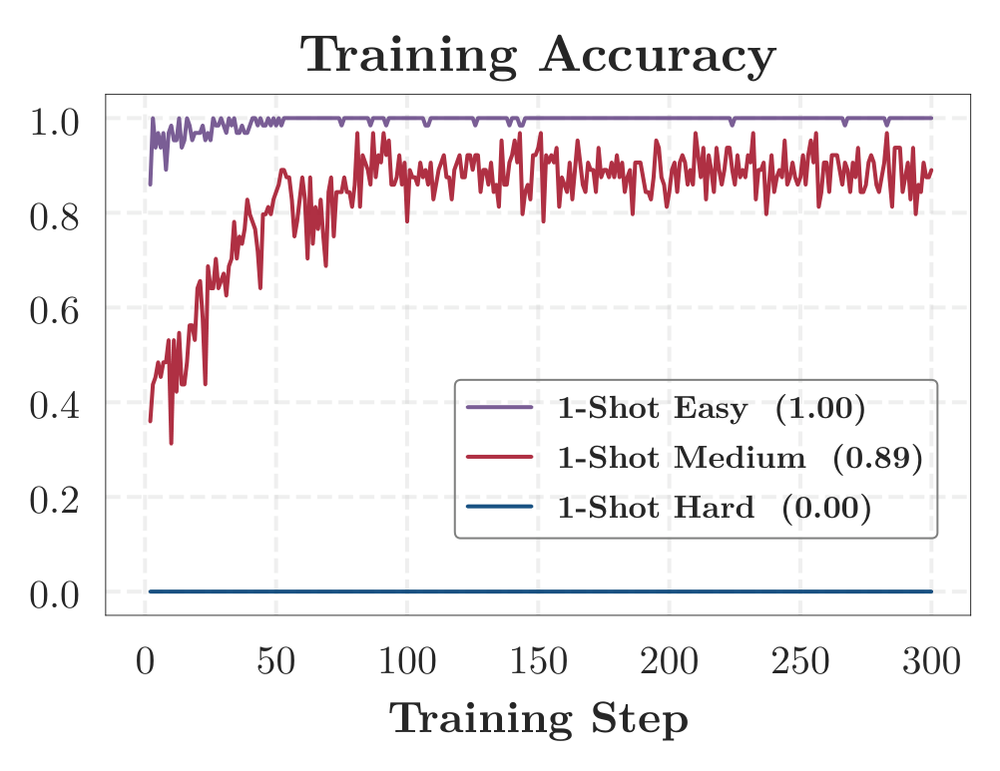

*图 15：表 2 的三条查询中，每步 64 条 rollout 里解出训练查询本身的比例。*

**OPD 的默认超参数（表 3）。** 除非另有说明，所有实验都使用这些默认值。top-$`K`$ 一行覆盖两种目标函数：第 3.2 节的数学 one-shot 实验使用 $`K=16`$，其余所有实验都使用采样 token 目标。

| 项目 | 取值 |
| --- | --- |
| Rollout 批大小 | 64 |
| Mini batch 大小 | 64 |
| 每个提示词的回答数 | 1 |
| KL 系数 | 0.0 |
| LogProb top-$`K`$ | 0（默认）/ 16 |
| Top-$`K`$ 策略 | 学生 Top-$`K`$ |
| 损失聚合方式 | token-mean |
| 训练温度 | 1.0 |
| Top-$`p`$ | 1.0 |
| 优化器 | AdamW（$`\beta_1{=}0.9`$，$`\beta_2{=}0.999`$，wd $`=0.01`$） |
| 学习率 | 1e-6 |
| 梯度裁剪范数 | 1.0 |
| 提示词最大长度 | 1024（数学）；4096（代码、指令遵循、智能体） |
| 回答最大长度 | 7168（数学、代码、指令遵循）；2048（智能体） |

*表 3：OPD 的默认超参数。*

### 附录 B 第 4 节的细节

#### B.1 训练状态覆盖率

**构造方式。** Rollout 是按优化步数而不是随机收集的，这样训练的每个阶段都被同等地代表，而且在跑同样步数的各个设定之间，预算是可比的：在全量数据运行的第 $`1`$ 步到第 $`500`$ 步，我们每步取 $`5`$ 条 rollout，其中三条用来构建簇，两条构成全量数据（留出），由此得到 $`12{,}000`$ 个参照状态和 $`8{,}000`$ 个留出状态。在做 $`K`$-means 之前，PCA 把它们降到 $`50`$ 维，保留了 $`71.9\%`$ 的方差。随后每个被评测的设定都按同一时间表来度量：每步从 $`5`$ 条 rollout 中取 $`2`$ 条，并在整个运行中累积，因此第 $`300`$ 步时 $`600`$ 条 rollout 的预算与留出划分相当。我们把这一抽取重复 $`30`$ 次；带状区域和误差棒是这些重复上的一个标准差，它反映的是 rollout 的二次抽样，而不是不同训练模型之间的差异。

**在不同的 $`K`$、参照构造方式和状态位置下，排序都是稳定的（表 4、表 5、图 16）。** 覆盖率取决于参照状态被聚类得有多细，也取决于哪些状态定义了这些簇，所以我们把两者都变动一遍。第一张表在 $`K\in\{50,100,200,500\}`$ 下重复该分析：更细的簇会降低绝对覆盖率，但覆盖率仍然从 1-shot 到 4-shot 再到 16-shot 依次上升，且 16-shot 接近全量数据。第二张表改用每个设定各 $`2{,}000`$ 条 rollout 的并集来重建簇，而不是只用全量数据的状态，排序依然成立；由于所有设定的状态都参与定义这些合并后的簇，合并后的覆盖率不是一个回收度量，它的各行只能互相比较。该图则改变从每条 rollout 中读取的位置，把最后一个非 padding token、以及固定绝对位置 $`2{,}000`$ 和 $`4{,}000`$，与主分析中的 8 个相对位置作比较。四种方式都保持了排序。固定位置的变体与主构造很接近，而最后一个 token 在查询很少时给出的覆盖率明显更低，这正是一个受回答长度和终止方式支配的位置所应有的表现；因此我们读取 8 个相对位置，它们能在任意长度的回答中都均匀取样。

| $`K`$ | 1-shot | 4-shot | 16-shot | 全量数据（留出） |
| --- | --- | --- | --- | --- |
| 50 | 0.755 | 0.829 | 1.000 | 1.000 |
| 100 | 0.727 | 0.803 | 1.000 | 1.000 |
| 200 | 0.715 | 0.798 | 0.989 | 1.000 |
| 500 | 0.564 | 0.695 | 0.904 | 0.956 |

*表 4：不同簇数 $`K`$ 下，第 $`300`$ 步以全量数据为锚的训练状态覆盖率。*

| 参照构造方式 | 1-shot | 4-shot | 16-shot | 全量数据（留出） |
| --- | --- | --- | --- | --- |
| 以全量数据为锚 | 0.663 | 0.773 | 0.953 | 0.998 |
| 等规模合并 | 0.750 | 0.845 | 0.958 | 0.966 |

*表 5：在 $`K=200`$ 下，不同簇构造方式下的训练状态覆盖率。*

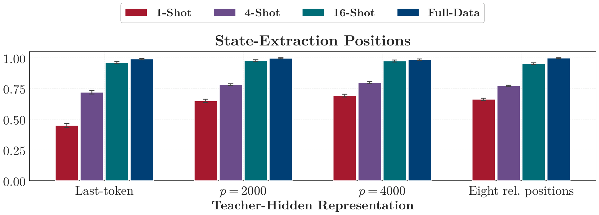

*图 16：在 $`K=200`$ 下，不同状态抽取位置下的训练状态覆盖率。误差棒表示 rollout 二次抽样上的一个标准差。*

**One-shot 的远距离状态有更重的尾部，但与全量数据并不可分（表 6）。** 最近质心的分配方式，会把一个状态归入某个簇，无论它离每一个全量数据状态有多远，所以单凭覆盖率无法区分“稀疏地填满参照空间”和“把它留空”。因此我们还为每个状态度量它在未降维的 $`1536`$ 维空间中到最近十个参照状态的平均余弦距离，并把该距离超过留出全量数据状态第 $`95`$ 百分位的状态称为*离参照*状态。One-shot OPD 超过阈值的频率高于其他设定，所以它的距离有更重的上尾。但相对留出全量数据状态的 AUROC 为 $`0.552`$，接近随机，所以整体而言 one-shot 的状态与全量数据的状态并不可分。

| 设定 | 超阈比例（%） | 平均距离 | AUROC |
| --- | --- | --- | --- |
| 1-shot | 17.2 | 0.283 | 0.552 |
| 4-shot | 4.4 | 0.218 | 0.477 |
| 16-shot | 3.8 | 0.231 | 0.512 |
| 全量数据（全部） | 4.0 | 0.215 | 0.476 |

*表 6：不同查询集规模下的参照距离诊断量。AUROC 是把每个设定与留出的全量数据状态作比较。最后一行是完整的全量数据池，包含了构建簇的那些 rollout，所以它的超阈比例不必等于阈值所设定的 $`5\%`$。*

#### B.2 训练数据上的对照实验

**16-shot OPD 中的多样性（图 17）。** 第 4.2 节阶梯上的每条查询都代表一个不同的语义簇，所以它同时提升了多样性和数量。把数量固定为 16、并让第二组查询全部取自同一个簇，就能把两者分开：16 条簇代表在第 $`300`$ 步达到 $`70.9`$ 的验证集准确率，而单簇集合为 $`69.9`$，后者大致相当于 4-shot OPD 用四分之一的查询数所达到的水平；它们的状态覆盖率也以同样的方式分开，而且很早就分开了——$`98.9\%`$ 对单簇集合在 $`100`$ 步内就趋平于 $`76.8\%`$ 附近。来自同一个簇的查询，只会不断把学生带回它已经见过的那部分状态空间。

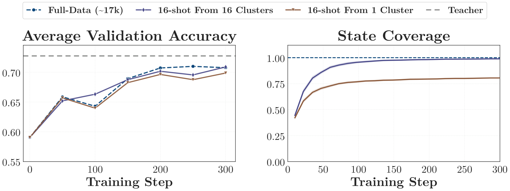

*图 17：两个仅在多样性上不同的 16-shot 查询集，与全量数据 OPD 的对比。*

**2-shot OPD 中的查询调度（图 18）。** 固定一个两条查询的集合、只改变各自出现的时机：顺序调度在 $`600`$ 步预算的前 $`300`$ 步训练困难查询，其余步数训练中等查询；混合调度则在每个批次中各放 $`32`$ 份。在第 $`600`$ 步它们分别达到 $`68.8`$ 和 $`69.1`$，都高于两者共享的 one-shot 基线的 $`67.4`$，所以与第二条查询本身带来的收益相比，给一个固定查询集排序几乎无足轻重。这些运行比第 4.2 节的训练得更久，并以困难查询为基线，所以无论是它们的时间跨度还是基线，都不能与图 8 互换。

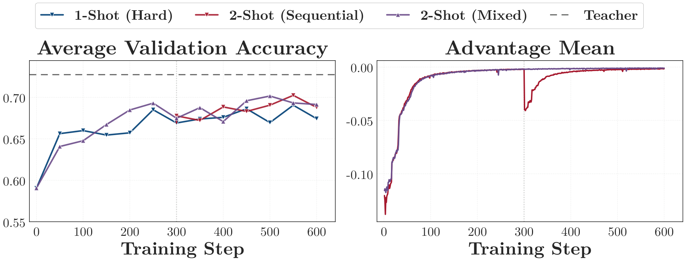

*图 18：2-shot OPD 中查询调度的影响。竖直点线标出顺序调度中切换查询的位置。*

### 附录 C 第 5 节的细节

#### C.1 吸收率的估计与度量窗口

第 5.2 节的度量遵循三条约定。各自的理由如下：

- $`[t/1.4,\,1.4t]`$。一旦 $`d`$ 变化缓慢，相邻两步之差就基本是噪声，所以 $`v_t`$ 被读作 $`\log d`$ 在该窗口两个端点之间的斜率，端点处各取附近 $`d`$ 的中位数。只有窗口完全落在被度量范围内的中心点才会被画出，这就是正文在第 $`50`$ 步和第 $`200`$ 步而不是第 $`300`$ 步读取速率的原因。
- $`d_t/d_{30}`$。每次运行都在它自己访问到的状态上度量距离，到第 $`30`$ 步时四者处于不同的水平，所以把每一次与它自己在那里的取值相比，可以让这些曲线按形状而不是按水平来比较。
- **从第 $`30`$ 步开始。** 在那之前梯度裁剪一直起约束作用，而一次被裁剪的更新并不是目标函数所要求的那次更新：该窗口内的 $`v_t`$ 度量的是一次*固定大小*的步长带来了什么，而不是一次更新带来了什么，这也是那里测得的速率不降反升的原因。

表 7 汇总了第 5.2 节从这一范围引用的读数：第 $`300`$ 步时仍剩余的第 $`30`$ 步距离的比例，以及吸收率在第 $`50`$ 步到第 $`200`$ 步之间下降的倍数。

| 设定（查询数） | 1 | 4 | 16 | 全量数据 |
| --- | --- | --- | --- | --- |
| $`d_{300}/d_{30}`$ | 0.16 | 0.17 | 0.18 | 0.22 |
| $`v_{50}/v_{200}`$ | 5.6 | 5.2 | 4.2 | 6.4 |

*表 7：默认学习率下，同策略 OPD 在第 $`30`$–$`300`$ 步的对齐动态。*

#### C.2 学习率只是在缩放步数轴

我们在二分之一、默认、以及两倍默认学习率下重复同策略 one-shot OPD，其余设置全部固定，并与第 5.2 节一样在同样的 $`300`$ 步上读取这三次运行。

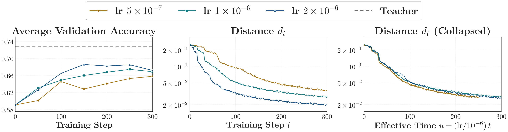

*图 19：在二分之一、一倍和两倍默认学习率下，one-shot OPD 的验证集准确率与师生距离。距离的纵轴为对数坐标，横轴为线性时间。*

**学习率缩放步数轴，而不改变放缓本身。**

更大的学习率会更早达到任一给定距离，三条曲线之间大致相差学习率之比（图 19）。把横轴从步数 $`t`$ 换成 $`u=(\mathrm{lr}/10^{-6})\,t`$ 后，它们就落到同一条曲线上：三次运行之间的离散程度从约 $`2.2\times`$ 缩小到约 $`1.1\times`$。因此，学习率只决定一次运行沿那条曲线前进得有多快，而不决定曲线本身的形状。这条曲线会一路向下弯得越来越平，正如第 5.2 节四种查询设定随步数所表现的那样。因此，在我们测试的四倍范围内，按比例增大学习率会按比例缩短运行时间，却触及不到那个一开始就让对齐变慢的原因。

### 附录 D 第 6 节的细节

表 8 给出 MOPD 的默认超参数。

| 项目 | 取值 |
| --- | --- |
| 教师数量 | 3（数学 / 代码 / 指令遵循） |
| LogProb top-$`k`$ | 0 |
| KL 系数 | 0.0 |
| 损失聚合方式 | seq-mean-token-mean |
| Rollout 批大小 | 64 |
| Mini batch 大小 | 64 |
| 每个提示词的回答数 | 1 |
| 训练温度 | 1.0 |
| Top-$`p`$ | 1.0 |
| 优化器 | AdamW（$`\beta_1{=}0.9`$，$`\beta_2{=}0.999`$，wd $`=0.01`$） |
| 学习率 | 1e-6 |
| 梯度裁剪 | 1.0 |
| 提示词最大长度 | 4096 |
| 回答最大长度 | 7680 |

*表 8：MOPD（多教师同策略蒸馏）的默认超参数。*

### 附录 E 第 7 节的细节

#### E.1 代码生成中的模板与 WildChat OPD

第 7.1 节报告了数学上的四种输入条件。这里我们在代码生成上报告同样的四种。

**设置。** 学生是 R1-Distill-1.5B，教师是 DeepCoder-1.5B-Preview (Luo et al., 2025)，基线是在 TACO (Li et al., 2023) 上的全量数据 OPD。基础模板、系统模板和 WildChat 查询与第 7.1 节完全相同；系统模板的那一行指令就是图 12(b) 的竞技编程指令。我们在 LiveCodeBench v6 上按 avg@3 评测。

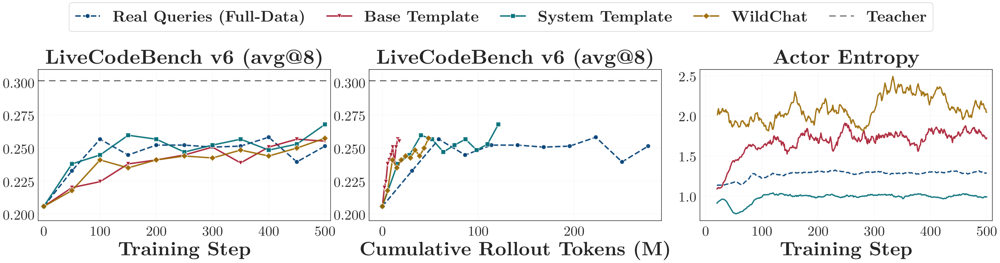

*图 20：代码生成 OPD 的验证集准确率与 actor 熵。*

**结果。** 图 20 显示，四种条件的终点彼此相差不到 $`1.7`$ 分，而按 token 计算把它们拉开的距离，远大于按步数计算：在同样的 $`500`$ 步里，基线花掉 $`277`$M rollout token，而基础模板只花 $`18`$M，另外两种介于其间。Actor 熵对这些条件的排序与数学上完全一致，WildChat 最高，系统模板最低。唯一的区别是，这里没有任何一种条件落后，而在数学上 WildChat 要付出约一分的代价。
