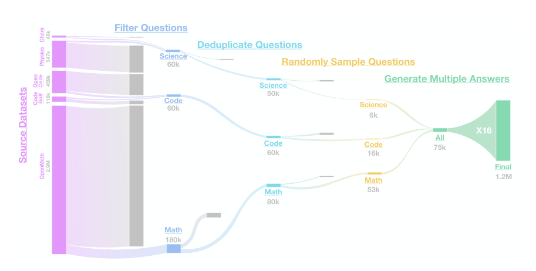
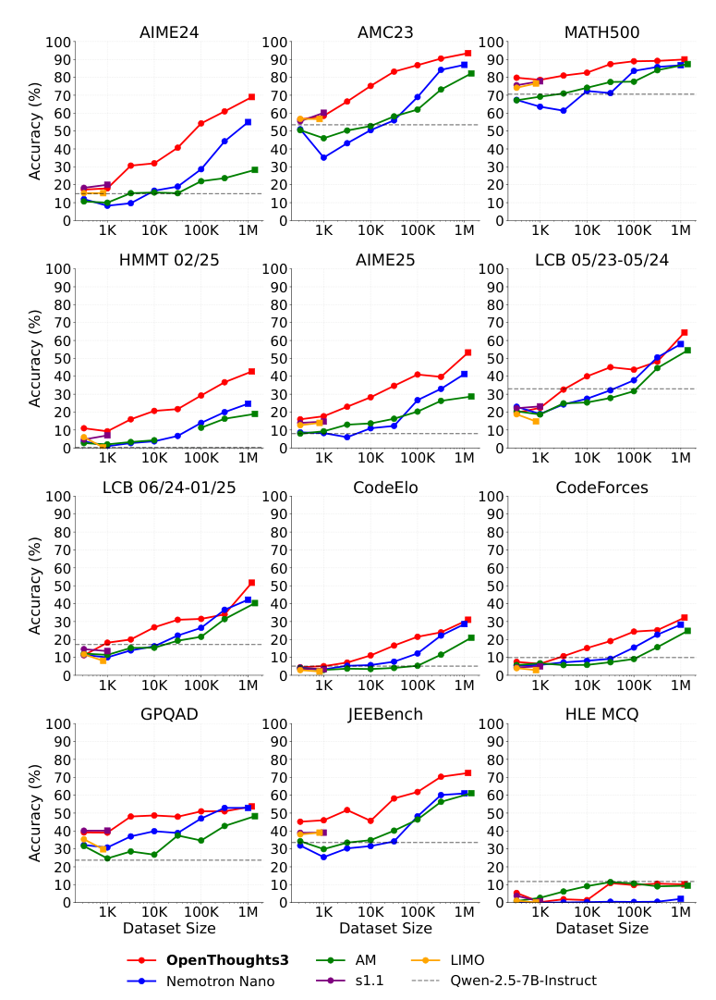

# OpenThoughts：推理数据配方与规模效应

中文 | [English](./OpenThoughts-Reasoning-Data-Scaling_en.md)

- **原文链接：** [论文原文](https://arxiv.org/abs/2506.04178v2)
- **发布日期：2025-06-04**

- **原论文：OpenThoughts: Data Recipes for Reasoning Models。**

**作者：Etash Guha、Ryan Marten、Sedrick Keh、Negin Raoof、Georgios Smyrnis 等联合研究团队。**

- **精读版本：arXiv:2506.04178v2，2025-06-05；首版 2025-06-04；整理日期 2026-11-09。**
- **原文：[版本化摘要](https://arxiv.org/abs/2506.04178v2)；[72 页 PDF](https://arxiv.org/pdf/2506.04178v2)；[项目页面](https://www.openthoughts.ai/)。**
- **阅读范围：完整主文，第 4–5 节逐项数据实验，以及附录 D/E/F/G/H/O/Q/R/S 中的训练、评测、去污染、规模实验、补充消融与数据细节。本文是通俗精读，不是全文翻译，也没有重训模型。**

## 1. 一句话说清楚

**这篇论文想知道：只用监督微调训练推理模型时，到底应该选什么题、找谁写解题过程、每道题采样几份答案，才能让学生真正变强？作者通过大量数据配方实验，做出了 OpenThoughts3-1.2M 数据集，并训练得到 OpenThinker3-7B。**

它不是提出一种新的 Transformer，也不是发明新的 RL 奖励算法。它把重点放在很多人容易跳过的环节： **什么样的训练材料，对学生有用？**

**来源：摘要、第 1、3、4–5 节。本文的“强”“最好”均限定在论文当时的设置与对比范围，不表示当前 SOTA。**

## 2. 先把名称分清楚

| 名称 | 是什么 |
| --- | --- |
| OpenThoughts | 开放推理数据项目与系列数据集 |
| OpenThoughts3-1.2M | 最终约 120 万条问答训练样本的数据集 |
| OpenThinker3-7B | 用该数据集微调得到的学生模型 |
| Qwen2.5-7B-Instruct | 主实验中学生的起始模型 |
| QwQ-32B | 最终配方使用的教师模型 |
| DeepSeek-R1 | 许多早期配方消融中使用的默认教师 |

论文摘要页面、图表表头与正文在少数地方存在 OpenThoughts3-7B/OpenThinker3-7B 的名称混用。本文统一用 **OpenThoughts 指数据、OpenThinker 指模型** ，以正文的模型命名区分二者，不把两种拼写当成两个不同实验。

**来源：第 1、3、5 节，表 1–2及版本化摘要。**

## 3. 训练流程有多简单？

先准备一个问题 $`x`$，让教师生成推理过程与最终回答 $`y`$。学生学习在该问题后生成这段回答。典型的序列级 SFT 目标可以写成：

```math
\mathcal L_{\mathrm{SFT}}=-\mathbb{E}_{(x,y)\sim\mathcal D}\sum_{t=1}^{|y|}\log p_\theta(y_t\mid x,y_{< t}).
```

这是对论文训练流程的标准化教学表达，不是论文提出的新损失公式。

这里有两个关键点：

- 学生不仅看最终答案，还看教师生成的长推理轨迹。
- 训练轨迹来自教师，不是学生在训练时自己生成后再让教师逐 token 评分。

因此，这篇论文研究的是 **教师生成推理轨迹上的监督微调数据配方** 。它关注如何构建问答训练集，而不是在训练过程中让学生生成轨迹再即时获取教师反馈。

**来源：第 1、4 节与附录 D。**

## 4. 超过一千次实验，究竟在试什么？

作者把数据生产拆成六个环节：

1. 从哪里找问题？
1. 混合多少种问题来源？
1. 如何筛选问题？
1. 是否去重、每道题采样多少个回答？
1. 要不要过滤教师回答？
1. 选择哪个教师？

每个环节比较不同策略，保留表现较好的策略，再进入下一环节。这是一种 **逐阶段选择** ，不是把所有策略的全部组合都穷举一遍，也不是保证找到了全局最优组合。

多数配方试验使用约 31,600 条训练样本、相同类型的 7B 学生，以八项数学、代码、科学基准的平均表现挑选策略。这里“超过 1000 次”指累计配方/消融实验，不能误读成“最终 120 万数据的模型训练了一千遍”。

作者另外留出 AIME25、HMMT、HLE 和较新的 LiveCodeBench 切片，不用它们指导中间数据配方选择。

**来源：第 1、4 节 Experimental Setup、Pipeline，附录 E 表 13。31,600 是约数 31.6K，不是 31.6K 次训练更新。**

## 5. 第一步：好题不一定来自看起来最“高级”的来源

作者比较了三类来源：

- **全合成：** 让模型直接编题。
- **半合成：** 以网页或教材文本为种子，让模型形成问题。
- **人工问题：** 来自论坛、竞赛、真实问答等。

实验覆盖代码 27 种、数学 21 种、科学 14 种来源。每种来源都会重新请教师作答，而不是直接沿用原始答案。

结果没有形成“人工一定比合成强”或“越复杂的数据流水线越好”的普遍排序。某些简单合成策略也有很强表现，而来源差异会造成明显的学生分数差距。

**教学直觉：一本教材是否有用，不能只看谁编的、是否人工写的；要看它是否给这个学生提供了合适的问题和可学习的解法。**

**来源：第 4.1 节、表 3，附录 R.1与表 32–34。**

## 6. 第二步：来源混得越多，不一定越好

作者固定总样本量，从排名前 $`1,2,4,8,16`$ 个来源中等量取题。这样增加来源数时，也会减少每个高质量来源分到的份额。

代码实验中，混合最好的两个来源，八任务平均分为 41.3；混合前十六个来源为 36.4，差 4.9 个百分点。

**论文实测：在这个固定总量、等比例混合的方案里，少数高质量来源优于混入更多相对较弱来源。**

但它没有证明“多样性本身有害”。增加来源多样性与稀释最佳来源、引入质量较弱来源同时发生。更精细的非均匀混合、不同总量、不同学生，都可能得到不同结果。

最终数学使用 OpenMath-2-Math；代码使用 CodeGolf 与 OpenCodeReasoning；科学使用 StackExchange Physics 与有机化学教材来源。

**来源：第 4.2 节、表 4，附录 S.2。上面的差值是由表中 41.3 与 36.4 相减，不是泛化到所有领域的固定收益。**

## 7. 第三步：筛问题，与筛答案是两回事

问题池可能有几百万条，逐条请强教师写长推理太贵。因此，先挑哪些题值得花钱，是一个重要环节。

作者比较 fastText、embedding 距离、LLM 打分等方法。表现较好的包括：

- **代码题：** 让 GPT-4o-mini 判断难度，保留更难的题。
- **数学和科学题：** 先让 GPT-4.1-mini 尝试回答，用回答长度来帮助选择问题。

“回答越长的题越值得选”在这里是一种经验筛选信号，不是证明所有长答案都正确，也不是最终训练时强迫学生尽量写长。

而且，筛选用的模型和最终生成推理答案的教师可以不同。便宜模型先选题、较强教师再写答案，是两笔不同的成本。

**来源：第 4.3 节、表 5，附录 R.2与表 38–40。**

## 8. 第四步：一道题可以贡献很多条训练轨迹

作者同时改变问题去重方式，以及每道题的教师回答数，测试了每题采样 1、4、16 个回答。

如果有 $`Q`$ 道问题，每道采样 $`K`$ 次，那么问答对数量约为：

```math
M=QK.
```

**教学示例：1 万道题，每题生成 16 份回答，是 16 万个问答对，不是 16 万道独立题目；也不是把同一份回答机械复制十六次。**

作者观察到，降低问题种类、增加同题回答数量，在不少设置中不会损害结果，甚至更好。这说明教师对同一问题给出的不同轨迹，也能提供训练价值。

最终三类领域都使用每题 16 次采样；数学与科学进行精确去重，代码不去重。数学局部消融中每题 4 次曾更优，但作者为最终扩展性选择 16 次。因此，16 不是被证明全局最优的神奇数字。

**来源：第 4.4 节、表 6，附录 S.4。**

## 9. 第五步：为什么“把错答案删掉”没有明显提升？

直觉上，训练数据越正确越好。但实际过滤器可能误判，也可能删掉很有教学价值的轨迹；过滤后数据总量还可能缩小。

作者先生成 63,200 个回答，再使用各类策略过滤并选出 31,600 个问答对，另设一个“不筛选、全部保留”的基线。

数学表 7 中：

| 策略 | 八任务平均分 | 应注意的比较条件 |
| --- | --- | --- |
| 不过滤 | 41.9 | 63,200 条，论文明确标记非等计算控制 |
| 随机过滤 | 41.6 | 31,600 条 |
| GPT 验证过滤 | 40.0 | 31,600 条 |

合理的结论是： **在作者所试的过滤器和成本条件下，过滤收益没有明显抵消丢失样本的代价，所以最终配方选择不做答案过滤。**

不合理的结论是：“正确性永远不重要”“任何验证都没用”。附录 H.1 在早期数据上的实验甚至发现，验证在 7B 上可能有害、在 32B 上可能有益；效果与学生规模和数据集有关。

附录还比较了用 LLM 生成单元测试来筛代码答案；其测试结果也不支持这种特定过滤方案带来改善。但这不是对高质量真实执行反馈或所有测试驱动训练的否定。

**来源：第 4.5 节、表 7，附录 H.1表 15–18。尤其要保留“非等计算控制”这个限定。**

## 10. 第六步：教师自己考得好，不等于它最会教

默认教师 DeepSeek-R1 自身表现较强，但最终实验中，用 QwQ-32B 生成数据，学生的表现更好。

例如表 8 的数学来源实验，八任务平均分从 R1 教师的 41.6 变为 QwQ 教师的 44.2；代码来源实验从 42.3 变为 44.2。

这里比较的不是教师分数，而是 **使用这个教师的数据训练后，学生的分数** 。两种排行榜不能互换。

**可能的教学解释：某位专家自己解题极强，但其解法未必最适合当前学生模仿。这只是类比；论文并没有通过严格因果实验，把效果归结为某一种“教学风格”。**

也不能由此认为不同 tokenizer 的概率蒸馏问题得到了解决。这里教师给出的是文本轨迹，学生把文本重新分词后做 SFT；它没有在两个不兼容词表之间直接计算逐 token KL。

**来源：第 4.6 节、表 8、附录 L表 29；关于 tokenizer 的说明是依据硬轨迹 SFT 流程作出的区分。**

## 11. 怎样从小配方变成 120 万条数据？



***图源：第 5 节图 4，PDF 第 11 页上部裁剪。图内数量为分阶段近似值，不应用四舍五入后的所有数字强行做精确对账。***

最终数据大致由以下部分组成：

| 领域 | 问答样本数 |
| --- | --- |
| 数学 | 850,000 |
| 代码 | 250,000 |
| 科学 | 100,000 |
| 合计 | 1,200,000 |

图 4 的直觉是：先从更大的题库里筛选、去重和抽样，得到约 7.5 万个问题，再每题采样 16 份回答，形成约 120 万个问答对。

这个混合比例沿用前一代项目中的经验，不是通过穷举所有数学/代码/科学比例得到的最优解。

**来源：第 5 节及图 4。**

## 12. 最终结果要怎样读，才不夸大？

### 12.1 看明确表格，不只背摘要整数

| 基准 | OpenThinker3-7B | R1-Distill-Qwen-7B | 差值 |
| --- | --- | --- | --- |
| AIME25 | 53.3% | 38.0% | +15.3 个百分点 |
| LiveCodeBench 06/24–01/25 | 51.7% | 34.5% | +17.2 个百分点 |
| GPQA Diamond | 53.7% | 33.2% | +20.5 个百分点 |
| 12 项平均分 | 55.3 | 42.9 | +12.4 分 |

**来源：表 1，PDF 第 2 页。摘要使用 53%、51%、54% 的概括，尤其 51.7% 并不是按常规四舍五入得到 51%；本文以表 1 的小数结果为准，不混用精度。**

“平均更强”不等于逐项第一。例如 HLE MCQ 上，最终模型为 10.2，而基座为 12.7；代码某些任务上也有其他对手更高。不同模型的训练数据、基座与优化算法不同，这张大表不是严格同成本、同基座消融。

### 12.2 这些分数不是 pass@10

附录 E说明：

- AIME、AMC、HMMT 报告 10 轮评测的平均准确率与标准误。
- LiveCodeBench 使用 6 轮。
- GPQA、JEEBench、HLE 等使用 3 轮。
- MATH500 做一次完整评测。

统一生成设置包括温度 0.7、top-p 为 1，以及最多 32,768 个新 token。 **多轮平均准确率不等于“每题试十次，只要一次对就算对”。**

LiveCodeBench 后面的日期表示题目切片的时间窗口，不是训练执行日期。该版本附录对新窗口起始月份的文字与标签略有不一致，比较时应固定实际切片，不能仅看“LCB”三个字。

**来源：附录 E、表 13。**

## 13. 这篇论文到底有没有证明“数据越多，分数就按固定规律涨”？

没有证明那么强的结论。它提供的是推理 SFT 的 **经验规模曲线** 。



***图源：附录 G图 8，PDF 第 28 页裁剪。横轴是训练数据样本量；多个任务表现不同，原图没有给出可直接套用到任意任务的统一拟合公式。***

这张图反映了三层信息：

1. **增加数据通常确实有帮助。** 许多任务到百万样本规模仍在提高。
1. **更好的配方能把曲线抬高。** 同样数据规模，不同来源、筛选和教师组合不一定同样有效。
1. **并非所有任务一直涨。** 作者明确指出 AMC23、MATH500 开始饱和，HLE 没有随规模改善，还观察到跳跃与下降。

此外，跨数据规模的训练超参数也会变化。附录 D表 9有四套配置：小规模可能训练 13 或 7 个 epoch，较大规模使用 5 个 epoch，学习率、批量和 packing 也不同。

所以，这些曲线反映“为相应规模配置训练后的效果”，不能不加说明地视为 **所有其他变量完全相同、只改独立数据数的因果曲线** 。

**来源：第 5 节、附录 D表 9及附录 G。**

## 14. 去污染、成本和复用：结果好之外，还要问什么？

### 14.1 去污染不是“证明绝无泄漏”

作者用文本相似度与共享 13-gram 两种方法过滤与评测题相近的训练样本，任一种命中就剔除。

他们还构造了污染与干净样本测试：3092 个污染样本中漏掉 12 个，3000 个干净样本中误删约 1.4%。这支持过滤器对所设计污染形式有较强检出能力，但不等于所有语义改写、跨语言改写或基础模型预训练污染都已排除。

**来源：附录 F。原文将约 99.6% 标为 true negative rate，但按“污染为正类”的通常定义，它更接近污染检出率；本文优先陈述原始计数，避免标签歧义。**

### 14.2 成本要分三笔

附录 O报告：最终数据教师标注约使用 22,000 H100 GPU 小时，一次 OpenThinker3-7B 训练约使用 25,000 A100 GPU 小时，一轮评测另有成本。

这几项不能直接相加再宣称是同一种设备上的运行时；GPU 型号不同，GPU 小时也不是墙钟小时。附录列出的单次最终训练成本，更不是整个千次配方搜索项目的全部成本。

**来源：附录 O，PDF 第 44 页。数字仅为论文历史报告，不是当前云服务报价。**

### 14.3 公开数据不自动等于所有原始材料可无限制商用

附录 Q列出不同数据来源与资产的许可信息，来源并不统一。项目可下载、代码可运行，与具体场景下是否可以复用某一类源材料，是不同问题。附录的许可汇总不等于对所有资产提供统一的商用授权。

**来源：附录 Q。这里只说明论文存在许可差异，不构成法律建议。**

## 15. 核心证据与原文阅读顺序

| 结论 | 证据性质 | 原文位置 |
| --- | --- | --- |
| 数据来源和选题方式显著影响学生表现 | 配方消融 | 第 4.1–4.3 节、表 3–5 |
| 固定总量下，前两个来源胜过前十六个 | 局部混合实验 | 表 4 |
| 同题多次教师采样能有效扩充训练对 | 去重与采样组合实验 | 第 4.4 节、表 6 |
| 最终不做答案过滤 | 有非等成本基线的比较 | 第 4.5 节、表 7 |
| 自身基准更强的模型不一定是更好教师 | 教师替换实验 | 第 4.6 节、表 8 |
| 最终 1.2M 数据提高 7B 模型表现 | 最终训练与统一评测 | 第 5 节、表 1 |
| 部分任务饱和或不响应数据规模 | 经验规模实验 | 附录 G图 8–9 |
| 跨规模超参数并非完全不变 | 训练设置披露 | 附录 D表 9 |

**建议阅读路线：先读图 2了解流水线，再读第 4.2–4.6 节和表 4–8；然后看图 4与表 1；最后一定读附录 D/E/G，分别弄清怎样训练、怎样计分、怎样观察规模效应。**

## 16. 五个复习问答

**问 1：120 万训练样本就是 120 万道不同的题吗？**

不是。最终配方每题采样多份回答，训练样本数与独立问题数不同。

**问 2：论文证明正确答案不重要吗？**

没有。它证明的是特定过滤方案在特定实验中没有提供足够收益，而且部分基线不是等计算控制。

**问 3：为什么不直接选基准分数最高的教师？**

因为教师自己解题的能力，与它生成的数据是否适合学生学习，不是同一个指标。论文以学生训练后的表现选教师。

**问 4：AIME 的十轮平均分意味着每题试十次取最好吗？**

不是。平均准确率与 pass@10/择优结果的定义不同。

**问 5：作者为什么把数据生产拆成多个环节进行比较？**

这样可以分别观察问题来源、混合策略、筛选、回答采样和教师选择的影响，再把表现较好的选择组合起来。这个流程减少了盲目试错，但逐阶段选择并不保证找到了所有可能组合中的全局最优解。
