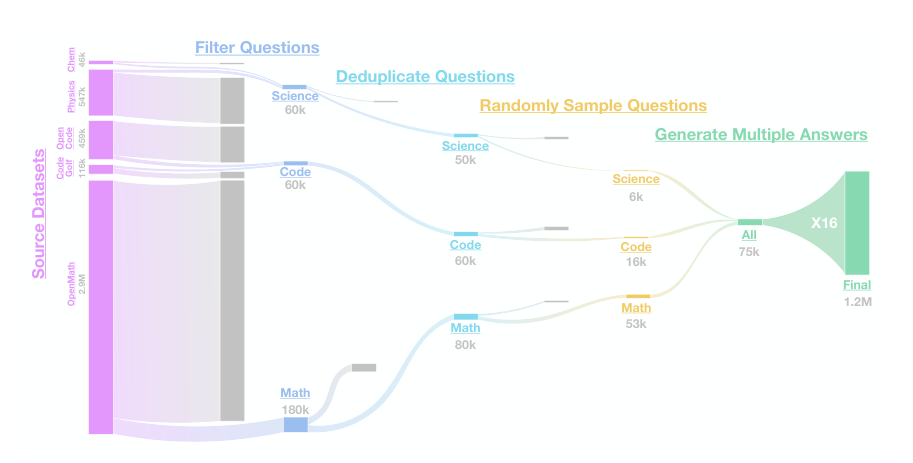
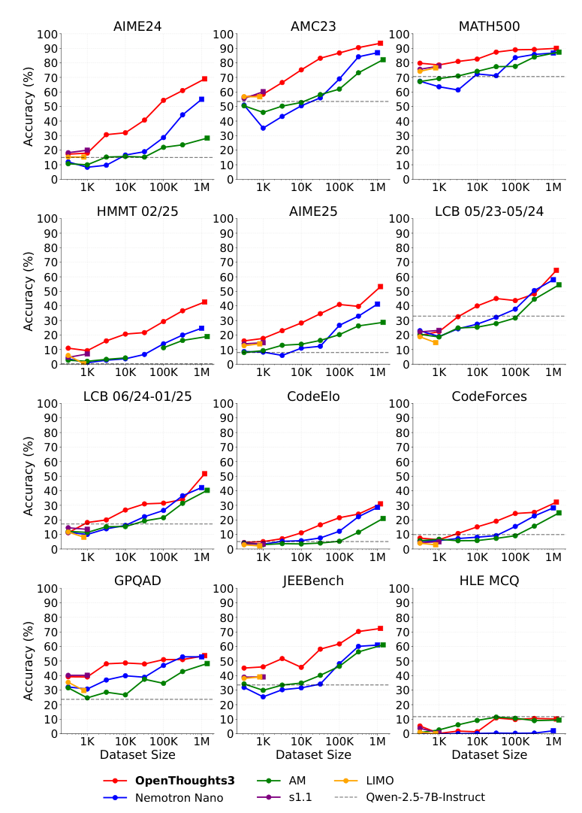

# OpenThoughts: Reasoning Data Recipes and Scaling Effects

[中文](./OpenThoughts-Reasoning-Data-Scaling.md) | English

- **Source:** [Original paper](https://arxiv.org/abs/2506.04178v2)
- **Published: 2025-06-04**

- **Original paper: OpenThoughts: Data Recipes for Reasoning Models.**

**Authors: Etash Guha, Ryan Marten, Sedrick Keh, Negin Raoof, Georgios Smyrnis, and a collaborative research team.**

- **Version examined: arXiv:2506.04178v2, 2025-06-05; first version 2025-06-04; compiled on 2026-11-09.**
- **Original sources: [Versioned abstract](https://arxiv.org/abs/2506.04178v2); [72-page PDF](https://arxiv.org/pdf/2506.04178v2); [project page](https://www.openthoughts.ai/).**
- **Reading scope: The complete main text, the data experiments in Sections 4–5, and training, evaluation, decontamination, scaling, supplementary ablations, and data details in Appendices D/E/F/G/H/O/Q/R/S. This is an accessible close reading, not a full translation or model retraining.**

## 1. The paper in one sentence

**The paper asks which questions to choose, who should produce the reasoning traces, and how many answers to sample per question when training reasoning models with supervised finetuning alone. Extensive data-recipe experiments lead to OpenThoughts3-1.2M and the trained OpenThinker3-7B model.**

It proposes neither a new Transformer nor a new RL reward algorithm. Its focus is a frequently overlooked question: **Which training materials actually help the student?**

**Sources: The abstract and Sections 1, 3, and 4–5. “Strong” and “best” are limited to the paper's period, settings, and comparisons, not current state of the art.**

## 2. Distinguish the names

| Name | Meaning |
| --- | --- |
| OpenThoughts | The open reasoning-data project and dataset series |
| OpenThoughts3-1.2M | The final dataset of approximately 1.2 million question–answer training examples |
| OpenThinker3-7B | The student model finetuned on that dataset |
| Qwen2.5-7B-Instruct | The student's starting model in the main experiments |
| QwQ-32B | The teacher selected for the final recipe |
| DeepSeek-R1 | The default teacher in many earlier recipe ablations |

The abstract page, table headers, and body occasionally mix the names OpenThoughts3-7B and OpenThinker3-7B. This note consistently uses **OpenThoughts for data and OpenThinker for models**, following the model name in the body rather than treating the spellings as distinct experiments.

**Sources: Sections 1, 3, and 5, Tables 1–2, and the versioned abstract.**

## 3. How simple is the training procedure?

A question $`x`$ is given to a teacher, which generates reasoning and a final response $`y`$. The student learns to generate that response after the question. A typical sequence-level SFT objective is:

```math
\mathcal L_{\mathrm{SFT}}=-\mathbb{E}_{(x,y)\sim\mathcal D}\sum_{t=1}^{|y|}\log p_\theta(y_t\mid x,y_{< t}).
```

This is a standardized teaching expression of the training procedure, not a new loss proposed by the paper.

Two points matter:

- The student sees the teacher's long reasoning trace, not only its final answer.
- Training trajectories come from the teacher; the student does not generate them during training for per-token teacher scoring.

The paper therefore studies **supervised-finetuning data recipes using teacher-generated reasoning traces**. It concerns constructing question–answer training sets, not generating student trajectories and obtaining immediate teacher feedback during training.

**Sources: Sections 1 and 4 and Appendix D.**

## 4. What did over a thousand experiments test?

The authors divide data production into six stages:

1. Where should questions come from?
1. How many question sources should be mixed?
1. How should questions be filtered?
1. Should questions be deduplicated, and how many answers should be sampled per question?
1. Should teacher answers be filtered?
1. Which teacher should be selected?

At each stage, strategies are compared and stronger choices carried forward. This is **stage-by-stage selection**, not an exhaustive search of all combinations or a guarantee of a global optimum.

Most recipe experiments use approximately 31,600 training examples and the same type of 7B student, selecting strategies by mean performance on eight math, code, and science benchmarks. More than 1000 refers to cumulative recipe and ablation experiments, not a thousand training runs on the final 1.2 million-example dataset.

AIME25, HMMT, HLE, and the newer LiveCodeBench slice are held out from intermediate recipe selection.

**Sources: Sections 1 and 4, Experimental Setup and Pipeline; Appendix E, Table 13. The rounded quantity 31,600 is 31.6K examples, not 31.6K optimizer updates.**

## 5. Stage one: good questions need not come from the most sophisticated-looking source

The authors compare three source categories:

- **Fully synthetic:** a model directly creates questions.
- **Semi-synthetic:** web or textbook passages seed model-generated questions.
- **Human-written questions:** sourced from forums, competitions, and real question–answer exchanges.

The study covers 27 code sources, 21 math sources, and 14 science sources. A teacher re-answers questions from each source rather than simply reusing their existing answers.

No universal ordering emerges in which human-written always beats synthetic or complex pipelines always beat simple ones. Some simple synthetic strategies are strong, and source choice can create substantial gaps in student scores.

**Teaching intuition: A textbook's value depends not only on its author or whether it was written by humans, but on whether it provides suitable questions and learnable solutions for the particular student.**

**Sources: Section 4.1, Table 3, Appendix R.1, and Tables 32–34.**

## 6. Stage two: mixing more sources is not necessarily better

Keeping the total example count fixed, the authors sample equally from the top $`1,2,4,8,16`$ sources. Increasing the number of sources consequently reduces each high-quality source's share.

In the code experiment, mixing the best two sources yields an eight-task average of 41.3, versus 36.4 for the top sixteen, a difference of 4.9 percentage points.

**Measured result: Under this fixed-volume, equal-weight mixture, a few high-quality sources outperform mixtures containing more relatively weak sources.**

This does not prove diversity itself is harmful. Greater source diversity simultaneously dilutes the strongest sources and introduces weaker material. Nonuniform mixtures, different total volumes, or different students may behave differently.

The final math source is OpenMath-2-Math; code uses CodeGolf and OpenCodeReasoning; science uses StackExchange Physics and organic-chemistry textbook sources.

**Sources: Section 4.2, Table 4, and Appendix S.2. The difference above is calculated from 41.3 and 36.4, not a fixed improvement across every domain.**

## 7. Stage three: filtering questions differs from filtering answers

Question pools can contain millions of items, making long reasoning generation by a strong teacher expensive. Selecting which questions merit that cost is therefore important.

The authors compare fastText, embedding distances, and LLM scoring. Stronger approaches include:

- **Code:** ask GPT-4o-mini to estimate difficulty and retain harder questions.
- **Math and science:** ask GPT-4.1-mini to attempt an answer and use response length to help select questions.

Selecting questions that elicit longer answers is an empirical filtering signal. It does not prove that every long answer is correct or require the final student to write as much as possible.

The filtering model can also differ from the final reasoning teacher. Selecting questions with a cheaper model and generating answers with a stronger teacher are distinct costs.

**Sources: Section 4.3, Table 5, Appendix R.2, and Tables 38–40.**

## 8. Stage four: one question can provide many training trajectories

The authors vary both question deduplication and teacher-answer count, testing 1, 4, and 16 answers per question.

With $`Q`$ questions and $`K`$ samples per question, the approximate pair count is:

```math
M=QK.
```

**Teaching example: 10,000 questions with 16 answers each yield 160,000 question–answer pairs, not 160,000 distinct questions or sixteen mechanical copies of the same answer.**

The authors find that fewer distinct questions with more answers per question often perform similarly or better. Different teacher trajectories for the same question can therefore have training value.

The final recipe uses 16 samples per question in every domain, exact deduplication for math and science, and no deduplication for code. A local math ablation favored 4 samples, but 16 was selected for scalability. The number 16 is not a proven universally optimal constant.

**Sources: Section 4.4, Table 6, and Appendix S.4.**

## 9. Stage five: why did removing wrong answers not clearly help?

Correcter training data sounds preferable, but real filters can misjudge examples or remove valuable traces. Filtering can also reduce dataset size.

The authors generate 63,200 answers, apply filtering strategies, and select 31,600 pairs, alongside an unfiltered baseline retaining everything.

For math in Table 7:

| Strategy | Eight-task mean | Important comparison condition |
| --- | --- | --- |
| No filtering | 41.9 | 63,200 examples; explicitly not compute-controlled |
| Random filtering | 41.6 | 31,600 examples |
| GPT verification | 40.0 | 31,600 examples |

The supported conclusion is that **under the tested filters and cost conditions, filtering benefits do not clearly offset the loss of examples, so the final recipe omits answer filtering**.

Unsupported conclusions would be that correctness never matters or verification is always useless. Appendix H.1 even finds that verification on an earlier dataset may hurt at 7B but help at 32B; effects depend on student scale and data.

The appendix also tests LLM-generated unit tests for filtering code answers without finding an improvement. That does not refute high-quality real execution feedback or all test-driven training.

**Sources: Section 4.5, Table 7, Appendix H.1, Tables 15–18. The non-compute-controlled qualification is essential.**

## 10. Stage six: a teacher's own exam score does not measure teaching value

DeepSeek-R1, the default teacher, is strong itself, but the final experiments produce better students with QwQ-32B-generated data.

In Table 8's math-source experiment, the eight-task mean rises from 41.6 with R1 to 44.2 with QwQ; for code-source data, it rises from 42.3 to 44.2.

The comparison concerns **student scores after training on a teacher's data**, not teacher scores. These two rankings are not interchangeable.

**Possible teaching interpretation: An expert may solve problems extremely well without providing the solutions best suited to a particular student's imitation. This is only an analogy; the paper does not causally attribute the effect to a specific teaching style.**

Nor does this solve probability distillation across different tokenizers. The teacher supplies text trajectories that the student retokenizes for SFT; the method does not directly compute per-token KL across incompatible vocabularies.

**Sources: Section 4.6, Table 8, and Appendix L, Table 29. The tokenizer distinction follows from the hard-trajectory SFT procedure.**

## 11. From small recipes to 1.2 million examples



***Figure source: Figure 4 in Section 5, cropped from the upper part of PDF page 11. Stage counts are approximate; rounded quantities should not be forced into exact reconciliation.***

The final dataset is approximately composed of:

| Domain | Question–answer examples |
| --- | --- |
| Math | 850,000 |
| Code | 250,000 |
| Science | 100,000 |
| Total | 1,200,000 |

Figure 4 shows filtering, deduplication, and sampling from larger question pools to obtain approximately 75,000 questions, then sampling 16 answers per question to form approximately 1.2 million pairs.

This mixture follows experience from the previous project generation, not an exhaustive optimization of all math/code/science proportions.

**Sources: Section 5 and Figure 4.**

## 12. Reading the final results without overstating them

### 12.1 Use explicit tables, not only rounded abstract numbers

| Benchmark | OpenThinker3-7B | R1-Distill-Qwen-7B | Difference |
| --- | --- | --- | --- |
| AIME25 | 53.3% | 38.0% | +15.3 percentage points |
| LiveCodeBench 06/24–01/25 | 51.7% | 34.5% | +17.2 percentage points |
| GPQA Diamond | 53.7% | 33.2% | +20.5 percentage points |
| Mean over 12 tasks | 55.3 | 42.9 | +12.4 points |

**Source: Table 1, PDF page 2. The abstract summarizes these as 53%, 51%, and 54%; notably, 51.7% does not conventionally round to 51%. This note uses Table 1's decimal results rather than mixing precision levels.**

Better on average is not first on every task. For HLE MCQ, the final model scores 10.2 versus the base model's 12.7, and some code tasks favor other competitors. Models differ in data, base checkpoints, and optimization methods, so the large comparison table is not an equal-cost, same-base ablation.

### 12.2 These scores are not pass@10

Appendix E specifies:

- AIME, AMC, and HMMT report mean accuracy and standard error over 10 evaluation iterations.
- LiveCodeBench uses 6 iterations.
- GPQA, JEEBench, HLE, and others use 3 iterations.
- MATH500 uses one complete evaluation.

Shared generation settings include temperature 0.7, top-p 1, and at most 32,768 new tokens. **Mean accuracy across iterations is not equivalent to trying each question ten times and counting it correct if any attempt succeeds.**

LiveCodeBench dates identify question-release windows, not training execution dates. This version's appendix wording and label differ slightly on the new window's starting month; comparisons must fix the actual slice rather than referring only to LCB.

**Sources: Appendix E and Table 13.**

## 13. Does the paper prove that more data always follows one fixed score curve?

No such strong conclusion is established. The paper provides **empirical scaling curves** for reasoning SFT.



***Figure source: Appendix G, Figure 8, cropped from PDF page 28. The x-axis is the number of training examples. Tasks behave differently, and the figure provides no universally applicable fitted equation.***

The figure supports three observations:

1. **More data generally helps.** Many tasks continue improving at million-example scale.
1. **Better recipes can raise the curve.** Different sources, filters, and teachers are not equally effective at the same data volume.
1. **Not every task keeps improving.** AMC23 and MATH500 begin to saturate, HLE does not improve with scale, and the authors observe jumps and dips.

Training hyperparameters also vary by data scale. Appendix D, Table 9 specifies four configurations: small scales may use 13 or 7 epochs, larger scales use 5, and learning rate, batch size, and packing also change.

These curves therefore reflect training configured for each scale, not automatically **a causal curve with every other variable fixed and only unique-example count changing**.

**Sources: Section 5, Appendix D, Table 9, and Appendix G.**

## 14. Decontamination, cost, and reuse beyond headline results

### 14.1 Decontamination is not proof of zero leakage

The authors filter training examples similar to evaluation questions using text similarity and shared 13-grams, removing an example if either criterion matches.

They construct contaminated and clean test cases: 12 of 3092 contaminated examples are missed, while approximately 1.4% of 3000 clean examples are wrongly removed. This supports detection of the designed contamination types, not complete elimination of semantic paraphrases, cross-language variants, or base-model pretraining contamination.

**Source: Appendix F. The paper labels approximately 99.6% as the true negative rate; under the usual convention that contamination is positive, it is closer to a contamination-detection rate. This note prioritizes the raw counts to avoid ambiguous labels.**

### 14.2 Separate three cost categories

Appendix O reports approximately 22,000 H100 GPU-hours for final teacher annotation and 25,000 A100 GPU-hours for one OpenThinker3-7B training run, plus separate evaluation costs.

These cannot simply be added and described as runtime on one device type. GPU models differ, and GPU-hours are not wall-clock hours. The cost of one final run is also not the total cost of the thousand-experiment recipe search.

**Source: Appendix O, PDF page 44. These are historical reported costs, not current cloud-service prices.**

### 14.3 Open data does not automatically permit unrestricted commercial use of all source material

Appendix Q lists differing licenses for data sources and assets. Downloadable projects and runnable code do not settle whether a particular source material may be reused in a particular setting. The appendix's license summary does not grant uniform commercial rights to every asset.

**Source: Appendix Q. This notes license differences reported by the paper and is not legal advice.**

## 15. Key evidence and reading order

| Conclusion | Evidence type | Original location |
| --- | --- | --- |
| Sources and question selection materially affect student performance | Recipe ablations | Sections 4.1–4.3, Tables 3–5 |
| At fixed volume, the top two sources outperform the top sixteen | Local mixing experiment | Table 4 |
| Repeated teacher sampling effectively expands training pairs | Deduplication and sampling experiments | Section 4.4, Table 6 |
| The final recipe omits answer filtering | Comparisons including an unequal-cost baseline | Section 4.5, Table 7 |
| A higher-scoring model is not necessarily a better teacher | Teacher replacement experiments | Section 4.6, Table 8 |
| The final 1.2M dataset improves a 7B model | Final training and unified evaluation | Section 5, Table 1 |
| Some tasks saturate or do not respond to data scale | Empirical scaling experiments | Appendix G, Figures 8–9 |
| Hyperparameters are not identical across scales | Training-configuration disclosure | Appendix D, Table 9 |

**Suggested route: Start with Figure 2 for the pipeline, then Sections 4.2–4.6 and Tables 4–8. Continue with Figure 4 and Table 1, and finish with Appendices D/E/G to understand training, scoring, and scaling effects respectively.**

## 16. Five review questions

**Question 1: Are 1.2 million training examples 1.2 million different questions?**

No. The final recipe samples multiple answers per question, so example count differs from unique-question count.

**Question 2: Does the paper show that correct answers do not matter?**

No. It shows that particular filters do not yield enough benefit in particular experiments, some of which lack equal-compute baselines.

**Question 3: Why not simply select the highest-scoring teacher?**

A teacher's own problem-solving ability differs from how suitable its generated data is for student learning. The paper selects teachers by trained-student performance.

**Question 4: Does averaging ten AIME iterations mean taking the best of ten attempts per question?**

No. Mean accuracy differs from pass@10 or best-of-sample scoring.

**Question 5: Why divide data production into separate experimental stages?**

This isolates the effects of sources, mixtures, filters, answer sampling, and teacher choice before combining better choices. It reduces blind trial and error, but stage-wise selection does not guarantee a globally optimal combination.
