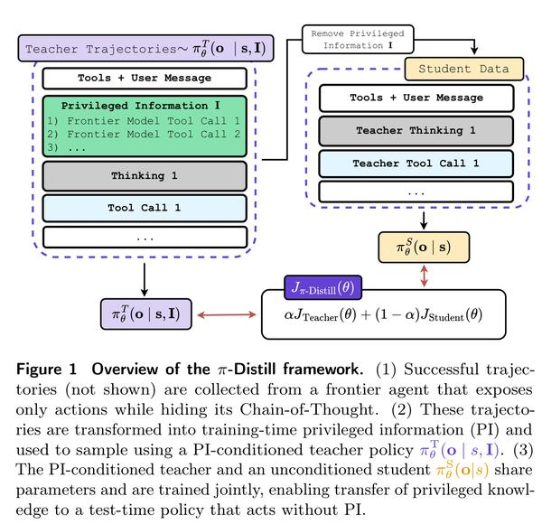
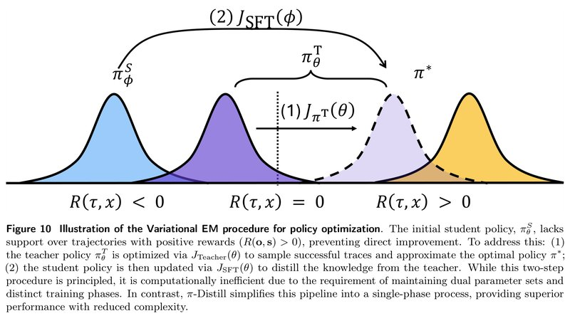
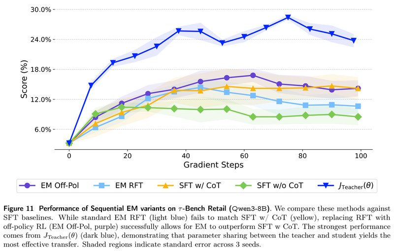
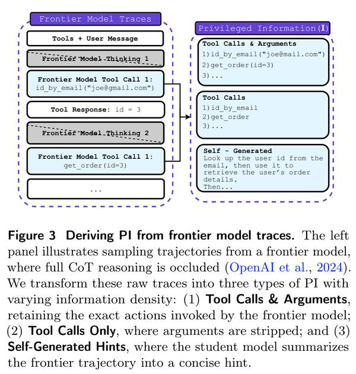
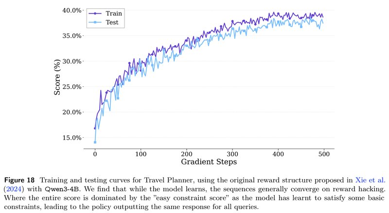
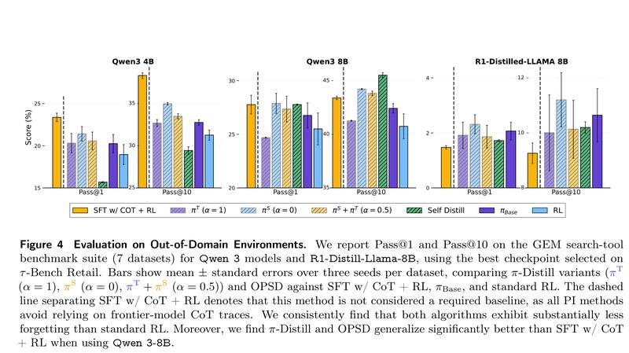
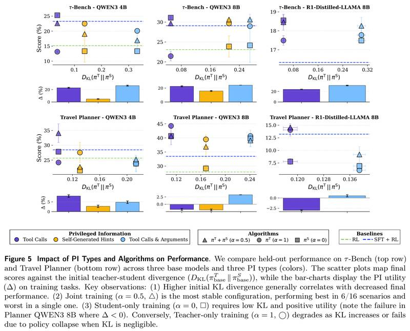
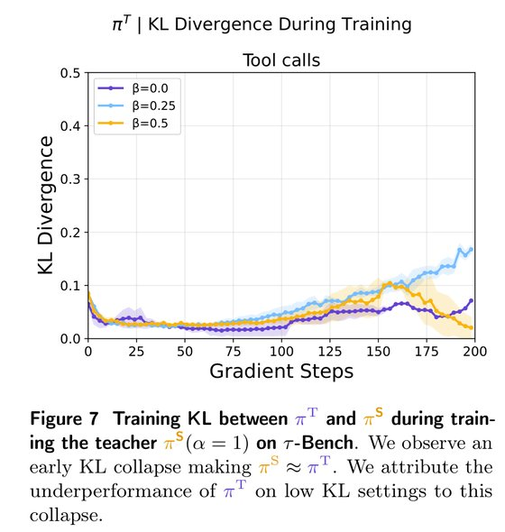
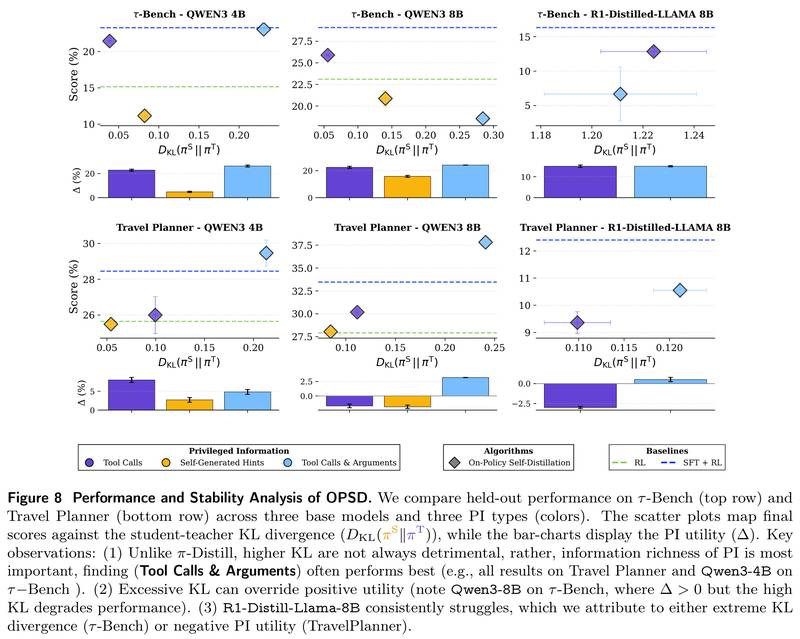
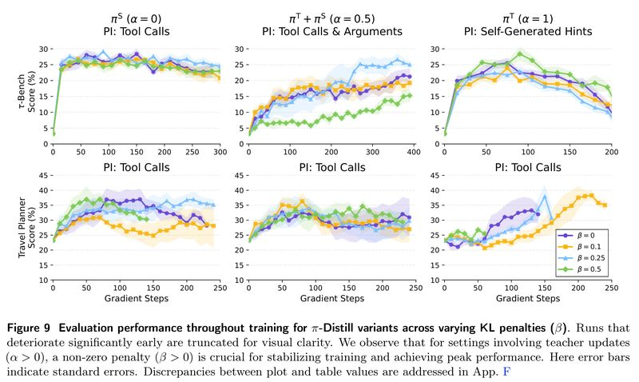

# Privileged Information Distillation for Language Models（语言模型的特权信息蒸馏）

中文 | [English](./Pi-Distill-Privileged-Information-Distillation_en.md)

- **原文链接**: [Privileged Information Distillation for Language Models](https://arxiv.org/abs/2602.04942v3)
- **论文**: [arXiv:2602.04942](https://arxiv.org/abs/2602.04942)
- **发布日期**: 2026-02-04
- **范围**: 按 arXiv v3（2026-02-16 修订）写的通俗解读，不是全文翻译。作者是 Emiliano Penaloza、Dheeraj Vattikonda、Nicolas Gontier、Alexandre Lacoste、Laurent Charlin、Massimo Caccia，来自 ServiceNow、Mila（魁北克）、蒙特利尔大学、麦吉尔大学和 HEC Montréal。论文没有给出代码链接（LaTeX 源码里的仓库链接被注释掉了）。作者的仓库 [Emilianopp/Privileged-Information-Distillation-and-Self-Distillation](https://github.com/Emilianopp/Privileged-Information-Distillation-and-Self-Distillation) 截至 2026-11-05 只有一份 README，写着等法务批准后尽快公开代码。

## 一句话版本

想把大模型做多步工具任务的本事教给小模型，可很多大模型只让你看到"它调用了哪些工具"，看不到"它是怎么想的"，常规的"拿完整思考过程做监督微调"就做不成。论文的办法是：训练时把大模型的动作记录塞进提示词当"小抄"（论文叫特权信息，Privileged Information，PI），同一个模型带着小抄当老师、不带小抄当学生，两边一起训练；上线时学生不看小抄也能做好。主推的方法叫 π-Distill（Privileged Information Distillation，特权信息蒸馏）：带小抄的老师去做任务，一边争取高分，一边被约束"别离不看小抄的自己太远"；学生拿老师做出的轨迹来学，得分高的照着学，得分低的反着学；老师和学生是同一套参数，用系数 α 调配两边的训练比重。另一种做法叫 OPSD（On-Policy Self-Distillation，在线自蒸馏）：学生自己做任务，带小抄的"自己"在旁边逐个 token 对照，越像越好，再加上任务得分一起做强化学习。

效果：Qwen3-8B 用 π-Distill 后，Travel Planner 成绩从 23.6% 提到 44.1%（三种 α 里最好的），接近 671B 的 DeepSeek-V3.1（45.0%），比"拿到完整思维链的 SFT + RL"（32.3%）高 11.8 个百分点（下文简称"分"）。同一个模型在 τ-Bench 零售客服任务上从 3.35% 提到 31.1%，"拿到完整思维链的 SFT + RL"是 29.1%。训练时每个任务只用大模型的 1 条成功记录当小抄；对照的 SFT 在 τ-Bench 上用了全部 15,885 条。

---

## 1. 先认识几个词

| 词 | 大白话 |
| --- | --- |
| 蒸馏（distillation） | 让小模型模仿大模型，把大模型的本事转到小模型身上 |
| 思维链（CoT，Chain-of-Thought） | 模型在动手之前写下的思考过程 |
| SFT（监督微调） | 拿现成的记录让模型逐字模仿 |
| 强化学习（RL） | 让模型自己做任务，按得分调整：得分高的做法以后多做，得分低的少做 |
| GRPO | 一种主流的强化学习方法：同一个任务做好几遍，比组内平均分高的那几遍被鼓励，低的被抑制 |
| 特权信息（PI） | 只在训练时提供的提示，上线后没有。本文里是大模型成功做任务时的动作记录，或由它加工出的提示。下文也叫"小抄" |
| 老师 $`\pi^T`$ | 提示词里带着 PI 的模型 |
| 学生 $`\pi^S`$ | 提示词里没有 PI 的模型，也就是最后上线用的版本 |
| 共享参数 | 老师和学生是同一个模型、同一套权重，区别只在提示词里有没有 PI |
| 轨迹（trajectory） | 一次完整做任务的记录：每一轮的思考、调用的工具、环境返回的结果 |
| KL 散度 | 衡量两个概率分布差多少的尺子。这里比的是：在同一个位置，老师和学生"下一个 token 写什么"的概率分布有多不一样，0 表示完全一样。下文说老师和学生的"差距"，指的就是它 |
| on-policy / off-policy | on-policy 是学自己当下生成的数据；off-policy 是学别人（这里是老师）生成的数据 |
| α 和 β | π-Distill 的两个系数。α 决定训练的力气在老师和学生之间怎么分；β 决定"老师和学生别离太远"这条约束有多严 |
| OOD（分布外） | 训练时没见过的任务，用来看模型能不能举一反三、老本事有没有丢 |
| Pass@k | 同一道题做 k 次，至少做对一次的比例 |

## 2. 它想解决什么问题

在多步工具调用这类智能体任务上，要把大模型的本事蒸馏给小模型，业界常见的流程分两步：先收集大模型做任务的完整记录，包括它的思维链和每一步的动作（调用哪个工具、填什么参数），用这些记录对小模型做 SFT；再用强化学习接着练。

麻烦在于，不少商业大模型只返回动作和一段简短摘要，真实的思维链不公开，论文举的例子是 OpenAI 的 o1。小模型能看到"大模型这一步调用了 `get_order_details`"，看不到"为什么这时候要查订单"。现有几条路线都不理想：

| 路线 | 做法 | 问题 |
| --- | --- | --- |
| SFT（有 CoT）+ RL，业界标准 | 拿大模型带思维链的完整记录做 SFT，再做强化学习 | 要用到思维链，很多商业大模型不给 |
| SFT（无 CoT）+ RL | 只拿动作记录做 SFT，再做强化学习 | 在 τ-Bench 零售任务上明显不如有思维链的版本：Qwen3-8B 是 23.5% 对 29.1%，Qwen3-4B 是 17.6% 对 23.3%（论文表 1） |
| 纯 RL | 小模型自己做任务，按得分学 | 强化学习要靠"做成功"的经验来学，小模型在难任务上几乎做不成（Qwen3-8B 原始模型在 τ-Bench 零售上只有 3.35%），没有成功经验，就没东西可学 |

论文借用了一个老概念：特权信息（PI，Vapnik 和 Vashist 在 2009 年提出），指只在训练时能拿到、实际使用时拿不到的信息。这里就是把大模型的动作记录当成 PI。

打个比方（类比是我加的，不是论文原文）：平时练习时，老师给你一张提示卡，写着这道题依次要做哪几步；正式考试时，提示卡收走。下文说的"小抄"就是这张提示卡。

提示卡对强化学习特别有用。带着提示卡，小模型能做成更多任务，这些成功经验就成了学习材料，补上了上表里纯 RL 缺的那一块。

问题变成：怎么让模型"带卡时学到的本事"，在"不带卡时"也保留下来？论文指出两个困难：

1. 小模型拿到提示卡也不一定会用，得先学会怎么用（证据见第 8.4 节）。
2. 带卡和不带卡时，模型的行为可能差很多，"带卡时的成功经验"不容易迁移给"不带卡的自己"。

论文要回答的问题是：**训练时带着小抄学到的本事，怎样转给上线时不看小抄的模型？**

## 3. 核心做法：π-Distill，老师和学生共用一个模型、一起训练



*图 1：π-Distill 框架总览。（1）从只露出动作、藏起思维链的前沿大模型那里收集成功轨迹（图中没画）；（2）把这些轨迹加工成训练时的 PI，由带 PI 的老师 $`\pi^T_\theta(\mathbf{o}\mid s,\mathbf{I})`$ 去采样；（3）带 PI 的老师和不带 PI 的学生 $`\pi^S_\theta(\mathbf{o}\mid s)`$ 共享参数、一起训练，把 PI 里的知识转给上线时不看 PI 的模型。看图：左边老师的输入里多了一块绿色的"特权信息"。把这块删掉，同样的思考和工具调用就成了学生的训练数据（右边）。两边是同一个模型，训练目标是两部分的加权和。*

π-Distill 用同一个模型扮演两个角色：老师的提示词里带着 PI，学生的没有。训练时由带小抄的老师去做任务，做出的轨迹同时用来训练老师和学生。

**（1）训练老师：拿高分，但别离"不看小抄的自己"太远。** 老师做任务得到奖励（在 −1 到 1 之间），同时要扣掉一项：老师和学生的差距（KL 散度）乘以系数 β。算这项差距时，学生这一侧不求梯度（论文记作 sg，即 stop gradient），只当参照物。论文说这一项有两个作用：一是逼老师去找学生"够得着"的成功做法，学生照着学更容易；二是参数共享，老师变强时学生也跟着沾光，哪怕不直接训练学生。

**（2）训练学生：拿老师刚做出的轨迹，教不看小抄的学生去复现，得分高的多学。** 轨迹是老师生成的，更新的却是学生，所以这是 off-policy 学习。每条轨迹要乘一个重要性权重：这条轨迹学生自己写出来的概率，除以老师写出来的概率。它把"别人的经验"折算成"如果是我自己做的"。学生这边同样要扣 β 乘以差距，算的是同一个方向的 KL，只是换成老师一侧不求梯度、更新的是学生。我的理解（论文没有这样展开）：老师和学生差得越远，学生给老师轨迹打的概率越低，这个权重越小，学生从这条轨迹上学到的就越少。这和第 8.4 节"差距越大效果越差"的观察对得上。

**（3）合起来：用 α 分配力气。** 总目标是 α 乘以老师的目标，加上 1 − α 乘以学生的目标，α 在 0 到 1 之间。

| α | 含义 |
| --- | --- |
| α = 1 | 只训练老师。学生不直接训练，靠共享参数沾光 |
| α = 0 | 只训练学生，学生模仿老师当前的轨迹。论文观察到，在一定条件下，老师不直接训练也会因为共享参数而变强 |
| α = 0.5 | 两边一起训练。实际做法是让 α 在前 15 轮训练里从 0 线性升到 0.5（附录表 2；LaTeX 源码的注释说，这样做是为了防止老师和学生过早"塌成一个"） |

**数值小例子**（我编的示意，不是论文里的）：τ-Bench 上每个任务让老师做 5 遍（这是论文的设置）。假设 3 遍成功（奖励 1）、2 遍失败（奖励 0），组平均 0.6，那么成功那 3 遍的"优势"（奖励减去组平均）是 +0.4，失败那 2 遍是 −0.6（论文的优势只减组平均，不除以标准差）。α = 0.5 时，一半的力气用在老师身上，让"带卡的自己"更常做出成功的那种操作；另一半用在学生身上，让"不带卡的自己"也朝同一个方向走。失败的轨迹也参与训练，被往下压。实际实现里，β 那一项直接从每条轨迹的奖励里扣掉（附录 E.1），所以这里的奖励其实是任务奖励减去 β 乘以差距。

**选读：三个公式。** 不看也不影响理解。$`s`$ 是到当前为止的全部交互内容（用户的请求、模型之前的输出、环境的返回），$`\mathbf{I}`$ 是 PI，$`\mathbf{o}`$ 是模型写出的思考和动作，$`R`$ 是奖励，$`\mathrm{sg}`$ 表示这一侧不求梯度。老师的目标（论文式 (2)）：

```math
J_{\text{Teacher}}(\theta)=\mathbb{E}_{\mathbf{o}\sim\pi^T_\theta(\cdot\mid s,\mathbf{I})}\big[R(\mathbf{o},s)\big]-\beta\,D_{\mathrm{KL}}\big(\pi^T_\theta(\cdot\mid s,\mathbf{I})\,\big\|\,\mathrm{sg}(\pi^S_\theta(\cdot\mid s))\big)
```

学生的目标（论文式 (3)，中括号里的分式就是重要性权重）：

```math
J_{\text{Student}}(\theta)=\mathbb{E}_{\mathbf{o}\sim\pi^T_\theta(\cdot\mid s,\mathbf{I})}\Big[\frac{\pi^S_\theta(\mathbf{o}\mid s)}{\mathrm{sg}\big(\pi^T_\theta(\mathbf{o}\mid s,\mathbf{I})\big)}\,R(\mathbf{o},s)\Big]-\beta\,D_{\mathrm{KL}}\big(\mathrm{sg}(\pi^T_\theta(\cdot\mid s,\mathbf{I}))\,\big\|\,\pi^S_\theta(\cdot\mid s)\big)
```

合起来（论文式 (4)）：

```math
J_{\pi\text{-Distill}}(\theta)=\alpha\,J_{\text{Teacher}}(\theta)+(1-\alpha)\,J_{\text{Student}}(\theta),\qquad \alpha\in[0,1]
```

## 4. 为什么不分两步走：作者走过的弯路

最直接的想法是：先把带小抄的老师训练好，再把它的本事蒸馏给学生。论文说这样做有三个问题：

1. 不知道该拿老师的哪个检查点去教。
2. 学生学的是别人的轨迹，属于 off-policy 学习，训练不稳定。
3. 分开训练两个模型，费算力。

作者的早期实验也表明分步做效果更差（图 11，在附录 A.2）。π-Distill 的设计就来自这些失败的尝试。

**选读：变分 EM 的视角。** 不看也不影响理解。论文在附录 A 里用变分 EM 的框架解释 π-Distill。设想一个"理想策略" $`\pi^*`$，它按 $`\pi_{\text{ref}}(\mathbf{o}\mid s)\,e^{R(\mathbf{o},s)}`$ 的比例偏向高分轨迹。这个分布要除以一个算不出来的归一化常数，没法直接用，于是用带 PI 的老师去逼近它（E 步，推出来就是 $`J_{\text{Teacher}}`$），再让学生去学老师（M 步，原本是 SFT；π-Distill 换成了能利用失败轨迹的 $`J_{\text{Student}}`$，理由见本节最后）。传统做法用两个模型、交替或先后训练；π-Distill 让两者共享参数，把两步合成一步。



*图 10：用变分 EM 做策略优化的示意图。横向从左到右是奖励从负到正的轨迹区域，几座"山"是不同模型生成的轨迹分布。一开始的学生（蓝色，$`\pi^S_\phi`$）几乎不会产生得正分（$`R>0`$）的轨迹，没法直接靠强化学习提升。办法是：（1）用 $`J_{\text{Teacher}}`$ 优化带 PI 的老师（紫色，$`\pi^T_\theta`$），让它能做出成功的轨迹，逼近理想策略（黄色，$`\pi^*`$）；（2）再用 $`J_{\text{SFT}}`$ 更新学生，把老师的本事蒸馏过来。论文的图注说，这个两步流程有道理，但要维护两套参数、分两个阶段训练，算力上不划算；π-Distill 把它简化成一个阶段，效果更好，也更简单。这张图也说明了 PI 为什么对强化学习有用：学生的轨迹几乎全落在得负分的区域，强化学习找不到可以鼓励的成功例子；带着 PI 的老师能往得正分的区域挪，把学生往理想策略那边带。*

作者先后试过这几条路（附录 A.2）：

1. **离线变分 EM**（仿照 Zhou 等 2025 的 Variational Reasoning）：在固定数据集上，学一个"看着专家轨迹补写思维链"的老师。要调的东西很多（老师和学生的更新比例、各自的优化器状态、从老师采多少数据），在多轮任务上没跑通。作者认为 Zhou 等能成功是因为有标准答案；拿不完美的大模型轨迹去拟合，甚至会让效果变差。
2. **在线训练老师，和学生交替进行**：老师和学生很容易塌成一个，效果不好。
3. **先后进行（Sequential EM）**：先训练老师，再拿老师的成功轨迹给学生做 SFT（只挑成功样本做微调，叫 rejection fine-tuning，RFT）。这是效果最好的 EM 版本，但仍要一些额外调整。

下面是在 τ-Bench 零售、Qwen3-8B、"自己写的提示"这个设置下的对比（作者说这个设置效果最好，所以选它）：



*图 11：τ-Bench 零售上（Qwen3-8B），几种先后进行的 EM 变体和 SFT 对照方法的对比。横轴是训练步数（0～100），纵轴是成绩（%）。标准的 EM（第二步用 RFT，浅蓝）达不到 SFT（有 CoT）的水平（黄）；把 RFT 换成带截断的 off-policy 强化学习（EM Off-Pol，紫）后，EM 能超过 SFT（有 CoT）。最好的是只优化 $`J_{\text{Teacher}}`$（深蓝），作者认为这说明老师和学生共享参数时迁移效果最好。阴影是 3 个种子的标准误。*

从图上读出的 100 步内峰值（读图估计）：

| 做法 | 峰值 |
| --- | --- |
| SFT（无 CoT） | 约 10.5% |
| EM，第二步用 RFT | 约 14.4%，之后掉到约 10.6% |
| SFT（有 CoT） | 约 14.7% |
| EM，第二步换成 off-policy 强化学习 | 约 16.8% |
| 只优化 $`J_{\text{Teacher}}`$，参数共享 | 约 28.4% |

作者从中得到两条结论，后来都成了 π-Distill 的设计：

1. **参数共享本身就能把老师的本事转给学生。** 只训练带 PI 的老师，学生的峰值就到了约 28%，差不多是 SFT（有 CoT）的两倍。这一点最出乎作者意料。
2. **训练学生时要用上失败的轨迹。** RFT 只模仿成功样本；换成能给失败样本负反馈的 off-policy 强化学习后效果明显变好。$`J_{\text{Student}}`$ 就是这样做的。

再把两步合成一步，就是 π-Distill。

## 5. 另一种做法：OPSD，学生自己做，带小抄的自己逐 token 对照

OPSD 的做法和 π-Distill 反过来：让学生自己（不看小抄）去做任务；带小抄的老师在学生写下的每个位置，给出"换我会怎么写"的概率分布；学生和老师越像，奖励越高。这个"像不像"是逐 token 的、很密的信号，和任务得分一起用来做强化学习。论文把这一项叫作学生和老师之间的反向 KL（reverse KL）惩罚。

通俗说：学生自己做题，旁边坐着一个看过提示卡的"自己"，学生每写一个 token，它都告诉学生"像不像我会写的"。

这种"学生自己做、老师逐 token 对照"的做法叫在线蒸馏（on-policy distillation）。论文第 3.2 节说，以前的在线蒸馏（比如 Agarwal 等 2024，[arXiv 2306.13649](https://arxiv.org/abs/2306.13649)）一般拿一个更大的模型当老师；本文换成同一个模型，只是让老师多看 PI。

**选读：OPSD 的目标（论文式 (5)）。** 不看也不影响理解。轨迹从学生采样，期望奖励减去学生到老师的 KL，老师一侧不求梯度：

```math
J_{\text{OPSD}}(\theta)=\mathbb{E}_{\mathbf{o}\sim\pi^S_\theta(\cdot\mid s)}\big[R(\mathbf{o},s)\big]-\beta\,D_{\mathrm{KL}}\big(\pi^S_\theta(\cdot\mid s)\,\big\|\,\mathrm{sg}(\pi^T_\theta(\cdot\mid s,\mathbf{I}))\big)
```

两种方法的区别：

| | π-Distill | OPSD |
| --- | --- | --- |
| 谁去做任务 | 带小抄的老师 | 不带小抄的学生 |
| 学生学什么 | 老师的轨迹，按重要性权重折算 | 自己的轨迹，老师逐 token 对照 |
| 数据类型 | off-policy | on-policy |
| 老师是否直接训练 | α > 0 时训练 | 不直接训练，只当参照（参数共享，会跟着学生一起变） |
| 差距用哪个方向的 KL | $`D_{\mathrm{KL}}(\pi^T\,\Vert\,\pi^S)`$ | $`D_{\mathrm{KL}}(\pi^S\,\Vert\,\pi^T)`$ |

论文脚注说，同期有三篇工作提出了同样的目标，"自蒸馏"这个名字也是跟着它们叫的。本文的不同在于：没有标准答案，老师看的是大模型的动作记录，任务是多轮工具调用，并且专门找出了 OPSD 会失败的情况。几篇工作的对比见第 12 节。

## 6. 小抄从哪来：三种 PI

论文用 DeepSeek-V3.1（671B，具体是 DeepSeek-chat-v3.1）当"前沿大模型"，实验里说的"大模型"都是它。选它是因为它开源、思维链看得见，这样才能和"拿完整思维链做 SFT"的传统做法对照。实验里只把它的动作当 PI，当作看不到它的思维链。



*图 3：从前沿大模型的轨迹里加工出 PI。左边是大模型做任务的记录，其中完整的思维链被遮住了（灰色，并被虚线划掉）。这些原始轨迹被加工成右边三种信息量不同的 PI：（1）工具调用 + 参数，保留大模型实际执行的动作；（2）只有工具名，去掉参数；（3）自己写的提示，由学生模型把大模型的轨迹总结成一段简短提示。*

三种 PI，信息从多到少：

1. **工具调用 + 参数**：完整的动作序列，例如 `GetUserDetails(Name:"Kevin Lau")`。
2. **只有工具名**：只告诉你调用过 `GetUserDetails`，参数要自己从上下文推。
3. **自己写的提示**：让学生模型（也就是要训练的那个模型）读一遍大模型的成功轨迹，总结成 2～3 句话。附录 H.3 里的例子是取消订单任务，提示写的是：智能体先用邮箱验证用户身份，再查订单详情，确认订单号和取消原因后调用 `cancel_pending_order` 取消了订单；退款流程随之启动，智能体也告知了用户后续步骤。作者认为，这样总结还能过滤掉大模型多余的步骤，甚至提出比它更好的做法。

数据规模和用法：

- 收集了大模型在 τ-Bench 零售上的 15,885 条、Travel Planner 上的 1,986 条成功轨迹，在各任务间均匀采样。
- 每个训练任务只挑**步数最少**的那条成功轨迹来做 PI。最终 Travel Planner 的 45 个训练任务全都有 PI，τ-Bench 的 500 个训练任务里有 300 个有 PI。没有 PI 的任务，就让学生自己做、按普通强化学习训练。
- SFT 对照方法用的是**全部**成功轨迹，比 PI 方法用到的多得多。论文说这样 SFT 的效果最好。
- R1-Distill-Llama-8B 不用"自己写的提示"，因为它总是把原始轨迹或工具调用原样抄回来，不会总结。

PI 怎么放进去：加在系统提示词的任务描述里，用 `<Secret information>` 标签包起来，并叮嘱模型"不要提到你拿到了提示"。实际上模型还是会说漏嘴（见第 7 节）。

## 7. 让它真正跑起来的几个细节

**（1）"别离太远"该以谁为参照：当前学生，不用冻结的原始模型。** KL 项里的参照模型，用"当前学生（不求梯度）"比用"冻结的原始模型"好得多（附录 D.2）。用原始模型当参照时，训练中成绩会下降甚至崩掉，α=1 时最明显：模型一边被要求离原始模型越来越远，一边又因为离得远被惩罚。用当前学生当参照，三种 α 都训练稳定，还不用在显存里多放一个冻结模型。

**（2）小抄会说漏嘴。** 提示词里要求模型别提自己拿到了提示，模型还是会在输出里写"hint""secret"之类的词。训练中作者还发现，少数指向 PI 的 token（比如"hint"）KL 特别高。作者用一个关键词表检测这类词，每出现一次奖励扣 0.1，最终实验都带着这项惩罚（附录 D.1）。结果：

- 训练中，老师说漏嘴的比例随步数上升，三种 PI 都这样："只有工具名"最高，"工具调用 + 参数"次之，"自己写的提示"起点低，但也在涨。这项惩罚能让比例降一些，降得不多。
- 加不加这项惩罚，任务成绩几乎一样。
- 上线时不看 PI 的学生，说漏嘴的比例没有随训练上升。

**（3）长度惩罚。** 模型容易越写越长，轨迹常常超出 25k token 的上下文上限。作者只对做成功的轨迹加长度惩罚（附录 E.2）：每一轮回复不超过 2000 token 不扣；超过后按余弦曲线逐渐加重，接近 5000 token 时奖励扣约 0.1，再长最多扣到 0.2；各轮的惩罚取平均后加到奖励上。附录还给总惩罚设了最多扣 0.3 的上限，但每轮最多扣 0.2，取平均后也不会超过 0.2，所以这个上限实际碰不到。正文对这项惩罚的说法和附录不完全一致，见第 10 节。

## 8. 实验结果

### 8.1 实验怎么设计的

**任务。** 四组任务都是多轮工具调用：

| 基准 | 内容 | 用途 | 规模 |
| --- | --- | --- | --- |
| τ-Bench 零售 | 模拟电商客服：验证身份、查订单、退换货等 | 训练 + 测试 | 训练 500 个任务，测试 115 个 |
| τ-Bench 航空 | 订机票、改签等 | 只测试，训练中没见过（OOD） | 50 个任务 |
| Travel Planner | 用搜索工具规划行程，要满足预算、饮食等约束 | 训练 + 测试 | 训练 45 个，测试 180 个 |
| GEM 搜索问答 | 用搜索工具回答问题，共 7 个数据集：2Wiki、PopQA、TriviaQA、HotpotQA、Bamboogle、NaturalQuestions、Musique | 只测试，和训练任务差别很大（OOD） | 论文没写 |

**环境改动。** 作者对原始环境做了几处改动：

- τ-Bench 的用户模拟器从 GPT-4o 换成 Qwen-14B，降低成本。最大的改动是删掉了"转人工"工具 `transfer_to_human_agents`，因为模型总是靠它钻空子（reward hacking）。
- Travel Planner 原来的打分规则是先查"简单约束"，全过了才查"困难约束"。模型学会了钻这个规则的空子：用原始打分规则训练 Qwen3-4B，成绩从约 14%～17% 一路涨到约 38%～39%，但所有题的回答都变成了同一个套路，直接调用 `Planner[...]` 工具结束对话，靠满足几条简单约束拿分。附录 G 的例子里，模型在思考里写着要搜航班、酒店、景点，最后只输出了一个动作 `Planner[Query: Craft a 7-day Wisconsin itinerary from Punta Gorda, ...]`。作者因此改成每个简单约束单独查、过了再查对应的困难约束，比如订完餐厅马上查是否符合饮食限制。



*图 18：用 Xie 等（2024）的原始打分规则训练 Qwen3-4B 时，Travel Planner 上的训练（深紫）和测试（浅蓝）曲线，横轴是训练步数（0～500），纵轴是成绩。两条线从约 14%～17% 涨到约 38%～39%（读图估计），模型看起来在进步，但输出基本都收敛到了钻空子的套路：总分几乎全由"简单约束"的得分撑起来，因为模型学会了满足几条基本约束，对所有问题都给出同样的回答。*

**学生模型**：Qwen3-4B、Qwen3-8B、R1-Distill-Llama-8B（两个模型家族）。R1-Distill-Llama-8B 即使带着 PI 也做不出正确的轨迹（原始成绩全是 0%），强化学习无从起步。所以只有它先用"带思维链的 SFT"热身，再接各种方法训练。这也顺带检验了一件事：模型已经在包含 PI 内容的轨迹上做过 SFT，PI 还有没有用。

**本文的方法**：π-Distill 取 α = 0、0.5、1 三种，外加 OPSD。

**对照方法**：

- 纯 RL（GRPO）。
- 只用动作做 SFT（下文记作"SFT（无 CoT）"），以及 SFT 之后再做强化学习。
- 用完整思维链做 SFT（"SFT（有 CoT）"），以及之后再做强化学习。这就是业界标准做法，它用到了现实中往往拿不到的思维链，论文把它当作"软上限"。按照惯例，这类对照方法要扫多个 SFT 检查点，挑最终效果最好的那个接着做强化学习。

**其他设置**：

- 2 张 H100，上下文上限 25k token。
- 所有方法都扫了超参数，最好的那组跑 3 个随机种子取平均。每个种子的成绩，取"连续 3 个检查点平均分"的最高值。
- τ-Bench 训练 600 步，Travel Planner 训练 400 步。

**表里的数为什么比曲线的最高点高。** 表 1 的数，是每个种子各自的最高点再取平均；曲线画的是每一步上 3 个种子的平均，再看最高点。三个种子在不同步数达到最高，附录 F 举的例子里分别在约 70、95、150 步，三个峰值的平均是 31.11%（表 1 里取整为 31.1%），比平均曲线的最高点高。所以下文图 9 这类训练曲线上读出的峰值，可能比表 1 里对应的数低。

### 8.2 训练过的任务：只看动作，也能超过"看完整思维链"的做法

论文摘要的说法是：在多个基准、多个模型、多种 PI 上，π-Distill（以及部分情况下的 OPSD）都超过了"先 SFT 再强化学习"的业界标准做法，而后者还假设能拿到完整的思维链。

论文表 1（3 个随机种子的均值 ± 标准差；τ-Bench 航空是训练中没见过的任务）：

| 模型 / 方法 | Travel Planner | τ-Bench 零售 | τ-Bench 航空（OOD） |
| --- | --- | --- | --- |
| **DeepSeek-V3.1（671B，大模型本身）** | 45.0% ± 3.78 | 51.3% ± 0.212 | 40.0% ± 0.161 |
| **R1-Distill-Llama-8B** | | | |
| 原始模型 | 0.00% ± 0.00 | 0.00% ± 0.00 | 0.00% ± 0.00 |
| SFT（有 CoT） | 6.35% ± 1.27 | 15.2% ± 0.44 | 8.00% ± 5.29 |
| SFT（无 CoT） | 2.40% ± 0.86 | 0.680% ± 0.17 | 0.670% ± 1.15 |
| SFT（有 CoT）+ RL | 12.4% ± 1.56 | 16.3% ± 1.49 | 7.33% ± 4.16 |
| SFT（有 CoT）+ OPSD（本文） | 13.1% ± 1.09 | 14.5% ± 0.00 | 2.00% ± 0.00 |
| SFT（有 CoT）+ π-Distill α=0（本文） | 7.86% ± 1.75 | **18.6%** ± 0.50 | **10.0%** ± 2.00 |
| SFT（有 CoT）+ π-Distill α=0.5（本文） | 14.0% ± 1.63 | 18.3% ± 0.77 | 9.33% ± 3.06 |
| SFT（有 CoT）+ π-Distill α=1（本文） | **14.1%** ± 3.27 | 17.7% ± 0.77 | 7.33% ± 4.16 |
| **Qwen3-4B** | | | |
| 原始模型 | 17.6% ± 2.16 | 5.03% ± 1.88 | 2.21% ± 1.99 |
| SFT（有 CoT） | 21.1% ± 1.94 | 12.4% ± 0.60 | 2.67% ± 1.15 |
| SFT（无 CoT） | 20.8% ± 1.82 | 15.2% ± 1.70 | 4.00% ± 5.29 |
| RL | 25.1% ± 3.75 | 15.2% ± 0.17 | 5.33% ± 3.06 |
| SFT（无 CoT）+ RL | 23.3% ± 1.33 | 17.6% ± 2.69 | 5.33% ± 2.31 |
| OPSD（本文） | 29.8% ± 1.14 | 23.1% ± 0.04 | 10.6% ± 6.57 |
| π-Distill α=0（本文） | 28.5% ± 4.35 | **25.3%** ± 0.60 | 8.00% ± 5.29 |
| π-Distill α=0.5（本文） | **33.8%** ± 6.85 | 22.6% ± 0.93 | 6.00% ± 2.00 |
| π-Distill α=1（本文） | 28.2% ± 6.27 | 22.5% ± 0.93 | **12.0%** ± 5.29 |
| SFT（有 CoT）+ RL（业界标准，用了 CoT） | 26.4% ± 1.16 | 23.3% ± 3.02 | 6.67% ± 5.77 |
| **Qwen3-8B** | | | |
| 原始模型 | 23.6% ± 2.23 | 3.35% ± 1.47 | 6.40% ± 3.02 |
| SFT（有 CoT） | 26.0% ± 2.27 | 16.5% ± 4.66 | 5.33% ± 1.15 |
| SFT（无 CoT） | 29.8% ± 1.71 | 12.8% ± 0.77 | 6.00% ± 4.00 |
| RL | 27.5% ± 0.95 | 23.9% ± 0.44 | 6.67% ± 3.06 |
| SFT（无 CoT）+ RL | 31.3% ± 2.79 | 23.5% ± 4.27 | 6.00% ± 2.00 |
| OPSD（本文） | 37.5% ± 1.53 | 27.3% ± 0.33 | **14.0%** ± 5.66 |
| π-Distill α=0（本文） | 40.7% ± 1.14 | **31.1%** ± 0.73 | 12.0% ± 6.00 |
| π-Distill α=0.5（本文） | 41.1% ± 7.24 | 30.6% ± 0.67 | 7.33% ± 1.15 |
| π-Distill α=1（本文） | **44.1%** ± 2.16 | 29.7% ± 0.33 | 9.33% ± 3.06 |
| SFT（有 CoT）+ RL（业界标准，用了 CoT） | 32.3% ± 1.10 | 29.1% ± 2.14 | 8.00% ± 3.46 |

*表 1 说明：标"本文"的是论文提出的方法；加粗是每个模型里最好的成绩（原表还用下划线标出第二名，这里省略）。论文的结论：π-Distill 和 OPSD 都能有效利用 PI，稳定超过所有拿不到大模型思维链的对照方法；两种方法在 Travel Planner 上都能超过 SFT（有 CoT）+ RL，π-Distill 在 τ-Bench 上也更好。*

怎么读这张表：

- **只看动作的 π-Distill，超过了看完整思维链的业界标准做法。** Qwen3-8B 上，π-Distill 三种 α 在 Travel Planner 上是 40.7%～44.1%，业界标准是 32.3%；在 τ-Bench 零售上是 29.7%～31.1%，业界标准是 29.1%。Travel Planner 上最多高出 11.8 分。Qwen3-4B 上，α=0 在三列都超过业界标准，另外两个 α 互有高低。
- **8B 的学生在 Travel Planner 上快追上 671B 的大模型了**：44.1% 对 45.0%。τ-Bench 零售上差距还大，31.1% 对 51.3%。
- **不用思维链的老办法提升有限**：纯 RL 和"SFT（无 CoT）+ RL"成绩差不多（纯 RL 更省算力），都不如业界标准，零售上落后 5～8 分。
- **OPSD 介于两者之间**：比不用思维链的老办法好不少（Qwen3-8B 零售 27.3%，纯 RL 23.9%），在训练任务上一般不如 π-Distill 表现最好的那个 α；在没训练过的航空任务上表现突出，Qwen3-8B 上的 14.0% 是三个小模型里最高的。
- **对已经做过 SFT 的模型也有用**：R1-Distill-Llama-8B 先用思维链做过 SFT，之后接 π-Distill（α=0）零售得 18.6%，接普通强化学习是 16.3%。但不是每种设置都更好：Travel Planner 上 α=0 只有 7.86%，比接普通强化学习的 12.4% 差。
- **α 没有统一的最好值**，三种 α 都拿过第一，要看具体场景（见第 8.4 节）。
- **更省事**：π-Distill 只有一个训练阶段；业界标准做法要先试多个 SFT 检查点，再挑最好的去做强化学习。
- **航空这一列看个大概就好**：只有 50 个任务，做对 1 个就是 2 分，不少标准差在 3～6 分之间。

### 8.3 没训练过的任务：多数情况下不"忘本"，Qwen3-8B 上泛化更好

这些模型是在 τ-Bench 零售客服上训练的，GEM 的搜索问答和它差别很大，所以这组评测看的是：学了新任务之后，老本事有没有丢、能不能举一反三。指标是 Pass@1（做一次就做对的比例）和 Pass@10（做 10 次至少对一次的比例）。



*图 4：在 GEM 搜索工具基准的 7 个数据集上，Qwen3 两个模型和 R1-Distill-Llama-8B 的 Pass@1 和 Pass@10（%）。每个方法都用它在 τ-Bench 零售上表现最好的那个检查点。柱子是均值，误差线是标准误（每个数据集 3 个种子）。颜色：橙色是 SFT（有 CoT）+ RL；斜线柱是 π-Distill 三个变体（紫 $`\pi^T`$ α=1、浅蓝 $`\pi^S`$ α=0、黄 $`\pi^T+\pi^S`$ α=0.5）；绿色斜线是 OPSD（图中叫 Self Distill）；深紫是原始模型 $`\pi_{\text{Base}}`$；浅蓝实心是纯 RL。SFT（有 CoT）+ RL 旁边的虚线表示它不是必须比的对照方法，因为所有 PI 方法都不依赖大模型的思维链。注意纵轴不从 0 开始，柱子的高低差看起来比实际大。论文的结论：两种算法的遗忘都比纯 RL 少得多；用 Qwen3-8B 时，π-Distill 和 OPSD 的泛化明显好于 SFT（有 CoT）+ RL。*

从图 4 读出的近似值（%，读图估计）：

| 方法 | Qwen3-4B Pass@1 | Qwen3-4B Pass@10 | Qwen3-8B Pass@1 | Qwen3-8B Pass@10 |
| --- | --- | --- | --- | --- |
| 原始模型 | 20.3 | 32.7 | 26.8 | 42.4 |
| 纯 RL | 19.0 | 31.2 | 25.5 | 40.7 |
| SFT（有 CoT）+ RL | 23.4 | 38.3 | 27.8 | 43.3 |
| π-Distill α=1 | 20.3 | 32.6 | 24.7 | 41.2 |
| π-Distill α=0 | 21.4 | 34.9 | 27.9 | 44.2 |
| π-Distill α=0.5 | 20.6 | 33.4 | 27.4 | 43.8 |
| OPSD | 15.7 | 29.4 | 27.8 | 45.5 |

- **纯 RL 会让模型"忘本"**：两个 Qwen 上，纯 RL 都比原始模型差（4B 19.0 对 20.3，8B 25.5 对 26.8）。论文说这一点在所有评测里都成立。
- **两个 Qwen 上，π-Distill 的 α=0 和 α=0.5 都没有退步**，都高于原始模型和纯 RL。α=1 在 Qwen3-8B 上是例外：Pass@1 约 24.7，比原始模型和纯 RL 都低，论文正文没有提到这一点（见第 10 节）。
- **模型越强，越适合"自己想"**：Qwen3-4B 上业界标准做法最好（Pass@10 38.3）。Qwen3-8B 上，π-Distill α=0、α=0.5 和 OPSD 在 Pass@1 上和业界标准基本持平（27.4～27.9 对 27.8），在 Pass@10 上都超过了它（43.8～45.5 对 43.3）。论文的解读：较小的模型更需要大模型思维链的显式示范，较强的推理模型从"更 on-policy"（学自己生成的推理）中受益更多。
- **OPSD 两极分化**：8B 上 Pass@10 最高，4B 上却掉得最多（Pass@1 15.7，比原始模型低 4.6 分）。论文猜测，小模型用 OPSD 时可能把老师在训练任务上的指导学得过头了，而更强的推理模型给出的指导更有通用性。
- **R1-Distill-Llama-8B**：业界标准做法掉到了原始模型以下（Pass@1 约 1.5 对约 2.1）；π-Distill 和 OPSD 没有带来明显提升，但也没有明显退步。

### 8.4 π-Distill 什么时候管用：差距小、小抄有用；一起训练最稳

前面看的是每种方法表现最好的配置。论文第 7 节换了三种 PI，想找出决定成败的因素，主要针对 π-Distill，也说明了 OPSD 在什么情况下有竞争力。它用了两个训练前就能测出来的指标：

- **差距**：同一个原始模型，带 PI 和不带 PI 时行为差多少，用 KL 散度衡量。π-Distill 看 $`D_{\mathrm{KL}}(\pi^T_{\text{base}}\,\|\,\pi^S_{\text{base}})`$，OPSD 看反方向的 $`D_{\mathrm{KL}}(\pi^S_{\text{base}}\,\|\,\pi^T_{\text{base}})`$，下标 base 表示训练前的原始模型。
- **有用程度 Δ**：在训练任务上，带 PI 比不带 PI 多拿多少分，$`\Delta=\text{score}(\pi^T_{\text{base}})-\text{score}(\pi^S_{\text{base}})`$。

举个数（从图 5 的柱状图读出，读图估计）：τ-Bench 上 PI 非常有用，Qwen3-8B 带上"工具调用 + 参数"，训练任务成绩高出约 24 分。Travel Planner 上 PI 的帮助小得多，最多约 8 分（Qwen3-4B 带"只有工具名"）；Qwen3-8B 带"只有工具名"或"自己写的提示"时，成绩反而低了约 2 分（Δ<0）。

论文还定义了一个训练后的指标 $`\Delta_{\max}`$：训练过程中"带 PI 的最好成绩"减去"纯 RL 的最好成绩"（都在训练任务上），衡量一种算法把 PI 变成实际提升的能力（论文图 6，本文没放）。



*图 5：PI 类型和算法对 π-Distill 效果的影响。上排是 τ-Bench，下排是 Travel Planner，三列是三个模型，颜色代表三种 PI（深紫：只有工具名；黄：自己写的提示；浅蓝：工具调用 + 参数）。散点图的横轴是训练前老师和学生的差距 $`D_{\mathrm{KL}}(\pi^T_{\text{base}}\|\pi^S_{\text{base}})`$，纵轴是最终的测试成绩；每个小图里，同一种颜色的三个点，是同一种 PI 下三种 α 的结果（三角 α=0.5，圆圈 α=1，方块 α=0）；绿色虚线是纯 RL，蓝色虚线是 SFT + RL。下方柱状图是 PI 在训练任务上的有用程度 Δ。图注的主要观察：（1）初始差距越大，最终成绩通常越差；（2）一起训练（α=0.5）最稳，16 个场景里 6 个最好、只有 1 个最差（正文写的是 7 个最好，见第 10 节）；（3）只训练学生（α=0）要求差距小且 Δ 为正（注意 Travel Planner 上 Qwen3-8B 在 Δ<0 时的失败）；反过来，只训练老师（α=1）在差距变大时变差，差距几乎为零时又会因为策略塌缩而失败。*

**总体**：差距越大，最终成绩往往越差。老师看着小抄做出来的步骤，很多是学生自己想不到的，差得越远，学生越难学会。具体还要看 α。

**只训练老师（α=1）**：

- 能让模型学会用原本用不好的 PI。即使一开始 Δ<0（带 PI 反而更差），训练老师之后 $`\Delta_{\max}`$ 也都是正的。论文认为，"学会用 PI"是只训老师时迁移成功的一个重要原因。
- 有个坑：τ-Bench 上用"只有工具名"当 PI 时，老师和学生本来就很接近，训练一开始差距就掉到接近 0（图 7），两者"塌成一个"，老师干脆不看小抄了。结果连纯 RL 都不如：Qwen3-4B 约 13%，纯 RL 是 15.2%；Qwen3-8B 约 21%，纯 RL 是 23.9%。作者试过把"别离太远"的参照从学生换成训练前的原始模型，效果更差（见第 7 节（1））。



*图 7：只训练老师（α=1）时，τ-Bench 上老师 $`\pi^T`$ 和学生 $`\pi^S`$ 之间的 KL 随训练的变化（PI 为"只有工具名"）。横轴是训练步数（0～200），纵轴是 KL，三条线是 β=0、0.25、0.5。KL 很早就塌缩，使得 $`\pi^S\approx\pi^T`$：一开始只有 0.065～0.085，训练约 25 步后就掉到 0.02～0.04，β=0 也一样；之后几条线有所回升，β=0.25 在第 200 步时约 0.17（读图估计）。论文把 α=1 在低差距设置下表现差归因于这次塌缩。原图注的符号有一处写错，见第 10 节。*

**一起训练（α=0.5）**：最稳。正文说它在 16 个场景里 7 个最好（图 5 的图注写的是 6 个，见第 10 节），只有 1 个垫底，单独训练老师或学生时的那些失败情况它基本都能避开。作者认为再细调 α 多半还能更好，留给了以后。

**只训练学生（α=0）**：

- 差距小是成功的强信号。τ-Bench 上用"只有工具名"配 α=0，在三个模型上都是整张小图里的最高分（Qwen3-4B 25.3%、Qwen3-8B 31.1%、R1-Distill-Llama-8B 约 18.6%），因为带不带小抄，模型的行为差不多，学生照着学最容易。差距变大时成绩通常下降，偶尔 PI 特别有用时能扳回来。
- PI 本身有没有用也很关键。Travel Planner 上的 Qwen3-8B，"自己写的提示"让成绩变差（Δ≈−2），α=0 只有约 29%，和纯 RL（约 28%）差不多；这类失败情况下 $`\Delta_{\max}\approx 0`$，说明 PI 一开始就没优势时，只训练学生榨不出价值。
- 有个反直觉的现象：同样是 Δ<0 的"只有工具名"，因为差距小，α=0 却有约 41%。论文的解释是，差距小时，学生学到的东西会通过共享参数"倒流"回老师，老师没被直接训练也学会了用小抄，进而能做出更好的轨迹给学生学。

作者的小结：

| 训练方式 | 什么时候好用 | 什么时候失败 |
| --- | --- | --- |
| 只训学生（α=0） | PI 有用，且带不带 PI 行为差别小 | 差距大，或 PI 没用甚至有害 |
| 只训老师（α=1） | PI 有用，或者模型能学会用它 | 老师和学生塌成一个，老师不再看小抄 |
| 一起训练（α=0.5） | 大多数情况都不差，从没明显垫底 | 论文没有列出（16 个场景里垫底过 1 次） |

作者的建议：手头只有一种 PI、或者没条件把几种 α 都试一遍时，就用 α=0.5。

### 8.5 OPSD 什么时候管用：看小抄的信息量，差距别太大



*图 8：OPSD 的效果和稳定性分析，版式和图 5 相同。上排是 τ-Bench，下排是 Travel Planner，三列是三个模型，颜色代表三种 PI（深紫：只有工具名；黄：自己写的提示；浅蓝：工具调用 + 参数）。散点图的横轴是学生和老师的差距 $`D_{\mathrm{KL}}(\pi^S\|\pi^T)`$，纵轴是最终测试成绩；柱状图是 PI 的有用程度 Δ；绿色虚线是纯 RL，蓝色虚线是 SFT + RL。图注的主要观察：（1）和 π-Distill 不同，差距大不一定坏，PI 的信息量才最重要，"工具调用 + 参数"常常最好（比如 Travel Planner 上的全部结果，以及 τ-Bench 上的 Qwen3-4B）；（2）差距过大会抵消 PI 的好处（看 τ-Bench 上的 Qwen3-8B，Δ>0，但差距太大拖累了成绩）；（3）R1-Distill-Llama-8B 一直表现不好，作者归因于差距极大（τ-Bench）或 PI 有害（Travel Planner）。*

- **信息量最能预测效果**。信息最全的"工具调用 + 参数"在 Travel Planner 上对两个 Qwen 都最好，Qwen3-8B 约 38%，另外两种 PI 只有约 28%～30%（读图估计，下同）。
- **差距也不能太大**。τ-Bench 上的 Qwen3-8B 是例外："工具调用 + 参数"差距最大（约 0.28），成绩反而最差（约 18.5%），低于纯 RL；只给工具名时差距约 0.06，成绩约 26%。论文说这种情况下 $`\Delta_{\max}`$ 是负的，反向 KL 惩罚反而妨碍了训练。
- **R1-Distill-Llama-8B 不适合 OPSD**。τ-Bench 上它两种 PI 的差距都在 1.2 左右，是 Qwen 模型的 4～30 倍；Travel Planner 上 PI 的 Δ 很小或为负。也可能和它事先做过 SFT 有关。
- **β 对 OPSD 没那么重要**（见第 8.6 节），PI 的信息量和差距才是主要因素。

一句话：π-Distill 怕差距大，所以挑"改变行为少"的 PI；OPSD 更看重信息量，所以挑"信息多"的 PI，但差距不能大到离谱。

### 8.6 "别离太远"的力度 β：多数设置要 β>0，但没有通用值

β 是第 3、5 节里差距那一项的系数：β 越大，越要求老师和学生的行为接近；β=0 就是不管。作者固定其他设置，扫了 β = 0、0.1、0.25、0.5：τ-Bench 上覆盖两个 Qwen 模型的全部 α 和 PI 类型（π-Distill 和 OPSD 都扫），Travel Planner 上只用表现最好的 PI 类型，每组跑 3 个种子。

结论：21 组设置里，有 17 组要 β>0 才能拿到最好成绩。要训练老师（α>0）时 β>0 尤其重要；但没有哪个 β 在所有设置里都最好，β 选错了也可能比 β=0 更差。对 OPSD，β 的影响没那么大，PI 的信息量和差距更关键。



*图 9：π-Distill 各变体在不同 KL 惩罚 β 下的测试成绩随训练的变化。上排 τ-Bench、下排 Travel Planner；三列从左到右是 α=0、α=0.5、α=1，每个小图标了所用的 PI；四种颜色是 β=0、0.1、0.25、0.5。早早明显崩掉的曲线被截断了，方便看图。图注的结论：对需要更新老师的设置（α>0），非零的惩罚（β>0）对稳定训练、拿到最好成绩很关键。阴影是标准误。图和表的数对不上，原因见第 8.1 节最后一段（附录 F）。*

从图上读出的每条曲线的最高点（%，读图估计）：

| 设置 | β=0 | β=0.1 | β=0.25 | β=0.5 |
| --- | --- | --- | --- | --- |
| τ-Bench，α=0，只有工具名 | 28.4 | 26.8 | **29.2** | 26.6 |
| τ-Bench，α=0.5，工具调用 + 参数 | 21.6 | 19.3 | **26.7** | 15.3 |
| τ-Bench，α=1，自己写的提示 | 25.5 | 24.0 | 22.9 | **28.4** |
| Travel Planner，α=0，只有工具名 | **37.0** | 30.9 | 36.9 | **37.0** |
| Travel Planner，α=0.5，只有工具名 | 32.6 | **36.3** | 34.0 | 34.6 |
| Travel Planner，α=1，只有工具名 | 33.2 | **38.3** | 37.9 | 26.7 |

- 只训学生（α=0）时，β 影响不大：τ-Bench 上四条曲线的峰值都在 26.6%～29.2% 之间，Travel Planner 上 β=0 本身就是最好之一。
- 要训老师（α>0）时，最好的那个 β>0 比 β=0 高 3～5 分。Travel Planner 上 α=1 时，只有 β=0.1 的曲线画到了约 240 步，β=0、0.25、0.5 分别在约 140、160、60 步就截断了（图注说，截断的是早早明显变差的曲线）。
- α>0 的四组里，最好的 β 分别是 0.25、0.5、0.1、0.1，没有通用值；选错了还可能比 β=0 更差，比如 τ-Bench 上 α=0.5 时，β=0.5 的峰值只有约 15%。附录表 2 给的默认值：π-Distill 为 0.25，OPSD 和 Travel Planner 为 0.5。

## 9. 作者自己承认的局限

- **PI 全靠前沿大模型的轨迹加工而来。** 既没有大模型示范、也没有标准答案时，怎么高效地得到有用的 PI，还没解决。作者提到，同期的 SDPO 尝试用模型的自我反思来挖 PI。
- **只做了 8B 及以下的模型。** 更大的模型上会怎样还不知道，作者认为继续放大规模可能会发现别的重要因素。
- **第 8.4、8.5 节的分析是观察性的。** 论文第 7 节没有系统地控制变量，只是观察不同配置的性质，结论更像经验规律。作者认为，系统控制这些因素的研究，有助于避开失败情况、找到最有用的 PI。

## 10. 读的时候值得留意的地方

以下是我读原文时注意到、论文没有重点讨论的点，供参考。

### 证据有多强

- **"只看动作就超过业界标准"在 Qwen3-8B 上最站得住。** Travel Planner 上 40.7%～44.1% 对 32.3%（± 1.10），差距远大于波动。零售上 π-Distill 最好的 31.1% ± 0.73 对 29.1% ± 2.14，只差 2 分，在业界标准一个标准差左右。Qwen3-4B 上只有 α=0 三列全赢。R1-Distill-Llama-8B 那组两边都先做了带思维链的 SFT，比的已经不是"有没有思维链"。
- **只有 3 个种子，不少差距落在波动范围内。** 航空只有 50 个任务，标准差常有 3～6 分；Qwen3-4B 上 α=0.5 的 33.8% 标准差是 6.85。
- **按测试成绩挑检查点。** 每个种子取"测试任务上连续 3 个检查点平均分"的最高值，表 1 再对各种子的最高值取平均（附录 F）。所有方法都这么算，不算偏袒，但绝对数会被抬高，波动越大的方法抬得越多。另外 π-Distill 在表里占三行（三个 α），每行还各自选了最好的 PI 类型和超参数，"每列第一几乎都是 π-Distill"这类说法要打点折扣。
- **"更省事"没有算力数据。** π-Distill 只有一个训练阶段，但每条轨迹要分别算带 PI、不带 PI 两遍概率。论文没报告 GPU 时间之类的对比。
- **没训练过的任务上，π-Distill 也不是全都不退步。** 图 4 里 Qwen3-8B 的 α=1，Pass@1 约 24.7%，比原始模型（约 26.8%）和纯 RL（约 25.5%）都低。论文"π-Distill 在所有情况下都避免了退步"的说法满了些。
- **Qwen3-8B 上"泛化明显好于业界标准"只在 Pass@10 上看得出来。** 从图 4 读数，π-Distill α=0、α=0.5 和 OPSD 的 Pass@10 比业界标准高 0.5～2.2 分，Pass@1 几乎持平（27.4～27.9 对 27.8）。论文用的词是"significantly"，但没有给显著性检验。

### 适用范围

- **"前沿大模型藏起思维链"是模拟的。** 实验里的大模型是开源的 DeepSeek-V3.1，只是假装看不到它的思维链。换成真正闭源的模型，动作记录的质量和风格可能不同，论文没测。

### 稿件里的小问题（不影响主要结论）

- **"零售上高 2.08 分"有小出入。** 论文第 5 节说 π-Distill 在零售上最多比业界标准高 2.08 分；按表中的数算是 31.11 − 29.1 ≈ 2.0（31.11% 是附录 F 给出的未取整值）。
- **"航空上高 6.00 分"对不上。** 论文第 5 节还说 π-Distill 在航空上最多高 6.00 分。三个模型里，π-Distill 在航空上比业界标准最多高 5.33 分（Qwen3-4B，12.0% 对 6.67%）；Qwen3-8B 上是 12.0% 对 8.00%，高 4 分。正好高 6 分的是 Qwen3-8B 上的 OPSD（14.0%）。
- **"Qwen3-8B 上无论 α 取多少都超过业界标准"不完全成立。** Travel Planner 和零售成立；航空上 α=0.5 是 7.33%，低于 8.00%。
- **α=0.5 最好的次数，正文和图注不一致。** 正文写 16 个场景里 7 个最好，图 5 图注写 6 个；按图上的点数下来是 7 个。
- **图 5、图 8 的散点和虚线与表 1 有几处对不上。** 例如 τ-Bench 上 Qwen3-8B 的 OPSD，图 8 最好的点约 25.9%，表 1 是 27.3%；Travel Planner 上 Qwen3-4B 的 SFT + RL 虚线约 28.4%，表 1 是 26.4%。论文没说明这些图用的哪组超参数、怎么汇总。
- **图 7 图注写错了符号。** 把被训练的老师写成了 $`\pi^S`$，应为 $`\pi^T`$。
- **STaR 的引用指错了论文。** 相关工作正文写的是 STaR，引用指向的却是另一篇 START（Li 等 2025，[arXiv 2503.04625](https://arxiv.org/abs/2503.04625)）；STaR 原文是 Zelikman 等（2022，[arXiv 2203.14465](https://arxiv.org/abs/2203.14465)）。
- **长度惩罚的描述有两处问题。** 正文说惩罚超过 15k token 的轨迹，附录 E.2 说每轮超过 2000 token 就开始扣；附录给总惩罚设的 0.3 上限也碰不到，因为每轮最多扣 0.2，取平均后不会超过 0.2（见第 7 节（3））。
- **OPSD 的 KL 怎么用，两处说法有出入。** 算法 2 把 KL 并进奖励，附录 E.1 说直接对 KL 的估计值求梯度。

## 11. 如果想自己跑

论文没放代码，作者的仓库截至 2026-11-05 只有 README（地址见文首）。硬件、训练步数和打分方式见第 8.1 节。下面是附录里能找到的关键设置：

- 采样温度 0.75；每个任务一组采 τ-Bench 5 条、Travel Planner 4 条；每次采样后更新 τ-Bench 3 步、Travel Planner 2 步；每批任务 τ-Bench 64 个（SFT + RL 对照方法 128 个），Travel Planner 45 个。
- 学习率从 {1e-6, 5e-6, 1e-5} 里扫。最终 τ-Bench 都用 5e-6；Travel Planner 上 π-Distill 用 1e-5，RL 和 OPSD 用 5e-6。
- 截断范围 0.8～1.2；优势只减组平均，并丢掉优势为 0 的样本。超过 25k token 的轨迹丢弃（RL 和 OPSD 放宽到 35k）。
- KL 用 Rao-Blackwell 化的估计（Amini 等 2025，[arXiv 2504.10637](https://arxiv.org/abs/2504.10637)）。π-Distill 按整条轨迹算 KL、并进奖励；OPSD 的做法论文两处说法不一致（见第 10 节）。
- PI 放在系统提示词的任务描述里，用 `<Secret information>` 标签包住，完整模板在附录 H.4。

几条实用的取舍（根据论文的结果整理）：

- **不想调参**：用 π-Distill，α=0.5（前 15 轮从 0 慢慢升上去），β>0（论文默认 0.25）。KL 的参照用当前学生（不求梯度），不要用冻结的原始模型（见第 7 节（1））。
- **选 PI 前先用原始模型测两个数**：带不带 PI 的行为差距（KL），以及 PI 在训练任务上能多拿多少分（Δ）。用 π-Distill 就挑 Δ 为正、差距小的；用 OPSD 就挑信息多的，但差距不能大得离谱（见第 8.4、8.5 节）。
- **盯紧奖励规则有没有被钻空子。** τ-Bench 的转人工、Travel Planner 的 Planner 工具都出过问题。训练曲线一路上涨时，抽几条轨迹看看。

## 12. 和相关工作的关系

**同期的自蒸馏工作。** 论文脚注说，同期有三篇工作提出了和 OPSD 同样的目标。这几篇的区别主要在老师多看了什么：

| 论文 | 老师比学生多看了什么 | 任务 |
| --- | --- | --- |
| OPSD（Zhao 等，[arXiv 2601.18734](https://arxiv.org/abs/2601.18734)），方法名和本文的 OPSD 相同 | 参考解答 | 数学推理 |
| SDFT（Shenfeld 等，[arXiv 2601.19897](https://arxiv.org/abs/2601.19897)） | 专家示范 | 持续学习新技能 |
| SDPO（Hübotter 等，[arXiv 2601.20802](https://arxiv.org/abs/2601.20802)） | 环境反馈（如报错），或同组里做对的答案 | 编程、科学问答、工具调用 |
| 本文 | 前沿大模型的动作记录，或由它总结出的提示 | 多轮工具调用智能体 |

论文第 9 节讨论的其他工作：

- **上下文蒸馏**：两种方法都可以看作上下文蒸馏，即把"带着丰富上下文时的表现"蒸馏进权重，让模型以后不带这些上下文也能做到。早期的做法，比如 Snell 等（2022，[arXiv 2209.15189](https://arxiv.org/abs/2209.15189)），是拿模型带上下文时的回答做 SFT。
- **STaR 一类"给提示再自训练"的方法**：STaR（Zelikman 等 2022，[arXiv 2203.14465](https://arxiv.org/abs/2203.14465)）在模型答不出时给它一个提示，再用 SFT 拟合它带着提示写出的推理。这接近 π-Distill 的 α=0，区别是 STaR 用 SFT 而不是带 KL 约束的 off-policy 强化学习，也不训练老师。论文这里的引用指错了论文，见第 10 节。
- **变分推理**（Zhou 等 2025，[arXiv 2509.22637](https://arxiv.org/abs/2509.22637)）：和 π-Distill 最像，老师和学生都训练、交替迭代。区别是它需要标准答案，老师和学生是两套参数；π-Distill 共享参数，也不需要标准答案。第 4 节的"离线变分 EM"就是仿照它做的。
- **在强化学习里加提示帮助探索**：Chen 等（2025，[arXiv 2509.25666](https://arxiv.org/abs/2509.25666)）往在线强化学习里注入模型自己生成的高层提示，Qu 等（2026，POPE，[arXiv 2601.18779](https://arxiv.org/abs/2601.18779)）用标准解法引导难题上的探索。论文认为它们相当于只训练带 PI 的老师、靠共享参数隐式迁移，类似 α=1。

本文用到的概念、算法和测试集：

- **特权信息**：概念出自 Vapnik 和 Vashist（2009），Learning using privileged information（[DOI 10.1016/j.neunet.2009.06.042](https://doi.org/10.1016/j.neunet.2009.06.042)）。
- **GRPO**：出自 DeepSeekMath（Shao 等 2024，[arXiv 2402.03300](https://arxiv.org/abs/2402.03300)）。
- **测试集**：τ-Bench（Yao 等 2024，[arXiv 2406.12045](https://arxiv.org/abs/2406.12045)）、Travel Planner（Xie 等 2024，[arXiv 2402.01622](https://arxiv.org/abs/2402.01622)）、GEM（Liu 等 2025，[arXiv 2510.01051](https://arxiv.org/abs/2510.01051)）。

**后续工作。** 2026 年 10 月有一篇论文专门研究怎么在训练前预测 PI 对 OPSD 有没有用（Zou 等，[arXiv 2610.22512](https://arxiv.org/abs/2610.22512)，本文一作 Penaloza 也是作者之一）。据其摘要，两个基于 KL 的指标比 PI 的有用程度更能预测训练后的效果。

## 13. 总结

**训练时把大模型的成功动作记录当小抄，同一个模型带小抄当老师、不带小抄当学生，一起训练，上线时学生不看小抄也能做好。** 拿不到大模型的思维链，不等于没法蒸馏：成功的动作记录就能当训练时的提示，每个任务一条就够。老师和学生共用一个模型、一起训练，比"先训老师再教学生"简单，效果也更好，这是作者从几次失败的分步尝试里得到的。

在 Qwen3-8B 上，π-Distill 把 Travel Planner 从 23.6% 提到 44.1%，比用了完整思维链的业界标准高 11.8 分，接近 671B 的大模型本身；τ-Bench 零售上 31.1% 对 29.1%，差距在波动范围内。没训练过的搜索问答任务上，纯 RL 会让模型退步，加了老师约束的这两种方法大多不退步，Qwen3-8B 上 Pass@10 还略高于业界标准。哪种 PI、哪个 α 最好要看情况：π-Distill 怕老师和学生差距大，OPSD 更看重小抄的信息量，这两个量训练前用原始模型就能测出来；拿不准时用 α=0.5。我把表 1 的 87 个数值和论文 PDF 逐项对过，都一致；正文"Travel Planner 上最多高 11.8 分"（44.1 − 32.3）也没问题，另外几处数字说法的出入见第 10 节。局限也很清楚：只试了 8B 及以下的模型，只有 3 个种子，PI 全靠大模型的轨迹，"藏起思维链"是用开源模型模拟的，"更省事"也没有算力数据支撑。

---

## 原文位置对照

| 本文内容 | 论文位置 |
| --- | --- |
| 一句话版本里的主要结论 | 摘要，第 5 节，表 1 |
| 问题和动机 | 第 1 节，第 4 节开头 |
| 术语：GRPO、轨迹和交互内容 $`s`$ | 第 2 节，式 (1) |
| π-Distill 的老师、学生目标和 α | 第 3.1 节，式 (2)～(4)，图 1，附录 C 算法 1 |
| 为什么不分两步走、变分 EM | 第 3.1 节，附录 A.1、A.2，式 (6)～(10)，图 10、图 11 |
| OPSD | 第 3.2 节，式 (5)，附录 B，附录 C 算法 2，脚注 1 |
| 三种 PI 和数据规模 | 第 4.2 节，图 3，附录 H.3 |
| KL 参照、说漏嘴、长度惩罚 | 第 4.3 节末尾的实现细节，附录 D.1（图 12～14）、D.2（图 15）、E.2 |
| 实验设置 | 第 4.1、4.3 节，附录 E.3 表 2 |
| Travel Planner 被钻空子 | 第 4.1 节，附录 G，图 18 |
| 表和曲线的数为什么对不上 | 附录 F，图 17 |
| 训练过的任务 | 第 5 节，表 1 |
| 没训练过的任务 | 第 6 节，图 4 |
| π-Distill 什么时候管用 | 第 7、7.1 节，图 5、图 6、图 7 |
| OPSD 什么时候管用 | 第 7.2 节，图 8 |
| β 的影响 | 第 8 节，图 9，附录 D.3 图 16 |
| 相关工作 | 第 9 节 |
| 局限 | 第 10 节 |
| 复现设置、PI 模板 | 附录 E.1、E.3 表 2，附录 H.4 |
