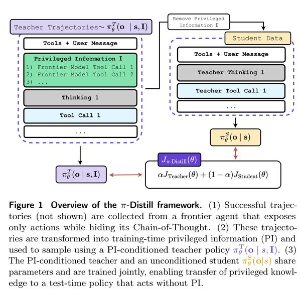
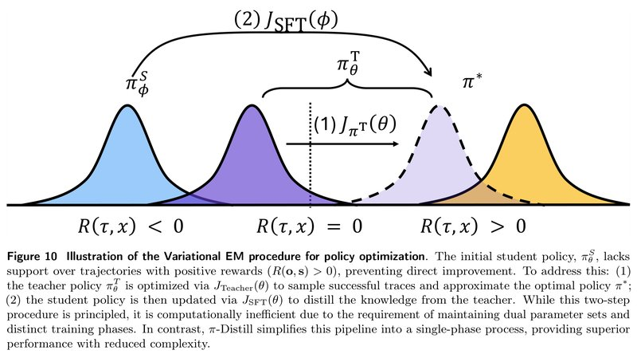
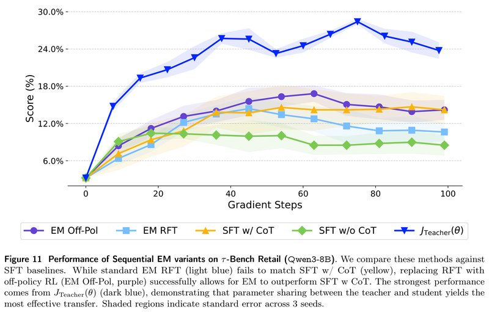
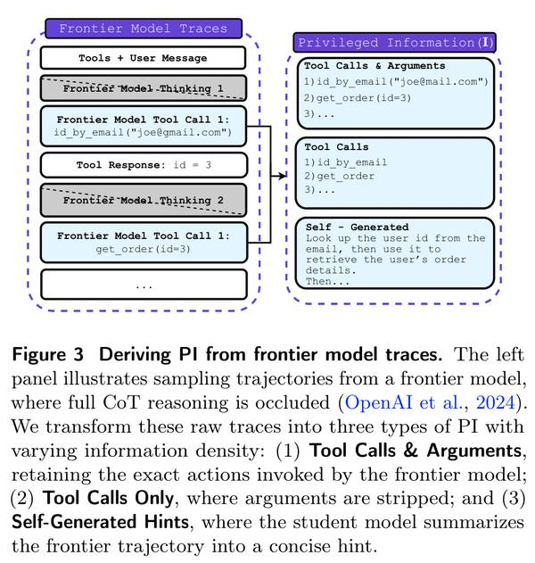
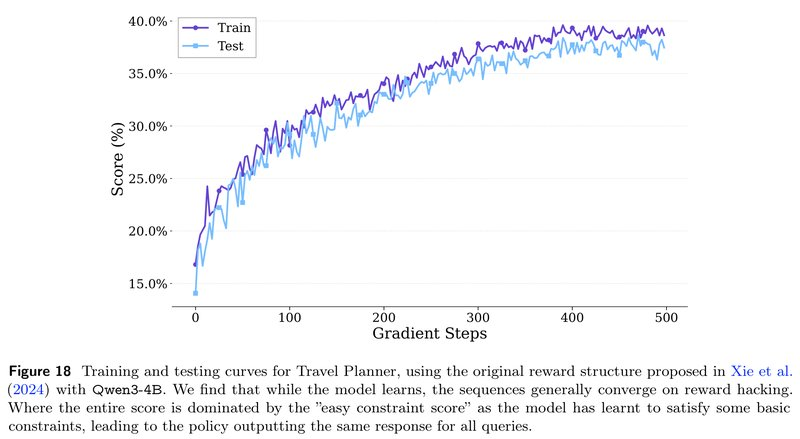
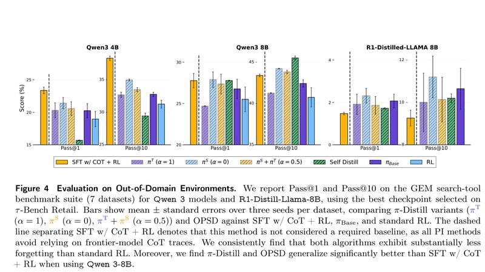
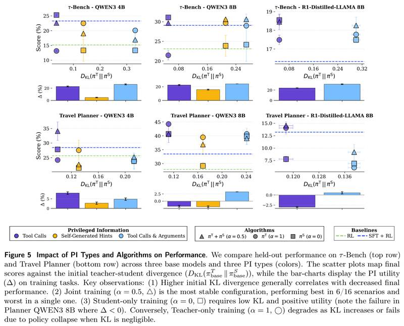
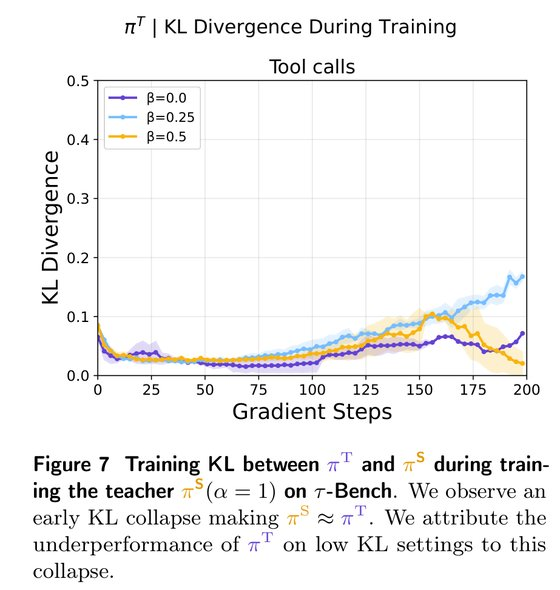
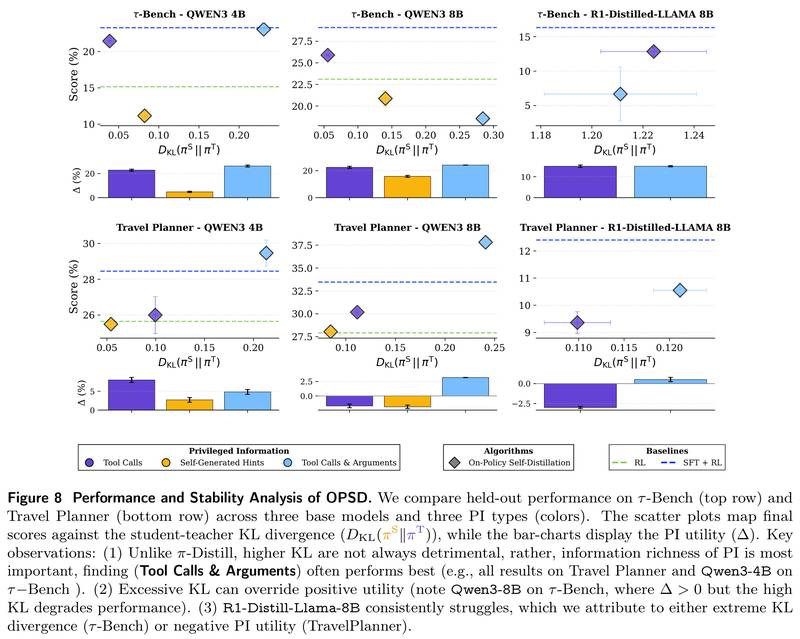
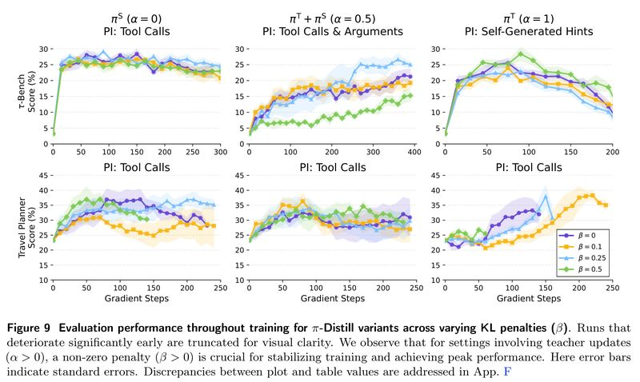

# Privileged Information Distillation for Language Models

[中文](./Pi-Distill-Privileged-Information-Distillation.md) | English

- **Source**: [Privileged Information Distillation for Language Models](https://arxiv.org/abs/2602.04942v3)
- **Paper**: [arXiv:2602.04942](https://arxiv.org/abs/2602.04942)
- **Published**: 2026-02-04
- **Scope**: A plain-language explainer based on arXiv v3 (revised 2026-02-16), not a full translation. The authors are Emiliano Penaloza, Dheeraj Vattikonda, Nicolas Gontier, Alexandre Lacoste, Laurent Charlin and Massimo Caccia, from ServiceNow, Mila (Quebec), Université de Montréal, McGill University and HEC Montréal. The paper gives no code link (the repository link in the LaTeX source is commented out). As of 2026-11-05, the authors' repository [Emilianopp/Privileged-Information-Distillation-and-Self-Distillation](https://github.com/Emilianopp/Privileged-Information-Distillation-and-Self-Distillation) holds only a README, which says the code will be released as soon as legal approval comes through.

## In One Sentence

Say you want to teach a small model a large model's skill at multi-step tool tasks. Many large models only let you see "which tools it called", not "how it thought", so the usual route of "supervised fine-tuning on the full reasoning trace" is closed. The paper's approach: during training, put the large model's action records into the prompt as a "cheat sheet" (the paper calls it privileged information, PI). The same model acts as the teacher with the cheat sheet and as the student without it, and both sides are trained together; at deployment the student does well without the cheat sheet. The main method is called π-Distill (Privileged Information Distillation): the teacher with the cheat sheet does the task, trying to score high while being held to "don't drift too far from yourself without the cheat sheet"; the student learns from the trajectories the teacher produces, imitating the high-scoring ones and moving away from the low-scoring ones; teacher and student share one set of parameters, and a coefficient α sets how the training weight is split between the two sides. The other approach is called OPSD (On-Policy Self-Distillation): the student does the task itself, while its own "self" with the cheat sheet checks it per token alongside, the closer the better, and this is combined with the task score for reinforcement learning.

Results: with π-Distill, Qwen3-8B's Travel Planner score rises from 23.6% to 44.1% (the best of the three α values), close to the 671B DeepSeek-V3.1 (45.0%) and 11.8 percentage points (shortened to "points" below) above "SFT + RL with the full chain of thought" (32.3%). On the τ-Bench retail customer-service task, the same model rises from 3.35% to 31.1%, while "SFT + RL with the full chain of thought" gets 29.1%. Training uses only 1 successful record from the large model per task as the cheat sheet; the SFT baseline on τ-Bench used all 15,885 records.

---

## 1. Key Terms

| Term | In plain words |
| --- | --- |
| Distillation | Have a small model imitate a large model, so the large model's skill moves to the small one |
| Chain of thought (CoT) | The reasoning a model writes down before it acts |
| SFT (supervised fine-tuning) | Have the model imitate existing records word for word |
| Reinforcement learning (RL) | Let the model do tasks itself and adjust by score: do high-scoring approaches more often, low-scoring ones less |
| GRPO | A mainstream RL method: do the same task several times; the attempts above the group's average score are encouraged and those below are suppressed |
| Privileged information (PI) | Hints given only during training and absent at deployment. In this paper it is the large model's action record from a successful run, or hints derived from it. Also called the "cheat sheet" below |
| Teacher $`\pi^T`$ | The model with PI in its prompt |
| Student $`\pi^S`$ | The model without PI in its prompt, which is the version finally deployed |
| Shared parameters | Teacher and student are the same model with the same weights; the only difference is whether the prompt contains PI |
| Trajectory | The record of one complete attempt at a task: each turn's reasoning, the tools called and the results the environment returned |
| KL divergence | A ruler for how much two probability distributions differ. Here it compares how different the teacher's and the student's distributions over "which token to write next" are at the same position; 0 means identical. When this note speaks of the "gap" between teacher and student, it means this |
| on-policy / off-policy | On-policy means learning from data the model itself is generating now; off-policy means learning from data generated by someone else (here, the teacher) |
| α and β | The two coefficients of π-Distill. α decides how the training effort is split between teacher and student; β decides how strict the constraint "teacher and student should not drift too far apart" is |
| OOD (out-of-distribution) | Tasks not seen during training, used to check whether the model can generalize and whether it has kept its old skills |
| Pass@k | The fraction of problems solved at least once when each is attempted k times |

## 2. What Problem It Tackles

On agentic tasks such as multi-step tool calling, the common industry pipeline for distilling a large model's skill into a small one has two steps: first collect complete records of the large model doing tasks, including its chain of thought and each step's action (which tool to call, what arguments to fill in), and use these records to do SFT on the small model; then continue training with reinforcement learning.

The trouble is that many commercial large models return only the actions and a short summary and keep the real chain of thought private; the paper's example is OpenAI's o1. The small model can see "the large model called `get_order_details` at this step" but not "why it needed to look up the order at this point". None of the existing routes is ideal:

| Route | What it does | Problem |
| --- | --- | --- |
| SFT (with CoT) + RL, the industry standard | Do SFT on the large model's complete records with chain of thought, then do reinforcement learning | Needs the chain of thought, which many commercial large models don't provide |
| SFT (no CoT) + RL | Do SFT on the action records only, then do reinforcement learning | Clearly worse than the version with chain of thought on the τ-Bench retail task: 23.5% vs 29.1% for Qwen3-8B, 17.6% vs 23.3% for Qwen3-4B (Table 1 of the paper) |
| Pure RL | The small model does tasks itself and learns from the score | Reinforcement learning relies on the experience of "succeeding" to learn, and the small model almost never succeeds on hard tasks (the original Qwen3-8B model gets only 3.35% on τ-Bench retail); with no successes, there is nothing to learn from |

The paper borrows an old concept: privileged information (PI, proposed by Vapnik and Vashist in 2009), meaning information that is available only during training and not in actual use. Here, the large model's action records are treated as the PI.

An analogy (the analogy is mine, not from the paper): during practice, the teacher gives you a hint card that lists the steps this problem needs, in order; in the real exam, the hint card is taken away. The "cheat sheet" in this note is this hint card.

The hint card is especially useful for reinforcement learning. With the hint card, the small model succeeds on more tasks, and these successes become learning material, filling the gap that pure RL had in the table above.

The question becomes: how do you make "the skill learned with the card" stay with the model "without the card"? The paper points out two difficulties:

1. A small model given the hint card does not necessarily know how to use it; it first has to learn how (see Section 8.4 for evidence).
2. The model may behave very differently with and without the card, so "successes with the card" do not easily transfer to "itself without the card".

The question the paper sets out to answer: **how can the skill learned with the cheat sheet during training be transferred to the model that does not see the cheat sheet at deployment?**

## 3. Core Method: π-Distill, Where Teacher and Student Share One Model and Train Together



*Figure 1: Overview of the π-Distill framework. (1) Collect successful trajectories from a frontier large model that shows its actions but hides its chain of thought (not drawn in the figure); (2) turn these trajectories into PI for training, and let the teacher with PI, $`\pi^T_\theta(\mathbf{o}\mid s,\mathbf{I})`$, sample; (3) the teacher with PI and the student without PI, $`\pi^S_\theta(\mathbf{o}\mid s)`$, share parameters and train together, transferring the knowledge in the PI to the model that does not see PI at deployment. Reading the figure: the teacher's input on the left has an extra green block of "privileged information". Delete this block, and the same reasoning and tool calls become the student's training data (right). Both sides are the same model, and the training objective is a weighted sum of the two parts.*

π-Distill uses one model to play two roles: the teacher's prompt contains PI, the student's does not. During training, the teacher with the cheat sheet does the tasks, and the trajectories it produces are used to train both the teacher and the student.

**(1) Training the teacher: score high, but don't drift too far from "yourself without the cheat sheet".** The teacher gets a reward for the task (between −1 and 1), minus one term: the gap between teacher and student (KL divergence) times a coefficient β. When this gap is computed, no gradient flows through the student side (the paper writes sg, for stop gradient); it serves only as a reference point. The paper says this term does two things: first, it pushes the teacher to find successful approaches the student "can reach", which are easier for the student to imitate; second, because the parameters are shared, the student also benefits when the teacher gets stronger, even if the student is not trained directly.

**(2) Training the student: take the trajectories the teacher just produced and teach the student, who doesn't see the cheat sheet, to reproduce them, learning more from the high-scoring ones.** The trajectories are generated by the teacher, but it is the student that gets updated, so this is off-policy learning. Each trajectory is multiplied by an importance weight: the probability that the student itself would write this trajectory, divided by the probability that the teacher would. It converts "someone else's experience" into "as if I had done it myself". The student side also subtracts β times the gap, computed as KL in the same direction, except that now the teacher side has no gradient and the student is the one updated. My reading (the paper does not spell it out this way): the further apart teacher and student are, the lower the probability the student assigns to the teacher's trajectory, the smaller this weight, and the less the student learns from that trajectory. This matches the observation in Section 8.4 that "the larger the gap, the worse the results".

**(3) Putting it together: split the effort with α.** The overall objective is α times the teacher's objective plus 1 − α times the student's objective, with α between 0 and 1.

| α | Meaning |
| --- | --- |
| α = 1 | Train only the teacher. The student is not trained directly and benefits through the shared parameters |
| α = 0 | Train only the student, which imitates the teacher's current trajectories. The paper observes that under certain conditions, the teacher also gets stronger without direct training, because of the shared parameters |
| α = 0.5 | Train both sides together. In practice, α rises linearly from 0 to 0.5 over the first 15 training rounds (Table 2 in the appendix; a comment in the LaTeX source says this is done to keep teacher and student from "collapsing into one" too early) |

**A small numeric example** (a sketch I made up, not from the paper): on τ-Bench the teacher attempts each task 5 times (this is the paper's setting). Suppose 3 attempts succeed (reward 1) and 2 fail (reward 0), so the group average is 0.6; then the "advantage" (reward minus group average) of the 3 successful attempts is +0.4, and that of the 2 failed ones is −0.6 (the paper's advantage only subtracts the group average and does not divide by the standard deviation). With α = 0.5, half the effort goes to the teacher, so that "itself with the card" produces the successful kind of action more often; the other half goes to the student, so that "itself without the card" moves in the same direction. The failed trajectories also take part in training and are pushed down. In the actual implementation, the β term is subtracted directly from each trajectory's reward (Appendix E.1), so the reward here is really the task reward minus β times the gap.

**Optional: three formulas.** You can skip them without losing the thread. $`s`$ is the full interaction so far (the user's request, the model's earlier outputs, what the environment returned), $`\mathbf{I}`$ is the PI, $`\mathbf{o}`$ is the reasoning and actions the model writes, $`R`$ is the reward, and $`\mathrm{sg}`$ means no gradient flows through that side. The teacher's objective (Eq. (2) in the paper):

```math
J_{\text{Teacher}}(\theta)=\mathbb{E}_{\mathbf{o}\sim\pi^T_\theta(\cdot\mid s,\mathbf{I})}\big[R(\mathbf{o},s)\big]-\beta\,D_{\mathrm{KL}}\big(\pi^T_\theta(\cdot\mid s,\mathbf{I})\,\big\|\,\mathrm{sg}(\pi^S_\theta(\cdot\mid s))\big)
```

The student's objective (Eq. (3) in the paper; the fraction inside the brackets is the importance weight):

```math
J_{\text{Student}}(\theta)=\mathbb{E}_{\mathbf{o}\sim\pi^T_\theta(\cdot\mid s,\mathbf{I})}\Big[\frac{\pi^S_\theta(\mathbf{o}\mid s)}{\mathrm{sg}\big(\pi^T_\theta(\mathbf{o}\mid s,\mathbf{I})\big)}\,R(\mathbf{o},s)\Big]-\beta\,D_{\mathrm{KL}}\big(\mathrm{sg}(\pi^T_\theta(\cdot\mid s,\mathbf{I}))\,\big\|\,\pi^S_\theta(\cdot\mid s)\big)
```

Combined (Eq. (4) in the paper):

```math
J_{\pi\text{-Distill}}(\theta)=\alpha\,J_{\text{Teacher}}(\theta)+(1-\alpha)\,J_{\text{Student}}(\theta),\qquad \alpha\in[0,1]
```

## 4. Why Not Do It in Two Steps: The Detours the Authors Took

The most direct idea: first train the teacher with the cheat sheet, then distill its skill into the student. The paper says this has three problems:

1. It is unclear which of the teacher's checkpoints should do the teaching.
2. The student learns from someone else's trajectories, which is off-policy learning, and training is unstable.
3. Training two models separately costs compute.

The authors' early experiments also showed that the two-step approach works worse (Figure 11, in Appendix A.2). The design of π-Distill came out of these failed attempts.

**Optional: the variational EM view.** You can skip it without losing the thread. In Appendix A, the paper explains π-Distill within a variational EM framework. Imagine an "ideal policy" $`\pi^*`$ that favors high-scoring trajectories in proportion to $`\pi_{\text{ref}}(\mathbf{o}\mid s)\,e^{R(\mathbf{o},s)}`$. This distribution has to be divided by a normalizing constant that cannot be computed, so it cannot be used directly. Instead, the teacher with PI approximates it (the E step, which works out to $`J_{\text{Teacher}}`$), and then the student learns from the teacher (the M step, originally SFT; π-Distill replaces it with $`J_{\text{Student}}`$, which can use failed trajectories, for reasons given at the end of this section). The traditional approach uses two models trained alternately or one after the other; π-Distill has the two share parameters, merging the two steps into one.



*Figure 10: Diagram of policy optimization with variational EM. Horizontally, from left to right, are trajectory regions with reward going from negative to positive, and the "hills" are the trajectory distributions generated by different models. The initial student (blue, $`\pi^S_\phi`$) almost never produces trajectories with a positive score ($`R>0`$), so it cannot improve directly through reinforcement learning. The fix: (1) optimize the teacher with PI (purple, $`\pi^T_\theta`$) with $`J_{\text{Teacher}}`$ so that it can produce successful trajectories and approach the ideal policy (yellow, $`\pi^*`$); (2) then update the student with $`J_{\text{SFT}}`$ to distill the teacher's skill into it. The paper's caption says this two-step process makes sense, but maintaining two sets of parameters and training in two stages is not worth the compute; π-Distill simplifies it into one stage, which works better and is also simpler. The figure also shows why PI helps reinforcement learning: the student's trajectories fall almost entirely in the negative-score region, so reinforcement learning finds no successful examples to encourage; the teacher with PI can move toward the positive-score region and pull the student toward the ideal policy.*

The authors tried these routes in turn (Appendix A.2):

1. **Offline variational EM** (modeled on the Variational Reasoning of Zhou et al. 2025): on a fixed dataset, learn a teacher that "fills in the chain of thought while looking at the expert trajectory". There was a lot to tune (the update ratio between teacher and student, each one's optimizer state, how much data to sample from the teacher), and it never worked on multi-turn tasks. The authors believe Zhou et al. succeeded because they had reference solutions; fitting imperfect large-model trajectories can even make results worse.
2. **Train the teacher on-policy, alternating with the student**: teacher and student easily collapsed into one, and results were poor.
3. **One after the other (Sequential EM)**: first train the teacher, then do SFT on the student with the teacher's successful trajectories (fine-tuning only on successful samples, called rejection fine-tuning, RFT). This was the best-performing EM version, but it still needed some extra adjustments.

Below is the comparison in the setting of τ-Bench retail, Qwen3-8B and "self-written hints" (the authors say this setting worked best, which is why they chose it):



*Figure 11: Comparison of several sequential EM variants and the SFT baselines on τ-Bench retail (Qwen3-8B). The horizontal axis is training steps (0 to 100), the vertical axis is score (%). Standard EM (RFT in the second step, light blue) does not reach the level of SFT (with CoT) (yellow); after RFT is replaced with off-policy reinforcement learning with clipping (EM Off-Pol, purple), EM can beat SFT (with CoT). Best of all is optimizing only $`J_{\text{Teacher}}`$ (dark blue), which the authors take to mean that transfer works best when teacher and student share parameters. The shading is the standard error over 3 seeds.*

Peak values within 100 steps (read off the plot):

| Method | Peak |
| --- | --- |
| SFT (no CoT) | About 10.5% |
| EM, RFT in the second step | About 14.4%, then drops to about 10.6% |
| SFT (with CoT) | About 14.7% |
| EM, second step replaced with off-policy reinforcement learning | About 16.8% |
| Optimizing only $`J_{\text{Teacher}}`$, with shared parameters | About 28.4% |

The authors drew two conclusions from this, and both later became part of π-Distill's design:

1. **Parameter sharing by itself can transfer the teacher's skill to the student.** Training only the teacher with PI already brought the student's peak to about 28%, nearly twice that of SFT (with CoT). This surprised the authors most.
2. **Failed trajectories should be used when training the student.** RFT imitates only the successful samples; switching to off-policy reinforcement learning, which can give failed samples negative feedback, clearly improved results. $`J_{\text{Student}}`$ does exactly this.

Merge the two steps into one, and you get π-Distill.

## 5. The Other Approach: OPSD, Where the Student Works Alone and Its Cheat-Sheet Self Checks It Per Token

OPSD works the other way round from π-Distill: the student does the task by itself (without the cheat sheet); at every position the student writes, the teacher with the cheat sheet gives a probability distribution for "how I would write it"; the more the student resembles the teacher, the higher the reward. This "how similar" signal is per-token and very dense, and it is used together with the task score for reinforcement learning. The paper calls this term a reverse KL penalty between student and teacher.

In plain terms: the student works on the problem alone, with a "self" that has seen the hint card sitting beside it; every time the student writes a token, that self tells the student "how much it looks like what I would write".

This approach of "the student works alone and the teacher checks per token" is called on-policy distillation. Section 3.2 of the paper says that earlier on-policy distillation (for example Agarwal et al. 2024, [arXiv 2306.13649](https://arxiv.org/abs/2306.13649)) usually used a larger model as the teacher; this paper uses the same model instead, only letting the teacher also see the PI.

**Optional: the OPSD objective (Eq. (5) in the paper).** You can skip it without losing the thread. Trajectories are sampled from the student, and the objective is the expected reward minus the KL from student to teacher, with no gradient through the teacher side:

```math
J_{\text{OPSD}}(\theta)=\mathbb{E}_{\mathbf{o}\sim\pi^S_\theta(\cdot\mid s)}\big[R(\mathbf{o},s)\big]-\beta\,D_{\mathrm{KL}}\big(\pi^S_\theta(\cdot\mid s)\,\big\|\,\mathrm{sg}(\pi^T_\theta(\cdot\mid s,\mathbf{I}))\big)
```

How the two methods differ:

| | π-Distill | OPSD |
| --- | --- | --- |
| Who does the task | The teacher with the cheat sheet | The student without the cheat sheet |
| What the student learns | The teacher's trajectories, converted by the importance weight | Its own trajectories, checked per token by the teacher |
| Data type | off-policy | on-policy |
| Is the teacher trained directly | Trained when α > 0 | Not trained directly, only a reference (with shared parameters, it changes along with the student) |
| Direction of the KL used for the gap | $`D_{\mathrm{KL}}(\pi^T\,\Vert\,\pi^S)`$ | $`D_{\mathrm{KL}}(\pi^S\,\Vert\,\pi^T)`$ |

A footnote in the paper says that three concurrent works proposed the same objective, and the name "self-distillation" also follows them. What sets this paper apart: there is no reference solution, the teacher sees the large model's action records, the tasks are multi-turn tool calling, and it specifically identifies the cases where OPSD fails. Section 12 compares these works.

## 6. Where the Cheat Sheet Comes From: Three Kinds of PI

The paper uses DeepSeek-V3.1 (671B, specifically DeepSeek-chat-v3.1) as the "frontier large model", and every "large model" in the experiments refers to it. It was chosen because it is open source and its chain of thought is visible, which makes it possible to compare against the traditional approach of "SFT on the full chain of thought". In the experiments, only its actions are used as PI, as if its chain of thought could not be seen.



*Figure 3: Turning a frontier large model's trajectories into PI. On the left is the large model's record of doing a task, with the full chain of thought hidden (gray, and crossed out with a dashed line). These raw trajectories are turned into the three kinds of PI on the right, which carry different amounts of information: (1) tool calls + arguments, keeping the actions the large model actually executed; (2) tool names only, with the arguments removed; (3) self-written hints, where the student model summarizes the large model's trajectory into a short hint.*

The three kinds of PI, from most to least information:

1. **Tool calls + arguments**: the complete action sequence, for example `GetUserDetails(Name:"Kevin Lau")`.
2. **Tool names only**: it only tells you that `GetUserDetails` was called; you have to infer the arguments from the context.
3. **Self-written hints**: have the student model (that is, the model being trained) read the large model's successful trajectory and summarize it in 2 to 3 sentences. The example in Appendix H.3 is an order-cancellation task, and the hint says: the agent first verified the user's identity by email, then looked up the order details, and after confirming the order number and the reason for cancellation, called `cancel_pending_order` to cancel the order; the refund process then started, and the agent also told the user the next steps. The authors think that summarizing this way can also filter out the large model's unnecessary steps, and can even come up with a better approach than the large model's.

Data size and usage:

- They collected 15,885 successful trajectories of the large model on τ-Bench retail and 1,986 on Travel Planner, sampled evenly across tasks.
- For each training task, only the successful trajectory with the **fewest steps** is picked as PI. In the end, all 45 Travel Planner training tasks have PI, and 300 of the 500 τ-Bench training tasks do. Tasks without PI are done by the student alone and trained with ordinary reinforcement learning.
- The SFT baseline uses **all** the successful trajectories, far more than the PI methods use. The paper says SFT works best this way.
- R1-Distill-Llama-8B does not use "self-written hints", because it always copies the raw trajectory or tool calls back verbatim instead of summarizing.

How the PI goes in: it is added to the task description in the system prompt, wrapped in a `<Secret information>` tag, with an instruction telling the model "don't mention that you were given a hint". In practice the model still lets it slip (see Section 7).

## 7. Details That Make It Actually Work

**(1) What "don't drift too far" should be measured against: the current student, not the frozen original model.** For the reference model in the KL term, "the current student (no gradient)" works much better than "the frozen original model" (Appendix D.2). With the original model as the reference, scores drop during training or even collapse, most visibly at α=1: the model is pushed to move ever further from the original model while also being penalized for being far from it. With the current student as the reference, training is stable for all three α values, and no extra frozen model needs to sit in GPU memory.

**(2) The cheat sheet leaks.** Even though the prompt asks the model not to mention that it was given a hint, the model still writes words like "hint" and "secret" in its output. During training the authors also found that a few tokens pointing to the PI (such as "hint") had especially high KL. The authors detect such words with a keyword list and deduct 0.1 from the reward for each occurrence, and all final experiments include this penalty (Appendix D.1). Results:

- During training, the teacher's leak rate rises with the step count, for all three kinds of PI: "tool names only" is highest, "tool calls + arguments" comes next, and "self-written hints" starts low but also rises. The penalty brings the rate down somewhat, but not by much.
- Task scores are nearly the same with or without the penalty.
- For the student, which does not see PI at deployment, the leak rate did not rise with training.

**(3) Length penalty.** The model tends to write longer and longer, and trajectories often exceed the 25k-token context limit. The authors apply a length penalty only to successful trajectories (Appendix E.2): there is no deduction while a turn's reply stays within 2000 tokens; beyond that the penalty grows gradually along a cosine curve, taking about 0.1 off the reward near 5000 tokens and at most 0.2 for anything longer; the penalties of all turns are averaged and added to the reward. The appendix also caps the total deduction at 0.3, but each turn loses at most 0.2, so the average never exceeds 0.2 and the cap is never reached. The main text's description of this penalty does not fully match the appendix; see Section 10.

## 8. Experimental Results

### 8.1 How the experiments were set up

**Tasks.** All four task groups are multi-turn tool calling:

| Benchmark | Content | Use | Size |
| --- | --- | --- | --- |
| τ-Bench retail | Simulated e-commerce customer service: verifying identity, looking up orders, returns and exchanges, etc. | Training + testing | 500 training tasks, 115 test tasks |
| τ-Bench airline | Booking flights, changing tickets, etc. | Testing only, unseen in training (OOD) | 50 tasks |
| Travel Planner | Plan trips with search tools while meeting constraints such as budget and diet | Training + testing | 45 for training, 180 for testing |
| GEM search QA | Answer questions with search tools, 7 datasets in total: 2Wiki, PopQA, TriviaQA, HotpotQA, Bamboogle, NaturalQuestions, Musique | Testing only, very different from the training tasks (OOD) | Not stated in the paper |

**Environment changes.** The authors made several changes to the original environments:

- τ-Bench's user simulator was switched from GPT-4o to Qwen-14B to cut costs. The biggest change was removing the "transfer to a human agent" tool `transfer_to_human_agents`, because the model kept using it to game the reward (reward hacking).
- Travel Planner's original scoring rule checks the "easy constraints" first and checks the "hard constraints" only if all of them pass. The model learned to game this rule: when Qwen3-4B was trained with the original scoring rule, its score climbed from a starting level of about 14% to 17% all the way up to about 38% to 39%, but its responses to every problem turned into the same pattern, directly calling the `Planner[...]` tool to end the conversation and scoring by meeting a few easy constraints. In the example in Appendix G, the model writes in its reasoning that it will search for flights, hotels and attractions, then outputs only one action, `Planner[Query: Craft a 7-day Wisconsin itinerary from Punta Gorda, ...]`. So the authors changed the rule to check each easy constraint separately and, once it passes, check the corresponding hard constraint, for example checking right after a restaurant is booked whether it meets the dietary restrictions.



*Figure 18: Training (dark purple) and test (light blue) curves on Travel Planner when Qwen3-4B is trained with the original scoring rule of Xie et al. (2024); the horizontal axis is training steps (0 to 500) and the vertical axis is score. Both lines rise from a starting level of about 14% to 17% up to about 38% to 39% (read off the plot), so the model seems to be improving, but its outputs have mostly converged to the reward-gaming pattern: the total score is propped up almost entirely by the "easy constraint" scores, because the model learned to satisfy a few basic constraints and gives the same response to every problem.*

**Student models**: Qwen3-4B, Qwen3-8B and R1-Distill-Llama-8B (two model families). R1-Distill-Llama-8B cannot produce correct trajectories even with PI (its original scores are all 0%), so reinforcement learning has nowhere to start. That is why it alone is first warmed up with "SFT with chain of thought" and then trained with each method. This also tests one thing on the side: whether PI is still useful once the model has done SFT on trajectories that contain the PI content.

**This paper's methods**: π-Distill with three values, α = 0, 0.5 and 1, plus OPSD.

**Baselines**:

- Pure RL (GRPO).
- SFT on actions only (written "SFT (no CoT)" below), and SFT followed by reinforcement learning.
- SFT on the full chain of thought ("SFT (with CoT)"), and reinforcement learning after it. This is the industry-standard approach. It uses the chain of thought, which is often unavailable in practice, and the paper treats it as a "soft upper bound". By convention, these baselines sweep several SFT checkpoints and continue reinforcement learning from the one that ends up best.

**Other settings**:

- 2 H100 GPUs, with a context limit of 25k tokens.
- Hyperparameters were swept for every method, and the best set was run with 3 random seeds and averaged. Each seed's score is the highest "average score over 3 consecutive checkpoints".
- τ-Bench is trained for 600 steps, Travel Planner for 400 steps.

**Why the numbers in the table are higher than the curves' peaks.** The numbers in Table 1 take each seed's own peak and then average them; the curves plot the average of the 3 seeds at each step, and then you look for the peak. The three seeds peak at different steps; in the example in Appendix F they peak at about steps 70, 95 and 150, and the average of the three peaks is 31.11% (rounded to 31.1% in Table 1), higher than the peak of the averaged curve. So peaks read off training curves such as Figure 9 below may be lower than the corresponding numbers in Table 1.

### 8.2 Trained tasks: seeing only actions can still beat the approach that "sees the full chain of thought"

The paper's abstract puts it this way: across several benchmarks, several models and several kinds of PI, π-Distill (and in some cases OPSD) beats the industry-standard approach of "SFT, then reinforcement learning", even though the latter also assumes access to the full chain of thought.

Table 1 of the paper (mean ± standard deviation over 3 random seeds; τ-Bench airline is a task unseen in training):

| Model / method | Travel Planner | τ-Bench retail | τ-Bench airline (OOD) |
| --- | --- | --- | --- |
| **DeepSeek-V3.1 (671B, the large model itself)** | 45.0% ± 3.78 | 51.3% ± 0.212 | 40.0% ± 0.161 |
| **R1-Distill-Llama-8B** | | | |
| Original model | 0.00% ± 0.00 | 0.00% ± 0.00 | 0.00% ± 0.00 |
| SFT (with CoT) | 6.35% ± 1.27 | 15.2% ± 0.44 | 8.00% ± 5.29 |
| SFT (no CoT) | 2.40% ± 0.86 | 0.680% ± 0.17 | 0.670% ± 1.15 |
| SFT (with CoT) + RL | 12.4% ± 1.56 | 16.3% ± 1.49 | 7.33% ± 4.16 |
| SFT (with CoT) + OPSD (ours) | 13.1% ± 1.09 | 14.5% ± 0.00 | 2.00% ± 0.00 |
| SFT (with CoT) + π-Distill α=0 (ours) | 7.86% ± 1.75 | **18.6%** ± 0.50 | **10.0%** ± 2.00 |
| SFT (with CoT) + π-Distill α=0.5 (ours) | 14.0% ± 1.63 | 18.3% ± 0.77 | 9.33% ± 3.06 |
| SFT (with CoT) + π-Distill α=1 (ours) | **14.1%** ± 3.27 | 17.7% ± 0.77 | 7.33% ± 4.16 |
| **Qwen3-4B** | | | |
| Original model | 17.6% ± 2.16 | 5.03% ± 1.88 | 2.21% ± 1.99 |
| SFT (with CoT) | 21.1% ± 1.94 | 12.4% ± 0.60 | 2.67% ± 1.15 |
| SFT (no CoT) | 20.8% ± 1.82 | 15.2% ± 1.70 | 4.00% ± 5.29 |
| RL | 25.1% ± 3.75 | 15.2% ± 0.17 | 5.33% ± 3.06 |
| SFT (no CoT) + RL | 23.3% ± 1.33 | 17.6% ± 2.69 | 5.33% ± 2.31 |
| OPSD (ours) | 29.8% ± 1.14 | 23.1% ± 0.04 | 10.6% ± 6.57 |
| π-Distill α=0 (ours) | 28.5% ± 4.35 | **25.3%** ± 0.60 | 8.00% ± 5.29 |
| π-Distill α=0.5 (ours) | **33.8%** ± 6.85 | 22.6% ± 0.93 | 6.00% ± 2.00 |
| π-Distill α=1 (ours) | 28.2% ± 6.27 | 22.5% ± 0.93 | **12.0%** ± 5.29 |
| SFT (with CoT) + RL (industry standard, uses CoT) | 26.4% ± 1.16 | 23.3% ± 3.02 | 6.67% ± 5.77 |
| **Qwen3-8B** | | | |
| Original model | 23.6% ± 2.23 | 3.35% ± 1.47 | 6.40% ± 3.02 |
| SFT (with CoT) | 26.0% ± 2.27 | 16.5% ± 4.66 | 5.33% ± 1.15 |
| SFT (no CoT) | 29.8% ± 1.71 | 12.8% ± 0.77 | 6.00% ± 4.00 |
| RL | 27.5% ± 0.95 | 23.9% ± 0.44 | 6.67% ± 3.06 |
| SFT (no CoT) + RL | 31.3% ± 2.79 | 23.5% ± 4.27 | 6.00% ± 2.00 |
| OPSD (ours) | 37.5% ± 1.53 | 27.3% ± 0.33 | **14.0%** ± 5.66 |
| π-Distill α=0 (ours) | 40.7% ± 1.14 | **31.1%** ± 0.73 | 12.0% ± 6.00 |
| π-Distill α=0.5 (ours) | 41.1% ± 7.24 | 30.6% ± 0.67 | 7.33% ± 1.15 |
| π-Distill α=1 (ours) | **44.1%** ± 2.16 | 29.7% ± 0.33 | 9.33% ± 3.06 |
| SFT (with CoT) + RL (industry standard, uses CoT) | 32.3% ± 1.10 | 29.1% ± 2.14 | 8.00% ± 3.46 |

*Notes on Table 1: rows marked "ours" are the methods the paper proposes; bold marks the best score within each model (the original table also underlines the second best, which is omitted here). The paper's conclusion: both π-Distill and OPSD make effective use of PI and consistently beat every baseline that has no access to the large model's chain of thought; on Travel Planner both methods beat SFT (with CoT) + RL, and π-Distill is also better on τ-Bench.*

How to read this table:

- **π-Distill, which sees only actions, beats the industry-standard approach that sees the full chain of thought.** On Qwen3-8B, the three α values of π-Distill score 40.7% to 44.1% on Travel Planner, against 32.3% for the industry standard; on τ-Bench retail they score 29.7% to 31.1%, against 29.1%. On Travel Planner the lead is up to 11.8 points. On Qwen3-4B, α=0 beats the industry standard in all three columns, while the other two α values win some columns and lose others.
- **On Travel Planner, the 8B student has nearly caught up with the 671B large model**: 44.1% vs 45.0%. On τ-Bench retail the gap is still large, 31.1% vs 51.3%.
- **The older methods that don't use chain of thought improve only modestly**: pure RL and "SFT (no CoT) + RL" score about the same (pure RL uses less compute), and both fall short of the industry standard, trailing by 5 to 8 points on retail.
- **OPSD sits in between**: it is well ahead of the older methods that don't use chain of thought (27.3% on Qwen3-8B retail, versus 23.9% for pure RL), and on the trained tasks it is generally below π-Distill's best α; it stands out on the airline task it was never trained on, where its 14.0% on Qwen3-8B is the highest across the three small models.
- **It also helps models that have already done SFT**: R1-Distill-Llama-8B first did SFT with chain of thought; followed by π-Distill (α=0) it scores 18.6% on retail, versus 16.3% when followed by ordinary reinforcement learning. But not every setting is better: on Travel Planner, α=0 gets only 7.86%, worse than the 12.4% from ordinary reinforcement learning.
- **There is no single best α**: each of the three α values has come first somewhere, depending on the scenario (see Section 8.4).
- **Less hassle**: π-Distill has only one training stage; the industry-standard approach first has to try several SFT checkpoints and then pick the best one for reinforcement learning.
- **Treat the airline column as a rough guide only**: there are only 50 tasks, so getting 1 more task right is worth 2 points, and many standard deviations are between 3 and 6 points.

### 8.3 Tasks it was not trained on: mostly no "forgetting", and better generalization on Qwen3-8B

These models were trained on τ-Bench retail customer service, and GEM's search QA is very different from it, so this set of evaluations checks whether, after learning a new task, the model has lost its old skills and whether it can generalize. The metrics are Pass@1 (the fraction solved on a single attempt) and Pass@10 (the fraction solved at least once in 10 attempts).



*Figure 4: Pass@1 and Pass@10 (%) of the two Qwen3 models and R1-Distill-Llama-8B on the 7 datasets of the GEM search-tool benchmark. Each method uses its best checkpoint on τ-Bench retail. Bars are means and error bars are standard errors (3 seeds per dataset). Colors: orange is SFT (with CoT) + RL; hatched bars are the three π-Distill variants (purple $`\pi^T`$ α=1, light blue $`\pi^S`$ α=0, yellow $`\pi^T+\pi^S`$ α=0.5); green hatching is OPSD (called Self Distill in the figure); dark purple is the original model $`\pi_{\text{Base}}`$; solid light blue is pure RL. The dashed line next to SFT (with CoT) + RL indicates that it is not a baseline the methods must be compared with, because none of the PI methods depend on the large model's chain of thought. Note that the vertical axis does not start at 0, so the differences in bar height look larger than they are. The paper's conclusion: both algorithms forget much less than pure RL; with Qwen3-8B, π-Distill and OPSD generalize clearly better than SFT (with CoT) + RL.*

Approximate values from Figure 4 (%, read off the plot):

| Method | Qwen3-4B Pass@1 | Qwen3-4B Pass@10 | Qwen3-8B Pass@1 | Qwen3-8B Pass@10 |
| --- | --- | --- | --- | --- |
| Original model | 20.3 | 32.7 | 26.8 | 42.4 |
| Pure RL | 19.0 | 31.2 | 25.5 | 40.7 |
| SFT (with CoT) + RL | 23.4 | 38.3 | 27.8 | 43.3 |
| π-Distill α=1 | 20.3 | 32.6 | 24.7 | 41.2 |
| π-Distill α=0 | 21.4 | 34.9 | 27.9 | 44.2 |
| π-Distill α=0.5 | 20.6 | 33.4 | 27.4 | 43.8 |
| OPSD | 15.7 | 29.4 | 27.8 | 45.5 |

- **Pure RL makes the model "forget"**: on both Qwen models, pure RL is worse than the original model (4B 19.0 vs 20.3, 8B 25.5 vs 26.8). The paper says this holds in every evaluation.
- **On both Qwen models, π-Distill's α=0 and α=0.5 show no regression**, and both are above the original model and pure RL. α=1 on Qwen3-8B is the exception: its Pass@1 is about 24.7, lower than both the original model and pure RL, which the paper's main text does not mention (see Section 10).
- **The stronger the model, the better "thinking for itself" suits it**: on Qwen3-4B, the industry-standard approach is best (Pass@10 38.3). On Qwen3-8B, π-Distill α=0, α=0.5 and OPSD are roughly level with the industry standard on Pass@1 (27.4 to 27.9 vs 27.8) and all beat it on Pass@10 (43.8 to 45.5 vs 43.3). The paper's interpretation: smaller models need explicit demonstrations from the large model's chain of thought more, while stronger reasoning models benefit more from being "more on-policy" (learning from reasoning they generate themselves).
- **OPSD is polarized**: it has the highest Pass@10 on 8B but drops the most on 4B (Pass@1 15.7, 4.6 points below the original model). The paper guesses that with OPSD, the small model may learn the teacher's guidance on the training tasks too closely, while a stronger reasoning model gives guidance that generalizes better.
- **R1-Distill-Llama-8B**: the industry-standard approach falls below the original model (Pass@1 about 1.5 vs about 2.1); π-Distill and OPSD bring no clear gain, but no clear regression either.

### 8.4 When π-Distill works: a small gap and a useful cheat sheet; training both together is the most stable

So far we have looked at each method's best configuration. Section 7 of the paper varies the three kinds of PI to find the factors that decide success or failure, mainly for π-Distill, and also explains when OPSD is competitive. It uses two metrics that can be measured before training:

- **Gap**: how differently the same original model behaves with and without PI, measured by KL divergence. π-Distill looks at $`D_{\mathrm{KL}}(\pi^T_{\text{base}}\,\|\,\pi^S_{\text{base}})`$, and OPSD at the reverse direction, $`D_{\mathrm{KL}}(\pi^S_{\text{base}}\,\|\,\pi^T_{\text{base}})`$; the subscript base denotes the original model before training.
- **Usefulness Δ**: how many more points the model scores on the training tasks with PI than without, $`\Delta=\text{score}(\pi^T_{\text{base}})-\text{score}(\pi^S_{\text{base}})`$.

Some numbers (from the bar charts in Figure 5, read off the plot): on τ-Bench, PI is very useful; with "tool calls + arguments", Qwen3-8B scores about 24 points higher on the training tasks. On Travel Planner, PI helps much less, at most about 8 points (Qwen3-4B with "tool names only"); with "tool names only" or "self-written hints", Qwen3-8B actually scores about 2 points lower (Δ<0).

The paper also defines a post-training metric $`\Delta_{\max}`$: "the best score with PI" during training minus "the best score of pure RL" (both on the training tasks), which measures how well an algorithm turns PI into actual improvement (Figure 6 of the paper, not included in this note).



*Figure 5: How the PI type and the algorithm affect π-Distill's results. The top row is τ-Bench and the bottom row is Travel Planner; the three columns are the three models, and the colors stand for the three kinds of PI (dark purple: tool names only; yellow: self-written hints; light blue: tool calls + arguments). In the scatter plots, the horizontal axis is the gap between teacher and student before training, $`D_{\mathrm{KL}}(\pi^T_{\text{base}}\|\pi^S_{\text{base}})`$, and the vertical axis is the final test score; in each panel, the three points of one color are the results of the three α values with the same kind of PI (triangle α=0.5, circle α=1, square α=0); the green dashed line is pure RL and the blue dashed line is SFT + RL. The bar charts below show the usefulness Δ of the PI on the training tasks. The caption's main observations: (1) the larger the initial gap, the worse the final score usually is; (2) training both together (α=0.5) is the most stable, best in 6 of 16 scenarios and worst in only 1 (the main text says best in 7; see Section 10); (3) training only the student (α=0) needs a small gap and a positive Δ (note the failure of Qwen3-8B on Travel Planner when Δ<0); conversely, training only the teacher (α=1) gets worse as the gap grows, and fails through policy collapse when the gap is nearly zero.*

**Overall**: the larger the gap, the worse the final score tends to be. Many of the steps the teacher takes while looking at the cheat sheet are ones the student would not think of by itself, and the further apart the two are, the harder it is for the student to learn them. The details also depend on α.

**Training only the teacher (α=1)**:

- It can teach the model to use PI that it originally could not use well. Even when Δ<0 at the start (worse with PI), $`\Delta_{\max}`$ is positive in every case after the teacher is trained. The paper considers "learning to use PI" an important reason why transfer succeeds when only the teacher is trained.
- There is a trap: on τ-Bench with "tool names only" as the PI, teacher and student are already very close, and the gap drops to nearly 0 right at the start of training (Figure 7); the two "collapse into one", and the teacher simply stops looking at the cheat sheet. As a result it does worse than even pure RL: about 13% for Qwen3-4B, against 15.2% for pure RL; about 21% for Qwen3-8B, against 23.9% for pure RL. The authors tried switching the "don't drift too far" reference from the student to the original model before training, and results were worse (see Section 7 (1)).



*Figure 7: How the KL between the teacher $`\pi^T`$ and the student $`\pi^S`$ changes during training on τ-Bench when only the teacher is trained (α=1), with "tool names only" as the PI. The horizontal axis is training steps (0 to 200), the vertical axis is KL, and the three lines are β=0, 0.25 and 0.5. The KL collapses early, making $`\pi^S\approx\pi^T`$: it starts at only 0.065 to 0.085 and drops to 0.02 to 0.04 after about 25 training steps, even with β=0; after that the lines recover somewhat, with β=0.25 at about 0.17 at step 200 (read off the plot). The paper attributes α=1's poor performance in low-gap settings to this collapse. The original caption has one symbol written wrong; see Section 10.*

**Training both together (α=0.5)**: the most stable. The main text says it is best in 7 of 16 scenarios (the caption of Figure 5 says 6; see Section 10) and last in only 1, and it mostly avoids the failure cases seen when the teacher or the student is trained alone. The authors think further fine-tuning of α would likely do even better, and leave that for future work.

**Training only the student (α=0)**:

- A small gap is a strong signal of success. On τ-Bench, "tool names only" with α=0 gets the top score in its whole panel on all three models (Qwen3-4B 25.3%, Qwen3-8B 31.1%, R1-Distill-Llama-8B about 18.6%), because the model behaves about the same with or without the cheat sheet, which makes it easiest for the student to follow. As the gap grows, scores usually fall, occasionally recovering when the PI is especially useful.
- Whether the PI itself is useful also matters a lot. For Qwen3-8B on Travel Planner, "self-written hints" make scores worse (Δ≈−2), and α=0 gets only about 29%, about the same as pure RL (about 28%); in failure cases like this $`\Delta_{\max}\approx 0`$, which shows that when the PI gives no advantage from the start, training only the student cannot squeeze any value out of it.
- There is a counterintuitive result: with "tool names only", which also has Δ<0, α=0 nevertheless reaches about 41%, because the gap is small. The paper's explanation is that when the gap is small, what the student learns "flows back" to the teacher through the shared parameters; the teacher learns to use the cheat sheet without being trained directly, and can then produce better trajectories for the student to learn from.

The authors' summary:

| Training mode | When it works well | When it fails |
| --- | --- | --- |
| Train only the student (α=0) | The PI is useful, and behavior differs little with or without it | The gap is large, or the PI is useless or even harmful |
| Train only the teacher (α=1) | The PI is useful, or the model can learn to use it | Teacher and student collapse into one, and the teacher stops looking at the cheat sheet |
| Train both together (α=0.5) | Not bad in most cases, never clearly last | Not listed in the paper (came last in 1 of 16 scenarios) |

The authors' advice: when you have only one kind of PI at hand, or cannot afford to try all the α values, use α=0.5.

### 8.5 When OPSD works: the information in the cheat sheet matters, as long as the gap is not too large



*Figure 8: Analysis of OPSD's results and stability, laid out like Figure 5. The top row is τ-Bench and the bottom row is Travel Planner; the three columns are the three models, and the colors stand for the three kinds of PI (dark purple: tool names only; yellow: self-written hints; light blue: tool calls + arguments). In the scatter plots, the horizontal axis is the gap between student and teacher, $`D_{\mathrm{KL}}(\pi^S\|\pi^T)`$, and the vertical axis is the final test score; the bar charts show the usefulness Δ of the PI; the green dashed line is pure RL and the blue dashed line is SFT + RL. The caption's main observations: (1) unlike π-Distill, a large gap is not necessarily bad, and the amount of information in the PI matters most, with "tool calls + arguments" often the best (for example, all results on Travel Planner, and Qwen3-4B on τ-Bench); (2) too large a gap cancels out the benefit of the PI (see Qwen3-8B on τ-Bench, where Δ>0 but the oversized gap drags the score down); (3) R1-Distill-Llama-8B performs poorly throughout, which the authors attribute to an extremely large gap (τ-Bench) or harmful PI (Travel Planner).*

- **The amount of information predicts results best.** "Tool calls + arguments", which carries the most information, is best for both Qwen models on Travel Planner: about 38% for Qwen3-8B, against only about 28% to 30% for the other two kinds of PI (read off the plot, as are the numbers below).
- **The gap must not be too large either.** Qwen3-8B on τ-Bench is the exception: "tool calls + arguments" has the largest gap (about 0.28) and actually the worst score (about 18.5%), below pure RL; with tool names only, the gap is about 0.06 and the score about 26%. The paper says that in this case $`\Delta_{\max}`$ is negative, and the reverse KL penalty actually hinders training.
- **R1-Distill-Llama-8B is not suited to OPSD.** On τ-Bench, its gaps for both kinds of PI are around 1.2, 4 to 30× those of the Qwen models; on Travel Planner, the Δ of its PI is small or negative. It may also have to do with the SFT it went through beforehand.
- **β matters less for OPSD** (see Section 8.6); the amount of information in the PI and the gap are the main factors.

In one sentence: π-Distill is hurt by a large gap, so pick PI that "changes behavior little"; OPSD cares more about the amount of information, so pick PI that "carries more information", but the gap must not be absurdly large.

### 8.6 β, the strength of "don't drift too far": most settings need β>0, but there is no universal value

β is the coefficient of the gap term in Sections 3 and 5: the larger β is, the more closely teacher and student are required to behave alike; β=0 means no constraint at all. Holding the other settings fixed, the authors swept β = 0, 0.1, 0.25 and 0.5: on τ-Bench, covering every α and PI type for both Qwen models (sweeping both π-Distill and OPSD), and on Travel Planner using only the best-performing PI type, with 3 seeds per configuration.

Conclusion: in 17 of the 21 settings, β>0 is needed to get the best score. β>0 matters especially when the teacher is trained (α>0); but no single β is best in every setting, and a wrong β can even be worse than β=0. For OPSD, β has less effect; the amount of information in the PI and the gap matter more.



*Figure 9: Test scores of the π-Distill variants over training under different KL penalties β. Top row τ-Bench, bottom row Travel Planner; the three columns from left to right are α=0, α=0.5 and α=1, and each panel is labeled with the PI it uses; the four colors are β=0, 0.1, 0.25 and 0.5. Curves that clearly collapsed early are cut off to make the plot easier to read. The caption's conclusion: for settings that update the teacher (α>0), a nonzero penalty (β>0) is key to stable training and to the best scores. The shading is the standard error. The numbers in the figure and the table do not match; see the last paragraph of Section 8.1 (Appendix F) for why.*

The peak of each curve read from the figure (%, read off the plot):

| Setting | β=0 | β=0.1 | β=0.25 | β=0.5 |
| --- | --- | --- | --- | --- |
| τ-Bench, α=0, tool names only | 28.4 | 26.8 | **29.2** | 26.6 |
| τ-Bench, α=0.5, tool calls + arguments | 21.6 | 19.3 | **26.7** | 15.3 |
| τ-Bench, α=1, self-written hints | 25.5 | 24.0 | 22.9 | **28.4** |
| Travel Planner, α=0, tool names only | **37.0** | 30.9 | 36.9 | **37.0** |
| Travel Planner, α=0.5, tool names only | 32.6 | **36.3** | 34.0 | 34.6 |
| Travel Planner, α=1, tool names only | 33.2 | **38.3** | 37.9 | 26.7 |

- When only the student is trained (α=0), β has little effect: on τ-Bench the peaks of all four curves lie between 26.6% and 29.2%, and on Travel Planner β=0 is itself among the best.
- When the teacher is trained (α>0), the best β>0 is 3 to 5 points above β=0. On Travel Planner with α=1, only the β=0.1 curve is drawn to about step 240; the β=0, 0.25 and 0.5 curves are cut off at about steps 140, 160 and 60 respectively (the caption says the cut-off curves are those that clearly got worse early).
- Across the four α>0 settings, the best β values are 0.25, 0.5, 0.1 and 0.1, so there is no universal value; a wrong choice can even be worse than β=0: for example, on τ-Bench with α=0.5, the peak for β=0.5 is only about 15%. The defaults given in Table 2 of the appendix: 0.25 for π-Distill, and 0.5 for OPSD and Travel Planner.

## 9. Limitations the Authors Acknowledge

- **The PI comes entirely from processing a frontier large model's trajectories.** How to obtain useful PI efficiently when there is neither a large-model demonstration nor a reference solution remains unsolved. The authors mention that the concurrent SDPO tries to mine PI from the model's own self-reflection.
- **Only models of 8B and below were tested.** What happens on larger models is unknown; the authors think scaling further may reveal other important factors.
- **The analysis in Sections 8.4 and 8.5 is observational.** Section 7 of the paper does not control variables systematically; it only observes the properties of different configurations, so its conclusions are closer to empirical rules. The authors think research that systematically controls these factors would help avoid the failure cases and find the most useful PI.

## 10. Points Worth Noticing While Reading

Below are points I noticed while reading the paper that it does not discuss at length, offered for reference.

### How strong the evidence is

- **"Beating the industry standard with actions alone" holds up best on Qwen3-8B.** On Travel Planner it is 40.7% to 44.1% vs 32.3% (± 1.10), a gap far larger than the noise. On retail, π-Distill's best of 31.1% ± 0.73 vs 29.1% ± 2.14 is only 2 points apart, about one standard deviation of the industry standard. On Qwen3-4B, only α=0 wins all three columns. In the R1-Distill-Llama-8B group, both sides first did SFT with chain of thought, so the comparison is no longer about "with or without chain of thought".
- **There are only 3 seeds, and many gaps fall within the noise.** Airline has only 50 tasks, and standard deviations are often 3 to 6 points; the 33.8% of α=0.5 on Qwen3-4B has a standard deviation of 6.85.
- **Checkpoints are picked by test score.** Each seed takes its highest "average score over 3 consecutive checkpoints on the test tasks", and Table 1 then averages the seeds' highest values (Appendix F). Every method is scored this way, so it is not favoritism, but the absolute numbers get inflated, and the noisier the method, the more they are inflated. Also, π-Distill takes up three rows in the table (three α values), and each row separately picks its best PI type and hyperparameters, so claims like "the top of almost every column is π-Distill" should be discounted somewhat.
- **"Less hassle" comes with no compute data.** π-Distill has only one training stage, but each trajectory needs its probabilities computed twice, once with PI and once without. The paper reports no comparison of GPU time or the like.
- **On tasks it was not trained on, π-Distill does not avoid regression everywhere either.** In Figure 4, Qwen3-8B with α=1 has a Pass@1 of about 24.7%, lower than both the original model (about 26.8%) and pure RL (about 25.5%). The paper's claim that "π-Distill avoids regression in all cases" is a bit too strong.
- **On Qwen3-8B, "generalizing clearly better than the industry standard" shows up only on Pass@10.** Reading Figure 4, π-Distill α=0, α=0.5 and OPSD have Pass@10 scores 0.5 to 2.2 points above the industry standard, while Pass@1 is nearly level (27.4 to 27.9 vs 27.8). The paper uses the word "significantly" but gives no significance test.

### Where it applies

- **"A frontier large model hiding its chain of thought" is simulated.** The large model in the experiments is the open-source DeepSeek-V3.1; the experiments merely pretend its chain of thought cannot be seen. With a truly closed-source model, the quality and style of the action records may differ, and the paper did not test this.

### Small issues in the manuscript (none affect the main conclusions)

- **"2.08 points higher on retail" is slightly off.** Section 5 of the paper says π-Distill beats the industry standard on retail by up to 2.08 points; computed from the numbers in the table, it is 31.11 − 29.1 ≈ 2.0 (31.11% is the unrounded value given in Appendix F).
- **"6.00 points higher on airline" does not match.** Section 5 of the paper also says π-Distill is up to 6.00 points higher on airline. Across the three models, π-Distill's largest lead over the industry standard on airline is 5.33 points (Qwen3-4B, 12.0% vs 6.67%); on Qwen3-8B it is 12.0% vs 8.00%, 4 points higher. The result that is exactly 6 points higher is OPSD on Qwen3-8B (14.0%).
- **"On Qwen3-8B, every α beats the industry standard" does not fully hold.** It holds on Travel Planner and retail; on airline, α=0.5 gets 7.33%, below 8.00%.
- **The main text and the caption disagree on how often α=0.5 is best.** The main text says best in 7 of 16 scenarios, while the caption of Figure 5 says 6; counting the points in the figure gives 7.
- **The scatter points and dashed lines in Figures 5 and 8 disagree with Table 1 in several places.** For example, for OPSD on Qwen3-8B on τ-Bench, the best point in Figure 8 is about 25.9%, while Table 1 has 27.3%; for Qwen3-4B on Travel Planner, the SFT + RL dashed line is at about 28.4%, while Table 1 has 26.4%. The paper does not say which hyperparameters these figures use or how they were aggregated.
- **The caption of Figure 7 has a wrong symbol.** It writes the teacher being trained as $`\pi^S`$; it should be $`\pi^T`$.
- **The citation for STaR points to the wrong paper.** The related-work text says STaR, but the citation points to a different paper, START (Li et al. 2025, [arXiv 2503.04625](https://arxiv.org/abs/2503.04625)); the original STaR paper is Zelikman et al. (2022, [arXiv 2203.14465](https://arxiv.org/abs/2203.14465)).
- **The description of the length penalty has two problems.** The main text says trajectories longer than 15k tokens are penalized, while Appendix E.2 says the deduction starts once a turn exceeds 2000 tokens; and the 0.3 cap the appendix sets on the total deduction is never reached, because each turn loses at most 0.2 and the average cannot exceed 0.2 (see Section 7 (3)).
- **The two accounts of how OPSD uses the KL differ.** Algorithm 2 folds the KL into the reward, while Appendix E.1 says the gradient is taken directly on the KL estimate.

## 11. If You Want to Run It Yourself

The paper releases no code, and as of 2026-11-05 the authors' repository has only a README (its address is at the top of this note). See Section 8.1 for the hardware, training steps and scoring. Below are the key settings that can be found in the appendix:

- Sampling temperature 0.75; each task's group samples 5 trajectories on τ-Bench and 4 on Travel Planner; after each round of sampling, τ-Bench takes 3 update steps and Travel Planner 2; each batch has 64 tasks on τ-Bench (128 for the SFT + RL baselines) and 45 on Travel Planner.
- The learning rate is swept over {1e-6, 5e-6, 1e-5}. In the end, τ-Bench uses 5e-6 throughout; on Travel Planner, π-Distill uses 1e-5, and RL and OPSD use 5e-6.
- Clipping range 0.8 to 1.2; the advantage only subtracts the group average, and samples whose advantage is 0 are dropped. Trajectories longer than 25k tokens are discarded (relaxed to 35k for RL and OPSD).
- The KL uses a Rao-Blackwellized estimator (Amini et al. 2025, [arXiv 2504.10637](https://arxiv.org/abs/2504.10637)). π-Distill computes the KL over the whole trajectory and folds it into the reward; for OPSD, the paper's two accounts disagree (see Section 10).
- The PI goes in the task description of the system prompt, wrapped in a `<Secret information>` tag; the full template is in Appendix H.4.

Some practical trade-offs (compiled from the paper's results):

- **If you don't want to tune**: use π-Distill with α=0.5 (raised slowly from 0 over the first 15 rounds) and β>0 (the paper's default is 0.25). Use the current student (no gradient) as the KL reference, not the frozen original model (see Section 7 (1)).
- **Before choosing PI, measure two numbers with the original model**: the behavior gap with and without PI (KL), and how many more points the PI earns on the training tasks (Δ). For π-Distill, pick PI with a positive Δ and a small gap; for OPSD, pick PI with more information, but the gap must not be absurdly large (see Sections 8.4 and 8.5).
- **Watch closely for the reward rule being gamed.** Both the transfer-to-human tool in τ-Bench and the Planner tool in Travel Planner caused problems. When the training curve keeps climbing, pull a few trajectories and look at them.

## 12. Relation to Related Work

**Concurrent self-distillation work.** A footnote in the paper says that three concurrent works proposed the same objective as OPSD. They differ mainly in what extra information the teacher sees:

| Paper | What the teacher sees that the student does not | Task |
| --- | --- | --- |
| OPSD (Zhao et al., [arXiv 2601.18734](https://arxiv.org/abs/2601.18734)), with the same method name as this paper's OPSD | Reference solution | Math reasoning |
| SDFT (Shenfeld et al., [arXiv 2601.19897](https://arxiv.org/abs/2601.19897)) | Expert demonstrations | Continual learning of new skills |
| SDPO (Hübotter et al., [arXiv 2601.20802](https://arxiv.org/abs/2601.20802)) | Environment feedback (such as error messages), or a correct response from the same group | Coding, science QA, tool calling |
| This paper | The frontier large model's action records, or hints summarized from them | Multi-turn tool-calling agents |

Other work discussed in Section 9 of the paper:

- **Context distillation**: both methods can be seen as context distillation, that is, distilling "how the model performs with rich context" into the weights, so that it can later do the same without that context. Earlier approaches, such as Snell et al. (2022, [arXiv 2209.15189](https://arxiv.org/abs/2209.15189)), did SFT on the model's responses given the context.
- **STaR-style methods that "give a hint, then self-train"**: STaR (Zelikman et al. 2022, [arXiv 2203.14465](https://arxiv.org/abs/2203.14465)) gives the model a hint when it cannot answer, then uses SFT to fit the reasoning it writes with the hint. This is close to π-Distill's α=0; the difference is that STaR uses SFT rather than off-policy reinforcement learning with a KL constraint, and it does not train the teacher. The paper's citation here points to the wrong paper; see Section 10.
- **Variational reasoning** (Zhou et al. 2025, [arXiv 2509.22637](https://arxiv.org/abs/2509.22637)): the closest to π-Distill, training both teacher and student and alternating between them. The difference is that it needs reference solutions, and its teacher and student are two separate sets of parameters; π-Distill shares parameters and needs no reference solution. The "offline variational EM" in Section 4 was modeled on it.
- **Adding hints to reinforcement learning to help exploration**: Chen et al. (2025, [arXiv 2509.25666](https://arxiv.org/abs/2509.25666)) inject high-level hints generated by the model itself into on-policy reinforcement learning, and Qu et al. (2026, POPE, [arXiv 2601.18779](https://arxiv.org/abs/2601.18779)) use reference solutions to guide exploration on hard problems. The paper considers them equivalent to training only the teacher with PI and transferring implicitly through the shared parameters, similar to α=1.

Concepts, algorithms and test sets used in this paper:

- **Privileged information**: the concept comes from Vapnik and Vashist (2009), Learning using privileged information ([DOI 10.1016/j.neunet.2009.06.042](https://doi.org/10.1016/j.neunet.2009.06.042)).
- **GRPO**: from DeepSeekMath (Shao et al. 2024, [arXiv 2402.03300](https://arxiv.org/abs/2402.03300)).
- **Test sets**: τ-Bench (Yao et al. 2024, [arXiv 2406.12045](https://arxiv.org/abs/2406.12045)), Travel Planner (Xie et al. 2024, [arXiv 2402.01622](https://arxiv.org/abs/2402.01622)) and GEM (Liu et al. 2025, [arXiv 2510.01051](https://arxiv.org/abs/2510.01051)).

**Follow-up work.** A paper from October 2026 studies specifically how to predict, before training, whether PI will help OPSD (Zou et al., [arXiv 2610.22512](https://arxiv.org/abs/2610.22512); Penaloza, this paper's first author, is also one of its authors). According to its abstract, two KL-based metrics predict post-training results better than the usefulness of the PI does.

## 13. Summary

**During training, use the large model's successful action records as a cheat sheet; the same model acts as the teacher with the cheat sheet and as the student without it, the two are trained together, and at deployment the student does well without the cheat sheet.** Not having the large model's chain of thought does not mean you cannot distill: successful action records can serve as hints during training, and one per task is enough. Having teacher and student share one model and train together is simpler than "train the teacher first, then teach the student", and it also works better; the authors learned this from several failed attempts at doing it in two steps.

On Qwen3-8B, π-Distill raises Travel Planner from 23.6% to 44.1%, 11.8 points above the industry standard that uses the full chain of thought, and close to the 671B large model itself; on τ-Bench retail it is 31.1% vs 29.1%, a gap within the noise. On the search QA tasks it was not trained on, pure RL makes the model regress, while the two methods that add the teacher constraint mostly do not, and on Qwen3-8B their Pass@10 is even slightly above the industry standard. Which PI and which α work best depends on the situation: π-Distill is hurt by a large gap between teacher and student, while OPSD cares more about the amount of information in the cheat sheet, and both quantities can be measured with the original model before training; when unsure, use α=0.5. I checked all 87 values in Table 1 against the paper's PDF one by one, and they all match; the main text's "up to 11.8 points higher on Travel Planner" (44.1 − 32.3) is also correct, and the discrepancies in a few other numerical claims are covered in Section 10. The limitations are also clear: only models of 8B and below were tried, there are only 3 seeds, the PI depends entirely on the large model's trajectories, "hiding the chain of thought" was simulated with an open-source model, and "less hassle" has no compute data behind it.

---

## Where Things Are in the Paper

| In this note | In the paper |
| --- | --- |
| Main conclusions in "In One Sentence" | Abstract, Section 5, Table 1 |
| Problem and motivation | Section 1, start of Section 4 |
| Terms: GRPO, trajectories and the interaction $`s`$ | Section 2, Eq. (1) |
| π-Distill's teacher and student objectives and α | Section 3.1, Eqs. (2) to (4), Figure 1, Algorithm 1 in Appendix C |
| Why not do it in two steps, variational EM | Section 3.1, Appendices A.1 and A.2, Eqs. (6) to (10), Figures 10 and 11 |
| OPSD | Section 3.2, Eq. (5), Appendix B, Algorithm 2 in Appendix C, footnote 1 |
| The three kinds of PI and data size | Section 4.2, Figure 3, Appendix H.3 |
| KL reference, leaks, length penalty | Implementation details at the end of Section 4.3, Appendix D.1 (Figures 12 to 14), D.2 (Figure 15), E.2 |
| Experimental setup | Sections 4.1 and 4.3, Table 2 in Appendix E.3 |
| Reward gaming on Travel Planner | Section 4.1, Appendix G, Figure 18 |
| Why the numbers in the table and the curves don't match | Appendix F, Figure 17 |
| Trained tasks | Section 5, Table 1 |
| Tasks not trained on | Section 6, Figure 4 |
| When π-Distill works | Sections 7 and 7.1, Figures 5, 6 and 7 |
| When OPSD works | Section 7.2, Figure 8 |
| The effect of β | Section 8, Figure 9, Figure 16 in Appendix D.3 |
| Related work | Section 9 |
| Limitations | Section 10 |
| Reproduction settings, PI template | Appendix E.1, Table 2 in E.3, Appendix H.4 |
