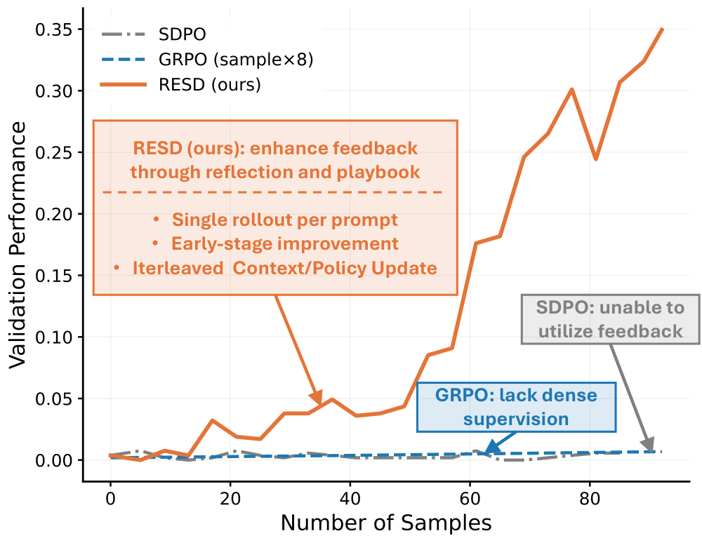
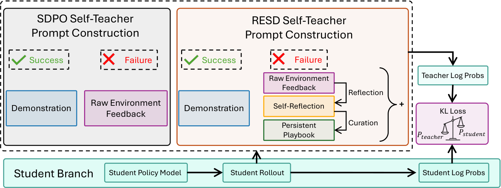
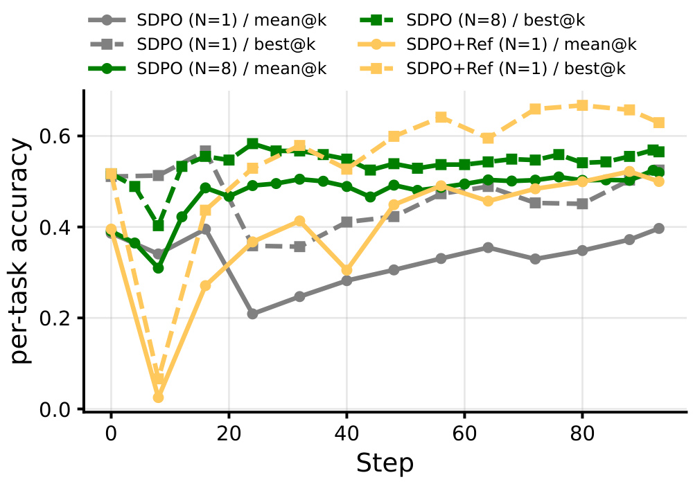
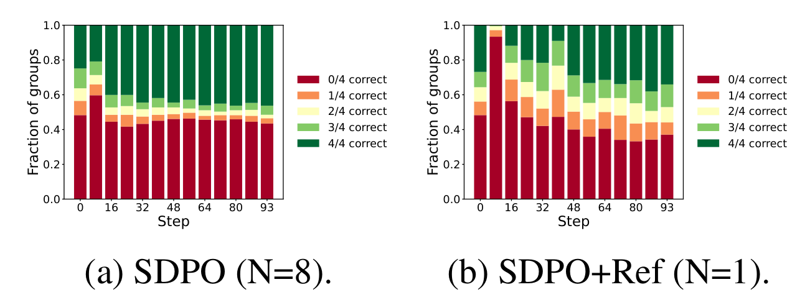
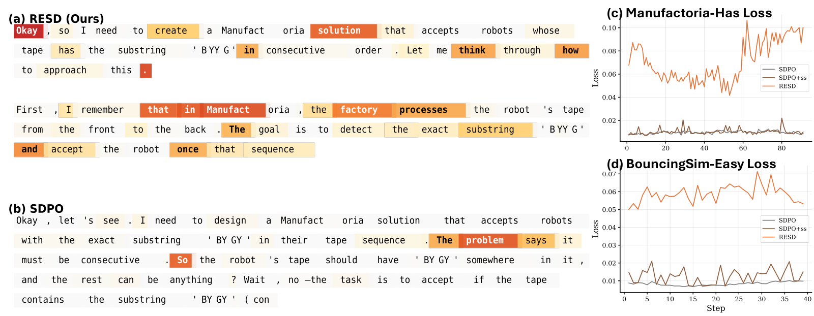
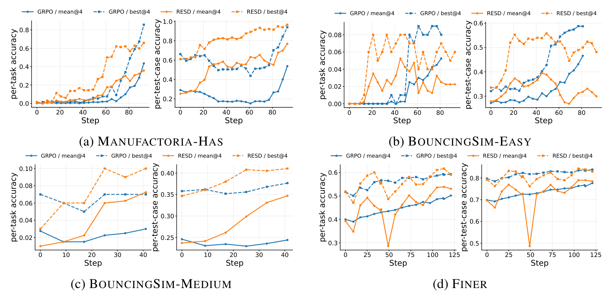
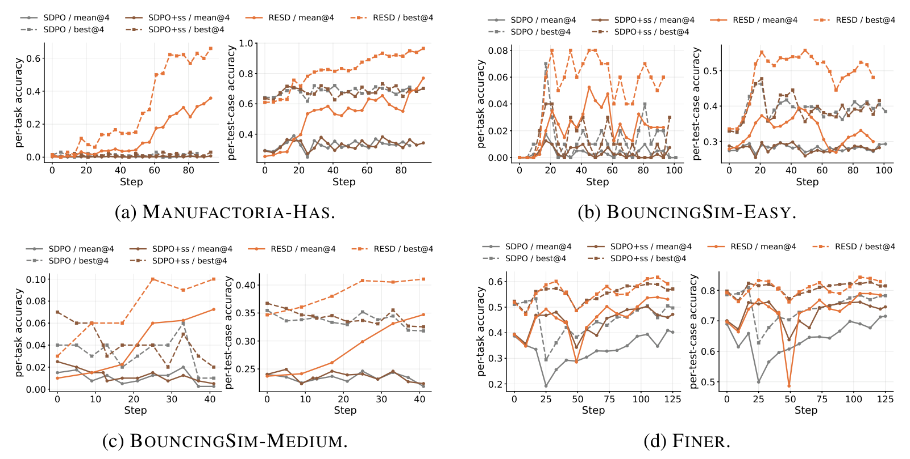
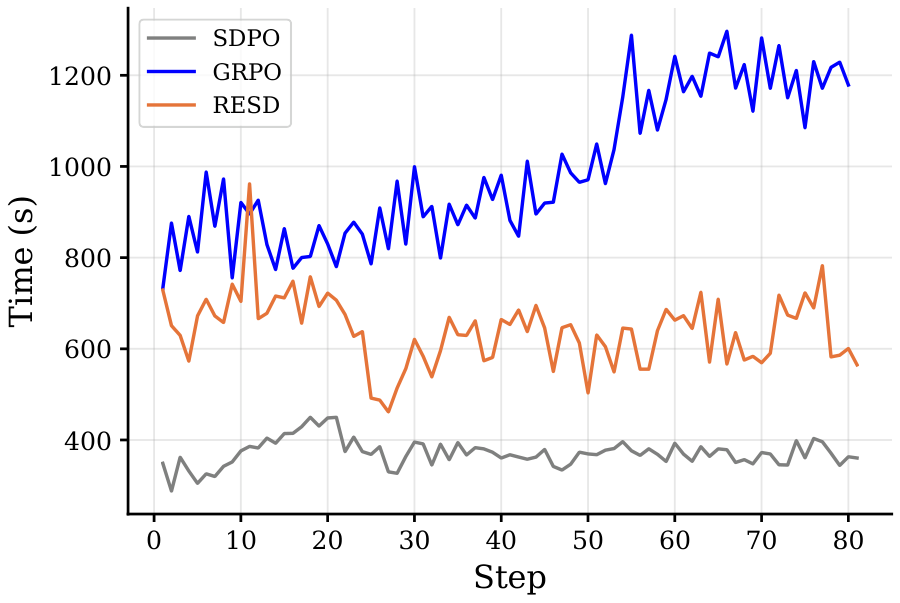

# Learning with Rare Success but Rich Feedback via Reflection-Enhanced Self-Distillation（成功很少、反馈很多时，靠"反思增强的自蒸馏"来学）

中文 | [English](./RESD-Reflection-Enhanced-Self-Distillation_en.md)

- **原文链接**: [Learning with Rare Success but Rich Feedback via Reflection-Enhanced Self-Distillation](https://arxiv.org/abs/2605.12741v1)
- **论文**: [arXiv:2605.12741](https://arxiv.org/abs/2605.12741)
- **官方资料**: [horizon-llm/RESD](https://github.com/horizon-llm/RESD)
- **发布日期**: 2026-05-12
- **范围**: 按 arXiv v1（2026-05-12 提交，目前只有这一版）写的通俗解读，不是全文翻译。作者是 Yuwei Zhang 等 12 人，来自加州大学圣地亚哥分校（UC San Diego）、亚马逊（Amazon）和佐治亚理工学院（Georgia Tech）。代码采用 Apache-2.0 许可，基于 veRL 训练框架和 SDPO 的代码。

## 一句话版本

这篇论文想让大模型在一类任务上自己变强：一开始几乎做不对，但每次做错，判题程序都会给出详细的报错。前作 SDPO 的办法是让同一个模型拿着反馈当"老师"，把学生刚写的回答逐个 token 重读一遍，指出哪里该换成什么。作者发现，SDPO 的老师其实很依赖"同一道题另一份做对的回答"当参照；成功很少时，老师手里只剩原始报错，教不出什么东西。RESD（Reflection-Enhanced Self-Distillation，反思增强的自蒸馏）的改法是：每次做错，先让模型自己写一段错题分析（论文叫反思，说清哪一步错了、该怎么改），再把能反复用的经验整理进一本所有题共用的错题本（论文叫 playbook），做对过的回答也存档。老师打分时把这些一起看，于是即使一份成功示范都没有，也能给出有用的逐词纠正。

效果：在一个写"状态机程序"的任务（Manufactoria-Has）上，测试时每题生成 4 次的平均全对率，从两个 SDPO 基线的不到 1% 提到 35.80%；两个物理模拟编程任务从 1%～2% 提到 4.25%～7.25%；本来就有约 40% 全对率的金融实体标注任务 FiNER，比最好的基线（50.25%）再高一些，到 53.66%。和强化学习方法 GRPO 比，RESD 每道题每步只生成 1 份回答（GRPO 生成 8 份），训练前期涨得更快；但它的曲线有起伏，后期不一定比 GRPO 好。作者的建议是先用 RESD 把成功率拉起来，再换 GRPO。



*图 1：横轴是生成的回答数量，纵轴是验证集表现。橙线 RESD 一路升到约 0.35（读图估计），灰线 SDPO 和蓝色虚线 GRPO（每题生成 8 份）几乎贴着 0。论文没注明是哪个任务，橙线的走势和数值都和图 6(a) 里 RESD 的每题全对率 mean@4 一致，应该是 Manufactoria-Has。RESD 和 SDPO 每步每题生成 1 份，GRPO 生成 8 份，所以在同一横坐标处 GRPO 只练了八分之一的步数；从数值看，蓝线大约只覆盖 GRPO 的前 12 步。按训练步数比，GRPO 练到最后每题全对率反超 RESD，见第 4.4 节图 6。*

---

## 1. 先认识几个词

| 词 | 大白话 |
| --- | --- |
| 一次作答（rollout） | 模型针对一道题写出的一份完整回答。这篇论文的模型开着思考模式，回答里包括思考过程和最终的程序或答案 |
| token | 模型一次写出的最小文字单位，可以理解成一个词或词的一部分 |
| 环境反馈 | 判题程序给出的信息，比如程序解析失败、哪些测试用例没通过 |
| GRPO | 常用的强化学习方法：同一道题做 8 遍，比这 8 遍平均分高的回答整体加分，低的整体扣分 |
| 自蒸馏 | 老师和学生是同一个模型。老师的提示里多放一些学生看不到的信息（论文叫"特权信息"），再在学生回答的每个位置给出"这里我觉得该写什么"，学生往老师的看法靠 |
| KL 散度、reverse KL、JSD | 都是衡量两个概率分布差多远的数，越小越接近。论文用 reverse KL 或 JSD（Jensen-Shannon 散度）量老师和学生在每个位置的差距，区别见第 3.5 节 |
| 每题全对率 | Per-Task Accuracy：一道题的所有测试用例都通过才算对，统计做对的题占多少。训练时的奖励也用它 |
| 用例通过率 | Per-Test-Case Accuracy：每道题通过了多少比例的测试用例，再对所有题取平均，能看出"做对了一部分" |
| mean@4 / best@4 | 测试时每题生成 4 份回答，取 4 份的平均成绩 / 取 4 份里最好的一份 |

## 2. 它想解决什么问题

### 成功很少时，强化学习几乎学不到

这篇论文挑的任务，训练前几乎做不对：Manufactoria-Has 每题全对率 0.38%，BouncingSim-Easy 是 0%，BouncingSim-Medium 是 1%（论文表 2 第一行）。GRPO 这类方法只看最后的对错打分。同一道题 8 遍全错时，每一遍都等于平均分，没有谁被加分或扣分，这道题等于白做。就算偶尔做对一次，也只是给整段回答一个总分，说不清是哪几步写得好。

### 自蒸馏能逐词纠正，但老师靠"同组做对的回答"

另一条路是蒸馏：让老师在学生回答的每个位置给出概率，学生照着调整，信号细得多。用外部的强模型当老师成本高，而且老师和学生的写法习惯不一样。SDPO、OPSD 这类自蒸馏方法改用模型自己当老师，只在老师的提示里多放特权信息。

SDPO 老师的特权信息有两样：这份回答收到的环境反馈，以及同一批里同一道题做对的另一份回答（论文叫同组示范）。为了分清两者各起多大作用，作者在 FiNER 上把每题采样数 N 从 8 改成 1，其他设置不变。N=1 时不可能有同组示范，老师只剩反馈可看，结果 SDPO 明显变差（第 3.4 节图 3 的灰线）。

成功越少，这个问题越严重：大部分题一批里全是失败，老师拿不到任何正确示范，只能从原始报错里硬凑纠正信号。

### 作者的判断：问题出在反馈的用法

按理说，老师已经看到了学生失败的详细反馈，应该能纠正。作者认为反馈本身已经够多了，问题出在它怎么呈现、怎么用。原始的失败反馈是"诊断性的"：告诉你失败了、哪个用例没过，却没说是哪一个决定导致了失败。老师和学生又是同一个模型，单看这样的报错，未必想得出该怎么改。

所以作者主张从"把反馈原样塞给老师"改成"先主动理解反馈"，具体要做两件事：

1. **回头看**：把最后的失败和中间哪一步推理联系起来，找到出错的原因。
2. **攒经验**：很多失败是同一条隐藏规则的反复体现，并不是互不相干的错误，所以要把教训跨题保存下来。

## 3. RESD 怎么做



*图 2：最下面一条是学生：学生模型写出回答，并算出自己在每个 token 上的概率。上方左边是 SDPO 老师的提示：做对的情况放示范回答，做错的情况只放原始反馈。右边是 RESD 老师的提示：做错时，在原始反馈之外加上模型自己写的反思（Self-Reflection）和持续更新的错题本（Persistent Playbook）。老师据此算出每个 token 的概率，和学生的概率算 KL 损失，用来更新学生。*

### 3.1 三样新东西

**错题分析（反思）。** 学生做错后，换一个"诊断"用的提示，让同一个模型读题目、自己的错误回答、环境反馈和当前错题本，输出两样东西：一段话说明这次为什么错、哪里该怎么改；再给错题本里每条现有经验打一个标签，表示这条经验这次是帮了忙（helpful）、带偏了（harmful），还是无关（neutral）。

**错题本（playbook）。** 全局只有一本，所有训练题共用，里面是一条条用自然语言写的经验。写完反思后，再让模型看着错题本和这段反思，补上错题本里还没有的新经验（论文叫 Curate，整理）。每条经验都记着累计被标"帮忙"和"带偏"的次数。错题本会定期精简（论文叫 Concise）：带偏次数不少于帮忙次数的删掉；从来没被标过的也会被删（有一种策略会多等一步再删）；总条数超过上限（各任务设 120～200 条）时，再随机删一些，或删最久没用到的。精简默认每 4 次更新做一次，条数超上限时也会触发。错题本这个想法借自 ACE（Agentic Context Engineering）。

**做对的回答存档（solution buffer）。** 某道题一旦做对，把这份回答存下来，以后再给这道题当老师时一起放进提示。

### 3.2 一步训练的流程（论文算法 1）

1. 学生只看题目，写一份回答（每题 1 份）。
2. 判题程序给出反馈，并判断对错。
3. 更新上下文：先精简错题本；做错了就写反思、更新错题本；做对了就把回答存档。
4. 拼出老师的提示：题目、错题本、这次的反思、学生这次的回答、反馈，以及这道题的存档回答（如果有）。
5. 老师逐个 token 读学生的回答，给出每个位置的概率；学生在每个位置向老师的概率靠拢。论文用 reverse KL 或 JSD 衡量两者差距，只在学生概率最高的 100 个候选 token 上算。
6. 更新学生的参数。老师的参数跟着学生做滑动平均（EMA），但挪得极慢：默认每步只向学生挪万分之一（BouncingSim-Medium 用百分之一）。

有两点值得记住：

- 按算法 1，学生写回答时只看题目，反思、错题本和存档只出现在老师的提示里，官方代码的默认设置也是这样（`use_playbook_in_student_rollout=False`）。训练的目的，是把老师"翻着错题本才知道的东西"压进学生自己的参数。
- 老师的参数几乎就是训练前的原模型。老师每步只把万分之一的权重换成学生的当前参数。我按每步更新一次估算，Manufactoria-Has 练完约 93 步、FiNER 练完约 125 步后，老师参数里训练前原模型的成分仍占约 99%；只有 BouncingSim-Medium 每步换百分之一，40 步后原模型成分约占三分之二。所以老师比学生懂得多，主要靠提示里多出的反思、错题本和存档，不靠参数。

另外还有一个辅助技巧：成功样本加权（附录 B）。一批里做对的样本很少时，给它们更大的权重；做错的很少时，反过来给做错的更大权重，免得少数一方的信号被淹没。论文只在 BouncingSim-Easy 和 FiNER 上开了这项。

### 3.3 和 SDPO 比，差在哪

| | SDPO（本文实验里的设置） | RESD |
| --- | --- | --- |
| 每题每步生成几份回答 | 1 份（SDPO 原论文的主要实验每题采 8 份） | 1 份 |
| 老师看到的特权信息 | 原始反馈；同组做对的回答（每题只采 1 份时没有） | 原始反馈、反思、错题本、这道题以前做对的存档 |
| 跨题共享的经验 | 没有 | 有，全局一本错题本 |
| 学生自己做对的样本 | 默认不拿来蒸馏；变体 SDPO+ss 会用 | 存档，并用来蒸馏 |
| 额外开销 | 无 | 做错时每份回答要多做两次生成（写反思、整理错题本），老师的提示也更长 |

SDPO 默认的规则是：学生这次做对了、同组又没有另一份做对的回答当示范，这条样本就不参与蒸馏。每题只采 1 份时组里永远只有它自己，所以 SDPO 做对的样本全被跳过，只能从失败里学。SDPO+ss 把这类样本也用上，让老师看着这份正确回答给它打分。

### 3.4 先导实验：只采 1 份时，反思能补回多少



*图 3：FiNER 上每题全对率随训练步数的变化，实线是 mean@4，虚线是 best@4。灰色是每题只采 1 份的 SDPO，绿色是每题采 8 份的 SDPO，黄色 SDPO+Ref 是只采 1 份、但老师多看反思和错题本的版本（还没加存档）。*

只采 1 份的 SDPO（灰线）mean@4 大部分时间在 0.2～0.4，比采 8 份的 SDPO（绿线，后期约 0.5）低一截（本段数值都是读图估计）。加上反思和错题本后（黄线），同样只采 1 份、手里没有任何成功示范，mean@4 到后期追到约 0.50，和采 8 份的 SDPO 差不多；best@4 则超过了它（第 72 步以后约 0.63～0.67 对约 0.55～0.57）。黄线开头有个大坑：第 8 步跌到接近 0，之后才回升，论文没有解释。



*图 4：每道 FiNER 验证题生成 4 次，按"4 次里对几次"把题目分成 5 组，柱子是各组所占比例。深红是 4 次全错，深绿是 4 次全对。(a) 每题采 8 份的 SDPO；(b) 每题采 1 份的 SDPO+Ref。*

两者进步的方式不一样（以下比例都是读图估计）。采 8 份的 SDPO，4 次全错的题训练前约 48%，之后（第 8 步除外）一直在 42%～46% 之间，几乎没变；涨的主要是 4 次全对的题（从约 25% 升到约 46%）。只采 1 份的 SDPO+Ref，4 次全错的题从约 48% 降到约 33%～37%，多出来的主要是"4 次对 1～3 次"的题；4 次全对的题到最后约 34%，比采 8 份的 SDPO 少。作者据此说：SDPO 的进步主要来自 4 次全对的题变多（我的理解是，原本时对时错的题变得稳定做对），反思则让模型在原本完全不会的题上也学到了东西。

### 3.5 选读：公式和两个小算例

不看也不影响理解。

把老师的概率除以学生的概率，记作比值 $`\tau`$：

```math
\tau^t_v=\frac{\pi_{\theta_{\text{old}}}(v\mid x,\,y_{< t},\,c,\,r,\,\mathcal{P},\,\mathcal{B}(x))}{\pi_\theta(v\mid x,\,y_{< t})}
```

分子是老师：参数 $`\theta_{\text{old}}`$，看题目 $`x`$、学生回答的前 $`t-1`$ 个 token $`y_{<t}`$、反馈 $`c`$、反思 $`r`$、错题本 $`\mathcal{P}`$ 和存档 $`\mathcal{B}(x)`$，给出第 $`t`$ 个位置写 token $`v`$ 的概率。分母是学生，只看题目和前文。训练目标（论文式 1）是：

```math
\mathcal{L}_{\text{SD}}(\theta)=\mathbb{E}_{x,\;y\sim\pi_\theta}\Big[\sum_{t=1}^{T}\sum_{v\in\mathcal{V}}\pi_\theta(v\mid x,y_{< t})\,f(\tilde\tau^t_v)\Big]
```

- $`\tilde\tau`$ 是截断后的比值，下限 0.2（Manufactoria-Has 另设上限 5），防止个别 token 的比值太极端，把训练带偏。
- 取 $`f(\tau)=-\log\tau`$，上式就是学生对老师的 reverse KL：学生把概率放在老师觉得不该写的 token 上时，罚得最重。取 $`f(\tau)=\tau\log\tau`$ 是 forward KL。JSD 介于两者之间，而且有上界（不超过 $`\log 2`$），老师和学生差距很大时更稳。
- 回答 $`y`$ 是学生自己采样的，所以这是 on-policy 训练：学生在自己会写出的回答上被纠正，不是去抄别人的标准答案。

小例子（我编的示意，不是论文里的）：某个位置只看三个候选 token，学生给的概率是 (0.7, 0.2, 0.1)，老师看过反思和错题本后给 (0.2, 0.7, 0.1)。这个位置的 reverse KL 是

```math
0.7\ln\tfrac{0.7}{0.2}+0.2\ln\tfrac{0.2}{0.7}+0.1\ln\tfrac{0.1}{0.1}\approx 0.877-0.251+0\approx 0.63
```

老师和学生看法一致时，这一项是 0。更新学生会压低第一个候选、抬高第二个候选。

反思和整理错题本这两步可以写成：

```math
r,\{\ell_{t,j}\}_{j=1}^{|\mathcal{P}_t|}=\text{Reflect}(x,y,c,\mathcal{P}_t;\theta),\qquad
\mathcal{P}_{t+1}=\mathcal{P}_t\cup\text{Curate}(\mathcal{P}_t,r;\theta)
```

$`\ell_{t,j}`$ 是给第 $`j`$ 条经验打的标签（helpful / harmful / neutral）。两步都由正在训练的学生模型自己完成，不用外部模型。

成功样本加权（附录 B）：一批样本的成功率为 $`s`$，成功样本的权重取 $`(1-s)^{\alpha}`$，失败样本取 $`s^{\beta}`$，再缩放到平均为 1，论文取 $`\alpha=\beta=1`$。举个数（我编的示意，不是论文里的）：32 个样本里 4 个做对（$`s=0.125`$），缩放后每个成功样本权重 4.0，每个失败样本约 0.57，成功和失败两边的总权重都是 16。$`\alpha=\beta=1`$ 时，不管成功率是多少，两边的总权重总是各占一半。

## 4. 实验结果

### 4.1 实验怎么设计的

**四个任务**（根据论文表 1 和表 2 第一行整理）：

| 任务 | 训练题 / 测试题 | 要做什么 | 训练前每题全对率（mean@4） | 模型 |
| --- | --- | --- | --- | --- |
| Manufactoria-Has | 742 / 132 | 用一种小语言写状态机程序，判断输入纸带上有没有指定图案 | 0.38% | Qwen3-4B-Thinking-2507 |
| BouncingSim-Easy | 640 / 100 | 写 Python 代码，模拟二维平面里多个物体碰撞弹跳（简单档） | 0% | Qwen3-4B-Thinking-2507 |
| BouncingSim-Medium | 320 / 100 | 同上（中等档） | 1.00% | Qwen3-30B-A3B-Thinking-2507 |
| FiNER | 1000 / 500 | 给美国上市公司财报（SEC 文件）里的数字打 XBRL 标签，判断每个数字属于哪个标准财务科目 | 39.28% | Qwen3-4B-Thinking-2507 |

*XBRL 是财报数据的标准标记格式。Qwen3-30B-A3B 是混合专家模型，总参数 300 亿，每个 token 实际只用约 30 亿。*

前三个任务来自 RL-Grok 基准，训练前几乎全错，正好用来测"只从失败里学"。FiNER 用的是 ACE 那篇论文的实验设置，起点约 40%，用来看成功并不少时 RESD 还有没有用。

**各任务的反馈长什么样**（论文没细说，以下来自官方代码）：Manufactoria 和 BouncingSim 返回类似刷题网站的测试结果，列出没通过的测试用例；BouncingSim 答错时还会给出每个球的位置误差。FiNER 做错时的反馈是"你的答案部分正确 / 完全错误，正确答案是……"，也就是直接把标准答案告诉了老师（影响见第 6 节）。

**Manufactoria 是什么。** 想象一个机器人带着一条纸带，纸带上是一串彩色符号：红 R、蓝 B、绿 G、黄 Y，比如 `GRBRBRY`。模型要写一个状态机程序，从左到右一个个读符号。程序里的"红蓝读取节点"（`PULLER_RB`）看纸带最前面的符号：是 R 或 B 就取走它，跳到对应的下一个节点；纸带空了，或者最前面是 G、Y，就走 `[EMPTY]` 这条分支。"黄绿读取节点"（`PULLER_YG`）同理。走到 `END` 算接受，走到 `NONE` 算拒绝，陷入死循环也算拒绝。"Has"这一组题，要求程序判断纸带上是否含有某个图案。

**训练方式**：

- **在线流式训练。** 训练数据只过一遍，每批 32 道题，每题每步只生成 1 份回答。同一批题最多连续练 4 步，每一步都重新作答、更新错题本、更新参数，然后换下一批新题。作者想模拟部署后的模型：不断遇到新任务，看到结果，在有限的尝试次数内改进。
- **损失和老师。** Manufactoria-Has 和 BouncingSim-Medium 用 reverse KL，另外两个用 JSD；老师 EMA 更新率 0.0001（BouncingSim-Medium 是 0.01）；比值截断下限 0.2。
- **硬件。** 一台 8 卡 H200 的机器，每个实验约一天。采样温度 1.0、top-p 0.95，所有模型都开着思考模式。回答最长 20,480～25,600 个 token；提示长度上限设到 49,152～58,368 个 token，因为老师的提示要装下错题本、反思、学生这次的回答和存档。

**怎么评分**：每道测试题生成 4 份回答，报 mean@4 和 best@4，各看每题全对率和用例通过率两个指标。训练中途会多次评估，不同指标的最好成绩可能出现在不同的步。作者的取点规则是：在每个记录点，把这 4 个数各自和其他记录点比出排名，4 个排名相加，报告总排名最好的那一步。所有方法都用同一规则。

**对照组**：

- **原模型**（论文表里叫 Base model）：训练前的模型。
- **SDPO**：每题 1 份回答，老师只看原始反馈。组里只有它自己，所以学生做对的样本按 SDPO 的默认设置不参与蒸馏，只从做错的样本里学。
- **SDPO+ss**：SDPO 的变体，学生自己做对的样本也拿来蒸馏（ss 指 self-success），成功多时信号更足。
- **GRPO**：每题 8 份回答，按附录的说法，学习率、批大小、连续练习步数都和 RESD 相同（官方 FiNER 脚本有出入，见第 6 节），不用自蒸馏和错题本。它只出现在曲线图里，表 2 没有它的数字。

### 4.2 主结果：四个任务都比 SDPO 基线好

论文表 2（单位 %；Manuf. = Manufactoria-Has，BSim-E / BSim-M = BouncingSim-Easy / Medium）。先看上半部分，每题全对率：

| 方法 | Manuf. m@4 | Manuf. b@4 | BSim-E m@4 | BSim-E b@4 | BSim-M m@4 | BSim-M b@4 | FiNER m@4 | FiNER b@4 |
| --- | --- | --- | --- | --- | --- | --- | --- | --- |
| 原模型 | 0.38 | 1.52 | 0.00 | 0.00 | 1.00 | 3.00 | 39.28 | 51.90 |
| SDPO | 0.95 | 3.79 | 1.00 | 3.00 | 2.00 | 6.00 | 40.93 | 50.50 |
| SDPO+ss | 0.57 | 2.27 | 1.00 | 4.00 | 2.00 | 6.00 | 50.25 | 59.12 |
| **RESD** | **35.80** | **65.91** | **4.25** | **8.00** | **7.25** | **10.00** | **53.66** | **61.12** |

再看下半部分，用例通过率：

| 方法 | Manuf. m@4 | Manuf. b@4 | BSim-E m@4 | BSim-E b@4 | BSim-M m@4 | BSim-M b@4 | FiNER m@4 | FiNER b@4 |
| --- | --- | --- | --- | --- | --- | --- | --- | --- |
| 原模型 | 25.31 | 60.97 | 27.85 | 33.53 | 23.72 | 34.67 | 69.65 | 79.21 |
| SDPO | 37.66 | 73.55 | 28.98 | 46.20 | 24.38 | 34.47 | 71.27 | 78.21 |
| SDPO+ss | 37.97 | 71.93 | 29.68 | 47.73 | 24.93 | 35.80 | 76.15 | 82.21 |
| **RESD** | **76.95** | **96.53** | **38.87** | **55.80** | **34.72** | **41.07** | **78.98** | **84.32** |

怎么读这两张表：

- **Manufactoria-Has 差距最大。** 两个 SDPO 基线的每题全对率不到 1%，RESD 到 35.80%。换成题数：132 道测试题里，4 次至少做对 1 次的，RESD 有 87 道，SDPO 只有 5 道。用例通过率也从约 38% 翻到约 77%。
- **BouncingSim 有提升，但绝对数很小。** Easy 档 RESD 的 4.25% 是 400 份回答里 17 份全对，b@4 的 8% 是 100 道题里 8 道，SDPO+ss 是 4 道。Medium 档是 10 道对 6 道。用例通过率高了约 9～10 个百分点（下文简称"分"），说明更多题"做对了一部分"。
- **FiNER 上，涨幅大部分来自"用上自己做对的样本"。** 只从失败里学的 SDPO 只比训练前高 1.65 分（40.93 对 39.28），SDPO+ss 一下到 50.25，RESD 在此基础上再高 3.41 分到 53.66。这说明成功并不少时，RESD 仍有帮助，但幅度小得多。

附录图 7 给了这些运行的完整训练曲线，放在第 4.4 节一起看。

### 4.3 老师纠正得更多，而且纠在"决定怎么做"的词上



*图 5：(a)(b) 是第 20 步时，RESD 和 SDPO 各一份回答开头的逐 token 蒸馏损失，颜色从白（损失为 0）到深红（损失大）。(c)(d) 是 Manufactoria-Has 和 BouncingSim-Easy 上，平均每个 token 的蒸馏损失随训练步数的变化。*

蒸馏损失衡量老师和学生在每个位置的看法差多远，差得越多，老师越想改学生。

- **RESD 的老师改得更多。** 在 (c)(d) 里，RESD 的平均损失约 0.04～0.10，两个 SDPO 基线大多在 0.01 上下，最高约 0.02（读图估计）。只看原始反馈的老师，和学生的看法几乎一样，等于没在教。
- **改的位置更关键。** (a) 里 RESD 损失大的 token 有 create、solution、processes、The goal 等。作者说，这些是模型决定"下一步做什么、怎么理解题目"的位置，说明老师在纠正解题思路，没有只抠字眼。(b) 里 SDPO 只有 The problem、says、So 等少数几处颜色较深。

需要注意（这是我的看法）：损失大只说明老师和学生分歧大，不等于老师说得对。老师说得对不对，要看最后的准确率。

### 4.4 和 GRPO 比：前期快，后期不一定



*图 6：四个任务上验证成绩随训练步数的变化，每个任务左边是每题全对率、右边是用例通过率；实线 mean@4，虚线 best@4。蓝色 GRPO 每步每题生成 8 份回答，橙色 RESD 只生成 1 份。*

两者每步的生成量差 8 倍。作者明确说，这个对比看的是"交互效率"（每次和环境交互能带来多少进步），不是生成量相同时的严格对比。论文的结论是：四个任务上，RESD 在训练前期都比 GRPO 涨得快。

按图读数，全程的情况是这样（都是 mean@4，数值为读图估计）：

| 任务 | 前期 | 训练结束时 |
| --- | --- | --- |
| Manufactoria-Has | GRPO 前 60 多步每题全对率几乎为 0，RESD 从第 15 步起慢慢涨 | GRPO 最后 20 步猛涨，每题全对率约 0.44，反超 RESD 的约 0.36（best@4 约 0.86 对 0.66）；用例通过率仍是 RESD 高（约 0.77 对 0.54） |
| BouncingSim-Easy | RESD 第 20 步就起来了，GRPO 到第 50 步前每题全对率几乎为 0 | RESD 在第 50 步前后到达高点，之后回落，用例通过率从约 0.39 掉到约 0.30；GRPO 持续上升到约 0.47 |
| BouncingSim-Medium | 开头两者接近，RESD 从第 17 步左右拉开 | 只练了 40 步，RESD 用例通过率约 0.35，GRPO 约 0.25 |
| FiNER | 多数记录点上 RESD 略高 | 第 50 步 RESD 突然掉到约 0.29，之后回升；结束时两者接近（每题全对率约 0.53 对 0.50） |

作者对曲线起伏的解释：FiNER 第 50 步的暴跌主要是回答太长被截断；BouncingSim-Easy 后期变差，说明模型进入成功较多的阶段后，基于反馈的稠密自蒸馏不如按奖励优化稳定。他们给的实用建议是：先用 RESD 快速把成功率拉起来，等每组回答里有足够多做对的，再换成更稳的 GRPO。



*附录图 7：表 2 那几次运行的完整训练曲线，排布同图 6。灰色 SDPO，棕色 SDPO+ss，橙色 RESD。*

和 SDPO 基线比，RESD 的优势在曲线上很清楚：Manufactoria-Has 上两个 SDPO 基线的每题全对率全程贴着 0，RESD 从第 20 步左右开始高于它们，第 55 步后差距明显拉大；BouncingSim-Medium 上 RESD 稳步上升，基线持平甚至下滑；FiNER 上 RESD 和 SDPO+ss 很接近，普通 SDPO 明显落后。BouncingSim-Easy 是例外：RESD 的用例通过率第 50 步前后约 0.39，到最后回落到约 0.30，和 SDPO 的约 0.29 差不多（读图估计）。表 2 里的 38.87 是按第 4.1 节说的取点规则挑出来的高点。

### 4.5 三样东西：去掉哪一样都会掉分

论文表 3（用例通过率，单位 %；只做了三个任务，没有 BouncingSim-Medium）：

| 方法 | Manuf. m@4 | Manuf. b@4 | BSim-E m@4 | BSim-E b@4 | FiNER m@4 | FiNER b@4 |
| --- | --- | --- | --- | --- | --- | --- |
| RESD（完整） | **76.95** | **96.53** | **38.87** | **55.80** | **78.98** | **84.32** |
| 去掉反思 | 51.41 | 79.26 | 36.85 | 55.33 | 77.78 | 82.26 |
| 去掉错题本 | 60.65 | 92.37 | 32.95 | 53.60 | 77.42 | 83.07 |
| 去掉存档 | 60.24 | 80.10 | 31.97 | 52.40 | 78.36 | 83.42 |

怎么读这张表：

- 去掉任何一样，成绩都会下降，完整版在三个任务上都最好。
- Manufactoria-Has 上去掉反思掉得最多（m@4 从 76.95 降到 51.41）。作者的解释是：反思负责眼前这道题的短期纠正，错题本保存可复用的经验、防止犯过的错再犯，存档帮模型把"做对一部分"变成"全部做对"。
- BouncingSim-Easy 上，去掉存档或错题本掉得多（约 6～7 分），去掉反思只掉约 2 分。FiNER 上差别都在约 2 分以内。
- 即使去掉反思，Manufactoria-Has 的 51.41 仍远高于 SDPO+ss 的 37.97，说明错题本和存档本身也贡献了不少。

这张表只报了用例通过率，没有报每题全对率。论文也没说清"去掉反思"是只不把反思放进老师的提示，还是错题本也不再从反思中更新。

### 4.6 一个具体例子：错题本怎么一步步攒起来

论文表 4 跟踪了 Manufactoria-Has 的一道题："纸带上连续出现 BRBR 就接受"，例如接受 `GRBRBRY`，拒绝 `BRGBY`。程序要能处理图案前后任意的其他符号，部分匹配失败后能重新开始找，纸带在半路读完时要拒绝。同一批题连续练的 4 步里，这道题的情况如下：

| 训练步 | 用例通过率 | 这一步错在哪 | 反思 / 错题本记下了什么 |
| --- | --- | --- | --- |
| 45 | 0.00 | 程序引用了一个没声明的状态，解析直接失败 | 语法规则：所有跳转目标都必须是程序里声明过的状态 |
| 46 | 0.84 | 开头是图案以外的符号就拒绝，比如 `GBRBR` 因为以 G 开头被拒，尽管后面有 BRBR | 状态 `s0` 遇到开头的 G 时去了拒绝，应该继续找。错题本记下：图案前面或中间的无关符号要跳过，不要拒绝 |
| 47 | 0.96 | 论文说是改过头了：为跳过无关符号加的状态，在纸带读完时和另一个状态来回跳，陷入死循环 | 无关符号在纸带没读完时跳过；纸带在非终止状态读完时要拒绝。错题本把这两条带适用场景的规则都记下 |
| 48 | 1.00 | 没有错，全部用例通过 | 存下这份做对的程序 |

作者想用这个例子说明两点。一是在"全对"出现之前，模型已经在一步步进步：先修语法，再修状态跳转，再修纸带读完这种边界情况。二是错题本记下的是带适用场景的规则：不同的失败需要不同的修法（跳过无关符号，还是在纸带读完时拒绝），最后存档的成功程序展示了这些规则怎么在一个完整程序里同时成立。附录 H 给出了每一步的完整程序。

我按官方模拟器的规则把这几段程序实际跑了一遍，第 47、48 步和上面的描述对不上，详见第 6 节。

### 4.7 格式指令能力基本没掉（只测了 IFEval）

论文附录表 5 用 IFEval 测了训练前后的模型。IFEval 检查模型能否遵守"至少写 300 字""不要用逗号"这类能自动检查的格式指令，一道题的"用例"就是题目里的各条指令（单位 %）：

| 模型 | 用例通过率 m@4 | b@4 | 每题全对率 m@4 | b@4 |
| --- | --- | --- | --- | --- |
| 训练前 | 87.62 | 91.33 | 82.50 | 87.00 |
| 练完 Manufactoria-Has | 87.96 | 91.33 | 83.75 | 87.00 |
| 练完 BouncingSim-Easy | 87.83 | 92.33 | 83.25 | 88.00 |
| 练完 FiNER | 86.88 | 90.33 | 80.50 | 86.00 |

变化都不超过 2 分，作者据此说 RESD 保住了原有能力。需要注意两点（这是我的看法）：表里的数字和 100 道题对得上（官方代码里的 IFEval 测试文件也是 100 条，IFEval 全集约 540 道），83.75 对 82.50 只差 400 份回答里的 5 份，属于正常波动；另外只测了遵守格式指令这一项，数学、知识、通用编程等能力都没测。

### 4.8 每步耗时约为 SDPO 的 1.5～2 倍



*附录图 8：BouncingSim-Easy 上每个训练步花的时间（秒）。灰色 SDPO，蓝色 GRPO，橙色 RESD。论文正文只给了两个概数：SDPO 每步约 400 秒，GRPO 后期超过 1200 秒。*

按图读数（读图估计）：SDPO 最省，每步约 300～450 秒。RESD 每步约 450～950 秒，多数在 550～750 秒，大约是 SDPO 的 1.5～2 倍，多出来的时间花在写反思、整理错题本，以及在更长的老师提示上算概率。GRPO 每步要生成并判分 8 倍的回答，从前期的约 750～1,000 秒涨到后期的 1,100～1,300 秒。所以按每步耗时算（我按这些读数估算），RESD 约为 GRPO 的一半到四分之三，并不是八分之一。

## 5. 作者自己承认的局限

- **曲线不单调。** FiNER 第 50 步前后的暴跌主要是回答被截断；BouncingSim-Easy 后期变差，作者认为模型进入成功较多的阶段后，基于反馈的稠密自蒸馏不如按奖励优化稳定。建议先用 RESD 把成功率拉起来，再换 GRPO。
- **自蒸馏本身不太稳。** 作者引用了几篇同期工作，指出自蒸馏的训练过程本来就容易不稳定。RESD 没有改训练目标，只改了喂给老师的信息，所以可以和更好的目标叠加：比如用样本路由决定什么时候做蒸馏，用基于奖励的目标决定更新方向，RESD 负责提供让失败样本也能用来逐词纠正的上下文。
- **多花时间。** 写反思和整理错题本要额外生成，每步比 SDPO 慢（见第 4.8 节图 8）。
- **还在进行中。** 作者在 arXiv 备注里写着"Work in progress"（仍在进行中的工作），之后的版本可能会改动。

## 6. 读的时候值得留意的地方

以下是我读原文时注意到、论文没有重点讨论的点，供参考。

### 证据有多强

- **表 2 的对照组只有每题 1 份回答的 SDPO。** 这个设置下 SDPO 没有同组示范，按默认设置还会跳过自己做对的样本，而论文第 3.1 节自己就说明了 SDPO 在这种设置下会变差。每题 8 份的 SDPO 只在 FiNER 的先导实验里出现过（图 3，对比的还是没加存档的 SDPO+Ref），GRPO 只出现在曲线图里。练完全程时，GRPO 在 Manufactoria-Has 的每题全对率（约 0.44 对 0.36，读图估计）和 BouncingSim-Easy 的两个指标上都高于 RESD。所以表 2 的"全部最好"，是在每题只生成 1 份回答的自蒸馏方法里比出来的。
- **"少用 8 倍样本"要看怎么算。** 图 1 按生成的回答数对齐，同一横坐标处 GRPO 只练了八分之一的步数。按时间算，RESD 每步约为 GRPO 的一半到四分之三（图 8）。RESD 省的主要是判题次数；判题很贵时（比如要和真实环境交互）这一点更有价值，算力是瓶颈时优势小得多。
- **成绩是在测试集上挑的最好一步。** 从表 1 和官方数据看，论文只分了训练集和测试集（Manufactoria-Has 的官方配置是 85% 训练、15% 测试），挑点用的"验证成绩"就是测试集成绩。规则对所有方法一样，但曲线起伏越大的方法越占便宜。BouncingSim-Easy 上，RESD 在表 2 的数字来自第 50 步前后的高点，练到最后，它的用例通过率（约 0.30）和 SDPO（约 0.29）差不多。论文每个设置只跑了一次，没有误差范围；BouncingSim 上 RESD 比基线多做对的题，是 100 道里的 4 道左右。

### 适用范围

- **模型和任务都不多。** 只用了 Qwen3 的两个模型（4B 和 30B-A3B）；四个任务里三个来自同一个基准，而且都有自动判题程序和详细报错。

### 对照公开代码（这几条是我对照官方代码仓库查到的，论文里没有写）

- **FiNER 的反馈里直接写着标准答案。** 按官方代码，FiNER 答错时的反馈是"你的答案部分正确 / 完全错误，正确答案是……"，RESD 和 SDPO 的脚本都开着这项。所以 FiNER 上的老师是看着答案在教，更接近 OPSD 那种"看过参考答案的老师"，测的不是"从诊断性的报错里学"。论文用来说明 SDPO 缺陷的先导实验（第 3.4 节）也是在 FiNER 上做的，而 FiNER 起点约 40%，并不属于成功很少的情况。
- **案例里的程序和文字描述对不上。** 我按官方代码里模拟器的规则，把附录 H 给出的几段程序在所有长度不超过 8 的纸带上（共 87,381 条）跑了一遍。第 46 步和描述一致。第 47 步的程序不会死循环：它的黄绿读取节点只会遇到空纸带或 G、Y，要么取走符号，要么拒绝。它真正的错误是 `state1` 读到第二个 B 时退回了 `state0`，把 `BBRBR` 这类纸带判成拒绝，而第 46 步这里原本是对的。第 48 步通过了这道题的全部测试用例，但按表 4 说明里的"连续出现 BRBR"，它会把 `BRGBR` 这类中间夹着 G 或 Y 的纸带也判为接受（长度不超过 8 的有 4,056 条），因为它在匹配到一半时也跳过 G、Y。也就是说，错题本里"跳过无关符号"这条经验被推广过了头，测试用例又恰好没覆盖到，这份程序就被当作"做对的示范"存了档。反思和错题本是模型自己写的，也会写错；论文没有分析错题本里有多少经验是错的。
- **复现时注意脚本和附录的出入。** 官方 FiNER 脚本里，RESD 和 SDPO 的默认学习率是 1e-5，GRPO 是 1e-6，而附录说 GRPO 和 RESD 用同样的学习率 1e-6；如果论文是按脚本默认值跑的，FiNER 上和 GRPO 对比时学习率差了 10 倍。Manufactoria-Has 的 RESD 脚本默认开着成功样本加权、用 staleness 方式精简错题本，附录写的是不加权、用 prioritized 方式。

### 稿件里的小问题（不影响主要结论）

- **附录 H 对第 48 步的说法和表 4、算法 1 对不上。** 附录说第 48 步的输出是"之前存档的成功程序引导出来的"，但表 4 里第 45～47 步都没做对，第 48 步才存档；按算法 1，学生作答时也看不到存档。

## 7. 和几篇相关工作的关系

| 工作 | 做法 | 和 RESD 的关系 |
| --- | --- | --- |
| [SDPO](https://arxiv.org/abs/2601.20802) | 同一个模型拿环境反馈当老师，逐 token 纠正；老师还能看同组做对的回答 | 直接前作，也是代码基础。RESD 在老师的提示里加了反思、错题本和存档 |
| [OPSD](https://arxiv.org/abs/2601.18734) | 老师看参考答案，学生不看 | 同属自蒸馏，老师的特权信息是标准答案 |
| [SDFT](https://arxiv.org/abs/2601.19897) | 老师看示范，在线自蒸馏，学新技能又少忘旧本事 | RESD 引用它说明在线自蒸馏不容易遗忘 |
| [ACE](https://arxiv.org/abs/2510.04618) | 不改参数，维护一本不断演化的经验手册（playbook），推理时放进提示 | RESD 借了它的手册和"先反思、再整理"的流程，但手册只给老师看，经验最后要练进参数 |
| [Reflexion](https://arxiv.org/abs/2303.11366) | 把文字形式的反思存成记忆，下次尝试时放进提示 | 同样用文字记住教训，但不更新参数 |

其他提到的：Manufactoria 和 BouncingSim 出自 [RL-Grok 基准](https://arxiv.org/abs/2509.21016)；GRPO 出自 [DeepSeekMath](https://arxiv.org/abs/2402.03300)；作者建议叠加的两种训练目标是[样本路由](https://arxiv.org/abs/2604.02288)和 [Self-Distilled RLVR](https://arxiv.org/abs/2604.03128)。

## 8. 总结

RESD 在 SDPO 上加了三样东西：做错后让模型自己写错题分析，把经验攒进所有题共用的错题本，把做对的回答存档，再把它们都放进老师的提示。这样老师手里即使一份成功示范都没有，也能给出更有针对性的逐词纠正。按算法 1 和官方代码的默认设置，学生作答时不带错题本，学到的经验要靠训练练进参数。

在几乎全错的任务上，它比只看原始反馈的 SDPO 强很多，前期也比每题采 8 份的 GRPO 涨得快，判题次数只有 GRPO 的八分之一。代价是每步耗时约为 SDPO 的 1.5～2 倍，后期不如 GRPO 稳。另外，表 2 只和每题 1 份回答的 SDPO 比，成绩又是在测试集上挑的高点（见第 6 节）。作者自己的定位是：RESD 适合在成功很少的早期把模型带起来，成功多了以后再交给 GRPO。

---

## 原文位置对照

| 本文内容 | 论文位置 |
| --- | --- |
| 问题和动机 | 第 1 节，图 1 |
| 自蒸馏的训练目标、三种差距度量 | 第 2 节，式 (1)；附录 A |
| SDPO 依赖同组示范、只采 1 份的先导实验 | 第 3.1、3.2 节，图 3、图 4 |
| 反思、错题本、存档和一步训练的流程 | 第 3.3 节，算法 1，图 2 |
| 错题本的精简策略 | 附录 D |
| 成功样本加权 | 第 3.3 节末尾，附录 B 式 (2)(3) |
| 实验设计：任务、训练方式、评分、对照组 | 第 4.1 节，表 1，附录 G |
| 主结果 | 第 4.2 节，表 2 |
| 老师纠正得更多 | 第 4.3 节，图 5 |
| 和 GRPO 比、完整训练曲线 | 第 4.4 节，图 6；附录 C 图 7；附录 G（GRPO 设置） |
| 三样东西各起多大作用 | 第 4.5 节，表 3 |
| 错题本一步步攒起来的例子 | 第 4.6 节，表 4，附录 H |
| IFEval 上的能力保持 | 附录 E，表 5 |
| 训练耗时 | 附录 F，图 8 |
| 作者自己承认的局限 | 第 4.4 节末尾，第 6 节，附录 F |
| 相关工作 | 第 5 节 |
| 各任务的反馈格式、脚本默认设置、案例程序的复跑 | 论文里没有，来自官方代码仓库 |
