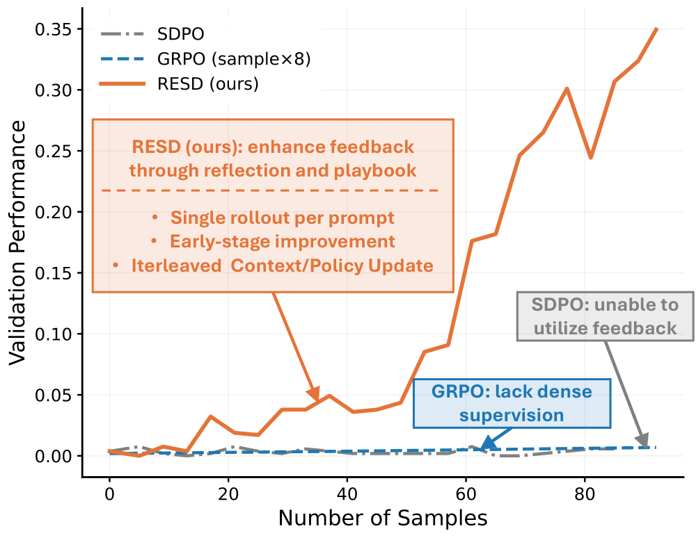
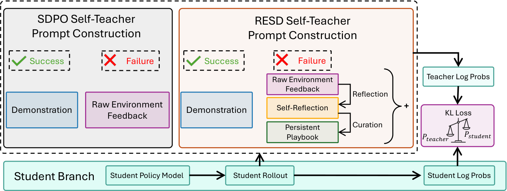
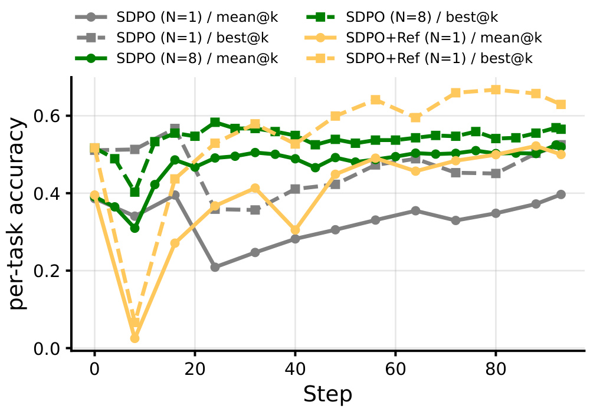
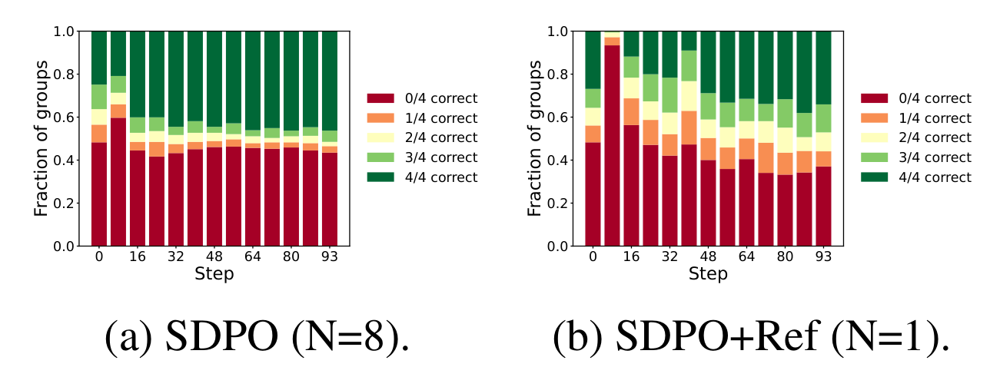
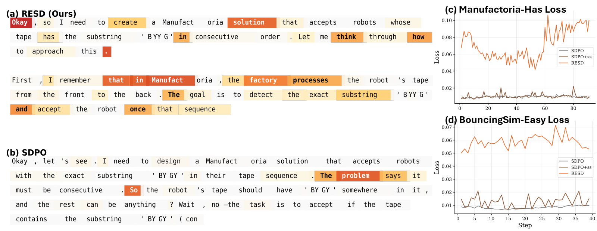
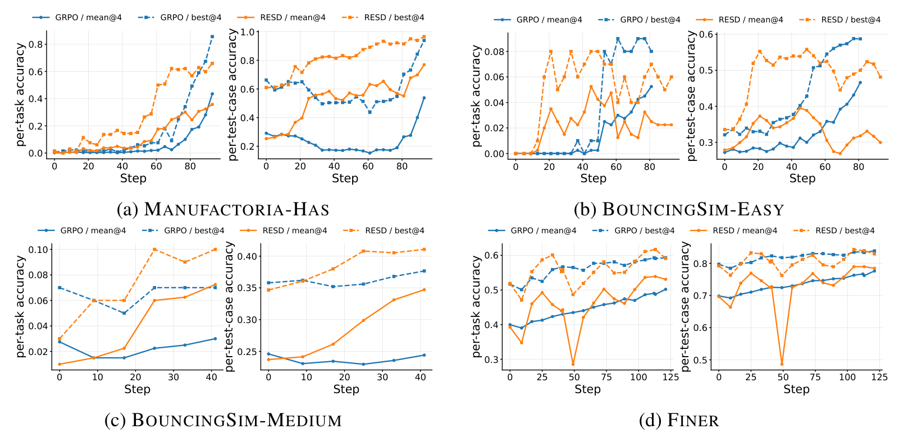
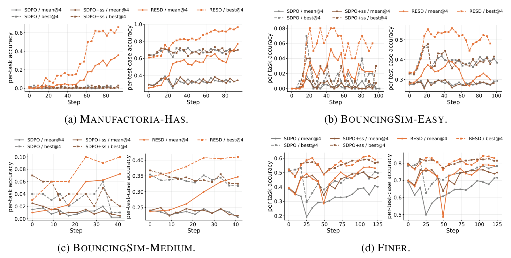
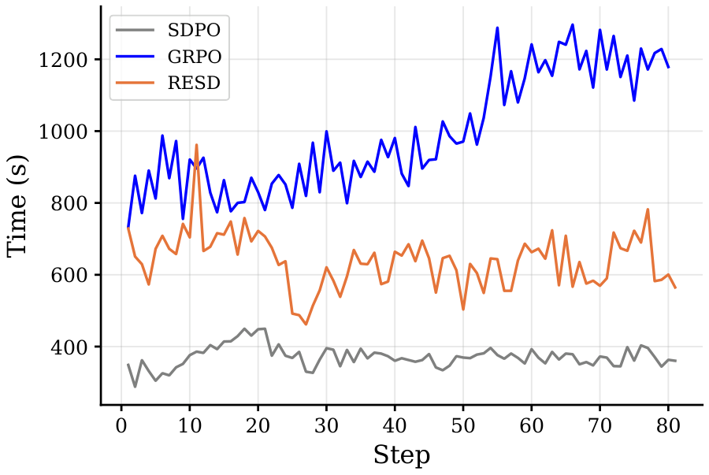

# Learning with Rare Success but Rich Feedback via Reflection-Enhanced Self-Distillation

[中文](./RESD-Reflection-Enhanced-Self-Distillation.md) | English

- **Source**: [Learning with Rare Success but Rich Feedback via Reflection-Enhanced Self-Distillation](https://arxiv.org/abs/2605.12741v1)
- **Paper**: [arXiv:2605.12741](https://arxiv.org/abs/2605.12741)
- **Official resources**: [horizon-llm/RESD](https://github.com/horizon-llm/RESD)
- **Published**: 2026-05-12
- **Scope**: A plain-language explainer based on arXiv v1 (submitted 2026-05-12, the only version so far), not a full translation. The authors are Yuwei Zhang and colleagues, 12 in all, from the University of California San Diego (UC San Diego), Amazon and the Georgia Institute of Technology (Georgia Tech). The code is released under the Apache-2.0 license and builds on the veRL training framework and the SDPO code.

## In One Sentence

This paper wants an LLM to get better on its own at a kind of task where it almost never gets things right at first, but every time it fails, the grader gives a detailed error report. The earlier work SDPO has the same model act as a "teacher" that holds the feedback: it rereads the response the student just wrote, token by token, and points out what should be replaced with what. The authors find that SDPO's teacher in fact leans heavily on "another correct response to the same problem" as a reference; when successes are rare, the teacher has only the raw error messages and cannot teach much. RESD (Reflection-Enhanced Self-Distillation) changes this: after each failure, the model first writes its own analysis of the mistake (the paper calls it a reflection; it says which step went wrong and how to fix it), then collects reusable lessons in a mistake notebook shared by all problems (the paper calls it a playbook), and it also archives the responses that succeeded. The teacher looks at all of these when scoring, so even without a single successful demonstration it can give useful per-token corrections.

Results: on a task of writing "state machine programs" (Manufactoria-Has), the per-task accuracy averaged over 4 generations per problem at test time rises from under 1% for the two SDPO baselines to 35.80%; on two physics-simulation coding tasks, it goes from a 1% to 2% range to a 4.25% to 7.25% range; on FiNER, a financial entity tagging task that already starts at about 40% per-task accuracy, it goes a bit beyond the best baseline (50.25%), to 53.66%. Compared with the RL method GRPO, RESD generates only 1 response per problem per step (GRPO generates 8) and climbs faster early in training; but its curves go up and down, and late in training it is not necessarily better than GRPO. The authors suggest using RESD first to raise the success rate, then switching to GRPO.



*Figure 1: the x-axis is the number of responses generated and the y-axis is validation performance. The orange RESD line rises all the way to about 0.35 (read off the plot), while the gray SDPO line and the dashed blue GRPO line (8 responses per problem) stay almost at 0. The paper does not say which task this is; the shape and values of the orange line match RESD's per-task accuracy mean@4 in Figure 6(a), so it is most likely Manufactoria-Has. RESD and SDPO generate 1 response per problem per step and GRPO generates 8, so at the same x position GRPO has trained for only one-eighth as many steps; judging by the values, the blue line covers only about the first 12 steps of GRPO. Compared by training steps, GRPO's per-task accuracy overtakes RESD's by the end of training; see Figure 6 in Section 4.4.*

---

## 1. Key Terms

| Term | In plain words |
| --- | --- |
| An attempt (rollout) | One complete response the model writes for a problem. The model in this paper runs with thinking mode on, so a response includes the thinking process and the final program or answer |
| token | The smallest unit of text the model writes at a time; think of it as a word or part of a word |
| Environment feedback | Information from the grader, for example that the program failed to parse, or which test cases did not pass |
| GRPO | A common RL method: solve the same problem 8 times; responses that score above the average of the 8 are rewarded as a whole, and those below are penalized as a whole |
| Self-distillation | Teacher and student are the same model. The teacher's prompt holds some extra information the student cannot see (the paper calls it "privileged information"); at every position of the student's response the teacher then says "this is what I think should be written here", and the student moves toward the teacher's view |
| KL divergence, reverse KL, JSD | All are numbers that measure how far apart two probability distributions are; smaller means closer. The paper uses reverse KL or JSD (Jensen-Shannon divergence) to measure the gap between teacher and student at each position; Section 3.5 explains the difference |
| Per-task accuracy | The paper's Per-Task Accuracy: a problem counts as correct only when all of its test cases pass, and the metric is the share of problems that are correct. The training reward uses it too |
| Per-test-case accuracy | The paper's Per-Test-Case Accuracy: the share of test cases passed on each problem, averaged over all problems. It shows when a response is "partly correct" |
| mean@4 / best@4 | At test time, generate 4 responses per problem and take the average score of the 4 / the score of the best of the 4 |

## 2. What Problem It Tackles

### When successes are rare, RL learns almost nothing

The tasks this paper picks are almost never solved before training: per-task accuracy is 0.38% on Manufactoria-Has, 0% on BouncingSim-Easy and 1% on BouncingSim-Medium (first row of Table 2 in the paper). Methods like GRPO score only whether the final result is right or wrong. When all 8 attempts at the same problem are wrong, each attempt scores exactly the average, none is rewarded or penalized, and the problem is effectively wasted. Even when the model occasionally gets one right, the whole response gets a single total score, which does not say which steps were good.

### Self-distillation can correct per token, but the teacher relies on "a correct response from the same group"

The other route is distillation: the teacher gives probabilities at every position of the student's response and the student adjusts to match them, so the signal is much finer. Using an external strong model as the teacher is expensive, and teacher and student have different writing habits. Self-distillation methods such as SDPO and OPSD use the model itself as the teacher instead, and only put extra privileged information in the teacher's prompt.

SDPO's teacher has two pieces of privileged information: the environment feedback this response received, and another correct response to the same problem in the same batch (the paper calls it an in-group demonstration). To separate how much each one contributes, the authors changed the number of samples per problem N from 8 to 1 on FiNER and kept every other setting the same. With N=1 there can be no in-group demonstration, so the teacher has only the feedback to look at, and SDPO got clearly worse (the gray line in Figure 3, Section 3.4).

The rarer successes are, the worse this problem gets: for most problems every attempt in a batch fails, so the teacher gets no correct demonstration at all and has to squeeze a correction signal out of the raw error messages.

### The authors' view: the problem is how the feedback is used

In principle, the teacher has already seen the detailed feedback on the student's failure, so it should be able to correct it. The authors argue that there is already plenty of feedback; the problem is how it is presented and used. Raw failure feedback is "diagnostic": it tells you that you failed and which test case did not pass, but not which decision caused the failure. And teacher and student are the same model, so from such an error report alone the teacher may not be able to work out how to fix it.

So the authors propose moving from "stuffing the feedback into the teacher's prompt as is" to "actively making sense of the feedback first", which takes two things:

1. **Look back**: link the final failure to the intermediate reasoning step behind it, and find why it went wrong.
2. **Build up experience**: many failures are repeated expressions of the same hidden rule, not unrelated errors, so the lessons should be kept across problems.

## 3. How RESD Works



*Figure 2: the bottom row is the student: the student model writes a response and computes its own probability for each token. Top left is the SDPO teacher's prompt: a correct case gets a demonstration response, and a wrong case gets only the raw feedback. On the right is the RESD teacher's prompt: for a wrong case, on top of the raw feedback it adds the reflection the model wrote itself (Self-Reflection) and the continually updated mistake notebook (Persistent Playbook). From this the teacher computes a probability for each token; a KL loss between these and the student's probabilities is used to update the student.*

### 3.1 Three new components

**Mistake analysis (reflection).** After the student fails, a different, "diagnostic" prompt has the same model read the problem, its own wrong response, the environment feedback and the current mistake notebook, and output two things: a paragraph explaining why it failed this time and what to fix where; and a label for each existing lesson in the mistake notebook, saying whether that lesson helped this time (helpful), led it astray (harmful) or was irrelevant (neutral).

**Mistake notebook (playbook).** There is only one, global notebook, shared by all training problems, and it holds lessons written one by one in natural language. After the reflection is written, the model looks at the notebook and the reflection and adds new lessons the notebook does not have yet (the paper calls this Curate). Each lesson keeps a running count of how many times it was labeled "helped" and "led astray". The notebook is pruned regularly (the paper calls this Concise): a lesson whose led-astray count is at least its helped count is deleted; lessons that were never labeled are deleted too (one strategy waits one more step before deleting them); and when the total exceeds the cap (set to 120 to 200 per task), more are deleted at random, or the ones unused for the longest time are. By default pruning runs once every 4 updates, and it also triggers when the count exceeds the cap. The idea of the mistake notebook is borrowed from ACE (Agentic Context Engineering).

**Archive of correct responses (solution buffer).** Once a problem is solved, that response is saved, and later, whenever the model acts as the teacher for this problem, it goes into the prompt as well.

### 3.2 One training step (Algorithm 1 in the paper)

1. The student sees only the problem and writes a response (1 per problem).
2. The grader gives feedback and decides whether the response is right or wrong.
3. Update the context: first prune the mistake notebook; if the response was wrong, write a reflection and update the notebook; if it was right, archive the response.
4. Assemble the teacher's prompt: the problem, the mistake notebook, this reflection, the student's response this time, the feedback, and the archived response for this problem (if any).
5. The teacher reads the student's response token by token and gives probabilities at each position; at each position the student moves toward the teacher's probabilities. The paper measures the gap between the two with reverse KL or JSD, computed only over the 100 candidate tokens to which the student gives the highest probability.
6. Update the student's parameters. The teacher's parameters follow the student as a moving average (EMA), but move extremely slowly: by default, each step moves them only one ten-thousandth of the way toward the student (BouncingSim-Medium uses one hundredth).

Two points are worth remembering:

- Per Algorithm 1, the student sees only the problem when writing a response; the reflection, mistake notebook and archive appear only in the teacher's prompt, and the official code's default setting is the same (`use_playbook_in_student_rollout=False`). The point of training is to press what the teacher "knows only by flipping through the mistake notebook" into the student's own parameters.
- The teacher's parameters are almost exactly the original model from before training. Each step, the teacher replaces only one ten-thousandth of its weights with the student's current parameters. By my estimate, assuming one update per step, after the about 93 steps of a full Manufactoria-Has run and the about 125 steps of a full FiNER run, the original model from before training still makes up about 99% of the teacher's parameters; only BouncingSim-Medium swaps in one hundredth per step, and after 40 steps the original model makes up about two-thirds. So the teacher knows more than the student mainly thanks to the extra reflection, mistake notebook and archive in its prompt, not its parameters.

There is also a helper trick: success-sample weighting (Appendix B). When a batch has few correct samples, they get larger weights; when it has few wrong ones, the wrong ones get larger weights instead, so that the minority side's signal is not drowned out. The paper turns this on only for BouncingSim-Easy and FiNER.

### 3.3 How it differs from SDPO

| | SDPO (the setting in this paper's experiments) | RESD |
| --- | --- | --- |
| Responses generated per problem per step | 1 (the main experiments of the original SDPO paper sample 8 per problem) | 1 |
| Privileged information the teacher sees | Raw feedback; a correct response from the same group (absent when only 1 is sampled per problem) | Raw feedback, reflection, mistake notebook, and the archived earlier correct response to this problem |
| Experience shared across problems | None | Yes, one global mistake notebook |
| The student's own correct samples | Not used for distillation by default; the variant SDPO+ss uses them | Archived, and used for distillation |
| Extra cost | None | Each wrong response needs two extra generations (writing the reflection, curating the mistake notebook), and the teacher's prompt is longer |

SDPO's default rule is: if the student got it right this time and the group has no other correct response to serve as a demonstration, the sample does not take part in distillation. With only 1 sample per problem, the group only ever holds that one response, so all of SDPO's correct samples are skipped and it can learn only from failures. SDPO+ss uses these samples too, having the teacher score each one while looking at that same correct response.

### 3.4 Pilot experiment: with only 1 sample, how much can reflection recover



*Figure 3: per-task accuracy on FiNER over training steps; solid lines are mean@4 and dashed lines are best@4. Gray is SDPO with 1 sample per problem, green is SDPO with 8 samples per problem, and yellow, SDPO+Ref, is the version with 1 sample where the teacher also sees the reflection and mistake notebook (the archive is not added yet).*

SDPO with 1 sample (gray line) has mean@4 between 0.2 and 0.4 most of the time, a notch below SDPO with 8 samples (green line, about 0.5 late in training) (all values in this paragraph are read off the plot). With the reflection and mistake notebook added (yellow line), still with only 1 sample and no successful demonstration at hand, mean@4 catches up to about 0.50 late in training, about the same as SDPO with 8 samples; best@4 goes past it (after step 72, about 0.63 to 0.67 versus about 0.55 to 0.57). The yellow line has a deep dip at the start: at step 8 it falls to near 0 and only then recovers, which the paper does not explain.



*Figure 4: each FiNER validation problem is generated 4 times, and the problems are split into 5 groups by "how many of the 4 are correct"; the bars show each group's share. Dark red is all 4 wrong, dark green is all 4 correct. (a) SDPO with 8 samples per problem; (b) SDPO+Ref with 1 sample per problem.*

The two improve in different ways (all shares below are read off the plot). For SDPO with 8 samples, problems with all 4 wrong are about 48% before training and stay between 42% and 46% afterwards (except at step 8), almost unchanged; the gain is mainly in problems with all 4 correct (from about 25% to about 46%). For SDPO+Ref with 1 sample, problems with all 4 wrong drop from about 48% to about 33% to 37%, and the share they lose goes mainly to problems with "1 to 3 of the 4 correct"; problems with all 4 correct end at about 34%, fewer than for SDPO with 8 samples. From this the authors say: SDPO's progress comes mainly from more problems being correct all 4 times (my reading is that problems that used to be sometimes right and sometimes wrong become reliably right), while reflection lets the model learn something even on problems it could not solve at all before.

### 3.5 Optional: the formulas and two small worked examples

You can skip this without losing the thread.

Divide the teacher's probability by the student's probability and call the ratio $`\tau`$:

```math
\tau^t_v=\frac{\pi_{\theta_{\text{old}}}(v\mid x,\,y_{< t},\,c,\,r,\,\mathcal{P},\,\mathcal{B}(x))}{\pi_\theta(v\mid x,\,y_{< t})}
```

The numerator is the teacher: with parameters $`\theta_{\text{old}}`$, it looks at the problem $`x`$, the first $`t-1`$ tokens of the student's response $`y_{<t}`$, the feedback $`c`$, the reflection $`r`$, the mistake notebook $`\mathcal{P}`$ and the archive $`\mathcal{B}(x)`$, and gives the probability of writing token $`v`$ at position $`t`$. The denominator is the student, which sees only the problem and the preceding text. The training objective (Equation 1 in the paper) is:

```math
\mathcal{L}_{\text{SD}}(\theta)=\mathbb{E}_{x,\;y\sim\pi_\theta}\Big[\sum_{t=1}^{T}\sum_{v\in\mathcal{V}}\pi_\theta(v\mid x,y_{< t})\,f(\tilde\tau^t_v)\Big]
```

- $`\tilde\tau`$ is the ratio after clipping, with a lower bound of 0.2 (Manufactoria-Has also sets an upper bound of 5), which keeps the ratio of an individual token from becoming too extreme and throwing training off course.
- With $`f(\tau)=-\log\tau`$, the expression above is the student's reverse KL to the teacher: it penalizes most heavily when the student puts probability on tokens the teacher thinks should not be written. With $`f(\tau)=\tau\log\tau`$ it is forward KL. JSD lies between the two and is also bounded (never above $`\log 2`$), so it is more stable when teacher and student are far apart.
- The response $`y`$ is sampled by the student itself, so this is on-policy training: the student is corrected on responses it would actually write, instead of copying someone else's reference solution.

A small example (an illustration I made up, not from the paper): at some position, consider only three candidate tokens; the student gives them probabilities (0.7, 0.2, 0.1), and the teacher, after seeing the reflection and mistake notebook, gives (0.2, 0.7, 0.1). The reverse KL at this position is

```math
0.7\ln\tfrac{0.7}{0.2}+0.2\ln\tfrac{0.2}{0.7}+0.1\ln\tfrac{0.1}{0.1}\approx 0.877-0.251+0\approx 0.63
```

When teacher and student agree, this term is 0. Updating the student pushes the first candidate down and the second one up.

The reflection and curation steps can be written as:

```math
r,\{\ell_{t,j}\}_{j=1}^{|\mathcal{P}_t|}=\text{Reflect}(x,y,c,\mathcal{P}_t;\theta),\qquad
\mathcal{P}_{t+1}=\mathcal{P}_t\cup\text{Curate}(\mathcal{P}_t,r;\theta)
```

$`\ell_{t,j}`$ is the label given to lesson $`j`$ (helpful / harmful / neutral). Both steps are done by the student model that is being trained, with no external model.

Success-sample weighting (Appendix B): if a batch's success rate is $`s`$, each successful sample gets weight $`(1-s)^{\alpha}`$ and each failed one gets $`s^{\beta}`$, and the weights are then rescaled to average 1; the paper uses $`\alpha=\beta=1`$. A worked number (an illustration I made up, not from the paper): 4 of 32 samples are correct ($`s=0.125`$); after rescaling, each successful sample has weight 4.0 and each failed one about 0.57, and the total weight on each side, success and failure, is 16. With $`\alpha=\beta=1`$, whatever the success rate, the two sides always split the total weight half and half.

## 4. Experimental Results

### 4.1 How the experiments were set up

**Four tasks** (compiled from Table 1 and the first row of Table 2 in the paper):

| Task | Training / test problems | What to do | Per-task accuracy before training (mean@4) | Model |
| --- | --- | --- | --- | --- |
| Manufactoria-Has | 742 / 132 | Write a state machine program in a small language that decides whether the input tape contains a given pattern | 0.38% | Qwen3-4B-Thinking-2507 |
| BouncingSim-Easy | 640 / 100 | Write Python code that simulates several objects colliding and bouncing in a two-dimensional plane (easy level) | 0% | Qwen3-4B-Thinking-2507 |
| BouncingSim-Medium | 320 / 100 | Same as above (medium level) | 1.00% | Qwen3-30B-A3B-Thinking-2507 |
| FiNER | 1000 / 500 | Tag the numbers in the financial reports of US listed companies (SEC filings) with XBRL labels, deciding which standard financial line item each number belongs to | 39.28% | Qwen3-4B-Thinking-2507 |

*XBRL is the standard markup format for financial report data. Qwen3-30B-A3B is a mixture-of-experts model with 30 billion parameters in total, of which only about 3 billion are actually used per token.*

The first three tasks come from the RL-Grok benchmark and are almost all wrong before training, which makes them a good test of "learning only from failures". FiNER uses the experimental setup of the ACE paper and starts at about 40%; it is there to see whether RESD still helps when successes are not rare.

**What each task's feedback looks like** (the paper does not go into detail; the following comes from the official code): Manufactoria and BouncingSim return test results like a coding-practice site does, listing the test cases that did not pass; when a BouncingSim answer is wrong, the feedback also gives each ball's position error. On a wrong FiNER answer, the feedback is "your answer is partially correct / completely wrong, the correct answer is ...", which means it tells the teacher the reference solution directly (see Section 6 for the impact).

**What Manufactoria is.** Picture a robot carrying a tape that holds a string of colored symbols: red R, blue B, green G, yellow Y, for example `GRBRBRY`. The model must write a state machine program that reads the symbols one by one from left to right. The program's "red-blue reader node" (`PULLER_RB`) looks at the symbol at the front of the tape: if it is R or B, it removes it and jumps to the matching next node; if the tape is empty, or the front symbol is G or Y, it takes the `[EMPTY]` branch. The "yellow-green reader node" (`PULLER_YG`) works the same way. Reaching `END` means accept, reaching `NONE` means reject, and getting stuck in an infinite loop also means reject. The "Has" group of problems asks the program to decide whether the tape contains a certain pattern.

**How training runs**:

- **Online streaming training.** The training data is passed over only once, in batches of 32 problems, with only 1 response per problem per step. The same batch is practiced for up to 4 consecutive steps; each step answers again, updates the mistake notebook and updates the parameters, and then the next batch of new problems comes in. The authors want to simulate a deployed model that keeps meeting new tasks, sees the results, and improves within a limited number of attempts.
- **Loss and teacher.** Manufactoria-Has and BouncingSim-Medium use reverse KL and the other two use JSD; the teacher's EMA update rate is 0.0001 (0.01 for BouncingSim-Medium); the lower clipping bound on the ratio is 0.2.
- **Hardware.** One machine with 8 H200 GPUs, about one day per experiment. Sampling temperature 1.0, top-p 0.95, and all models run with thinking mode on. Responses are at most 20,480 to 25,600 tokens long; the prompt length cap is set to 49,152 to 58,368 tokens, because the teacher's prompt has to hold the mistake notebook, the reflection, the student's response this time and the archive.

**How scoring works**: each test problem gets 4 generated responses, and the paper reports mean@4 and best@4, each for both per-task accuracy and per-test-case accuracy. Evaluation happens many times during training, and the best scores for different metrics may come at different steps. The authors' rule for picking a point is: at each logged point, rank each of these 4 numbers against the other logged points, add up the 4 ranks, and report the step with the best total rank. All methods use the same rule.

**Baselines**:

- **Original model** (called Base model in the paper's tables): the model before training.
- **SDPO**: 1 response per problem, and the teacher sees only the raw feedback. The group holds only that one response, so under SDPO's default setting the student's correct samples do not take part in distillation, and it learns only from the wrong ones.
- **SDPO+ss**: a variant of SDPO that also uses the student's own correct samples for distillation (ss stands for self-success), which gives a stronger signal when there are more successes.
- **GRPO**: 8 responses per problem; according to the appendix, the learning rate, batch size and number of consecutive practice steps are all the same as for RESD (the official FiNER script differs, see Section 6), and it uses no self-distillation and no mistake notebook. It appears only in the curve plots; Table 2 has no numbers for it.

### 4.2 Main results: better than the SDPO baselines on all four tasks

Table 2 of the paper (in %; Manuf. = Manufactoria-Has, BSim-E / BSim-M = BouncingSim-Easy / Medium). First, the top half, per-task accuracy:

| Method | Manuf. m@4 | Manuf. b@4 | BSim-E m@4 | BSim-E b@4 | BSim-M m@4 | BSim-M b@4 | FiNER m@4 | FiNER b@4 |
| --- | --- | --- | --- | --- | --- | --- | --- | --- |
| Original model | 0.38 | 1.52 | 0.00 | 0.00 | 1.00 | 3.00 | 39.28 | 51.90 |
| SDPO | 0.95 | 3.79 | 1.00 | 3.00 | 2.00 | 6.00 | 40.93 | 50.50 |
| SDPO+ss | 0.57 | 2.27 | 1.00 | 4.00 | 2.00 | 6.00 | 50.25 | 59.12 |
| **RESD** | **35.80** | **65.91** | **4.25** | **8.00** | **7.25** | **10.00** | **53.66** | **61.12** |

Next, the bottom half, per-test-case accuracy:

| Method | Manuf. m@4 | Manuf. b@4 | BSim-E m@4 | BSim-E b@4 | BSim-M m@4 | BSim-M b@4 | FiNER m@4 | FiNER b@4 |
| --- | --- | --- | --- | --- | --- | --- | --- | --- |
| Original model | 25.31 | 60.97 | 27.85 | 33.53 | 23.72 | 34.67 | 69.65 | 79.21 |
| SDPO | 37.66 | 73.55 | 28.98 | 46.20 | 24.38 | 34.47 | 71.27 | 78.21 |
| SDPO+ss | 37.97 | 71.93 | 29.68 | 47.73 | 24.93 | 35.80 | 76.15 | 82.21 |
| **RESD** | **76.95** | **96.53** | **38.87** | **55.80** | **34.72** | **41.07** | **78.98** | **84.32** |

How to read these two tables:

- **Manufactoria-Has shows the largest gap.** The two SDPO baselines have per-task accuracy under 1%, and RESD reaches 35.80%. In problem counts: of the 132 test problems, RESD gets at least 1 of the 4 attempts right on 87, and SDPO on only 5. Per-test-case accuracy also doubles, from about 38% to about 77%.
- **BouncingSim improves, but the absolute numbers are small.** On the Easy level, RESD's 4.25% is 17 fully correct responses out of 400, and its b@4 of 8% is 8 problems out of 100, against 4 for SDPO+ss. On the Medium level it is 10 problems against 6. Per-test-case accuracy is about 9 to 10 percentage points higher (shortened to "points" below), which shows that more problems are "partly correct".
- **On FiNER, most of the gain comes from "using its own correct samples".** SDPO, which learns only from failures, is only 1.65 points higher than before training (40.93 versus 39.28); SDPO+ss jumps straight to 50.25, and RESD adds another 3.41 points on top of that, reaching 53.66. This shows that when successes are not rare, RESD still helps, but by a much smaller margin.

Appendix Figure 7 gives the full training curves of these runs; they are discussed together in Section 4.4.

### 4.3 The teacher corrects more, and on the words that "decide what to do"



*Figure 5: (a)(b) show the per-token distillation loss at the start of one response each from RESD and SDPO at step 20, colored from white (loss 0) to dark red (large loss). (c)(d) show the average per-token distillation loss over training steps on Manufactoria-Has and BouncingSim-Easy.*

The distillation loss measures how far apart the views of teacher and student are at each position; the bigger the gap, the more the teacher wants to change the student.

- **RESD's teacher makes more corrections.** In (c)(d), RESD's average loss is about 0.04 to 0.10, while the two SDPO baselines mostly sit around 0.01, peaking at about 0.02 (read off the plot). A teacher that sees only the raw feedback holds almost the same views as the student, so in effect it is not teaching.
- **The corrected positions matter more.** In (a), RESD's high-loss tokens include create, solution, processes, The goal and others. The authors say these are positions where the model decides "what to do next and how to understand the problem", which shows the teacher is correcting the approach to the problem, not just nitpicking the wording. In (b), SDPO has only a few darker spots, such as The problem, says and So.

One caveat (this is my view): a large loss only means teacher and student disagree a lot, not that the teacher is right. Whether the teacher is right depends on the final accuracy.

### 4.4 Against GRPO: faster early, not necessarily later



*Figure 6: validation scores over training steps on the four tasks; for each task, per-task accuracy is on the left and per-test-case accuracy on the right; solid lines are mean@4 and dashed lines are best@4. Blue GRPO generates 8 responses per problem per step, and orange RESD generates only 1.*

The two differ 8× in how much they generate per step. The authors say explicitly that this comparison is about "interaction efficiency" (how much progress each interaction with the environment brings), not a strict comparison at equal generation volume. The paper's conclusion is: on all four tasks, RESD climbs faster than GRPO early in training.

Reading off the plots, here is how the whole run goes (all mean@4; values are read off the plot):

| Task | Early in training | At the end of training |
| --- | --- | --- |
| Manufactoria-Has | GRPO's per-task accuracy is almost 0 for the first 60-odd steps, while RESD climbs slowly from step 15 | GRPO shoots up in the last 20 steps, and its per-task accuracy, about 0.44, overtakes RESD's, about 0.36 (best@4 about 0.86 versus 0.66); per-test-case accuracy is still higher for RESD (about 0.77 versus 0.54) |
| BouncingSim-Easy | RESD takes off by step 20, while GRPO's per-task accuracy is almost 0 until step 50 | RESD peaks around step 50 and then falls back, with per-test-case accuracy dropping from about 0.39 to about 0.30; GRPO keeps rising to about 0.47 |
| BouncingSim-Medium | The two are close at the start, and RESD pulls ahead from around step 17 | Trained for only 40 steps; RESD's per-test-case accuracy is about 0.35 and GRPO's about 0.25 |
| FiNER | RESD is slightly higher at most logged points | At step 50 RESD suddenly drops to about 0.29, then recovers; at the end the two are close (per-task accuracy about 0.53 versus 0.50) |

The authors' explanation of the ups and downs: the crash at step 50 on FiNER is mainly because responses grew too long and were truncated; BouncingSim-Easy getting worse late in training shows that once the model enters a phase with more successes, dense feedback-based self-distillation is less stable than optimizing for reward. Their practical advice is: first use RESD to raise the success rate quickly, and once each group of responses holds enough correct ones, switch to the more stable GRPO.



*Appendix Figure 7: the full training curves of the runs in Table 2, laid out as in Figure 6. Gray is SDPO, brown is SDPO+ss, orange is RESD.*

Against the SDPO baselines, RESD's advantage is clear on the curves: on Manufactoria-Has, the per-task accuracy of the two SDPO baselines hugs 0 throughout, while RESD rises above them from around step 20 and the gap widens markedly after step 55; on BouncingSim-Medium, RESD rises steadily while the baselines stay flat or even slide; on FiNER, RESD and SDPO+ss are very close, and plain SDPO lags clearly behind. BouncingSim-Easy is the exception: RESD's per-test-case accuracy is about 0.39 around step 50 and falls back to about 0.30 by the end, about the same as SDPO's about 0.29 (read off the plot). The 38.87 in Table 2 is a high point picked by the point-picking rule described in Section 4.1.

### 4.5 The three components: removing any one of them lowers the score

Table 3 of the paper (per-test-case accuracy, in %; only three tasks were run, without BouncingSim-Medium):

| Method | Manuf. m@4 | Manuf. b@4 | BSim-E m@4 | BSim-E b@4 | FiNER m@4 | FiNER b@4 |
| --- | --- | --- | --- | --- | --- | --- |
| RESD (full) | **76.95** | **96.53** | **38.87** | **55.80** | **78.98** | **84.32** |
| Without reflection | 51.41 | 79.26 | 36.85 | 55.33 | 77.78 | 82.26 |
| Without mistake notebook | 60.65 | 92.37 | 32.95 | 53.60 | 77.42 | 83.07 |
| Without archive | 60.24 | 80.10 | 31.97 | 52.40 | 78.36 | 83.42 |

How to read this table:

- Removing any one of them lowers the score, and the full version is the best on all three tasks.
- On Manufactoria-Has, removing reflection costs the most (m@4 drops from 76.95 to 51.41). The authors' explanation: reflection handles short-term correction on the problem at hand, the mistake notebook keeps reusable lessons and prevents past mistakes from being repeated, and the archive helps the model turn "partly correct" into "fully correct".
- On BouncingSim-Easy, removing the archive or the mistake notebook costs a lot (about 6 to 7 points), while removing reflection costs only about 2 points. On FiNER, all the differences are within about 2 points.
- Even without reflection, the 51.41 on Manufactoria-Has is still far above SDPO+ss's 37.97, which shows that the mistake notebook and the archive also contribute a good deal on their own.

This table reports only per-test-case accuracy, not per-task accuracy. The paper also does not make clear whether "without reflection" means only leaving the reflection out of the teacher's prompt, or also no longer updating the mistake notebook from reflections.

### 4.6 A concrete example: how the mistake notebook builds up step by step

Table 4 of the paper follows one Manufactoria-Has problem: "accept if BRBR appears consecutively on the tape", for example accepting `GRBRBRY` and rejecting `BRGBY`. The program must handle any other symbols before and after the pattern, start searching again after a partial match fails, and reject when the tape runs out partway. Over the 4 consecutive steps of practice on the same batch, this problem went as follows:

| Training step | Per-test-case accuracy | What went wrong at this step | What the reflection / mistake notebook recorded |
| --- | --- | --- | --- |
| 45 | 0.00 | The program refers to a state that was never declared, so parsing fails outright | Syntax rule: every jump target must be a state declared in the program |
| 46 | 0.84 | It rejects whenever the tape starts with a symbol outside the pattern; for example `GBRBR` is rejected for starting with G, even though BRBR follows | State `s0` goes to reject when it meets a leading G, but it should keep searching. The mistake notebook records: skip irrelevant symbols before or inside the pattern, do not reject |
| 47 | 0.96 | The paper says it overcorrected: the state added to skip irrelevant symbols bounces back and forth with another state when the tape runs out, and gets stuck in an infinite loop | Skip irrelevant symbols while the tape is not yet used up; reject when the tape runs out in a non-final state. The mistake notebook records both rules, each with the situation it applies to |
| 48 | 1.00 | No error; all test cases pass | Archive this correct program |

The authors use this example to make two points. First, before "fully correct" appears, the model is already improving step by step: it fixes the syntax first, then the state transitions, then edge cases such as the tape running out. Second, what the mistake notebook records are rules tied to the situations they apply to: different failures need different fixes (skip irrelevant symbols, or reject when the tape runs out), and the successful program archived at the end shows how these rules hold together in one complete program. Appendix H gives the complete program at each step.

I actually ran these programs under the official simulator's rules, and steps 47 and 48 do not match the description above; see Section 6 for details.

### 4.7 Format-instruction ability barely drops (only IFEval was tested)

Appendix Table 5 of the paper tests the model before and after training on IFEval. IFEval checks whether a model can follow automatically checkable format instructions such as "write at least 300 words" and "do not use commas"; the "test cases" of a problem are the individual instructions in it (in %):

| Model | Per-test-case accuracy m@4 | b@4 | Per-task accuracy m@4 | b@4 |
| --- | --- | --- | --- | --- |
| Before training | 87.62 | 91.33 | 82.50 | 87.00 |
| After training on Manufactoria-Has | 87.96 | 91.33 | 83.75 | 87.00 |
| After training on BouncingSim-Easy | 87.83 | 92.33 | 83.25 | 88.00 |
| After training on FiNER | 86.88 | 90.33 | 80.50 | 86.00 |

No change exceeds 2 points, and from this the authors say RESD preserves the original abilities. Two things to note (this is my view): the numbers in the table are consistent with 100 problems (the IFEval test file in the official code also has 100 entries, while the full IFEval set has about 540 problems), and 83.75 versus 82.50 is a difference of only 5 out of 400 responses, within normal fluctuation; also, only format-instruction following was tested, and abilities such as math, knowledge and general coding were not tested at all.

### 4.8 Each step takes about 1.5× to 2× as long as for SDPO



*Appendix Figure 8: the time each training step takes on BouncingSim-Easy (in seconds). Gray is SDPO, blue is GRPO, orange is RESD. The main text of the paper gives only two rough numbers: about 400 seconds per step for SDPO, and over 1200 seconds for GRPO late in training.*

Reading off the plot (values read off the plot): SDPO is the cheapest, at about 300 to 450 seconds per step. RESD takes about 450 to 950 seconds per step, mostly 550 to 750 seconds, roughly 1.5× to 2× SDPO; the extra time goes into writing reflections, curating the mistake notebook, and computing probabilities over the longer teacher prompt. GRPO has to generate and grade 8× as many responses per step, rising from about 750 to 1,000 seconds early on to 1,100 to 1,300 seconds late in training. So by time per step (my estimate from these readings), RESD takes about half to three-quarters as long as GRPO, not one-eighth.

## 5. Limitations the Authors Acknowledge

- **The curves are not monotonic.** The crash around step 50 on FiNER is mainly due to truncated responses; BouncingSim-Easy gets worse late in training, and the authors believe that once the model enters a phase with more successes, dense feedback-based self-distillation is less stable than optimizing for reward. They suggest first using RESD to raise the success rate, then switching to GRPO.
- **Self-distillation itself is not very stable.** The authors cite several concurrent works pointing out that self-distillation training is prone to instability in the first place. RESD does not change the training objective, only the information fed to the teacher, so it can be stacked with better objectives: for example, sample routing to decide when to distill, and a reward-based objective to decide the direction of the update, with RESD supplying the context that makes failed samples usable for per-token correction too.
- **It costs more time.** Writing reflections and curating the mistake notebook require extra generation, so each step is slower than for SDPO (see Figure 8 in Section 4.8).
- **Still in progress.** The authors' arXiv comment says "Work in progress", so later versions may change.

## 6. Points Worth Noticing While Reading

Below are points I noticed while reading the paper that it does not discuss at length, offered for reference.

### How strong the evidence is

- **The baselines in Table 2 are only SDPO with 1 response per problem.** In this setting SDPO has no in-group demonstration and, by default, also skips its own correct samples, and Section 3.1 of the paper itself states that SDPO gets worse in this setting. SDPO with 8 responses per problem appears only in the FiNER pilot experiment (Figure 3, and even there it is compared with SDPO+Ref, which lacks the archive), and GRPO appears only in the curve plots. At the end of the full run, GRPO is higher than RESD in per-task accuracy on Manufactoria-Has (about 0.44 versus 0.36, read off the plot) and on both metrics on BouncingSim-Easy. So the "best everywhere" in Table 2 is a comparison among self-distillation methods that generate only 1 response per problem.
- **"8× fewer samples" depends on how you count.** Figure 1 aligns the methods by the number of responses generated, so at the same x position GRPO has trained for only one-eighth as many steps. By time, each RESD step takes about half to three-quarters as long as a GRPO step (Figure 8). What RESD mainly saves is the number of grading calls; this matters more when grading is expensive (for example when it requires interacting with a real environment), and the advantage is much smaller when compute is the bottleneck.
- **The scores are the best step picked on the test set.** Judging from Table 1 and the official data, the paper splits the data only into a training set and a test set (the official configuration for Manufactoria-Has is 85% training, 15% test), so the "validation score" used to pick the point is the test-set score. The rule is the same for all methods, but the more a method's curve swings, the more it benefits. On BouncingSim-Easy, RESD's number in Table 2 comes from the high point around step 50; by the end of training, its per-test-case accuracy (about 0.30) is about the same as SDPO's (about 0.29). The paper runs each setting only once and gives no error bars; on BouncingSim, the extra problems RESD solves compared with the baselines number about 4 out of 100.

### Where it applies

- **Few models and tasks.** Only two Qwen3 models were used (4B and 30B-A3B); three of the four tasks come from the same benchmark, and all of them have an automatic grader and detailed error reports.

### Checked against the released code (I found these points by checking the official code repository; the paper does not mention them)

- **FiNER's feedback states the reference solution outright.** According to the official code, when a FiNER answer is wrong the feedback is "your answer is partially correct / completely wrong, the correct answer is ...", and both the RESD and SDPO scripts have this switched on. So on FiNER the teacher teaches while looking at the answer, which is closer to OPSD's kind of "teacher that has seen the reference solution", and what is being tested is not "learning from diagnostic error reports". The pilot experiment the paper uses to show SDPO's weakness (Section 3.4) was also run on FiNER, and FiNER starts at about 40%, which is not a case of rare successes.
- **The programs in the example do not match the text.** Following the simulator rules in the official code, I ran the programs given in Appendix H on every tape of length at most 8 (87,381 in all). Step 46 matches the description. The step 47 program does not loop forever: its yellow-green reader node only ever meets an empty tape or a G or Y, and it either removes the symbol or rejects. Its real error is that `state1` goes back to `state0` when it reads a second B, so tapes like `BBRBR` get rejected, although step 46 got this part right. Step 48 passes all of this problem's test cases, but judged by "BRBR appears consecutively" from the description in Table 4, it also accepts tapes like `BRGBR` that have a G or Y in the middle (4,056 such tapes have length at most 8), because it skips G and Y even halfway through a match. In other words, the mistake notebook's lesson "skip irrelevant symbols" was generalized too far, the test cases happened not to cover this, and the program was archived as a "correct demonstration". The reflections and the mistake notebook are written by the model itself, so they can be wrong too; the paper does not analyze how many of the notebook's lessons are wrong.
- **When reproducing, watch for differences between the scripts and the appendix.** In the official FiNER script, the default learning rate is 1e-5 for RESD and SDPO and 1e-6 for GRPO, while the appendix says GRPO and RESD use the same learning rate, 1e-6; if the paper's runs used the script defaults, the learning rates in the FiNER comparison with GRPO differ by 10×. The RESD script for Manufactoria-Has turns on success-sample weighting by default and prunes the mistake notebook with the staleness method, while the appendix says no weighting and the prioritized method.

### Small issues in the manuscript (none affect the main conclusions)

- **What Appendix H says about step 48 does not match Table 4 or Algorithm 1.** The appendix says the output at step 48 was "guided by the previously archived successful program", but in Table 4 none of steps 45 to 47 was correct, and the archiving happens only at step 48; and per Algorithm 1, the student does not see the archive when answering either.

## 7. Relation to Related Work

| Work | Approach | Relation to RESD |
| --- | --- | --- |
| [SDPO](https://arxiv.org/abs/2601.20802) | The same model acts as the teacher using environment feedback and corrects per token; the teacher can also see a correct response from the same group | The direct predecessor, and the code base too. RESD adds the reflection, mistake notebook and archive to the teacher's prompt |
| [OPSD](https://arxiv.org/abs/2601.18734) | The teacher sees the reference solution and the student does not | Also self-distillation; the teacher's privileged information is the reference solution |
| [SDFT](https://arxiv.org/abs/2601.19897) | The teacher sees a demonstration; on-policy self-distillation that learns new skills while forgetting less of the old ones | RESD cites it to show that on-policy self-distillation is less prone to forgetting |
| [ACE](https://arxiv.org/abs/2510.04618) | Leaves the parameters unchanged and maintains an evolving handbook of lessons (playbook) that goes into the prompt at inference time | RESD borrows its handbook and the "reflect first, then curate" process, but only the teacher sees the handbook, and the lessons must in the end be trained into the parameters |
| [Reflexion](https://arxiv.org/abs/2303.11366) | Stores reflections in text form as memory and puts them in the prompt on the next attempt | Also remembers lessons in text, but does not update parameters |

Other works mentioned: Manufactoria and BouncingSim come from the [RL-Grok benchmark](https://arxiv.org/abs/2509.21016); GRPO comes from [DeepSeekMath](https://arxiv.org/abs/2402.03300); the two training objectives the authors suggest stacking with RESD are [sample routing](https://arxiv.org/abs/2604.02288) and [Self-Distilled RLVR](https://arxiv.org/abs/2604.03128).

## 8. Summary

RESD adds three things to SDPO: after a failure, it has the model write its own mistake analysis, collects lessons in a mistake notebook shared by all problems, and archives correct responses, then puts all of these in the teacher's prompt. This way, even when the teacher has not a single successful demonstration at hand, it can still give more targeted per-token corrections. Under Algorithm 1 and the official code's default settings, the student answers without the mistake notebook, and the lessons it learns have to be trained into its parameters.

On tasks that are almost all wrong, it is much stronger than SDPO, which sees only the raw feedback, and early in training it also climbs faster than GRPO with 8 samples per problem, while making only one-eighth as many grading calls as GRPO. The cost is that each step takes about 1.5× to 2× as long as for SDPO, and late in training it is less stable than GRPO. Also, Table 2 compares only against SDPO with 1 response per problem, and the scores are high points picked on the test set (see Section 6). The authors' own positioning is: RESD is suited to lifting the model up in the early phase when successes are rare, and once successes become common, GRPO takes over.

---

## Where Things Are in the Paper

| In this note | In the paper |
| --- | --- |
| The problem and motivation | Section 1, Figure 1 |
| The self-distillation training objective, three gap measures | Section 2, Equation (1); Appendix A |
| SDPO's reliance on in-group demonstrations, pilot experiment with only 1 sample | Sections 3.1 and 3.2, Figures 3 and 4 |
| Reflection, mistake notebook, archive, and one training step | Section 3.3, Algorithm 1, Figure 2 |
| Pruning strategies for the mistake notebook | Appendix D |
| Success-sample weighting | End of Section 3.3, Appendix B Equations (2)(3) |
| Experimental setup: tasks, training procedure, scoring, baselines | Section 4.1, Table 1, Appendix G |
| Main results | Section 4.2, Table 2 |
| The teacher corrects more | Section 4.3, Figure 5 |
| Against GRPO, full training curves | Section 4.4, Figure 6; Appendix C Figure 7; Appendix G (GRPO settings) |
| How much each of the three components contributes | Section 4.5, Table 3 |
| Example of the mistake notebook building up step by step | Section 4.6, Table 4, Appendix H |
| Ability retention on IFEval | Appendix E, Table 5 |
| Training time | Appendix F, Figure 8 |
| Limitations the authors acknowledge | End of Section 4.4, Section 6, Appendix F |
| Related work | Section 5 |
| Feedback format of each task, script defaults, rerunning the example programs | Not in the paper; from the official code repository |
