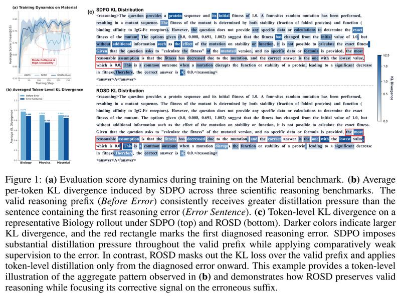
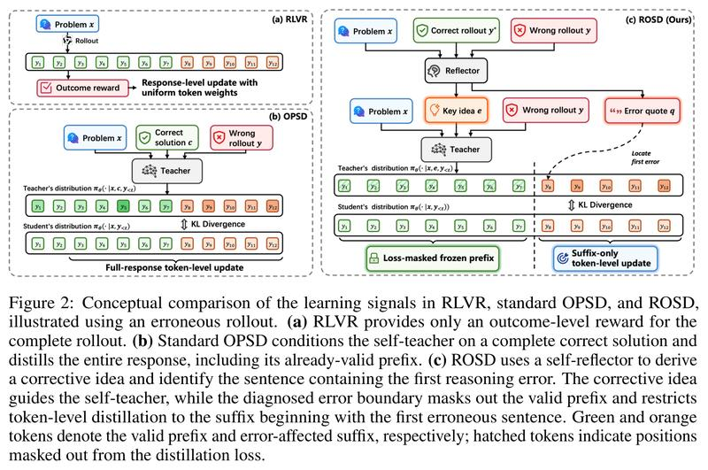
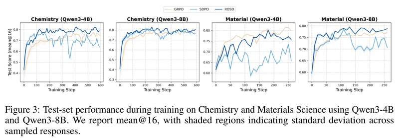

# Beyond Imitation: Reflective On-Policy Self-Distillation for LLM Reasoning（超越模仿：面向大模型推理的反思式在线自蒸馏）

中文 | [English](./ROSD-Reflective-On-Policy-Self-Distillation_en.md)

- **原文链接**: [Beyond Imitation: Reflective On-Policy Self-Distillation for LLM Reasoning](https://arxiv.org/abs/2605.28014v2)
- **论文**: [arXiv:2605.28014](https://arxiv.org/abs/2605.28014)
- **官方资料**: [ZiqiZhao1/ROSD](https://github.com/ZiqiZhao1/ROSD)
- **发布日期**: 2026-05-27
- **范围**: 按 arXiv v2（2026-09-28 修订）写的通俗解读，不是全文翻译。作者是 Ziqi Zhao 等 9 人，来自香港理工大学、百度、山东大学和莱顿大学。

## 一句话版本

在线自蒸馏让同一个模型扮演老师和学生：老师多看一份正确答案，逐个 token 批改学生自己写出的回答。作者发现，老师拿着整份答案批改整份回答，学生前面推对的部分也会被逼着向参考答案靠拢，训练后期容易崩。这篇论文提出 ROSD（Reflective On-policy Self-Distillation，反思式在线自蒸馏），在同类方法 SDPO 的基础上改了两处。第一，模型做错一道题后，先让它自己复盘：对照同组里一份做对的回答，找出错误回答里第一句出错的话，再写一段改错要点；老师只看这段要点，不看整份正确答案，学生也就不会被拉着照抄参考答案的写法。第二，只纠正第一句错话及之后的内容，前面推对的部分不计入训练的损失。

效果：论文用 Qwen3-4B、Qwen3-8B、Llama-3.2-3B-Instruct 三个模型，在五个任务（四个本科难度的科学选择题任务，加一个工具调用任务）上做实验，每个任务单独训练、单独测试。ROSD 的五任务平均分在三个模型上都是第一：Qwen3-4B 上 72.83（强化学习方法 GRPO 69.86，SDPO 67.02），Qwen3-8B 上 73.45（GRPO 71.99，SDPO 72.50），Llama-3.2-3B-Instruct 上 53.38（GRPO 52.69，SDPO 50.30）。这些数取的都是训练过程中测试分数的最高点。SDPO 在好几个设置里训练后期分数大幅下滑，ROSD 没有出现这种崩溃。换到没训练过的领域测试时，ROSD 远好于 SDPO，但 GRPO 在全部 10 组跨领域设置里都最好。

---

## 1. 先认识几个词

| 词 | 大白话 |
| --- | --- |
| token | 模型处理文字的最小单位，大致相当于一个词或词的一部分 |
| 回答（rollout） | 模型针对一道题自己写出的一份完整回答。训练时每道题采样 8 份，这 8 份叫"同一组" |
| RLVR（reinforcement learning with verifiable rewards） | 用能自动判对错的奖励做强化学习，比如核对选择题选的是不是正确选项 |
| GRPO | 一种常用的 RLVR 算法：一道题写多份回答，每份按"比同组平均好多少"得一个分数，整份回答的所有 token 共用这个分数 |
| on-policy 和 off-policy | 训练用的回答是模型当前自己写的，叫 on-policy（下文也叫"在线"）；拿别人写好的范文来训练，叫 off-policy |
| 自蒸馏 | 老师和学生是同一个模型，老师多看一份"小抄"（额外信息），学生每个位置的概率分布向老师靠拢 |
| 复盘员 | ROSD 加的第三个角色（论文叫 self-reflector），仍是同一个模型：把错误回答和一份正确回答放在一起，找出第一句错话，写出改错要点 |
| 前缀、后缀 | 错误回答里第一句错话之前的部分叫前缀；从这句错话开始到结尾叫后缀 |
| KL、JSD | 衡量两个概率分布差多远的数，越小越接近。JSD 是对称的版本，数值有上界 |
| stopgrad | 把老师的输出当作固定目标，梯度只更新学生 |
| EMA | 指数滑动平均：老师的参数每一步只朝学生当前的参数挪一小步 |
| 模式崩溃（mode collapse） | 模型的回答越来越单一，分数突然变差或剧烈波动 |
| mean@16 | 每道题采样 16 次，取平均正确率 |
| 检查点 | 训练到某一步时保存下来的模型 |

## 2. 它想解决什么问题

提升大模型推理能力的后训练，目前常用两类方法。

**GRPO：只看最后答案对不对。** GRPO 属于 RLVR。一道题让模型写 G 份回答，答对得 1 分，答错得 0 分。每份回答的优势（advantage，即它比同组平均好多少）是：

```math
A_i=\frac{r_i-\mu_G}{\sigma_G}
```

$`\mu_G`$ 和 $`\sigma_G`$ 是这一组分数的均值和标准差。

举个例子（我编的示意，不是论文里的）：8 份回答里 3 份对、5 份错。均值 0.375，标准差约 0.484（按总体标准差算），对的回答 $`A\approx+1.29`$，错的回答 $`A\approx-0.77`$。

问题在于，一份回答里的所有 token 共用同一个 $`A`$。一份错误回答即使前面大半都推对了，只在最后一步出错，前面那些正确的 token 也会一起被扣分。GRPO 没法告诉模型具体错在哪一步。

**在线自蒸馏：看过答案的自己逐字批改。** 在线自蒸馏（on-policy self-distillation）就是为了补这个缺口。同一个模型扮演两个角色：

- **学生**：只看题目 $`x`$，自己写出回答 $`y`$。
- **老师**：除了题目，还额外看到一段"小抄" $`c`$（例如一份正确解答）。老师自己不写回答，只对学生写的回答逐个位置给出"换成我，下一个 token 会是什么"的概率分布。

训练时让学生每个位置的分布向老师靠拢（公式见本节末尾的选读）。"在线"指训练用的是学生当前自己写出的回答；拿别人写好的范文来训练则属于 off-policy。

几种方法的区别主要在小抄 $`c`$ 是什么。OPSD（arXiv 2601.18734）和 SDFT（arXiv 2601.19897）用人工写的标准解答；SDPO（arXiv 2601.20802）用同一组里模型自己做对的回答（或环境反馈），不需要人工解答。论文主要和 SDPO 比较。论文也用 OPSD 泛指在线自蒸馏这一类方法，图 2 里的"OPSD"就是这个意思。

相比 GRPO，这类方法每个 token 都有单独的训练信号，学得更快。但作者发现它有两个毛病，见第 3 节。

| 路线 | 做法 | 问题 |
| --- | --- | --- |
| GRPO | 一道题写多份回答，按最终对错给每份回答一个分数 | 整份回答共用一个分数，说不出错在哪一步 |
| 在线自蒸馏（如 SDPO） | 老师多看一份正确回答，对学生的整份回答逐 token 给出分布，学生向它靠拢 | 每个 token 都有信号；但作者发现学生会被拉着照抄参考答案，推对的前缀也被"纠正"，训练后期容易崩 |

论文要回答的问题是：**能不能保留逐 token 的信号，但只告诉学生从哪里开始错、该怎么改，不逼它照抄整份答案？**

**选读：SDPO 的损失公式。** 不看也不影响理解。

```math
\mathcal{L}_{\text{SDPO}}(\theta)=\sum_{i=1}^{G}\sum_{t=1}^{|y_i|}D\left(p^{S}_{i,t},\ \text{stopgrad}\left[p^{T}_{i,t}\right]\right)
```

其中 $`p^{S}_{i,t}=\pi_\theta(\cdot\mid x,y_{i,<t})`$ 是学生的分布，$`p^{T}_{i,t}=\pi_\theta(\cdot\mid x,c_i,y_{i,<t})`$ 是老师的分布。$`D`$ 衡量两个分布差多少，可以是 KL、反向 KL 或 JSD。stopgrad 表示老师那一侧不回传梯度，只更新学生。

## 3. 作者发现的毛病：推对的部分也被逼着改

**原因一：老师拿着整份正确答案。** 老师看过一份完整的正确解答后，给出的分布会带上这份解答的思路、格式甚至措辞。学生被拉着往这份解答上靠，容易变成照着这一份写，抓不住这类题的关键。

**原因二：整份回答都参与蒸馏。** 很多题有不止一种正确解法。学生前面的推理明明是对的，只是写法和参考答案不同，也会被老师"纠正"。

打个比方（类比是我加的，不是论文原文）：老师批改解题过程时手里拿着一份标准答案。学生前面写对了，只是写法不同，也被要求改成标准答案的样子；真正写错的那一句，反而没有被重点圈出来。

作者认为，两个原因叠在一起，模型的回答会越来越单一（多样性下降），训练后期容易出现模式崩溃：分数突然下跌、剧烈波动。

**证据：正确前缀受到的纠正比错话还大。** 作者做了一个统计（附录 D）。用初始的 Qwen3-4B，在生物（Biology）、物理（Physics）、材料（Material）三个科学推理任务上各取 50 道题生成回答。对每份错误回答，请 claude-opus-5 当裁判，找出第一句出错的话。这样每份错误回答被分成两段：出错之前的正确前缀，以及第一句错话。再计算 SDPO 在这两段上平均每个 token 的 KL。KL 越大，说明这个位置被纠正得越用力。

论文附录 D 的结果（每 token 平均 KL）：

| 任务 | 正确前缀 | 第一句错话 |
| --- | --- | --- |
| 生物 | 0.9786 | 0.8881 |
| 物理 | 0.9080 | 0.7605 |
| 材料 | 0.9054 | 0.8513 |

三个任务里，正确前缀受到的纠正力度都比真正出错的那句话大，高出 6%～19%。差距不算悬殊，但方向一致：最该纠正的地方没有得到更多关注，力气花在了本来就对的部分。



*图 1：（a）在材料任务上训练时的测试分数。横轴是训练步数，纵轴是 mean@16；米色是 GRPO，浅蓝是 SDPO，深蓝是 ROSD。SDPO 在约 130 步之后明显下滑并剧烈波动，图中标注为"模式崩溃和高度不稳定"（读图估计）。图注没写是哪个模型，这条曲线和图 3 里材料（Qwen3-8B）那张子图一致。（b）SDPO 在三个科学推理任务上每个 token 的平均 KL：浅色柱是正确前缀（图例 Before Error），深色柱是第一句错话（Error Sentence），前者始终更高。柱上标注的 0.979/0.888、0.908/0.760、0.905/0.851 和附录 D 的数值一致。（c）一份生物题回答在 SDPO（上）和 ROSD（下）下的逐 token KL，颜色越深 KL 越大，红框是诊断出的第一处错误。作者的说法是：SDPO 在整段正确前缀上施加了大量蒸馏压力，对错误本身的监督反而较弱；ROSD 屏蔽了前缀上的 KL 损失，只从诊断出的错误处开始蒸馏。*

**一个具体例子：蛋白质突变题。** 图 1(c) 用的是附录 E 的一道生物题。题目给出一段蛋白质序列和它随机改动 4 个位点后的突变体，问突变体的适应度（fitness）是多少。适应度综合了稳定性和结合能力，原始序列记为 1.0。选项是 A（0.0）、B（0.008）、C（0.691）、D（1.002），正确答案是 B。Qwen3-4B 的回答分三段：

1. **正确前缀**：复述题目条件，指出题目没有给出计算所需的数据。这部分没有问题。
2. **第一句错话**：意思是"最合理的假设是适应度因突变而下降，正确答案是数值最低的那个，也就是 0.0"（原文是英文，这里直译）。这里把"下降"直接当成"完全失活"，是一次没有依据的跳跃。
3. **后续部分**：顺着这个假设找理由，最后选了 A。

在 SDPO 下，第 1 段（正确前缀）里很多普通词（如 `protein`、`initial`、`without additional`、`Given`）颜色很深，红框里的错话颜色反而较浅。

## 4. 核心做法：先复盘找出第一句错话，只从那里开始纠正

ROSD 让老师只告诉学生从哪一句开始错、该怎么改，不再拿整份答案让学生对照。学生、复盘员、老师三个角色都由同一个基础模型担任，不需要额外的大模型，也不增加可训练参数。

还是用批改作业来比喻（类比是我加的，不是论文原文）：老师先复盘，把这份错卷和同组里最简洁的一份对卷放在一起，圈出第一句错话，写一条批注"这里错了，应该这样想"。讲评时只讲红圈及之后的部分，前面写对的不动。



*图 2：以一份错误回答为例，比较三种训练信号。绿色是正确前缀，橙色是受错误影响的后缀。（a）RLVR：整份回答只得到一个最终结果的奖励，所有 token 权重相同。（b）标准的在线自蒸馏（图中标为 OPSD）：老师看完整的正确解答 c，对整份回答（包括已经正确的前缀）做逐 token 蒸馏。（c）ROSD：复盘员（图中的 Reflector）对比正确回答和错误回答，给出关键思路 e（Key idea）和第一处错误的原句 q（Error quote）。老师依据 e 给出分布；根据 q 定位第一处错误，之前的前缀不计损失（斜线阴影），只对从错误句开始的后缀做逐 token 更新。*

**第 1 步：采样，分出对错。** 每道题让当前模型写 8 份回答，按最终答案分成对的和错的。只保留对错都有的题，全对或全错的题跳过。GRPO 类方法通常也这样处理，因为这类题组内的分数没有差别。

**第 2 步：复盘。** 错误回答和正确回答的复盘方式不同。

- **错误回答：对比式复盘。** 从同组的正确回答里挑出最短的一份 $`y^*`$，作者希望借此找到简洁的改法。不过公开代码里没有挑最短这一步，取的是同组第一份做对的回答（见第 8 节"对照公开代码和 v1"）。把题目 $`x`$、$`y^*`$、错误回答 $`y^-`$ 和正确答案一起交给复盘员，要求它按固定格式输出两段：`<error_quote>` 里是错误回答中第一处出错的原文，必须一字不差地摘出来，记作 $`q`$；`<explanation>` 里写错在哪、怎么改、正确的逻辑是什么，记作 $`e^-`$。
- **正确回答：正向复盘。** 不用找错，只让复盘员说明这份推理为什么对、关键思路是什么，记作 $`e^+`$。

作者把这一步称作"信息瓶颈"：完整解答被压缩成一小段针对这份回答的要点，老师接触不到整份答案的措辞和格式，也就不会逼学生照抄。对错误回答来说，"改什么"（$`e^-`$）和"从哪里开始改"（$`q`$）被分开处理。

**第 3 步：只从第一句错话开始蒸馏。** 把 $`q`$ 放回错误回答里做字符串匹配，找到它开始的 token 位置 $`k`$。匹配不上时（例如复盘员没有照抄原文），退回整段蒸馏，即 $`k=1`$。然后给每个位置一个 0/1 遮罩 $`m_t`$：第 $`k`$ 个 token 之前是 0，不计入损失；从第 $`k`$ 个开始是 1，照常计入。正确回答不需要定位，所有 token 的 $`m_t`$ 都是 1。

老师比学生多看了复盘要点 $`e`$（错误回答用 $`e^-`$，正确回答用 $`e^+`$），两者看到的回答前缀完全相同。每个位置上，学生向老师靠拢的程度用 JSD 衡量，乘上遮罩 $`m_t`$ 后加起来，就是 ROSD 的损失。和 SDPO 相比，只多了遮罩 $`m_t`$，老师的条件也从完整答案 $`c`$ 换成了复盘要点 $`e`$。

举个例子（对应图 2(c) 的画法）：一份错误回答有 12 个 token，$`q`$ 从第 8 个 token 开始，那么 $`m=[0,0,0,0,0,0,0,1,1,1,1,1]`$。只有第 8～12 个 token 的 JSD 计入损失，前 7 个 token 不产生梯度。

**选读：ROSD 的公式。** 不看也不影响理解。遮罩是：

```math
m_t=\begin{cases}0, & t < k\\ 1, & t \ge k\end{cases}
```

学生和老师的分布分别是：

```math
p^{S}_t=\pi_\theta(\cdot\mid x,y_{<t}),\qquad p^{T}_t=\pi_\theta(\cdot\mid x,e,y_{<t})
```

最终的损失是：

```math
\mathcal{L}_{\text{ROSD}}(\theta)=\sum_{t=1}^{T}m_t\,\text{JSD}\left(p^{S}_t\ \|\ \text{stopgrad}\left[p^{T}_t\right]\right)
```

老师的输入（附录 J 图 14）只是在学生原来的提示词后面加了几行，再接上学生写的那份回答（论文原文是英文，这里直译，尖括号处填入具体内容）：

```text
[系统] <原来的系统提示词>
[用户] <原来的用户提示词>
下面是解这道题的关键思路：
<复盘要点>
请正确解答原题。
[助手] <学生写的回答>
```

**回到蛋白质那道题。** 复盘员摘出的第一处错误，正是第 3 节例子里的第一句错话（选数值最低的 0.0）。它写的改错要点大意是：随意认定答案必须是代表完全失活的最小值 0.0，这是错的；随机突变确实会破坏稳定性和功能，但 4 位点突变体可以保留很低但不为零的适应度，所以答案是 0.008（B）。

在 ROSD 下（图 1(c) 下半部分），前缀不计 KL 损失，图上基本是白色，颜色集中在错话及之后的内容上。

## 5. 几个实现细节

- **分布距离和 SDPO 一样。** 用 JSD（α=0.5），只取概率最高的 100 个 token 计算（top-k=100）。
- **老师冻结。** ROSD 的老师在整个训练过程中冻结，一直是初始模型；SDPO 的老师则每一步按 EMA（更新率 0.05）向学生靠拢。
- **复盘由谁来写。** 论文附录 B 说复盘员也冻结，但公开代码里复盘由当前正在训练的模型来写，与附录 B 不符（见第 8 节"对照公开代码和 v1"）。
- **复盘的长度上限。** 复盘输入最长 8k token，复盘输出最长 4k token。

## 6. 实验结果

### 6.1 实验怎么设计的

- **模型**：Qwen3-4B、Qwen3-8B（关闭思考模式），以及 Llama-3.2-3B-Instruct。
- **任务**：SciKnowEval 推理子集（L3）中的 4 个本科难度科学四选一任务，加上 ToolAlpaca 的工具调用任务（根据工具 API 说明和用户需求写出正确的工具调用）。每个任务单独训练、单独测试。本文用中文称呼各任务，下表括号里是论文图表里的英文名。

论文表 4（附录 A，题数）：

| 任务 | 训练集 | 测试集 |
| --- | --- | --- |
| 生物（Biology） | 450 | 50 |
| 化学（Chemistry） | 1,890 | 210 |
| 材料（Material） | 841 | 94 |
| 物理（Physics） | 720 | 80 |
| 工具调用（ToolUse） | 4,046 | 68 |
| AIME2024 数学题（只测不训） | - | 30 |

- **对照方法**：
  - GRPO：按近期最佳实践增强过的版本，加了 DAPO 的非对称裁剪、无偏归一化，以及针对推理引擎采样的 off-policy 校正。
  - SDPO：官方实现和超参数。
  - 没有比较 OPSD 和 SDFT，因为它们需要人工标注的标准解答，论文的设定里只有自动判对错的判分器。
- **指标**：每道题采样 16 次，取平均正确率（mean@16）。
- **训练量**：科学任务训 10 轮，工具调用训 5 轮；每批 32 道题，每道题 8 份回答。训练中每 10 步在测试集上评估一次。
- **算力**：基于 verl 框架（FSDP 训练、vLLM 生成），8 张 A800 80G。

### 6.2 主结果：三个模型上平均分都是第一

论文表 1 的五任务平均分（mean@16，%）：

| 模型 | 原模型 | GRPO | SDPO | ROSD |
| --- | --- | --- | --- | --- |
| Qwen3-4B | 51.32 | 69.86 | 67.02 | **72.83** |
| Qwen3-8B | 50.10 | 71.99 | 72.50 | **73.45** |
| Llama-3.2-3B-Instruct | 0.01 | 52.69 | 50.30 | **53.38** |

论文表 1 的分任务结果（mean@16，%，加粗为同一模型下该任务的最好成绩）：

| 模型 | 方法 | 材料 | 物理 | 生物 | 化学 | 工具调用 |
| --- | --- | --- | --- | --- | --- | --- |
| Qwen3-4B | GRPO | **81.45** | 74.61 | 53.75 | 77.53 | 61.95 |
| | SDPO | 73.60 | 68.52 | 55.38 | 76.93 | 60.66 |
| | ROSD | 80.18 | **76.56** | **57.50** | **82.47** | **67.46** |
| Qwen3-8B | GRPO | 77.46 | 76.09 | 56.88 | 80.77 | 68.75 |
| | SDPO | 78.46 | **76.41** | **61.13** | 80.71 | 65.81 |
| | ROSD | **79.52** | 75.16 | 60.38 | **83.07** | **69.12** |
| Llama-3.2-3B | GRPO | 46.14 | **48.04** | 45.37 | 65.56 | **58.36** |
| | SDPO | 45.47 | 46.01 | 42.25 | 61.78 | 55.97 |
| | ROSD | **46.76** | 47.57 | **49.12** | **66.36** | 57.07 |

怎么读这张表：

- **取的是最高分。** 表中每个数是训练中各次评估里的最高分，不是训练结束时的分数（见第 8 节"对照公开代码和 v1"）。
- **单项上不是每次都赢。** 15 个"模型 × 任务"组合里，ROSD 拿了 10 个第一。
- **平均分的差距。** ROSD 比 GRPO 高 0.69～2.97 个百分点（下文简称"分"），比 SDPO 高 0.95～5.81 分。Qwen3-4B 上优势最大；Qwen3-8B 上只比 SDPO 高 0.95 分。
- **SDPO 的表现很受模型大小影响。** 它在 Qwen3-8B 上略好于 GRPO，在更小的 Qwen3-4B 和 Llama-3.2-3B 上不如 GRPO。作者据此认为，只有逐 token 的密集信号，并不能保证比只看对错的强化学习更好，模型容量小时尤其如此。
- **Llama 原模型接近 0 分。** 论文没有解释。我的猜测是原模型不按要求的 `<answer>` 格式作答，全被判错（没有核实）。

### 6.3 训练过程：SDPO 后期会崩，ROSD 不会

作者观察了 Qwen3-4B、Qwen3-8B 在化学和材料上的训练曲线：测试分数见图 3，训练中模型自己采样的回答答对的比例（下文简称训练正确率）见论文图 4。



*图 3：Qwen3-4B 和 Qwen3-8B 在化学、材料上训练时的测试分数。横轴是训练步数，纵轴是 mean@16（0.8 即 80%）；米色是 GRPO，浅蓝是 SDPO，深蓝是 ROSD。按论文图注，阴影是多次采样回答之间的标准差。两个任务的训练集大小不同，所以化学的横轴到约 590 步，材料只到约 260 步。*

作者看到两个现象。

1. **前期两种自蒸馏都比 GRPO 学得快。** 每个 token 都有信号，SDPO 和 ROSD 的训练正确率上升得比 GRPO 快（论文图 4）。
2. **后期 SDPO 会崩，ROSD 不会。**
   - Qwen3-4B 上，SDPO 在化学和材料两个任务的训练正确率和测试分数都出现崩塌。以化学为例，测试分数峰值约 0.77，中途一度跌到约 0.53，最后约 0.64（读图估计）。
   - Qwen3-8B 的材料上，SDPO 的训练正确率一直很高，测试分数却持续下降，训练和测试之间的差距越拉越大，符合过拟合的表现。
   - ROSD 在这些设置里基本保持稳定或继续上升。

图上还有两点论文没有强调（这是我读图看到的）：材料（Qwen3-4B）上 GRPO 的曲线最终最高，ROSD 后期也有小幅回落（从约 0.80 降到约 0.76），只是没有 SDPO 那样大起大落；化学（Qwen3-8B）上三种方法差别不大。

### 6.4 回答多样性：比 SDPO 保留得好

用两个指标衡量同一道题的多次回答之间有多不一样：

- **Self-BLEU-4**：同一道题的多份回答彼此有多相似，越低越多样。
- **Distinct-2**：所有回答里不重复的相邻两词组合所占比例，越高越多样。

论文表 2，Qwen3-4B 在五个任务上的平均值（%）：

| 方法 | Self-BLEU-4（越低越多样） | Distinct-2（越高越多样） |
| --- | --- | --- |
| 原模型（未训练） | 88.67 | 13.69 |
| GRPO | 91.68 | 12.03 |
| SDPO | 93.69 | 10.95 |
| ROSD | 92.59 | 12.91 |

这些回答是在第 140 步取的还是训练结束时取的，论文前后说法不一致（见第 8 节"稿件里的小问题"）。

怎么读这张表：

- **SDPO 的回答最雷同。** 生物上 Self-BLEU-4 高达 99.20，几乎每次都写得一样。
- **ROSD 比 SDPO 多样。** ROSD 的 Distinct-2 在五个任务上都高于 SDPO，Self-BLEU-4 在其中四个任务上低于 SDPO。
- **但谁都比不上原模型。** 平均来看，所有训练方法的多样性都不如原模型；ROSD 和 GRPO 在两个指标上各有胜负；ROSD 在生物上的 Self-BLEU-4 也有 98.61，同样接近每次写得一样。

### 6.5 消融实验：两处改动缺一不可

- **去掉复盘**（论文记作 w/o Refl.）：仍然定位第一处错误、只蒸馏后缀，但老师直接看完整的参考解答，不看复盘要点。
- **去掉局部蒸馏**（w/o LocDist.）：老师看复盘要点，但整份回答都参与蒸馏。

论文表 3 的五任务平均分（mean@16，%，和表 1 一样取训练过程中的最高分）：

| 模型 | SDPO | ROSD | 去掉复盘 | 去掉局部蒸馏 |
| --- | --- | --- | --- | --- |
| Qwen3-4B | 67.02 | **72.83** | 67.56 | 69.73 |
| Qwen3-8B | 72.50 | **73.45** | 70.50 | 72.34 |
| Llama-3.2-3B-Instruct | 50.30 | **53.38** | 51.03 | 52.26 |

怎么读这张表：

- **去掉复盘掉分最多。** 比完整的 ROSD 低 2.35～5.27 分，成绩大致退回 SDPO 的水平。作者的解释是：直接看整份答案，监督信号分散；复盘能点出具体的逻辑漏洞，信号更集中。
- **去掉局部蒸馏也稳定地变差。** 低 1.11～3.10 分。作者的解释是：逼模型蒸馏本来就对的前缀，会压制探索，引发模式崩溃。
- **Qwen3-8B 上两处改动要合起来才有用。** 在这个模型上，两个消融版本都不如 SDPO（70.50、72.34 对 72.50）。也就是说，单用任何一处改动都没有收益，两处合起来才比 SDPO 高 0.95 分。

### 6.6 跨领域泛化：明显好于 SDPO，但不如 GRPO

在一个任务上训练，到其余 4 个任务和 AIME2024 数学题上测试。论文表 5 的跨领域平均分（mean@16，%，取最后 3 次评估的平均）：

| 训练任务 | 4B·GRPO | 4B·SDPO | 4B·ROSD | 8B·GRPO | 8B·SDPO | 8B·ROSD |
| --- | --- | --- | --- | --- | --- | --- |
| 生物 | **49.57** | 42.71 | 46.06 | **51.91** | 40.79 | 48.64 |
| 化学 | **44.54** | 22.93 | 38.54 | **53.09** | 18.27 | 45.74 |
| 材料 | **47.41** | 31.70 | 41.37 | **47.79** | 29.70 | 44.57 |
| 物理 | **47.64** | 36.51 | 45.03 | **48.04** | 31.86 | 45.73 |
| 工具调用 | **43.57** | 2.88 | 41.31 | **46.26** | 39.38 | 45.11 |

怎么读这张表：

- **GRPO 在全部 10 组里都最好。** 作者的解释是：GRPO 只看最终对错，不约束每个 token 的分布，探索更自由，不容易过拟合某个领域的说法；自蒸馏有逐 token 的 KL 约束，更容易记住训练领域的措辞。
- **ROSD 在全部 10 组里都好于 SDPO。** 和 GRPO 的差距在 1.15～7.35 分之间。最极端的是在工具调用上训练的 Qwen3-4B：换到其他领域，SDPO 平均只剩 2.88%，ROSD 为 41.31%，GRPO 为 43.57%。
- **SDPO 有几次几乎归零。** Qwen3-4B 在工具调用上训练后，四个科学任务只有 0.49%～1.09%；Qwen3-4B 在化学上训练后，AIME2024 为 0.00；Qwen3-8B 在化学、材料、物理上训练后，工具调用分别只有 0.83%、0.86%、2.27%。作者认为这是 SDPO 死记了训练领域的格式模板。

### 6.7 训练开销和回答长度：每步只比 SDPO 慢约 12%，回答更短

ROSD 多了一步复盘，但每步耗时没有明显增加。论文图 7（附录 G，化学任务，Qwen3-8B，柱上标注的秒/步）：

| 方法 | 全程平均（秒/步） | 最后 50 步平均（秒/步） |
| --- | --- | --- |
| GRPO | 84.6 | 134.4 |
| SDPO | 66.1 | 91.7 |
| ROSD | 73.9 | 71.5 |

全程平均下，ROSD 比 SDPO 慢约 12%，比 GRPO 快。训练后期 GRPO 和 SDPO 的回答越写越长，每步耗时跟着上升，ROSD 反而最快。

回答长度（论文图 8，附录 H，同一设置，读图估计）：ROSD 从开始的约 450 token 很快降到约 200 token，之后一直稳定；SDPO 大约 400 步之后开始变长，500 步之后急剧上升，最后约 900 token；GRPO 在 500 步之后也涨到 600～700 token。

### 6.8 错误定位：模型越大匹配率越高，出错位置越训越靠后

附录 I 的图 9 给了两个观察（读图估计）：

- **匹配率**：复盘员摘出的出错原句能在原回答里找到的比例。材料上 Qwen3-4B 约 0.56、Qwen3-8B 约 0.72；化学上 Qwen3-4B 约 0.68、Qwen3-8B 约 0.82。模型越大，越能按要求照抄原文。反过来看，约 2～4 成的错误回答匹配失败，会退回整段蒸馏。
- **出错位置后移**：物理（Qwen3-8B）上，第一处错误在回答中的相对位置从训练初期的约 0.4 逐渐后移到 0.6 左右，说明模型越训越晚才犯错，正确前缀越来越长。作者用这一点解释整段蒸馏为什么到后期危害更大：前面大部分已经对了，继续蒸馏整段只会扰动正确的前缀。

## 7. 作者自己承认的局限

论文在第 5 节的讨论里提到两点：

- **效果取决于复盘和错误定位的质量。** 题目本身有歧义或非常专业时，这两步可能不可靠。
- **按句子定位只是近似。** 真正的错误可能只是句子里的某几个 token。

## 8. 读的时候值得留意的地方

以下是我读原文时注意到、论文没有重点讨论的点，供参考。

### 证据有多强

- **提升幅度不大，统计上难以判断。** 和增强版 GRPO 相比，平均只高 0.69～2.97 分；15 个"模型 × 任务"组合中有 5 个不是第一。测试集也小（生物 50 题、工具调用 68 题）。论文没有报告多次独立训练（不同随机种子）的结果，图中阴影是同一次训练里多次采样的标准差，反映不了训练本身的波动。
- **表 1 报的是训练过程中的最高分。** 这一点已经核实（见下面"对照公开代码和 v1"）。最高分是在测试集上从多次评估里挑出来的，数字偏乐观；SDPO 后期崩溃的代价也没有体现在表 1 里。跨领域的表 5 取的则是最后 3 次评估的平均。我从图 3 的原图上读出每条曲线在各次评估时的分数（读图估计，误差约 ±0.5 分），和表 1 对照如下。

| 任务（模型） | 方法 | 表 1 | 曲线最高点（第几步） | 最后 3 次评估的平均 |
| --- | --- | --- | --- | --- |
| 化学（Qwen3-4B） | GRPO | 77.53 | 77.4（540） | 75.7 |
| | SDPO | 76.93 | 76.9（140） | 67.5 |
| | ROSD | 82.47 | 82.3（410） | 78.9 |
| 化学（Qwen3-8B） | GRPO | 80.77 | 80.6（440） | 77.1 |
| | SDPO | 80.71 | 80.4（210） | 76.5 |
| | ROSD | 83.07 | 82.8（250） | 80.2 |
| 材料（Qwen3-4B） | GRPO | 81.45 | 81.4（240） | 80.9 |
| | SDPO | 73.60 | 73.2（250） | 69.5 |
| | ROSD | 80.18 | 80.0（180） | 76.3 |
| 材料（Qwen3-8B） | GRPO | 77.46 | 77.4（240） | 77.1 |
| | SDPO | 78.46 | 78.4（110） | 73.1 |
| | ROSD | 79.52 | 79.5（130） | 78.4 |

- **表 1 和曲线最高点几乎一样。** 12 个数里，两者相差都不超过 0.4 分；和最后 3 次评估的平均相比，最多差 9.4 分（化学、Qwen3-4B 上的 SDPO：76.93 对约 67.5）。
- **改用最后 3 次评估的平均来比，ROSD 对 SDPO 领先更多，对 GRPO 的一处落后也拉大了。** ROSD 对 SDPO 的领先在四组里都变大了。ROSD 对 GRPO 仍是三组领先，领先 1.3～3.2 分；但在材料（Qwen3-4B）上落后 4.6 分，按表 1 只落后 1.3 分。图 3 只画了这四组，其余组合没法这样核对。
- **挑最高分反而对 SDPO 有利。** 从多次评估里挑最高分，曲线波动越大的方法越占便宜。SDPO 波动最大，所以 ROSD 领先 SDPO 不是挑分挑出来的。
- **错误定位只覆盖了一部分错误回答。** 按附录 I 的匹配率，约 2～4 成错误回答找不到出错原句，只能退回整段蒸馏。
- **复盘要点有时更像根据答案倒推的理由。** 复盘员事先知道正确答案。以蛋白质那道题为例，"4 位点突变体可能保留很低但非零的适应度，所以选 0.008"更像是从答案倒推出的说法，很难算作能迁移到别的题上的推理思路，而且要点里直接写出了答案。
- **和 SDPO 的对比里还混着老师是否更新这个差别。** 代码证实，SDPO 的老师每步按 EMA 跟着学生更新，ROSD 的老师始终是初始模型。冻结的老师本身就可能让训练更稳，论文没有单独做这项消融，所以 ROSD 更稳不能全部归功于复盘和遮罩。
- **消融只给了最终分数。** 论文把后期崩溃归因于整段蒸馏，但没有给出去掉局部蒸馏后的训练曲线，看不出这个版本是否也会崩。

### 适用范围

- **只对"有对有错"的题起作用。** 8 份回答全错的难题没有对照对象，ROSD 在这些题上学不到东西，这一点和 GRPO 相同。
- **模型偏小，题型偏简单。** 最大只到 8B；科学任务是本科难度的四选一题，工具调用只需写出一次工具调用。长链数学推理、代码等任务上是否同样有效，论文没有验证（AIME2024 只用于跨领域测试）。

### 对照公开代码和 v1

核对对象是作者公开的代码（2026-05-28 提交的版本，在 verl 和 SDPO 的代码上改写）和论文 v1（2026-05-27）。代码的 README 说主实验用的是启动脚本 `run_sdpo_processreflection_ood_all.sh`，下面的配置都以这个脚本为准。

- **老师确实冻结，附录 B 写得对。** 附录 B 说老师冻结，公式 (10) 却写成当前模型 $`\pi_\theta`$。ROSD 的启动脚本把老师的 EMA 更新率设为 0。老师是开训时另外加载的一份初始模型，更新函数遇到更新率为 0 直接返回。SDPO 的脚本没改这一项，用默认的 0.05。所以老师确实冻结，公式里的 $`\pi_\theta`$ 只是简写。
- **复盘员其实随训练更新，附录 B 写错了。** 附录 B 和 v1 都说复盘员冻结，公式 (6)、(7) 写成 $`\pi_\theta`$。代码里复盘默认由学生（当前正在训练的模型）生成，每次生成前代码都会把学生的最新权重同步给推理引擎 vLLM。配置里可以改成让老师写，但这份代码只支持异步生成，这种模式下会自动退回学生。所以公式 (6)、(7) 与代码一致，附录 B 与代码不符。
- **对照用的正确回答不是同组最短的那份。** 公式 (5) 说取同组最短的正确回答。代码取的是同组里排在第一个的正确回答，代码注释说这 "effectively selects a random one"（实际上等于随机挑一份）；训练代码里没有按长度挑选的逻辑。这有两种可能：如果论文的实验就是用这份代码跑的，那挑最短对回答变短没有贡献；如果用的是另一版代码，公开代码就复现不了论文描述的做法。从公开材料里分不出是哪种。
- **老师有时仍会看到整份正确回答。** 正文说不让老师直接看完整的正确回答。代码里，复盘输出有 `<explanation>` 段时，老师只看复盘要点；没有时，老师改看那份正确回答的全文，也就是 SDPO 的做法。论文没提这个退路，也没报告触发比例。
- **全对、全错的题确实被跳过。** 论文第 3.1 节说只保留有对有错的组。代码算完奖励后，把全对、全错组的回答遮罩整体置 0，这些回答不参与损失，与论文一致。
- **表 1、表 3 取的是训练中的最高分。** v2 没写取哪个检查点。v1 的表注写的是 "the maximum mean@16(%) achieved during training"，v1 的消融表注也写明取训练中的最大值。v2 删掉了 maximum 一词，但表 1 中 Qwen 部分的 48 个数与 v1 完全相同。
- **论文没写学习率。** 代码里 GRPO 用 1e-6，每步分 4 个小批次更新；SDPO 和 ROSD 用 1e-5，每步更新一次。

### 稿件里的小问题（不影响主要结论）

- **表 3 有一个平均分算错了。** Llama 的"去掉局部蒸馏"一行，五项之和为 261.80，平均应为 52.36，论文写 52.26。按 52.36 算，这一行比 ROSD 低 1.02 分，第 6.5 节"低 1.11～3.10 分"的下限会变成 1.02。
- **表 2 的评估时间点前后矛盾。** 表注写第 140 步，正文写训练结束时的检查点。按每批 32 道题、10 轮推算，生物（450 题）约 140 步训完；化学（1,890 题）约 590 步、材料（841 题）约 260 步，与图 3 横轴长度吻合。表 2 应是五个任务统一取第 140 步，只有生物恰好是训练终点；这时化学上的 SDPO 还没崩（崩在约 370 步）。
- **"ROSD 在所有设置里都稳定或上升"说得略满。** 大体成立，但材料（Qwen3-4B）后期有约 0.04 的回落（见第 6.3 节）。
- **"去掉复盘后接近 SDPO"只在两个模型上成立。** Qwen3-4B、Llama 上成立；Qwen3-8B 上比 SDPO 低 2.0 分。

## 9. 和相关工作的关系

| 方法 | 老师额外看到什么 | 哪些 token 参与训练 | 需要人工标准解答吗 |
| --- | --- | --- | --- |
| GRPO（arXiv 2402.03300） | 没有老师，只有对错奖励 | 整份回答共用一个分数 | 不需要 |
| OPSD（Zhao 等，2026，arXiv 2601.18734）、SDFT（Shenfeld 等，2026，arXiv 2601.19897） | 人工写的标准解答 | 整份回答 | 需要 |
| SDPO（Hübotter 等，2026，arXiv 2601.20802） | 同组里做对的回答（或环境反馈） | 整份回答 | 不需要 |
| ROSD（本文） | 复盘要点（错的回答：改错要点；对的回答：关键思路） | 错的回答只算第一句错话及之后；对的回答全算 | 不需要，只要最终答案，以及同组至少一份正确回答 |

简单说：GRPO 只告诉模型这份回答错了；SDPO 让模型向一份正确回答看齐；ROSD 指出从哪一句开始错、应该怎么改。

论文引用的其他几篇，按它们在论文里的用处整理：

- **其他自蒸馏工作。** 论文把 SD-Zero（He 等，2026，arXiv 2604.12002）和 Li 等（2026，arXiv 2604.02288，用样本分流把 GRPO 和 SDPO 统一起来）跟 OPSD、SDFT、SDPO 并列，作为让模型自己当老师、额外看一份正确解答的代表工作（论文第 1 节）。ROSD 用 JSD 做分布距离，也说是沿用 SDPO 和 arXiv 2604.02288 的做法（论文第 3.2 节）。
- **在线蒸馏。** Agarwal 等（2024，arXiv 2306.13649）研究学生在自己写的回答上向老师学习，论文第 2.2 节引用它介绍在线蒸馏的思路。Li 等（2026，arXiv 2604.13016）重新审视在线蒸馏的现象、机制和做法；论文引用它说明老师可以和学生共享参数、固定不动或用 EMA 更新（论文第 2.2 节），mean@16 的评测方式也沿用 SDPO 和这篇（论文第 4.1 节）。
- **强化学习。** GRPO 出自 DeepSeekMath（Shao 等，2024，arXiv 2402.03300）。GRPO 对照方法按 Khatri 等（2025，arXiv 2510.13786）总结的近期最佳实践增强，其中的非对称裁剪来自 DAPO（Yu 等，2025，arXiv 2503.14476）。
- **数据集。** 四个科学任务来自 SciKnowEval（Feng 等，2024，arXiv 2406.09098），工具调用任务来自 ToolAlpaca（Tang 等，2023，arXiv 2306.05301，标题里说它用 3000 个模拟案例做通用的工具学习）。

## 10. 总结

ROSD 的思路是：**做错的题先让模型自己复盘，老师只拿着"错在哪、怎么改"去批改，而且只批改第一句错话及之后的部分。** 相对 SDPO，它只改了两处：老师的条件从完整答案换成复盘要点，损失上乘一个 0/1 遮罩。学生、老师、复盘员是同一个模型，不需要额外模型，也不需要人工标准解答，改动小，容易接入现有框架。论文的问题定位也有数据支撑：它用逐 token 的 KL 量化了"正确前缀被过度纠正"，还配了具体例子，比笼统地说"SDPO 不稳定"更有说服力。

实验覆盖 3 个模型、5 个任务，主结果、训练曲线、多样性、消融、跨领域、耗时都有，GRPO 跨领域更强这一点也如实写出；表 1 的 12 行、表 2 的 4 行、表 5 的 30 行平均分，以及表 3 与表 1 重复的两行，我都核对过（误差不超过 0.01），只有表 3 一处笔误。结果上，ROSD 的平均分在三个模型上都是第一，但比增强版 GRPO 只高 0.69～2.97 分，取的还是训练中的最高分，也没有多个随机种子；它没有 SDPO 那样的后期崩溃，回答更短，全程每步耗时只比 SDPO 多约 12%；跨领域时明显好于 SDPO，但在全部 10 组里都不如 GRPO。它只能从有对有错的题里学，约 2～4 成错误回答定位不到出错原句，实验也只到 8B 模型和本科难度的选择题。公开代码和论文描述有两处不符（复盘员其实随训练更新，对照用的正确回答不是最短的那份），想复现要留意。

---

## 原文位置对照

| 本文内容 | 论文位置 |
| --- | --- |
| GRPO 和在线自蒸馏的背景 | 第 1 节，第 2.1、2.2 节，式 (1)～(3) |
| SDPO 的两个毛病和 KL 证据 | 第 1 节，图 1，附录 D（裁判提示词见图 6） |
| 蛋白质突变的例子 | 附录 E，图 1(c) |
| ROSD 的三步做法 | 第 3 节，式 (4)～(11)，图 2 |
| 复盘和老师的提示词 | 附录 C 图 5，附录 J 图 14 |
| 实现细节 | 附录 B |
| 实验设置 | 第 4.1 节，附录 A 表 4，附录 B，附录 J 图 10～13 |
| 主结果 | 第 4.2 节，表 1 |
| 训练过程 | 第 4.3 节，图 3、图 4 |
| 回答多样性 | 第 4.4 节，表 2 |
| 消融实验 | 第 4.5 节，表 3 |
| 跨领域泛化 | 附录 F，表 5 |
| 训练开销和回答长度 | 附录 G 图 7，附录 H 图 8 |
| 错误定位 | 附录 I，图 9 |
| 作者自己承认的局限 | 第 5 节 |
| 表 1 与图 3 曲线的对照 | 表 1，图 3 |
| 对照公开代码和 v1 | 附录 B，式 (5)～(7)、(10)，表 1、表 3 的表注 |
