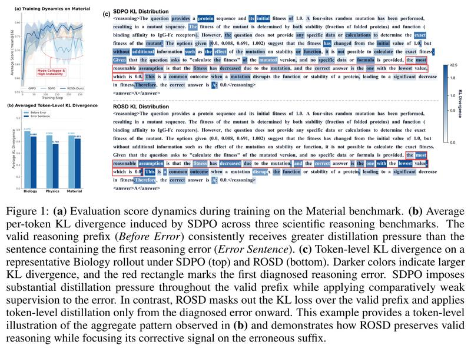
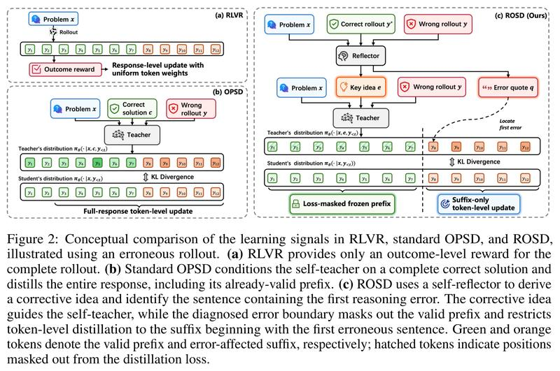
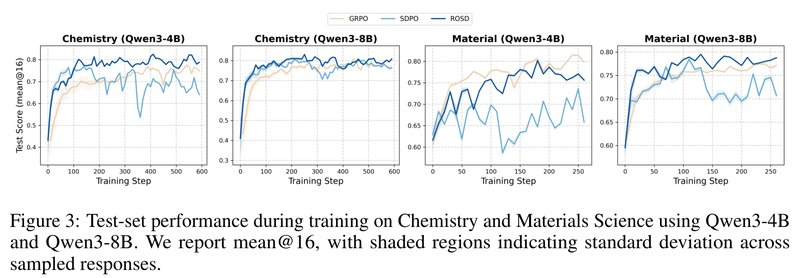

# Beyond Imitation: Reflective On-Policy Self-Distillation for LLM Reasoning

[中文](./ROSD-Reflective-On-Policy-Self-Distillation.md) | English

- **Source**: [Beyond Imitation: Reflective On-Policy Self-Distillation for LLM Reasoning](https://arxiv.org/abs/2605.28014v2)
- **Paper**: [arXiv:2605.28014](https://arxiv.org/abs/2605.28014)
- **Official resources**: [ZiqiZhao1/ROSD](https://github.com/ZiqiZhao1/ROSD)
- **Published**: 2026-05-27
- **Scope**: A plain-language explainer based on arXiv v2 (revised 2026-09-28), not a full translation. The authors are Ziqi Zhao and colleagues, 9 in all, from The Hong Kong Polytechnic University, Baidu, Shandong University and Leiden University.

## In One Sentence

On-policy self-distillation has one model play both teacher and student: the teacher also gets to see a correct answer and grades the response the student wrote itself, token by token. The authors found that when the teacher grades the whole response while holding the whole answer, even the parts the student reasoned correctly early on get forced toward the reference solution, and training tends to collapse in its later stages. This paper proposes ROSD (Reflective On-policy Self-Distillation), which changes two things on top of SDPO, a method of the same kind. First, when the model gets a problem wrong, it is asked to reflect on its own mistake: it compares the wrong response with a correct response from the same group, finds the first sentence in the wrong response that goes wrong, and then writes a short set of correction notes; the teacher sees only these notes, not the whole correct answer, so the student is not pulled into copying the way the reference solution is written. Second, only the first wrong sentence and what follows it get corrected; the correctly reasoned part before it is left out of the training loss.

Results: The paper runs experiments with three models, Qwen3-4B, Qwen3-8B and Llama-3.2-3B-Instruct, on five tasks (four undergraduate-level science multiple-choice tasks plus one tool-calling task), training and testing on each task separately. ROSD has the highest five-task average score on all three models: 72.83 on Qwen3-4B (the reinforcement learning method GRPO 69.86, SDPO 67.02), 73.45 on Qwen3-8B (GRPO 71.99, SDPO 72.50), and 53.38 on Llama-3.2-3B-Instruct (GRPO 52.69, SDPO 50.30). All of these numbers are the highest test score reached during training. In several settings SDPO's score drops sharply late in training; ROSD shows no such collapse. When tested on domains it was not trained on, ROSD does far better than SDPO, but GRPO is the best in all 10 cross-domain settings.

---

## 1. Key Terms

| Term | In plain words |
| --- | --- |
| token | The smallest unit of text a model processes, roughly a word or part of a word |
| Response (rollout) | One complete response the model writes on its own for a problem. During training, 8 responses are sampled per problem, and these 8 are called "one group" |
| RLVR (reinforcement learning with verifiable rewards) | Reinforcement learning with rewards that can be checked automatically, such as checking whether a multiple-choice answer picks the correct option |
| GRPO | A common RLVR algorithm: the model writes several responses to a problem, each response gets a score for "how much better than the group average" it is, and every token of that response shares the score |
| On-policy and off-policy | Training on responses the current model writes itself is called on-policy (the term used throughout below); training on ready-made example answers written by someone else is called off-policy |
| Self-distillation | Teacher and student are the same model; the teacher gets an extra "cheat sheet" (extra information), and the student's probability distribution at each position is pulled toward the teacher's |
| Reflector | The third role ROSD adds (the paper calls it the self-reflector), still played by the same model: it puts a wrong response next to a correct one, finds the first wrong sentence, and writes correction notes |
| Prefix, suffix | In a wrong response, the part before the first wrong sentence is the prefix; from that sentence to the end is the suffix |
| KL, JSD | Numbers that measure how far apart two probability distributions are; the smaller, the closer. JSD is the symmetric version, and its value has an upper bound |
| stopgrad | Treats the teacher's output as a fixed target, so gradients update only the student |
| EMA | Exponential moving average: at each step, the teacher's parameters move only a small step toward the student's current parameters |
| Mode collapse | The model's responses become more and more uniform, and the score suddenly drops or swings wildly |
| mean@16 | Sample 16 times per problem and take the average accuracy |
| Checkpoint | The model saved at a given step of training |

## 2. What Problem It Tackles

Post-training that improves the reasoning of large models currently relies on two common kinds of methods.

**GRPO: only checks whether the final answer is right.** GRPO is a form of RLVR. The model writes G responses to a problem; a correct one scores 1 and a wrong one scores 0. The advantage of each response (how much better it is than the group average) is:

```math
A_i=\frac{r_i-\mu_G}{\sigma_G}
```

$`\mu_G`$ and $`\sigma_G`$ are the mean and standard deviation of the group's scores.

An example (an illustration I made up, not from the paper): of 8 responses, 3 are right and 5 are wrong. The mean is 0.375 and the standard deviation is about 0.484 (computed as a population standard deviation), so the right responses get $`A\approx+1.29`$ and the wrong ones get $`A\approx-0.77`$.

The problem is that every token in a response shares the same $`A`$. Even if a wrong response gets most of the way right and only fails at the last step, the correct tokens before that step are penalized along with the rest. GRPO cannot tell the model which step went wrong.

**On-policy self-distillation: the model, having seen the answer, grades itself token by token.** On-policy self-distillation was designed to fill this gap. The same model plays two roles:

- **Student**: sees only the problem $`x`$ and writes a response $`y`$ on its own.
- **Teacher**: besides the problem, it also sees a "cheat sheet" $`c`$ (for example, a correct solution). The teacher writes no response of its own; at each position of the student's response, it only gives a probability distribution for "if it were me, what the next token would be".

During training, the student's distribution at each position is pulled toward the teacher's (the formula is in the optional reading at the end of this section). "On-policy" means training uses the responses the student currently writes itself; training on ready-made example answers written by someone else counts as off-policy.

The methods differ mainly in what the cheat sheet $`c`$ is. OPSD (arXiv 2601.18734) and SDFT (arXiv 2601.19897) use human-written reference solutions; SDPO (arXiv 2601.20802) uses a response from the same group that the model itself got right (or environment feedback), so it needs no human-written solution. The paper compares mainly with SDPO. The paper also uses OPSD as a general name for the whole class of on-policy self-distillation methods, and that is what "OPSD" means in Figure 2.

Compared with GRPO, these methods give every token its own training signal and learn faster. But the authors found two flaws in them, covered in Section 3.

| Approach | How it works | Problem |
| --- | --- | --- |
| GRPO | Writes several responses per problem and gives each response one score based on whether its final answer is right | The whole response shares one score, so it cannot say which step went wrong |
| On-policy self-distillation (such as SDPO) | The teacher also sees a correct response and gives a per-token distribution over the student's whole response, and the student moves toward it | Every token gets a signal; but the authors found the student gets pulled into copying the reference solution, even the correctly reasoned prefix gets "corrected", and training tends to collapse late on |

The question the paper sets out to answer is: **can we keep the per-token signal, but only tell the student where it starts going wrong and how to fix it, without forcing it to copy the whole answer?**

**Optional reading: the SDPO loss.** You can skip it and still follow the rest.

```math
\mathcal{L}_{\text{SDPO}}(\theta)=\sum_{i=1}^{G}\sum_{t=1}^{|y_i|}D\left(p^{S}_{i,t},\ \text{stopgrad}\left[p^{T}_{i,t}\right]\right)
```

Here $`p^{S}_{i,t}=\pi_\theta(\cdot\mid x,y_{i,<t})`$ is the student's distribution and $`p^{T}_{i,t}=\pi_\theta(\cdot\mid x,c_i,y_{i,<t})`$ is the teacher's. $`D`$ measures how different the two distributions are and can be KL, reverse KL or JSD. stopgrad means no gradient flows back through the teacher's side, so only the student is updated.

## 3. The Flaws the Authors Found: Even the Correct Parts Get Forced to Change

**Cause one: the teacher holds the whole correct answer.** Once the teacher has seen a complete correct solution, the distribution it gives carries that solution's line of reasoning, format and even wording. The student is pulled toward this one solution and can easily end up just writing along the lines of it, without grasping what really matters for this type of problem.

**Cause two: the whole response takes part in distillation.** Many problems have more than one correct solution. Even when the student's earlier reasoning is clearly right and is only written differently from the reference solution, the teacher still "corrects" it.

An analogy (the analogy is mine, not from the paper): a teacher grades a student's worked solution while holding a reference solution. Where the student wrote something correct but in a different way, the student is still told to rewrite it to look like the reference solution; meanwhile, the one sentence that is actually wrong does not get circled for attention.

The authors argue that with the two causes combined, the model's responses become more and more uniform (diversity drops), and mode collapse tends to set in late in training: the score suddenly falls and swings wildly.

**Evidence: the correct prefix gets corrected harder than the wrong sentence.** The authors ran a measurement (Appendix D). With the initial Qwen3-4B, they generated responses to 50 problems from each of three science reasoning tasks: Biology, Physics and Material. For each wrong response, they asked claude-opus-5 to act as judge and find the first sentence that goes wrong. This splits each wrong response into two segments: the correct prefix before the error, and the first wrong sentence. They then computed SDPO's average per-token KL on each of the two segments. A larger KL means that position is being corrected harder.

Results from the paper's Appendix D (average KL per token):

| Task | Correct prefix | First wrong sentence |
| --- | --- | --- |
| Biology | 0.9786 | 0.8881 |
| Physics | 0.9080 | 0.7605 |
| Material | 0.9054 | 0.8513 |

On all three tasks, the correct prefix is corrected harder than the sentence that is actually wrong, by 6% to 19%. The gap is not huge, but it points the same way every time: the place most in need of correction gets no extra attention, and the effort goes into parts that were already right.



*Figure 1: (a) Test score while training on the Material task. The x-axis is training steps and the y-axis is mean@16; beige is GRPO, light blue is SDPO and dark blue is ROSD. After about step 130, SDPO drops clearly and swings wildly, which the figure labels "mode collapse and high instability" (read off the plot). The caption does not say which model this is; the curve matches the Material (Qwen3-8B) panel in Figure 3. (b) SDPO's average per-token KL on the three science reasoning tasks: light bars are the correct prefix (legend: Before Error), dark bars are the first wrong sentence (Error Sentence), and the former is always higher. The values on the bars, 0.979/0.888, 0.908/0.760 and 0.905/0.851, match those in Appendix D. (c) Per-token KL on one Biology response under SDPO (top) and ROSD (bottom); darker color means larger KL, and the red box is the first error found by the diagnosis. The authors' account: SDPO puts heavy distillation pressure on the whole correct prefix, while its supervision of the error itself is weaker; ROSD masks out the KL loss on the prefix and distills only from the diagnosed error onward.*

**A concrete example: a protein mutation problem.** Figure 1(c) uses a Biology problem from Appendix E. The problem gives a protein sequence and a mutant with 4 randomly changed sites, and asks for the mutant's fitness. Fitness combines stability and binding ability, with the original sequence set to 1.0. The options are A (0.0), B (0.008), C (0.691) and D (1.002), and the correct answer is B. Qwen3-4B's response has three parts:

1. **Correct prefix**: restates the conditions of the problem and points out that the problem does not give the data needed for a calculation. Nothing is wrong with this part.
2. **First wrong sentence**: it says, in effect, "the most reasonable assumption is that fitness decreases because of the mutations, so the correct answer is the lowest value, which is 0.0" (the original is in English; this is a literal rendering, not an exact quote). This jumps straight from "decreases" to "completely inactive", a leap with no basis.
3. **The rest**: looks for reasons that fit this assumption and finally picks A.

Under SDPO, many ordinary words in part 1 (the correct prefix), such as `protein`, `initial`, `without additional` and `Given`, are shaded very dark, while the wrong sentence in the red box is, if anything, lighter.

## 4. Core Method: Reflect First to Find the First Wrong Sentence, Then Correct Only from There

ROSD has the teacher tell the student only which sentence the mistake starts at and how to fix it, instead of handing the student the whole answer to check against. The three roles, student, reflector and teacher, are all played by the same base model, so no extra large model is needed and no trainable parameters are added.

To stay with the grading analogy (the analogy is mine, not from the paper): the teacher first goes over the mistake, putting this wrong paper next to the most concise correct paper from the same group, circles the first wrong sentence, and writes a comment: "this is wrong; think about it this way". When going over the work in class, the teacher covers only the circled part and what comes after it, and leaves the correctly written earlier part alone.



*Figure 2: Three kinds of training signal compared on one wrong response. Green is the correct prefix; orange is the suffix affected by the error. (a) RLVR: the whole response gets only one reward for the final outcome, and all tokens have the same weight. (b) Standard on-policy self-distillation (labeled OPSD in the figure): the teacher sees the complete correct solution c and does per-token distillation on the whole response, including the prefix that is already correct. (c) ROSD: the reflector (Reflector in the figure) compares a correct response with the wrong one and produces the key idea e (Key idea) and the original sentence of the first error, q (Error quote). The teacher gives its distribution based on e; q locates the first error, the prefix before it is left out of the loss (hatched), and only the suffix starting at the error sentence gets per-token updates.*

**Step 1: sample and sort into right and wrong.** The current model writes 8 responses to each problem, which are split into right and wrong by their final answers. Only problems with both right and wrong responses are kept; problems where all responses are right or all are wrong are skipped. GRPO-style methods usually do the same, because the scores within such a group do not differ.

**Step 2: reflection.** Wrong responses and correct responses are reflected on in different ways.

- **Wrong responses: contrastive reflection.** The shortest correct response in the same group is picked as $`y^*`$; the authors hope this leads to a concise fix. However, the released code has no step that picks the shortest one; it takes the first correct response in the group (see "Checked against the released code and v1" in Section 8). The problem $`x`$, $`y^*`$, the wrong response $`y^-`$ and the correct answer are given to the reflector together, and it must output two parts in a fixed format: `<error_quote>` holds the original text of the first error in the wrong response, copied word for word, written $`q`$; `<explanation>` says where the error is, how to fix it and what the correct logic is, written $`e^-`$.
- **Correct responses: positive reflection.** There is no error to find; the reflector only explains why this reasoning is right and what the key idea is, written $`e^+`$.

The authors call this step an "information bottleneck": the complete solution is compressed into a short set of notes specific to this response, the teacher never sees the wording and format of the whole answer, and so it does not force the student to copy it. For a wrong response, "what to fix" ($`e^-`$) and "where to start fixing" ($`q`$) are handled separately.

**Step 3: distill only from the first wrong sentence on.** $`q`$ is string-matched back into the wrong response to find the token position $`k`$ where it starts. When there is no match (for example, when the reflector did not copy the original text exactly), it falls back to distilling the whole response, that is, $`k=1`$. Each position then gets a 0/1 mask $`m_t`$: before token $`k`$ it is 0 and the position is left out of the loss; from token $`k`$ on it is 1 and counts as usual. Correct responses need no localization, and $`m_t`$ is 1 for all of their tokens.

Compared with the student, the teacher additionally sees the reflection notes $`e`$ ($`e^-`$ for a wrong response, $`e^+`$ for a correct one); the response prefix the two see is exactly the same. At each position, the gap between the student and the teacher is measured with JSD; multiply it by the mask $`m_t`$ and add everything up, and that is the ROSD loss. Compared with SDPO, the only addition is the mask $`m_t`$, and the teacher's conditioning also switches from the complete answer $`c`$ to the reflection notes $`e`$.

An example (matching the way Figure 2(c) is drawn): a wrong response has 12 tokens and $`q`$ starts at token 8, so $`m=[0,0,0,0,0,0,0,1,1,1,1,1]`$. Only the JSD of tokens 8 to 12 counts toward the loss; the first 7 tokens produce no gradient.

**Optional reading: the ROSD formulas.** You can skip them and still follow the rest. The mask is:

```math
m_t=\begin{cases}0, & t < k\\ 1, & t \ge k\end{cases}
```

The student's and teacher's distributions are:

```math
p^{S}_t=\pi_\theta(\cdot\mid x,y_{< t}),\qquad p^{T}_t=\pi_\theta(\cdot\mid x,e,y_{< t})
```

The final loss is:

```math
\mathcal{L}_{\text{ROSD}}(\theta)=\sum_{t=1}^{T}m_t\,\text{JSD}\left(p^{S}_t\ \|\ \text{stopgrad}\left[p^{T}_t\right]\right)
```

The teacher's input (Appendix J, Figure 14) just adds a few lines after the student's original prompt and then appends the response the student wrote (the paper's original is in English; this is a literal rendering, not an exact quote, and the angle brackets are filled with the actual content):

```text
[System] <original system prompt>
[User] <original user prompt>
Here are the key ideas for solving this problem:
<reflection notes>
Please solve the original problem correctly.
[Assistant] <the student's response>
```

**Back to the protein problem.** The first error the reflector quoted is exactly the first wrong sentence from the example in Section 3 (picking the lowest value, 0.0). The gist of its correction notes: it is wrong to assume arbitrarily that the answer must be the minimum value 0.0, which stands for complete inactivation; random mutations do damage stability and function, but a 4-site mutant can keep a very low but nonzero fitness, so the answer is 0.008 (B).

Under ROSD (bottom half of Figure 1(c)), the prefix carries no KL loss and is mostly white in the figure; the color is concentrated on the wrong sentence and what follows it.

## 5. Implementation Details

- **Same distribution distance as SDPO.** It uses JSD (α=0.5), computed only over the 100 most likely tokens (top-k=100).
- **Frozen teacher.** ROSD's teacher stays frozen throughout training and is always the initial model; SDPO's teacher, by contrast, moves toward the student by EMA at every step (update rate 0.05).
- **Who writes the reflection.** The paper's Appendix B says the reflector is also frozen, but in the released code the reflection is written by the model currently being trained, which does not match Appendix B (see "Checked against the released code and v1" in Section 8).
- **Length limits for reflection.** The reflection input is at most 8k tokens, and the reflection output at most 4k tokens.

## 6. Experimental Results

### 6.1 How the experiments were set up

- **Models**: Qwen3-4B and Qwen3-8B (with thinking mode off), plus Llama-3.2-3B-Instruct.
- **Tasks**: 4 undergraduate-level four-option science multiple-choice tasks from the reasoning subset (L3) of SciKnowEval, plus the tool-calling task from ToolAlpaca (write the correct tool call from the tool's API description and the user's request). Each task is trained and tested separately. This note calls each task by the English name used in the paper's figures and tables, as listed in the table below.

The paper's Table 4 (Appendix A, number of problems):

| Task | Training set | Test set |
| --- | --- | --- |
| Biology | 450 | 50 |
| Chemistry | 1,890 | 210 |
| Material | 841 | 94 |
| Physics | 720 | 80 |
| ToolUse | 4,046 | 68 |
| AIME2024 math problems (test only, no training) | - | 30 |

- **Baselines**:
  - GRPO: a version enhanced with recent best practices, adding DAPO's asymmetric clipping, unbiased normalization, and an off-policy correction for sampling from the inference engine.
  - SDPO: the official implementation and hyperparameters.
  - OPSD and SDFT are not compared, because they need human-annotated reference solutions, and the paper's setting only has a grader that automatically judges right or wrong.
- **Metric**: 16 samples per problem, averaging their accuracy (mean@16).
- **Amount of training**: 10 epochs on the science tasks and 5 epochs on tool calling; each batch has 32 problems, with 8 responses per problem. During training, the model is evaluated on the test set every 10 steps.
- **Compute**: the verl framework (FSDP for training, vLLM for generation), on 8 A800 80G GPUs.

### 6.2 Main results: first in average score on all three models

Five-task average scores from the paper's Table 1 (mean@16, %):

| Model | Base model | GRPO | SDPO | ROSD |
| --- | --- | --- | --- | --- |
| Qwen3-4B | 51.32 | 69.86 | 67.02 | **72.83** |
| Qwen3-8B | 50.10 | 71.99 | 72.50 | **73.45** |
| Llama-3.2-3B-Instruct | 0.01 | 52.69 | 50.30 | **53.38** |

Per-task results from the paper's Table 1 (mean@16, %; bold marks the best result on that task for the same model):

| Model | Method | Material | Physics | Biology | Chemistry | ToolUse |
| --- | --- | --- | --- | --- | --- | --- |
| Qwen3-4B | GRPO | **81.45** | 74.61 | 53.75 | 77.53 | 61.95 |
| | SDPO | 73.60 | 68.52 | 55.38 | 76.93 | 60.66 |
| | ROSD | 80.18 | **76.56** | **57.50** | **82.47** | **67.46** |
| Qwen3-8B | GRPO | 77.46 | 76.09 | 56.88 | 80.77 | 68.75 |
| | SDPO | 78.46 | **76.41** | **61.13** | 80.71 | 65.81 |
| | ROSD | **79.52** | 75.16 | 60.38 | **83.07** | **69.12** |
| Llama-3.2-3B | GRPO | 46.14 | **48.04** | 45.37 | 65.56 | **58.36** |
| | SDPO | 45.47 | 46.01 | 42.25 | 61.78 | 55.97 |
| | ROSD | **46.76** | 47.57 | **49.12** | **66.36** | 57.07 |

How to read this table:

- **These are peak scores.** Each number in the table is the highest score among all evaluations during training, not the score at the end of training (see "Checked against the released code and v1" in Section 8).
- **It does not win every single task.** Of the 15 "model × task" combinations, ROSD comes first in 10.
- **The gaps in average score.** ROSD is 0.69 to 2.97 percentage points (just "points" below) above GRPO and 0.95 to 5.81 points above SDPO. Its lead is largest on Qwen3-4B; on Qwen3-8B, it is only 0.95 points above SDPO.
- **SDPO's performance depends heavily on model size.** It is slightly better than GRPO on Qwen3-8B, and worse than GRPO on the smaller Qwen3-4B and Llama-3.2-3B. From this the authors conclude that a dense per-token signal alone does not guarantee doing better than reinforcement learning that only looks at right or wrong, especially when model capacity is small.
- **The base Llama model scores close to 0.** The paper does not explain this. My guess is that the base model does not answer in the required `<answer>` format, so every answer is marked wrong (not verified).

### 6.3 Training dynamics: SDPO collapses late, ROSD does not

The authors looked at the training curves of Qwen3-4B and Qwen3-8B on Chemistry and Material: test scores are in Figure 3, and the fraction of the model's own sampled responses that are correct during training (called training accuracy below) is in the paper's Figure 4.



*Figure 3: Test scores of Qwen3-4B and Qwen3-8B while training on Chemistry and Material. The x-axis is training steps and the y-axis is mean@16 (0.8 means 80%); beige is GRPO, light blue is SDPO and dark blue is ROSD. According to the paper's caption, the shading is the standard deviation across multiple sampled responses. The two tasks have training sets of different sizes, so the x-axis runs to about step 590 for Chemistry but only to about step 260 for Material.*

The authors see two patterns.

1. **Early on, both kinds of self-distillation learn faster than GRPO.** With a signal on every token, the training accuracy of SDPO and ROSD rises faster than GRPO's (the paper's Figure 4).
2. **Later, SDPO collapses and ROSD does not.**
   - On Qwen3-4B, SDPO's training accuracy and test score both collapse on Chemistry and on Material. Taking Chemistry as an example, the test score peaks at about 0.77, at one point falls to about 0.53, and ends at about 0.64 (read off the plot).
   - On Material with Qwen3-8B, SDPO's training accuracy stays high throughout while its test score keeps falling, and the gap between training and test keeps widening, which fits the pattern of overfitting.
   - In these settings, ROSD mostly stays stable or keeps rising.

The figure also shows two things the paper does not stress (this is what I saw reading the plot): on Material (Qwen3-4B), GRPO's curve ends highest, and ROSD also dips slightly late on (from about 0.80 to about 0.76), just without SDPO's big swings; on Chemistry (Qwen3-8B), the three methods differ little.

### 6.4 Response diversity: better preserved than with SDPO

Two metrics measure how different the multiple responses to the same problem are:

- **Self-BLEU-4**: how similar the responses to the same problem are to each other; lower means more diverse.
- **Distinct-2**: the share of unique pairs of adjacent words across all responses; higher means more diverse.

The paper's Table 2, averages for Qwen3-4B over the five tasks (%):

| Method | Self-BLEU-4 (lower is more diverse) | Distinct-2 (higher is more diverse) |
| --- | --- | --- |
| Base model (untrained) | 88.67 | 13.69 |
| GRPO | 91.68 | 12.03 |
| SDPO | 93.69 | 10.95 |
| ROSD | 92.59 | 12.91 |

The paper is inconsistent about whether these responses were taken at step 140 or at the end of training (see "Small issues in the manuscript" in Section 8).

How to read this table:

- **SDPO's responses are the most alike.** On Biology, its Self-BLEU-4 is as high as 99.20, so it writes almost the same thing every time.
- **ROSD is more diverse than SDPO.** ROSD's Distinct-2 is higher than SDPO's on all five tasks, and its Self-BLEU-4 is lower than SDPO's on four of them.
- **But none matches the base model.** On average, every training method is less diverse than the base model; ROSD and GRPO each win on one of the two metrics; and ROSD's Self-BLEU-4 on Biology is also as high as 98.61, likewise close to writing the same thing every time.

### 6.5 Ablations: both changes are needed

- **Without reflection** (w/o Refl. in the paper): still locates the first error and distills only the suffix, but the teacher sees the complete reference solution directly instead of the reflection notes.
- **Without localized distillation** (w/o LocDist.): the teacher sees the reflection notes, but the whole response takes part in distillation.

Five-task average scores from the paper's Table 3 (mean@16, %, taking the highest score during training, as in Table 1):

| Model | SDPO | ROSD | Without reflection | Without localized distillation |
| --- | --- | --- | --- | --- |
| Qwen3-4B | 67.02 | **72.83** | 67.56 | 69.73 |
| Qwen3-8B | 72.50 | **73.45** | 70.50 | 72.34 |
| Llama-3.2-3B-Instruct | 50.30 | **53.38** | 51.03 | 52.26 |

How to read this table:

- **Removing reflection costs the most.** It is 2.35 to 5.27 points below full ROSD, falling roughly back to SDPO's level. The authors' explanation: looking directly at the whole answer spreads the supervision signal thin, while reflection can point out the specific gap in the logic, so the signal is more focused.
- **Removing localized distillation also makes it consistently worse.** It is 1.11 to 3.10 points lower. The authors' explanation: forcing the model to distill a prefix that was already right suppresses exploration and triggers mode collapse.
- **On Qwen3-8B, the two changes only help together.** On this model, both ablated versions are below SDPO (70.50 and 72.34 versus 72.50). In other words, neither change alone brings any gain; only the two together put it 0.95 points above SDPO.

### 6.6 Cross-domain generalization: clearly better than SDPO, but behind GRPO

Train on one task, then test on the other 4 tasks and on AIME2024 math problems. Cross-domain average scores from the paper's Table 5 (mean@16, %, averaged over the last 3 evaluations):

| Training task | 4B·GRPO | 4B·SDPO | 4B·ROSD | 8B·GRPO | 8B·SDPO | 8B·ROSD |
| --- | --- | --- | --- | --- | --- | --- |
| Biology | **49.57** | 42.71 | 46.06 | **51.91** | 40.79 | 48.64 |
| Chemistry | **44.54** | 22.93 | 38.54 | **53.09** | 18.27 | 45.74 |
| Material | **47.41** | 31.70 | 41.37 | **47.79** | 29.70 | 44.57 |
| Physics | **47.64** | 36.51 | 45.03 | **48.04** | 31.86 | 45.73 |
| ToolUse | **43.57** | 2.88 | 41.31 | **46.26** | 39.38 | 45.11 |

How to read this table:

- **GRPO is the best in all 10 settings.** The authors' explanation: GRPO only looks at whether the final answer is right and does not constrain the distribution of each token, so it explores more freely and is less likely to overfit to one domain's way of phrasing things; self-distillation has a per-token KL constraint, so it more easily memorizes the wording of the training domain.
- **ROSD beats SDPO in all 10 settings.** Its gap to GRPO is between 1.15 and 7.35 points. The most extreme case is Qwen3-4B trained on ToolUse: on the other domains, SDPO averages only 2.88%, ROSD 41.31% and GRPO 43.57%.
- **SDPO drops to nearly zero several times.** After Qwen3-4B is trained on ToolUse, it scores only 0.49% to 1.09% on the four science tasks; after Qwen3-4B is trained on Chemistry, it scores 0.00 on AIME2024; after Qwen3-8B is trained on Chemistry, Material and Physics, it scores only 0.83%, 0.86% and 2.27% on ToolUse, respectively. The authors think this is because SDPO memorized the format template of the training domain.

### 6.7 Training cost and response length: only about 12% slower per step than SDPO, with shorter responses

ROSD adds a reflection step, but the time per step does not rise noticeably. The paper's Figure 7 (Appendix G, Chemistry task, Qwen3-8B, the seconds per step labeled on the bars):

| Method | Average over the whole run (s/step) | Average over the last 50 steps (s/step) |
| --- | --- | --- |
| GRPO | 84.6 | 134.4 |
| SDPO | 66.1 | 91.7 |
| ROSD | 73.9 | 71.5 |

Averaged over the whole run, ROSD is about 12% slower than SDPO and faster than GRPO. Late in training, GRPO's and SDPO's responses keep getting longer and their time per step rises with them, while ROSD ends up the fastest.

Response length (the paper's Figure 8, Appendix H, same setting, read off the plot): ROSD drops quickly from about 450 tokens at the start to about 200 tokens and stays stable after that; SDPO starts getting longer after about step 400, rises sharply after step 500, and ends at about 900 tokens; GRPO also grows to 600 to 700 tokens after step 500.

### 6.8 Error localization: larger models match more often, and errors come later as training goes on

Figure 9 in Appendix I gives two observations (read off the plot):

- **Match rate**: the fraction of error sentences quoted by the reflector that can be found in the original response. On Material, about 0.56 for Qwen3-4B and about 0.72 for Qwen3-8B; on Chemistry, about 0.68 for Qwen3-4B and about 0.82 for Qwen3-8B. The larger the model, the better it copies the original text as required. Seen the other way, about 20% to 40% of wrong responses fail to match and fall back to whole-response distillation.
- **Errors move later**: on Physics (Qwen3-8B), the relative position of the first error in a response gradually moves from about 0.4 early in training to around 0.6, which shows that the longer the model is trained, the later it makes its first mistake, and the longer the correct prefix gets. The authors use this to explain why whole-response distillation does more harm late in training: most of the earlier part is already right, so continuing to distill the whole response only disturbs the correct prefix.

## 7. Limitations the Authors Acknowledge

The paper raises two points in its discussion in Section 5:

- **Results depend on the quality of reflection and error localization.** When a problem is itself ambiguous or highly specialized, these two steps may be unreliable.
- **Locating errors by sentence is only an approximation.** The real error may be just a few tokens within the sentence.

## 8. Points Worth Noticing While Reading

Below are points I noticed while reading the paper that it does not discuss at length, offered for reference.

### How strong the evidence is

- **The gains are small and hard to judge statistically.** Compared with the enhanced GRPO, the average is only 0.69 to 2.97 points higher; in 5 of the 15 "model × task" combinations, ROSD is not first. The test sets are also small (50 problems for Biology, 68 for ToolUse). The paper reports no results from multiple independent training runs (with different random seeds); the shading in the figures is the standard deviation across multiple samples within a single training run, which cannot capture the variance of training itself.
- **Table 1 reports the highest score during training.** This has been verified (see "Checked against the released code and v1" below). The highest score is picked from many evaluations on the test set, so the numbers lean optimistic; the cost of SDPO's late collapse also does not show up in Table 1. The cross-domain Table 5, by contrast, uses the average of the last 3 evaluations. I read each curve's score at every evaluation off the original Figure 3 (read off the plot, with an error of about ±0.5 points) and compare them with Table 1 below.

| Task (model) | Method | Table 1 | Curve peak (step) | Average of the last 3 evaluations |
| --- | --- | --- | --- | --- |
| Chemistry (Qwen3-4B) | GRPO | 77.53 | 77.4 (540) | 75.7 |
| | SDPO | 76.93 | 76.9 (140) | 67.5 |
| | ROSD | 82.47 | 82.3 (410) | 78.9 |
| Chemistry (Qwen3-8B) | GRPO | 80.77 | 80.6 (440) | 77.1 |
| | SDPO | 80.71 | 80.4 (210) | 76.5 |
| | ROSD | 83.07 | 82.8 (250) | 80.2 |
| Material (Qwen3-4B) | GRPO | 81.45 | 81.4 (240) | 80.9 |
| | SDPO | 73.60 | 73.2 (250) | 69.5 |
| | ROSD | 80.18 | 80.0 (180) | 76.3 |
| Material (Qwen3-8B) | GRPO | 77.46 | 77.4 (240) | 77.1 |
| | SDPO | 78.46 | 78.4 (110) | 73.1 |
| | ROSD | 79.52 | 79.5 (130) | 78.4 |

- **Table 1 and the curve peaks are almost the same.** Across the 12 numbers, the two never differ by more than 0.4 points; compared with the average of the last 3 evaluations, the gap is as large as 9.4 points (SDPO on Chemistry with Qwen3-4B: 76.93 versus about 67.5).
- **Compared by the average of the last 3 evaluations, ROSD's lead over SDPO grows, and its one deficit against GRPO widens too.** ROSD's lead over SDPO grows in all four settings. ROSD still leads GRPO in three settings, by 1.3 to 3.2 points; but on Material (Qwen3-4B) it trails by 4.6 points, whereas by Table 1 it trails by only 1.3 points. Figure 3 plots only these four settings, so the other combinations cannot be checked this way.
- **Picking the highest score actually favors SDPO.** When the highest score is picked from many evaluations, the more a method's curve fluctuates, the more it benefits. SDPO fluctuates the most, so ROSD's lead over SDPO is not an artifact of picking the best score.
- **Error localization covers only some of the wrong responses.** Going by the match rates in Appendix I, for about 20% to 40% of wrong responses the quoted error sentence cannot be found, and they can only fall back to whole-response distillation.
- **The reflection notes sometimes read more like reasons worked backward from the answer.** The reflector knows the correct answer in advance. Take the protein problem: "a 4-site mutant may keep a very low but nonzero fitness, so choose 0.008" reads more like a claim worked backward from the answer, and is hard to count as a line of reasoning that transfers to other problems; on top of that, the notes state the answer outright.
- **The comparison with SDPO also mixes in a difference in whether the teacher is updated.** The code confirms that SDPO's teacher follows the student by EMA at every step, while ROSD's teacher is always the initial model. A frozen teacher may by itself make training more stable, and the paper does not run a separate ablation for this, so ROSD's greater stability cannot be credited entirely to reflection and the mask.
- **The ablations give only the final numbers.** The paper attributes the late collapse to whole-response distillation, but gives no training curves for the version without localized distillation, so one cannot tell whether that version collapses too.

### Where it applies

- **It only works on problems with "both right and wrong" responses.** For hard problems where all 8 responses are wrong, there is nothing to compare against, so ROSD learns nothing from them; GRPO is the same in this respect.
- **The models are small and the problem types simple.** The largest is only 8B; the science tasks are undergraduate-level four-option multiple-choice questions, and ToolUse only requires writing a single tool call. Whether it works as well on tasks such as long-chain math reasoning or code, the paper does not verify (AIME2024 is used only for cross-domain testing).

### Checked against the released code and v1

The check covers the authors' released code (the version committed on 2026-05-28, adapted from the verl and SDPO code) and paper v1 (2026-05-27). The code's README says the main experiments use the launch script `run_sdpo_processreflection_ood_all.sh`, and all the settings below are taken from this script.

- **The teacher really is frozen, and Appendix B is right.** Appendix B says the teacher is frozen, yet Equation (10) writes it as the current model $`\pi_\theta`$. ROSD's launch script sets the teacher's EMA update rate to 0. The teacher is a separate copy of the initial model loaded at the start of training, and the update function returns immediately when the update rate is 0. SDPO's script leaves this setting alone and uses the default 0.05. So the teacher really is frozen, and the $`\pi_\theta`$ in the equation is just shorthand.
- **The reflector is actually updated during training, and Appendix B is wrong.** Appendix B and v1 both say the reflector is frozen, while Equations (6) and (7) write it as $`\pi_\theta`$. In the code, the reflection is generated by default by the student (the model currently being trained), and before each generation the code syncs the student's latest weights to the inference engine vLLM. The configuration can be changed to have the teacher write it, but this code only supports asynchronous generation, and in that mode it automatically falls back to the student. So Equations (6) and (7) match the code, and Appendix B does not.
- **The correct response used for comparison is not the shortest one in the group.** Equation (5) says to take the shortest correct response in the group. The code takes the first correct response in the group, and a code comment says this "effectively selects a random one"; the training code has no logic that selects by length. There are two possibilities: if the paper's experiments were run with this code, then picking the shortest contributed nothing to the responses getting shorter; if they used another version of the code, then the released code cannot reproduce the procedure the paper describes. The public materials do not show which one it is.
- **The teacher still sometimes sees a whole correct response.** The main text says the teacher is not allowed to see the complete correct response directly. In the code, when the reflection output has an `<explanation>` section, the teacher sees only the reflection notes; when it does not, the teacher sees the full text of that correct response instead, which is what SDPO does. The paper does not mention this fallback, nor does it report how often it is triggered.
- **Problems that are all right or all wrong are indeed skipped.** Section 3.1 of the paper says only groups with both right and wrong responses are kept. After computing rewards, the code sets the whole mask to 0 for the responses of all-right and all-wrong groups, so these responses do not take part in the loss, which matches the paper.
- **Tables 1 and 3 take the highest score during training.** v2 does not say which checkpoint is used. v1's table note says "the maximum mean@16(%) achieved during training", and v1's ablation table note also states that the maximum during training is taken. v2 dropped the word maximum, but the 48 numbers in the Qwen part of Table 1 are exactly the same as in v1.
- **The paper does not give the learning rate.** In the code, GRPO uses 1e-6 with 4 mini-batch updates per step; SDPO and ROSD use 1e-5 with one update per step.

### Small issues in the manuscript (none affect the main conclusions)

- **One average in Table 3 is miscalculated.** In Llama's "without localized distillation" row, the five scores sum to 261.80, so the average should be 52.36, but the paper gives 52.26. With 52.36, this row is 1.02 points below ROSD, and the lower bound of "1.11 to 3.10 points lower" in Section 6.5 would become 1.02.
- **Table 2's evaluation point is inconsistent.** The table note says step 140, while the main text says the checkpoint at the end of training. Working from 32 problems per batch and 10 epochs, Biology (450 problems) finishes training in about 140 steps; Chemistry (1,890 problems) takes about 590 steps and Material (841 problems) about 260 steps, which matches the lengths of the x-axes in Figure 3. Table 2 is presumably taken at step 140 for all five tasks, which happens to be the end of training only for Biology; at that point SDPO on Chemistry has not yet collapsed (it collapses at about step 370).
- **"ROSD is stable or rising in all settings" overstates it slightly.** It largely holds, but on Material (Qwen3-4B) there is a dip of about 0.04 late in training (see Section 6.3).
- **"Close to SDPO after removing reflection" holds on only two of the models.** It holds on Qwen3-4B and Llama; on Qwen3-8B it is 2.0 points below SDPO.

## 9. Relation to Related Work

| Method | What the teacher additionally sees | Which tokens are trained on | Needs human reference solutions? |
| --- | --- | --- | --- |
| GRPO (arXiv 2402.03300) | No teacher, only a right-or-wrong reward | The whole response shares one score | No |
| OPSD (Zhao et al., 2026, arXiv 2601.18734), SDFT (Shenfeld et al., 2026, arXiv 2601.19897) | Human-written reference solutions | The whole response | Yes |
| SDPO (Hübotter et al., 2026, arXiv 2601.20802) | A correct response from the same group (or environment feedback) | The whole response | No |
| ROSD (this paper) | Reflection notes (wrong responses: correction notes; correct responses: the key idea) | Wrong responses: only the first wrong sentence and what follows; correct responses: all tokens | No; it needs only the final answer and at least one correct response in the group |

Put simply: GRPO only tells the model that this response is wrong; SDPO has the model line up with a correct response; ROSD points out which sentence the mistake starts at and how to fix it.

Other papers the paper cites, organized by how the paper uses them:

- **Other self-distillation work.** The paper lists SD-Zero (He et al., 2026, arXiv 2604.12002) and Li et al. (2026, arXiv 2604.02288, which unifies GRPO and SDPO through sample routing) alongside OPSD, SDFT and SDPO as representative work in which the model acts as its own teacher and additionally sees a correct solution (Section 1 of the paper). ROSD's use of JSD as the distribution distance is also described as following SDPO and arXiv 2604.02288 (Section 3.2 of the paper).
- **On-policy distillation.** Agarwal et al. (2024, arXiv 2306.13649) study a student learning from a teacher on responses the student wrote itself; Section 2.2 of the paper cites it to introduce the idea of on-policy distillation. Li et al. (2026, arXiv 2604.13016) revisit the phenomena, mechanisms and practices of on-policy distillation; the paper cites it to show that the teacher can share parameters with the student, stay fixed, or be updated by EMA (Section 2.2 of the paper), and the paper's mean@16 evaluation also follows SDPO and this work (Section 4.1 of the paper).
- **Reinforcement learning.** GRPO comes from DeepSeekMath (Shao et al., 2024, arXiv 2402.03300). The GRPO baseline is enhanced with the recent best practices summarized by Khatri et al. (2025, arXiv 2510.13786), and its asymmetric clipping comes from DAPO (Yu et al., 2025, arXiv 2503.14476).
- **Datasets.** The four science tasks come from SciKnowEval (Feng et al., 2024, arXiv 2406.09098), and the tool-calling task comes from ToolAlpaca (Tang et al., 2023, arXiv 2306.05301, whose title says it does generalized tool learning with 3000 simulated cases).

## 10. Summary

The idea of ROSD is: **for a problem the model got wrong, first have the model reflect on it itself; the teacher grades holding only "where it went wrong and how to fix it", and grades only the first wrong sentence and what follows it.** Relative to SDPO, it changes only two things: the teacher's conditioning switches from the complete answer to the reflection notes, and the loss is multiplied by a 0/1 mask. Student, teacher and reflector are the same model, so it needs no extra model and no human reference solutions; the change is small and easy to plug into existing frameworks. The paper's diagnosis of the problem is also backed by data: it uses per-token KL to quantify "the correct prefix gets over-corrected" and adds a concrete example, which is more convincing than vaguely saying "SDPO is unstable".

The experiments cover 3 models and 5 tasks, with main results, training curves, diversity, ablations, cross-domain tests and timing, and the paper honestly reports that GRPO is stronger across domains. I checked the averages in the 12 rows of Table 1, the 4 rows of Table 2 and the 30 rows of Table 5, plus the two rows Table 3 repeats from Table 1 (all within 0.01), and found only one slip, in Table 3. As for results, ROSD's average score is first on all three models, but only 0.69 to 2.97 points above the enhanced GRPO, these are peak scores taken during training, and there are no runs with multiple random seeds; it has no late collapse like SDPO's, writes shorter responses, and takes only about 12% more time per step than SDPO over the whole run; across domains it is clearly better than SDPO, but worse than GRPO in all 10 settings. It can learn only from problems with both right and wrong responses, for about 20% to 40% of wrong responses it cannot locate the erroneous sentence, and the experiments go only up to 8B models and undergraduate-level multiple-choice questions. The released code and the paper's description disagree in two places (the reflector is actually updated during training, and the correct response used for comparison is not the shortest one), which anyone trying to reproduce the work should keep in mind.

---

## Where Things Are in the Paper

| In this note | In the paper |
| --- | --- |
| Background on GRPO and on-policy self-distillation | Section 1; Sections 2.1 and 2.2; Eqs. (1) to (3) |
| SDPO's two flaws and the KL evidence | Section 1; Figure 1; Appendix D (judge prompt in Figure 6) |
| The protein mutation example | Appendix E; Figure 1(c) |
| ROSD's three steps | Section 3; Eqs. (4) to (11); Figure 2 |
| Reflection and teacher prompts | Appendix C, Figure 5; Appendix J, Figure 14 |
| Implementation details | Appendix B |
| Experimental setup | Section 4.1; Appendix A, Table 4; Appendix B; Appendix J, Figures 10 to 13 |
| Main results | Section 4.2; Table 1 |
| Training dynamics | Section 4.3; Figures 3 and 4 |
| Response diversity | Section 4.4; Table 2 |
| Ablations | Section 4.5; Table 3 |
| Cross-domain generalization | Appendix F; Table 5 |
| Training cost and response length | Appendix G, Figure 7; Appendix H, Figure 8 |
| Error localization | Appendix I; Figure 9 |
| Limitations the authors acknowledge | Section 5 |
| Table 1 compared with the curves in Figure 3 | Table 1; Figure 3 |
| Checked against the released code and v1 | Appendix B; Eqs. (5) to (7) and (10); the table notes of Tables 1 and 3 |
