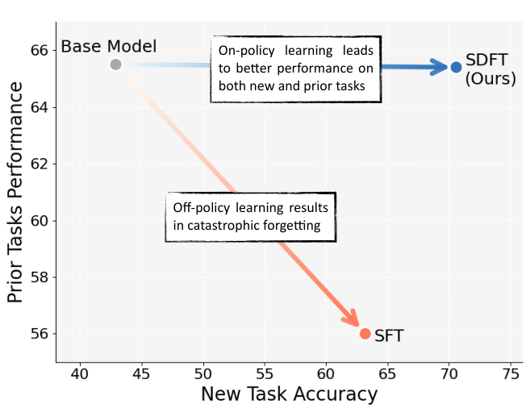
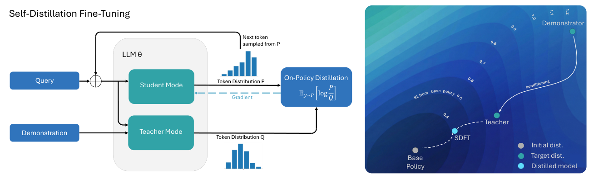
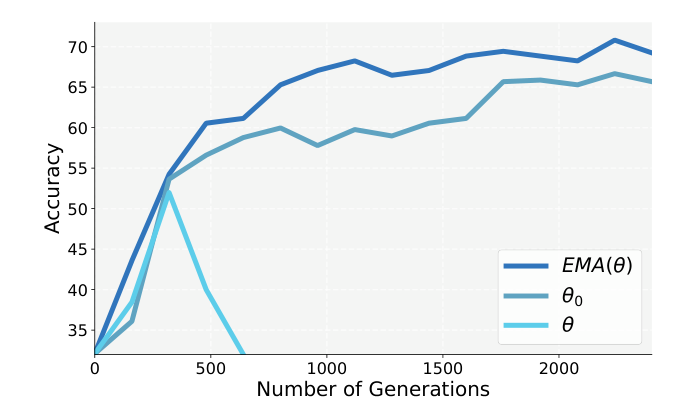
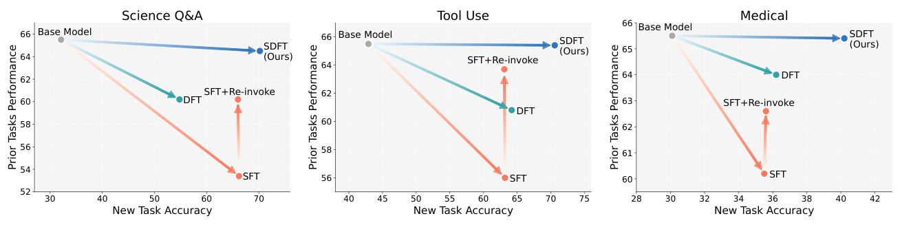
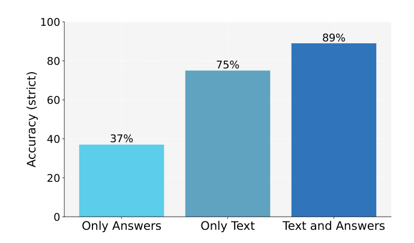
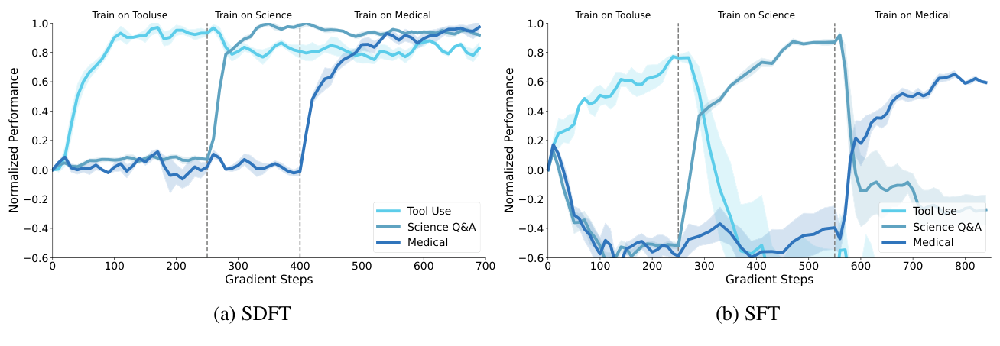
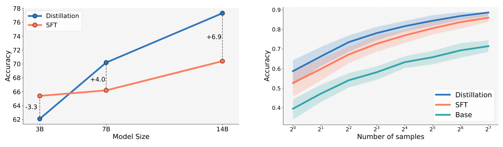
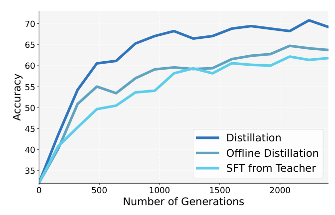

# Self-Distillation Enables Continual Learning（自蒸馏让持续学习成为可能）

中文 | [English](./SDFT-Self-Distillation-Continual-Learning_en.md)

- **原文链接**: [Self-Distillation Enables Continual Learning](https://arxiv.org/abs/2601.19897v2)
- **论文**: [arXiv:2601.19897](https://arxiv.org/abs/2601.19897)
- **官方资料**: [idanshenfeld.com/SDFT](http://idanshenfeld.com/SDFT)
- **发布日期**: 2026-01-27
- **范围**: 按 arXiv v2（2026-08-07 修订）写的通俗解读，不是全文翻译。作者是 Idan Shenfeld、Mehul Damani、Jonas Hübotter、Pulkit Agrawal，来自 MIT、Improbable AI Lab 和苏黎世联邦理工学院（ETH Zurich）。官方资料是论文给出的代码和数据地址。

## 一句话版本

大模型上线后想继续学新东西，最大的麻烦是"学了新的，忘了旧的"。这篇论文提出 SDFT（Self-Distillation Fine-Tuning，自蒸馏微调）：同一个模型扮演两个角色，"老师"在提示词里看到一份专家示范，"学生"只看到题目。学生先自己作答，老师对这份答案逐个 token 给出"换我会怎么写"的概率分布，学生朝老师靠拢。这样只要有示范数据，不需要给答案自动打分的规则（奖励函数），模型也能在自己写出的答案上学习。已有研究发现，在自己写的答案上学，旧本事忘得少得多。

效果：让 Qwen2.5-7B-Instruct 分别学习科学问答、工具调用、医疗问答三项新技能（每项都从原模型出发单独训练），SDFT 的新任务准确率比普通的监督微调（SFT）高 4.0～7.4 个百分点（下文简称"分"）。六项旧能力的平均分，SDFT 只比原模型低 0.1～1.0 分，SFT 则低 5.3～12.1 分。



*图 1：横轴是新任务准确率，纵轴是旧能力平均分。从原模型（灰点）出发，SFT 学会了新任务，旧能力却掉到约 56；SDFT 新任务更高，旧能力几乎没掉。图注没写是哪个任务，图中数值和附录表 5 的工具调用任务一致。*

---

## 1. 先认识几个词

| 词 | 大白话 |
| --- | --- |
| 持续学习（continual learning） | 模型上线后不断学新技能、新知识，同时不把原来会的弄丢 |
| 灾难性遗忘（catastrophic forgetting） | 学新任务时，旧能力大幅下降 |
| 示范（demonstration） | 专家针对某道题写的一份标准回答，比如一次正确的工具调用 |
| SFT（监督微调） | 拿示范让模型逐字模仿 |
| off-policy 和 on-policy | 练习用的回答是别人写的，叫 off-policy；是模型自己写的，叫 on-policy（policy 在这里就是指模型）。下文的"离线""在线"分别是这两个意思，和模型"上线"无关 |
| 上下文学习（ICL） | 不改参数，只在提示词里放例子，模型就能照着例子调整回答 |
| 蒸馏（distillation） | 让学生模型的输出概率分布去贴近老师模型的分布 |
| KL 散度 | 衡量两个概率分布差多远的一个数，越小越接近。下文的"KL 距离"说的也是它，单位写作 nats，只需比大小 |
| 强化学习（RL） | 让模型自己作答，按得分高低调整：得分高的写法以后多写，得分低的少写 |
| 奖励函数 | 强化学习里给回答打分的规则，比如数学题核对最终答案、代码跑测试用例。很多任务写不出这样的规则 |

## 2. 它想解决什么问题

现在的大模型训练完、上线后基本就定型了。它们可以靠检索或提示词临时调整行为，但参数不再更新，学不到新技能，也记不住新知识。作者想让模型像人一样，一边用一边持续学。

已有研究发现：**模型在自己生成的数据上学（on-policy），比照着别人的数据学（off-policy），遗忘少得多。** 但现有的 on-policy 方法大多是强化学习，需要明确的奖励函数，很多实际任务给不出来。实际中更常见的情况是手里有一批专家示范，于是大家用 SFT。

| 路线 | 做法 | 问题 |
| --- | --- | --- |
| On-policy 强化学习 | 模型自己作答，按奖励打分改进 | 忘得少，但需要奖励函数，很多任务没有 |
| SFT | 照着专家示范逐字模仿 | 只要示范就能训，但它是 off-policy 的，泛化差，容易灾难性遗忘 |
| 逆强化学习（IRL） | 先从示范反推奖励函数，再做强化学习 | 想法好，但要对奖励的形式做很强的假设，很难大规模用 |

论文要回答的问题是：**只有示范数据时，能不能拿到 on-policy 学习的好处？**

打个比方（类比是我加的，不是论文原文）：SFT 像只看教练的行车录像学开车。真上路后，只要开得和录像有一点偏差，就进入了没练过的路况，错误越积越多。这就是论文引用的 Ross 等人（2011）指出的"复合误差"。On-policy 像自己开、教练坐副驾驶随时纠正，练的正是自己会遇到的路况。

## 3. 核心做法：看了示范的自己，教没看示范的自己

大模型有上下文学习能力：提示词里放一份示范，它就能领会意图、答得更好，不需要改参数。SDFT 用两种提示词，把同一个模型调成两个角色：

- **学生**：只看题目 x。
- **老师**：看题目 x 和一份专家示范 c。

老师的提示词只有几行（论文原文是英文，这里直译，尖括号处填入具体内容）：

```text
<问题>
这是这个问题的一个回答示例：
<示范>
现在请给出你自己的回答，包括思考过程：
```

作者说，这样写就足以让模型不照抄示范，而是领会示范背后的意图，再用自己的方式回答。

训练时每一步这样做（对应图 2 左半部分）：

1. 学生看着题目，自己写出一份完整回答。
2. 把这份回答原样交给老师。老师不重写，只在回答的每个位置算出"下一个 token 我会怎么选"的概率分布。
3. 学生在同样的位置也有自己的分布。两者的差距（KL 散度）就是损失，用它更新学生的参数。老师不直接被这个损失更新。
4. 老师和学生是同一个模型，但训练中老师不直接用学生的最新参数，而是用学生参数的指数滑动平均（EMA）：每一步只朝学生当前的参数挪一小步，相当于"慢半拍的学生"（为什么这样做见第 5 节（1））。



*图 2 左：同一个模型（LLM θ）有两种模式。学生模式只看 Query，按自己的分布 P 逐个采样 token；老师模式额外看 Demonstration，对同一段内容给出分布 Q。损失是 P 和 Q 的差距，梯度（虚线）只回到学生。右：示意图，等高线表示和原模型（Base Policy）的 KL 距离。示范者（Demonstrator）在最外圈，看了示范的老师（Teacher）离原模型近得多，SDFT 训练出的模型落在两者之间，更靠近原模型。正文对应的实测是：SFT 模型和原模型的 KL 为 1.26 nats，老师为 0.68 nats（见第 4 节）；SDFT 模型本身离原模型多远，论文没有给实测数字。*

老师和学生出自同一个模型，区别主要在提示词里有没有示范，所以叫"自蒸馏"。学生练的是自己写出来的回答，所以是 on-policy。

**举个例子**（我编的示意，不是论文里的）：工具调用任务里，用户问"明天北京天气怎么样"，示范里的正确调用是 `get_weather(city="北京", date="明天")`。

- 学生没看示范，写出了 `get_weather(city="北京")`，漏了日期。
- 老师在学生写的这段文字上逐位置打分。写到 `city="北京"` 时，学生认为下一个最可能是右括号，老师看过示范，认为更可能是逗号，接着写 `date=`。
- 训练让学生在这个位置把概率往逗号挪一些。前面学生写对的部分，老师和学生看法差不多，几乎不用改。日期参数本身，要等学生以后真的写出逗号，在新的回答里再被纠正。

学生是在自己真实写出的回答上、在自己出错的那个位置被纠正的。

和几种常见做法比（这张表是我根据论文内容整理的；"普通的在线蒸馏"指学生自己作答，另一个更强的模型逐 token 打分）：

| | SFT | On-policy 强化学习 | 普通的在线蒸馏 | SDFT |
| --- | --- | --- | --- | --- |
| 在模型自己写的回答上学 | 否 | 是 | 是 | 是 |
| 不需要奖励函数 | 是 | 否 | 是 | 是 |
| 不需要另一个更强的老师模型 | 是 | 是 | 否 | 是 |
| 每个 token 都能得到单独的反馈 | 是 | 通常否，GRPO（大模型上常用的一种强化学习算法）只按整段回答的总分更新 | 是 | 是 |

论文还拿它和以前的"上下文蒸馏"比。那些方法通常是离线的（学生模仿老师事先生成好的回答），老师看的也是一段固定的提示词（比如几条示例或行为准则）。SDFT 是在线的，而且每道题配一份专门的示范。

## 4. 为什么作者认为它能少忘

论文给了三层理由。

**（1）在自己写的回答上学，本来就忘得少。** 这是已有研究的经验结论：论文引用的 Shenfeld 等（2025）、Chen 等（2025）发现，模型在自己当前生成的数据上训练，灾难性遗忘比 off-policy 方法少得多。作者据此假设，on-policy 学习是持续学习的必要条件。第 2 节说的复合误差（一步走偏就进入没练过的状态），论文是拿来解释新任务成绩为什么更好的，没有用它解释少忘。

**（2）老师离原来的自己不远。** 学生要靠近的目标，是"看懂了示范的自己"，不是专家示范本身。作者在工具调用任务上量了一下和原模型的 KL 距离：用示范做 SFT 训练出的模型是 1.26 nats，看了示范的老师只有 0.68 nats，大约一半。已有研究（包括作者团队之前的工作）发现，训练后离原模型越近，遗忘越少。学生朝一个近处的目标走，改动小，旧本事保留得多。

**（3）换个角度看，它是一种奖励自动算出来的强化学习。** 论文第 3.1 节把这层关系解释成逆强化学习（第 2 节表里"先从示范反推奖励"的那条路线），推导思路如下：

- 强化学习如果加上"别离当前模型太远"的限制，每一步的最优解（这一步最理想的新模型）可以直接写出来：在当前模型的基础上，给每个回答的概率乘一个倍数，奖励越高，倍数越大。反过来，只要知道最优解，看它给某个回答的概率是当前模型的几倍，就能倒推出这个回答的奖励。
- 作者假设：看过示范的模型，近似就是这一步的最优解。论文把它叫作"上下文假设"（In-Context Assumption）。
- 在这个假设下，一份回答的奖励等于"老师给它的 log 概率"减去"学生给它的 log 概率"。老师给的概率比学生高，就得正分；比学生低，就得负分。看的是两者谁高谁低。
- 用强化学习的常规做法（策略梯度）去最大化这个奖励，平均下来，和直接缩小"学生到老师"的 KL 散度是一回事。这个方向的 KL 叫 reverse KL，方向的区别见第 5 节（2）。

所以 SDFT 也可以看成 on-policy 强化学习，奖励不用人写，来自"看过示范的自己"和"现在的自己"之间的对比。其中"梯度相等"这一步是纯数学，本身不需要假设。需要上下文假设的是另一件事：把这个差值当成示范背后真正的奖励。

**检验这个假设。** 作者说它没法从理论上证明，只能用实验查两个条件。实验用 Qwen2.5-7B-Instruct 和 ToolAlpaca 工具调用数据集：

| 要查的条件 | 怎么查 | 结果 |
| --- | --- | --- |
| 老师答得够好 | 比较给不给示范时的正确率；人工检查 50 条老师的推理过程 | 不给示范 42%，给示范 100%；50 条推理过程的最终调用全对，中间推理也成立 |
| 老师离当前模型够近 | 量它和原模型的 KL 距离（论文用离原模型的距离代替离当前模型的距离），和 SFT 模型对比 | SFT 模型 1.26 nats，老师 0.68 nats |

需要注意（这是我的看法）：示范里本来就有这道题的正确工具调用，所以 100% 主要说明老师会利用示范。更有信息量的是另外两点：老师自己写的推理过程是对的，而且它离原模型更近。这项检查只在一个任务、一个模型上做过。

**选读：两个公式。** 不看也不影响理解。记学生为 $`\pi_\theta(\cdot\mid x)`$，看了示范 $`c`$ 的老师为 $`\pi(\cdot\mid x,c)`$。推导中的损失是学生到老师的 reverse KL：

```math
\mathcal{L}(\theta) = D_{\mathrm{KL}}\big(\pi_\theta(\cdot\mid x)\,\|\,\pi(\cdot\mid x,c)\big) = \mathbb{E}_{y\sim\pi_\theta(\cdot\mid x)}\left[\log\frac{\pi_\theta(y\mid x)}{\pi(y\mid x,c)}\right]
```

强化学习视角下，第 $`k`$ 步隐含的奖励（$`\pi_k`$ 是当前模型）是：

```math
r(y,x,c) = \log \pi(y\mid x,c) - \log \pi_k(y\mid x)
```

## 5. 让它真正跑起来的几个细节

**（1）老师用"慢半拍的学生"。** 老师的参数怎么取，对训练稳不稳影响很大（附录 A.3，图 8）。作者试了三种：

- 老师固定为训练前的原模型：训练稳定，但效果偏低，因为老师跟不上学生学到的新东西。
- 老师直接用学生当前的参数：训练很快崩掉。小的随机波动在"学生写、老师评、学生改"这个循环里被不断放大。
- 老师用学生参数的指数滑动平均（EMA），每一步只朝学生挪一小步：既能跟上学生的进步，又能抹平剧烈波动，效果最好。论文默认用这种。



*图 8：横轴是训练中累计生成的回答条数，纵轴是准确率。EMA(θ) 是滑动平均老师，后期在 68～71；θ₀ 是固定的原模型老师，后期在 65～67；θ 是学生自己当老师，约 300 条时到 52 左右，随后跌出图外。图注没写是哪个任务。EMA 这条曲线和图 6 的 SDFT 曲线逐点一样，应该是同一组实验（图 6 标的任务有个疑点，见第 9 节）。数值是读图估计。*

**（2）推导用 reverse KL，实际用 forward KL。** KL 散度不对称，"学生到老师"和"老师到学生"算出来的数不一样，所以衡量"学生和老师差多远"有两个方向。reverse KL 主要惩罚"学生把概率放在老师不认可的词上"，forward KL 主要惩罚"老师认可的词学生没覆盖到"。拿第 3 节天气的例子说：reverse KL 主要罚学生在右括号上放了太多概率，forward KL 主要罚学生给逗号的概率太少。第 4 节（3）介绍的推导用的是 reverse KL，但作者在实现部分写道，实践中 forward KL 效果最好。论文没有给两者对比的数字。同期的 OPSD 论文给过数字，可作旁证（Qwen3-1.7B，AIME25 数学题，Avg@12 准确率，%）：原模型 36.7；训练 50 步时 forward KL 43.9、reverse KL 37.5；100 步时 41.1、35.0。不论哪个方向，被比较的回答都是学生自己写的，所以仍然是 on-policy。

**（3）每个位置看整个词表，每道题只采一条回答。** 附录 A.1 比较了三种算梯度的方法。它们要估计的是同一个梯度，区别在两处：结果抖得厉不厉害（方差，越大训练越不稳），以及有没有系统性偏差（有偏、无偏）：

| 方法 | 做法 | 结果 |
| --- | --- | --- |
| 逐 token 采样估计 | 只看学生实际写出的那个 token | 有偏（只算了偏导，忽略了前面的 token 对后面 token 分布的影响），而且方差大，KL 控制得差 |
| 逐 token 解析估计 | 每个位置把整个词表的分布都拿来比 | 按整条回答算同样有偏，但方差比采样估计小；实际最稳、效果最好，主实验用它 |
| Rao-Blackwell 估计 | 在解析估计上补一项，使整体无偏 | 更贵，没带来可测的提升 |

作者还试过每道题采多条回答来降低方差，提升可以忽略，计算量却大增。所以主实验都是每题只采一条。

**（4）不计开头几个 token 的损失。** 老师看过示范或原文，回答开头可能带上"根据这段文字……""按照示例……"这类话。学生看不到示范，有时也学会了说。作者的办法是训练时不计开头几个 token 的损失。这样能压住这类口头禅，下游准确率不受影响。作者承认这只是权宜之计。

**（5）能多练几轮。** SDFT 一般练 2 轮（技能任务）或 4 轮（知识任务）还有收益；SFT 则很快过拟合，多数情况下练超过 1 轮就没有提升。

其他设置：用 Hugging Face TRL 库，单张 NVIDIA H200，全参数微调；各方法都在学习率、训练轮数上做了搜索，除 CPT 外还搜了批大小（附录表 4 里 CPT 的批大小一栏是 N/A），SDFT 还搜了 EMA 系数（0.01、0.02、0.05）；学生每次最多生成 2048 个 token（技能任务）或 1024 个（知识任务）。

## 6. 实验结果

### 6.1 实验怎么设计的

除非特别说明，模型都是 Qwen2.5-7B-Instruct。实验分两类。

**学技能**：选了三个模型没有专门训练过的任务（作者特意避开数学、代码这类常见训练任务），看它能不能学会，同时不丢旧本事。

| 任务 | 内容 | 训练数据和示范 | 怎么判对错 |
| --- | --- | --- | --- |
| 科学问答 | 本科水平化学题，选择题 | SciKnowEval 化学 L-3 子集；示范由 GPT-4o 生成，每题最多采 8 次，留一条答案正确的 | 选项完全匹配 |
| 工具调用 | 给出工具 API 说明和用户请求，写出正确的调用 | ToolAlpaca，示范来自原数据集 | 正则匹配标准调用，允许参数顺序不同 |
| 医疗 | 临床推理问答 | HuatuoGPT-o1，训练用约 2 万道英文题，测试随机抽 1000 道可验证题 | GPT-5-mini 自动判分 |

**学新知识**：收集 2025 年发生的自然灾害的维基百科文章（缅甸地震、堪察加地震、飓风梅丽莎等，都在模型的训练数据截止之后），共约 20 万 token。再用 GPT-5 根据文章出问答题，问答数据量约为原文的 5 倍。评测分三种：

- 严格准确率：所有细节都对。
- 宽松准确率：包含正确信息，且没有错误说法。
- 分布外（OOD）准确率：问的是"间接问题"，答案依赖新知识，但问题本身不直接提到它。例如"2025 年哪些国家需要国际人道主义援助？"

**旧能力**：用六个常用基准的平均分来衡量遗忘：HellaSwag（常识推理）、TruthfulQA（会不会被常见误解带偏）、MMLU（多学科知识）、IFEval（是否照指令要求作答，比如限定字数、格式）、Winogrande（代词指代类常识题）、HumanEval（写代码）。

**对比方法**：

- 学技能时：SFT；DFT（用重要性采样这种给样本重新加权的技巧，把离线数据当成 on-policy 样本来用）；SFT + Re-invoke（先做 SFT；再拿一批通用提示，让训练前的原模型当老师，做一轮在线蒸馏，把丢掉的旧能力补回来）。
- 学知识时：CPT（直接在文章上继续预训练）；SFT（在问答对上训练）；Oracle RAG（不训练，每道题都把正确的文章放进上下文，相当于开卷考试。整个语料放不进上下文窗口，所以假设检索每次都能找对文章）。

每个方法都做了超参数搜索，报告目标任务验证集上最好的那个模型。

### 6.2 学单个新技能：学得更好，忘得更少

论文附录表 5 的核心数字（%）：

| 任务 | 指标 | 原模型 | SFT | SFT + Re-invoke | DFT | SDFT |
| --- | --- | --- | --- | --- | --- | --- |
| 科学问答 | 新任务 | 32.1 | 66.2 | 66.0 | 54.8 | **70.2** |
| | 旧能力平均 | **65.5** | 53.4 | 60.2 | 60.2 | 64.5 |
| 工具调用 | 新任务 | 42.9 | 63.2 | 63.1 | 64.2 | **70.6** |
| | 旧能力平均 | **65.5** | 56.0 | 63.7 | 60.8 | 65.4 |
| 医疗 | 新任务 | 30.1 | 35.5 | 35.6 | 36.2 | **40.2** |
| | 旧能力平均 | **65.5** | 60.2 | 62.6 | 64.0 | 65.4 |

怎么读这张表：

- **新任务**：SDFT 三项都是最高，比 SFT 高 4.0～7.4 分。作者的解释是 on-policy 训练避免了复合误差，所以在新任务的测试集上泛化也更好。
- **旧能力**：和原模型的 65.5 比，SFT 掉 5.3～12.1 分。Re-invoke 能补回一部分，仍差 1.8～5.3 分。DFT 掉 1.5～5.3 分。SDFT 只掉 0.1～1.0 分。
- **平均分会掩盖单项变化**：不管学的是哪个任务，SDFT 训练后的模型在 HellaSwag、IFEval、MMLU、TruthfulQA 四项上都比原模型低，在 HumanEval、Winogrande 两项上都比原模型高，涨跌抵消后平均分接近原模型。掉得最多的是学习科学问答后的 IFEval，从 74.3 降到 66.8。
- **SFT 主要忘了什么**：三个任务里，SFT 掉得最多的都是 IFEval（照指令和格式要求作答），从 74.3 分别降到 35.3（科学问答）、49.8（工具调用）、56.6（医疗）。科学问答上，这一项就占了 SFT 六项总跌幅的一半以上。其次是 TruthfulQA（掉 8～11 分）和 HumanEval（掉 4～16 分）。MMLU 在工具调用、医疗上只掉 1～2 分（科学问答上掉 7 分），Winogrande 三次都比原模型略高（72.9～73.7，原模型 71.1）。所以这里的"遗忘"主要是听指令、按格式回答、事实性和写代码变差，知识类选择题（MMLU）多数情况下受影响小。SDFT 和 SFT 差距最大的也是 IFEval：科学问答任务上 SDFT 66.8，SFT 35.3。



*图 4：每个点是一个训练好的模型，越靠右上越好（新任务高，旧能力也高）。三个任务里，SDFT（深蓝）都在最右上；SFT（橙）右移但大幅下沉；Re-invoke 把 SFT 往上拉回一段；DFT（青绿）忘得比 SFT 少，新任务成绩在工具调用、医疗上和 SFT 相近，在科学问答上明显更低。*

### 6.3 学新知识：记得住，还会用

论文表 1（%）：

| 方法 | 严格准确率 | 宽松准确率 | 分布外准确率 |
| --- | --- | --- | --- |
| 原模型 | 0 | 0 | 0 |
| Oracle RAG（开卷） | 91 | 100 | 100 |
| CPT | 9 | 37 | 7 |
| SFT | 80 | 95 | 80 |
| **SDFT** | **89** | **100** | **98** |

- 原模型全是 0，因为这些事发生在它的训练数据之后。
- 直接在文章上继续预训练（CPT）效果很差，严格准确率只有 9%，和以前的研究结论一致。
- SFT 在问答对上训练，严格准确率到 80%。SDFT 到 89%，接近开卷的 Oracle RAG（91%）。
- 差别最大的是间接问题：SFT 80%，SDFT 98%。作者的解读是，SFT 教会模型复述特定答案，但不能可靠地把背后的事实融进模型更广的知识里。

在这个实验里，老师看到的"示范"是相关文章加上这道题的答案。附录 A.2 拆开看了老师该看什么（图 7，训练方式都是 SDFT，只改老师的上下文）：



*图 7（严格准确率）：老师只看答案 37%，只看文章 75%，文章和答案都看 89%。*

只看文章（75%）明显不如文章加答案（89%）。作者说这和以前研究的发现一致：只拿原文做蒸馏，监督信号弱、噪声大。作者的结论是，在文章之外再给出答案很关键，它给学生的指导更强。

**这里有个容易忽略的地方**（我的观察）：表 1 里 SDFT 和 SFT 用到的信息不一样多。SFT 只在问答对上训练，没直接见过原文；SDFT 的老师同时看文章和答案，比 Oracle RAG 的开卷上下文还多一份标准答案。老师只看答案时，SDFT 用的信息和 SFT 一样，严格准确率却只有 37%，远低于 SFT 的 80%。论文没有做"原文加问答对一起训练"的 SFT 对照，所以 SDFT 比 SFT 多出的 9 分（间接问题多 18 分）里，有多少来自 on-policy、有多少来自多看了原文，没法拆开。

### 6.4 连续学三项技能：SDFT 能攒住，SFT 学一个丢一个

同一个模型按"工具调用 → 科学问答 → 医疗"的顺序依次训练，全程记录三项任务的成绩。



*图 3：左边 SDFT，右边 SFT；竖虚线是切换训练任务的时刻。纵轴做了归一化：0 表示原模型在该任务上的成绩，1 表示两种方法在该任务上达到的最好成绩。*

从图上可以看到：

- **SDFT**：每学一项，这一项就升到 0.8～1.0。之前学过的有所下降但没有崩，比如工具调用从约 0.95 降到约 0.8。还没开始学的任务一直停在 0 附近，没被拖累。
- **SFT**：每换一项任务，上一项就崩。工具调用从约 0.77 跌到 −0.6 以下，比原模型还差得多；科学问答从约 0.87 跌到 0 以下。而且在学工具调用的阶段，另外两项还没开始学，就已经掉到约 −0.5。

两边的训练安排不完全一样：SDFT 在约 250、400 步切换任务，共约 700 步；SFT 在约 250、550 步切换，共约 850 步。图中数值是读图估计。

### 6.5 多采样几次，优势仍在

强化学习类的方法有个常见担心：模型只是把概率更集中到它本来就会的几种答案上（分布"变尖"）。这样采一次就答对的概率会上升，但原来采很多次都答不对的题，现在照样答不对。检验办法是看 pass@k（采 k 次，至少一次答对的比例），关键看 k 很大时，训练后的模型是否仍比原模型强。作者在技能任务上测了 k 从 1 到 128。



*图 5：图例里的 Distillation（蓝）就是 SDFT，SFT 是橙色，Base（青绿）是原模型。左图比较模型尺寸，见 6.6 节；右图横轴是采样次数 k（1 到 128），纵轴是 pass@k，0.6 即 60%。*

从右图读数：k=1 时 SDFT 约 58.5%、SFT 约 52.5%、原模型约 39.5%；k=128 时分别约 88.5%、86%、71.5%。SDFT 的平均线在每个 k 上都最高，所以作者认为提升来自真正学到了技能。不过和 SFT 的差距是逐渐缩小的，从约 6 分缩到约 2.5 分；和原模型的差距一直在 17～20 分。论文没写这张图用的是哪个任务。

读这张图还要注意两点：

- 图上 SDFT 和 SFT 的阴影带（按附录说明，应是 3 个随机种子的 95% 置信区间）在大部分 k 上互相重叠，只有和原模型的差距清楚分开。这张图能说明 SDFT 不只是把分布变尖，但不足以说明多次采样时 SDFT 一定强过 SFT。
- 表 1、表 2、表 5 这些准确率用的是贪心解码（每次取概率最高的 token，temperature=0），pass@k 用的是随机采样（temperature=1.0、top-p=0.95）。所以 k=1 的数和表 5 的准确率不是一回事，不能直接对照。

### 6.6 模型越大，优势越明显

作者的假设是：SDFT 靠的是模型的上下文学习能力，模型越大，这种能力越强，老师也就越好。为了验证，作者在科学问答上比了 Qwen2.5 的三个尺寸（图 5 左）：

| 模型 | SFT | SDFT | SDFT 减 SFT |
| --- | --- | --- | --- |
| 3B | 约 65.4 | 约 62.1 | −3.3 |
| 7B | 66.2 | 70.2 | +4.0 |
| 14B | 约 70.4 | 约 77.3 | +6.9 |

*差值是图上直接标的；3B 和 14B 的绝对数值是读图估计，7B 和表 5 一致。*

3B 时 SDFT 反而不如 SFT。作者的解释是，3B 模型的上下文学习能力太弱，当不了合格的老师；论文没有单独测 3B 老师本身答得怎么样。7B 开始反超，14B 拉开到近 7 分。作者据此推测，模型再大，SDFT 的优势还会更大。这只是三个点上的趋势外推。同期的 SDPO 论文也看到类似现象：在 Qwen3 系列上，自蒸馏相对 GRPO 的优势随模型变大而增大，在 Qwen2.5-1.5B 上反而不如 GRPO。

### 6.7 只有最终答案的数据，也能训推理模型

很多现成的数据只有最终答案，没有中间推理过程。拿这种数据直接对推理模型做 SFT，会出问题：模型被训练去贴近短答案，原本的长推理习惯被压掉。

作者用 Olmo-3-7B-Think（一个会先长篇思考再作答的模型）在医疗任务上做了对比，训练数据里没有推理过程（论文表 2）：

| 模型 | 准确率 | 平均生成 token 数 |
| --- | --- | --- |
| Olmo-3-7B-Think 原模型 | 31.2% | 4612 |
| + SFT | 23.5% | 3273 |
| + SDFT | **43.7%** | 4180 |

SFT 让准确率掉了 7.7 分，回答长度缩短约 29%。作者把回答长度当作推理深度的粗略指标，认为这说明推理行为塌了。SDFT 让准确率涨了 12.5 分，长度只少了约 9%。作者的解释是：老师就是这个推理模型自己，看了答案后，它仍按自己习惯的推理方式给每个位置打分。学生从老师那里学到"答案该往哪走"，推理习惯保留了下来。

### 6.8 同一个老师，离线用就差一截

既然"看了示范的老师"本身就很强，那直接用它离线教学生行不行？作者在工具调用任务上，用同一个老师比了三种用法（图 6）：

- **SDFT**：学生自己写，老师在线打分（on-policy 蒸馏）。
- **离线蒸馏**：先让老师写好一批回答，学生在这批固定回答上对齐老师的分布。
- **用老师的回答做 SFT**：学生直接模仿老师写好的回答。



*图 6：图例里的 Distillation 就是 SDFT，Offline Distillation 是离线蒸馏，SFT from Teacher 是用老师回答做 SFT。横轴是累计生成的回答条数。最后一个点（约 2400 条）上，SDFT 约 69，离线蒸馏约 64，用老师回答做 SFT 约 62（读图估计）。SDFT 从头到尾都在最上面；另外两条线在开头和约 1300 条处有交叉，其余时间离线蒸馏略高。*

老师是同一个。离线蒸馏和 SDFT 的区别主要在学生是不是在自己写的回答上学，最后差约 5 分。用老师回答做 SFT 除了数据是离线的，还只照着老师写出的那条回答逐字学，不用老师在每个位置给出的完整概率分布，最后差约 7 分。作者由此认为，好处不能全归功于老师的质量，on-policy 学习本身很重要。

论文第 3 节的脚注还给了另一层理由：老师看得到示范，学生看不到，老师手里有学生没有的信息。作者引用 Swamy 等人（2022）指出，这种情况下即使不考虑遗忘，也需要 on-policy 学习。我的理解是：如果让学生离线模仿老师写好的回答，学生会被要求写出单凭题目推不出来的内容（比如只有示范里才有的参数值），等于被教着去硬猜；on-policy 时，老师在学生自己写的回答上逐个位置打分，纠正的是学生真会犯的错。

## 7. 代价，以及和强化学习的关系

**比 SFT 贵。** 训练时学生要现场生成回答。作者实测，计算量（FLOPs）约是 SFT 的 2.5 倍，训练耗时约是 4 倍。这两个倍数是在哪个任务上量的、按相同轮数还是按各自最终的训练长度算的，论文没说。前面提到 SDFT 一般要练 2～4 轮，SFT 多数 1 轮就够；如果倍数是按相同轮数算的，完整训练一次的差距会超过 4 倍。按附录算法 1，额外开销来自三处：学生现场生成回答，老师在"题目 + 示范 + 回答"这段更长的输入上再算一遍，以及多存一份 EMA 老师的参数。作者的说法是：Re-invoke 这类方法要先做 SFT、再补一轮在线训练，两段加起来算，SDFT 的总训练时间反而可能更短，新任务效果也更好。论文没有给出 Re-invoke 的实际耗时。

**和强化学习：各管一类场景，也能组合。** SDFT 用在"有示范、没有奖励函数"的场景，on-policy 强化学习用在"有奖励"的场景。作者认为两者可以组合：先用 SDFT 打底，再做基于奖励的强化学习，理由是 SDFT 提升了 pass@k，高概率的回答更多样、质量更高，是更好的起点；也可以训练时同时用示范和奖励两种信号。这些是作者提出的方向，论文里没有做组合实验。

**和 GRPO 比效率（只有定性分析）。** SDFT 每道题只生成一条回答，GRPO 要为每道题生成一组回答来比较好坏。SDFT 在每个 token 上都有信号（甚至覆盖整个词表），GRPO 只有整段回答的一个分数。论文没有和 GRPO 做实验对比。

## 8. 作者自己承认的局限

- **离不开上下文学习能力。** 模型太小（实验里是 3B）时，看了示范也当不好老师，SDFT 不如 SFT。
- **擅长加东西，不擅长大改造。** SDFT 适合在保留原有能力的前提下学新技能、新知识。如果目标行为要求从根本上改变模型的生成方式，就很难。作者举的例子是：把一个不写推理过程的模型训练成会写显式思维链的模型，他们发现很难做到。我的理解是，老师就是模型自己，它本来不写长推理，看了示范后的打分也还是自己的风格，学生很难从中学到全新的写法。
- **学生会继承老师的口头禅。** 屏蔽开头几个 token 只是权宜之计，更根本的办法还没找到。
- **遗忘没有完全消除。** 作者明确说，比 off-policy 方法少很多，但仍有一些能力下降，需要别的技术配合。
- **只试了专家示范。** 从非专家、有噪声的示范，或者从用户对话这类没有结构的数据里学习，留给以后。

## 9. 读的时候值得留意的地方

以下是我读原文时注意到、论文没有重点讨论的点，供参考。

### 证据有多强

- **理论和实际做法对不上。** "等价于逆强化学习"的推导用的是 reverse KL，推导里的老师就是看了示范的当前模型。实际训练用的是 forward KL、EMA 老师，以及按整条回答算有偏的逐 token 估计。所以这段推导更像在解释"这个思路为什么说得通"，不能当作实际算法的理论保证。
- **"上下文假设"只在一个任务、一个模型上查过**（见第 4 节）。
- **原有通用能力保没保住，直接证据只有表 5。** 六项通用基准只在 Qwen2.5-7B 的三个单任务实验里量过（表 5、图 4；图 1 是其中的工具调用任务）。知识实验（表 1）、Olmo 推理模型实验（表 2）、模型规模实验（图 5 左）、连续学习（图 3），以及图 6～8 的几组对比，都没有报告这六项的分数。图 3 能说明先学的技能没被后学的冲掉，但没说明通用能力怎样。摘要说两类任务上都"大幅减少了灾难性遗忘"，知识获取这一半没有数字支撑。也因为图 6 没量旧能力，第 4 节的理由（2）（老师离原模型近，所以忘得少）没有被单独检验过：离线学这个老师会不会同样忘得少，论文没回答。同期 SDPO 论文有个相近的旁证（代码任务、Qwen3-8B，设置和本文不同）：用自教师答对的回答做离线 SFT，几项通用基准（IFEval、ArenaHard-v2、MMLU-Pro）的平均分从 43.5 降到 41.4，在线的 SDPO 降到 42.4。
- **图 6 少了一条对照线。** 图 6 没画用专家示范直接做的普通 SFT，正文却说离线蒸馏"比普通 SFT 好"。粗略对照表 5（训练长度和选点方式不完全相同）：工具调用上普通 SFT 是 63.2，和两种离线用法（约 64、约 62）差不多；如果图 6 实际是科学问答（见下面"稿件里的小问题"第一条），普通 SFT 是 66.2，还高于两种离线用法。粗略看，这个老师拿来离线用，新任务上并不比直接学专家示范强多少，SDFT 的提升主要来自 on-policy 这一步。
- **看不到误差范围。** 附录说默认跑 3 个随机种子、报告 95% 置信区间，但表 1、表 2、表 5 都只给一个数，图 4、6、7、8 也没画误差范围，只有图 3 和图 5 右图有阴影带。旧能力平均分上 SDFT 和原模型只差 0.1～1.0 分，这么小的差距里有多少是随机波动，没法判断。
- **每种方法只有一个点。** 图 4 每种方法只画一个模型，是按新任务验证集成绩选出来的。SFT 如果用小一点的学习率或少练一点，也许忘得少、学得也少，会落在图上别的位置。论文没有画出各方法在不同超参下的完整权衡曲线，"SDFT 全面占优"只基于这一个点。
- **自动判分。** 医疗和知识任务都由 GPT-5-mini 判对错，论文没有报告它和人工判分的一致程度。
- **有些结论只有文字。** forward KL 比 reverse KL 好、三种梯度估计的比较、屏蔽开头 token 不伤准确率，这几处都没给数字。

### 适用范围

- **主要实验只有一个模型。** 几乎都在 Qwen2.5-7B-Instruct 上做。规模实验只在科学问答一个任务、三个尺寸上做，"越大越好"是三个点的外推。
- **知识实验规模很小。** 附录举出 9 篇文章（原文写的是 including，不一定是全部）；正文说整个语料约 20 万 token。老师要在上下文里看到对应的文章和答案，所以每道训练题都得知道对应哪篇文章，文章也得放得进上下文。语料大很多、或者问题和资料的对应关系不清楚时效果如何，没测。间接问题有多少道、怎么构造的，论文也没说明。训练轮数也不对等：附录表 4 里 SFT 只搜了 1、2 轮，SDFT 搜到 4 轮，附录 B.1 说 SDFT 在知识任务上一般练 4 轮（附录 B.1 也说 SFT 多数情况下练超过 1 轮就不再提升，见第 5 节（5））。再加上 6.3 节说的信息量不对等，表 1 的差距不能全算在 on-policy 头上。
- **连续学习只连了三项任务。** SDFT 一侧共约 700 步（SFT 一侧约 850 步）。引言说这个实验里"无关的原有能力"也保住了，但图 3 只画了这三项任务的成绩。

### 稿件里的小问题（不影响主要结论）

- 正文说图 6 是工具调用任务，但图 6、图 8 的曲线起点都约为 32，和表 5 里原模型的科学问答成绩（32.1）吻合，和工具调用的 42.9（论文第 3.2 节也说是 42%）对不上。可能是任务写错了，也可能是评测方式不同，论文没有解释。
- 局限部分说规模实验见"图 4a"，实际是图 5 左。
- 论文第 3.1 节说"代入式 (6)"，但式 (6) 在后面，应该是指前面那个没编号的奖励式。
- 附录 A.1 的解析估计和 Rao-Blackwell 估计两个公式里，对词表求和的那一项都比正文式 (2) 少了概率权重 $`\pi_\theta(v\mid y_{<t},x)`$；Rao-Blackwell 公式下方对 $`k_\theta`$ 的定义写成了 $`\pi(\cdot\mid y_{<t},x,x)`$，应为 $`\pi(\cdot\mid y_{<t},x,c)`$。
- 算法 1 写的是只取采样到的 token 的 log 概率，但它调用的解析估计需要整个词表的分布。
- 表 5 工具调用任务里，SFT 的旧能力平均分写的是 56.0，按六项重算是 56.3。
- 论文第 4.3 节说 SFT 在所有评测基准上都严重遗忘，但表 5 里 Winogrande 三次都比原模型高（见 6.2 节）。

## 10. 和同期两篇工作的关系

论文提到，同一时期另有两篇独立工作也提出了这种自蒸馏算法，作者认为彼此互补。三篇的主要区别（我根据三篇原文整理）：

| | SDFT（本文） | OPSD（arXiv 2601.18734） | SDPO（arXiv 2601.20802） |
| --- | --- | --- | --- |
| 老师额外看到什么 | 专家示范；知识任务里是文章加答案 | 参考解题过程 | 同组采样里答对的回答；没有答对的回答时，改给这次失败尝试的环境反馈（比如运行报错、评测意见）。没有文字反馈的任务只用答对的回答 |
| 想解决的问题 | 持续学习：学新的同时不忘旧的 | 提升数学推理 | 强化学习每次只有一个总分，信号太粗 |
| 老师的参数 | 学生参数的 EMA | 固定为训练前的模型 | EMA，或在当前老师和初始老师之间插值 |
| 差距度量 | 推导用 reverse KL，实践用 forward KL | forward KL | 损失式按 reverse KL 写；正文说为了稳定改用 Jensen-Shannon 散度，附录超参表里只有无文字反馈的实验用它，有文字反馈和测试时训练的实验用 reverse KL |
| 主要模型 | Qwen2.5（3B/7B/14B）、Olmo-3-7B-Think | Qwen3（1.7B/4B/8B） | Qwen3-8B、Olmo3-7B-Instruct |

老师参数的选法不完全一样：本文和 SDPO 都发现 EMA 一类的老师比固定的原模型好（SDPO 也说，老师固定不动时它的表现也不错），OPSD 则固定用原模型，说这样更稳，也能防止模型偏离太远。另外，本文作者 Jonas Hübotter 是 SDPO 的第一作者，SDPO 的作者里也有本文第一作者 Idan Shenfeld。

## 11. 总结

SDFT 的思路很简单：**同一个模型，一个看示范、一个不看，让看了示范的那个在线指导没看的那个。** 这样只要有示范数据，就能在模型自己写出的回答上学习，拿到 on-policy 学习"忘得少、泛化好"的好处，既不需要奖励函数，也不需要更大的老师模型。

在 Qwen2.5-7B 上，它学新技能比 SFT 高 4～7 分，旧能力平均分几乎不掉；学新知识时，不直接提到这些事件、但答案要用上新知识的间接问题答对 98%（SFT 是 80%）；连续学三项技能时能把学过的攒住，SFT 则学一个丢一个。代价是训练耗时约为 SFT 的 4 倍，而且要求模型有足够强的上下文学习能力，3B 这么小的模型就不行。它更适合给能力不错的模型"加新本事"，不适合彻底改变模型的回答方式。

---

## 原文位置对照

| 本文内容 | 论文位置 |
| --- | --- |
| 问题和动机 | 第 1、2 节，图 1 |
| 方法、老师提示词 | 第 3 节，式 (1)(2)，图 2 左，附录算法 1 |
| 逆强化学习解释 | 第 3.1 节，式 (3)～(6) |
| 上下文假设的验证 | 第 3.2 节，图 2 右 |
| 实验设置 | 第 4.1 节，附录 B |
| 新技能、旧能力 | 第 4.2、4.3 节，图 4，附录表 5 |
| 新知识 | 第 4.2 节，表 1，附录 A.2 图 7 |
| 连续学习 | 第 4.3 节，图 3 |
| pass@k、模型规模 | 第 4.2、4.4 节，图 5 |
| 只有答案的推理模型训练 | 第 4.5 节，表 2 |
| 在线与离线对比 | 第 4.6 节，图 6 |
| 成本、局限、未来方向 | 第 5 节 |
| 梯度估计、老师参数 | 附录 A.1、A.3，图 8 |
| 超参数 | 附录表 3、表 4 |
