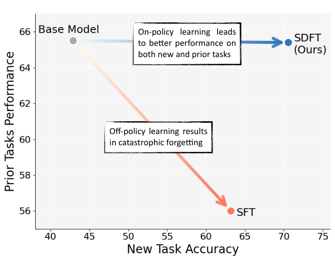
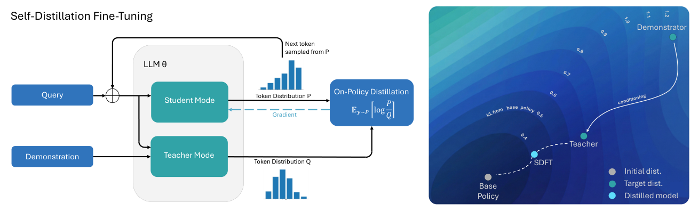
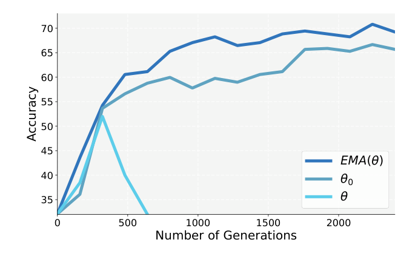
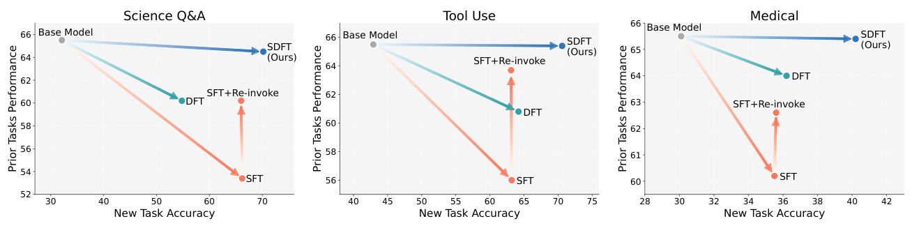
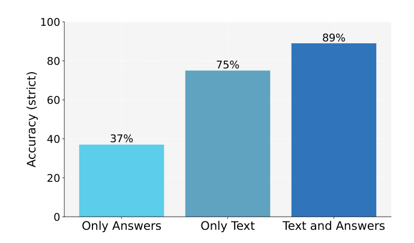
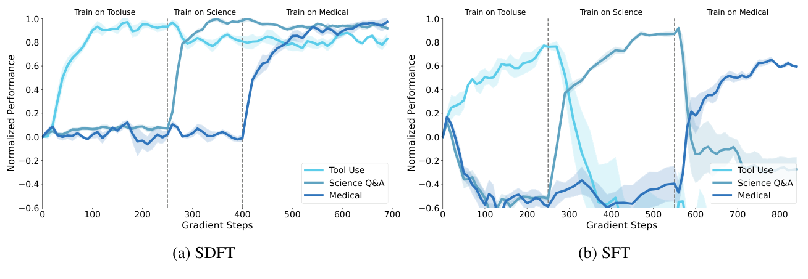
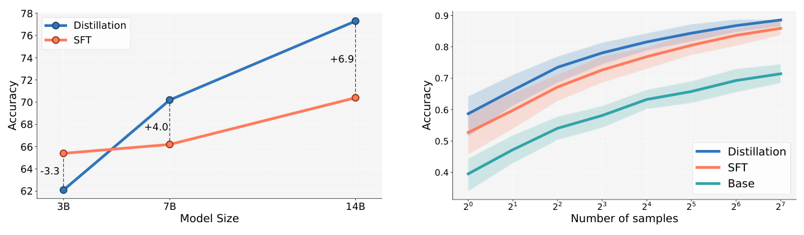
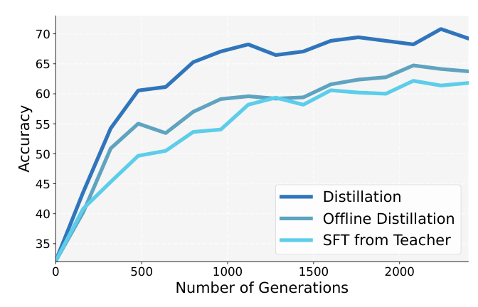

# Self-Distillation Enables Continual Learning

[中文](./SDFT-Self-Distillation-Continual-Learning.md) | English

- **Source**: [Self-Distillation Enables Continual Learning](https://arxiv.org/abs/2601.19897v2)
- **Paper**: [arXiv:2601.19897](https://arxiv.org/abs/2601.19897)
- **Official resources**: [idanshenfeld.com/SDFT](http://idanshenfeld.com/SDFT)
- **Published**: 2026-01-27
- **Scope**: A plain-language explainer based on arXiv v2 (revised 2026-08-07), not a full translation. The authors are Idan Shenfeld, Mehul Damani, Jonas Hübotter and Pulkit Agrawal, from MIT, Improbable AI Lab and ETH Zurich. The official resources link is the code and data address given in the paper.

## In One Sentence

When a large model wants to keep learning new things after deployment, the biggest trouble is "learn the new, forget the old". This paper proposes SDFT (Self-Distillation Fine-Tuning): the same model plays two roles. The "teacher" sees an expert demonstration in its prompt, and the "student" sees only the question. The student first writes its own response, the teacher gives a per-token distribution over that response saying "how I would write it", and the student moves toward the teacher. So with only demonstration data, and no rule that scores responses automatically (a reward function), the model can still learn on responses it wrote itself. Prior work has found that learning on your own responses makes the model forget much less of what it could already do.

Results: Qwen2.5-7B-Instruct learns three new skills (science Q&A, tool use and medical Q&A), each trained separately starting from the original model. SDFT's new-task accuracy is 4.0 to 7.4 percentage points (shortened to "points" below) higher than plain supervised fine-tuning (SFT). On the average score over six old capabilities, SDFT is only 0.1 to 1.0 points below the original model, while SFT is 5.3 to 12.1 points below.



*Figure 1: the x-axis is new-task accuracy and the y-axis is the average score on old capabilities. Starting from the original model (gray dot), SFT learns the new task, but its old capabilities drop to about 56; SDFT scores higher on the new task and its old capabilities barely drop. The caption does not say which task this is; the values in the figure match the tool-use task in Appendix Table 5.*

---

## 1. Key Terms

| Term | In plain words |
| --- | --- |
| Continual learning | After deployment, the model keeps learning new skills and new knowledge without losing what it could already do |
| Catastrophic forgetting | Old capabilities drop sharply while a new task is learned |
| Demonstration | A reference response an expert writes for a given question, such as one correct tool call |
| SFT (supervised fine-tuning) | Having the model imitate demonstrations word for word |
| Off-policy and on-policy | If the practice responses were written by someone else, it is off-policy; if the model wrote them itself, it is on-policy ("policy" here just means the model). Below, "offline" means the same as off-policy, and none of these terms has anything to do with the model being deployed |
| In-context learning (ICL) | Without changing any parameters, just put examples in the prompt and the model adjusts its responses to follow them |
| Distillation | Making the student model's output distribution move close to the teacher model's distribution |
| KL divergence | A number that measures how far apart two distributions are; smaller means closer. The "KL distance" below also refers to it. Its unit is written as nats, and you only need to compare sizes |
| Reinforcement learning (RL) | The model answers on its own and is adjusted by score: ways of writing that score high get written more later, and those that score low get written less |
| Reward function | The rule that scores responses in RL, such as checking the final answer of a math problem or running test cases on code. For many tasks no such rule can be written |

## 2. What Problem It Tackles

Today's large models are essentially fixed once they are trained and deployed. They can adjust their behavior temporarily through retrieval or prompts, but their parameters no longer update, so they cannot learn new skills or remember new knowledge. The authors want models that, like people, keep learning while they are being used.

Prior work has found that **a model that learns on data it generated itself (on-policy) forgets much less than one that learns from someone else's data (off-policy).** But most existing on-policy methods are RL, which needs an explicit reward function, and many real tasks cannot provide one. The more common situation in practice is having a batch of expert demonstrations, so people use SFT.

| Approach | How it works | Problem |
| --- | --- | --- |
| On-policy RL | The model answers on its own and improves according to reward scores | Forgets little, but needs a reward function, which many tasks lack |
| SFT | Imitates expert demonstrations word for word | Trains with just demonstrations, but it is off-policy, generalizes poorly and is prone to catastrophic forgetting |
| Inverse reinforcement learning (IRL) | First infers a reward function from demonstrations, then runs RL | A good idea, but it needs strong assumptions about the form of the reward and is hard to use at scale |

The question the paper wants to answer is: **with only demonstration data, can we get the benefits of on-policy learning?**

An analogy (the analogy is mine, not the paper's): SFT is like learning to drive by only watching the instructor's driving videos. Once you are on a real road, any small deviation from the videos puts you in road conditions you never practiced, and the errors pile up. This is the "compounding error" pointed out by Ross et al. (2011), whom the paper cites. On-policy is like driving yourself with the instructor in the passenger seat correcting you at any moment, so you practice exactly the road conditions you will meet.

## 3. Core Method: The Self That Saw the Demonstration Teaches the Self That Didn't

Large models can do in-context learning: put a demonstration in the prompt and the model grasps the intent and answers better, without any parameter change. SDFT uses two prompts to turn the same model into two roles:

- **Student**: sees only the question x.
- **Teacher**: sees the question x and an expert demonstration c.

The teacher's prompt is only a few lines (this is the paper's original English wording; the actual content goes where the angle brackets are):

```text
<Question>
This is an example for a response to the question:
<Demonstration>
Now answer with a response of your own, including the thinking process:
```

The authors say this wording is enough to keep the model from copying the demonstration; instead, it grasps the intent behind the demonstration and answers in its own way.

Each training step goes like this (the left half of Figure 2):

1. The student looks at the question and writes a complete response on its own.
2. The response is handed to the teacher as is. The teacher does not rewrite it; at each position in the response, it only computes a distribution saying "which token I would pick next".
3. The student has its own distribution at the same positions. The gap between the two (the KL divergence) is the loss, and it is used to update the student's parameters. The teacher is not updated directly by this loss.
4. The teacher and the student are the same model, but during training the teacher does not use the student's latest parameters directly. It uses an exponential moving average (EMA) of the student's parameters: each step, it moves only a small step toward the student's current parameters, like "a student who lags half a beat behind" (see Section 5, item (1), for why).



*Figure 2 left: the same model (LLM θ) has two modes. In student mode it sees only the Query and samples tokens one by one from its own distribution P; in teacher mode it also sees the Demonstration and gives a distribution Q over the same content. The loss is the gap between P and Q, and the gradients (dashed lines) flow back only to the student. Right: a schematic, where the contour lines show the KL distance from the original model (Base Policy). The Demonstrator is on the outermost ring, the Teacher that has seen the demonstration is much closer to the original model, and the model SDFT trains lands between the two, closer to the original model. The matching measurements in the text: the KL between the SFT model and the original model is 1.26 nats, and for the teacher it is 0.68 nats (see Section 4); the paper gives no measured number for how far the SDFT model itself is from the original model.*

The teacher and the student come from the same model and differ mainly in whether the prompt contains a demonstration, hence the name "self-distillation". The student practices on responses it wrote itself, so it is on-policy.

**An example** (an illustration I made up, not from the paper): in the tool-use task, the user asks "What's the weather in Beijing tomorrow?", and the correct call in the demonstration is `get_weather(city="北京", date="明天")`.

- The student has not seen the demonstration and writes `get_weather(city="北京")`, leaving out the date.
- The teacher scores the student's text position by position. When the text reaches `city="北京"`, the student thinks the most likely next token is the closing parenthesis, while the teacher, having seen the demonstration, thinks a comma is more likely, followed by `date=`.
- Training makes the student shift some probability toward the comma at this position. On the earlier part that the student got right, the teacher and the student mostly agree, so almost nothing changes. The date argument itself gets corrected only later, in a new response, once the student actually writes the comma.

The student is corrected on a response it really wrote, at the exact position where it went wrong.

Compared with a few common approaches (I compiled this table from the paper's content; "plain on-policy distillation" means the student answers on its own and another, stronger model scores it per token):

| | SFT | On-policy RL | Plain on-policy distillation | SDFT |
| --- | --- | --- | --- | --- |
| Learns on responses the model wrote itself | No | Yes | Yes | Yes |
| No reward function needed | Yes | No | Yes | Yes |
| No separate, stronger teacher model needed | Yes | Yes | No | Yes |
| Every token gets its own feedback | Yes | Usually no: GRPO (an RL algorithm commonly used on large models) updates only by the total score of the whole response | Yes | Yes |

The paper also compares it with earlier "context distillation". Those methods are usually off-policy (the student imitates responses the teacher generated in advance), and their teacher sees a fixed prompt (such as a few examples or behavior guidelines). SDFT is on-policy, and each question comes with its own dedicated demonstration.

## 4. Why the Authors Think It Forgets Less

The paper gives reasons at three levels.

**(1) Learning on your own responses already forgets less.** This is an empirical conclusion from prior work: Shenfeld et al. (2025) and Chen et al. (2025), cited by the paper, found that when a model trains on data it currently generates itself, there is much less catastrophic forgetting than with off-policy methods. Based on this, the authors hypothesize that on-policy learning is a necessary condition for continual learning. The paper uses the compounding error from Section 2 (one step off course puts you in states you never practiced) to explain why new-task scores are better, not to explain why forgetting is lower.

**(2) The teacher is not far from its original self.** The target the student moves toward is "itself after understanding the demonstration", not the expert demonstration itself. On the tool-use task, the authors measured the KL distance from the original model: the model trained by SFT on the demonstrations is at 1.26 nats, while the teacher that has seen the demonstration is at only 0.68 nats, about half. Prior work (including the authors' own earlier work) has found that the closer a model stays to the original model after training, the less it forgets. The student walks toward a nearby target, so it changes little and keeps more of its old skills.

**(3) Seen from another angle, it is RL with an automatically computed reward.** Section 3.1 of the paper explains this link as inverse reinforcement learning (the route in the Section 2 table that "first infers the reward from demonstrations"). The derivation goes like this:

- If RL adds the constraint "don't move too far from the current model", the optimal solution of each step (the ideal new model for that step) can be written down directly: start from the current model and multiply the probability of each response by a factor, where a higher reward means a larger factor. Conversely, if you know the optimal solution, the ratio between the probability it gives a response and the probability the current model gives that response lets you work back to the response's reward.
- The authors assume that the model that has seen the demonstration is approximately the optimal solution for this step. The paper calls this the "In-Context Assumption".
- Under this assumption, a response's reward equals "the log probability the teacher gives it" minus "the log probability the student gives it". If the teacher gives it a higher probability than the student does, it gets a positive score; if lower, a negative score. What matters is which of the two is higher.
- Maximizing this reward with the usual RL method (policy gradient) is, on average, the same thing as directly shrinking the "student to teacher" KL divergence. KL in this direction is called reverse KL; Section 5, item (2), explains the difference between the directions.

So SDFT can also be seen as on-policy RL whose reward is not written by people but comes from comparing "itself after seeing the demonstration" with "itself now". The "the gradients are equal" step is pure math and needs no assumption by itself. What needs the In-Context Assumption is something else: treating this difference as the true reward behind the demonstration.

**Testing the assumption.** The authors say it cannot be proven in theory, so they can only check two conditions by experiment. The experiments use Qwen2.5-7B-Instruct and the ToolAlpaca tool-use dataset:

| Condition to check | How it is checked | Result |
| --- | --- | --- |
| The teacher answers well enough | Compare accuracy with and without the demonstration; manually inspect 50 of the teacher's reasoning traces | 42% without the demonstration, 100% with it; in all 50 reasoning traces the final call is correct, and the intermediate reasoning holds up too |
| The teacher is close enough to the current model | Measure its KL distance from the original model (the paper uses the distance from the original model in place of the distance from the current model) and compare it with the SFT model | SFT model 1.26 nats, teacher 0.68 nats |

Worth noting (this is my view): the demonstration already contains the correct tool call for the question, so the 100% mainly shows that the teacher can make use of the demonstration. The other two points carry more information: the reasoning the teacher writes itself is correct, and the teacher is closer to the original model. This check was done on only one task and one model.

**Optional reading: two formulas.** You can skip them without losing the thread. Write the student as $`\pi_\theta(\cdot\mid x)`$ and the teacher that has seen demonstration $`c`$ as $`\pi(\cdot\mid x,c)`$. The loss in the derivation is the reverse KL from the student to the teacher:

```math
\mathcal{L}(\theta) = D_{\mathrm{KL}}\big(\pi_\theta(\cdot\mid x)\,\|\,\pi(\cdot\mid x,c)\big) = \mathbb{E}_{y\sim\pi_\theta(\cdot\mid x)}\left[\log\frac{\pi_\theta(y\mid x)}{\pi(y\mid x,c)}\right]
```

From the RL point of view, the implicit reward at step $`k`$ ($`\pi_k`$ is the current model) is:

```math
r(y,x,c) = \log \pi(y\mid x,c) - \log \pi_k(y\mid x)
```

## 5. A Few Details That Make It Actually Work

**(1) The teacher is "a student who lags half a beat behind".** How the teacher's parameters are chosen has a big effect on whether training is stable (Appendix A.3, Figure 8). The authors tried three options:

- The teacher is fixed as the original model from before training: training is stable, but the results are on the low side, because the teacher cannot keep up with the new things the student learns.
- The teacher uses the student's current parameters directly: training soon collapses. Small random fluctuations get amplified over and over in the loop of "the student writes, the teacher grades, the student adjusts".
- The teacher uses an exponential moving average (EMA) of the student's parameters, moving only a small step toward the student each step: it keeps up with the student's progress and also smooths out sharp fluctuations, and it gives the best results. The paper uses this by default.



*Figure 8: the x-axis is the cumulative number of responses generated during training, and the y-axis is accuracy. EMA(θ) is the moving-average teacher, at 68 to 71 late in training; θ₀ is the fixed original-model teacher, at 65 to 67 late in training; θ is the student acting as its own teacher, which reaches around 52 at about 300 responses and then drops off the chart. The caption does not say which task this is. The EMA curve matches the SDFT curve in Figure 6 point for point, so they are probably the same set of experiments (the task labeled in Figure 6 raises a question, see Section 9). The values are read off the plot.*

**(2) The derivation uses reverse KL; the implementation uses forward KL.** KL divergence is not symmetric: "student to teacher" and "teacher to student" give different numbers, so there are two directions for measuring "how far apart the student and the teacher are". Reverse KL mainly penalizes "the student putting probability on tokens the teacher does not endorse", and forward KL mainly penalizes "tokens the teacher endorses that the student does not cover". Take the weather example from Section 3: reverse KL mainly penalizes the student for putting too much probability on the closing parenthesis, and forward KL mainly penalizes the student for giving the comma too little probability. The derivation in Section 4, item (3), uses reverse KL, but the authors write in the implementation part that forward KL works best in practice. The paper gives no numbers comparing the two. The concurrent OPSD paper does give numbers, which can serve as side evidence (Qwen3-1.7B, AIME25 math problems, Avg@12 accuracy, %): original model 36.7; at 50 training steps, forward KL 43.9 and reverse KL 37.5; at 100 steps, 41.1 and 35.0. Whichever direction is used, the responses being compared are ones the student wrote itself, so it is still on-policy.

**(3) Look at the whole vocabulary at each position, and sample only one response per question.** Appendix A.1 compares three ways of computing the gradient. They all estimate the same gradient and differ in two places: how much the result jitters (the variance; the larger it is, the less stable training is), and whether there is a systematic bias (biased or unbiased):

| Method | How it works | Result |
| --- | --- | --- |
| Per-token sampled estimator | Looks only at the token the student actually wrote | Biased (it computes only the partial derivative and ignores how earlier tokens affect the distribution of later tokens), with high variance and poor control of the KL |
| Per-token analytic estimator | Compares the distribution over the whole vocabulary at each position | Equally biased when computed over the whole response, but with lower variance than the sampled estimator; in practice it is the most stable and works best, and the main experiments use it |
| Rao-Blackwell estimator | Adds one term to the analytic estimator to make the whole thing unbiased | More expensive, with no measurable gain |

The authors also tried sampling several responses per question to reduce the variance. The gain was negligible, but the compute went up sharply. So all the main experiments sample only one response per question.

**(4) The loss on the first few tokens is not counted.** The teacher has seen the demonstration or the source text, so its responses may open with phrases like "Based on this text..." or "Following the example...". The student cannot see the demonstration, yet sometimes learns to say them too. The authors' fix is to leave the first few tokens out of the loss during training. This suppresses such stock phrases, and downstream accuracy is not affected. The authors admit this is only a stopgap.

**(5) It can train for more epochs.** SDFT usually still gains at 2 epochs (skill tasks) or 4 epochs (knowledge tasks); SFT overfits quickly, and in most cases training beyond 1 epoch brings no gain.

Other settings: the Hugging Face TRL library, a single NVIDIA H200 and full-parameter fine-tuning. Every method was searched over learning rate and number of epochs, every method except CPT was also searched over batch size (the batch-size entry for CPT in Appendix Table 4 is N/A), and SDFT was also searched over the EMA coefficient (0.01, 0.02, 0.05). The student generates at most 2048 tokens per response (skill tasks) or 1024 (knowledge tasks).

## 6. Experimental Results

### 6.1 How the experiments were set up

Unless stated otherwise, the model is always Qwen2.5-7B-Instruct. The experiments fall into two kinds.

**Learning skills**: the authors picked three tasks the model had not been specifically trained on (they deliberately avoided common training tasks such as math and code), to see whether it can learn them without losing its old skills.

| Task | Content | Training data and demonstrations | How correctness is judged |
| --- | --- | --- | --- |
| Science Q&A | Undergraduate-level chemistry questions, multiple choice | SciKnowEval Chemistry L-3 subset; demonstrations generated by GPT-4o, sampling up to 8 times per question and keeping one with the correct answer | Exact match on the option |
| Tool use | Given a tool's API description and a user request, write the correct call | ToolAlpaca; the demonstrations come from the original dataset | Regex match against the reference call, allowing a different argument order |
| Medical | Clinical reasoning Q&A | HuatuoGPT-o1; about 20,000 English questions for training, and 1000 randomly drawn verifiable questions for testing | Graded automatically by GPT-5-mini |

**Learning new knowledge**: the authors collected Wikipedia articles on natural disasters that happened in 2025 (the Myanmar earthquake, the Kamchatka earthquake, Hurricane Melissa and others, all after the model's training-data cutoff), about 200,000 tokens in total. GPT-5 then wrote Q&A questions from the articles, giving about 5× as much Q&A data as source text. There are three kinds of evaluation:

- Strict accuracy: every detail is correct.
- Lenient accuracy: contains the correct information and makes no false claims.
- Out-of-distribution (OOD) accuracy: the questions are "indirect questions", whose answers depend on the new knowledge although the question itself does not mention it directly. For example, "Which countries needed international humanitarian aid in 2025?"

**Old capabilities**: forgetting is measured by the average score on six common benchmarks: HellaSwag (commonsense reasoning), TruthfulQA (whether the model gets led astray by common misconceptions), MMLU (multi-subject knowledge), IFEval (whether it answers as the instructions require, such as limits on length or format), Winogrande (commonsense questions about what a pronoun refers to) and HumanEval (writing code).

**Baselines**:

- For skills: SFT; DFT (uses importance sampling, a trick that reweights samples, to treat off-policy data as on-policy samples); SFT + Re-invoke (first do SFT, then take a batch of general prompts and run a round of on-policy distillation with the original model from before training as the teacher, to bring back the lost old capabilities).
- For knowledge: CPT (continued pretraining directly on the articles); SFT (training on the Q&A pairs); Oracle RAG (no training; the correct article is put into the context for every question, like an open-book exam. The whole corpus does not fit in the context window, so this assumes retrieval finds the right article every time).

Every method had a hyperparameter search, and the reported model is the best one on the target task's validation set.

### 6.2 Learning a single new skill: learns better, forgets less

The key numbers from the paper's Appendix Table 5 (%):

| Task | Metric | Original model | SFT | SFT + Re-invoke | DFT | SDFT |
| --- | --- | --- | --- | --- | --- | --- |
| Science Q&A | New task | 32.1 | 66.2 | 66.0 | 54.8 | **70.2** |
| | Old-capability average | **65.5** | 53.4 | 60.2 | 60.2 | 64.5 |
| Tool use | New task | 42.9 | 63.2 | 63.1 | 64.2 | **70.6** |
| | Old-capability average | **65.5** | 56.0 | 63.7 | 60.8 | 65.4 |
| Medical | New task | 30.1 | 35.5 | 35.6 | 36.2 | **40.2** |
| | Old-capability average | **65.5** | 60.2 | 62.6 | 64.0 | 65.4 |

How to read this table:

- **New task**: SDFT is the highest on all three, 4.0 to 7.4 points above SFT. The authors' explanation is that on-policy training avoids compounding error, so it also generalizes better on the new task's test set.
- **Old capabilities**: compared with the original model's 65.5, SFT drops 5.3 to 12.1 points. Re-invoke wins back part of that but is still 1.8 to 5.3 points short. DFT drops 1.5 to 5.3 points. SDFT drops only 0.1 to 1.0 points.
- **The average hides changes on single benchmarks**: whichever task it learns, the model after SDFT training is below the original model on four benchmarks (HellaSwag, IFEval, MMLU and TruthfulQA) and above it on two (HumanEval and Winogrande); the rises and falls cancel out, leaving the average close to the original model's. The biggest drop is IFEval after learning science Q&A, from 74.3 to 66.8.
- **What SFT mainly forgets**: on all three tasks, SFT's biggest drop is on IFEval (answering according to instructions and format requirements), which falls from 74.3 to 35.3 (science Q&A), 49.8 (tool use) and 56.6 (medical). On science Q&A, this one benchmark accounts for more than half of SFT's total drop across the six. Next come TruthfulQA (down 8 to 11 points) and HumanEval (down 4 to 16 points). MMLU drops only 1 to 2 points on tool use and medical (7 points on science Q&A), and Winogrande is slightly above the original model all three times (72.9 to 73.7, versus 71.1 for the original model). So the "forgetting" here is mainly worse instruction following, format compliance, factuality and coding, while knowledge-type multiple-choice questions (MMLU) are little affected in most cases. The biggest gap between SDFT and SFT is also on IFEval: on the science Q&A task, SDFT has 66.8 and SFT 35.3.



*Figure 4: each point is one trained model, and the closer to the upper right, the better (high on the new task and high on old capabilities). On all three tasks, SDFT (dark blue) is furthest to the upper right; SFT (orange) moves right but sinks a lot; Re-invoke pulls SFT back up part of the way; DFT (teal) forgets less than SFT, and its new-task scores are close to SFT's on tool use and medical but clearly lower on science Q&A.*

### 6.3 Learning new knowledge: it remembers it and can use it

Table 1 of the paper (%):

| Method | Strict accuracy | Lenient accuracy | OOD accuracy |
| --- | --- | --- | --- |
| Original model | 0 | 0 | 0 |
| Oracle RAG (open book) | 91 | 100 | 100 |
| CPT | 9 | 37 | 7 |
| SFT | 80 | 95 | 80 |
| **SDFT** | **89** | **100** | **98** |

- The original model scores 0 on everything, because these events happened after its training data.
- Continued pretraining directly on the articles (CPT) works poorly, with a strict accuracy of only 9%, in line with the conclusions of earlier research.
- SFT, trained on the Q&A pairs, reaches 80% strict accuracy. SDFT reaches 89%, close to the open-book Oracle RAG (91%).
- The biggest difference is on the indirect questions: SFT 80%, SDFT 98%. The authors' reading is that SFT teaches the model to repeat specific answers but cannot reliably fold the underlying facts into the model's broader knowledge.

In this experiment, the "demonstration" the teacher sees is the relevant article plus the answer to the question. Appendix A.2 breaks down what the teacher should see (Figure 7; training is always SDFT, and only the teacher's context changes):



*Figure 7 (strict accuracy): 37% when the teacher sees only the answer, 75% when it sees only the article, and 89% when it sees both the article and the answer.*

Seeing only the article (75%) is clearly worse than the article plus the answer (89%). The authors say this matches what earlier research found: distilling from the source text alone gives a weak, noisy supervision signal. The authors conclude that giving the answer on top of the article is key, because it gives the student stronger guidance.

**Something easy to miss here** (my observation): in Table 1, SDFT and SFT do not use the same amount of information. SFT trains only on the Q&A pairs and never sees the source text directly; SDFT's teacher sees both the article and the answer, which is one reference solution more than even Oracle RAG's open-book context. When the teacher sees only the answer, SDFT uses the same information as SFT, yet its strict accuracy is only 37%, far below SFT's 80%. The paper has no SFT control "trained on the source text plus the Q&A pairs together", so of SDFT's 9-point lead over SFT (18 points more on indirect questions), there is no way to separate how much comes from being on-policy and how much from also seeing the source text.

### 6.4 Learning three skills in a row: SDFT accumulates them, SFT loses one for each one it learns

The same model is trained in the order "tool use → science Q&A → medical", and its scores on all three tasks are recorded throughout.



*Figure 3: SDFT on the left, SFT on the right; the vertical dashed lines mark when the training task switches. The y-axis is normalized: 0 is the original model's score on that task, and 1 is the best score that either of the two methods reached on that task.*

From the figure you can see:

- **SDFT**: each time it learns a task, that task rises to 0.8 to 1.0. Tasks learned earlier drop somewhat but do not collapse; for example, tool use falls from about 0.95 to about 0.8. Tasks not yet learned stay near 0 throughout and are not dragged down.
- **SFT**: each time the task switches, the previous one collapses. Tool use falls from about 0.77 to below −0.6, much worse than even the original model; science Q&A falls from about 0.87 to below 0. Moreover, during the tool-use phase, the other two tasks, which have not been learned yet, already drop to about −0.5.

The training schedules on the two sides are not exactly the same: SDFT switches tasks at about steps 250 and 400, for about 700 steps in total; SFT switches at about steps 250 and 550, for about 850 steps in total. The values from the figure are read off the plot.

### 6.5 With more samples, the advantage remains

A common worry about RL-style methods is that the model merely concentrates its probability more on the few answers it could already give (the distribution gets "sharper"). That raises the chance of answering correctly in a single sample, but questions it could not get right even with many samples still come out wrong. The way to check is pass@k (the fraction of questions answered correctly at least once in k samples), and the key question is whether the trained model still beats the original model when k is large. The authors measured k from 1 to 128 on the skill tasks.



*Figure 5: in the legend, Distillation (blue) is SDFT, SFT is orange, and Base (teal) is the original model. The left plot compares model sizes, see Section 6.6; in the right plot, the x-axis is the number of samples k (1 to 128) and the y-axis is pass@k, where 0.6 means 60%.*

Reading the right plot: at k=1, SDFT is at about 58.5%, SFT about 52.5% and the original model about 39.5%; at k=128 they are about 88.5%, 86% and 71.5%. SDFT's mean line is the highest at every k, so the authors believe the gain comes from really learning the skill. But its gap to SFT narrows gradually, from about 6 points to about 2.5 points, while its gap to the original model stays at 17 to 20 points throughout. The paper does not say which task this figure uses.

Two more points to keep in mind when reading this figure:

- The shaded bands of SDFT and SFT in the figure (going by the appendix, these should be 95% confidence intervals over 3 random seeds) overlap at most values of k; only the gap to the original model is clearly separated. The figure shows that SDFT does more than sharpen the distribution, but it is not enough to show that SDFT must beat SFT when sampling many times.
- The accuracies in Tables 1, 2 and 5 use greedy decoding (taking the highest-probability token each time, temperature=0), while pass@k uses random sampling (temperature=1.0, top-p=0.95). So the k=1 numbers and the accuracies in Table 5 are not the same thing and cannot be compared directly.

### 6.6 The larger the model, the clearer the advantage

The authors' hypothesis is that SDFT relies on the model's in-context learning ability, which gets stronger as the model gets larger, so the teacher gets better too. To test this, the authors compared three sizes of Qwen2.5 on science Q&A (Figure 5, left):

| Model | SFT | SDFT | SDFT minus SFT |
| --- | --- | --- | --- |
| 3B | about 65.4 | about 62.1 | −3.3 |
| 7B | 66.2 | 70.2 | +4.0 |
| 14B | about 70.4 | about 77.3 | +6.9 |

*The differences are labeled directly in the figure; the absolute values for 3B and 14B are read off the plot, and those for 7B match Table 5.*

At 3B, SDFT is actually worse than SFT. The authors' explanation is that the 3B model's in-context learning ability is too weak for it to serve as a competent teacher; the paper does not separately test how well the 3B teacher itself answers. From 7B on, SDFT pulls ahead, and at 14B the lead widens to nearly 7 points. From this, the authors speculate that SDFT's advantage will grow further with even larger models. This is only a trend extrapolated from three points. The concurrent SDPO paper sees a similar pattern: on the Qwen3 series, self-distillation's advantage over GRPO grows as the model gets larger, while on Qwen2.5-1.5B it is actually worse than GRPO.

### 6.7 Data with only final answers can still train a reasoning model

A lot of ready-made data has only final answers, with no intermediate reasoning. Doing SFT on a reasoning model directly with such data causes trouble: the model is trained to match short answers, and its original habit of long reasoning gets suppressed.

The authors ran a comparison on the medical task with Olmo-3-7B-Think (a model that thinks at length before it answers), with no reasoning traces in the training data (Table 2 of the paper):

| Model | Accuracy | Average number of generated tokens |
| --- | --- | --- |
| Olmo-3-7B-Think original model | 31.2% | 4612 |
| + SFT | 23.5% | 3273 |
| + SDFT | **43.7%** | 4180 |

SFT makes accuracy drop 7.7 points and shortens responses by about 29%. The authors treat response length as a rough indicator of reasoning depth and take this to mean that the reasoning behavior collapsed. SDFT raises accuracy by 12.5 points, and the length shrinks by only about 9%. The authors' explanation: the teacher is this reasoning model itself, and after seeing the answer it still scores each position in its own habitual way of reasoning. The student learns from the teacher "where the answer should head", and its reasoning habits are kept.

### 6.8 The same teacher falls behind when used offline

Since "the teacher that has seen the demonstration" is already strong on its own, why not use it directly to teach the student offline? On the tool-use task, the authors compared three ways of using the same teacher (Figure 6):

- **SDFT**: the student writes its own responses, and the teacher scores them on-policy (on-policy distillation).
- **Offline distillation**: the teacher first writes a batch of responses, and the student matches the teacher's distribution on this fixed batch.
- **SFT on the teacher's responses**: the student directly imitates the responses the teacher has written.



*Figure 6: in the legend, Distillation is SDFT, Offline Distillation is offline distillation, and SFT from Teacher is SFT on the teacher's responses. The x-axis is the cumulative number of responses generated. At the last point (about 2400 responses), SDFT is at about 69, offline distillation at about 64, and SFT on the teacher's responses at about 62 (read off the plot). SDFT stays on top from start to finish; the other two lines cross at the start and at about 1300 responses, and offline distillation is slightly higher the rest of the time.*

All three use the same teacher. Offline distillation differs from SDFT mainly in whether the student learns on responses it wrote itself, and it ends up about 5 points behind. SFT on the teacher's responses not only uses offline data but also learns word for word from the one response the teacher wrote, without using the full distribution the teacher gives at each position; it ends up about 7 points behind. From this the authors conclude that the benefit cannot all be credited to the teacher's quality, and that on-policy learning itself matters a lot.

A footnote in Section 3 of the paper gives one more reason: the teacher can see the demonstration and the student cannot, so the teacher holds information the student lacks. Citing Swamy et al. (2022), the authors point out that in this situation on-policy learning is needed even if forgetting is set aside. My understanding: if the student imitates the teacher's pre-written responses offline, it is asked to write content that cannot be worked out from the question alone (such as argument values that only appear in the demonstration), which amounts to being taught to guess blindly; on-policy, the teacher scores the student's own response position by position, so what gets corrected are mistakes the student would really make.

## 7. Costs, and How It Relates to RL

**More expensive than SFT.** During training, the student has to generate responses on the fly. By the authors' measurements, the compute (FLOPs) is about 2.5× that of SFT, and the training time is about 4×. The paper does not say which task these two multiples were measured on, or whether they are computed at the same number of epochs or at each method's final training length. As mentioned earlier, SDFT usually trains for 2 to 4 epochs, while SFT is mostly done after 1 epoch; if the multiples are at the same number of epochs, the gap for one complete training run would be more than 4×. Going by Algorithm 1 in the appendix, the extra cost comes from three places: the student generating responses on the fly, the teacher running another pass over the longer input "question + demonstration + response", and storing an extra copy of the EMA teacher's parameters. The authors' argument: methods like Re-invoke first do SFT and then add a round of on-policy training, so counting both stages together, SDFT's total training time may actually be shorter, and it also does better on the new task. The paper does not give Re-invoke's actual training time.

**Relation to RL: each handles its own kind of setting, and the two can be combined.** SDFT is for settings that "have demonstrations but no reward function", and on-policy RL is for settings that "have a reward". The authors think the two can be combined: first use SDFT as a foundation, then do reward-based RL, on the grounds that SDFT raises pass@k, so its high-probability responses are more diverse and of higher quality, which makes a better starting point; or use both signals, demonstrations and rewards, at the same time during training. These are directions the authors propose; the paper runs no experiments on combining them.

**Efficiency compared with GRPO (qualitative analysis only).** SDFT generates only one response per question, while GRPO has to generate a group of responses per question to compare which are better. SDFT has a signal on every token (even covering the whole vocabulary), while GRPO has only one score for the whole response. The paper runs no experimental comparison with GRPO.

## 8. Limitations the Authors Acknowledge

- **It depends on in-context learning ability.** When the model is too small (3B in the experiments), it cannot be a good teacher even after seeing the demonstration, and SDFT does worse than SFT.
- **Good at adding things, not at major overhauls.** SDFT suits learning new skills and new knowledge while keeping existing capabilities. If the target behavior requires fundamentally changing how the model generates, it is hard. The authors' example is training a model that does not write out its reasoning into one that writes an explicit chain of thought, which they found hard to achieve. My understanding is that the teacher is the model itself: it did not write long reasoning to begin with, and its scoring after seeing the demonstration is still in its own style, so the student can hardly learn an entirely new way of writing from it.
- **The student inherits the teacher's stock phrases.** Masking the first few tokens is only a stopgap, and a more fundamental fix has not been found yet.
- **Forgetting is not fully eliminated.** The authors say explicitly that it is much lower than with off-policy methods, but some capabilities still drop, and other techniques are needed alongside it.
- **Only expert demonstrations were tried.** Learning from non-expert, noisy demonstrations, or from unstructured data such as user conversations, is left for future work.

## 9. Points Worth Noticing While Reading

Below are points I noticed while reading the paper that it does not discuss at length, offered for reference.

### How strong the evidence is

- **The theory and the actual practice don't match.** The "equivalent to inverse reinforcement learning" derivation uses reverse KL, and the teacher in the derivation is the current model after seeing the demonstration. Actual training uses forward KL, an EMA teacher, and a per-token estimator that is biased when computed over the whole response. So the derivation reads more like an explanation of "why this idea makes sense" and cannot be taken as a theoretical guarantee for the actual algorithm.
- **The "In-Context Assumption" was checked on only one task and one model** (see Section 4).
- **The only direct evidence on whether the original general capabilities survive is Table 5.** The six general benchmarks were measured only in the three single-task experiments on Qwen2.5-7B (Table 5 and Figure 4; Figure 1 is the tool-use task among them). The knowledge experiment (Table 1), the Olmo reasoning-model experiment (Table 2), the model-size experiment (Figure 5, left), continual learning (Figure 3) and the comparisons in Figures 6 to 8 report no scores on these six. Figure 3 shows that skills learned earlier were not washed out by those learned later, but says nothing about general capabilities. The abstract claims "substantially reducing catastrophic forgetting" on both kinds of tasks, but the knowledge-acquisition half has no numbers behind it. And because Figure 6 did not measure old capabilities, reason (2) in Section 4 (the teacher is close to the original model, so forgetting is lower) was never tested on its own: the paper does not answer whether learning from this teacher offline would forget just as little. The concurrent SDPO paper has a similar piece of side evidence (a coding task with Qwen3-8B, in a setup different from this paper's): offline SFT on the self-teacher's correct responses lowers the average score on several general benchmarks (IFEval, ArenaHard-v2 and MMLU-Pro) from 43.5 to 41.4, while on-policy SDPO lowers it to 42.4.
- **Figure 6 is missing a control line.** Figure 6 does not plot plain SFT done directly on the expert demonstrations, yet the text says offline distillation "improves over standard SFT". A rough comparison with Table 5 (the training length and the way the point is picked are not exactly the same): on tool use, plain SFT is at 63.2, about the same as the two offline uses (about 64 and about 62); if Figure 6 is actually science Q&A (see the first item under "Small issues in the manuscript" below), plain SFT is at 66.2, even higher than both offline uses. Roughly speaking, using this teacher offline is not much better on the new task than learning directly from the expert demonstrations, and SDFT's gain comes mainly from the on-policy step.
- **No error ranges are shown.** The appendix says the default is 3 random seeds with 95% confidence intervals reported, but Tables 1, 2 and 5 each give only a single number, Figures 4, 6, 7 and 8 draw no error ranges either, and only Figure 3 and the right plot of Figure 5 have shaded bands. On the old-capability average, SDFT and the original model differ by only 0.1 to 1.0 points, and there is no way to tell how much of such a small gap is random fluctuation.
- **Each method is a single point.** Figure 4 plots only one model per method, picked by its score on the new task's validation set. If SFT used a somewhat smaller learning rate or trained a bit less, it might forget less and also learn less, landing somewhere else on the plot. The paper does not plot each method's full trade-off curve across different hyperparameters, so "SDFT wins across the board" rests on this single point.
- **Automatic grading.** Both the medical and the knowledge tasks are graded by GPT-5-mini, and the paper does not report how well it agrees with human grading.
- **Some conclusions are stated in words only.** Forward KL beating reverse KL, the comparison of the three gradient estimators, and masking the first tokens without hurting accuracy: none of these come with numbers.

### Where it applies

- **The main experiments use only one model.** Almost all of them are on Qwen2.5-7B-Instruct. The scaling experiment covers only one task (science Q&A) and three sizes, and "larger is better" is an extrapolation from three points.
- **The knowledge experiment is very small.** The appendix lists 9 articles (the paper's wording is "including", so the list may not be complete); the main text says the whole corpus is about 200,000 tokens. The teacher needs to see the matching article and answer in its context, so for every training question you must know which article it matches, and the article must fit in the context. How well it works when the corpus is much larger, or when the mapping between questions and source material is unclear, was not tested. The paper also does not say how many indirect questions there are or how they were built. The number of training epochs is not equal either: in Appendix Table 4, SFT was searched only over 1 and 2 epochs, while SDFT was searched up to 4 epochs, and Appendix B.1 says SDFT usually trains for 4 epochs on knowledge tasks (Appendix B.1 also says that in most cases SFT stops improving beyond 1 epoch, see Section 5, item (5)). Together with the unequal amount of information described in Section 6.3, the gap in Table 1 cannot all be credited to on-policy learning.
- **The continual-learning run chains only three tasks.** The SDFT side runs about 700 steps in total (the SFT side about 850). The introduction says that "unrelated, pre-existing capabilities" were also preserved in this experiment, but Figure 3 plots only the scores on these three tasks.

### Small issues in the manuscript (none affect the main conclusions)

- The text says Figure 6 is the tool-use task, but the curves in Figures 6 and 8 both start at about 32, which matches the original model's science Q&A score in Table 5 (32.1) and does not match the 42.9 for tool use (Section 3.2 of the paper also says 42%). Either the task is mislabeled or the evaluation is done differently; the paper does not explain.
- The limitations section says the scaling experiment is in "Figure 4a", but it is actually Figure 5, left.
- Section 3.1 of the paper says "Substituting this into Eq. (6)", but Eq. (6) comes later; it should mean the unnumbered reward equation before it.
- In the two formulas in Appendix A.1, for the analytic estimator and the Rao-Blackwell estimator, the term that sums over the vocabulary lacks the probability weight $`\pi_\theta(v\mid y_{<t},x)`$ that Eq. (2) in the main text has; below the Rao-Blackwell formula, the definition of $`k_\theta`$ is written as $`\pi(\cdot\mid y_{<t},x,x)`$ and should be $`\pi(\cdot\mid y_{<t},x,c)`$.
- Algorithm 1 says to take only the log probability of the sampled token, but the analytic estimator it calls needs the distribution over the whole vocabulary.
- For the tool-use task in Table 5, SFT's old-capability average is given as 56.0, but recomputing it from the six benchmarks gives 56.3.
- Section 4.3 of the paper says SFT forgets severely on all evaluation benchmarks, but in Table 5, Winogrande is above the original model all three times (see Section 6.2).

## 10. Relation to Two Concurrent Works

The paper mentions that two other independent works from the same period also proposed this self-distillation algorithm, and the authors see them as complementary. The main differences among the three (I compiled this from the three papers):

| | SDFT (this paper) | OPSD (arXiv 2601.18734) | SDPO (arXiv 2601.20802) |
| --- | --- | --- | --- |
| What the teacher additionally sees | Expert demonstration; in the knowledge task, the article plus the answer | Reference solution | Correct responses from the same sampled group; when there is no correct response, it gets the environment feedback on this failed attempt instead (such as runtime errors or evaluator comments). Tasks without text feedback use only the correct responses |
| Problem it targets | Continual learning: learning the new without forgetting the old | Improving math reasoning | RL gives only one overall score each time, so the signal is too coarse |
| Teacher's parameters | EMA of the student's parameters | Fixed as the model from before training | EMA, or an interpolation between the current teacher and the initial teacher |
| Gap measure | Reverse KL in the derivation, forward KL in practice | Forward KL | The loss is written as reverse KL; the text says it switches to Jensen-Shannon divergence for stability, yet in the appendix hyperparameter table only the experiments without text feedback use it, and the experiments with text feedback and the test-time training experiments use reverse KL |
| Main models | Qwen2.5 (3B/7B/14B), Olmo-3-7B-Think | Qwen3 (1.7B/4B/8B) | Qwen3-8B, Olmo3-7B-Instruct |

The choice of teacher parameters is not quite the same: this paper and SDPO both find that an EMA-type teacher beats the fixed original model (SDPO also says it does fairly well with a fixed teacher), while OPSD always uses the fixed original model, saying this is more stable and also keeps the model from drifting too far. Also, Jonas Hübotter, an author of this paper, is the first author of SDPO, and SDPO's authors also include this paper's first author, Idan Shenfeld.

## 11. Summary

The idea of SDFT is simple: **take the same model, let one copy see the demonstration and the other not, and have the copy that saw it guide the other on-policy.** So with only demonstration data, the model can learn on responses it wrote itself and get the benefits of on-policy learning ("forgets less, generalizes better"), with no need for a reward function or a larger teacher model.

On Qwen2.5-7B, it beats SFT by 4 to 7 points on new skills while its old-capability average barely drops; on new knowledge, it answers 98% of the indirect questions correctly (questions that do not mention these events directly but whose answers need the new knowledge), versus 80% for SFT; learning three skills in a row, it keeps what it has learned, while SFT loses one for each one it learns. The cost is that training takes about 4× as long as SFT, and the model needs strong enough in-context learning ability; a model as small as 3B does not work. It is better suited to "adding new skills" to a fairly capable model than to completely changing how the model answers.

---

## Where Things Are in the Paper

| In this note | In the paper |
| --- | --- |
| Problem and motivation | Sections 1 and 2, Figure 1 |
| Method, teacher prompt | Section 3, Eqs. (1) and (2), Figure 2 left, Appendix Algorithm 1 |
| Inverse reinforcement learning interpretation | Section 3.1, Eqs. (3) to (6) |
| Testing the In-Context Assumption | Section 3.2, Figure 2 right |
| Experimental setup | Section 4.1, Appendix B |
| New skills, old capabilities | Sections 4.2 and 4.3, Figure 4, Appendix Table 5 |
| New knowledge | Section 4.2, Table 1, Appendix A.2 Figure 7 |
| Continual learning | Section 4.3, Figure 3 |
| pass@k, model size | Sections 4.2 and 4.4, Figure 5 |
| Training a reasoning model with answers only | Section 4.5, Table 2 |
| On-policy vs offline comparison | Section 4.6, Figure 6 |
| Cost, limitations, future directions | Section 5 |
| Gradient estimation, teacher parameters | Appendix A.1 and A.3, Figure 8 |
| Hyperparameters | Appendix Tables 3 and 4 |
