# Reinforcement Learning via Self-Distillation（用自蒸馏做强化学习）

中文 | [English](./SDPO-Reinforcement-Learning-via-Self-Distillation_en.md)

- **原文链接**: [Reinforcement Learning via Self-Distillation](https://arxiv.org/abs/2601.20802v2)
- **论文**: [arXiv:2601.20802](https://arxiv.org/abs/2601.20802)
- **官方资料**: [lasgroup/SDPO](https://github.com/lasgroup/SDPO)
- **发布日期**: 2026-01-28
- **范围**: 按 arXiv v2（2026-02-16 修订）写的通俗解读，不是全文翻译。作者是 Jonas Hübotter 等 11 人，来自苏黎世联邦理工学院（ETH Zurich）、马普智能系统研究所、MIT 和斯坦福大学。代码基于 verl 训练框架。

## 一句话版本

模型做完一道题，环境给出的信息往往比"对/错"多得多，比如编程题的报错。这篇论文提出 SDPO（Self-Distillation Policy Optimization，自蒸馏策略优化）：把这段反馈交给同一个模型，让它当"老师"，把自己刚写的答案逐词重读一遍，指出"哪个词写错了、应该换成哪个"，再让模型朝老师的看法调整。整个过程不需要更强的外部模型，也不需要单独训练奖励模型。

效果：在 Qwen3-8B 上练 LiveCodeBench v6 编程题，SDPO 准确率 48.8%，比主流的强化学习方法 GRPO（41.2%）高 7.6 个百分点（下文简称"分"），而且只用约四分之一的生成量就达到 GRPO 的最终水平。在只给对错、没有文字反馈的科学问答和工具调用任务上，SDPO 在 10 组对比里赢了 GRPO 7 组，回答长度只有 GRPO 的约三分之一。在单道极难的编程题上边做边练，它整体上也比反复抽签更早做出答案。短板是模型太弱时它反而不如 GRPO。

---

## 1. 先认识几个词

| 词 | 大白话 |
| --- | --- |
| 强化学习（RL） | 让模型自己作答，按得分高低调整：得分高的写法以后多写，得分低的少写 |
| RLVR | 可验证奖励的强化学习。用程序自动判对错，把结果当作奖励（给回答打的分），通常对了 1 分、错了 0 分 |
| GRPO | 大模型上常用的一种强化学习算法。同一道题做多遍，比这组平均分高的回答整体加分，低的整体扣分 |
| token | 模型读写文字的基本单位，可以理解成一个词或词的一部分。下文说的"逐词"就是逐个 token |
| 信用分配（credit assignment） | 一次作答成功或失败，该算到其中哪几个 token 头上 |
| 优势值（advantage） | 强化学习里给每个 token 的"加减分"：正数让这种写法以后更常出现，负数让它更少出现 |
| 蒸馏（distillation） | 让学生模型在每个位置给出的"下一个词概率表"，去贴近老师模型给出的那张表 |
| on-policy 和 off-policy | 训练用的回答是模型用当前参数自己写的，叫 on-policy，下文也叫"在线"；是别人写的或参数更新前写的，叫 off-policy，下文也叫"离线" |
| SFT（监督微调） | 拿现成的回答让模型逐字模仿 |
| 上下文学习（in-context learning） | 不改参数，只靠提示词里给的信息（例子、报错）现学现用 |
| KL 散度 | 衡量两个概率分布差多远的一个数，越小越接近。下文的 JS 散度是它的一个对称版本 |
| RLRF | 带丰富反馈的强化学习，是论文提出的说法。环境除了打分，还返回报错、没通过的测试或评委模型的评语，这些文字也拿来训练 |
| 自教师（self-teacher） | 模型自己：提示词里多给它看反馈，它就扮演老师，回头评判刚才的回答 |

## 2. 它想解决什么问题

### 现在的主流做法：只看对错打分

想让大模型在数学、编程这类"程序能自动判对错"的任务上变强，现在常用 RLVR（Reinforcement Learning with Verifiable Rewards，可验证奖励的强化学习）：模型写一个答案，程序判分，对了 1 分，错了 0 分。

常用的算法是 GRPO：同一道题让模型做 8 遍，得分高于这 8 遍平均分的答案整体加分，低于平均分的整体扣分。

这有两个毛病：

1. **只知道错了，不知道错在哪。** 一整段代码只因为多写了一个 `+ 1` 而没通过，GRPO 会给这段代码里的每个 token 扣同样多的分。论文把这叫"信用分配"问题：一次失败该怪到哪几个词头上。
2. **全错就学不到。** 8 遍全是 0 分时，每一遍都等于平均分，没有谁被加分或扣分，这道题等于白做。越难的题越容易出现这种情况。

### 另一条路：请强老师逐词指导

"蒸馏"是让一个更强的模型在答案的每个位置告诉学生"这里我会写什么"，信号很细。问题是，想把模型推到比现有模型都强时，往往找不到这样的老师。

### SDPO 想站的位置

论文表 1 把几类方法放在一起：

| 方法 | 练的是谁写的答案 | 反馈有多细 | 反馈从哪来 |
| --- | --- | --- | --- |
| SFT / 蒸馏 | 别人写好的（离线） | 细 | 需要更强的老师 |
| 在线蒸馏 | 模型自己写的 | 细 | 需要更强的老师 |
| RLVR（如 GRPO） | 模型自己写的 | 粗，只有对错 | 环境 |
| SDPO（本文） | 模型自己写的 | 细 | 环境 |

作者想要的是最后一行：像强化学习一样练模型自己写的答案、只依赖环境，又像蒸馏一样在每个词上都有反馈。

论文要回答的问题是：**不靠更强的外部老师，怎样把环境给的丰富反馈变成有效的信用分配？**

## 3. 核心想法：环境其实说了更多，模型自己看得懂

### 环境给的不只是对错

很多能自动判分的环境，本来就会给出一段文字说明。比如编程题提交后，评测系统会返回类似 LeetCode 的结果（论文图 3）：

```text
Runtime Error
ZeroDivisionError: division by zero
Line 73 in separateSquares (Solution.py)

Last Executed Input
[[26,30,2],[11,23,1]]
```

RLVR 只取其中的"0 分"，其余信息都扔掉了。作者把"保留这段文字来训练"的设定叫作 RLRF（Reinforcement Learning with Rich Feedback，带丰富反馈的强化学习）。反馈可以是报错、没通过的测试用例，也可以是另一个模型当评委写的评语。

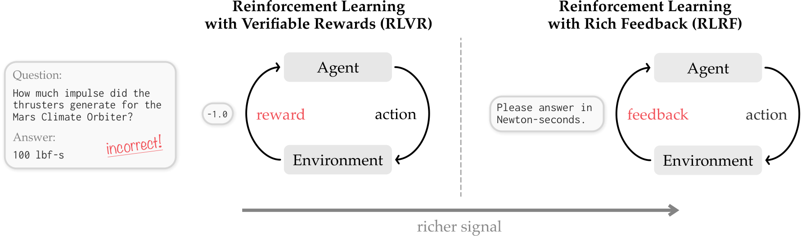

*图 2：题目问"火星气候探测者号的推进器产生了多大冲量"，模型答"100 lbf-s"（磅力·秒）。RLVR 只收到"-1.0"；RLRF 收到"请用牛顿·秒作答"。例子的背景是 1999 年火星气候探测者号因为英制、公制单位混用而失事。*

### 同一个模型，两个角色

大模型有一个现成的本事：把错误信息贴给它，它往往能看出自己错在哪。作者利用这一点，让同一个模型扮演两个角色：

- **学生**：只看题目，自己答题。
- **老师**：看题目，外加这次的反馈，回头评判学生刚才的答案。

老师多看了反馈，通常比学生判断得准。论文的说法是："同一个策略可以扮演两个角色：第一次作答时当学生，事后当老师，回头判断当初每一步的价值。"

### 具体流程

用论文图 4 的小例子说明。题目是"写一个 Python 函数，返回 1 到 n 的所有数，简短作答"。

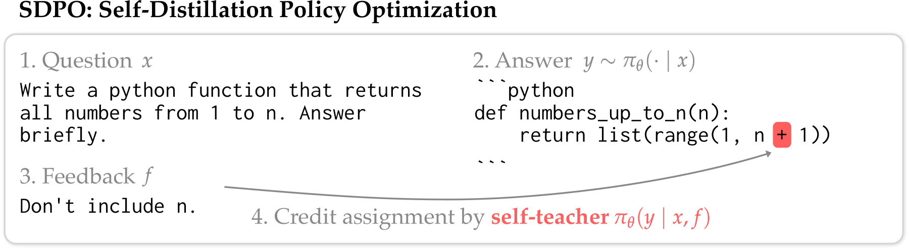

*图 4：学生（Qwen3-8B）写了 `list(range(1, n + 1))`，反馈说"不要包含 n"。老师读过反馈再看这段代码，只在 `+` 这个位置明显不认同（红色）。*

1. **学生答题。** 每道题让模型独立作答 8 次（论文实验的设置）。
2. **环境给反馈。** 判分，并给出报错或没通过的测试。
3. **给老师拼一段新的提示词。** 内容依次是：原题；如果同一组 8 个答案里有做对的，附上一份做对的答案，标题是"正确解答"；如果一个做对的都没有，就附上这次的报错，标题是"这是你上一次失败尝试收到的反馈"；最后一句"请正确解答原题"。做对的答案也来自学生自己，不需要外部专家。
4. **老师不重写，只重读。** 把学生原来的答案原样接在这段提示词后面，让模型做一次前向计算。这样就知道：看过反馈的模型，在学生答案的每个位置，觉得下一个词应该是什么。这一步只算概率、不生成新答案，所以开销小。
5. **逐词比对，调整学生。** 在每个位置比较老师和学生的"下一个词概率表"。老师比学生更认可的词加分，老师更不认可的词扣分，两者看法一致的地方基本不动。梯度只从学生这一侧回传，老师只当参照（老师自己怎么更新见第 5 节）。

图 4 里，学生写 `+` 的位置被扣分。下面的图 9 还显示，老师在这个位置更倾向于直接写 `))` 收尾，也就是改成 `list(range(1, n))`。学生写下的其他词，老师基本没有异议。

整套方法就叫 SDPO（自蒸馏策略优化）。"蒸馏"指学生去贴近老师的概率表；"自"指老师就是模型自己。

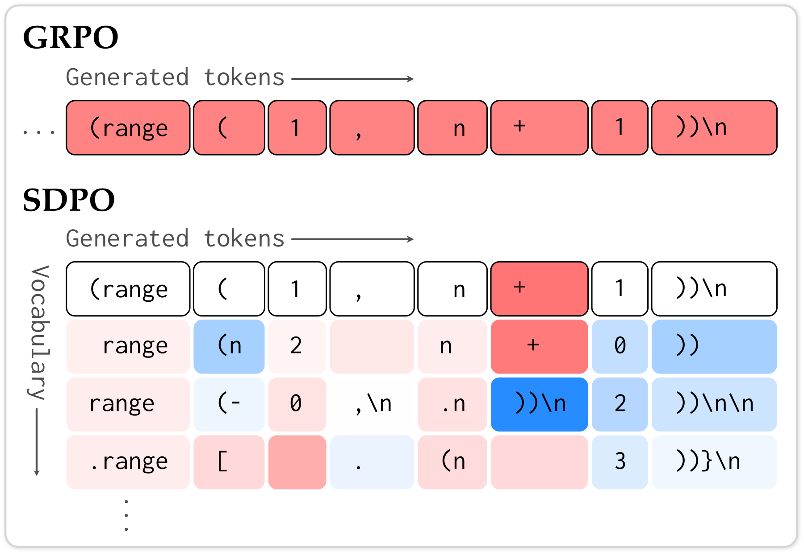

*图 9：还是这个例子。上面是 GRPO：答案错了，每个词扣一样的分（整排红色）。下面是 SDPO：只有 `+` 被扣分；每一列下方是这个位置上的其他候选词，蓝色表示老师更认可，比如 `+` 下方的 `))\n`。*

这就是论文说的"稠密的信用分配"：错误被定位到具体的词上，而且每个位置不只评价学生写下的那个词，也评价其他可能的写法。实现时，每个位置只看学生最可能写的前 K 个候选词（K 取 20 或 100），其余的词合并成一项，所以不用多存整张词表的概率，显存基本不涨。

附录图 22 是另一个例子，能看清"给出替代写法"这一点：

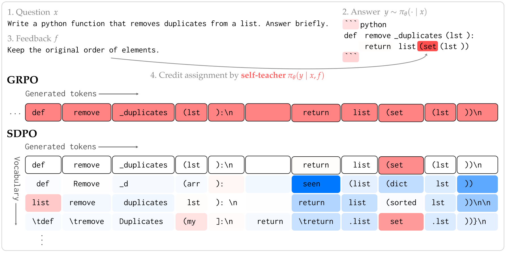

*附录图 22：题目要求去掉列表里的重复元素，学生写了 `list(set(lst))`，反馈是"保持元素原来的顺序"。老师在 `(set` 处扣分，候选词里更认可 `(dict`（Python 的 dict 会保留插入顺序，比如写成 `list(dict.fromkeys(lst))`）；在 `return` 位置，老师还更认可以 `seen` 开头的另一种写法（通常是先用一个集合记下见过的元素，再按原顺序保留）。整个答案里只有少数几个位置被明显加减分。*

**选读：损失函数和优势值。** 不看也不影响理解。记题目为 $`x`$，学生答案为 $`y`$，反馈为 $`f`$，模型为 $`\pi_\theta`$。学生在第 $`t`$ 个位置的"下一个词概率表"是 $`\pi_\theta(\cdot \mid x, y_{<t})`$，老师的是 $`\pi_\theta(\cdot \mid x, f, y_{<t})`$，两者是同一套参数，区别只在输入里有没有 $`f`$。SDPO 让两张表在每个位置都尽量接近，差距用 KL 散度衡量：

```math
\mathcal{L}_{\mathrm{SDPO}}(\theta)=\sum_{t} \mathrm{KL}\Big(\pi_\theta(\cdot \mid x, y_{<t}) \,\Vert\, \mathrm{stopgrad}\big(\pi_\theta(\cdot \mid x, f, y_{<t})\big)\Big)
```

$`\mathrm{stopgrad}`$ 表示老师那一侧不求梯度、只当参照。否则优化时老师也会被拉向学生，等于不看反馈了。

作者证明，这个目标的梯度就是一种策略梯度，其中的"加减分"（优势值）可以和 GRPO 直接对照：

```math
A^{\mathrm{GRPO}}_{i,t} = r_i - \mathrm{mean}(r_1,\dots,r_G),
\qquad
A^{\mathrm{SDPO}}_{i,t}(\hat y) = \log \frac{\pi_\theta(\hat y \mid x, f_i, y_{i,<t})}{\pi_\theta(\hat y \mid x, y_{i,<t})}
```

这里 $`r_i`$ 是第 $`i`$ 个答案的得分，$`G`$ 是每题作答次数，$`\hat y`$ 是第 $`t`$ 个位置上的某个候选词。GRPO 的分数在一个答案的所有位置上都一样；SDPO 的分数随位置和候选词变化：老师更认可就是正数，更不认可就是负数，看法一致就是 0。因为只是换了优势值的算法，SDPO 能套进现有的 GRPO 训练代码，改动不大。

这个梯度把学生刚写的答案当作固定样本，没有计入"改一个词会影响后面写什么"这一层。附录 A.1 试过把这一层也算进去，没测出可见的收益。

## 4. 和其他做法比，差别在哪

- **和 GRPO 比**：GRPO 只用分数，一个答案里所有词同奖同罚；SDPO 用反馈文字，奖罚落到具体的词上。在能给出报错的环境里，即使全组都做错，SDPO 也还有报错可学。
- **和"把报错贴回对话、让模型重写"比**（论文称为多轮修正，multi-turn）：这种做法不改参数，靠上下文记住之前的错误，历史越长越占上下文窗口。SDPO 不让模型重写，只重读原答案打分，再把学到的东西写进参数，不占上下文。
- **和"让看过反馈的自己重写一份，再用重写结果做监督微调（SFT）"比**：这是离线的自蒸馏，练的是老师写的答案，学生原来的错答案本身得不到纠正，而且每步要多生成一倍。论文实测这种做法在编程题上得 42.7%，低于 SDPO 的 48.8%，遗忘也更多（见 6.3 节）。
- **和过程奖励模型（PRM）比**：PRM 要另外训练一个模型给每一步打分。SDPO 不用另训模型。论文的说法是：只要给出丰富的反馈，每个语言模型回头看时，本身就隐含是一个过程奖励模型。
- **和同期的 OPSD、SDFT 比**：OPSD（arXiv 2601.18734）和 SDFT（arXiv 2601.19897）也让"多看了信息的自己"当老师，但老师多看的是固定数据集里的现成内容（OPSD 是标准解法，SDFT 是专家示范），训练中不和环境交互。SDPO 的老师看的是环境的实时反馈，以及同一题里自己做对的答案。SDFT 和本文有两位共同作者。

## 5. 让它稳定跑起来的几个细节

**老师用"慢半拍"的参数。** 老师和学生本是同一个模型，但如果老师总用学生最新的参数，训练到后面会发散。论文给了两种稳住的办法：一是让老师的参数做学生参数的滑动平均（EMA），每个训练步，老师只往学生那边挪 1%～5%；二是在对数概率上，把当前老师和初始老师按比例混合（论文叫信任域老师）。两种办法下，老师都会随学生缓慢变化，又不会被学生带着乱跑。论文表 4（编程题，前 90 步内）：

| 老师的设置 | 最好准确率 | 平均准确率 |
| --- | --- | --- |
| 直接用学生最新参数（训练最终发散） | 36.1% | 29.8% |
| 固定为初始模型 | 48.8% | 44.4% |
| 信任域混合 | **50.6%** | **45.6%** |
| 滑动平均（EMA） | 49.3% | 45.3% |

老师完全不更新时，SDPO 也练得不错；让老师跟着变强会再好一点。

**老师的提示词里不放学生原答案。** 如果把学生的错答案也写进老师的提示词，老师会倾向于照着学生的路子走，学生的输出变得单一、探索变少（见 6.3 节表 6）。所以学生的答案只作为"被重读的内容"接在提示词后面。

**用什么尺子量差距。** 科学问答和工具调用实验用 JS 散度，编程实验和考场现练用 KL 散度（学生在前、老师在后，即第 3 节选读里的公式）。

**开销。** 比 GRPO 只多一次老师的前向计算，这一步可以并行，比逐词生成快得多。论文图 5：没有代码运行环境时，每步训练时间多 17.1%；有代码环境、要跑测试用例时，只多 5.8%。作者也提醒，生成很短的小模型上，这部分开销的占比会更高。

## 6. 实验结果

### 6.1 实验怎么设计的

论文做了三类实验，反馈从少到多、题目从常规到极难。所有实验都在一台装有 4 张 NVIDIA GH200 GPU 的机器上完成（附录 E.1）。

**没有文字反馈：科学问答和工具调用（论文第 3 节）。** 环境只给对错。这时 SDPO 拿"同一题里做对的那份答案"当反馈，给做错的答案当参照，相当于老师说"你看这份是怎么做对的，你错在哪"。任务是 SciKnowEval 里本科难度的化学、物理、生物、材料推理题，以及 ToolAlpaca 工具调用（给定 API 说明和用户请求，写出正确的调用）。模型是 Qwen3-8B 和 Olmo3-7B-Instruct。题目分成训练集和测试集，测的是没见过的同类题，成绩是每题采 16 次的平均准确率（avg@16）。每次训练跑 5 小时。

**有文字反馈：竞赛编程题（论文第 4 节）。** 题目来自 LiveCodeBench v6（LCBv6），共 131 道 2025 年 2 月到 5 月发布的竞赛编程题，难度从简单到竞赛级。每道题的测试用例随机分出一半当"公开测试"：训练时模型提交代码，用这一半判分并生成类似 LeetCode 的报错；验证时用全部测试判分，准确率是每题采 4 次的平均值。默认模型是 Qwen3-8B。练完编程后，再测三个和编程无关的考试，看旧本领忘了多少：IFEval（按格式要求办事）、ArenaHard-v2（真实用户提问，由模型当评委，分"难题"和"创意写作"两部分）、MMLU-Pro（多学科知识）。

**考场现练：单道难题（论文第 5 节）。** 从 LCBv6 里挑出对 Qwen3-8B 来说很难的题："难题"指独立做 64 次至少对一次的概率低于 50%，"极难题"指这个概率低于 3%。再只保留三种方法里至少有一种做出过的题（论文的条件是 5 个随机种子、512 步以内），最后得到 19 道难题，其中 9 道是极难题。总预算是每道题最多 2,750 次尝试，每道题跑 5 个随机种子。

**对照方法。**

- 前两类实验：加了近年多项改进的 GRPO（下文直接叫 GRPO），以及和 SDPO 超参数一致的"在线版"GRPO（每批数据只更新一次参数）。
- 编程题上另加一个"离线自蒸馏"：让看过反馈的模型重写答案，挑出做对的，用 SFT 去学。
- 考场现练：反复抽签和多轮修正，做法见 6.4 节。

### 6.2 没有文字反馈：多数任务胜过 GRPO，回答短得多

论文表 3（训练 5 小时内测试集上出现过的最高 avg@16，%）：

| 模型 | 方法 | 化学 | 物理 | 生物 | 材料 | 工具调用 |
| --- | --- | --- | --- | --- | --- | --- |
| Qwen3-8B | 训练前 | 41.2 | 59.2 | 30.8 | 58.9 | 57.5 |
| | GRPO | 74.5 | 72.7 | **59.9** | 77.1 | 67.7 |
| | SDPO | **80.9** | **75.6** | 56.8 | **78.4** | **68.5** |
| Olmo3-7B | 训练前 | 22.8 | 37.7 | 16.2 | 36.7 | 39.3 |
| | GRPO | 56.7 | 63.3 | **55.8** | 75.0 | **65.0** |
| | SDPO | **80.0** | **66.1** | 52.8 | **79.1** | 62.1 |

- 10 组对比里 SDPO 赢 7 组，输 3 组（两个模型的生物、Olmo 的工具调用）。和超参数一致的在线版 GRPO 比，10 组全赢。
- 论文给的汇总数字是 70.2% 对 66.6%（按上表 10 组直接平均是 70.0% 对 66.8%，两者接近）。
- 学得快：多个任务上，SDPO 练 1 小时就接近 GRPO 练 5 小时的水平。最突出的是 Olmo 做化学（图 6）：SDPO 用 50 分钟就达到 GRPO 5 小时的成绩，快了约 6 倍，5 小时成绩高出 10 分以上。这里的 GRPO 按这个模型和任务单独调过参数，5 小时成绩是 67.7%（附录表 7）；表 3 里统一调参的 GRPO 只有 56.7%。

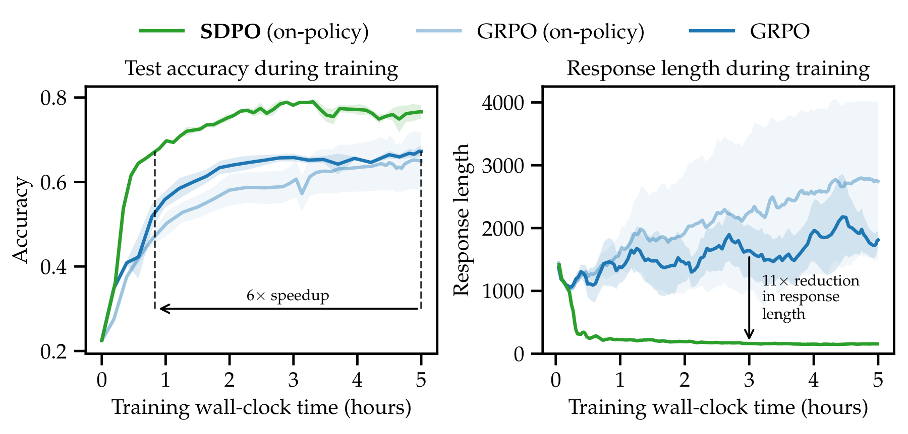

*图 6：横轴是训练耗时（小时）。左边是测试准确率，右边是回答长度（token 数）。绿色是 SDPO，深蓝是 GRPO，浅蓝是在线版 GRPO，阴影是 3 个随机种子的标准误。SDPO 很快升到 0.8 左右；GRPO 的回答越练越长，SDPO 的回答很快缩到两百个 token 左右（读图估计）。*

**这个设置有个前提。** 老师唯一的参照是"同组做对的答案"，所以同一组 8 个答案里至少要有一个做对。8 次全错时，SDPO 和 GRPO 一样，这道题这一轮学不到东西（官方代码里这类样本不计入损失）。有对有错时，GRPO 只能让错答案整体扣分，SDPO 能对照做对的答案，找出错答案具体错在哪几个词。8 次全对时，GRPO 的加减分全是 0；按 SDPO 的模板（官方代码也是这样做的），老师仍会参照一份做对的答案重读每个答案，所以还有信号。

**回答更短。** SDPO 的回答平均只有 GRPO 的约三分之一（附录表 8，两者都是在线训练：Qwen3-8B 平均 256 对 821 个 token，Olmo 平均 344 对 1,095 个 token），Olmo 做化学时短了约 11 倍，准确率还更高。作者翻看 GRPO 的长回答，发现很多是空转：反复出现 "Hmm""Wait"，原样重复前面的计算。论文图 7 的例子是同一道化学题（估算某分子在 pH 7.4 下的 logD，四选一），两边都是 Qwen3-8B 训练 50 步后的回答：GRPO 写了 5,549 个 token，有 25 个 "Wait"，同一个算式 $`10^{1.85}\approx 69.3`$ 出现 4 次，还写出 "Wait I'm going in circles"（我在绕圈子），最后选错；SDPO 写了 764 个 token，选对了。作者推测这和逐词打分有关：SDPO 给每个词单独打分，GRPO 只按整段对错奖罚。

### 6.3 有文字反馈：竞赛编程题上明显好于 GRPO

这是论文的主战场：SDPO 比 GRPO 高 7.6 分，模型越大优势越明显。

**主结果（图 1）。** 训练前 27.9%。GRPO 最终 41.2%，SDPO 48.8%，而且 SDPO 只用约四分之一的生成量就追平了 GRPO 的最终成绩。论文还拿公开排行榜对比：同一批题上，Claude Sonnet 4 是 40.5%，Claude Opus 4 是 39.7%（这个对比的口径见第 8 节）。另外几种强化学习方法（只在高熵 token 上训练的 GRPO 变体、GSPO、CISPO）在 37.8%～41.2% 之间，和 GRPO 差不多（附录表 9）。按 LCB 自带的难度分级，提升主要在中等题和难题。看前 80 步训练里的平均准确率（GRPO 对 SDPO）：简单题 90.1% 对 91.7%，中等题 37.8% 对 46.6%，难题 11.6% 对 18.9%（附录图 15）。

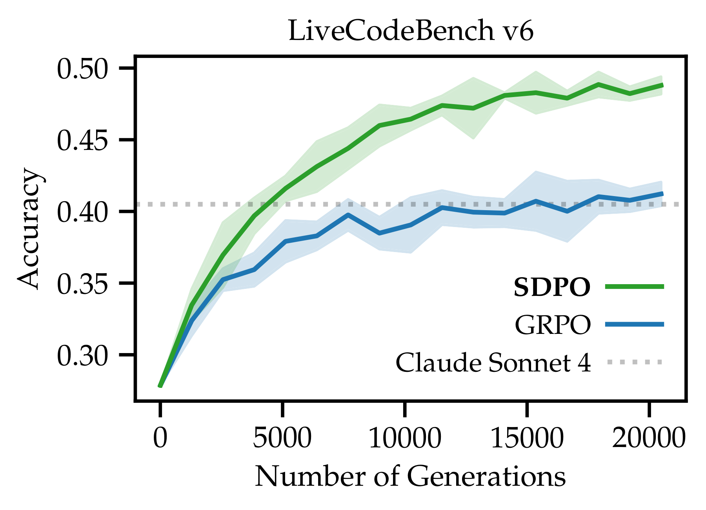

*图 1：横轴是累计生成的答案数，纵轴是准确率。绿色是 SDPO，蓝色是 GRPO，阴影是 3 次重复实验的标准差，灰色点线是 Claude Sonnet 4 在排行榜上的成绩。*

**模型越强，优势越大（图 8、附录图 17）。** 用 Qwen3 的 0.6B、1.7B、4B、8B 四个尺寸各练 80 步：0.6B 上 SDPO 只比 GRPO 高约 1 分，8B 上高 7.6 分。在更早的 Qwen2.5-Instruct 系列上，7B 时 SDPO 更好，3B 时两者差不多（论文正文这里写成了 "Qwen2.5-8B"，应是笔误，见第 8 节），1.5B 时 SDPO 明显不如 GRPO。作者的解释是：老师要靠读反馈来找错，这依赖模型的上下文学习能力，而这种能力随模型变大才变强。

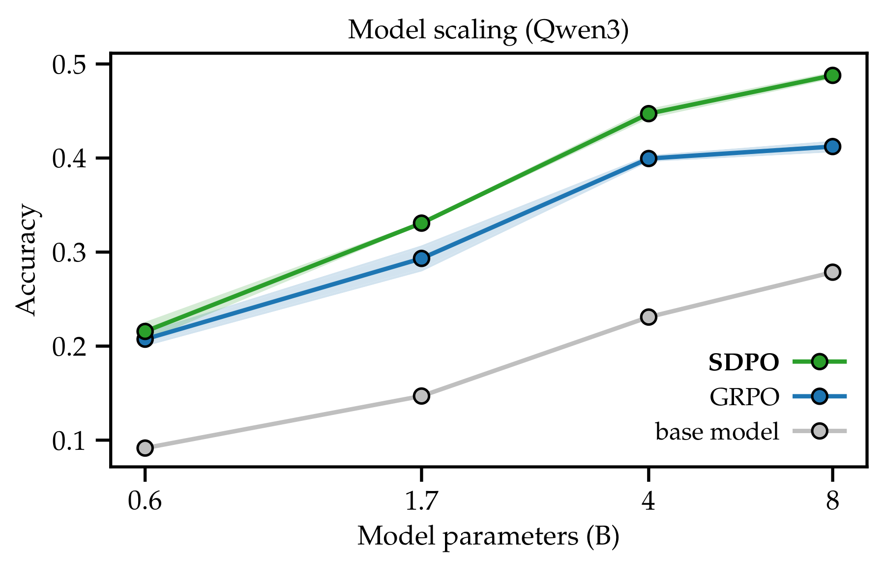

*图 8：Qwen3 四个尺寸第 80 步的验证准确率。绿色是 SDPO，蓝色是 GRPO，灰线是训练前。*

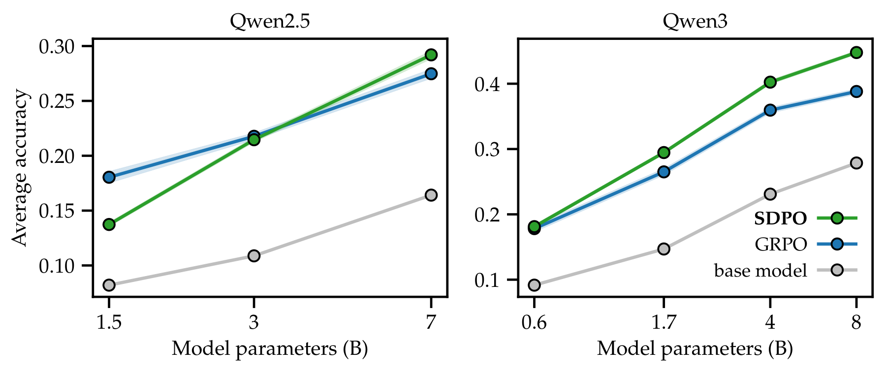

*附录图 17：左边是 Qwen2.5-Instruct，右边是 Qwen3。1.5B 时绿线（SDPO）在蓝线（GRPO）下方。这张图的纵轴是平均验证准确率（Qwen2.5 算到第 65 步，Qwen3 算到第 80 步），和图 8 的第 80 步准确率口径不同。*

**收益来自哪里：反馈本身，加上逐词打分（图 10 左）。** 作者比较了三个版本：

- 每个位置评价前 100 个候选词（完整版）；
- 每个位置只评价最可能的那一个词；
- 先算出每个词的分，再把整段答案平均成一个分数，像 GRPO 那样整段同奖同罚。

结果是完整版 > 只评价一个词 > 整段一个分 > GRPO。最后这组对比说明，**即使不逐词打分，只要用上反馈，也比 GRPO 好**；逐词打分在此基础上再加分。

**老师也在变强（图 10 右）。** 作者让带反馈的老师直接生成答案，测它的准确率：开始约 42%，训练中升到约 50%。学生从约 29% 起步，第 80 步约 50%，超过了初始老师（读图估计）。也就是说，学生的上限不会被初始老师卡住，师生一起往上走。

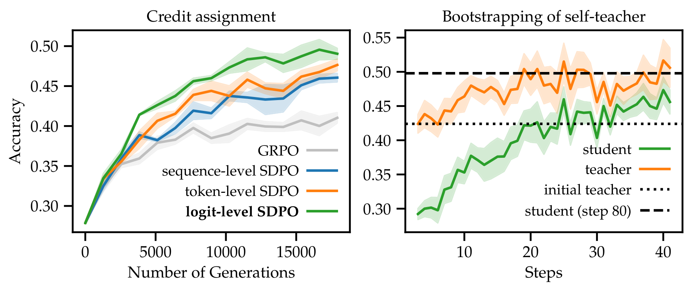

*图 10：左边是三种打分粒度和 GRPO 的对比，横轴是累计生成的答案数；绿色是完整版，橙色只评价一个词，蓝色是整段一个分，灰色是 GRPO。右边是在当前训练批次上测的老师（橙）和学生（绿）的准确率，横轴是训练步数，点线是初始老师，虚线是学生第 80 步的成绩。*

**旧本领忘得少一些。** 论文表 5（%）：

| 方法 | 编程（训练任务） | IFEval | ArenaHard 难题 | ArenaHard 创意写作 | MMLU-Pro | 四项旧能力平均 |
| --- | --- | --- | --- | --- | --- | --- |
| 训练前 | 27.9 | 83.9 | 14.0 | 13.7 | 62.5 | 43.5 |
| 离线自蒸馏（SFT） | 42.7 | 83.7 | 11.2 | 8.9 | 61.9 | 41.4 |
| GRPO | 41.2 | 82.2 | 12.0 | 10.8 | 62.3 | 41.8 |
| **SDPO** | **48.8** | 83.2 | 12.3 | 11.1 | 62.9 | 42.4 |

论文第 4.4 节的标题是"避免灾难性遗忘"。从数字看，三种方法的旧能力都有小幅下降，SDPO 降得最少（平均降 1.1 分，GRPO 降 1.7 分，SFT 降 2.1 分），同时编程分数最高。创意写作这一项三种方法都降得比较明显。

**GRPO 和 SDPO 能不能混着用（图 11）。** 作者把两种加减分按比例相加（GRPO 的权重取 0.9）。在最小的 Qwen3-0.6B 上，混合版比纯 SDPO 高约 2 分；在 8B 上反而比纯 SDPO 低约 1 分（读图估计）。作者的解释是：小模型当老师不太靠谱，加入按对错打分的 GRPO 信号能稳住训练；模型够强时，只看对错的信号反而会拖后腿。

**哪种反馈最有用。** 作者比较了给老师看不同内容的效果，论文表 6（训练 60 步）：

| 老师看到的内容 | 训练前老师自己作答的准确率 | 老师作答后得到和学生相同报错的比例 | 学生训练后准确率 |
| --- | --- | --- | --- |
| 只有报错 | 32.5% | 13.7% | 39.9% |
| 只有同组做对的答案 | 42.4% | 12.1% | 42.6% |
| 两种都用（默认：有做对的答案就给答案，没有才给报错） | 42.5% | 10.1% | **48.3%** |
| 两种都用，再加学生原答案 | 39.3% | 30.0% | 44.5% |

报错和做对的答案互相补充，一起用最好。把学生原答案也放进老师的提示词，老师有 30% 的情况得到和学生一样的报错，说明它在照着学生的路子走；学生训练后输出的多样性（熵）从 0.38 降到 0.23，最终效果也变差。作者还说，模板换几种措辞，效果差别不大。

### 6.4 考场现练：单道难题上比反复抽签更早做出答案

**问题。** 换一个场景：只有一道很难的编程题，目标是尽快做出一份通过的代码。论文用 discovery@k 衡量，意思是"尝试 k 次以内至少做对一次的概率"。题目怎么挑、预算多少，见 6.1 节。

常见做法有两种：

- **best-of-k（反复抽签）**：模型不变，独立做 k 次，看有没有一次对的。
- **多轮修正（multi-turn）**：把之前每次的报错拼进提示词，让模型接着改。模型参数不变，只是上下文越来越长。论文用的版本只拼报错、不带之前的答案，这比连答案一起拼效果好得多（附录图 19）；提示词超过 32k token 后，丢掉最早的报错。

按对错打分的强化学习在这里帮不上忙：在做对第一次之前，每次都是 0 分，没有可学的信号，效果等同于反复抽签。SDPO 每次失败都有报错可学，所以可以在做对之前就开始改进。

**做法（图 12）。** 每一轮让模型对这道题作答 16 次，拿到报错，用 SDPO 更新一次参数，再进入下一轮。和多轮修正的区别是：多轮修正把历史塞进上下文，SDPO 把历史"压"进参数，上下文不会越来越长。

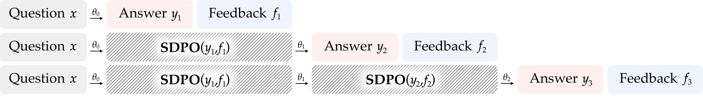

*图 12：同一道题 $`x`$，模型用参数 $`\theta_0`$ 作答得到 $`y_1`$ 和反馈 $`f_1`$；SDPO 据此把参数更新为 $`\theta_1`$，再作答得到 $`y_2`$、$`f_2`$，依此类推。*

**结果（图 13）。**

- **9 道极难题**：用完预算时，SDPO 做出的概率是 53.2%，反复抽签 41.5%，多轮修正 35.6%。要达到 22% 的成功概率，SDPO 约需 500 次尝试，另两种约需 1,500 次（读图估计），这就是摘要里"少用 3 倍尝试"的来源。
- **19 道难题**：用完预算时 SDPO 是 78%，反复抽签 72.3%，多轮修正 68.4%。要达到 67% 的成功概率，SDPO 比另两种少用约 2.4 倍尝试。
- **第 3 题只有 SDPO 做出来了。** 另两种方法用完 2,750 次都没做出。SDPO 最早在第 321 次尝试时做出，也就是第 20 轮更新之后；按 2,750 次封顶算，它在这道题上的平均首次成功次数是 1,987 次（附录表 10）。另两种方法能做出的题，SDPO 也都做出来了。
- **一开始老师也不会做。** 让看过一次报错的模型直接作答，19 道题里有 15 道准确率是 0，16 道低于 1%。只给一轮反馈不够解题，但老师逐词指出的问题足够让 SDPO 一轮轮改进，最后做出来。
- 多轮修正平均在第 837 次（难题）和第 1,007 次（极难题）尝试时撑满上下文窗口，之后只能丢掉最早的报错，这可能是它后期涨得慢的原因。

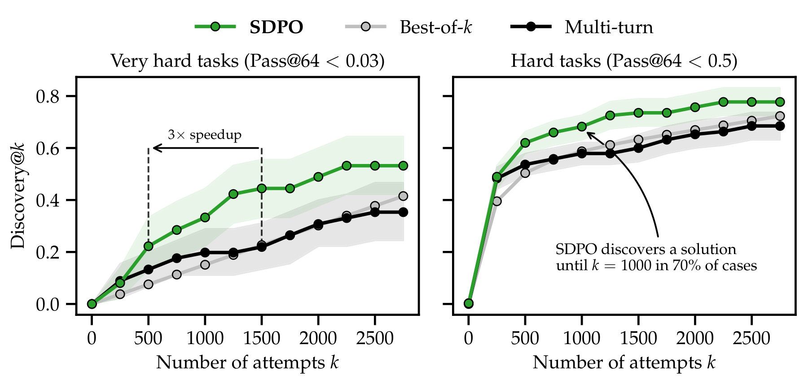

*图 13：左边是 9 道极难题，右边是 19 道难题。横轴是尝试次数，纵轴是至少做对一次的概率。绿色 SDPO，浅灰反复抽签，黑色多轮修正；阴影是 90% 置信区间。左图的箭头标出"3 倍提速"的位置。*

## 7. 作者自己承认的局限

- **依赖模型自己的理解力。** 老师能不能找对错，取决于模型的上下文学习能力。所以 SDPO 主要适合比较强的基础模型，在弱模型上可能不如 GRPO（Qwen2.5-1.5B 就是例子）。最大只试到 8B，作者也希望在更强的模型上验证。
- **依赖反馈质量。** 如果环境给的反馈没有信息量，甚至误导，模型就可能学不到东西。
- **有少量额外计算。** 每步多一次老师的前向计算。通常可以忽略，但在生成很短的小模型上占比会更高。
- **作者提出的后续方向。** 放到步骤多、能看到中间状态的智能体（agent）任务里；在更大规模的多任务训练和前沿模型上测试；扩展到没有标准答案、只有文字评语的开放式任务（比如对齐）；系统研究老师模板等因素怎样影响模型的推理风格。

## 8. 读的时候值得留意的地方

以下是我读原文时注意到、论文没有重点讨论的点，供参考。

### 证据有多强

- **编程实验是在练过的题上考。** LCBv6 的 131 道题既用来训练也用来验证，分开的只是测试用例：训练时用一半用例判分、生成报错，验证时用全部用例（官方 `data/split_tests.py` 把完整数据存成验证集，每题随机保留一半用例存成训练集）。所以 48.8% 衡量的是"练过的题能不能通过全部测试，包括训练时没见过的用例"，说明不了模型在没见过的新题上能做对多少。论文说这是编程竞赛和刷题平台的常见设定。SDPO 和 GRPO 用同一设定，两者之间的比较是公平的；但拿它和 Claude Sonnet 4 的 40.5% 比时要注意，排行榜上的模型是直接作答，没有拿这批题的测试反馈反复训练过。
- **"3 倍"是在一个特定档位上量的。** 摘要的"少用 3 倍尝试"来自 9 道极难题、成功概率 22% 这一档。换成"每道题首次做对平均要尝试多少次"（附录表 10，没做出来的按 2,750 次计），SDPO 比反复抽签和多轮修正都快约 1.2～1.3 倍。按表 10 的提速倍数，19 道题里 SDPO 比反复抽签快的有 10 道，持平 2 道，更慢 7 道；比多轮修正更慢的有 8 道；单题最多快 13.6 倍。按上限计次可能压低了没做出来的题上的差距，所以 3 倍这个数本身没有错，只是换个口径，倍数会小很多。另外，题目只有 9 道和 19 道，而且是按"至少一种方法做出来过"挑出来的，这些成功率只对这批题成立。
- **编程实验里两边的参数更新次数不同。** 按论文表 12（SDPO 的超参数）和官方的 GRPO 编程实验脚本（论文表 13 只列了论文第 3 节的 GRPO 设置），编程实验每生成一批答案（32 道题，每题 8 次），SDPO 更新 32 次参数，GRPO 更新 4 次，学习率相同。图 1 的横轴是生成数量，所以"少用约 4 倍生成量"里可能有一部分来自更新次数的差别。附录图 16 试了几种批大小，整体上 GRPO 的曲线仍在 SDPO 下方，但图注没写这些运行每批更新几次。反过来，论文第 3 节的科学问答和工具调用实验里，SDPO 每批只更新 1 次，GRPO 更新 4 次，SDPO 仍然多数占优。
- **表 3 是"挑最好成绩"的口径。** 表 3 报的是训练 5 小时内测试集上出现过的最高分，超参数也是按同一个 5 小时成绩挑的（见表 3 的说明）。SDPO 和 GRPO 同样处理，比较大体公平，但绝对数字偏乐观。表 3 也没有给误差范围，几组 1 分左右的差距（比如 Qwen3-8B 的工具调用 68.5 对 67.7、材料 78.4 对 77.1）不一定超出随机波动。

### 适用范围

- **模型、任务和设置都有限。** 所有实验都关闭了 Qwen3 的思考模式，回答上限 8,192 个 token，模型最大 8B，带文字反馈的实验只有 LCBv6 这一个编程数据集。"回答更短"等结论在长思考模式和更大的模型上是否成立，论文没有测。

### 对照公开代码

- **论文和代码有一处出入，复现时注意。** 论文表 2 说，学生答对时，把这份答案本身当作"正确解答"给老师看。官方代码的默认设置（`dont_reprompt_on_self_success=True`）是换用同组另一份做对的答案；如果它是组里唯一做对的，这条样本不参与训练。

### 稿件里的小问题（不影响主要结论）

- **"Qwen2.5-8B"应是笔误。** 论文第 4.1 节说 SDPO 在 Qwen2.5-7B 上胜过 GRPO、在 "Qwen2.5-8B" 上和 GRPO 相近。Qwen2.5 没有 8B 版本，附录图 17 里和 GRPO 相近的是 3B。
- **v1 和 v2 的数字不同。** v2 里论文第 3 节的结果改动较大：引言里的汇总从 68.8% 对 64.1% 变成 70.2% 对 66.6%，Olmo 做化学从"30 分钟追平、快 10 倍、领先 20 分以上"变成"50 分钟追平、快 6 倍、领先 10 分以上"，回答缩短从"最多 7 倍"变成"最多 11 倍"，训练前的分数也变了。v2 还改正了 v1 梯度公式里的一处错误（v2 致谢里有说明）。引用网上的数字时，留意是哪个版本。

## 9. 总结

SDPO 的思路很朴素：**模型做错题后，把错误信息给它自己看，让它回头把刚写的答案逐词批改一遍，再朝批改意见调整。** 它同时拿到了几样东西：练的是模型自己写的答案，每个词都有反馈，不需要更强的外部老师，也不需要另训打分模型；算法上只是把 GRPO 的加减分换掉，能直接套进现有训练代码。它和同期的 OPSD、SDFT 是同一类思路，都让"多看了一些信息的自己"当老师，区别在于 SDPO 的老师多看的是环境的实时反馈和同组做对的答案。

论文的结果是：在能给出报错的编程题上，它明显好于 GRPO，模型越大优势越明显；在只给对错的任务上，它借用同组做对的答案当参照，多数任务上也更好，而且回答短得多；在单道极难题上边做边练，它整体上比反复抽签和多轮修正更早做出答案，但逐题看并非每道都更快。代价是每步多一次老师的前向计算，每步训练时间多 5.8%～17.1%。前提是模型本身要够强、反馈要有信息量，弱模型上它可能不如 GRPO。

---

## 原文位置对照

| 本文内容 | 论文位置 |
| --- | --- |
| 问题和动机、RLRF 的提出 | 第 1 节，图 1、图 2、图 3，表 1 |
| SDPO 的做法、老师的提示词模板 | 第 2 节，式 (1)(2)，图 4，算法 1，表 2 |
| 和 GRPO 的对照、逐词打分 | 第 2.1、4.2 节，图 9，附录 F.4 图 22 |
| 梯度的另一种算法 | 附录 A.1、B.1 |
| 和其他做法、同期工作的比较 | 第 4.4、5、6 节 |
| 开销、只看前 K 个候选词 | 第 2.2 节，图 5，附录 A.3 |
| 老师参数的稳定办法 | 第 2.3、4.3 节，表 4，附录 A.2、B.2 |
| 实验设置、超参数、硬件 | 第 3.1、4、5.1 节，附录 E，表 12、表 13 |
| 没有文字反馈的实验 | 第 3.2、3.3 节，表 3，图 6、图 7，附录 D.1 表 7、表 8 |
| 编程题主结果、按难度拆分、其他对照方法 | 第 4 节，图 1，附录图 15、表 9 |
| 模型规模 | 第 4.1 节，图 8，附录图 17 |
| 打分粒度、老师变强 | 第 4.2、4.3 节，图 10 |
| 遗忘、离线自蒸馏 | 第 4.4 节，表 5 |
| GRPO 与 SDPO 混合 | 第 4.5 节，式 (3)，图 11 |
| 哪种反馈最有用 | 第 4.6 节，表 6 |
| 考场现练 | 第 5 节，图 12、图 13，附录 D.3 表 10、表 11、图 19 |
| 批大小对比 | 附录 D.2，图 16 |
| 局限和后续方向 | 第 7 节 |
