# Reinforcement Learning via Self-Distillation

[中文](./SDPO-Reinforcement-Learning-via-Self-Distillation.md) | English

- **Source**: [Reinforcement Learning via Self-Distillation](https://arxiv.org/abs/2601.20802v2)
- **Paper**: [arXiv:2601.20802](https://arxiv.org/abs/2601.20802)
- **Official resources**: [lasgroup/SDPO](https://github.com/lasgroup/SDPO)
- **Published**: 2026-01-28
- **Scope**: A plain-language explainer based on arXiv v2 (revised 2026-02-16), not a full translation. The authors are Jonas Hübotter and colleagues, 11 in all, from ETH Zurich, the Max Planck Institute for Intelligent Systems, MIT and Stanford University. The code is built on the verl training framework.

## In One Sentence

After a model finishes a problem, the environment often tells it much more than "right/wrong", such as the error message on a coding problem. This paper proposes SDPO (Self-Distillation Policy Optimization): give that feedback to the same model and let it act as the "teacher", rereading the response it just wrote token by token and pointing out "which token is wrong and what should replace it", then move the model toward the teacher's view. The whole process needs no stronger external model, and no separately trained reward model either.

Results: training Qwen3-8B on LiveCodeBench v6 coding problems, SDPO reaches 48.8% accuracy, 7.6 percentage points (shortened to "points" below) above GRPO (41.2%), the mainstream reinforcement learning method, and it reaches GRPO's final level with only about a quarter of the generations. On science Q&A and tool-use tasks that give only right or wrong, with no text feedback, SDPO beats GRPO in 7 of 10 comparisons, and its responses are only about a third as long as GRPO's. When it trains while working on a single very hard coding problem, it also solves the problem earlier overall than repeated sampling. Its weak spot: when the model is too weak, it ends up worse than GRPO.

---

## 1. Key Terms

| Term | In plain words |
| --- | --- |
| Reinforcement learning (RL) | Let the model answer by itself and adjust it by the score: ways of writing that score high get written more often later, and those that score low get written less often |
| RLVR | Reinforcement learning with verifiable rewards. A program judges right or wrong automatically and the result is used as the reward (the score given to a response), usually 1 for right and 0 for wrong |
| GRPO | A reinforcement learning algorithm widely used on large models. The model answers the same problem several times; responses above the group's average score gain points as a whole, and those below lose points as a whole |
| token | The basic unit a model reads and writes; think of it as a word or part of a word. "Per-token" below means one token at a time |
| Credit assignment | When a response succeeds or fails, which of its tokens the success or failure should be credited to |
| Advantage | In RL, the "plus or minus points" given to each token: a positive value makes that way of writing appear more often later, and a negative one makes it appear less often |
| Distillation | Make the "next-token distribution" that the student model gives at each position move close to the one the teacher model gives |
| On-policy and off-policy | If the responses used for training were written by the model itself with its current parameters, that is on-policy; if they were written by someone else, or before the parameters were updated, that is off-policy |
| SFT (supervised fine-tuning) | Have the model imitate ready-made responses word for word |
| In-context learning | Without changing any parameters, learn on the spot from just the information given in the prompt (examples, error messages) and use it right away |
| KL divergence | A number that measures how far apart two probability distributions are; the smaller it is, the closer they are. The JS divergence below is a symmetric version of it |
| RLRF | Reinforcement learning with rich feedback, a term the paper proposes. Besides a score, the environment returns error messages, failed tests or a judge model's comments, and this text is used for training too |
| Self-teacher | The model itself: when its prompt also shows it the feedback, it plays the teacher and goes back to judge the response it just wrote |

## 2. What Problem It Tackles

### The mainstream approach today: scoring only right or wrong

To make large models stronger on tasks like math and coding, where "a program can judge right or wrong automatically", the common method today is RLVR (Reinforcement Learning with Verifiable Rewards): the model writes a response, a program scores it, 1 point if right and 0 points if wrong.

The usual algorithm is GRPO: the model answers the same problem 8 times; responses scoring above the average of those 8 gain points as a whole, and those below the average lose points as a whole.

This has two flaws:

1. **It only knows the response is wrong, not where it went wrong.** If a whole block of code fails just because it has one extra `+ 1`, GRPO takes the same number of points off every token in that code. The paper calls this the "credit assignment" problem: which tokens a failure should be blamed on.
2. **When every attempt is wrong, nothing is learned.** When all 8 attempts score 0, each one equals the average, so none of them gains or loses points, and the problem is effectively wasted. The harder the problem, the more often this happens.

### Another route: per-token guidance from a strong teacher

"Distillation" has a stronger model tell the student, at each position of the response, "here is what I would write", which is a very fine-grained signal. The problem is that when you want to push a model beyond all existing models, there is often no such teacher to be found.

### Where SDPO wants to sit

Table 1 of the paper puts several kinds of methods side by side:

| Method | Whose responses it trains on | How fine the feedback is | Where the feedback comes from |
| --- | --- | --- | --- |
| SFT / distillation | Written by someone else (off-policy) | Fine | Needs a stronger teacher |
| On-policy distillation | Written by the model itself | Fine | Needs a stronger teacher |
| RLVR (e.g. GRPO) | Written by the model itself | Coarse, only right or wrong | The environment |
| SDPO (this paper) | Written by the model itself | Fine | The environment |

What the authors want is the last row: like reinforcement learning, train on the model's own responses and rely only on the environment, and like distillation, get feedback on every token.

The question the paper sets out to answer is: **without a stronger external teacher, how can the rich feedback from the environment be turned into effective credit assignment?**

## 3. Core Idea: The Environment Actually Says More, and the Model Can Understand It on Its Own

### The environment gives more than right or wrong

Many environments that score automatically already return a piece of text explaining the result. For example, after a coding solution is submitted, the judging system returns a LeetCode-style result (Figure 3 of the paper):

```text
Runtime Error
ZeroDivisionError: division by zero
Line 73 in separateSquares (Solution.py)

Last Executed Input
[[26,30,2],[11,23,1]]
```

RLVR takes only the "0 points" from this and throws all the other information away. The authors call the setting that "keeps this text for training" RLRF (Reinforcement Learning with Rich Feedback). The feedback can be an error message or failed test cases, or comments written by another model acting as a judge.

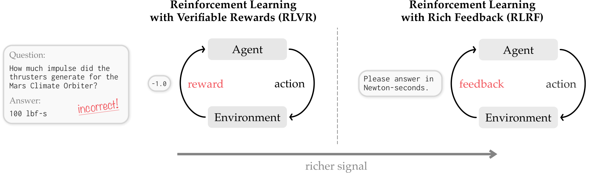

*Figure 2: The question asks "how much impulse did the Mars Climate Orbiter's thrusters produce", and the model answers "100 lbf-s" (pound-force seconds). RLVR receives only "-1.0"; RLRF receives "please answer in newton-seconds". The example alludes to the loss of the Mars Climate Orbiter in 1999, caused by mixing up imperial and metric units.*

### One model, two roles

Large models already have a ready-made skill: show them the error message, and they can often see where they went wrong. The authors use this by having the same model play two roles:

- **Student**: sees only the problem and answers it on its own.
- **Teacher**: sees the problem plus the feedback from this attempt, and goes back to judge the response the student just wrote.

Because the teacher also sees the feedback, it usually judges more accurately than the student. In the paper's words: "We can use the same policy in two different roles: As the student for the initial attempt and as the teacher to determine the value of actions in hindsight."

### How it works, step by step

Take the small example in Figure 4 of the paper. The problem is "write a Python function that returns all numbers from 1 to n, answer briefly".

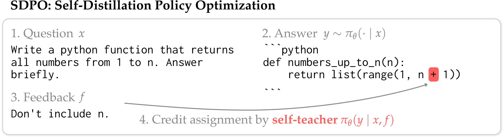

*Figure 4: The student (Qwen3-8B) wrote `list(range(1, n + 1))`, and the feedback says "do not include n". Rereading this code with the feedback in mind, the teacher clearly disagrees only at the `+` position (red).*

1. **The student answers.** The model answers each problem independently 8 times (the setting in the paper's experiments).
2. **The environment gives feedback.** It scores each response and returns the error message or the failed tests.
3. **Build a new prompt for the teacher.** In order, it contains: the original problem; if any of the 8 responses in the same group is correct, one correct response, under the heading "Correct solution"; if none is correct, the error message from this attempt, under the heading "The following is feedback from your unsuccessful earlier attempt"; and last, the sentence "Correctly solve the original question." The correct response also comes from the student itself, so no outside expert is needed.
4. **The teacher does not rewrite, it only rereads.** Append the student's original response, unchanged, after this prompt and run the model forward once. This tells us what the model, having seen the feedback, thinks the next token should be at each position of the student's response. This step only computes probabilities and generates no new response, so it is cheap.
5. **Compare per-token and adjust the student.** At each position, compare the teacher's and the student's "next-token distributions". Tokens the teacher favors more than the student gain points, tokens the teacher favors less lose points, and where the two agree, little changes. Gradients flow back only through the student side, and the teacher serves only as a reference (Section 5 covers how the teacher itself is updated).

In Figure 4, the position where the student wrote `+` loses points. Figure 9 below also shows that at this position the teacher prefers to close right away with `))`, that is, to change the code to `list(range(1, n))`. The teacher has almost no objection to the other tokens the student wrote.

The whole method is called SDPO (Self-Distillation Policy Optimization). "Distillation" means the student moves toward the teacher's distribution; "self" means the teacher is the model itself.

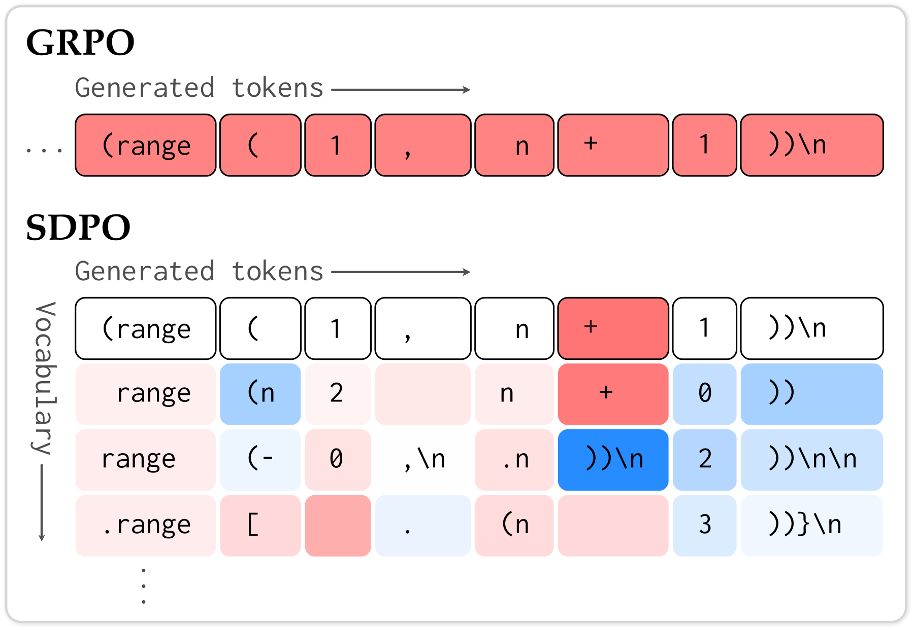

*Figure 9: The same example. The top is GRPO: the response is wrong, so every token loses the same points (the whole row is red). The bottom is SDPO: only `+` loses points; below each column are the other candidate tokens at that position, and blue means the teacher favors that token more, such as `))\n` below `+`.*

This is what the paper calls "dense credit assignment": the error is pinned to specific tokens, and at each position the method evaluates not only the token the student wrote but also other possible ways of writing it. In the implementation, each position looks only at the top K candidate tokens the student is most likely to write (K is 20 or 100), and all other tokens are merged into one entry, so there is no need to store extra probabilities over the whole vocabulary, and GPU memory barely grows.

Appendix Figure 22 is another example, which shows clearly how the teacher "offers an alternative way of writing":

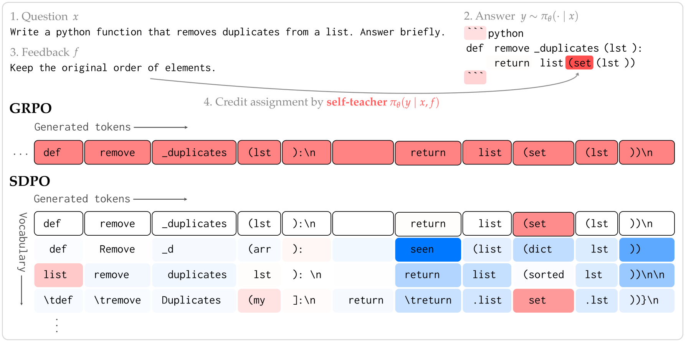

*Appendix Figure 22: The problem asks to remove duplicate elements from a list. The student wrote `list(set(lst))`, and the feedback is "keep the elements in their original order". The teacher takes points off at `(set`, and among the candidate tokens it favors `(dict` (a Python dict keeps insertion order, as in `list(dict.fromkeys(lst))`); at the `return` position, the teacher also favors another way of writing that starts with `seen` (usually, first record the elements already seen in a set, then keep the elements in their original order). Only a few positions in the whole response get clearly noticeable plus or minus points.*

**Optional: the loss function and the advantage.** You can skip this without losing the thread. Write the problem as $`x`$, the student's response as $`y`$, the feedback as $`f`$ and the model as $`\pi_\theta`$. The student's "next-token distribution" at position $`t`$ is $`\pi_\theta(\cdot \mid x, y_{<t})`$, and the teacher's is $`\pi_\theta(\cdot \mid x, f, y_{<t})`$. Both use the same parameters; the only difference is whether $`f`$ is in the input. SDPO makes the two distributions as close as possible at every position, and measures the gap with the KL divergence:

```math
\mathcal{L}_{\mathrm{SDPO}}(\theta)=\sum_{t} \mathrm{KL}\Big(\pi_\theta(\cdot \mid x, y_{< t}) \,\Vert\, \mathrm{stopgrad}\big(\pi_\theta(\cdot \mid x, f, y_{< t})\big)\Big)
```

$`\mathrm{stopgrad}`$ means no gradient is computed on the teacher side, which serves only as a reference. Otherwise, optimization would also pull the teacher toward the student, which amounts to ignoring the feedback.

The authors prove that the gradient of this objective is a kind of policy gradient, and its "plus or minus points" (the advantage) can be compared directly with GRPO's:

```math
A^{\mathrm{GRPO}}_{i,t} = r_i - \mathrm{mean}(r_1,\dots,r_G),
\qquad
A^{\mathrm{SDPO}}_{i,t}(\hat y) = \log \frac{\pi_\theta(\hat y \mid x, f_i, y_{i,< t})}{\pi_\theta(\hat y \mid x, y_{i,< t})}
```

Here $`r_i`$ is the score of the $`i`$-th response, $`G`$ is the number of attempts per problem, and $`\hat y`$ is a candidate token at position $`t`$. GRPO's score is the same at every position of a response; SDPO's score varies with the position and the candidate token: positive when the teacher favors the token more, negative when it favors it less, and 0 when they agree. Because only the way the advantage is computed changes, SDPO fits into existing GRPO training code with small changes.

This gradient treats the response the student just wrote as a fixed sample, and leaves out the effect that "changing one token changes what gets written after it". Appendix A.1 tried including this effect too and measured no visible gain.

## 4. How It Differs from Other Approaches

- **Compared with GRPO**: GRPO uses only the score, so all tokens in a response are rewarded or penalized alike; SDPO uses the feedback text, so rewards and penalties land on specific tokens. In environments that return error messages, even when the whole group is wrong, SDPO still has the error messages to learn from.
- **Compared with "pasting the error message back into the conversation and having the model rewrite"** (multi-turn revision, which the paper calls multi-turn): this approach does not change parameters. It relies on the context to remember earlier mistakes, and the longer the history, the more of the context window it takes up. SDPO does not have the model rewrite; it only rereads the original response to score it, then writes what it learned into the parameters, so it takes up no context.
- **Compared with "having the model, after seeing the feedback, write a new response, then doing supervised fine-tuning (SFT) on the rewrites"**: this is off-policy self-distillation. It trains on responses the teacher wrote, so the student's original wrong responses are never corrected themselves, and each step needs twice as much generation. In the paper's tests, this approach scores 42.7% on coding problems, below SDPO's 48.8%, and it also forgets more (see Section 6.3).
- **Compared with process reward models (PRMs)**: a PRM requires training a separate model to score each step. SDPO needs no separately trained model. As the paper puts it, given rich feedback, every language model is implicitly a process reward model when it looks back.
- **Compared with the concurrent OPSD and SDFT**: OPSD (arXiv 2601.18734) and SDFT (arXiv 2601.19897) also make "the model itself, shown extra information" the teacher, but what their teacher sees extra is ready-made content from a fixed dataset (a reference solution for OPSD, an expert demonstration for SDFT), and they do not interact with the environment during training. SDPO's teacher sees live feedback from the environment, plus the model's own correct responses to the same problem. SDFT shares two authors with this paper.

## 5. A Few Details That Make It Run Stably

**The teacher uses parameters that lag "half a beat" behind.** The teacher and the student are the same model, but if the teacher always uses the student's latest parameters, training diverges later on. The paper gives two ways to keep it steady. One makes the teacher's parameters an exponential moving average (EMA) of the student's, so at each training step the teacher moves only 1% to 5% toward the student; the other mixes the current teacher and the initial teacher in a set proportion on log-probabilities (the paper calls this a trust-region teacher). With either method, the teacher changes slowly along with the student without being dragged around by it. Table 4 of the paper (coding problems, within the first 90 steps):

| Teacher setting | Best accuracy | Average accuracy |
| --- | --- | --- |
| Use the student's latest parameters directly (training eventually diverges) | 36.1% | 29.8% |
| Fixed to the initial model | 48.8% | 44.4% |
| Trust-region mixing | **50.6%** | **45.6%** |
| Moving average (EMA) | 49.3% | 45.3% |

Even when the teacher is never updated, SDPO trains well; letting the teacher get stronger along the way is a bit better still.

**The teacher's prompt does not include the student's original response.** If the student's wrong response is also put into the teacher's prompt, the teacher tends to follow the student's approach, and the student's outputs become uniform, with less exploration (see Table 6 in Section 6.3). So the student's response is appended after the prompt only as "the content to be reread".

**Which ruler measures the gap.** The science Q&A and tool-use experiments use the JS divergence; the coding experiments and test-time training use the KL divergence (student first, teacher second, as in the formula in the optional part of Section 3).

**Cost.** Compared with GRPO, the only extra work is one forward pass of the teacher, which can run in parallel and is much faster than generating token by token. Figure 5 of the paper: without a code execution environment, each training step takes 17.1% longer; with a code environment that has to run test cases, only 5.8% longer. The authors also point out that on small models with very short generations, this overhead takes a larger share.

## 6. Experimental Results

### 6.1 How the experiments were set up

The paper runs three kinds of experiments, going from little feedback to more, and from ordinary problems to extremely hard ones. All experiments ran on a single machine with 4 NVIDIA GH200 GPUs (Appendix E.1).

**No text feedback: science Q&A and tool use (Section 3 of the paper).** The environment gives only right or wrong. Here SDPO uses "the correct response to the same problem" as the feedback, which serves as a reference for the wrong responses, as if the teacher said "look at how this one got it right, and where you went wrong". The tasks are undergraduate-level chemistry, physics, biology and materials reasoning problems from SciKnowEval, plus ToolAlpaca tool use (given an API description and a user request, write the correct call). The models are Qwen3-8B and Olmo3-7B-Instruct. The problems are split into a training set and a test set, so the test measures unseen problems of the same kind, and the score is the average accuracy over 16 samples per problem (avg@16). Each training run lasts 5 hours.

**With text feedback: competitive programming (Section 4 of the paper).** The problems come from LiveCodeBench v6 (LCBv6): 131 competitive programming problems released between February and May 2025, ranging from easy to contest level. For each problem, half of the test cases are randomly set aside as "public tests": during training, the model submits code that is scored on this half, which produces LeetCode-style error messages; during validation, all tests are used for scoring, and accuracy is the average over 4 samples per problem. The default model is Qwen3-8B. After the coding training, three exams unrelated to coding measure how much of the old skills was forgotten: IFEval (following format instructions), ArenaHard-v2 (real user questions judged by a model, in two parts, "hard prompts" and "creative writing") and MMLU-Pro (knowledge across many subjects).

**Test-time training: single hard problems (Section 5 of the paper).** From LCBv6, the authors pick problems that are hard for Qwen3-8B: a "hard" problem is one where the probability of getting it right at least once in 64 independent attempts is below 50%, and a "very hard" problem is one where this probability is below 3%. They then keep only the problems that at least one of the three methods has solved (the paper's condition is within 5 random seeds and 512 steps), which leaves 19 hard problems, 9 of them very hard. The total budget is at most 2,750 attempts per problem, and each problem is run with 5 random seeds.

**Baselines.**

- The first two kinds of experiments: GRPO with several recent improvements (simply called GRPO below), and an "on-policy" GRPO whose hyperparameters match SDPO's (it updates the parameters only once per batch of data).
- On the coding problems, one more baseline, "off-policy self-distillation": have the model rewrite its responses after seeing the feedback, pick out the correct ones, and learn them with SFT.
- Test-time training: repeated sampling and multi-turn revision; Section 6.4 describes how they work.

### 6.2 No text feedback: better than GRPO on most tasks, with much shorter responses

Table 3 of the paper (the highest avg@16 reached on the test set within 5 hours of training, %):

| Model | Method | Chemistry | Physics | Biology | Materials | Tool use |
| --- | --- | --- | --- | --- | --- | --- |
| Qwen3-8B | Before training | 41.2 | 59.2 | 30.8 | 58.9 | 57.5 |
| | GRPO | 74.5 | 72.7 | **59.9** | 77.1 | 67.7 |
| | SDPO | **80.9** | **75.6** | 56.8 | **78.4** | **68.5** |
| Olmo3-7B | Before training | 22.8 | 37.7 | 16.2 | 36.7 | 39.3 |
| | GRPO | 56.7 | 63.3 | **55.8** | 75.0 | **65.0** |
| | SDPO | **80.0** | **66.1** | 52.8 | **79.1** | 62.1 |

- SDPO wins 7 of the 10 comparisons and loses 3 (biology for both models, and tool use for Olmo). Against the on-policy GRPO with matching hyperparameters, it wins all 10.
- The summary figures the paper gives are 70.2% vs 66.6% (a plain average of the 10 results in the table above gives 70.0% vs 66.8%, close to the paper's).
- It learns fast: on several tasks, SDPO after 1 hour of training comes close to GRPO after 5 hours. The most striking case is Olmo on chemistry (Figure 6): SDPO reaches GRPO's 5-hour score in just 50 minutes, about 6× faster, and its 5-hour score is more than 10 points higher. The GRPO here was tuned separately for this model and task, and its 5-hour score is 67.7% (Appendix Table 7); the GRPO in Table 3, with one hyperparameter setting shared across tasks, gets only 56.7%.

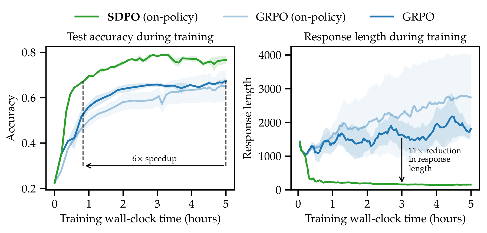

*Figure 6: The x-axis is training time (hours). The left panel shows test accuracy, and the right panel shows response length (in tokens). Green is SDPO, dark blue is GRPO, light blue is the on-policy GRPO, and the shading is the standard error over 3 random seeds. SDPO quickly rises to around 0.8; GRPO's responses grow longer as training goes on, while SDPO's quickly shrink to around two hundred tokens (read off the plot).*

**This setting has a precondition.** The teacher's only reference is "a correct response from the same group", so at least one of the 8 responses in a group must be correct. When all 8 are wrong, SDPO is like GRPO: nothing is learned from this problem in this round (the official code leaves such samples out of the loss). When some are right and some are wrong, GRPO can only take points off each wrong response as a whole, while SDPO can compare against the correct response and find exactly which tokens in a wrong response are at fault. When all 8 are right, GRPO's plus or minus points are all 0; under SDPO's template (which the official code also follows), the teacher still rereads each response with a correct response as reference, so there is still a signal.

**Shorter responses.** On average, SDPO's responses are only about a third as long as GRPO's (Appendix Table 8, both trained on-policy: on average 256 vs 821 tokens for Qwen3-8B, and 344 vs 1,095 tokens for Olmo); for Olmo on chemistry they are about 11× shorter, with higher accuracy too. Looking through GRPO's long responses, the authors find that many of them spin in place: "Hmm" and "Wait" come up again and again, and earlier calculations are repeated verbatim. The example in Figure 7 of the paper is one chemistry problem (estimating the logD of a molecule at pH 7.4, multiple choice with four options), and both responses come from Qwen3-8B after 50 training steps: GRPO writes 5,549 tokens, with 25 "Wait"s, the same calculation $`10^{1.85}\approx 69.3`$ appearing 4 times, and even the line "Wait I'm going in circles", and in the end picks the wrong option; SDPO writes 764 tokens and picks the right one. The authors guess this has to do with per-token scoring: SDPO scores each token separately, while GRPO rewards or penalizes only by whether the whole response is right.

### 6.3 With text feedback: clearly better than GRPO on competitive programming

This is the paper's main battleground: SDPO is 7.6 points above GRPO, and the larger the model, the bigger its lead.

**Main result (Figure 1).** Before training: 27.9%. GRPO ends at 41.2% and SDPO at 48.8%, and SDPO matches GRPO's final score with only about a quarter of the generations. The paper also compares against a public leaderboard: on the same problems, Claude Sonnet 4 scores 40.5% and Claude Opus 4 scores 39.7% (see Section 8 on how to read this comparison). Several other reinforcement learning methods (a GRPO variant that trains only on high-entropy tokens, GSPO, CISPO) land between 37.8% and 41.2%, about the same as GRPO (Appendix Table 9). By LCB's own difficulty levels, the gains come mainly on medium and hard problems. Average accuracy over the first 80 training steps (GRPO vs SDPO): easy problems 90.1% vs 91.7%, medium 37.8% vs 46.6%, hard 11.6% vs 18.9% (Appendix Figure 15).

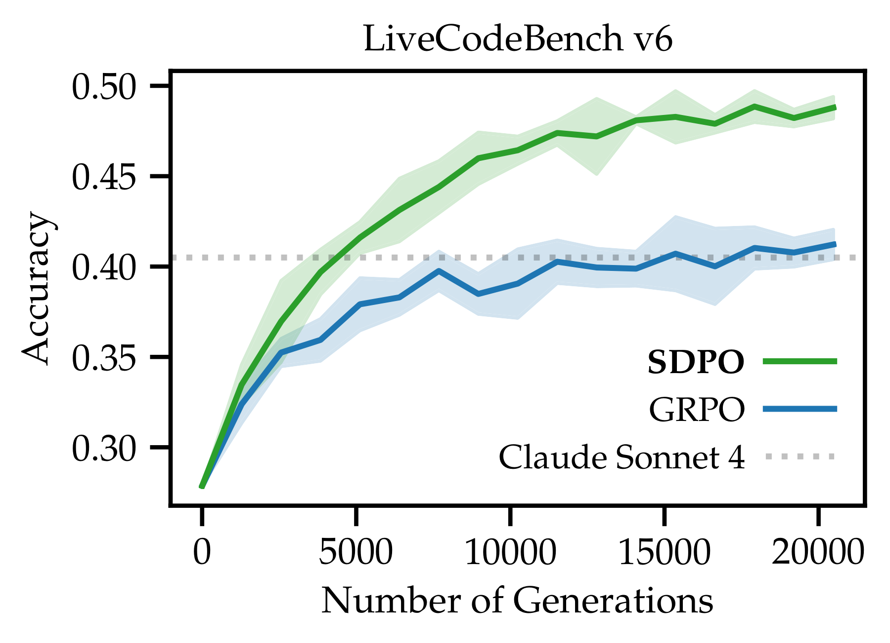

*Figure 1: The x-axis is the cumulative number of generated responses, and the y-axis is accuracy. Green is SDPO, blue is GRPO, the shading is the standard deviation over 3 repeated runs, and the gray dotted line is Claude Sonnet 4's score on the leaderboard.*

**The stronger the model, the bigger the lead (Figure 8, Appendix Figure 17).** Four Qwen3 sizes, 0.6B, 1.7B, 4B and 8B, are each trained for 80 steps: at 0.6B, SDPO is only about 1 point above GRPO; at 8B, it is 7.6 points above. On the earlier Qwen2.5-Instruct series, SDPO is better at 7B, the two are about even at 3B (the paper's main text writes "Qwen2.5-8B" here, which should be a typo; see Section 8), and at 1.5B SDPO is clearly worse than GRPO. The authors' explanation: the teacher finds errors by reading the feedback, which depends on the model's in-context learning ability, and that ability only gets strong as models get larger.

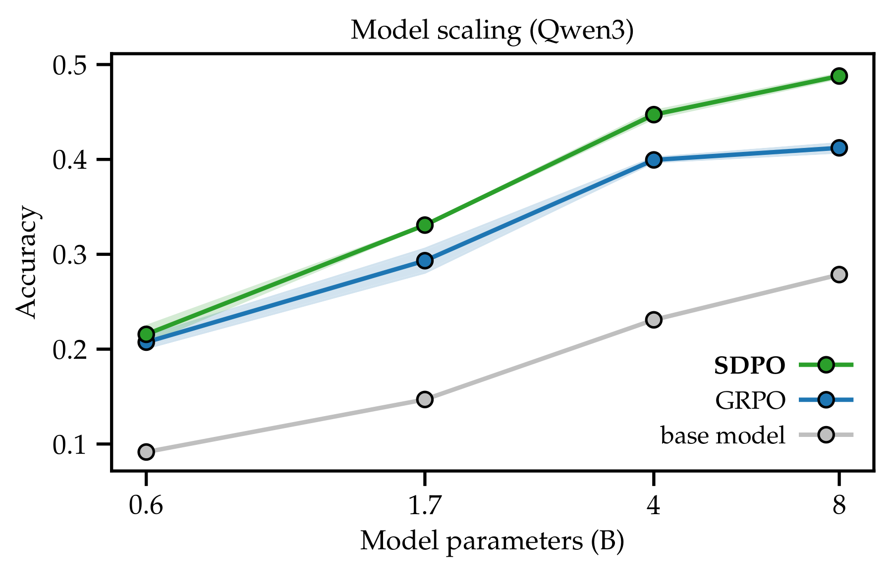

*Figure 8: Validation accuracy at step 80 for the four Qwen3 sizes. Green is SDPO, blue is GRPO, and the gray line is before training.*

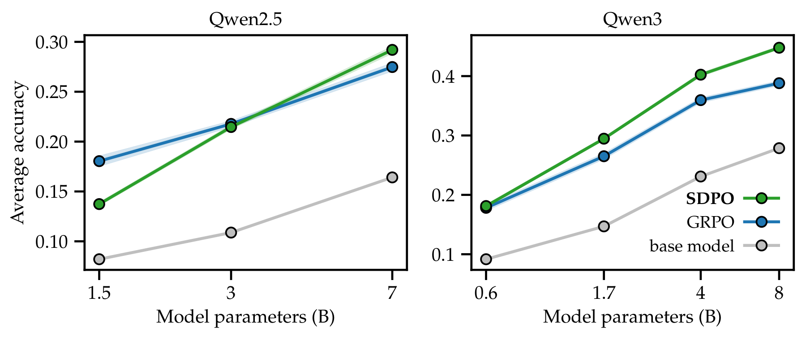

*Appendix Figure 17: Qwen2.5-Instruct on the left, Qwen3 on the right. At 1.5B, the green line (SDPO) is below the blue line (GRPO). The y-axis of this figure is average validation accuracy (up to step 65 for Qwen2.5 and up to step 80 for Qwen3), a different measure from the step-80 accuracy in Figure 8.*

**Where the gains come from: the feedback itself, plus per-token scoring (Figure 10, left).** The authors compare three versions:

- evaluating the top 100 candidate tokens at each position (the full version);
- evaluating only the single most likely token at each position;
- computing each token's score first, then averaging over the whole response into one score, so the whole response is rewarded or penalized alike, as in GRPO.

The result is full version > single token only > one score per response > GRPO. The last comparison shows that **even without per-token scoring, just using the feedback beats GRPO**; per-token scoring adds more on top of that.

**The teacher gets stronger too (Figure 10, right).** The authors have the teacher, given the feedback, generate responses directly, and measure its accuracy: about 42% at the start, rising to about 50% during training. The student starts at about 29% and reaches about 50% by step 80, surpassing the initial teacher (read off the plot). In other words, the student's ceiling is not capped by the initial teacher; teacher and student rise together.

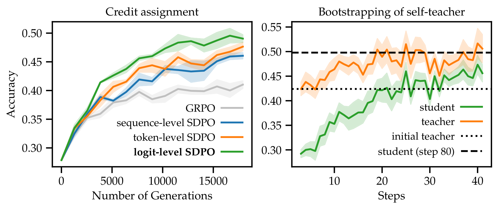

*Figure 10: The left panel compares the three scoring granularities with GRPO, with the cumulative number of generated responses on the x-axis; green is the full version, orange evaluates a single token only, blue is one score per response, and gray is GRPO. The right panel shows the accuracy of the teacher (orange) and the student (green) measured on the current training batch, with training steps on the x-axis; the dotted line is the initial teacher, and the dashed line is the student's score at step 80.*

**Old skills are forgotten somewhat less.** Table 5 of the paper (%):

| Method | Coding (training task) | IFEval | ArenaHard hard prompts | ArenaHard creative writing | MMLU-Pro | Average of the four old skills |
| --- | --- | --- | --- | --- | --- | --- |
| Before training | 27.9 | 83.9 | 14.0 | 13.7 | 62.5 | 43.5 |
| Off-policy self-distillation (SFT) | 42.7 | 83.7 | 11.2 | 8.9 | 61.9 | 41.4 |
| GRPO | 41.2 | 82.2 | 12.0 | 10.8 | 62.3 | 41.8 |
| **SDPO** | **48.8** | 83.2 | 12.3 | 11.1 | 62.9 | 42.4 |

The title of Section 4.4 of the paper is "On-policy self-distillation avoids catastrophic forgetting". Going by the numbers, all three methods lose a little on the old skills, and SDPO loses the least (an average drop of 1.1 points, against 1.7 for GRPO and 2.1 for SFT) while also scoring highest on coding. On creative writing, all three methods drop fairly noticeably.

**Can GRPO and SDPO be mixed (Figure 11)?** The authors add the two kinds of plus or minus points in proportion (with a weight of 0.9 on GRPO). On the smallest model, Qwen3-0.6B, the mix is about 2 points above pure SDPO; on 8B it is instead about 1 point below pure SDPO (read off the plot). The authors' explanation: a small model is not a very reliable teacher, so adding the GRPO signal, which scores by right or wrong, steadies training; once the model is strong enough, the signal that looks only at right or wrong holds it back instead.

**Which feedback helps most.** The authors compare the effect of showing the teacher different content, in Table 6 of the paper (60 training steps):

| What the teacher sees | Accuracy of the teacher's own responses before training | Share of the teacher's responses that get the same error as the student | Student accuracy after training |
| --- | --- | --- | --- |
| Error message only | 32.5% | 13.7% | 39.9% |
| Only a correct response from the same group | 42.4% | 12.1% | 42.6% |
| Both (default: give a correct response if there is one, and the error message only if there is not) | 42.5% | 10.1% | **48.3%** |
| Both, plus the student's original response | 39.3% | 30.0% | 44.5% |

Error messages and correct responses complement each other, and using both works best. With the student's original response also in the teacher's prompt, 30% of the time the teacher gets the same error as the student, which shows it is following the student's approach; the diversity (entropy) of the student's outputs after training drops from 0.38 to 0.23, and the final result also gets worse. The authors add that rewording the template in several ways makes little difference.

### 6.4 Test-time training: solving single hard problems earlier than repeated sampling

**The problem.** A different scenario: there is just one really difficult coding problem, and the goal is to produce passing code as quickly as possible. The paper measures this with discovery@k, meaning "the probability of getting it right at least once within k attempts". Section 6.1 covers how the problems were picked and what the budget is.

There are two common approaches:

- **best-of-k (repeated sampling)**: the model stays the same, makes k independent attempts, and you check whether any one of them is right.
- **Multi-turn revision ("multi-turn" in the paper)**: the error messages from all earlier attempts are put into the prompt, and the model keeps revising. The model's parameters stay the same; only the context grows longer and longer. The version the paper uses includes only the error messages, not the earlier responses, which works much better than including the responses as well (Appendix Figure 19); once the prompt exceeds 32k tokens, the earliest error messages are dropped.

Reinforcement learning that scores by right or wrong cannot help here: until the first correct attempt, every attempt scores 0, so there is no signal to learn from, and the result is the same as repeated sampling. SDPO has an error message to learn from after every failure, so it can start improving before it ever gets the problem right.

**How it works (Figure 12).** In each round, the model answers the problem 16 times, gets the error messages, updates its parameters once with SDPO, and moves on to the next round. The difference from multi-turn revision: multi-turn revision stuffs the history into the context, while SDPO "compresses" the history into the parameters, so the context does not keep growing.

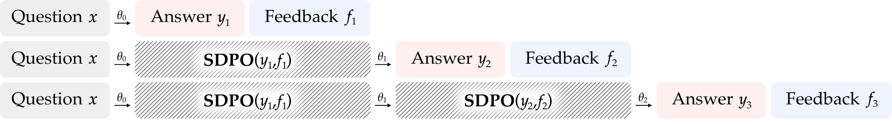

*Figure 12: For the same problem $`x`$, the model answers with parameters $`\theta_0`$ and gets $`y_1`$ and feedback $`f_1`$; from these, SDPO updates the parameters to $`\theta_1`$, the model answers again and gets $`y_2`$ and $`f_2`$, and so on.*

**Results (Figure 13).**

- **9 very hard problems**: when the budget runs out, SDPO's probability of having solved a problem is 53.2%, against 41.5% for repeated sampling and 35.6% for multi-turn revision. To reach a 22% success probability, SDPO needs about 500 attempts and the other two about 1,500 (read off the plot), which is where the abstract's "3× fewer attempts" comes from.
- **19 hard problems**: when the budget runs out, SDPO is at 78%, repeated sampling at 72.3% and multi-turn revision at 68.4%. To reach a 67% success probability, SDPO needs about 2.4× fewer attempts than the other two.
- **Only SDPO solved problem 3.** The other two methods used up all 2,750 attempts without solving it. SDPO solved it as early as attempt 321, that is, after the 20th round of updates; with the count capped at 2,750, its average number of attempts to first success on this problem is 1,987 (Appendix Table 10). Every problem the other two methods solved, SDPO also solved.
- **At first the teacher cannot solve them either.** When the model answers directly after seeing one error message, its accuracy is 0 on 15 of the 19 problems, and below 1% on 16. One round of feedback is not enough to solve a problem, but the issues the teacher points out token by token are enough for SDPO to improve round after round and finally solve it.
- Multi-turn revision fills the context window at attempt 837 on average (hard problems) and attempt 1,007 (very hard problems), after which it can only drop the earliest error messages; this may be why it improves slowly later on.

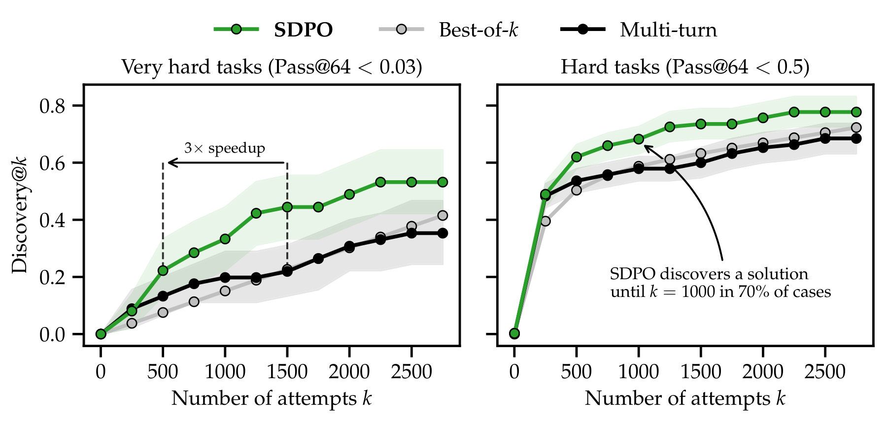

*Figure 13: The 9 very hard problems on the left, the 19 hard problems on the right. The x-axis is the number of attempts, and the y-axis is the probability of getting it right at least once. Green is SDPO, light gray is repeated sampling, black is multi-turn revision; the shading is the 90% confidence interval. The arrow in the left panel marks where the "3× speedup" is measured.*

## 7. Limitations the Authors Acknowledge

- **It depends on the model's own understanding.** Whether the teacher can pinpoint the errors depends on the model's in-context learning ability. So SDPO mainly suits fairly strong base models, and on weak models it may do worse than GRPO (Qwen2.5-1.5B is an example). The largest model tried is only 8B, and the authors also hope to verify it on stronger models.
- **It depends on the quality of the feedback.** If the environment's feedback carries no information, or is even misleading, the model may learn nothing.
- **It adds a little extra computation.** Each step needs one more forward pass of the teacher. This is usually negligible, but on small models with very short generations it takes a larger share.
- **Future directions the authors propose.** Apply it to agent tasks with many steps, where intermediate states are visible; test it in larger-scale multi-task training and on frontier models; extend it to open-ended tasks that have no reference solution, only text comments (alignment, for example); and study systematically how factors such as the teacher template shape the model's reasoning style.

## 8. Points Worth Noticing While Reading

Below are points I noticed while reading the paper that it does not discuss at length, offered for reference.

### How strong the evidence is

- **The coding experiments test on problems the model trained on.** The 131 LCBv6 problems are used for both training and validation, and only the test cases are split: training scores on half of the cases and generates error messages from them, while validation uses all the cases (the official `data/split_tests.py` saves the full data as the validation set, and for each problem keeps a random half of the cases as the training set). So the 48.8% measures "whether the problems trained on pass all their tests, including cases not seen during training", and says nothing about how many new, unseen problems the model can solve. The paper says this is a common setup for programming contests and coding-practice platforms. SDPO and GRPO use the same setup, so the comparison between them is fair; but take care when comparing it with Claude Sonnet 4's 40.5%, because the leaderboard models answer directly and were never trained repeatedly on test feedback from these problems.
- **The "3×" is measured at one particular level.** The abstract's "3× fewer attempts" comes from the 9 very hard problems, at the 22% success-probability level. Switch to "the average number of attempts needed to first solve each problem" (Appendix Table 10, with unsolved runs counted as 2,750), and SDPO is about 1.2× to 1.3× faster than both repeated sampling and multi-turn revision. By the speedup factors in Table 10, out of the 19 problems SDPO is faster than repeated sampling on 10, ties on 2 and is slower on 7; it is slower than multi-turn revision on 8; the largest speedup on a single problem is 13.6×. Counting up to the cap may shrink the gap on the problems that went unsolved, so the 3× figure itself is not wrong; under a different measure, though, the factor is much smaller. Also, there are only 9 and 19 problems, picked because "at least one method solved them", so these success rates hold only for this set of problems.
- **In the coding experiments, the two sides make different numbers of parameter updates.** According to Table 12 of the paper (SDPO's hyperparameters) and the official GRPO coding experiment script (Table 13 of the paper lists only the GRPO settings for Section 3 of the paper), for each batch of generated responses in the coding experiments (32 problems, 8 attempts each), SDPO updates its parameters 32 times and GRPO 4 times, with the same learning rate. The x-axis of Figure 1 is the number of generations, so part of the "about 4× fewer generations" may come from the difference in update counts. Appendix Figure 16 tries several batch sizes, and overall GRPO's curves are still below SDPO's, but the caption does not say how many updates per batch these runs made. Conversely, in the science Q&A and tool-use experiments in Section 3 of the paper, SDPO makes only 1 update per batch and GRPO makes 4, and SDPO still comes out ahead in most cases.
- **Table 3 reports "the best score seen".** Table 3 gives the highest test-set score reached within 5 hours of training, and the hyperparameters were also picked by the same 5-hour score (see the notes to Table 3). SDPO and GRPO are treated the same way, so the comparison is broadly fair, but the absolute numbers lean optimistic. Table 3 also gives no error bars, so several gaps of around 1 point (for example, Qwen3-8B's tool use at 68.5 vs 67.7 and materials at 78.4 vs 77.1) may be within random fluctuation.

### Where it applies

- **The models, tasks and settings are all limited.** All experiments turn off Qwen3's thinking mode, responses are capped at 8,192 tokens, the largest model is 8B, and the only experiments with text feedback use a single coding dataset, LCBv6. The paper does not test whether conclusions such as "shorter responses" hold in long-thinking mode or on larger models.

### Checked against the released code

- **The paper and the code differ in one place; watch for it when reproducing.** Table 2 of the paper says that when the student answers correctly, that response itself is shown to the teacher as the "Correct solution". The official code's default setting (`dont_reprompt_on_self_success=True`) uses another correct response from the same group instead; if it is the only correct one in the group, that sample is left out of training.

### Small issues in the manuscript (none affect the main conclusions)

- **"Qwen2.5-8B" should be a typo.** Section 4.1 of the paper says SDPO beats GRPO on Qwen2.5-7B and is close to GRPO on "Qwen2.5-8B". Qwen2.5 has no 8B version, and in Appendix Figure 17 the size that is close to GRPO is 3B.
- **The numbers differ between v1 and v2.** In v2, the results in Section 3 of the paper changed considerably: the summary in the introduction went from 68.8% vs 64.1% to 70.2% vs 66.6%; Olmo on chemistry went from "matches in 30 minutes, 10× faster, ahead by more than 20 points" to "matches in 50 minutes, 6× faster, ahead by more than 10 points"; the shortening of responses went from "up to 7×" to "up to 11×"; and the scores before training changed too. v2 also fixes an error in v1's gradient formula (explained in the v2 acknowledgments). When citing numbers found online, check which version they come from.

## 9. Summary

SDPO's idea is simple: **after the model gets a problem wrong, show it the error message, let it go back over the response it just wrote and mark it up token by token, then move toward those corrections.** It gets several things at once: it trains on the model's own responses, there is feedback on every token, and it needs neither a stronger external teacher nor a separately trained scoring model; algorithmically, it only replaces GRPO's plus or minus points, so it fits straight into existing training code. It belongs to the same family of ideas as the concurrent OPSD and SDFT, which all make "the model itself, shown some extra information" the teacher; the difference is that what SDPO's teacher sees extra is live feedback from the environment and the correct responses from the same group.

The paper's results: on coding problems that return error messages, it is clearly better than GRPO, and the larger the model, the bigger its lead; on tasks that give only right or wrong, it uses correct responses from the same group as the reference, and it is also better on most tasks, with much shorter responses; when it trains while working on a single very hard problem, it solves the problem earlier overall than repeated sampling and multi-turn revision, though problem by problem it is not faster on every one. The cost is one extra forward pass of the teacher per step, which adds 5.8% to 17.1% to the training time per step. The preconditions are that the model itself is strong enough and the feedback is informative; on weak models it may do worse than GRPO.

---

## Where Things Are in the Paper

| In this note | In the paper |
| --- | --- |
| The problem and motivation, the proposal of RLRF | Section 1, Figures 1, 2 and 3, Table 1 |
| How SDPO works, the teacher's prompt template | Section 2, Eqs. (1) and (2), Figure 4, Algorithm 1, Table 2 |
| Comparison with GRPO, per-token scoring | Sections 2.1 and 4.2, Figure 9, Appendix F.4 Figure 22 |
| Another way to compute the gradient | Appendices A.1 and B.1 |
| Comparison with other approaches and concurrent work | Sections 4.4, 5 and 6 |
| Cost, looking only at the top K candidate tokens | Section 2.2, Figure 5, Appendix A.3 |
| Ways to stabilize the teacher's parameters | Sections 2.3 and 4.3, Table 4, Appendices A.2 and B.2 |
| Experimental setup, hyperparameters, hardware | Sections 3.1, 4 and 5.1, Appendix E, Tables 12 and 13 |
| Experiments without text feedback | Sections 3.2 and 3.3, Table 3, Figures 6 and 7, Appendix D.1 Tables 7 and 8 |
| Main coding results, breakdown by difficulty, other baselines | Section 4, Figure 1, Appendix Figure 15 and Table 9 |
| Model scale | Section 4.1, Figure 8, Appendix Figure 17 |
| Scoring granularity, the teacher getting stronger | Sections 4.2 and 4.3, Figure 10 |
| Forgetting, off-policy self-distillation | Section 4.4, Table 5 |
| Mixing GRPO and SDPO | Section 4.5, Eq. (3), Figure 11 |
| Which feedback helps most | Section 4.6, Table 6 |
| Test-time training | Section 5, Figures 12 and 13, Appendix D.3 Tables 10 and 11, Figure 19 |
| Batch size comparison | Appendix D.2, Figure 16 |
| Limitations and future directions | Section 7 |
