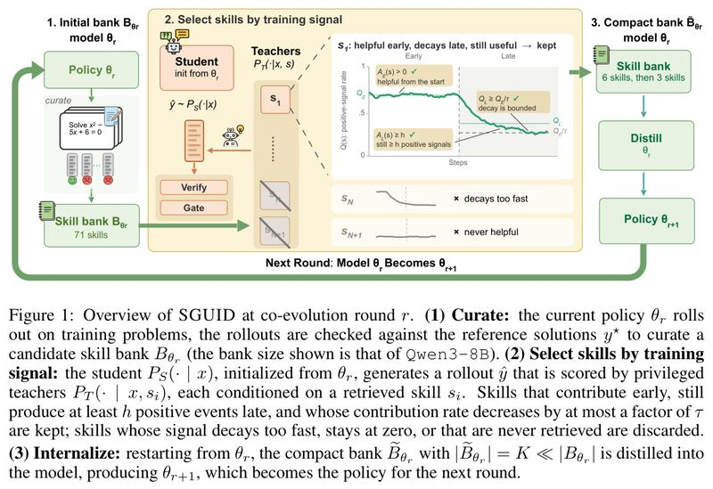
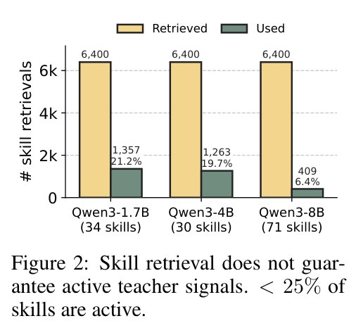
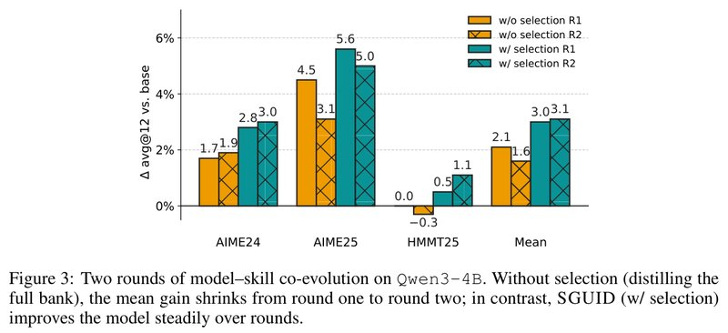

# Which Skill to Distill? SGUID: Selecting a Compact Skill Bank for Model-Skill Co-Evolution（该蒸馏哪项技能？SGUID：为模型与技能的共同进化挑选精简技能库）

中文 | [English](./SGUID-Selecting-a-Compact-Skill-Bank_en.md)

- **原文链接**: [Which Skill to Distill? SGUID: Selecting a Compact Skill Bank for Model-Skill Co-Evolution](https://arxiv.org/abs/2610.12367v1)
- **论文**: [arXiv:2610.12367](https://arxiv.org/abs/2610.12367)
- **发布日期**: 2026-10-08
- **范围**: 按 arXiv v1（2026-10-08 提交，目前只有这一版）写的通俗解读，不是全文翻译。作者是 Yuhan Liu 等 7 人，来自纽约大学（第一作者 Yuhan Liu）和亚马逊（其余六位）。代码暂未公开：论文目前是审稿中的预印本，作者说被接收后会公开代码、总结技能用的提示词和全部候选技能库。

## 一句话版本

先给模型准备一批"解题心得"（论文叫 skill，下文叫技能），再通过训练把这些心得学进模型参数里，是最近出现的一种提升推理能力的做法。这篇论文发现，按"看起来相关"检索出来的技能大多在训练里没起作用：在三个 Qwen3 模型上，只有 6.4%～21.2% 的技能检索真正进入了训练。作者因此主张，挑技能时除了看语义上是否相关，还要看这条技能在训练中是否一直给出方向正确的信号。据此提出的 SGUID（skill Selection GUIded by training Dynamics，根据训练过程中的表现挑技能）先带着全部技能试训一遍，记下每条技能的表现，只留下最好的几条，再回到原来的模型、只用这几条重新训练。变强后的模型再总结新技能、再挑、再学，作者把这个循环叫作模型与技能的共同进化。

效果：在 Olmo-3-7B 和三个 Qwen3 模型上，用 AIME24、AIME25、HMMT25 三套数学竞赛题的平均正确率（每题做 12 次取平均）衡量，只学挑出来的 6 条技能，4 个模型中有 3 个追平或超过学全部技能（每个模型 30～71 条）的效果。用变强后的模型再挑 3 条新技能、训练第 2 轮后，4 个模型全部追平或超过；Qwen3-8B 的平均正确率从原模型的 62.9% 升到 66.3%（第 1 轮后是 64.3%）。在 Qwen3-4B 上，如果不挑选、每轮都学全部技能，第 2 轮的平均提升反而缩小，HMMT25 还比原模型低 0.3 个百分点（下文简称"分"）。

---

## 1. 先认识几个词

| 词 | 大白话 |
| --- | --- |
| 技能（skill） | 一小段写给模型看的解题心得，比如"遇到整除问题先试模运算"。用的时候放进提示词 |
| 技能库（skill bank） | 一批候选技能。本文的技能库由模型自己做训练题、对照标准答案后总结而来，没有借助更强的模型 |
| 解答（rollout） | 模型针对一道题自己写出的一整份回答 |
| 验证器（verifier） | 拿标准答案核对模型的最终答案对不对。数学题可以自动核对 |
| 蒸馏（distillation） | 让"学生"模仿"老师"的输出，把老师的本事学过来 |
| 自蒸馏（self-distillation） | 老师和学生是同一个模型。老师能多看到一些额外信息（论文叫特权信息，例如标准解答或一条技能），学生看不到 |
| on-policy | 训练用的解答是学生自己当场写的，而非别人事先写好的 |
| token | 模型输出文字的最小单位，可以粗略理解成一个词 |
| 共同进化（co-evolution） | 模型学完技能变强后，用新模型总结新一批技能，挑选后再学，一轮轮循环 |
| 思考模式（thinking mode） | 模型先写出一段思考过程，再给最终答案。关掉时直接作答 |
| avg@12 | 每道题让模型做 12 次，取平均正确率 |
| 检查点（checkpoint） | 训练过程中定期保存下来的模型版本 |
| LoRA | 一种省资源的微调方法，只训练少量新增参数 |

## 2. 它想解决什么问题

技能有两种用法。一种是推理时放进提示词，相当于考试带小抄。另一种是训练时把技能学进参数，相当于把小抄背下来，以后考试不用再带（类比是我加的，不是论文原文）。本文研究第二种。

把技能学进参数，本文用的办法是 on-policy 自蒸馏：学生只看题目，自己写解答；老师是同一个模型，但多看一份额外信息，在学生的解答上逐 token 打分。老师多看什么，有两条现成路线：

| 路线 | 老师多看什么 | 问题 |
| --- | --- | --- |
| OPSD（arXiv 2601.18734） | 这道题的标准解答 | 前人发现，带技能的老师给的信号往往更好用 |
| SGSD（arXiv 2605.28791） | 一条按语义相似度检索到的技能 | 技能只按"语义相关"检索，没人检查每条技能到底帮没帮上忙 |

本文就在 SGSD 的基础上改进。SGSD 处理一道训练题的过程是：

1. **学生做题**：学生只看题目，自己写一份解答。
2. **检索技能、请老师**：按题目和技能描述的语义相似度检索技能（论文的设置里每道题配 8 个老师）。每个老师都是"同一个模型 + 一条技能"。
3. **老师逐字打分**：老师逐个 token 读学生的解答，估计"带着这条技能的话，这里写成这样的可能性有多大"，再和学生自己的估计比较。老师估得更高，说明老师更认可这一步。整份解答平均下来，得到这条技能对这份解答的**支持度**。
4. **门槛（Gate）**：支持度的绝对值不超过 0.05，说明老师和学生看法差不多，这条技能等于没开口，这次信号作废。
5. **对答案（Verify）**：用标准答案判断学生做对没有。老师的态度和对错一致（做对了老师支持，做错了老师反对），学生就朝老师靠拢；两者冲突（做对了老师却反对，或做错了老师却支持），就反过来，往远离老师的方向调。

我的理解是：标准答案定方向（做对的解答要加强，做错的要削弱），老师的逐字意见定力度，告诉学生哪些地方该多改、哪些地方少改。

**举个例子**（我编的示意，不是论文里的）：学生做对了一道题，带着"先试模运算"这条技能的老师读完后，比学生自己更认可这份解答，支持度是 0.2。过了门槛，方向也和"做对了"一致，这就是一次有效的训练信号。

**选读：支持度、门槛和对答案的公式。** 不看也不影响理解。设第 $`n`$ 个 token 上老师和学生的对数概率之差为

```math
\Delta_n=\log P_T(\hat y_n\mid x,s,\hat y_{< n})-\log P_S(\hat y_n\mid x,\hat y_{< n})
```

支持度 $`\tilde a`$ 大致是 $`\Delta_n`$ 在整份解答上的平均值（实际计算时会屏蔽无关 token、截掉极端值）。门槛是 $`|\tilde a|>\kappa`$，$`\kappa=0.05`$；对答案是 $`\mathrm{sign}(r\cdot\tilde a)`$，做对时 $`r=+1`$，做错时 $`r=-1`$。

问题出在技能的挑法上。按语义相关检索出来的技能，不一定每条都有用：已有研究在软件工程任务上发现，49 条编程技能里只有 7 条有明显帮助，很多没作用甚至有害（SWE-Skills-Bench，arXiv 2603.15401）。

论文要回答的问题是：**哪些技能值得蒸馏进模型？只蒸馏这些技能，"模型变强、再总结新技能、再学"这个循环能不能一轮轮稳定地转下去？**

## 3. SGUID 的整体流程

图 1 把 SGUID 画成一个三步循环：

1. **总结技能**：让当前模型做训练题，对照标准答案检查，再让模型从这些解答里总结出一批候选技能。
2. **挑技能**：带着全部候选技能试训一遍，边训边记录每条技能的表现，只留下表现最好的几条（第 1 轮 6 条，第 2 轮 3 条）。
3. **学技能**：回到试训之前的模型，只用挑出来的几条技能重新训练，得到新模型。



*图 1：第 r 轮共同进化中 SGUID 的流程，从左到右三块。左边"总结技能"：当前模型 $`\theta_r`$ 在训练题上作答，用标准解答核对这些解答，总结出候选技能库（图中的 71 条是 Qwen3-8B 的库大小）。中间"按训练信号挑技能"：学生从 $`\theta_r`$ 出发写解答，多个老师各带一条检索到的技能给它打分，再经过 Verify（对答案）和 Gate（门槛）两步。中间的曲线是一条被留下的技能 s1：纵轴是贡献率（0～1），横轴是训练步数，竖虚线分开前期和后期；它前期贡献率高，后期降了下来，但没有跌破"前期贡献率除以 τ"那条线，后期有效次数也不少于 h，所以留下；曲线上三个打勾的标注对应第 5.3 节的三条留用规则。下方的 sN 衰减太快，sN+1 从来没帮上忙，都被丢弃；论文图注还说，从没被检索到的技能也丢弃。右边"内化"：从 $`\theta_r`$ 重新出发，把只有 K 条（远少于原库，图中写的是第 1 轮 6 条、第 2 轮 3 条）的精简技能库蒸馏进模型，得到 $`\theta_{r+1}`$，底部箭头表示它成为下一轮的模型。*

新模型回到第 1 步，总结新一批技能，开始下一轮。下面第 4 节先看为什么要挑，第 5 节讲怎么挑、挑完怎么用。

## 4. 为什么要挑：检索到的技能大多在空转

作者在三个 Qwen3 模型上各记录了 6,400 次技能检索，看其中有多少次的信号过了门槛、真正参与了训练：



*图 2：纵轴是技能检索次数。每个模型两根柱子：浅黄色是检索到的次数（都是 6,400），灰绿色是信号过了门槛、真正用于训练的次数。横轴是三个模型，括号里是各自的技能库大小。论文图注的结论是"检索到技能，不等于老师给出了有效信号，不到 25% 的技能是活跃的"；图里统计的其实是检索次数，见下文。*

| 模型 | 技能库大小 | 检索次数 | 用上的次数 | 比例 |
| --- | --- | --- | --- | --- |
| Qwen3-1.7B | 34 条 | 6,400 | 1,357 | 21.2% |
| Qwen3-4B | 30 条 | 6,400 | 1,263 | 19.7% |
| Qwen3-8B | 71 条 | 6,400 | 409 | 6.4% |

我读这组数字时注意到两点：

- 统计单位是检索次数，不是技能条数。摘要和图注说"不到 25% 的技能"给出了有效信号，按图里的统计方式，准确的意思是"不到 25% 的检索产生了足够强的信号"。
- "用上"只表示过了门槛，其中也包括和标准答案冲突、被反过来用的情况。

Qwen3-8B 的比例最低，只有 6.4%，它的技能库也最大（71 条）。作者据此提出设想：既然大部分检索都在空转，只保留少数一直有用的技能也许就够了；判断"有用"，除了看语义相关，还要看模型自己的训练动态。

## 5. SGUID 怎么挑技能

### 5.1 每次检索记一笔

带着全部候选技能正常训练一遍（200 步）。某条技能每被检索到一次、给学生的解答打完分，就记一笔：

| 记分 | 含义 |
| --- | --- |
| +1 | 过了门槛，而且老师的态度和对错一致。算一次**有效贡献** |
| 0 | 信号太弱，没过门槛 |
| −1 | 过了门槛，但老师的态度和对错冲突 |

用公式写就是 $`c=\mathrm{Verify}\times\mathrm{Gate}`$。第 2 节的例子里，学生做对、老师更认可，记 +1。

### 5.2 分前期、后期统计

把训练分成前期和后期，对每条技能分别数三个数：被检索次数 $`N`$、有效贡献次数 $`A`$、贡献率 $`Q=A/N`$。下标 E 表示前期，L 表示后期。

### 5.3 三条留用规则

一条技能要留下，必须同时满足：

```math
A_E(s)>0,\qquad A_L(s)\ge h,\qquad Q_L(s)\ge Q_E(s)/\tau
```

1. **前期有过贡献**：前期至少有一次有效贡献。
2. **后期仍然常有贡献**：后期有效贡献至少 $`h`$ 次（第 1 轮取 $`h=10`$）。次数太少的不算数，避免凭零星几次下结论。
3. **贡献率没掉太多**：后期贡献率至少是前期的 $`1/\tau`$，第 1 轮取 $`\tau=5`$，即五分之一。这条用来淘汰"刚开始有用、后来渐渐没用"的技能。

满足条件的技能按后期有效贡献次数 $`A_L`$ 从高到低排序（次数相同时比 $`Q_L`$），取前 $`K`$ 名：第 1 轮 $`K=6`$，第 2 轮 $`K=3`$。

### 5.4 举个例子

假设第 1 轮试训后，四条技能的统计如下（我编的示意，不是论文里的，数字只为演示规则），规则用第 1 轮的 $`h=10`$、$`\tau=5`$：

| 技能 | 前期：检索 / 有效 → 贡献率 | 后期：检索 / 有效 → 贡献率 | 结果 |
| --- | --- | --- | --- |
| 甲 | 40 / 12 → 30% | 80 / 16 → 20% | 留下：16 ≥ 10，且 20% ≥ 30% ÷ 5 = 6% |
| 乙 | 20 / 10 → 50% | 120 / 11 → 9.2% | 淘汰：后期贡献率低于前期的五分之一（9.2% < 10%） |
| 丙 | 30 / 0 → 0% | 60 / 12 → 20% | 淘汰：前期一次都没帮上忙 |
| 丁 | 10 / 3 → 30% | 30 / 5 → 16.7% | 淘汰：后期有效次数太少（5 < 10） |

注意乙：它后期的有效次数（11 次）达到了 10 次的要求，只是贡献率从 50% 掉到了 9.2%，属于"衰退太快"。第 6.5 节会看到，混进两条这类技能，平均分就掉了 2.8 分。

### 5.5 挑完之后：回到起点重新训练

挑出 K 条技能后，SGUID 不在试训过的模型上接着训，而是回到试训之前的模型 $`\theta_r`$，只用这 K 条技能重新训练 200 步，得到 $`\theta_{r+1}`$。论文附录 A 写明，这次训练会检索全部 K 条技能，每道题配 K 个老师（第 1 轮 6 个，第 2 轮 3 个），也就是说挑出来的技能每道题都会用上。

所以每一轮其实要训练两次：一次带全部技能试训，用来挑；一次带挑出的技能正式训练。

### 5.6 第 2 轮：模型和技能一起进化

拿新模型 $`\theta_{r+1}`$ 重新做训练题，总结出一批新的候选技能，用同样的规则挑出 3 条，再从 $`\theta_{r+1}`$ 出发训练一轮，得到 $`\theta_{r+2}`$。第 2 轮只学新挑的 3 条。

模型变强，总结出新技能；挑选后学进模型，模型再变强。作者把这个循环叫作模型与技能的**共同进化**（co-evolution）。

第 2 轮只留 3 条，作者的理由是：第 1 轮学完后，训练统计显示还能持续给出信号的技能变少了。作者强调 K 是事先定好、所有模型共用的，没有按模型或测试成绩调过；挑选用的阈值也只参考训练中的统计。

## 6. 实验结果

### 6.1 实验怎么设计的

- **模型**：Olmo-3-7B、Qwen3-1.7B、Qwen3-4B、Qwen3-8B。
- **训练题**：DAPO-Math-17K 数学题集。
- **测试**：AIME24、AIME25、HMMT25 三个数学竞赛题集，每题做 12 次取平均（avg@12），再算三个题集的平均分。
- **对比方法**：
  - 原模型：不做任何训练。
  - GRPO：常见的强化学习，只看最终答案对不对，给整份解答打一个分。
  - OPSD：自蒸馏，老师看标准解答。
  - SGSD：自蒸馏，老师看检索到的技能，用全部技能库（Olmo-3-7B 38 条、Qwen3-1.7B 34 条、Qwen3-4B 30 条、Qwen3-8B 71 条）。
  - SGUID 第 1 轮（6 条），以及第 2 轮（在第 1 轮的模型上再学 3 条新技能）。
- **训练设置**：每种方法训练 200 步，用 LoRA 微调，4 块 H200 GPU。训练时学生关闭思考模式，老师开启思考模式；蒸馏类方法的学生每份解答最多写 1,024 个 token（GRPO 是 16,000 个）。测试时开启思考模式。
- **报告方式**：在 200 步里，挑三个测试集平均分最高的检查点来报告。

### 6.2 主要结果：只学 6 条基本够用，第 2 轮后全部追平或超过

论文表 1 的平均分（AIME24、AIME25、HMMT25 三项 avg@12 的平均，%），括号里是全部技能的条数：

| 模型（全部技能条数） | 原模型 | GRPO | OPSD | SGSD（全部技能） | SGUID 第 1 轮（6 条） | SGUID 第 2 轮（再学 3 条） |
| --- | --- | --- | --- | --- | --- | --- |
| Olmo-3-7B（38 条） | 39.8 | 40.6 | 33.6 | 40.0 | 40.9 | **41.3** |
| Qwen3-1.7B（34 条） | 36.4 | 36.9 | 41.9 | **43.0** | 42.3 | **43.0** |
| Qwen3-4B（30 条） | 62.1 | 62.7 | 64.3 | 64.2 | 65.1 | **65.2** |
| Qwen3-8B（71 条） | 62.9 | 63.4 | 65.3 | 63.9 | 64.3 | **66.3** |

*每种方法报告的都是 200 步训练里三个测试集平均分最高的检查点。SGSD 沿用其原论文的技能库。每行最高分加粗。各轮挑出的技能列在论文附录 B。*

怎么读这张表：

- **第 1 轮，6 条技能基本够用**：和学全部技能的 SGSD 比，Olmo-3-7B 高 0.9 分，Qwen3-4B 高 0.9 分，Qwen3-8B 高 0.4 分，只有 Qwen3-1.7B 低 0.7 分。在 Olmo-3-7B 和 Qwen3-4B 上，三个测试集分开看也都比 SGSD 高。全部技能最多是 6 条的 11 倍多（Qwen3-8B 有 71 条）。
- **第 2 轮再学 3 条**：4 个模型都追平或超过 SGSD，也都超过 OPSD。
- **大模型上，技能多了反而添乱**：在 Qwen3 系列里，模型越大，SGSD 相对 OPSD 的优势越小。Qwen3-1.7B 上 SGSD 比 OPSD 高 1.1 分，Qwen3-4B 上两者几乎一样（64.2% 对 64.3%），Qwen3-8B 上 SGSD 反而低 1.4 分，只比原模型高 1.0 分。作者的解释是：老师只看标准解答就已经够强时，从一大堆未经筛选的技能里检索出来的内容更像噪声。SGUID 第 1 轮在 Qwen3-8B 上仍比 OPSD 低 1.0 分，第 2 轮升到 66.3%，反超 OPSD 1.0 分。作者据此认为，问题出在老师带的是哪些技能，而不是"带技能"这种做法本身。
- **GRPO 提升很小**：只比原模型高 0.5～0.8 分。作者认为原因是 GRPO 只按整份解答的对错给一个分，信号太稀疏；OPSD、SGSD 和 SGUID 的信号能落到每个 token 上。
- **Olmo-3-7B 上 OPSD 反而退步**：比原模型低 6.2 分（33.6% 对 39.8%），论文没有分析原因。

论文表 1 的分项成绩（avg@12，%）：

| 模型 | 方法 | 技能条数 | AIME24 | AIME25 | HMMT25 | 平均 |
| --- | --- | --- | --- | --- | --- | --- |
| Olmo-3-7B | 原模型 | – | 53.1 | 39.4 | 26.9 | 39.8 |
| | GRPO | – | 53.6 | 42.5 | 25.8 | 40.6 |
| | OPSD | – | 42.5 | 37.5 | 20.8 | 33.6 |
| | SGSD | 38 | 54.4 | 41.1 | 24.4 | 40.0 |
| | SGUID 第 1 轮 | 6 | 55.0 | 42.2 | 25.6 | 40.9 |
| | SGUID 第 2 轮 | 3 | 55.0 | 42.8 | 26.1 | 41.3 |
| Qwen3-1.7B | 原模型 | – | 50.6 | 35.6 | 23.1 | 36.4 |
| | GRPO | – | 49.2 | 36.9 | 24.7 | 36.9 |
| | OPSD | – | 56.4 | 41.7 | 27.5 | 41.9 |
| | SGSD | 34 | 55.6 | 46.1 | 27.2 | 43.0 |
| | SGUID 第 1 轮 | 6 | 55.3 | 43.1 | 28.6 | 42.3 |
| | SGUID 第 2 轮 | 3 | 56.9 | 43.3 | 28.9 | 43.0 |
| Qwen3-4B | 原模型 | – | 73.9 | 65.8 | 46.7 | 62.1 |
| | GRPO | – | 76.1 | 66.7 | 45.3 | 62.7 |
| | OPSD | – | 77.8 | 68.9 | 46.1 | 64.3 |
| | SGSD | 30 | 75.6 | 70.3 | 46.7 | 64.2 |
| | SGUID 第 1 轮 | 6 | 76.7 | 71.4 | 47.2 | 65.1 |
| | SGUID 第 2 轮 | 3 | 76.9 | 70.8 | 47.8 | 65.2 |
| Qwen3-8B | 原模型 | – | 77.5 | 67.2 | 43.9 | 62.9 |
| | GRPO | – | 76.9 | 68.1 | 45.3 | 63.4 |
| | OPSD | – | 78.1 | 69.7 | 48.1 | 65.3 |
| | SGSD | 71 | 77.2 | 67.2 | 47.2 | 63.9 |
| | SGUID 第 1 轮 | 6 | 75.3 | 71.9 | 45.6 | 64.3 |
| | SGUID 第 2 轮 | 3 | 78.3 | 73.9 | 46.7 | 66.3 |

*"技能条数"是老师能检索的技能数。第 2 轮的 3 条是新挑的，此时模型已经学过第 1 轮的 6 条。*

### 6.3 不挑选的话，第 2 轮的提升会缩水

作者在 Qwen3-4B 上做了对照：一组每轮都学全部候选技能（不挑选；从数字看，它的第 1 轮就是表 1 里的 SGSD），另一组每轮用 SGUID 挑选。两组都做两轮。



*图 3：Qwen3-4B 上两轮共同进化。纵轴是相对原模型的 avg@12 提升（分），横轴是 AIME24、AIME25、HMMT25 和三项平均。橙色是不挑选（每轮蒸馏全部技能），青绿色是 SGUID 挑选；实心柱是第 1 轮，带交叉线的是第 2 轮。论文图注的说法是：不挑选时，平均提升从第 1 轮到第 2 轮缩小；SGUID 则随轮次稳步提升模型。"稳步"的实际幅度见第 8 节。*

- **不挑选**：平均提升从第 1 轮的 +2.1 分降到第 2 轮的 +1.6 分。主要是 AIME25 的提升从 4.5 分降到 3.1 分，HMMT25 从持平变成比原模型低 0.3 分。
- **挑选**：平均提升第 1 轮 +3.0 分，第 2 轮 +3.1 分。HMMT25 的提升从 0.5 分涨到 1.1 分。

作者的解读是：挑选不只是把技能库变小，它还在每轮之前滤掉过时、重复或互相冲突的技能，这样多轮进化才稳得住。

### 6.4 只用前 25 步的统计来挑：1.7B 上可行，4B 上不太可靠

默认做法要先带着全部技能完整试训 200 步，成本不低。作者试了只看前 25 步的统计来挑。论文表 2（三项平均 avg@12，%）：

| 模型 | 原模型 | 用 200 步的统计挑（默认） | 只用前 25 步的统计挑 |
| --- | --- | --- | --- |
| Qwen3-1.7B | 36.4 | 42.3 | 42.5 |
| Qwen3-4B | 62.1 | 65.1 | 63.4 |

*论文表注的结论是：25 步的近似在 Qwen3-1.7B 上和完整版相当，在 Qwen3-4B 上不太可靠。*

在 Qwen3-1.7B 上，25 步挑出的技能甚至略好（高 0.2 分）。在 Qwen3-4B 上则低了 1.7 分，其中 AIME24 只有 72.5%，比原模型（73.9%）还低。作者的结论是：训练早期的统计有参考价值，但想在很早的阶段就可靠地挑出技能，还需要以后继续研究。

### 6.5 留 4～12 条都行，"不能衰退"那条规则不能去掉

技能库该精简到什么程度？论文表 3 在 Qwen3-4B 第 1 轮上比了不同的留用条数（avg@12，%）：

| 设置 | AIME24 | AIME25 | HMMT25 | 平均 |
| --- | --- | --- | --- | --- |
| 原模型 | 73.9 | 65.8 | 46.7 | 62.1 |
| OPSD | 77.8 | 68.9 | 46.1 | 64.3 |
| SGSD（全部 30 条） | 75.6 | 70.3 | 46.7 | 64.2 |
| 留 2 条 | 76.9 | 69.4 | 43.6 | 63.3 |
| 留 4 条 | 75.6 | 70.8 | 46.9 | 64.4 |
| 留 6 条（默认） | 76.7 | 71.4 | 47.2 | **65.1** |
| 留 12 条 | 75.8 | 68.9 | 49.2 | 64.6 |
| 留 6 条，去掉"贡献率不能掉太多" | 73.3 | 67.8 | 45.8 | 62.3 |

*最后一行同样留 6 条，但只按后期有效次数排名，去掉了"后期贡献率不低于前期的 1/τ"这条规则。平均分最高的加粗。*

- 留 4、6、12 条都追平或超过 SGSD。默认的 6 条最好，比原模型高 3.0 分。所以 K 不需要调得很精确。
- 只留 2 条时不如 SGSD，主要掉在 HMMT25（43.6%，比原模型还低 3.1 分）。作者认为技能太少，能覆盖的题型就不够。
- 去掉"不能衰退"规则后，会混进两条贡献率在前后期之间骤降的技能。平均分掉到 62.3%，比默认低 2.8 分，只比原模型高 0.2 分。作者的结论是：前期好用还不够，学生变强之后还得一直有用。
- 作者说明，这组实验是事后在单个模型上做的检查，K=6 并不是根据它定的。

### 6.6 留哪 6 条有影响：排名最前的平均分最高

论文表 4（Qwen3-1.7B，固定只留 6 条，avg@12，%）：

| 挑法（都留 6 条） | AIME24 | AIME25 | HMMT25 | 平均 |
| --- | --- | --- | --- | --- |
| 原模型 | 50.6 | 35.6 | 23.1 | 36.4 |
| SGSD（全部 34 条） | 55.6 | 46.1 | 27.2 | 43.0 |
| 排名最前的 6 条 | 55.3 | **43.1** | **28.6** | **42.3** |
| 随机 6 条 | 54.1 ± 0.8 | 42.6 ± 1.2 | 26.9 ± 0.9 | 41.2 ± 0.9 |
| 排名最后的 6 条 | **55.6** | 42.8 | 26.1 | 41.5 |

*只改变留哪 6 条：排名最前、随机（换 3 个随机种子各挑一次）、排名最后。论文注明这组用来对比的挑法都训练 100 步（排名最前那一行是不是也只训练了 100 步，有疑问，见第 8 节）。原模型和 SGSD 两行作为参考。每一栏加粗的是三种挑法里的最高分。*

这里的排名是在通过三条规则的候选技能之间排的。

- 排名最前的 6 条平均分最高，离用全部 34 条的 SGSD 只差 0.7 分。
- 随机 6 条和排名最后的 6 条成绩接近，平均分都不如排名最前的 6 条。作者据此认为，提升来自留下了哪些技能，而不只是技能库变小了。
- 换个角度看（这是我的看法，论文没有做这个比较）：三种挑法都比原模型高 4.8～5.9 分，彼此只差 1 分左右。作为参照，表 1 里完全不用技能、老师只看标准解答的 OPSD 在这个模型上也有 41.9%。这提示：相对原模型的提升，大部分可能来自自蒸馏这种训练方式本身，挑哪些技能主要影响最后 1 分左右（两边训练步数可能不同，只能粗略比较）。

### 6.7 挑出来的技能：多是通用方法，也有很窄的结论

论文附录 B 列出了每个模型每一轮挑中的技能。以 Qwen3-4B 第 1 轮的 6 条为例（中文是意译）：

| 技能 | 内容 |
| --- | --- |
| 化简表达式 | 用代数技巧、因式分解或数论，把复杂的表达式或比值拆成简单部分 |
| 把条件翻译成代数 | 把几何、数论或组合条件写成方程或代数式，以便解出变量或找到关系 |
| 利用对称性 | 计数时除以对称群的阶，去掉等价的重复排列 |
| 约束下求最值 | 分析变量关系、奇偶性或整数性质，求最大最小值或缩小讨论范围 |
| 验算 | 把候选答案代回原条件或边界情况检验 |
| 角度与比例分析 | 用三角恒等式或向量比例关系处理角度、方向和比值 |

这些大多是通用的解题方法。我注意到，其他模型的技能里也有很窄、像是从某一道题里直接总结出来的结论，例如：

- Qwen3-1.7B 第 1 轮的"勾股数生成"：用整数参数 m > n 生成本原勾股数，并验证面积与周长之比。
- Qwen3-1.7B 第 1 轮的"奇偶平衡计数"：奇数和偶数元素个数相等时，最少交换次数是元素总数的一半。
- Olmo-3-7B 第 2 轮的"平面三角剖分与边计数"：凸 n 边形的三角剖分中，内部三角形个数的最大值是 T = 2n − 4。

最后一条的说法其实有误；选中的技能之间也可能高度重叠。这两点见第 8 节。

## 7. 作者自己承认的局限

- **只测了单轮数学推理。** 作者预计方法能推广到多轮的智能体任务，但没有验证。
- **没研究推理时直接用技能。** 论文只研究了技能在训练时当老师的作用，没研究推理时把技能直接放进提示词有没有用。SGSD 的论文（arXiv 2605.28791）发现，推理时给原模型加上蒸馏用过的技能，反而可能降低成绩；作者猜测原因是训练和测试条件不一致：训练时学生关闭思考模式、最多只写 1,024 个 token。另一项研究（arXiv 2604.01348）则发现推理时加数学技能有帮助。作者把"对训练和推理都有用的技能"的共同进化留给以后。
- **早挑省钱的办法还不稳。** 只看前 25 步就挑技能的省钱办法，在不同大小的模型上表现不稳定（论文第 5 节，本文第 6.4 节）。

## 8. 读的时候值得留意的地方

以下是我读原文时注意到、论文没有重点讨论的点，供参考。

### 证据有多强

- **在测试集上挑检查点。** 每种方法报告的都是 200 步里 AIME24、AIME25、HMMT25 平均分最高的检查点，而这三套题就是测试题。这是沿用 SGSD 的设置，对所有方法一视同仁，但分数会偏乐观，偶然的波动也会被放大。
- **差距很小，没有报告波动范围。** 这三套题通常各有 30 道，合起来 90 道。平均分差 1 分，大约相当于 90 道题里多做对 1 道。SGUID 第 1 轮和 SGSD 的差距在 −0.7～+0.9 分之间，主结果都没有给出多次运行的波动范围。可以参照的是表 4（第 6.6 节）：随机挑 6 条、换 3 个种子，平均分的波动（±）就有 0.9 分，其中既有技能不同带来的差异，也有训练本身的随机性。
- **第 2 轮多训练了一轮，算力也没比较。** SGUID 第 2 轮的模型先后训练了两个 200 步，表 1 里其他方法只训练了一个 200 步，所以第 2 轮的优势有一部分可能来自训练得更多。图 3 中"不挑选也做两轮"的对照能部分排除这个因素，但只在 Qwen3-4B 上做过。另外，每一轮都要先试训、再正式训练，两轮共 4 次训练，论文没有和对比方法比较计算量。
- **"稳步提升"的幅度。** 图 3 里挑选组第 2 轮相对第 1 轮，平均提升只从 3.0 分变成 3.1 分，AIME25 还从 5.6 分降到 5.0 分。说"保住了第 1 轮的提升"比说"稳步提升"更贴切；不挑选组则退了 0.5 分。
- **表 4 的训练步数没说清。** 表 4 里"排名最前的 6 条"那一行和表 1 中训练 200 步的结果一模一样，而表注写的是对照组训练 100 步，论文没说清两边训练步数是否相同。如果对照组只训练了 100 步，这组比较就不完全公平。

### 适用范围

- **补充实验覆盖面窄。** 图 3 和表 3 只用了 Qwen3-4B，表 4 只用了 Qwen3-1.7B。

### 挑选规则不看技能内容

- **规则只看训练信号。** SGUID 的规则只看一条技能当老师时给出的训练信号，不检查技能内容对不对，也不检查和别的技能重不重复。论文没有讨论这会带来什么后果，附录里能找到下面两个例子。
- **内容有错也可能被选中。** 第 6.7 节最后一条（Olmo-3-7B 第 2 轮的"平面三角剖分与边计数"）说法有误。它说最大值是 2n − 4，可凸 n 边形只用顶点连对角线做三角剖分，不管怎么剖，都恰好得到 n − 2 个三角形。比如正方形只能剖成 2 个三角形，这条技能的公式却给出 4 个。这一轮 Olmo-3-7B 的平均分仍从 40.9% 升到 41.3%，论文没有分析这条错误技能的影响。
- **选中的技能可能高度重叠。** Qwen3-8B 第 2 轮选中的 3 条分别是"分类讨论""组合计数""组合分析"，内容都是在约束下系统地数情况。作者说挑选能滤掉重复的技能，但规则本身并不比较技能之间的相似度。不过，正是这一轮把 Qwen3-8B 从 64.3% 提到了 66.3%，所以重叠不一定有害。

### 稿件里的小问题（不影响主要结论）

- **第 2 轮的设置没交代全。** 附录只给出第 1 轮的阈值（h=10、τ=5），没有列出第 2 轮的取值；前后期的分界写作"75 / 100"，也没有解释具体含义。

## 9. 和相关工作的关系

论文第 6 节把相关工作分成两类：一类维护技能库，大多是为固定的模型在推理时优化技能库；另一类用自蒸馏把技能学进参数。SGUID 两头都沾：它也维护技能库，但挑出的技能要学进参数，学完的模型再总结下一轮的技能库。和 SGSD 比，它把关注点从"每次打分怎么用"转到"整个技能库留哪些"。下表列出文中讨论到的论文：

| 方向 | 论文 | 和本文的关系 |
| --- | --- | --- |
| 技能蒸馏 | SGSD（arXiv 2605.28791） | 本文直接改进的方法，"门槛"和"对答案"两步都来自它 |
| 技能蒸馏 | Skill-SD（arXiv 2604.10674） | 把技能当作老师的额外上下文，用在多轮智能体任务上 |
| 自蒸馏 | OPSD（arXiv 2601.18734） | 老师看标准解答的自蒸馏，本文的对比方法 |
| 自蒸馏 | Reinforcement Learning via Self-Distillation（arXiv 2601.20802） | 用环境反馈等额外信息当老师的上下文 |
| 自蒸馏 | On-Policy Distillation of Language Models（ICLR 2024，arXiv 2306.13649） | on-policy 蒸馏的早期工作：在学生自己写的解答上向老师学习 |
| 技能效果评测 | SWE-Skills-Bench（arXiv 2603.15401） | 发现 49 条编程技能里只有 7 条有明显帮助 |
| 技能效果评测 | SkillsBench（arXiv 2602.12670） | 技能效果因任务和模型而异，精简聚焦的技能可以胜过大而全的技能包 |
| 推理时用技能 | Procedural Knowledge at Scale Improves Reasoning（arXiv 2604.01348） | 发现推理时加上数学技能有帮助 |
| 对比方法 | DeepSeekMath（arXiv 2402.03300） | 对比方法 GRPO 的出处 |

## 10. 总结

论文结论的第一句话概括了全文：**检索决定老师能看到哪些技能，但不决定哪些技能真正在教。** SGUID 据此带着全部技能试训一遍，留下前期有用、后期仍常有用、贡献率没掉太多的技能，取前几名，再回到原来的模型重新训练；学完的模型再总结新技能，开始下一轮。

证据方面：在三个 Qwen3 模型上，按语义检索到的技能，约 79%～94% 的检索没有产生足够强的训练信号。只学 6 条技能，4 个模型中有 3 个追平或超过学几十条的效果；再挑 3 条做第 2 轮后，4 个模型全部追平或超过。在 Qwen3-4B 上做两轮进化时，不挑选的话第 2 轮后反而不如第 1 轮后，挑选则能保住提升。代价是每一轮都要训练两次，先试训挑技能，再正式训练。相对 SGSD 的提升多在 1 分上下，又是在测试集上挑的检查点、没有报告波动范围，这些结论还需要更多实验来确认。

---

## 原文位置对照

| 本文内容 | 论文位置 |
| --- | --- |
| 问题和动机 | 摘要，第 1 节 |
| 技能库、自蒸馏、SGSD 的门槛和对答案 | 第 2.1～2.3 节，式 (1)～(9) |
| SGUID 整体流程 | 第 3 节开头，图 1 |
| 检索到的技能大多没用上 | 第 3 节 Motivation 一段，图 2 |
| 记分、前后期统计、三条留用规则 | 第 3 节 Skill Selection 一段，式 (10)(11) |
| 回到起点重新训练、第 2 轮 | 第 3 节 Skill Internalization and Evolution 一段，式 (12)(13) |
| 实验设置、K 的选法 | 第 4.1 节，附录 A 表 5 |
| 主要结果 | 第 4.2 节，表 1 |
| 不挑选的两轮对照 | 第 5 节，图 3 |
| 只用前 25 步的统计来挑 | 第 5 节，表 2 |
| 留几条、去掉"不能衰退"规则 | 第 5 节，表 3 |
| 排名最前、随机、排名最后 | 第 5 节，表 4 |
| 挑出来的技能 | 附录 B，表 6～9 |
| 作者承认的局限 | 第 8 节；早挑的办法见第 5 节 |
| 相关工作 | 第 1、6 节 |
| 总结 | 第 7 节 |
